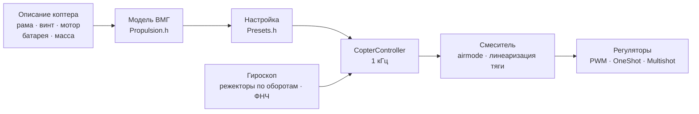

# COPTER.md — прошивка для мультикоптеров

Та же прошивка, те же платы (Matek H743-WING V3, DevEBox H743), те же
датчики и приёмники — но вместо самолёта квадрокоптер, гекса, окта, Y6
или X8. Главное отличие от Betaflight, INAV и ArduPilot — **PID, фильтры,
холостые и расходы не подбираются руками**: вы описываете коптер (раму,
винты, моторы, батарею, массу), а прошивка по физической модели выводит
настройку сама — и сама же подстраивается в полёте под то, что модель
угадала неточно.

> **Честно.** Коптерная прошивка пока проверена только в симуляторе
> (модель с 6 степенями свободы, 12 сборок × 3 варианта «не той» физики)
> и сборкой под платы. В воздухе она ещё не была. Утверждать, что она
> летает лучше Betaflight или ArduPilot, можно будет только после лётных
> испытаний — до них это цель, а не факт.

## Как это работает



1. **Модель винтомоторной группы** (`copter/Propulsion.h`): мотор с
   противо-ЭДС и сопротивлением обмотки (из KV и объёма статора), тяга
   и момент винта (из диаметра, шага и числа лопастей), инерция ротора с
   винтом. Для 5" 2207 1950KV на 6S модель даёт ~28 тыс. об/мин, ~1.6 кг
   тяги и ~45 А на полном газе — как на стендах.
2. **Что из неё следует** (`copter/Presets.h`): газ висения, обороты на
   холостых/висении/полном газе, запаздывание мотора τ, моменты инерции
   рамы, тяговооружённость, ток.
3. **Контур угловой скорости** выбирается по частотной характеристике:
   мотор, фильтры, режекторы, задержка цикла и регулятора — всё в модели.
   Частота среза — наибольшая, при которой запас по фазе 50° (рысканье 55°)
   и **запас по усилению 12 дБ**: настройка выдерживает коптер, у которого
   тяга и инерция вдвое «не те». Доля D подбирается перебором — та, при
   которой контур шире всего. Из частоты среза — P, I, D и упреждение (FF).
4. **Поправка усиления по газу (TPA)** — из той же модели: на малом газе
   мотор слабее отвечает, на большом — сильнее.
5. **В полёте** прошивка сама учит газ висения (тяжелее батарея, подвес)
   и подстраивает режекторы под обороты.

## Каталог сборок

| Сборка | Рама | Винт · мотор · батарея | Масса | Тяга/вес | Висение | Полоса контура |
|---|---|---|---|---|---|---|
| `whoop65` | Quad X 65 мм | 31 мм ×4 · 0702 23000KV · 1S | 22 г | 4.2 | 31 % | 16 Гц |
| `whoop75` | Quad X 75 мм | 40 мм ×4 · 0802 19000KV · 1S | 32 г | 4.3 | 27 % | 16 Гц |
| `toothpick25` | Quad X 115 мм | 2.5" · 1103 8000KV · 3S | 70 г | 12.1 | 8 % | 14 Гц |
| `micro3` | Quad X 140 мм | 3" · 1404 4500KV · 4S | 190 г | 8.3 | 15 % | 14 Гц |
| `cinewhoop3` | Quad X 150 мм | 3" 5-лоп. · 1504 3600KV · 4S | 330 г | 4.1 | 32 % | 16 Гц |
| `freestyle5` | Quad X 225 мм | 5.1" · 2207 1950KV · 6S | 680 г | 9.0 | 15 % | 13 Гц |
| `race5` | Quad X вытянутый | 5.1" · 2306 2000KV · 6S | 560 г | 10.8 | 11 % | 12 Гц |
| `longrange7` | Quad X 315 мм | 7" · 2806.5 1300KV · 6S | 1.0 кг | 7.0 | 20 % | 11 Гц |
| `heavy10` | Quad X 450 мм | 10" · 3115 900KV · 6S | 2.2 кг | 6.6 | 25 % | 10 Гц |
| `cinelifter8` | X8 380 мм | 8" · 2812 1100KV · 6S | 3.5 кг | 6.4 | 23 % | 11 Гц |
| `hex13` | Hex X 700 мм | 13" · 3510 600KV · 6S | 4.0 кг | 3.7 | 35 % | 8 Гц |
| `hex15` | Hex X 900 мм | 15" · 4114 400KV · 6S | 6.0 кг | 3.0 | 45 % | 8 Гц |

Рамы: Quad X, X вытянутый, H, Deadcat, «+», Hex X/+, Y6, Octo X/+, X8.
Нумерация моторов — как в Betaflight (квадро: 1 — задний правый,
2 — передний правый, 3 — задний левый, 4 — передний левый), пропеллеры
внутрь или наружу. Стили полёта — в помещении, фристайл, гонки, съёмка,
дальние, грузовой: от них зависят расходы и наибольший наклон.

## Свой коптер

`include/config/CopterConfig.h`:

```cpp
#define COPTER_BUILD "freestyle5"     // ближайшая сборка из каталога
constexpr float MASS_G = 742;          // взвесить с батареей — главное
constexpr float PROP_DIAMETER_IN = 5.1f, PROP_PITCH_IN = 3.6f;
constexpr float MOTOR_KV = 2150;       // 0 — как в сборке
constexpr copter::EscProtocol ESC_PROTOCOL = copter::EscProtocol::ONESHOT125;
```

Сборку можно выбрать и флагом: `-D COPTER_BUILD=\"race5\"`. После
прошивки клавиша `t` в консоли покажет, что вывелось, и предупредит, если
что-то не так: тяги мало, мотор не тянет этот винт, соседние винты
задевают, висит выше 60 % газа, моторы крутятся быстрее половины частоты
цикла.

## Прошивка и первый запуск

```bash
pio run -e matek-h743-quad -t upload          # Matek H743-WING V3: кнопка BOOT + USB
pio run -e stm32h743-devebox-quad -t upload   # DevEBox H743
```

Выходы на моторы — по порядку: Matek — S1…S8, DevEBox — PA0–PA3, PD14,
PD15, PE9. **Первый запуск — без пропеллеров**, монитор порта 115200:

| Клавиша | Что делает |
|---|---|
| `t` | настройка: тяга, висение, обороты, τ мотора, фильтры, полоса и запасы контура, P/I/D/FF, расходы, предупреждения |
| `m` | проверка моторов: просит подтвердить `y` (пропеллеры сняты!), крутит каждый по 2 с и пишет, где он и куда должен крутиться |
| `s` | состояние и **почему не армится** — каждой причиной словами |
| `o` | калибровка установки платы тремя позами (на Matek обязательна до ARM) |
| `i` · `r` · `l` · `D` | гироскоп · каналы пульта · живая строка · загрузчик DFU |

Не тот мотор крутится — поменять порядок в `CopterConfig::MOTOR_PINS`; не в
ту сторону — направление в конфигураторе регулятора (BLHeliSuite,
ESC-Configurator), провода не перепаивать.

## Пульт и режимы

Mode 2: CH1 крен, CH2 тангаж, CH3 газ, CH4 рысканье. **ARM** — SwA (CH5),
как у самолёта. **Режим** — SwC (CH7):

| SwC | Режим | Что делает стик |
|---|---|---|
| вверх | ANGLE | наклон (до предела стиля), отпустил — коптер выравнивается; рысканье — вокруг вертикали |
| середина | ALT_HOLD | ANGLE + высота: газ в центре — висит, выше/ниже — набор до 3 м/с, снижение до 2 м/с |
| вниз | ACRO | угловая скорость по кривой расходов; airmode — управляется и на нулевом газе |

HORIZON (у центра — ANGLE, у края — ACRO) включается заменой одной строки
в `CopterConfig.h`.

## Защиты

- **ARM** — только если: связь есть, газ внизу, коптер стоит ровно (до
  25°) и не качается, гироскоп отвечает, ориентация определилась,
  батарея не пустая, проверка моторов не идёт, установка платы
  откалибрована (где нужно). ARM, включённый раньше времени, надо
  выключить и включить снова.
- **Тумблер ARM вниз — моторы стоп в том же цикле**, в любом режиме.
- **Потеря связи**: провал до 0.3 с — ничего не меняется; дольше — на
  земле сразу DISARM, в воздухе — горизонт и снижение 0.7 м/с (по
  барометру, без него — по акселерометру), касание земли — DISARM. Связь
  вернулась на 1 с — управление снова у пилота.
- **Авария**: в ANGLE/ALT_HOLD наклон больше 90° дольше 0.7 с или не тот,
  что просит стик, больше 30° дольше 2 с (отказал мотор, лежит на боку); в
  любом режиме лежит на спине 1 с — моторы стоп. Повторный ARM — после
  выключения тумблера.
- **На земле интеграл не копится** — коптер не подпрыгивает и не
  заваливается при взлёте.

## Что внутри — коротко

| Файл | Что |
|---|---|
| `copter/Propulsion.h` | модель мотора и винта |
| `copter/Presets.h` | каталог сборок, вывод настройки, предупреждения |
| `copter/Frames.h` · `Mixer.h` | рамы и смеситель (airmode, приоритет крена/тангажа над рысканьем, линеаризация тяги) |
| `copter/RateController.h` | P, I (relax на флипе и разгоне, anti-gravity), D по гироскопу, FF |
| `copter/Attitude.h` | ориентация кватернионом; акселерометр не верят на рывке, во вращении и при расхождении с гироскопом |
| `copter/AltitudeHold.h` | высота: барометр + акселерометр, газ висения учится |
| `copter/GyroFilter.h` | режекторы на 1×, 2× оборотов и проходе лопастей + ФНЧ |
| `copter/CopterController.h` | всё вместе: ARM, режимы, failsafe, авария |
| `hal/stm32/Stm32MotorOutput.h` · `src/stm32/main_copter.cpp` | регуляторы и точка входа на STM32 |

## Как это проверено

`test/native/test_copter_sim` — **настоящий** `CopterController` и модель
коптера с 6 степенями свободы: моторы с противо-ЭДС, просадка батареи
под током, реактивный момент винтов, сопротивление воздуха, ветер с
порывами, задержка регулятора, гироскоп с шумом и вибрацией моторов
(вибрация выше половины частоты цикла заворачивается, как на плате),
барометр 50 Гц, земля. Каждая сборка каталога летает на своей настройке
и на модели, которая нарочно не совпадает с описанием:

- **«вялая»**: винт тянет на 20 % меньше, мотор и рама на 30 % инерционнее,
  на 20 % тяжелее, центр тяжести сдвинут вперёд;
- **«резвая»**: тяга +20 %, инерция −30 %, масса −15 %, центр тяжести
  сдвинут вбок — усиление контура почти вдвое выше расчётного.

| Что | Итог по 36 полётам (12 сборок × 3 физики) |
|---|---|
| Взлёт и висение в ALT_HOLD | высота ±0.3 м, наклон < 1°, газ висения выучен (у «резвого» вупа — 0.22 вместо расчётных 0.31) |
| ANGLE: полный стик | 90 % наклона за 0.14–0.35 с, перелёт < 3 %, выравнивание до 3° за 0.15–0.4 с |
| ACRO: полный стик | 90 % расхода за 0.04–0.15 с, перелёт < 12 % |
| Потеря связи на 10 м | снижение ≤ 0.94 м/с, касание — DISARM, 17–28 с |

И отдельно — на 5": airmode на нулевом газе, рысканье, ветер 4.5 м/с с
порывами, failsafe без барометра, обычные PWM-регуляторы, провал и возврат
связи, падение на спину, отказ мотора, проверка моторов, просадка
батареи. В `test_copter` — каждый блок по отдельности (41 тест), в
`native_stm32/test_app_stm32_copter` — прошивка целиком на фейках Matek
H743: импульсы «стоп» до ARM, калибровка установки, холостые после ARM,
режимы с тумблера, потеря связи на земле, консоль.

Симулятор нашёл и помог исправить настоящие ошибки, которых не видно в
расчёте: режекторы, прыгавшие вслед за каждым циклом смесителя; лишнюю
фазу от режекторов у полосы контура; накопление интеграла на разгоне
«вялой» гексы (перелёт 32 %); акселерометр, который во флипе на газе
висения показывает ровно 1 g и уводил горизонт на 10°; коптер, который с
отказавшим мотором крутился на земле.

## Чего пока нет

- **DShot** (и двунаправленный — точные обороты для режекторов): нужен
  драйвер с DMA, расчёт кадров и CRC уже есть (`copter/EscProtocol.h`).
- **Цикл быстрее 1 кГц** — для вупов, у которых моторы крутятся быстрее
  500 Гц (симуляция показывает, что на 4 кГц им заметно лучше).
- Чёрный ящик, MAVLink и OpenPlane Studio для коптера; удержание позиции
  по GPS, возврат домой, миссии.
- Лётные испытания.
