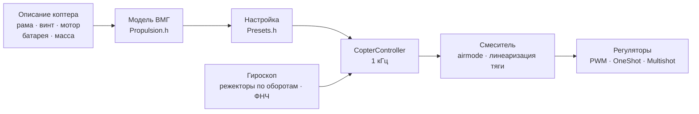

# COPTER.md — прошивка для мультикоптеров

Та же прошивка, те же платы (Matek H743-WING V3, DevEBox H743), те же
датчики и приёмники — но вместо самолёта квадрокоптер, гекса, окта, Y6
или X8. Главное отличие от Betaflight, INAV и ArduPilot — **PID, фильтры,
холостые и расходы не подбираются руками**: вы описываете коптер (раму,
винты, моторы, батарею, массу), а прошивка по физической модели выводит
настройку сама — и сама же подстраивается в полёте под то, что модель
угадала неточно.

> **Честно.** Коптерная прошивка пока проверена только в симуляторе
> (модель с 6 степенями свободы, 12 сборок × 3 варианта «не той» физики)
> и сборкой под платы. В воздухе она ещё не была. Утверждать, что она
> летает лучше Betaflight или ArduPilot, можно будет только после лётных
> испытаний — до них это цель, а не факт.

## Как это работает



1. **Модель винтомоторной группы** (`copter/Propulsion.h`): мотор с
   противо-ЭДС и сопротивлением обмотки (из KV и объёма статора), тяга
   и момент винта (из диаметра, шага и числа лопастей), инерция ротора с
   винтом. Для 5" 2207 1950KV на 6S модель даёт ~28 тыс. об/мин, ~1.6 кг
   тяги и ~45 А на полном газе — как на стендах.
2. **Что из неё следует** (`copter/Presets.h`): газ висения, обороты на
   холостых/висении/полном газе, запаздывание мотора τ, моменты инерции
   рамы, тяговооружённость, ток.
3. **Контур угловой скорости** выбирается по частотной характеристике:
   мотор, фильтры, режекторы, задержка цикла и регулятора — всё в модели.
   Частота среза — наибольшая, при которой запас по фазе 50° (рысканье 55°)
   и **запас по усилению 12 дБ**: настройка выдерживает коптер, у которого
   тяга и инерция вдвое «не те». Доля D подбирается перебором — та, при
   которой контур шире всего. Из частоты среза — P, I, D и упреждение (FF).
4. **Поправка усиления по газу (TPA)** — из той же модели: на малом газе
   мотор слабее отвечает, на большом — сильнее.
5. **В полёте** прошивка сама учит газ висения (тяжелее батарея, подвес)
   и подстраивает режекторы под обороты.

## Каталог сборок

| Сборка | Рама | Винт · мотор · батарея | Масса | Тяга/вес | Висение | Полоса контура |
|---|---|---|---|---|---|---|
| `whoop65` | Quad X 65 мм | 31 мм ×4 · 0702 23000KV · 1S | 22 г | 4.2 | 31 % | 16 Гц |
| `whoop75` | Quad X 75 мм | 40 мм ×4 · 0802 19000KV · 1S | 32 г | 4.3 | 27 % | 16 Гц |
| `toothpick25` | Quad X 115 мм | 2.5" · 1103 8000KV · 3S | 70 г | 12.1 | 8 % | 14 Гц |
| `micro3` | Quad X 140 мм | 3" · 1404 4500KV · 4S | 190 г | 8.3 | 15 % | 14 Гц |
| `cinewhoop3` | Quad X 150 мм | 3" 5-лоп. · 1504 3600KV · 4S | 330 г | 4.1 | 32 % | 16 Гц |
| `freestyle5` | Quad X 225 мм | 5.1" · 2207 1950KV · 6S | 680 г | 9.0 | 15 % | 13 Гц |
| `race5` | Quad X вытянутый | 5.1" · 2306 2000KV · 6S | 560 г | 10.8 | 11 % | 12 Гц |
| `longrange7` | Quad X 315 мм | 7" · 2806.5 1300KV · 6S | 1.0 кг | 7.0 | 20 % | 11 Гц |
| `heavy10` | Quad X 450 мм | 10" · 3115 900KV · 6S | 2.2 кг | 6.6 | 25 % | 10 Гц |
| `cinelifter8` | X8 380 мм | 8" · 2812 1100KV · 6S | 3.5 кг | 6.4 | 23 % | 11 Гц |
| `hex13` | Hex X 700 мм | 13" · 3510 600KV · 6S | 4.0 кг | 3.7 | 35 % | 8 Гц |
| `hex15` | Hex X 900 мм | 15" · 4114 400KV · 6S | 6.0 кг | 3.0 | 45 % | 8 Гц |

Рамы: Quad X, X вытянутый, H, Deadcat, «+», Hex X/+, Y6, Octo X/+, X8.
Нумерация моторов — как в Betaflight (квадро: 1 — задний правый,
2 — передний правый, 3 — задний левый, 4 — передний левый), пропеллеры
внутрь или наружу. Стили полёта — в помещении, фристайл, гонки, съёмка,
дальние, грузовой: от них зависят расходы и наибольший наклон.

## Свой коптер

`include/config/CopterConfig.h`:

```cpp
#define COPTER_BUILD "freestyle5"     // ближайшая сборка из каталога
constexpr float MASS_G = 742;          // взвесить с батареей — главное
constexpr float PROP_DIAMETER_IN = 5.1f, PROP_PITCH_IN = 3.6f;
constexpr float MOTOR_KV = 2150;       // 0 — как в сборке
constexpr copter::EscProtocol ESC_PROTOCOL = copter::EscProtocol::ONESHOT125;
```

Сборку можно выбрать и флагом: `-D COPTER_BUILD=\"race5\"`, а можно и без
пересборки — в CLI: `set copter_build = race5`, `set copter_mass_g = 742`,
`save` (настройки ниже; файл тогда — только умолчание). После прошивки
клавиша `t` в консоли покажет, что вывелось, и предупредит, если
что-то не так: тяги мало, мотор не тянет этот винт, соседние винты
задевают, висит выше 60 % газа, моторы крутятся быстрее половины частоты
цикла. Другая рама с другим числом моторов заработает после
перезагрузки: до того ARM запрещён (`REBOOT_REQD`).

## Прошивка и первый запуск

```bash
pio run -e matek-h743-quad -t upload          # Matek H743-WING V3: кнопка BOOT + USB
pio run -e stm32h743-devebox-quad -t upload   # DevEBox H743
```

Выходы на моторы — по порядку: Matek — S1…S8, DevEBox — PA0–PA3, PD14,
PD15, PE9. **Первый запуск — без пропеллеров**, монитор порта 115200:

| Клавиша | Что делает |
|---|---|
| `t` | настройка: тяга, висение, обороты, τ мотора, фильтры, полоса и запасы контура, P/I/D/FF, расходы, предупреждения |
| `m` | проверка моторов: просит подтвердить `y` (пропеллеры сняты!), крутит каждый по 2 с и пишет, где он и куда должен крутиться |
| `s` | состояние, как `status` в Betaflight: загрузка цикла, частоты, батарея и **почему не армится** — каждая причина кодом BF (`RXLOSS`, `ANGLE`, `CLI`…) и словами |
| `o` | калибровка установки платы тремя позами (на Matek обязательна до ARM) |
| `i` · `r` · `l` · `D` | гироскоп · каналы пульта · живая строка · загрузчик DFU |
| `#` | CLI как в Betaflight: `set`, `get`, `diff`, `aux`, `map`, `profile`, `save` — [ниже](#настройки-cli-как-в-betaflight) |

Не тот мотор крутится — поменять порядок в `CopterConfig::MOTOR_PINS`; не в
ту сторону — направление в конфигураторе регулятора (BLHeliSuite,
ESC-Configurator), провода не перепаивать.

## Настройки: CLI как в Betaflight

Выведенное из описания можно поправить руками — без пересборки, строками,
как в CLI Betaflight. `#` в консоли — вход (только без ARM; пока CLI
открыт, ARM запрещён):

```text
# get p_roll                     ← значение, границы, умолчание и откуда оно
# set p_roll = 50                ← в единицах Betaflight
# set tune_source = BETAFLIGHT   ← дефолты BF 4.5 вместо модели
# profile 1                      ← PID-профиль 0–3 (rateprofile — расходы); сразу, на ходу
# diff                           ← только изменённое, в формате BF
# save                           ← во флеш, настройка пересчитана, выход
```

- **Не заданное руками — умолчание, а у PID и расходов оно не число из
  таблицы, а вывод из описания коптера** (`get` пишет «из модели
  коптера»). Поменяли описание — сдвинется всё, что вы не трогали;
  заданное руками останется. Задать значение, равное умолчанию, — то же,
  что вернуть умолчание.
- **Единицы — как в Betaflight**: член PID = число × масштаб BF × ошибка,
  сумма ÷ 1000 — в смеситель (P 0.032029, I 0.244381 и у рысканья ещё
  ×2.5, D 0.000529, F 0.013754 × 0.01). `t` показывает и модельную
  настройку в этих числах: для 5" это P 25, I 41, D 28, F 35 против
  дефолтных 45/80/40/120 у BF — модель мягче, потому что держит запас по
  усилению 12 дБ.
- **diff из Betaflight можно вставить целиком**: известные настройки
  зададутся, `profile`/`rateprofile` переключатся, `map`, `aux` и
  `rxrange` лягут в свои таблицы, комментарии и `batch start/end`
  пропускаются, остальное — строкой `###ОШИБКА…###`.
- `tune_source = BETAFLIGHT` — дефолты BF 4.5 целиком: PID 45/80/40/120,
  47/84/46/125, 45/80/0/120; расходы Actual 70/670/0; TPA только на D,
  65 % от газа 1350; `iterm_limit` 400; ANGLE 5 °/с на градус, до 60°;
  `yaw_lowpass_hz` 100; фильтры — в пересчёте на нашу цепочку (гироскоп
  PT2 250 Гц, D — PT1 60 Гц: то же запаздывание у полосы контура). Режекторы
  по оборотам остаются наши.
- Во флеше — только заданное руками (и выбранные профили); перепрошивка их
  не стирает, `defaults` — стирает. `exit` без `save` — отмена.

| Команда | Что делает |
|---|---|
| `set` · `set имя = значение` | все настройки · задать (работать начнёт после `save`) |
| `get часть_имени` | значение, границы, умолчание, что это |
| `diff [all]` · `dump [all]` | изменённое · всё; `all` — все профили |
| `profile [0-3]` · `rateprofile [0-3]` | выбрать PID-профиль · профиль расходов |
| `aux` · `aux № режим канал от до [логика связь]` · `aux help` | таблица режимов на тумблерах · строка таблицы · номера режимов — [ниже](#пульт-и-режимы) |
| `map [AETR1234]` · `rxrange [0-3 мин макс]` | порядок каналов · концы стиков крена/тангажа/рысканья/газа |
| `save` · `defaults [nosave]` | сохранить и пересчитать · всё по умолчанию |
| `status` · `tasks` | состояние (как `s`) · время каждой части цикла: частота, среднее и худшее, доля процессора |
| `version` · `help` · `exit` | версия · список · выход |

### Настройки

| Настройка | Где | Диапазон | По умолчанию | Что |
|---|---|---|---|---|
| `tune_source` | общая | `MODEL`, `BETAFLIGHT` | `MODEL` | откуда PID, фильтры и TPA: из описания коптера или дефолты BF 4.5 |
| `profile_name` | PID-профиль | до 8 символов | — | имя PID-профиля |
| `p_roll` `i_roll` `d_roll` `f_roll` | PID-профиль | P, I, D 0–250; F 0–1000 | из модели; BF: 45, 80, 40, 120 | PID крена в единицах BF |
| `p_pitch` `i_pitch` `d_pitch` `f_pitch` | PID-профиль | так же | из модели; BF: 47, 84, 46, 125 | PID тангажа |
| `p_yaw` `i_yaw` `d_yaw` `f_yaw` | PID-профиль | так же | из модели; BF: 45, 80, 0, 120 | PID рысканья |
| `rateprofile_name` | профиль расходов | до 8 символов | — | имя профиля расходов |
| `roll_rc_rate` `pitch_rc_rate` `yaw_rc_rate` | профиль расходов | 1–255 (×10 °/с) | по стилю полёта; BF: 7 | расход у центра стика |
| `roll_srate` `pitch_srate` `yaw_srate` | профиль расходов | 0–255 (×10 °/с) | по стилю полёта; BF: 67 | расход на упоре стика |
| `roll_expo` `pitch_expo` `yaw_expo` | профиль расходов | 0–100 % | по стилю полёта; BF: 0 | экспо: мягче у центра |
| `serialrx_provider` | общая | `IBUS`, `SBUS`, `CRSF` | `RX_PROTOCOL` из `Config.h` | протокол приёмника; меняется после `save` без перезагрузки |
| `rx_min_usec` `rx_max_usec` | общая | 750–2250 мкс | 885, 2115 | импульс вне них — ошибка канала: на стике — потеря связи, на AUX держится прежнее |
| `copter_build` | общая | сборки каталога | `COPTER_BUILD` | основа описания коптера |
| `copter_mass_g` | общая | 0–30000 г (0 — оценка) | из сборки | взлётная масса с батареей |
| `copter_wheelbase_mm` | общая | 30–2000 мм | из сборки | между осями противоположных моторов |
| `prop_diameter_in` `prop_pitch_in` `prop_blades` | общая | 0.5–40", 0.3–30", 2–8 | из сборки | винт |
| `motor_stator_mm` `motor_height_mm` `motor_kv` | общая | 3–120 мм, 0.5–60 мм, 50–80000 | из сборки | мотор: 2207 — 22 и 7 |
| `battery_cells` `battery_mah` | общая | 1–14 S, 50–50000 мА·ч | из сборки | батарея |
| `props_out` | общая | `OFF`, `ON` | `PROPS_OUT` | пропеллеры наружу: все моторы крутятся наоборот |

Описание коптера (`copter_build` … `props_out`): умолчание — сборка из
каталога с поправками «своего коптера» из `CopterConfig.h`; сменили
сборку — умолчания массы, винта, мотора и батареи берутся из новой, а
заданное руками остаётся. PID и фильтры по новому описанию пересчитываются
при `save`.

Кривая расходов пока наша: у центра — `rc_rate`, на упоре — `srate`, экспо
делает центр мягче; при экспо 0 она совпадает с Actual из Betaflight.
У гекс 13"/15" модель просит D больше 250 и F больше 1000 — `get`
покажет умолчание, прижатое к границе, а работает точное значение модели.

## Пульт и режимы

По умолчанию Mode 2: CH1 крен, CH2 тангаж, CH3 газ, CH4 рысканье. **ARM** —
SwA (CH5), как у самолёта. **Режим** — SwC (CH7):

| SwC | Режим | Что делает стик |
|---|---|---|
| вверх | ANGLE | наклон (до предела стиля), отпустил — коптер выравнивается; рысканье — вокруг вертикали |
| середина | ALT_HOLD | ANGLE + высота: газ в центре — висит, выше/ниже — набор до 3 м/с, снижение до 2 м/с |
| вниз | ACRO | угловая скорость по кривой расходов; airmode — управляется и на нулевом газе |

Всё это меняется в CLI, как в Betaflight:

- `map TAER1234` — порядок каналов: буква на месте каждого канала (A —
  крен, E — тангаж, T — газ, R — рысканье, 1–4 — AUX1–AUX4). Порог
  failsafe по газу (`RX_FAILSAFE_THROTTLE_US`) идёт за газом.
- `rxrange 3 1050 1950` — концы стика газа растягиваются на 1000–2000
  (0 — крен, 1 — тангаж, 2 — рысканье, 3 — газ).
- `aux 0 0 1 1700 2100 0 0` — режим включён, пока канал в диапазоне:
  номер строки 0–19, режим (номер BF), канал (0 — AUX1, то есть CH5 при
  `map AETR1234`), от и до в мкс с шагом 25, логика (0 — хватит любой
  строки режима, 1 — нужны все), связь (режим включается вместе с другим).
  `aux` без аргументов — таблица, `aux help` — номера режимов.

| Режим | Номер BF | Что делает |
|---|---|---|
| ARM | 0 | моторы включены |
| ANGLE · HORIZON · ALTHOLD | 1 · 2 · 3 | полётный режим; включено несколько — ALTHOLD, затем ANGLE, затем HORIZON; ни одного — ACRO |
| FAILSAFE | 27 | как потеря связи (проверка failsafe на земле) |
| AIR MODE | 28 | airmode и при выключенном `AIRMODE` в `CopterConfig.h` |
| PREARM | 36 | есть в таблице — ARM только при включённом PREARM |

**Таблица пуста (так после `defaults`) — работают тумблеры из
`CopterConfig.h`** (`aux` покажет их строками, чтобы скопировать). Есть
хоть одна строка — работает только таблица, как в BF: вставленный diff из
Betaflight описывает её целиком, умолчания прошивки к нему не
примешиваются. В таблице нет ARM — коптер не армится (`NO_ARM_AUX`).
Режимы BF, которых у нас пока нет (BEEPER, GPS RESCUE…), принимаются и
хранятся, но ничего не делают — `aux` об этом пишет.

## Связь с приложением

Команды ПК — как у самолёта: байт STX (0x02), строка, перевод строки.
Ответ — строка `@имя {JSON}` (`telemetry/CopterLink.h`):

| Команда | Ответ |
|---|---|
| `id` | `@id`: прошивка, плата, коммит, сборка, протокол приёмника |
| `params` | `@params` (сколько, профили, сборка), по `@param` на настройку — имя, тип, группа (= вкладка), границы, умолчание и откуда оно, единицы, описание, значение, у профильных — все четыре; `@rc` — `map`, `rxrange`, таблица `aux` и тумблеры прошивки; `@modes` — режимы BF |
| `set имя значение` | `@set`: ok или ошибка и новое значение |
| `profile N` · `rateprofile N` | `@profile` |
| `aux …` · `map …` · `rxrange …` | `@rc` |
| `save` · `revert` | `@save` (во флеш и в работу) · `@revert` (отменить несохранённое) |
| `live` · `live 0` | `@live` 20 раз в секунду ещё 3 с: ARM, режим, связь, каналы, углы, высота, газ, моторы, батарея, флаги запрета ARM, включённые режимы, загрузка · хватит |

Менять — только без ARM и при закрытом CLI; пока изменения из приложения не
сохранены и не отменены, ARM запрещён (`MSP`, как при подключённом
конфигураторе BF).

## Защиты

- **ARM** — только если: связь есть, газ внизу, коптер стоит ровно (до
  25°) и не качается, гироскоп отвечает, ориентация определилась,
  батарея не пустая, проверка моторов не идёт, установка платы
  откалибрована (где нужно), CLI закрыт, настройки из приложения
  сохранены, цикл успевает. ARM, включённый раньше времени, надо
  выключить и включить снова. Каждая причина — кодом, как флаг в `status`
  Betaflight (`RXLOSS`, `THROTTLE`, `ANGLE`, `ARMSWITCH`, `NOGYRO`, `CALIB`,
  `CRASH`, `BOXFAILSAFE`, `NOPREARM`, `CLI`, `MSP`, `NO_ACC_CAL`,
  `REBOOT_REQD`, `LOAD`; свои — `MOVING`, `BATTERY`, `MOTOR_TEST`,
  `NO_ARM_AUX`, `CONFIG`), и словами.
- **Тумблер ARM вниз — моторы стоп в том же цикле**, в любом режиме.
- **Потеря связи**: провал до 0.3 с — ничего не меняется; дольше — на
  земле сразу DISARM, в воздухе — горизонт и снижение 0.7 м/с (по
  барометру, без него — по акселерометру), касание земли — DISARM. Связь
  вернулась на 1 с — управление снова у пилота.
- **Авария**: в ANGLE/ALT_HOLD наклон больше 90° дольше 0.7 с или не тот,
  что просит стик, больше 30° дольше 2 с (отказал мотор, лежит на боку); в
  любом режиме лежит на спине 1 с — моторы стоп. Повторный ARM — после
  выключения тумблера.
- **На земле интеграл не копится** — коптер не подпрыгивает и не
  заваливается при взлёте.

## Что внутри — коротко

| Файл | Что |
|---|---|
| `copter/Propulsion.h` | модель мотора и винта |
| `copter/Presets.h` | каталог сборок, вывод настройки, предупреждения |
| `copter/Frames.h` · `Mixer.h` | рамы и смеситель (airmode, приоритет крена/тангажа над рысканьем, линеаризация тяги) |
| `copter/RateController.h` | P, I (relax на флипе и разгоне, anti-gravity), D по гироскопу, FF |
| `copter/Attitude.h` | ориентация кватернионом; акселерометр не верят на рывке, во вращении и при расхождении с гироскопом |
| `copter/AltitudeHold.h` | высота: барометр + акселерометр, газ висения учится |
| `copter/GyroFilter.h` | режекторы на 1×, 2× оборотов и проходе лопастей + ФНЧ |
| `copter/CopterController.h` | всё вместе: ARM, режимы, failsafe, авария |
| `copter/Params.h` | реестр настроек: имена, единицы и дефолты Betaflight, профили, описание коптера, флеш |
| `copter/RcSetup.h` | пульт: `map`, `rxrange`, режимы на тумблерах (`aux`) |
| `copter/CopterCli.h` | CLI как в Betaflight (`telemetry/CopterConsole.h` — консоль по клавишам) |
| `telemetry/CopterLink.h` | протокол настроек и живые данные для приложения |
| `hal/stm32/Stm32MotorOutput.h` · `src/stm32/main_copter.cpp` | регуляторы и точка входа на STM32 |

## Как это проверено

`test/native/test_copter_sim` — **настоящий** `CopterController` и модель
коптера с 6 степенями свободы: моторы с противо-ЭДС, просадка батареи
под током, реактивный момент винтов, сопротивление воздуха, ветер с
порывами, задержка регулятора, гироскоп с шумом и вибрацией моторов
(вибрация выше половины частоты цикла заворачивается, как на плате),
барометр 50 Гц, земля. Каждая сборка каталога летает на своей настройке
и на модели, которая нарочно не совпадает с описанием:

- **«вялая»**: винт тянет на 20 % меньше, мотор и рама на 30 % инерционнее,
  на 20 % тяжелее, центр тяжести сдвинут вперёд;
- **«резвая»**: тяга +20 %, инерция −30 %, масса −15 %, центр тяжести
  сдвинут вбок — усиление контура почти вдвое выше расчётного.

| Что | Итог по 36 полётам (12 сборок × 3 физики) |
|---|---|
| Взлёт и висение в ALT_HOLD | высота ±0.3 м, наклон < 1°, газ висения выучен (у «резвого» вупа — 0.22 вместо расчётных 0.31) |
| ANGLE: полный стик | 90 % наклона за 0.14–0.35 с, перелёт < 3 %, выравнивание до 3° за 0.15–0.4 с |
| ACRO: полный стик | 90 % расхода за 0.04–0.15 с, перелёт < 12 % |
| Потеря связи на 10 м | снижение ≤ 0.94 м/с, касание — DISARM, 17–28 с |

И отдельно — на 5": airmode на нулевом газе, рысканье, ветер 4.5 м/с с
порывами, failsafe без барометра, обычные PWM-регуляторы, провал и возврат
связи, падение на спину, отказ мотора, проверка моторов, просадка
батареи. В `test_copter` — каждый блок по отдельности (48 тестов, среди
них реестр настроек, единицы BF, профили и CLI), в
`native_stm32/test_app_stm32_copter` — прошивка целиком на фейках Matek
H743: импульсы «стоп» до ARM, калибровка установки, холостые после ARM,
режимы с тумблера, потеря связи на земле, консоль, CLI → `save` → флеш →
«перезагрузка».

### Дефолты Betaflight на нашем цикле

`tune_source = BETAFLIGHT`, цикл 1 кГц, OneShot125, номинальная физика:
висение 4 с в ALT_HOLD и полный стик в ACRO — те же мерки, что у настройки
из модели (`test_betaflight_defaults_on_our_loop`). Дефолты BF подобраны
под 5" с DShot и циклом 4–8 кГц:

| Сборка | Висение (качание) | ACRO: 90 % расхода · перелёт |
|---|---|---|
| `whoop65` · `whoop75` | да (1.1 · 0.1 °/с) | 0.034 · 0.035 с · 10–11 % |
| `toothpick25` · `micro3` · `cinewhoop3` | да (0.1 °/с) | 0.028–0.036 с · 5–11 % |
| `freestyle5` · `race5` | да (0.1 °/с) | 0.031–0.033 с · 0 % |
| `longrange7` · `heavy10` · `cinelifter8` | да (≤ 0.1 °/с) | 0.048–0.062 с · 2–7 % |
| `hex13` · `hex15` | **нет: раскачка ~36 °/с** | 0.15–0.19 с · 9–13 % |

Гексам с винтами 13"/15" дефолтов BF мало: модель просит P 150–220 и D 250
(в единицах BF), BF даёт 45 и 40 — коптер висит с раскачкой. Для них —
только `tune_source = MODEL`. Настройка из модели в единицах BF (крен):

| Сборка | P · I · D · F | Сборка | P · I · D · F |
|---|---|---|---|
| `whoop65` | 42 · 88 · 60 · 29 | `race5` | 20 · 31 · 23 · 30 |
| `toothpick25` | 19 · 36 · 31 · 16 | `longrange7` | 37 · 53 · 61 · 61 |
| `micro3` | 22 · 42 · 29 · 23 | `heavy10` | 58 · 77 · 74 · 107 |
| `cinewhoop3` | 40 · 83 · 56 · 36 | `cinelifter8` | 48 · 69 · 53 · 81 |
| `freestyle5` | 25 · 41 · 28 · 35 | `hex13` · `hex15` | 168–221 · 179–222 · 250+ · 304–508 |

Симулятор нашёл и помог исправить настоящие ошибки, которых не видно в
расчёте: режекторы, прыгавшие вслед за каждым циклом смесителя; лишнюю
фазу от режекторов у полосы контура; накопление интеграла на разгоне
«вялой» гексы (перелёт 32 %); акселерометр, который во флипе на газе
висения показывает ровно 1 g и уводил горизонт на 10°; коптер, который с
отказавшим мотором крутился на земле.

## Чего пока нет

- **DShot** (и двунаправленный — точные обороты для режекторов): нужен
  драйвер с DMA, расчёт кадров и CRC уже есть (`copter/EscProtocol.h`).
- **Цикл быстрее 1 кГц** — для вупов, у которых моторы крутятся быстрее
  500 Гц (симуляция показывает, что на 4 кГц им заметно лучше).
- Чёрный ящик, MAVLink и OpenPlane Studio для коптера; удержание позиции
  по GPS, возврат домой, миссии.
- Лётные испытания.
