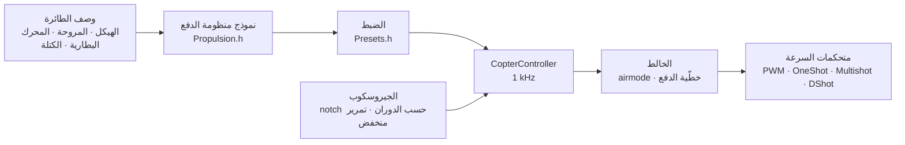

# COPTER.md — برنامج ثابت للطائرات متعددة المراوح

البرنامج الثابت نفسه، واللوحات نفسها (Matek H743-WING V3 وDevEBox H743 وأي F405 تقريبًا يعمل بـ Betaflight)، والحساسات والمستقبلات نفسها — لكن بدلًا من الطائرة: رباعية مراوح أو سداسية أو ثمانية أو Y6 أو X8. الفرق الرئيسي عن Betaflight وINAV وArduPilot: **لا تُضبط قيم PID والمرشحات والسرعة الدنيا والمعدلات يدويًا**. تصف الطائرة (الهيكل، المراوح، المحركات، البطارية، الكتلة)، فيستنتج البرنامج الثابت الضبط بنفسه من نموذج فيزيائي — ثم يتكيّف أثناء الطيران مع ما قدّره النموذج تقديرًا غير دقيق.

> **بصراحة.** لم يُختبر البرنامج الثابت للطائرة متعددة المراوح حتى الآن إلا في المحاكي (نموذج بست درجات حرية، 12 تركيبة × 3 صيغ من الفيزياء «الخاطئة») وبالبناء للوحات. لم يطر بعد. القول إنه يطير أفضل من Betaflight أو ArduPilot لن يكون ممكنًا إلا بعد اختبارات الطيران — وحتى ذلك الحين هو هدف لا حقيقة.

## كيف يعمل



1. **نموذج منظومة الدفع** (`copter/Propulsion.h`): محرك بقوة دافعة عكسية ومقاومة ملفات (من KV وحجم الجزء الثابت)، ودفع المروحة وعزمها (من القطر والخطوة وعدد الشفرات)، وعطالة الدوّار مع المروحة. لطائرة 5" بمحرك 2207 1950KV على 6S يعطي النموذج عند الخانق الكامل نحو 28 000 rpm ونحو 1.6 kg دفعًا ونحو 45 A — كما في منصات الاختبار.
2. **ما يُستنتج منه** (`copter/Presets.h`): خانق التحويم، والدوران عند السرعة الدنيا/التحويم/الخانق الكامل، وتأخّر المحرك τ، وعزوم عطالة الهيكل، ونسبة الدفع إلى الوزن، والتيار.
3. **حلقة السرعة الزاوية** تُختار حسب الاستجابة الترددية: المحرك والمرشحات وnotch وتأخّر الدورة ومتحكم السرعة — كلها في النموذج. تردد العبور هو الأعلى الذي يبقى عنده هامش الطور 50° (الانعراج 55°) و**هامش الكسب 12 dB**: هذا الضبط يصمد على طائرة دفعها وعطالتها «خاطئان» بمعامل اثنين. نسبة D تُوجد بالبحث — النسبة التي تجعل الحلقة أعرض. وتُشتق P وI وD والتغذية الأمامية (FF) من تردد العبور.
4. **تصحيح الكسب حسب الخانق (TPA)** — من النموذج نفسه: عند الدوران المنخفض يستجيب المحرك بليونة، وعند المرتفع بقوة. ومنحنى Betaflight متاح أيضًا (`tpa_mode = PD` أو `D`).
5. **أثناء الطيران** يتعلّم البرنامج الثابت خانق التحويم بنفسه (بطارية أثقل، حامل كاميرا) ويجعل مرشحات notch تتبع الدوران.

## دليل التركيبات

| التركيبة | الهيكل | المروحة · المحرك · البطارية | الكتلة | الدفع/الوزن | التحويم | عرض نطاق الحلقة |
|---|---|---|---|---|---|---|
| `whoop65` | Quad X 65 mm | 31 mm ×4 · 0702 23000KV · 1S | 22 g | 4.2 | 31% | 16 Hz |
| `whoop75` | Quad X 75 mm | 40 mm ×4 · 0802 19000KV · 1S | 32 g | 4.3 | 27% | 16 Hz |
| `toothpick25` | Quad X 115 mm | 2.5" · 1103 8000KV · 3S | 70 g | 12.1 | 8% | 14 Hz |
| `micro3` | Quad X 140 mm | 3" · 1404 4500KV · 4S | 190 g | 8.3 | 15% | 14 Hz |
| `cinewhoop3` | Quad X 150 mm | 3" خماسية الشفرات · 1504 3600KV · 4S | 330 g | 4.1 | 32% | 16 Hz |
| `freestyle5` | Quad X 225 mm | 5.1" · 2207 1950KV · 6S | 680 g | 9.0 | 15% | 13 Hz |
| `race5` | Quad X ممدود | 5.1" · 2306 2000KV · 6S | 560 g | 10.8 | 11% | 12 Hz |
| `longrange7` | Quad X 315 mm | 7" · 2806.5 1300KV · 6S | 1.0 kg | 7.0 | 20% | 11 Hz |
| `longrange7li` | Quad X 315 mm | 7" ثنائية الشفرات · 2810 1300KV · 6S Li-ion 4000 | 1.05 kg | 7.5 | 23% | 12 Hz |
| `heavy10` | Quad X 450 mm | 10" · 3115 900KV · 6S | 2.2 kg | 6.6 | 25% | 10 Hz |
| `cinelifter8` | X8 380 mm | 8" · 2812 1100KV · 6S | 3.5 kg | 6.4 | 23% | 11 Hz |
| `hex13` | Hex X 700 mm | 13" · 3510 600KV · 6S | 4.0 kg | 3.7 | 35% | 8 Hz |
| `hex15` | Hex X 900 mm | 15" · 4114 400KV · 6S | 6.0 kg | 3.0 | 45% | 8 Hz |

الهياكل: Quad X وX الممدود وH وDeadcat و«+» وHex X/+ وY6 وOcto X/+ وX8. ترقيم المحركات كما في Betaflight (الرباعية: 1 — خلفي أيمن، 2 — أمامي أيمن، 3 — خلفي أيسر، 4 — أمامي أيسر)، والمراوح للداخل أو للخارج. أساليب الطيران — داخلي، حرّ، سباق، تصوير، مدى بعيد، حمل: تحدد المعدلات وأقصى ميل.

## طائرتك الخاصة

`include/config/CopterConfig.h`:

```cpp
#define COPTER_BUILD "freestyle5"     // أقرب تركيبة في الدليل
constexpr float MASS_G = 742;          // زِنها مع البطارية — هذا أهم شيء
constexpr float PROP_DIAMETER_IN = 5.1f, PROP_PITCH_IN = 3.6f;
constexpr float MOTOR_KV = 2150;       // 0 — كما في التركيبة
constexpr copter::EscProtocol ESC_PROTOCOL = copter::EscProtocol::ONESHOT125;
```

يمكن اختيار التركيبة أيضًا بعلم البناء `-D COPTER_BUILD=\"race5\"`، أو دون إعادة بناء — في CLI: ‏`set copter_build = race5` و`set copter_mass_g = 742` و`save` (الإعدادات أدناه؛ تصبح قيمة الملف عندئذ قيمة افتراضية فقط). بعد رفع البرنامج الثابت تعرض المفتاح `t` في وحدة التحكم النصية ما استُنتج، وتحذّر إن كان هناك خلل: دفع قليل، المحرك لا يدير هذه المروحة، المراوح المتجاورة تتلامس، تحوم فوق 60% من الخانق، المحركات تدور أسرع من نصف تردد الدورة. هيكل آخر بعدد محركات مختلف يعمل بعد إعادة التشغيل: حتى ذلك الحين يُمنع ARM ‏(`REBOOT_REQD`).

## رفع البرنامج الثابت والتشغيل الأول

```bash
pio run -e matek-h743-quad -t upload          # Matek H743-WING V3: زر BOOT + USB
pio run -e stm32h743-devebox-quad -t upload   # DevEBox H743
pio run -e aocodarc-f405v3-quad -t upload     # متحكم طيران F405 من Betaflight — انظر أدناه
```

مخارج المحركات بالترتيب: Matek — ‏S1…S8، وDevEBox — ‏PA0–PA3 وPD14 وPD15 وPE9. **التشغيل الأول — دون مراوح**، والمراقب التسلسلي على 115200:

| المفتاح | ما يفعله |
|---|---|
| `t` | الضبط: الدفع، التحويم، الدوران، τ المحرك، المرشحات، عرض نطاق الحلقة وهوامشها، ‏P/I/D/FF، المعدلات، التحذيرات |
| `m` | اختبار المحركات: يطلب التأكيد بـ `y` (المراوح منزوعة!)، ويدير كل محرك 2 s ويخبر أين هو وفي أي اتجاه يجب أن يدور |
| `s` | الحالة، مثل `status` في Betaflight: حمل الدورة، الترددات، البطارية، و**لماذا لا يتسلّح** — كل سبب برمز BF ‏(`RXLOSS`، `ANGLE`، `CLI`…) وبالكلمات |
| `o` | معايرة تركيب اللوحة في ثلاث وضعيات (إلزامية على Matek قبل ARM) |
| `c` | معايرة البوصلة: أدِر الطائرة حول جميع المحاور لمدة 15 s (البوصلة — ‏QMC5883L أو QMC5883P على وحدة GPS، أيّهما يستجيب) |
| `i` · `r` · `l` · `D` | الجيروسكوب · قنوات جهاز التحكم · سطر حيّ · محمّل الإقلاع DFU |
| `#` | ‏CLI كما في Betaflight: ‏`set` و`get` و`diff` و`aux` و`map` و`profile` و`save` — [أدناه](#الإعدادات-cli-كما-في-betaflight) |

يدور المحرك الخطأ — غيّر الترتيب في `CopterConfig::MOTOR_PINS`؛ يدور في الاتجاه الخطأ — غيّر الاتجاه في أداة إعداد متحكم السرعة (BLHeliSuite، ESC-Configurator)، ولا تُعِد لحام الأسلاك.

### متحكم طيران F405 من Betaflight

يصلح تقريبًا أي متحكم طيران رباعي بمعالج STM32F405 ‏(Betaflight، بلورة 8 MHz) إن كان عليه ICM-42688-P وبارومتر SPL06 أو DPS310. يُؤخذ توزيع الأطراف من Betaflight نفسه — لذا تعمل حتى لوحة لا يوجد هدفها في أي مستودع (GETFUN F405V3):

```bash
# 1. على اللوحة ما زال Betaflight؛ وأداة Configurator مغلقة. تفريغ CLI إلى ملف
#    (‏Python الخاص بـ PlatformIO — فيه pyserial):
~/.platformio/penv/Scripts/python tools/bf_board.py read --port COM5 --out stack/MYBOARD_bf.txt
# 2. البرنامج الثابت الأصلي كاملًا — لإعادة Betaflight عند الحاجة
#    (اللوحة في DFU: اضغط BOOT وأدخل USB):
python tools/bf_board.py backup --out stack/MYBOARD_original.bin
# 3. ترويسة اللوحة: ما الموصول على كل طرف (لا يعرف BF نوع البارومتر — حسب الوصف):
python tools/bf_board.py header stack/MYBOARD_bf.txt --baro SPL06 --out include/config/boards/MYBOARD.h
```

ثم env في `platformio.ini` مثل `aocodarc-f405v3-quad` (اللوحة المرجعية: توزيع أطرافها منشور، ونواة F405 تُبنى وتُختبر عليها دائمًا)، مع `-D OP_BOARD_FILE=\"config/boards/MYBOARD.h\"`. المحركات M1…M8 بأرقام Betaflight؛ والمستقبل وGPS والقياس عن بعد على منافذ UART التي كانت لها في Betaflight؛ ومؤقّت كل محرك هو الذي اختاره Betaflight (أسطر `timer B06 AF2` في التفريغ -> `OPB_MOTOR_AF`: قد يكون لطرف واحد مؤقّتان أو ثلاثة، وقد اختارها BF دون تعارض DMA على هذه اللوحة). ذاكرة الصندوق الأسود تأتي بناقلها وCS من التفريغ. لوحة عليها برنامجنا الثابت مسبقًا — ‏`bf_board.py header` من `config.h` في [github.com/betaflight/config](https://github.com/betaflight/config).

للمعالج F405 بنك فلاش واحد فقط: كتابة الإعدادات توقف المعالج 1–2 s، لذلك لا تُكتب الإعدادات إلا والطائرة غير مسلّحة.

## الإعدادات: CLI كما في Betaflight

ما استُنتج من الوصف يمكن تصحيحه يدويًا — دون إعادة بناء، سطرًا سطرًا، كما في CLI الخاص بـ Betaflight. المفتاح `#` في وحدة التحكم النصية يُدخلك إليه (فقط والطائرة غير مسلّحة؛ وما دام CLI مفتوحًا يُمنع ARM):

```text
# get p_roll                     ← القيمة، الحدود، الافتراضي ومصدره
# set p_roll = 50                ← بوحدات Betaflight
# set tune_source = BETAFLIGHT   ← افتراضيات BF 4.5 بدلًا من النموذج
# profile 1                      ← ملف PID ‏0–3 (rateprofile — المعدلات)؛ فورًا، أثناء العمل
# diff                           ← المتغيّر فقط، بصيغة BF
# save                           ← إلى الفلاش، يُعاد حساب الضبط، خروج
```

- ‏**ما لم يُضبط يدويًا يأخذ القيمة الافتراضية، وبالنسبة لـ PID والمعدلات فهي ليست رقمًا من جدول بل نتيجة وصف الطائرة** (`get` يكتب «من نموذج الطائرة»). غيّر الوصف — فيتغيّر معه كل ما لم تلمسه؛ وما ضُبط يدويًا يبقى. إعطاء قيمة مساوية للافتراضي يعني العودة إلى الافتراضي.
- ‏**الوحدات وحدات Betaflight**: حدّ PID = الرقم × مقياس BF × الخطأ، والمجموع ÷ 1000 يذهب إلى الخالط (‏P 0.032029، I 0.244381 وفي الانعراج ×2.5 إضافيًا، D 0.000529، F 0.013754 × 0.01). يعرض `t` ضبط النموذج بهذه الأرقام أيضًا: لطائرة 5" هي P 25 وI 41 وD 28 وF 35 مقابل افتراضيات BF ‏45/80/40/120 — النموذج أنعم لأنه يحتفظ بهامش كسب 12 dB.
- ‏**يمكن لصق diff من Betaflight كاملًا** (`diff all` للإصدار 4.5): تُطبّق الإعدادات المعروفة، ويتبدّل `profile`/`rateprofile`، وتذهب `map` و`aux` و`rxrange` و`vtx` و`rxfail` إلى جداولها، وتُتجاهل التعليقات، ويعطي الإعداد المجهول سطر `###خطأ…###`. أوامر العتاد في BF ‏(`resource` و`timer` و`dma` و`serial` و`feature` و`board_name`…: عندنا هذا من عمل ترويسة اللوحة) تُتخطّى مع تعليق `# تُخطّي`، و`defaults nosave` من الـ diff لا يمسّ وصف الطائرة (لا وصف في BF). عند `batch end` (أو عند `save` في منتصف اللصق) — ملخّص: `# لُصق: طُبّق N سطرًا؛ لم يُنقل M: الأسماء…`. بعد `save` كهذا لا يُحسب باقي اللصق ضغطات مفاتيح في وحدة التحكم لمدة نصف ثانية.
- ‏`tune_source = BETAFLIGHT` — كل افتراضيات BF 4.5: ‏PID ‏45/80/40/120 و47/84/46/125 و45/80/0/120؛ المعدلات Actual ‏70/670/0؛ TPA على D فقط، 65% ابتداءً من خانق 1350، و−20% عند الخانق المنخفض حتى الإقلاع؛ `iterm_limit` 400؛ مجموع PID ‏500 (الانعراج 400)؛ anti-gravity ‏80 و5 Hz وP 100؛ `throttle_boost` 5؛ ANGLE ‏5 °/s لكل درجة حتى 60°؛ `yaw_lowpass_hz` 100؛ المرشحات — محوّلة إلى سلسلتنا (الجيروسكوب PT2 ‏250 Hz، وD — ‏PT1 ‏60 Hz: التأخّر نفسه عند عرض نطاق الحلقة). مرشحات notch حسب الدوران تبقى مرشحاتنا.
- ‏في الفلاش يُحفظ فقط ما ضُبط يدويًا (والملفات المختارة)؛ إعادة الرفع لا تمحوه، و`defaults` تمحوه. `exit` دون `save` — إلغاء.

| الأمر | ما يفعله |
|---|---|
| `set` · `set الاسم = القيمة` | كل الإعدادات · ضبط (يسري بعد `save`) |
| `get جزء_من_الاسم` | القيمة، الحدود، الافتراضي، ما هو |
| `diff [all]` · `dump [all]` | المتغيّر · الكل؛ `all` — كل الملفات |
| `profile [0-3]` · `rateprofile [0-3]` | اختيار ملف PID · ملف المعدلات |
| `aux` · `aux الرقم الوضع القناة من إلى [المنطق الربط]` · `aux help` | جدول الأوضاع على المفاتيح · سطر واحد · أرقام الأوضاع — [أدناه](#جهاز-التحكم-والأوضاع) |
| `map [AETR1234]` · `rxrange [0-3 min max]` | ترتيب القنوات · أطراف عصي الدوران الجانبي/الميل/الانعراج/الخانق |
| `rxfail` · `rxfail القناة a\|h\|s [القيمة]` | ما يُفعل بقناة دون اتصال، كما في BF: العصي 0–3 — ‏`a` (آلية failsafe) أو `h` (إبقاء الأخيرة)، وAUX ‏4–17 — ‏`h` أو `s 750…2250` (قيمة ثابتة)؛ أول 0.3 s — دائمًا آخر قيمة صالحة |
| `vtx` · `vtx الرقم القناة النطاق قناة_VTX القدرة من إلى` · `vtx_info` | مرسل الفيديو من مفتاح، كما في BF · بمَ أجاب وقدراته — [أدناه](#مرسل-الفيديو) |
| `dshot_telemetry_info` | كما في BF: ‏eRPM وrpm وHz ونسبة الإطارات دون إجابة لكل محرك (`dshot_bidir`) |
| `flash_info` · `flash_erase` | فلاش الصندوق الأسود (F405): الشريحة، الحجم، JEDEC ID، الامتلاء والرحلات · محو الكل (أمر واحد، ينتظر حتى دقيقة، كما في BF) |
| `save` · `defaults [nosave]` | الحفظ وإعادة الحساب · كل شيء افتراضي |
| `status` · `tasks` | الحالة (مثل `s`) · زمن كل جزء من الدورة: التردد، المتوسط والأسوأ، حصة المعالج |
| `version` · `help` · `exit` | الإصدار · القائمة · خروج |

### الإعدادات

| الإعداد | أين | المدى | الافتراضي | ما هو |
|---|---|---|---|---|
| `tune_source` | عام | `MODEL`، `BETAFLIGHT` | `MODEL` | مصدر PID والمرشحات وTPA: وصف الطائرة أو افتراضيات BF 4.5 |
| `profile_name` | ملف PID | حتى 8 أحرف | — | اسم ملف PID |
| `p_roll` `i_roll` `d_roll` `f_roll` | ملف PID | ‏P وI وD ‏0–250؛ F ‏0–1000 | من النموذج؛ BF: ‏45، 80، 40، 120 | ‏PID الدوران الجانبي بوحدات BF |
| `p_pitch` `i_pitch` `d_pitch` `f_pitch` | ملف PID | كذلك | من النموذج؛ BF: ‏47، 84، 46، 125 | ‏PID الميل |
| `p_yaw` `i_yaw` `d_yaw` `f_yaw` | ملف PID | كذلك | من النموذج؛ BF: ‏45، 80، 0، 120 | ‏PID الانعراج |
| `d_max_roll` `d_max_pitch` `d_max_yaw` | ملف PID | 0–250 | 0 (D ثابت) | ‏D عند حركة حادة، كما في BF 2025.12: عندها `d_*` هو D السكون |
| `d_min_roll` `d_min_pitch` `d_min_yaw` | ملف PID | 0–250 | 0؛ BF: ‏30، 34، 0 | كما في BF 4.5: ‏D السكون، و`d_*` — عند حركة حادة (إن لم يُضبط `d_max_*`) |
| `d_max_gain` (`d_min_gain`) | ملف PID | 0–100 | 37 | مدى سهولة ارتفاع D مع اهتزازات الجيروسكوب: عند 37 — كاملًا عند نحو 5000 °/s² |
| `d_max_advance` (`d_min_advance`) | ملف PID | 0–200 | 20 | مدى تبكير ارتفاع D مع حركة العصا: عند 20 — كاملًا عند نحو 2500 °/s² من القيمة المطلوبة |
| `iterm_relax` | ملف PID | `OFF`، `RP`، `RPY`، `RP_INC`، `RPY_INC` | `RPY`؛ BF: ‏`RP` | على أي المحاور ينتظر I بينما تتغيّر القيمة المطلوبة بحدة (لا ارتداد بعد القلبة)؛ `_INC` — يُكبح النمو فقط |
| `iterm_relax_type` | ملف PID | `GYRO`، `SETPOINT` | `SETPOINT` | ‏`SETPOINT` — يتراكم I أبطأ؛ `GYRO` — يتجه I نحو القيمة المطلوبة المنعّمة، وصفر قريبًا جدًا منها |
| `iterm_relax_cutoff` | ملف PID | 1–50 Hz | 10؛ BF: ‏15 | تنعيم القيمة المطلوبة لـ relax: أقل — ينتظر أطول |
| `iterm_relax_error` | ملف PID | `OFF`، `ON` | `ON` | خاص بنا: الخطأ الكبير عند التسارع نحو قيمة مطلوبة جديدة (قلبة) لا يتراكم في I؛ والخطأ دون حركة العصا (هبّة، دفعة خانق) يتراكم |
| `iterm_rotation` | ملف PID | `OFF`، `ON` | `OFF` | يدور I مع الهيكل: في الدوران حول النفس ينتقل ما تراكم على الدوران الجانبي إلى الميل |
| `iterm_windup` | ملف PID | 30–100% | 100 (معطّل)؛ BF: ‏85 | كلما تباعدت مخارج المحركات تراكم I أضعف؛ وعند التباعد الكامل يتوقف |
| `iterm_limit` | ملف PID | 0–500 | من النموذج (300)؛ BF: ‏400 | حدّ I، و1000 — كامل شوط المحركات |
| `pidsum_limit` · `pidsum_limit_yaw` | ملف PID | 100–1000 | 1000؛ BF: ‏500 · 400 | حدّ مجموع PID في الدوران الجانبي والميل · في الانعراج (1000 — كامل الشوط)؛ عند الحدّ لا يتراكم I |
| `anti_gravity_gain` | ملف PID | 0–250 | 80 | دفعة الخانق تقوّي I فلا ينخفض الأنف: عند دفعة كاملة (كامل الشوط في 0.1 s) ‏1 + gain/10 مرة |
| `anti_gravity_cutoff_hz` | ملف PID | 2–50 Hz | 5 | تنعيم سرعة الخانق: أقل — قمة أخفض لكن أطول |
| `anti_gravity_p_gain` | ملف PID | 0–250% | 0؛ BF: ‏100 | يقوى P الدوران الجانبي والميل أيضًا: عند 100 — بنسبة 50% عند دفعة كاملة |
| `throttle_boost` · `throttle_boost_cutoff` | ملف PID | 0–100 (×0.1) · 5–50 Hz | 0؛ BF: ‏5 · 15 | دفعة الخانق على العصا (الخانق ناقص تمريره المنخفض) تُضخَّم 1 + boost/10 مرة — تلحق المحركات بالعصا أبكر؛ ليس في ALT_HOLD |
| `tpa_mode` | ملف PID | `PD`، `D`، `MODEL` | `MODEL`؛ BF: ‏`D` | تصحيح PD حسب الخانق: `PD`/`D` — منحنى BF (سطران أدناه)، و`MODEL` — تصحيح النموذج على P وD |
| `tpa_rate` · `tpa_breakpoint` | ملف PID | 0–100% · 750–2250 µs | 65 · 1350 | ‏`PD`/`D`: فوق النقطة يضعف PD (أو D وحده) خطيًا، وعند الخانق الكامل بمقدار `tpa_rate` |
| `tpa_low_rate` · `tpa_low_breakpoint` | ملف PID | −128…100% · 750–2250 µs | 0؛ BF: ‏20 · 1050 | عند خانق صفري يكون PD (‏D) أضعف بمقدار `tpa_low_rate` (تحت 0 — أقوى)، خطيًا حتى النقطة |
| `tpa_low_always` | ملف PID | `OFF`، `ON` | `OFF` | ‏`OFF` — فقط ما دام الخانق بعد ARM لم يتجاوز `tpa_low_breakpoint` (على الأرض)، و`ON` — دائمًا |
| `feedforward_transition` | ملف PID | 0–100% | 0 | أقرب إلى مركز العصا من هذا تكون التغذية الأمامية أضعف (خطيًا حتى الصفر) — أنعم في المركز |
| `feedforward_averaging` | ملف PID | `OFF`، `2_POINT`، `3_POINT`، `4_POINT` | `OFF` | سرعة العصا للتغذية الأمامية تُحسب متوسطًا على 2–4 إطارات من المستقبل: أنعم مع الإطارات المتباعدة لكنها أبطأ |
| `feedforward_smooth_factor` | ملف PID | 0–95% | 0؛ BF: ‏25 | تنعيم التغذية الأمامية من إطار إلى إطار (حصة القيمة القديمة في كل إطار) |
| `feedforward_jitter_factor` | ملف PID | 0–20 | 0؛ BF: ‏7 | تحركت العصا في إطار أقل من هذا (500 — نصف عصا) — تضعف التغذية الأمامية بنعومة حتى الصفر: ارتجاف الإصبع لا يهزّ المحركات |
| `feedforward_boost` | ملف PID | 0–50 | 0؛ BF: ‏15 | إضافة حسب تسارع العصا (15 — تقدّم 3 ms، لا أكثر من سرعة العصا نفسها) |
| `feedforward_max_rate_limit` | ملف PID | 0–150% | 0؛ BF: ‏90 | حين تبلغ القيمة المطلوبة هذه النسبة من أقصى معدل لا تزيد التغذية الأمامية نحو الخارج عمّا يعطيه P للهامش المتبقي، وبعدها — صفر: قلبة بعصا كاملة دون تجاوز |
| `yaw_lowpass_hz` | ملف PID | 0–500 Hz | من النموذج (30–100)؛ BF: ‏100 | تمرير منخفض على مخرج PID الانعراج (0 — دون مرشح)؛ تُحسب PID النموذج بتردد النموذج |
| `use_integrated_yaw` · `integrated_yaw_relax` | ملف PID | `OFF`، `ON` · 0–255 | `OFF` · 200 | الانعراج بتكامل مجموع PID (×100 1/s، تسرّب relax × 0.08 1/s) — للمراوح الكبيرة التي يسرّعها الانعراج. أرقام BF تتصرف كما في BF (‏I دون ×2.5؛ طائرة 5" تحتاج `d_yaw` وإلا تتأرجح)؛ وتُعاد حساب PID الانعراج غير المضبوطة يدويًا في النموذج لتبقى الحلقة كما هي |
| `abs_control_gain` | ملف PID | 0–20 (°/s لكل °) | 0 (معطّل) | ‏ACRO: الزاوية والاتجاه اللذان ضاعا بسبب هبّة أو اختلال الدفع يعودان؛ الدوران الجانبي والميل — في ACRO فقط، والانعراج — في أي وضع، في الجو |
| `abs_control_limit` · `abs_control_error_limit` · `abs_control_cutoff` | ملف PID | 10–255 °/s · 1–45° · 1–45 Hz | 90 · 20 · 11 | حدّ التصحيح · حدّ خطأ الزاوية المتراكم · تمرير منخفض للقيمة المطلوبة (تأخّر الهيكل مع العصا السريعة لا يتراكم) |
| `thrust_linear` | ملف PID | 0–150% | من النموذج (15–30)؛ BF: ‏0 | خطّية الدفع: الخانق المنخفض يستجيب كالمرتفع |
| `motor_output_limit` | ملف PID | 1–100% | 100 | حصة شوط المحركات فوق السرعة الدنيا: بطارية 6S على محركات 4S — ‏66 |
| `rateprofile_name` | ملف المعدلات | حتى 8 أحرف | — | اسم ملف المعدلات |
| `roll_rc_rate` `pitch_rc_rate` `yaw_rc_rate` | ملف المعدلات | 1–255 (×10 °/s) | حسب أسلوب الطيران؛ BF: ‏7 | المعدل في مركز العصا |
| `roll_srate` `pitch_srate` `yaw_srate` | ملف المعدلات | 0–255 (×10 °/s) | حسب أسلوب الطيران؛ BF: ‏67 | المعدل بعصا كاملة |
| `roll_expo` `pitch_expo` `yaw_expo` | ملف المعدلات | 0–100% | حسب أسلوب الطيران؛ BF: ‏0 | ‏expo: أنعم في المركز |
| `serialrx_provider` | عام | `IBUS`، `SBUS`، `CRSF` | `RX_PROTOCOL` من `Config.h` | بروتوكول المستقبل؛ يتغيّر بعد `save` دون إعادة تشغيل |
| `rx_min_usec` `rx_max_usec` | عام | 750–2250 µs | 885، 2115 | نبضة خارج هذه الحدود خطأ في القناة: على عصا — فقدان اتصال، وعلى AUX تُبقى القيمة السابقة |
| `copter_build` | عام | تركيبات الدليل | `COPTER_BUILD` | أساس وصف الطائرة |
| `copter_mass_g` | عام | 0–30000 g (0 — تقدير) | من التركيبة | كتلة الإقلاع مع البطارية |
| `copter_wheelbase_mm` | عام | 30–2000 mm | من التركيبة | بين محوري محركين متقابلين |
| `prop_diameter_in` `prop_pitch_in` `prop_blades` | عام | 0.5–40" و0.3–30" و2–8 | من التركيبة | المروحة |
| `motor_stator_mm` `motor_height_mm` `motor_kv` | عام | 3–120 mm و0.5–60 mm و50–80000 | من التركيبة | المحرك: 2207 — ‏22 و7 |
| `battery_cells` `battery_mah` | عام | 1–14 S و50–50000 mAh | من التركيبة | البطارية |
| `props_out` | عام | `OFF`، `ON` | `PROPS_OUT` | المراوح للخارج: تدور كل المحركات في الاتجاه المعاكس |
| `battery_chemistry` | عام | `LIPO`، `LIHV`، `LIION` | من التركيبة (LiPo) | الكيمياء: عتبات الخلية والجهد تحت الحمل لنموذج الدفع (3.75 / 3.85 / 3.5 V) |
| `vbat_min_cell_voltage` `vbat_warning_cell_voltage` `vbat_max_cell_voltage` | عام | 100–500 (×0.01 V) | حسب الكيمياء: LiPo ‏330/350/430، LiHV ‏330/350/440، Li-ion ‏280/310/425 | الخلية: فارغة (CRITICAL) · حان وقت العودة (WARNING؛ تحتها في السكون — لا تسليح) · ممتلئة |
| `vbat_full_cell_voltage` | عام | 100–500 (×0.01 V) | حسب الكيمياء: LiPo ‏410، LiHV ‏425، Li-ion ‏410 | خلية فوق هذا عند التوصيل — البطارية ممتلئة؛ وإلا تعرض OSD ‏`BATT < FULL` والطائرة غير مسلّحة |
| `vbat_scale` · `vbat_divider` · `vbat_multiplier` | عام | 0–255 · 1–255 · 1–255 | مقسّم اللوحة (110 · 10 · 1 — ‏1:11؛ F405 — من تفريغ اللوحة) | الفولت = mV الطرف × `vbat_scale` / (1000 × `vbat_divider` × `vbat_multiplier`)، كما في BF |
| `battery_meter` | عام | `NONE`، `ADC`، `ESC` | `ADC` إن كان في اللوحة مدخل بطارية | مصدر الجهد (`ESC` — من قياس متحكم السرعة عن بعد، لا يعمل بعد) |
| `current_meter` · `ibata_scale` · `ibata_offset` | عام | `NONE`/`ADC`/`VIRTUAL`/`ESC`/`MSP` · ±16000 (×0.1 mV/A) · ±32000 mV | `ADC` إن كان في اللوحة مدخل تيار؛ 400 (Matek — ‏250، F405 — من تفريغ اللوحة)؛ 0 | حساس التيار: التيار، وmAh المستهلكة، والمتبقي (`VIRTUAL` و`ESC` و`MSP` تُقبل من diff الخاص بـ BF لكنها لا تعطي تيارًا بعد) |
| `vbat_detect_cell_voltage` | عام | 0–2000 (×0.01 V) | 300 | البطارية موجودة إن كان الجهد بين هذه القيمة وخلية ممتلئة (1S) أو فوق ضعفها؛ وإلا — تغذية USB |
| `force_battery_cell_count` | عام | 0–24 S | 0 | عدد الخلايا؛ 0 — من وصف الطائرة (`battery_cells`). في BF يعني 0 التخمين من الجهد؛ نحن لا نخمّن: بطارية Li-ion ‏6S فارغة (17 V) لا تُميَّز عن LiPo ‏4S ممتلئة |
| `bat_capacity` | عام | 0–20000 mAh | 0 | السعة للمتبقي ولإنذار الاستهلاك؛ 0 — ‏`battery_mah` من الوصف |
| `vbat_hysteresis` | عام | 0–250 (×0.01 V) | 1 | يُطلق الإنذار حين يكون الجهد أدنى من العتبة بهذا المقدار أيضًا (للبطارية كلها، كما في BF)؛ ويزول فوق العتبة |
| `vbat_duration_for_warning` · `vbat_duration_for_critical` | عام | 0–150 (×0.1 s) | 20 · 20 (BF: ‏0 · 0) | هذا الوقت متتاليًا تحت العتبة — WARNING · CRITICAL: الهبوط عند دفعة خانق ليس إنذارًا |
| `use_vbat_alerts` · `use_cbat_alerts` · `cbat_alert_percent` | عام | `OFF`/`ON` · `OFF`/`ON` · 0–100% | `ON` · `OFF` · 10 | إصدار صوت إنذار البطارية وعرضه · إنذار حسب mAh أيضًا (يتبقّى `cbat_alert_percent` على الأكثر — WARNING، وصفر — CRITICAL؛ يلزم حساس تيار) |
| `vbat_cutoff_percent` | عام | 0–100% | 100 (لا شيء) | منذ أول CRITICAL يُقيَّد خانق العصا بنعومة إلى هذه الحصة خلال 10 s ‏(LVC في BF)؛ لا يشمل تثبيت الارتفاع ولا آلية failsafe |
| `vbat_display_lpf_period` · `vbat_sag_lpf_period` · `ibat_lpf_period` | عام | 1–255 (×0.1 s) | 30 · 2 · 10 | التنعيم (تمرير منخفض 10/الفترة Hz، كما في BF): العرض والإنذارات · الجهد لتعويض الهبوط · التيار |
| `vtx_protocol` | عام | `AUTO`، `SMARTAUDIO`، `TRAMP`، `NONE` | `AUTO` إن كان في اللوحة سلك VTX | سلك التحكم بمرسل الفيديو |
| `vtx_band` · `vtx_channel` · `vtx_freq` | عام | 0–10 · 1–8 · 0–6200 MHz | 5 (R) · 1 · 0 | النطاق (1 A، 2 B، 3 E، 4 F، 5 R، 6 L، 7 X، 8 V، 9 G، 10 S؛ 0 — التردد رقمًا) |
| `vtx_power` | عام | 1–12 | 1 | مستوى القدرة، 1 — الأدنى؛ الجدول من المرسل (`vtx_info`) |
| `vtx_max_power_mw` | عام | 0–10000 mW | 0 (لا شيء) | ‏**السقف**: لا يُرفع فوقه لا بمفتاح ولا بزر المرسل |
| `vtx_low_power_disarm` | عام | `OFF`، `ON`، `UNTIL_FIRST_ARM` | `OFF` | والطائرة غير مسلّحة — المستوى الأدنى |
| `gps_minimum_sats` | عام | 4–50 | 8 | يُثبَّت موقع البيت عند ARM إن وُجد هذا العدد من الأقمار على الأقل |
| `crsf_telemetry` | عام | `OFF`، `ON` | `ON` | القياس عن بعد إلى جهاز التحكم عبر CRSF |
| `blackbox_device` | عام | `NONE`، `SPIFLASH`، `SDCARD`، `SERIAL` | `SPIFLASH` على F405، و`SDCARD` على H743 | أين يُكتب الصندوق الأسود؛ لا يكتب إلا إذا اختير وسيط هذه اللوحة (`SERIAL` يُقبل من diff الخاص بـ BF لكنه لا يكتب) |
| `blackbox_mode` | عام | `NORMAL`، `MOTOR_TEST`، `ALWAYS` | `NORMAL` | متى يكتب: ما دامت مسلّحة، ما دامت المحركات تدور، دائمًا |
| `blackbox_sample_rate` | عام | `1/1` … `1/32` | `1/1` (‏F405 مع فلاش — `1/2`) | الجيروسكوب وPID والمحركات — دورة من كم دورة |
| `motor_poles` | عام | 4–255 | 14 | مغانط الدوّار: rpm = eRPM × 2 / `motor_poles` |
| `dshot_bidir` | عام | `OFF`، `ON` | `OFF` | ‏DShot ثنائي الاتجاه: يجيب متحكم السرعة بالدوران؛ يتغيّر بعد إعادة التشغيل (حتى ذلك يُمنع ARM، `REBOOT_REQD`)؛ ومعه يكون حدّ الدورة أدنى — إطار و30 µs وإجابة: DShot600 — حتى 11.8 kHz، و300 — ‏7.2، و150 — ‏4.0 |
| `small_angle` | عام | 0–180° | 25 | موضوعة مائلة أكثر من هذا — لا تسليح؛ 180 — دون فحص |
| `auto_disarm_delay` | عام | 0–60 s | 5 | مسلّحة لكنها على الأرض والخانق في الأسفل هذه المدة — DISARM (في BF فقط مع التسليح بالعصي؛ وعندنا بالمفتاح أيضًا)؛ 0 — أبدًا |
| `runaway_takeoff_prevention` | عام | `OFF`، `ON` | `ON` | بعد ARM المتحكم في حدّه والطائرة تدور — DISARM |
| `runaway_takeoff_deactivate_delay` | عام | 100–1000 ms | 500 | هذا القدر من الطيران الهادئ — يُطفأ فحص runaway حتى ARM التالي |
| `runaway_takeoff_deactivate_throttle_percent` | عام | 0–100% | 20 | الخانق الذي يُحتسب فوقه الطيران (أو أن الطائرة ارتفعت فوق متر) |
| `failsafe_delay` | عام | 1–200 (×0.1 s) | 15 | لا اتصال هذه المدة — المرحلة 2؛ وقبلها المرحلة 1: استواء وتثبيت الارتفاع (في BF — العصي في المركز، والخانق 0) |
| `failsafe_procedure` | عام | `AUTO-LAND`، `DROP`، `GPS-RESCUE` | `AUTO-LAND` (BF: ‏`DROP`) | المرحلة 2: استواء وهبوط · إطفاء المحركات · العودة (حاليًا دون GPS — مثل AUTO-LAND، ويعود التحكم بالعصا) |
| `failsafe_landing_time` | عام | 1–250 s | 120 (BF: ‏60) | لم يهبط AUTO-LAND خلال هذه المدة — DISARM؛ الهبوط عندنا يتبع الارتفاع وينتهي بلمس الأرض، وهذا هامش |
| `failsafe_throttle` | عام | 1000–2000 µs | 1000 | ‏AUTO-LAND: ‏1000 — هبوط بسرعة 0.7 m/s حسب الارتفاع؛ أكثر — خانق ثابت، كما في BF |
| `failsafe_throttle_low_delay` | عام | 0–300 (×0.1 s) | 100 | كان الخانق في الأسفل أطول من هذا قبل فقدان الاتصال — DISARM فورًا (الطائرة على الأرض بوضوح)؛ 0 — لا |
| `failsafe_recovery_delay` | عام | 1–200 (×0.1 s) | 5 | يصمد الاتصال هذه المدة — يعود التحكم إلى الطيار (المرحلة 2) ويصبح ARM ممكنًا مجددًا بعد DISARM بسبب failsafe |
| `failsafe_stick_threshold` | عام | 0–50% | 30 | ‏GPS-RESCUE: عاد الاتصال — يعود التحكم إلى الطيار حين تُحرَّك عصا أبعد من هذا |
| `failsafe_switch_mode` | عام | `STAGE1`، `KILL`، `STAGE2` | `STAGE1` | وضع FAILSAFE من مفتاح: كفقدان الاتصال · إطفاء المحركات فورًا (ARM بعد 1 s) · المرحلة 2 مباشرة |
| `craft_name` | عام | حتى 16 حرفًا | — | اسم الطائرة: أداة إعداد BF ‏(`MSP_NAME`) والسجل |
| `vbat_sag_compensation` | ملف PID | 0–150% | 100 (BF: ‏0) | تصحيح المحركات لهبوط الجهد: 100 — مع بطارية تهبط تستجيب كما مع بطارية ممتلئة، و0 — دون تصحيح |

وصف الطائرة (`copter_build` … `props_out`): الافتراضي هو تركيبة الدليل مع تصحيحات «طائرتك الخاصة» من `CopterConfig.h`؛ غيّر التركيبة — فتأتي افتراضيات الكتلة والمروحة والمحرك والبطارية من الجديدة، ويبقى ما ضُبط يدويًا. وتُعاد حساب PID والمرشحات للوصف الجديد عند `save`.

منحنى المعدلات منحنانا حاليًا: في المركز `rc_rate`، وعند الحدّ `srate`، ويليّن expo المركز؛ ومع expo ‏0 يطابق Actual في Betaflight. للسداسيات 13"/15" يطلب النموذج D فوق 250 وF فوق 1000 — يعرض `get` الافتراضي مقصوصًا عند الحدّ، لكن تُطبَّق قيمة النموذج الدقيقة.

## جهاز التحكم والأوضاع

الافتراضي Mode 2: ‏CH1 الدوران الجانبي، CH2 الميل، CH3 الخانق، CH4 الانعراج. **ARM** — ‏SwA ‏(CH5)، كما في الطائرة. **الوضع** — ‏SwC ‏(CH7):

| SwC | الوضع | ما تفعله العصا |
|---|---|---|
| أعلى | ANGLE | الميل (حتى حدّ الأسلوب)، وعند تركها — تستوي الطائرة؛ الانعراج — حول المحور الرأسي |
| وسط | ALT_HOLD | ‏ANGLE + الارتفاع: الخانق في المركز — تحويم، وفوقه/تحته — صعود حتى 3 m/s وهبوط حتى 2 m/s |
| أسفل | ACRO | سرعة الدوران حسب منحنى المعدلات؛ airmode — قابلة للتحكم حتى عند خانق صفري |

كل هذا يُغيَّر في CLI، كما في Betaflight:

- ‏`map TAER1234` — ترتيب القنوات: حرف مكان كل قناة (A — الدوران الجانبي، E — الميل، T — الخانق، R — الانعراج، 1–4 — ‏AUX1–AUX4). وعتبة failsafe للخانق (`RX_FAILSAFE_THROTTLE_US`) تتبع الخانق.
- ‏`rxrange 3 1050 1950` — تُمدّ أطراف عصا الخانق إلى 1000–2000 (0 — الدوران الجانبي، 1 — الميل، 2 — الانعراج، 3 — الخانق).
- ‏`aux 0 0 1 1700 2100 0 0` — الوضع فعّال ما دامت القناة في المدى: رقم السطر 0–19، والوضع (رقم BF)، والقناة (0 — ‏AUX1، أي CH5 مع `map AETR1234`)، ومن وإلى بالميكروثانية بخطوة 25، والمنطق (0 — يكفي أي سطر للوضع، 1 — يلزم الكل)، والربط (يُشغَّل الوضع مع وضع آخر). ‏`aux` دون وسائط — الجدول، و`aux help` — أرقام الأوضاع.

| الوضع | رقم BF | ما يفعله |
|---|---|---|
| ARM | 0 | تشغيل المحركات |
| ANGLE · HORIZON · ALTHOLD | 1 · 2 · 3 | وضع الطيران؛ إن كانت عدة — ‏ALTHOLD ثم ANGLE ثم HORIZON؛ ولا شيء — ‏ACRO |
| FAILSAFE | 27 | كفقدان الاتصال (فحص failsafe على الأرض) |
| AIR MODE | 28 | ‏airmode حتى مع إطفاء `AIRMODE` في `CopterConfig.h` |
| PREARM | 36 | إن كان في الجدول — ‏ARM فقط مع PREARM فعّال |
| USER1 … USER4 | 40 … 43 | أطراف PINIO في اللوحة (على GETFUN F405V3: ‏USER1 — الكاميرا CAM1/CAM2، وUSER2 — تغذية 12 V) |
| VTX PIT MODE · VTX CONTROL DISABLE | 39 · 48 | مرسل الفيديو في PIT · لا تلمس المرسل |

‏**حين يكون الجدول فارغًا (كما بعد `defaults`) تعمل مفاتيح `CopterConfig.h`** (`aux` يعرضها أسطرًا للنسخ). وما إن يوجد سطر واحد حتى يعمل الجدول وحده، كما في BF: ‏diff الملصوق من Betaflight يصفه كاملًا، ولا تختلط به افتراضيات البرنامج الثابت. لا ARM في الجدول — لا تتسلّح الطائرة (`NO_ARM_AUX`). أوضاع BF التي ليست عندنا بعد (BEEPER وGPS RESCUE…) تُقبل وتُحفظ لكنها لا تفعل شيئًا — ويقول `aux` ذلك.

## مرسل الفيديو

المرسل التناظري ذو سلك التحكم (SmartAudio أو Tramp — يجده `vtx_protocol = AUTO` بنفسه) يُبقيه البرنامج الثابت على تردد الإعدادات وقدرتها:

```text
# set vtx_band = 5            ← R
# set vtx_channel = 1         ← R1، 5658 MHz
# set vtx_max_power_mw = 400  ← سقف «في المدينة»
# vtx 0 2 0 0 2 900 1300      ← AUX3 (SwC) أعلى — المستوى 2
# vtx 1 2 0 0 6 1700 2100     ← AUX3 أسفل — المستوى 6 (لكن لا فوق السقف)
# vtx_info                    ← بمَ أجاب المرسل، وقدراته
# save
```

- ‏**السقف `vtx_max_power_mw`** هو الأهم: لا سطر `vtx` من مفتاح ولا `vtx_power` يتجاوزانه، وإن رُفع المرسل بزره الخاص يخفضه البرنامج الثابت خلال ثانية. لإزالة السقف — ‏`set vtx_max_power_mw = 0`.
- ‏**القدرة من جهاز التحكم** — أسطر `vtx`، كما في Betaflight: ما دام AUX في المدى يكون للمرسل هذا النطاق وهذه القناة وهذا المستوى (0 — لا تلمس). مفتاح أو مقبض دوّار أو قناة منطقية في EdgeTX — لا فرق.
- ‏جدول القدرات من المرسل نفسه: يبلّغ SmartAudio 2.1 مستوياته بالـ dBm ‏(36 dBm — «4 W»)، وTramp — الحدّ بالـ mW؛ ولـ SmartAudio 1.0/2.0 الدرجات 25/200/500/800 mW، كما في TBS Unify.
- ‏الترددات — جدول مرسل بـ 80 قناة 4.9–6.1 GHz: ‏A وB وE وF وR وL (عند البائع — D) وX وV وG وS. **النظارة التناظرية (Cobra X V4) لا تستقبل إلا A وB وE وF وR وL** — على X/V/G/S لن تكون هناك صورة.
- ‏وضع VTX PIT MODE — ‏PIT (لا تزعج الآخرين على الأرض)، وUSER2 على GETFUN — تغذية 12 V للمرسل كله. لا يجيب المرسل — يعرض `status` «VTX: لا يجيب»؛ فتُضبط التردد والقدرة بأزراره.

## ‏OSD والصفارة

‏**OSD** — شريحة AT7456E/MAX7456 في متحكم الطيران (على اللوحات القادمة من Betaflight يأتي ناقلها وCS من تفريغ اللوحة). صورة الكاميرا تمرّ دائمًا عبر الشريحة، وتُركَّب OSD فوقها: الاتصال (LQ)، والوضع، والأقمار، وقدرة VTX، والتصويب، وسهم البيت والمسافة إليه، والارتفاع، والجهد (ولكل خلية)، والتيار، وmAh، وزمن الطيران، و**تحذير رئيسي واحد** في المركز: ‏FAILSAFE وRXLOSS وBATT CRITICAL وLOW BATTERY، والطائرة غير مسلّحة — لماذا لا تتسلّح (رمز BF، مثل THROTTLE) أو DISARMED. الخط خط الشريحة (على لوحات Betaflight — خط BF)، ولذا الكتابة بأحرف لاتينية. ‏PAL/NTSC — حسب الكاميرا، تلقائيًا؛ ووضع OSD DISABLE يخفي كل شيء.

‏**الصفارة**: ‏ARM — طويلة، DISARM — قصيرتان، بعد التشغيل حين يصبح التسليح ممكنًا — قصيرة؛ البطارية WARNING — قصيرة كل 2 s، وCRITICAL — متكررة؛ failsafe — إنذار؛ وضع BEEPER — «ابحث عن النموذج» (حتى دون اتصال — يُبقي AUX آخر قيمة)، وBEEPER MUTE — صمت (عدا البحث).

## ‏GPS والبوصلة والقياس عن بعد إلى جهاز التحكم

- ‏**GPS** ‏(u-blox M10) — على منفذ UART الذي كان له في Betaflight. يعرض `status` التثبيت والأقمار والدقة والسرعة و**البيت**: يُثبَّت عند ARM مع تثبيت ثلاثي الأبعاد و`gps_minimum_sats` قمرًا على الأقل؛ وإلا — عند أول تثبيت جيد، ولو في الجو («ثُبّت أثناء الطيران»). المسافة إلى البيت واتجاهه — في `status` و`@live` وعلى جهاز التحكم. أوضاع GPS (العودة إلى البيت، تثبيت الموقع) **غير موجودة بعد**.
- ‏**البوصلة** على وحدة GPS — ‏QMC5883L أو QMC5883P، ويجرّب البرنامج الثابت كلتيهما. المعايرة — ‏`c` في وحدة التحكم النصية. اتجاه الأنف من البوصلة (إن كانت معايَرة)، وفوق 3 m/s — من GPS، وإلا — من الجيروسكوب منذ التشغيل. الميل لا يُعوَّض بعد: في الطيران السريع قد يخطئ اتجاه البوصلة بعشرات الدرجات.
- ‏**قياس CRSF عن بعد** (ELRS، Crossfire) — في منفذ UART نفسه الذي تأتي منه القنوات: البطارية (V، A، mAh، %)، وGPS، والوضعية، والوضع (`ACRO`، `ANGL`، `HOR`، `ALTH`، `!FS!`؛ وغير مسلّحة — مع «*»)، والسرعة الرأسية. في EdgeTX ‏(RadioMaster TX12) — «اكتشاف الحساسات» في صفحة القياس عن بعد للنموذج.

## الصندوق الأسود

على H743 ‏(Matek H743، DevEBox) تكتب الطائرة الرحلة على بطاقة SD — بالصيغة نفسها وفي الملف نفسه `BLACKBOX.BIN` كالطائرة الثابتة الجناح (تحضير البطاقة — [BLACKBOX.md](BLACKBOX.md#بطاقة-sd-stm32h743)). وعلى F405 — في فلاش SPI في اللوحة (`blackbox_device = SPIFLASH`، كما في BF): ‏W25Q128 وW25Q64 وM25P16 وGD25Q وأشباهها تُعرف من JEDEC ID ‏(حتى 16 MB)؛ الصيغة نفسها والتنزيل نفسه. يُبقى نصف الفلاش ممسوحًا (16 MB عند `1/2` — نحو 8 دقائق طيران)، وتُمحى الرحلات القديمة على الأرض كاملة، الأقدم أولًا — لا «ممتلئ — توقف التسجيل» كما في BF. طابور السجلات في CCM RAM للمعالج F405 ‏(60 KB)، والفلاش على ناقل OSD نفسه يتقاسم معه قفلًا متبادلًا، والفلاش على ناقل الجيروسكوب لا يُستخدم. ‏`flash_info` و`flash_erase` في CLI — كما في BF.

| السجل | التكرار | ما فيه |
|---|---|---|
| `QGYRO` | كل دورة (`blackbox_sample_rate`) | الجيروسكوب قبل المرشحات وبعدها، والقيم المطلوبة، وزمن عمل الدورة |
| `QCTRL` | في اللحظة نفسها | ‏P وI وD وF لكل محور (حصة من شوط المحركات)، والمحركات 1–4، وخانق الخالط |
| `QMOT8` | في اللحظة نفسها، إن كانت المحركات أكثر من 4 | المحركات 5–8 |
| `QSTATE` | 50 Hz | الزوايا، والارتفاع والهدف، والصعود، والعصي، وخانق التحويم، والبطارية (V، A، mAh)، والدوران، وLQ، والوضع، والأعلام، وموانع ARM |
| `GPS`، `SYS` | حلّ جديد، 1 Hz | كما في الطائرة الثابتة الجناح |
| `EVENT` | — | ‏ARM/DISARM، والوضع، وFAILSAFE، والحادث، والاتصال، والبطارية، والملف، و«رُفض ARM: رموز BF»، وGPS والبيت، واختبار المحركات، وفاقد الطابور |

في بداية الرحلة — التركيبة، والهيكل، وPID بوحدات BF، والمعدلات، والمرشحات، وكل ما ضُبط في CLI ‏(`set.<الاسم>=<القيمة>`، مثل `diff`).

متى يكتب — ‏`blackbox_mode`، كما في Betaflight: ‏`NORMAL` — ما دامت مسلّحة (من 2 s قبل إلى 2 s بعد)، و`MOTOR_TEST` — ما دامت المحركات تدور (واختبار المحركات على المنضدة)، و`ALWAYS` — منذ التشغيل. ‏`blackbox_device = NONE` — لا يكتب. عند 1 kHz يكون التدفق نحو 70 KB/s: تذهب إلى البطاقة كتل من 512 بايت، وملف 256 MB يكفي نحو ساعة. إن قال السجل «الطابور ممتلئ» — ‏`blackbox_sample_rate = 1/2`.

للمشاهدة — ‏**OpenPlane Studio، قسم «الصندوق الأسود»**: رحلات اللوحة عبر USB (زر «تنزيل»، والملف يذهب إلى مجلد المشروع)، أو السجلات المحفوظة، أو `BLACKBOX.BIN` من البطاقة مباشرة. شريط زمني بالأوضاع والأحداث، ورسوم القيمة المطلوبة والجيروسكوب (قبل المرشحات وبعدها)، وPID لكل محور، والمحركات، والخانق، والارتفاع، والبطارية — بمؤشر مشترك وتكبير بالعجلة وتشغيل؛ وطيف ضجيج الجيروسكوب في النافذة المرئية مع علامات دوران المحركات؛ والطائرة ثلاثية الأبعاد عند المؤشر. دون التطبيق — ‏`python tools/blackbox.py download` و`decode` (ملف CSV لكل نوع سجل). وحدة التحكم النصية: ‏`k` — الحالة والرحلات.

‏**صيغة Betaflight** ‏(`.BFL` — ‏Blackbox Explorer وPIDtoolbox): ‏`python tools/blackbox.py download --bfl` — تحوّل اللوحة الرحلة بنفسها (`bb bfl N`، `telemetry/BflEncoder.h`) وتسلّم ملفًا جاهزًا. إطار لكل دورة مسجّلة: ‏`axisP/I/D/F` (أجزاء من ألف من شوط المحركات، كما في BF)، و`rcCommand`، و`setpoint`، و`gyroADC` و`gyroUnfilt` ‏(°/s)، و`motor` ‏(48–2047)، و`vbatLatest`، و`amperageLatest`؛ والأوضاع وfailsafe — في إطارات S. تقدّم الترويسة نفسها بأنها `Betaflight 4.5.0 (OpenPlane …)` — وإلا لا يعرف Explorer كيف يقرأ الحقول. الملف نحو نصف سجلّنا.

تحقّقنا في المحاكي: رحلة بقلبات ودوران حول النفس ودفعة خانق تُسجَّل كاملة (`test/native/test_copter_blackbox`؛ ‏`OPENPLANE_COPTER_BLACKBOX_DUMP=ملف` يحفظ السجل لـ Studio، و`OPENPLANE_COPTER_BFL_DUMP=ملف.bfl` — الرحلة نفسها لـ Blackbox Explorer)، والبرنامج الثابت مع البطاقة — ‏`test_app_stm32_copter_blackbox`، وF405 مع الفلاش — ‏`test_app_stm32_f405_copter_blackbox` (محاكي W25Q128). أما أن `.BFL` يفتح في Blackbox Explorer نفسه فيتحقق منه المستخدم: الصيغة مفحوصة حسب وصفها، ومحلّلنا يقرؤها حسب ترويستها.

## أداة إعداد Betaflight (MSP)

تتصل أداة إعداد Betaflight بالطائرة عبر وحدة التحكم النصية نفسها على USB: إطارات MSP ‏(`$M<…` v1 و`$X<…` v2، `telemetry/Msp.h`) تأتي مختلطة بضغطات المفاتيح وأسطر التطبيق. تقدّم الطائرة نفسها بأنها **Betaflight 4.5** ‏(FC_VARIANT ‏`BTFL`، وMSP API 1.46، وFC_VERSION 4.5.0) — وبحسبها تقرر أداة الإعداد أي التبويبات تعرض؛ أما BOARD_INFO وBUILD_INFO فتقولان بصدق `OpenPlane` واسم اللوحة والإيداع (`telemetry/CopterMsp.h`).

| ماذا | الرسائل | كيف عندنا |
|---|---|---|
| الاتصال واللوحة | `API_VERSION`، `FC_VARIANT`، `FC_VERSION`، `BOARD_INFO`، `BUILD_INFO`، `UID`، `NAME`/`SET_NAME` | الاسم هو `craft_name` |
| البيانات الحية | `STATUS`، `STATUS_EX`، `RAW_IMU`، `ATTITUDE`، `ALTITUDE`، `ANALOG`، `BATTERY_STATE`، `RC`، `MOTOR`، `BOXNAMES`، `BOXIDS` | موانع ARM — بأرقام BF ‏(`status`)، والأوضاع — جدولنا |
| ‏PID والمعدلات | `PID`، `RC_TUNING`، `PID_ADVANCED` و`SET_*` | في السجل، بوحدات BF؛ نوع المعدلات `ACTUAL` (منحنانا)، وLEVEL وMAG — افتراضيات BF دون تغيير |
| المرشحات | `FILTER_CONFIG`، `SET_FILTER_CONFIG` | تُعرض مرشحات النموذج؛ ولا يُكتب إلا `yaw_lowpass_hz` |
| الأوضاع والمستقبل | `MODE_RANGES`، `SET_MODE_RANGE`، `RX_CONFIG`، `RX_MAP`، `RXFAIL_CONFIG` و`SET_*` | الجداول `aux` و`map` و`rxfail`، و`serialrx_provider` و`rx_min/max_usec` |
| المحركات والأمان والبطارية | `MOTOR_CONFIG`، `ADVANCED_CONFIG`، `FAILSAFE_CONFIG`، `ARMING_CONFIG`، `BATTERY_CONFIG`، `MIXER_CONFIG`، `FEATURE_CONFIG` و`SET_*` | `motor_poles` و`dshot_bidir` و`failsafe_*` و`small_angle` و`auto_disarm_delay` و`vbat_*`؛ بروتوكول متحكمات السرعة — بالبناء، والميزات — للعرض فقط |
| الملفات والحفظ وإعادة التشغيل | `SELECT_SETTING`، `EEPROM_WRITE`، `REBOOT` (0 — اللوحة، 1 — DFU)، `SET_ARMING_DISABLED` | مثل `save` في CLI |

الكتابات (`SET_*`) تغيّر الإعدادات في الذاكرة، و`EEPROM_WRITE` يحفظها ويطبّقها؛ وحتى ذلك يُمنع ARM (العلم `MSP`)، وكذلك ما دامت أداة الإعداد تُبقي `SET_ARMING_DISABLED` وتستعلم اللوحة (3 s صمت — يسقط العلم). والطائرة مسلّحة لا تتغيّر الإعدادات (الإجابة `!`). لا يوجد بعد اختبار للمحركات من أداة الإعداد (`SET_MOTOR`) — وحدة التحكم النصية، `m`. كيف تعرض أداة الإعداد كل هذا — البند 160 من الخطة (المنضدة).

## الاتصال بالتطبيق

أوامر الحاسوب كما في الطائرة الثابتة الجناح: بايت STX ‏(0x02)، وسطر، وسطر جديد. الإجابة سطر `@الاسم {JSON}` ‏(`telemetry/CopterLink.h`):

| الأمر | الإجابة |
|---|---|
| `id` | `@id`: البرنامج الثابت، واللوحة، والإيداع، والتركيبة، وجواز التطبيق (التجزئة واسم النموذج)، وبروتوكول المستقبل |
| `params` | `@params` (العدد، والملفات، والتركيبة)، و`@param` لكل إعداد — الاسم، والنوع، والمجموعة (= التبويب)، والحدود، والافتراضي ومصدره، والوحدات، والوصف، والقيمة، والأربع لإعدادات الملفات؛ و`@rc` — ‏`map` و`rxrange` وجدول `aux` ومفاتيح البرنامج الثابت؛ و`@modes` — أوضاع BF |
| `set الاسم القيمة` | `@set`: ‏ok أو خطأ والقيمة الجديدة |
| `profile N` · `rateprofile N` | `@profile` |
| `aux …` · `map …` · `rxrange …` · `vtx …` · `rxfail …` | `@rc` (فيه أيضًا `rxfail` المعدّلة: `[القناة, "a/h/s", µs]`) |
| `calibrate vbat V` · `calibrate ibat A` | حسب مقياس متعدد: ‏`vbat_scale` · `ibata_scale` جديد، والإجابة كما في `set` (للإبقاء — ‏`save`) |
| `save` · `revert` | `@save` (إلى الفلاش وإلى العمل) · `@revert` (إلغاء غير المحفوظ) |
| `live` · `live 0` | `@live` ‏20 مرة في الثانية لمدة 3 s أخرى: ‏ARM، والوضع، والاتصال، والقنوات، والزوايا، والارتفاع، والخانق، والمحركات، والبطارية، وموانع ARM، والأوضاع الفعّالة، والحمل · يكفي |

لا يمكن التغيير إلا والطائرة غير مسلّحة وCLI مغلق؛ وما دامت التغييرات القادمة من التطبيق لم تُحفظ ولم تُلغَ يُمنع ARM ‏(`MSP`، كما مع أداة إعداد BF متصلة).

‏**OpenPlane Studio** يضع الطائرة متعددة المراوح في الحظيرة بجانب الطائرات: بناء البرنامج الثابت (env من `platformio.ini`) والمكوّنات. الرفع بالزر نفسه: البناء، واللوحة في DFU، والإرسال، والتحقق من الجواز — لا يكتب التطبيق في `config/Project.h` إلا الاسم والتجزئة (`opconfig.py apply` مع `"vehicle": "copter"`)، وتبقى إعدادات الطائرة على اللوحة. ما دامت ترويسة اللوحة مؤقتة (`needsBoardDump` في وصف البرنامج الثابت) يعرض التطبيق أوامر `tools/bf_board.py` الثلاثة بدل الزر. الإعداد الأول — مستقبل CRSF، ومرسل فيديو بسقف قدرة، ومفاتيح ARM والأوضاع والصفارة وقدرة الفيديو — يكتبه التطبيق إلى اللوحة بالأوامر أعلاه و`save`.

## الحماية

- ‏**ARM** — فقط إذا: الاتصال قائم، والخانق في الأسفل، والطائرة مستوية (حتى `small_angle`، 25°) ولا يحرّكها أحد، والجيروسكوب يستجيب، والوضعية قد تحددت، والبطارية ليست فارغة، ولا يجري اختبار للمحركات، وتركيب اللوحة مُعايَر (حيث يلزم)، وCLI مغلق، وإعدادات التطبيق محفوظة، والدورة تواكب، وبعد failsafe صمد الاتصال `failsafe_recovery_delay`. مفتاح ARM الذي شُغّل مبكرًا يجب إطفاؤه وتشغيله من جديد. كل سبب هو علم منع ARM من Betaflight 4.5: رقم البت نفسه (0–25، تقرأ أداة إعداد BF القناع بالأرقام) والرمز نفسه في `status` ‏(`NOGYRO`، `FAILSAFE`، `RXLOSS`، `NOT_DISARMED`، `BOXFAILSAFE`، `RUNAWAY`، `CRASH`، `THROTTLE`، `ANGLE`، `NOPREARM`، `LOAD`، `CALIB`، `CLI`، `MSP`، `REBOOT_REQD`، `NO_ACC_CAL`، `ARMSWITCH`؛ و`BOOTGRACE`، `CMS`، `BST`، `PARALYZE`، `GPS`، `RESC`، `RPMFILTER`، `DSHOT_BBANG`، `MOTOR_PROTO` — محجوزة لما سيضعها). وأعلامنا الخاصة التي ليست في BF، ابتداءً من البت 26: ‏`MOVING`، `BATTERY`، `MOTOR_TEST`، `NO_ARM_AUX`، `CONFIG`. ولكل منها كلمات أيضًا.
- ‏**مفتاح ARM إلى الأسفل — تتوقف المحركات في الدورة نفسها**، في أي وضع.
- ‏**نزع التسليح التلقائي**: مسلّحة، على الأرض، والخانق في الأسفل لمدة `auto_disarm_delay` ‏(5 s) — ‏DISARM؛ ولإعادة التسليح — أطفئ المفتاح وشغّله (`NOT_DISARMED`).
- ‏**Runaway takeoff** ‏(`runaway_takeoff_prevention`): بعد ARM يتجاوز مجموع PID على محور 60% من شوط المحركات بينما تدور الطائرة حوله أسرع من 15 °/s (الانعراج — 50 °/s)، لمدة 75 ms متتالية — ‏DISARM ‏(`RUNAWAY`): محركات على مخارج خاطئة، مراوح مقلوبة، لوحة مُدارة. في المحاكي تنزع طائرة 5" بمحركين متبادلين تسليحها خلال 0.26 s بعد ميلها 46°. يُطفأ الفحص ما إن تطير الطائرة بهدوء نصف ثانية (الخانق فوق 20% أو أعلى من متر) — ولا تُطلقه القلبات بعد ذلك.
- ‏**فقدان الاتصال** (أو وضع FAILSAFE من مفتاح، `failsafe_switch_mode`): انقطاع حتى 0.3 s — آخر العصي، لا يتغيّر شيء. أطول على الأرض (أو إن كان الخانق في الأسفل أطول من `failsafe_throttle_low_delay`) — ‏DISARM فورًا. في الجو، المرحلة 1 حتى `failsafe_delay` ‏(1.5 s) — استواء وتثبيت الارتفاع (عصا مع `rxfail … h` — آخر موضع لها؛ والخانق `rxfail 3 h` — آخر خانق بدلًا من الارتفاع، كما في BF)؛ وبعد 0.3 s تأخذ قنوات AUX قيم `rxfail` ‏(`h` — الأخيرة، و`s` — الثابتة)؛ ثم المرحلة 2 حسب `failsafe_procedure`: ‏`AUTO-LAND` — استواء وهبوط بسرعة 0.7 m/s (بالبارومتر، ومن دونه بمقياس التسارع؛ ومع `failsafe_throttle` فوق 1000 — خانق ثابت، كما في BF)، ولمس الأرض أو `failsafe_landing_time` — ‏DISARM؛ و`DROP` — إطفاء المحركات؛ و`GPS-RESCUE` — حاليًا مثل `AUTO-LAND`. يعود الاتصال في المرحلة 1 — يعود التحكم إلى الطيار فورًا، وفي المرحلة 2 — بعد `failsafe_recovery_delay` ‏(0.5 s)، ولـ `GPS-RESCUE` — إضافةً إلى ذلك حين يحرّك الطيار عصا أبعد من `failsafe_stick_threshold`؛ وإطفاء مفتاح FAILSAFE — فورًا. ما لم ينتهِ failsafe لا أثر لعصي جهاز التحكم. بعد DISARM بسبب failsafe يصبح ARM ممكنًا حين يصمد الاتصال `failsafe_recovery_delay` (بعد `KILL` — ‏1 s) ويُطفأ مفتاح ARM.
- ‏**الحادث**: في ANGLE/ALT_HOLD ميل يتجاوز 90° لأكثر من 0.7 s، أو ميل يختلف عمّا تطلبه العصا بأكثر من 30° لأكثر من 2 s (محرك معطّل، مستلقية على جانبها)؛ وفي أي وضع الاستلقاء على الظهر 1 s أو انعراج يبتعد عن القيمة المطلوبة بأكثر من 200 °/s لأكثر من 1.5 s (محرك معطّل، والطائرة تدور كالخذروف على ثلاثة وهي تحافظ على ميلها) — تتوقف المحركات. إعادة التسليح — بعد إطفاء المفتاح.
- ‏**على الأرض لا يتراكم التكامل** — لا تقفز الطائرة ولا تنقلب عند الإقلاع.

## ما في الداخل — باختصار

| الملف | المحتوى |
|---|---|
| `copter/Propulsion.h` | نموذج المحرك والمروحة |
| `copter/Presets.h` | دليل التركيبات، استنتاج الضبط، التحذيرات |
| `copter/Frames.h` · `Mixer.h` | الهياكل والخالط (airmode، أولوية الدوران الجانبي/الميل على الانعراج، خطّية الدفع) |
| `copter/RateController.h` | ‏P وI (‏relax عند القلبات والتسارع، anti-gravity) وD على الجيروسكوب وFF وحدود المجموع |
| `copter/Attitude.h` | الوضعية بالكواترنيون؛ لا يُوثق بمقياس التسارع عند الهزّات وأثناء الدوران وعند تعارضه مع الجيروسكوب |
| `copter/AltitudeHold.h` | الارتفاع: بارومتر + مقياس تسارع، ويُتعلَّم خانق التحويم |
| `copter/GyroFilter.h` | مرشحات notch عند 1× و2× الدوران وعند مرور الشفرات + مرشح تمرير منخفض |
| `copter/CopterController.h` | كل شيء معًا: ARM والأوضاع وfailsafe والحادث |
| `copter/Params.h` | سجل الإعدادات: أسماء Betaflight ووحداته وافتراضياته، والملفات، ووصف الطائرة، والفلاش |
| `copter/RcSetup.h` | جهاز التحكم: ‏`map` و`rxrange` والأوضاع على المفاتيح (`aux`) |
| `copter/Battery.h` | البطارية: الجهد، والتيار، وmAh، وعتبات الخلية حسب الكيمياء (LiPo، LiHV، Li-ion) |
| `copter/Vtx.h` · `hal/stm32/Stm32VtxPort.h` | مرسل الفيديو: ‏SmartAudio 1/2/2.1 وTramp، وجدول الترددات، وسقف القدرة |
| `copter/GpsHome.h` · `copter/CrsfTelemetry.h` | البيت عبر GPS (المسافة، الاتجاه) · إطارات القياس عن بعد إلى جهاز التحكم |
| `copter/Osd.h` · `hal/Max7456.h` | شاشة OSD · شريحة AT7456E/MAX7456 |
| `copter/Beeper.h` | ماذا يصفر ومتى |
| `tools/bf_board.py` · `include/config/boards/` | لوحة من Betaflight: تفريغ CLI اللوحة، والبرنامج الثابت الأصلي عبر DFU، وترويسة بتوزيع الأطراف |
| `copter/CopterCli.h` | ‏CLI كما في Betaflight (`telemetry/CopterConsole.h` — وحدة التحكم بالمفاتيح) |
| `telemetry/CopterLink.h` | بروتوكول الإعدادات والبيانات الحية للتطبيق |
| `hal/stm32/Stm32MotorOutput.h` · `hal/stm32/Stm32Dshot.h` | متحكمات السرعة: النبضات (PWM، OneShot، Multishot) · ‏DShot على مؤقّت مع DMA، وإجابة متحكم السرعة |
| `telemetry/CopterBlackBox.h` · `hal/SpiNorFlash.h` · `telemetry/BflEncoder.h` | الصندوق الأسود · فلاش SPI في F405 · صيغة Betaflight ‏(.BFL) |
| `telemetry/Msp.h` · `telemetry/CopterMsp.h` | ‏MSP: إطارات v1/v2 · الإجابات لأداة إعداد Betaflight |
| `src/stm32/main_copter.cpp` | نقطة الدخول على STM32 |

## كيف جرى التحقق

`test/native/test_copter_sim` — ‏`CopterController` **الحقيقي** ونموذج طائرة بست درجات حرية: محركات بقوة دافعة عكسية، وهبوط جهد البطارية تحت التيار، وعزم ردّ فعل المراوح، ومقاومة الهواء، وريح بهبّات، وتأخّر متحكم السرعة، وجيروسكوب بضجيج واهتزاز المحركات (الاهتزاز فوق نصف تردد الدورة ينطوي كما على اللوحة)، وبارومتر 50 Hz، والأرض. تطير كل تركيبة من الدليل على ضبطها الخاص، وعلى نموذج لا يطابق الوصف عمدًا:

- ‏**«بطيئة»**: المروحة تسحب أقل بـ 20%، وعطالة المحرك والهيكل أكبر بـ 30%، وأثقل بـ 20%، ومركز الثقل مُزاح إلى الأمام؛
- ‏**«حادّة»**: الدفع +20%، العطالة −30%، الكتلة −15%، مركز الثقل مُزاح جانبًا — كسب الحلقة ضعف المحسوب تقريبًا.

| ماذا | النتيجة في 36 رحلة (12 تركيبة × 3 فيزياء) |
|---|---|
| الإقلاع والتحويم في ALT_HOLD | الارتفاع ±0.3 m، والميل < 1°، وخانق التحويم مُتعلَّم (طائرة whoop «الحادّة» — ‏0.22 بدلًا من 0.31 المحسوبة) |
| ‏ANGLE: عصا كاملة | ‏90% من الميل خلال 0.14–0.35 s، وتجاوز < 3%، والاستواء إلى 3° خلال 0.15–0.4 s |
| ‏ACRO: عصا كاملة | ‏90% من المعدل خلال 0.04–0.15 s، وتجاوز < 12% |
| فقدان الاتصال على ارتفاع 10 m | تحويم 1.5 s على الارتفاع، ثم هبوط ≤ 0.94 m/s، ولمس الأرض — ‏DISARM |
| ‏Runaway takeoff عند إقلاع عادي | لا يُطلَق، ويُطفأ الفحص بعد الإقلاع في الرحلات الـ 36 كلها |

وعلى حدة على طائرة 5": ‏airmode عند خانق صفري، والانعراج، وريح 4.5 m/s بهبّات، وfailsafe دون بارومتر، ومتحكمات سرعة PWM عادية، وانقطاع الاتصال وعودته، ومراحل failsafe وإجراءات DROP / GPS-RESCUE، ومفتاح FAILSAFE ‏(STAGE2، KILL)، وأسلاك محركات متبادلة (runaway takeoff)، والسقوط على الظهر، وتعطّل محرك، واختبار المحركات، وهبوط جهد البطارية. في `test_copter` — كل كتلة على حدة (108 اختبارات، منها سجل الإعدادات، ووحدات BF، والملفات، وCLI ولصق diff من BF، وMSP، والبطارية، وDShot وإجابة متحكم السرعة)، وفي `native_stm32/test_app_stm32_copter` — البرنامج الثابت كله على محاكيات Matek H743: نبضات «التوقف» قبل ARM، ومعايرة التركيب، والسرعة الدنيا بعد ARM، والأوضاع من المفتاح، وفقدان الإشارة على الأرض، ووحدة التحكم النصية، وCLI → ‏`save` → الفلاش → «إعادة التشغيل».

### افتراضيات Betaflight على حلقتنا

‏`tune_source = BETAFLIGHT`، ودورة 1 kHz، وOneShot125، وفيزياء اسمية: تحويم 4 s في ALT_HOLD وعصا كاملة في ACRO — القياسات نفسها كما لضبط النموذج (`test_betaflight_defaults_on_our_loop`). افتراضيات BF مختارة لطائرة 5" مع DShot ودورة 4–8 kHz:

| التركيبة | التحويم (التأرجح) | ‏ACRO: ‏90% من المعدل · التجاوز |
|---|---|---|
| `whoop65` · `whoop75` | نعم (0.3 · 0.1 °/s) | 0.039 s · 6–8% |
| `toothpick25` · `micro3` · `cinewhoop3` | نعم (0.1 °/s) | 0.035–0.041 s · 1–4% |
| `freestyle5` · `race5` | نعم (0.1 °/s) | 0.041–0.043 s · 1% |
| `longrange7` · `longrange7li` · `heavy10` · `cinelifter8` | نعم (≤ 0.1 °/s) | 0.049–0.064 s · 1–7% |
| `hex13` · `hex15` | ‏**لا: تأرجح نحو 95–150 °/s** | 0.11–0.21 s، لا يحافظ على المعدل (خطأ 6–26%) |

مع D يرتفع مع الحركة (`d_min` ‏30/34 → `d_*` ‏40/46)، وI-relax ‏`RP` ‏15 Hz، و`iterm_windup` 85%، ومجموع PID ‏500/400، وanti-gravity ‏80/5 Hz/100، و`throttle_boost` 5، وTPA عند الخانق المنخفض، و`feedforward_max_rate_limit` 90، و`thrust_linear` 0 — كما في BF 4.5. حدّ FF يكلّف طائرة 5" نحو 6 ms حتى 90% من المعدل (0.037 → 0.043 s)، لكن طائرة 5" «الحادّة» تتجاوز في قلبة بعصا كاملة بـ 1.3% فقط لا 7.9% ‏(`test_feedforward_max_rate_limit_on_a_full_stick_flip`)؛ ودون خطّية الدفع تحافظ السداسيات على المعدل أسوأ (`hex13` خطأ 26% بدلًا من 10%). تنقص السداسيات P وD مع افتراضيات BF فتحوم وهي تتأرجح؛ وكان relax الخطأ عندنا يخمده قليلًا من قبل (نحو 40 °/s)، والآن لم يعد يكبح I دون حركة العصا.

‏**D مع الحركة في النموذج** (`d_max_*`، `test_d_max_keeps_hover_quiet`): ‏D السكون أدنى بـ 30% من المستنتج، وفي المناورة كما من قبل. ضجيج المحركات في التحويم أدنى بـ 25–30% في كل التركيبات، والأكروبات كما من قبل. طائرات whoop التي تدور محركاتها أسرع من نصف تردد الدورة (`WARN_VIBRATION_ALIAS`) — فقط مع دورة 4 kHz: عند 1 kHz يقع الاهتزاز في نطاق الحلقة ويرتفع D مع الضجيج (`whoop65` ضجيج +5%). ‏**I-relax كما في BF** ‏(`RP`، 15 Hz، `SETPOINT` أو `GYRO`) على السداسيات «البطيئة» — تجاوز 10–12% ‏(`test_bf_iterm_relax_on_sluggish_hexa`).

‏**دفعة الخانق** (`test_anti_gravity_holds_the_nose_on_punch`): من التحويم إلى الخانق الكامل في ACRO. إن لم يكن مركز الثقل في المركز يكبر اختلال الدفع مع الخانق، وعلى I أن يلحق به. كان relax الخطأ عندنا يظن هذا الخطأ (عشرات °/s) تسارعًا نحو قيمة مطلوبة فلا يدع I يتراكم — فينحرف أنف طائرتي 5" «البطيئة» و«الحادّة» 44–83°. الآن لا يكبح relax إلا الخطأ الذي تفسّره حركة العصا في آخر نحو 0.2 s، وanti-gravity في النموذج كما في BF 4.3+ ‏(80، 5 Hz، دون P): ‏3.1° و2.4° (دون anti-gravity — ‏13° و10°، ومع القديم — ‏11° و7°)، وكما في الوصف — ‏0.05°. ‏`throttle_boost` 5 (كما في BF) يعطي بعد 50 ms من الدفعة سرعة صعود أعلى بـ 12%، و10 — بـ 24%. الخانق الكامل — لا تأرجح مع أي `tpa_mode`، والخانق الصفري مع `tpa_low_always` (−20% و+50%) — كذلك.

إعدادات `feedforward_*` لا تؤثر إلا في جزء القيمة المطلوبة الآتي من العصا (في ANGLE يذهب تصحيح الأفق إلى التغذية الأمامية كما من قبل) وتعدّ إطارات المستقبل (دون إطارات — ‏250 Hz). افتراضيات BF ‏(25 / 7 / 15) على دفعة نصف عصا خلال 20 ms مع إطارات 250 Hz: الصعود نفسه إلى المعدل، وتجاوز 10.3% مقابل 13.4% دونها («البطيئة» — ‏18.5 مقابل 20.1، و«الحادّة» — ‏8.7 مقابل 9.0).

‏**Integrated yaw** ‏(`test_integrated_yaw_on_big_hexa`): على المراوح الكبيرة يسرّع الانعراج المروحة (يأخذ المحاكي ذلك في الحسبان). سداسية 15" بأرقام BF و`use_integrated_yaw = ON` تحافظ على نصف عصا انعراج بخطأ 1.3 °/s RMS وتجاوز 3.9% — ودون التكامل 11.9 °/s و14.7%. ومع PID النموذج (المعاد حسابها) تحافظ على المعدل في الفيزياءات الثلاث (خطأ حتى 0.9 °/s). على طائرة 5" تتأرجح أرقام BF مع التكامل ودون `d_yaw` — ميزة للمراوح الكبيرة، كما في BF.

‏**Absolute control** ‏(`test_absolute_control_holds_attitude_against_torque`): ‏ACRO، والعصي في المركز، وعزم يضغط على الهيكل لمدة 2 s — ‏5% من صلاحية الدوران الجانبي والانعراج. دونه تفقد طائرة 5" ‏2–5° من الدوران الجانبي و16–49° من الاتجاه ولا تستعيدها؛ ومع `abs_control_gain = 10` — أقل من 0.03° و0.3°.

لا تكفي افتراضيات BF السداسيات ذات المراوح 13"/15": يطلب النموذج P ‏150–220 وD ‏250 (بوحدات BF)، ويعطي BF ‏45 و40 — فتحوم الطائرة وهي تتأرجح. لها — ‏`tune_source = MODEL` فقط. ضبط النموذج بوحدات BF (الدوران الجانبي):

| التركيبة | P · I · D · F | التركيبة | P · I · D · F |
|---|---|---|---|
| `whoop65` | 42 · 88 · 60 · 29 | `race5` | 20 · 31 · 23 · 30 |
| `toothpick25` | 19 · 36 · 31 · 16 | `longrange7` | 37 · 53 · 61 · 61 |
| `micro3` | 22 · 42 · 29 · 23 | `heavy10` | 58 · 77 · 74 · 107 |
| `cinewhoop3` | 40 · 83 · 56 · 36 | `cinelifter8` | 48 · 69 · 53 · 81 |
| `freestyle5` | 25 · 41 · 28 · 35 | `hex13` · `hex15` | 168–221 · 179–222 · 250+ · 304–508 |

وجد المحاكي أخطاء حقيقية لا تُرى في الحساب وساعد في إصلاحها: مرشحات notch تقفز بعد كل دورة للخالط؛ وطور زائد من مرشحات notch عند عرض نطاق الحلقة؛ وتكامل يجمح أثناء تسارع السداسية «البطيئة» (تجاوز 32%)؛ ومقياس تسارع يُظهر في قلبة عند خانق التحويم 1 g بالضبط فيحرف الأفق 10°؛ وطائرة بمحرك معطّل تدور حول نفسها على الأرض.

## ما ليس موجودًا بعد

- ‏**DShot لم يُتحقق منه على العتاد**: هناك مشغّل (`hal/stm32/Stm32Dshot.h`: مؤقّت في وضع الدفعات + تدفق DMA واحد على حدث التحديث، دون مقاطعات، F405 وH743؛ يُفعَّل بـ `-D COPTER_ESC_PROTOCOL=DSHOT600` في env)، والإطارات وCRC وأطوال البتات وتخطّي التدفق المشغول مفحوصة على محاكي DMA. دورة أسرع مما يواكبه البروتوكول (إطار وتوقف بطوله: DShot150 — حتى 4.7 kHz، و300 — ‏9.4، و600 — ‏18.8) تمنع ARM. حتى 4 مؤقّتات (M1–M8) تنطلق من `write` واحد؛ ولا تتداخل تدفقات DMA لمؤقّتات مختلفة، ولا تستخدم المشغّلات الأخرى DMA.
- ‏**الدوران من متحكمات السرعة (`dshot_bidir`) — دون قراءة الإجابة حاليًا**: إطارات bidir (خط وCRC معكوسان)، وفك ترميز الإجابة (GCR، CRC، الدور -> eRPM، من عيّنات الخط)، ونسبة الأخطاء، و`dshot_telemetry_info` جاهزة ومفحوصة على إجابات مرجعية، لكن قراءة الطرف على العتاد غير موجودة بعد (على F405 لا يستطيع قراءة منفذ إلا DMA2، وتدفقاته تخص TIM1/TIM8 — ولدى BF لذلك مشغّل bitbang خاص). يُنجز هذا على المنضدة؛ وحتى ذلك أخطاء القياس عن بعد 100%، والمحركات تدور مع ذلك.
- ‏**دورة أسرع من 1 kHz** — لطائرات whoop التي تدور محركاتها أسرع من 500 Hz (تُظهر المحاكاة أنها أفضل بوضوح عند 4 kHz).
- ‏MAVLink للطائرة متعددة المراوح، وPID وغيرها من الإعدادات في OpenPlane Studio (حاليًا — ‏CLI)؛ وتثبيت الموقع عبر GPS، والعودة إلى البيت، والمهام.
- ‏تعويض ميل البوصلة واختيار محاورها (`align_mag`).
- ‏تخطيط OSD خاص (`osd_*_pos`) وخط خاص.
- ‏اختبارات الطيران.
