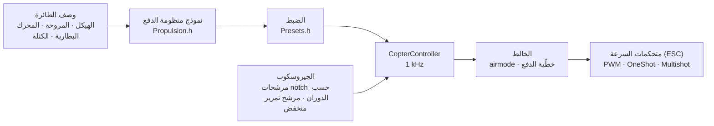

# COPTER.md — برنامج ثابت للطائرات متعددة المراوح

البرنامج الثابت نفسه، واللوحات نفسها (Matek H743-WING V3 وDevEBox H743)، والحساسات والمستقبلات نفسها — لكن بدلًا من الطائرة: رباعية مراوح أو سداسية أو ثمانية أو Y6 أو X8. الفرق الرئيسي عن Betaflight وINAV وArduPilot: **لا تُضبط قيم PID والمرشحات والسرعة الدنيا والمعدلات يدويًا**. تصف الطائرة (الهيكل، المراوح، المحركات، البطارية، الكتلة)، فيستنتج البرنامج الثابت الضبط بنفسه من نموذج فيزيائي — ثم يتكيّف أثناء الطيران مع ما قدّره النموذج تقديرًا غير دقيق.

> **بصراحة.** لم يُختبر البرنامج الثابت للطائرة متعددة المراوح حتى الآن إلا في المحاكي (نموذج بست درجات حرية، 12 تركيبة × 3 صيغ من الفيزياء «الخاطئة») وبالبناء للوحات. لم يطر بعد. القول إنه يطير أفضل من Betaflight أو ArduPilot لن يكون ممكنًا إلا بعد اختبارات الطيران — وحتى ذلك الحين هو هدف لا حقيقة.

## كيف يعمل



1. **نموذج منظومة الدفع** (`copter/Propulsion.h`): محرك بقوة دافعة كهربائية عكسية ومقاومة ملفات (من KV وحجم الجزء الثابت)، ودفع المروحة وعزمها (من القطر والخطوة وعدد الشفرات)، وعطالة الدوّار مع المروحة. لمحرك 2207 1950KV مع مروحة 5" على 6S يعطي النموذج نحو 28 000 rpm ونحو 1.6 kg من الدفع ونحو 45 A عند الخانق الكامل — كما على منصات الاختبار.
2. **ما ينتج عنه** (`copter/Presets.h`): خانق التحويم، والدوران عند السرعة الدنيا/التحويم/الخانق الكامل، وتأخّر المحرك τ، وعزوم عطالة الهيكل، ونسبة الدفع إلى الوزن، والتيار.
3. **حلقة السرعة الزاوية** تُختار من الاستجابة الترددية: المحرك والمرشحات ومرشحات notch وتأخّر الدورة ومتحكم السرعة — كلها في النموذج. تردد العبور هو الأعلى الذي يحقق هامش طور 50° (55° للانعراج) و**هامش كسب 12 dB**: يصمد هذا الضبط أمام طائرة دفعها وعطالتها «خاطئان» بمعامل اثنين. تُختار حصة D بالبحث — الحصة التي تجعل الحلقة أعرض ما يمكن. ومن تردد العبور تُشتق P وI وD والتغذية الأمامية (FF).
4. **تصحيح الكسب حسب الخانق (TPA)** من النموذج نفسه: عند الخانق المنخفض يستجيب المحرك أضعف، وعند المرتفع أقوى.
5. **أثناء الطيران** يتعلّم البرنامج الثابت خانق التحويم بنفسه (بطارية أثقل، حامل كاميرا) ويحرّك مرشحات notch مع الدوران.

## دليل التركيبات

| التركيبة | الهيكل | المروحة · المحرك · البطارية | الكتلة | الدفع/الوزن | التحويم | عرض نطاق الحلقة |
|---|---|---|---|---|---|---|
| `whoop65` | Quad X 65 mm | 31 mm ×4 · 0702 23000KV · 1S | 22 g | 4.2 | 31% | 16 Hz |
| `whoop75` | Quad X 75 mm | 40 mm ×4 · 0802 19000KV · 1S | 32 g | 4.3 | 27% | 16 Hz |
| `toothpick25` | Quad X 115 mm | 2.5" · 1103 8000KV · 3S | 70 g | 12.1 | 8% | 14 Hz |
| `micro3` | Quad X 140 mm | 3" · 1404 4500KV · 4S | 190 g | 8.3 | 15% | 14 Hz |
| `cinewhoop3` | Quad X 150 mm | 3" بخمس شفرات · 1504 3600KV · 4S | 330 g | 4.1 | 32% | 16 Hz |
| `freestyle5` | Quad X 225 mm | 5.1" · 2207 1950KV · 6S | 680 g | 9.0 | 15% | 13 Hz |
| `race5` | Quad X مطوّل | 5.1" · 2306 2000KV · 6S | 560 g | 10.8 | 11% | 12 Hz |
| `longrange7` | Quad X 315 mm | 7" · 2806.5 1300KV · 6S | 1.0 kg | 7.0 | 20% | 11 Hz |
| `heavy10` | Quad X 450 mm | 10" · 3115 900KV · 6S | 2.2 kg | 6.6 | 25% | 10 Hz |
| `cinelifter8` | X8 380 mm | 8" · 2812 1100KV · 6S | 3.5 kg | 6.4 | 23% | 11 Hz |
| `hex13` | Hex X 700 mm | 13" · 3510 600KV · 6S | 4.0 kg | 3.7 | 35% | 8 Hz |
| `hex15` | Hex X 900 mm | 15" · 4114 400KV · 6S | 6.0 kg | 3.0 | 45% | 8 Hz |

الهياكل: Quad X وX المطوّل وH وDeadcat و«+» وHex X/+ وY6 وOcto X/+ وX8. ترقيم المحركات كما في Betaflight (الرباعية: 1 — الخلفي الأيمن، 2 — الأمامي الأيمن، 3 — الخلفي الأيسر، 4 — الأمامي الأيسر)، والمراوح للداخل أو للخارج. أنماط الطيران — داخلي، حر (freestyle)، سباق، تصوير، مدى بعيد، حمولة ثقيلة: تحدد المعدلات وأقصى ميل.

## طائرتك الخاصة

`include/config/CopterConfig.h`:

```cpp
#define COPTER_BUILD "freestyle5"     // أقرب تركيبة في الدليل
constexpr float MASS_G = 742;          // زِنها مع البطارية — هذا أهم شيء
constexpr float PROP_DIAMETER_IN = 5.1f, PROP_PITCH_IN = 3.6f;
constexpr float MOTOR_KV = 2150;       // 0 — كما في التركيبة
constexpr copter::EscProtocol ESC_PROTOCOL = copter::EscProtocol::ONESHOT125;
```

يمكن اختيار التركيبة بعلَم بناء أيضًا: `-D COPTER_BUILD=\"race5\"`. بعد رفع البرنامج الثابت يعرض المفتاح `t` في وحدة التحكم النصية ما استُنتج، وينبّه إن كان هناك خلل: دفع قليل، المحرك لا يتحمل هذه المروحة، المراوح المتجاورة تتلامس، التحويم فوق 60% من الخانق، المحركات تدور أسرع من نصف تردد الدورة.

## رفع البرنامج الثابت والتشغيل الأول

```bash
pio run -e matek-h743-quad -t upload          # Matek H743-WING V3: زر BOOT + USB
pio run -e stm32h743-devebox-quad -t upload   # DevEBox H743
```

مخارج المحركات بالترتيب: Matek — S1…S8، DevEBox — PA0–PA3 وPD14 وPD15 وPE9. **التشغيل الأول — دون مراوح**، مراقب المنفذ التسلسلي على 115200:

| المفتاح | ما يفعله |
|---|---|
| `t` | الضبط: الدفع، التحويم، الدوران، τ المحرك، المرشحات، عرض نطاق الحلقة وهوامشها، P/I/D/FF، المعدلات، التحذيرات |
| `m` | اختبار المحركات: يطلب التأكيد بـ `y` (المراوح منزوعة!)، ويدير كل محرك 2 s ويقول أين هو وفي أي اتجاه يجب أن يدور |
| `s` | الحالة و**لماذا لا يتم التسليح** — كل سبب بالكلمات |
| `o` | معايرة تركيب اللوحة بثلاث وضعيات (إلزامية على Matek قبل ARM) |
| `i` · `r` · `l` · `D` | الجيروسكوب · قنوات جهاز التحكم · سطر مباشر · محمّل DFU |

يدور المحرك الخطأ — غيّر الترتيب في `CopterConfig::MOTOR_PINS`؛ يدور في الاتجاه المعاكس — غيّر الاتجاه في أداة ضبط متحكم السرعة (BLHeliSuite أو ESC-Configurator)، ولا تُعِد لحام الأسلاك.

## جهاز التحكم والأوضاع

Mode 2: CH1 الدوران الجانبي، CH2 الميل، CH3 الخانق، CH4 الانعراج. **ARM** — SwA (CH5)، كما في الطائرة. **الوضع** — SwC (CH7):

| SwC | الوضع | ما تفعله العصا |
|---|---|---|
| أعلى | ANGLE | الميل (حتى حد النمط)؛ أفلِتها — تستوي الطائرة بنفسها؛ الانعراج — حول المحور الرأسي |
| الوسط | ALT_HOLD | ANGLE + الارتفاع: الخانق في الوسط — تحويم، أعلى/أدنى — صعود حتى 3 m/s وهبوط حتى 2 m/s |
| أسفل | ACRO | سرعة الدوران وفق منحنى المعدلات؛ airmode — يمكن التحكم حتى عند خانق صفري |

يُفعَّل HORIZON (‏ANGLE قرب الوسط وACRO عند الأطراف) بتغيير سطر واحد في `CopterConfig.h`.

## الحماية

- ‏**ARM** — فقط إذا: الاتصال قائم، والخانق في الأسفل، والطائرة مستوية (حتى 25°) ولا يحرّكها أحد، والجيروسكوب يستجيب، والوضعية قد تحددت، والبطارية ليست فارغة، ولا يجري اختبار للمحركات، وتركيب اللوحة مُعايَر (حيث يلزم). مفتاح ARM الذي شُغّل مبكرًا يجب إطفاؤه وتشغيله من جديد.
- ‏**مفتاح ARM إلى الأسفل — تتوقف المحركات في الدورة نفسها**، في أي وضع.
- ‏**فقدان الإشارة**: انقطاع حتى 0.3 s لا يغيّر شيئًا؛ أطول من ذلك — على الأرض DISARM فورًا، وفي الجو — استواء وهبوط بسرعة 0.7 m/s (بالبارومتر، ومن دونه بمقياس التسارع)، ولمس الأرض — DISARM. إذا عاد الاتصال لمدة 1 s يعود التحكم إلى الطيار.
- ‏**الحادث**: في ANGLE/ALT_HOLD ميل يتجاوز 90° لأكثر من 0.7 s، أو ميل يختلف عمّا تطلبه العصا بأكثر من 30° لأكثر من 2 s (محرك معطّل، مستلقية على جانبها)؛ وفي أي وضع الاستلقاء على الظهر 1 s — تتوقف المحركات. إعادة التسليح — بعد إطفاء المفتاح فقط.
- ‏**على الأرض لا يتراكم التكامل** — لا تقفز الطائرة ولا تنقلب عند الإقلاع.

## ما في الداخل — باختصار

| الملف | المحتوى |
|---|---|
| `copter/Propulsion.h` | نموذج المحرك والمروحة |
| `copter/Presets.h` | دليل التركيبات، استنتاج الضبط، التحذيرات |
| `copter/Frames.h` · `Mixer.h` | الهياكل والخالط (airmode، أولوية الدوران الجانبي/الميل على الانعراج، خطّية الدفع) |
| `copter/RateController.h` | ‏P وI (‏relax عند القلبات والتسارع، anti-gravity) وD على الجيروسكوب وFF |
| `copter/Attitude.h` | الوضعية بالكواترنيون؛ لا يُوثق بمقياس التسارع عند الهزّات وأثناء الدوران وعند تعارضه مع الجيروسكوب |
| `copter/AltitudeHold.h` | الارتفاع: بارومتر + مقياس تسارع، ويُتعلَّم خانق التحويم |
| `copter/GyroFilter.h` | مرشحات notch عند 1× و2× الدوران وعند مرور الشفرات + مرشح تمرير منخفض |
| `copter/CopterController.h` | كل شيء معًا: ARM والأوضاع وfailsafe والحادث |
| `hal/stm32/Stm32MotorOutput.h` · `src/stm32/main_copter.cpp` | متحكمات السرعة ونقطة الدخول على STM32 |

## كيف جرى التحقق

`test/native/test_copter_sim` — ‏`CopterController` **الحقيقي** ونموذج طائرة بست درجات حرية: محركات بقوة دافعة عكسية، وهبوط جهد البطارية تحت التيار، وعزم ردّ فعل المراوح، ومقاومة الهواء، وريح بهبّات، وتأخّر متحكم السرعة، وجيروسكوب بضجيج واهتزاز المحركات (الاهتزاز فوق نصف تردد الدورة ينطوي كما على اللوحة)، وبارومتر 50 Hz، والأرض. تطير كل تركيبة من الدليل على ضبطها الخاص، وعلى نموذج لا يطابق الوصف عمدًا:

- ‏**«بطيئة»**: المروحة تسحب أقل بـ 20%، وعطالة المحرك والهيكل أكبر بـ 30%، وأثقل بـ 20%، ومركز الثقل مُزاح إلى الأمام؛
- ‏**«حادّة»**: الدفع +20%، العطالة −30%، الكتلة −15%، مركز الثقل مُزاح جانبًا — كسب الحلقة ضعف المحسوب تقريبًا.

| ماذا | النتيجة على 36 طيرانًا (12 تركيبة × 3 فيزياءات) |
|---|---|
| الإقلاع والتحويم في ALT_HOLD | الارتفاع ±0.3 m، الميل < 1°، خانق التحويم مُتعلَّم (الـ whoop «الحادّة»: 0.22 بدل 0.31 المحسوبة) |
| ANGLE: العصا إلى الآخر | 90% من الميل في 0.14–0.35 s، تجاوز < 3%، الاستواء إلى 3° في 0.15–0.4 s |
| ACRO: العصا إلى الآخر | 90% من المعدل في 0.04–0.15 s، تجاوز < 12% |
| فقدان الإشارة على ارتفاع 10 m | الهبوط ≤ 0.94 m/s، لمس الأرض — DISARM، خلال 17–28 s |

وعلى حدة على طائرة 5": ‏airmode عند خانق صفري، والانعراج، وريح 4.5 m/s بهبّات، وfailsafe دون بارومتر، ومتحكمات سرعة PWM عادية، وانقطاع الاتصال وعودته، والسقوط على الظهر، وتعطّل محرك، واختبار المحركات، وهبوط جهد البطارية. يتحقق `test_copter` من كل كتلة على حدة (41 اختبارًا)، و`native_stm32/test_app_stm32_copter` — البرنامج الثابت كله على محاكيات Matek H743: نبضات «التوقف» قبل ARM، ومعايرة التركيب، والسرعة الدنيا بعد ARM، والأوضاع من المفتاح، وفقدان الإشارة على الأرض، ووحدة التحكم النصية.

وجد المحاكي أخطاء حقيقية لا تظهر في الحساب وساعد على إصلاحها: مرشحات notch كانت تقفز مع كل دورة للخالط؛ وطور إضافي من مرشحات notch قرب عرض نطاق الحلقة؛ وتراكم التكامل أثناء تسارع السداسية «البطيئة» (تجاوز 32%)؛ ومقياس تسارع يقرأ 1 g بالضبط أثناء القلبة عند خانق التحويم فيزيح الأفق 10°؛ وطائرة بمحرك معطّل ظلت تدور على الأرض.

## ما ليس موجودًا بعد

- ‏**DShot** (والثنائي الاتجاه — دوران دقيق لمرشحات notch): يحتاج إلى مشغّل DMA؛ حساب الإطارات وCRC موجود بالفعل (`copter/EscProtocol.h`).
- ‏**دورة أسرع من 1 kHz** — لطائرات whoop التي تدور محركاتها أسرع من 500 Hz (تُظهر المحاكاة أنها أفضل بوضوح عند 4 kHz).
- الصندوق الأسود وMAVLink وOpenPlane Studio للطائرة متعددة المراوح؛ تثبيت الموقع بالـ GPS، والعودة إلى نقطة الانطلاق، والمهام.
- اختبارات الطيران.
