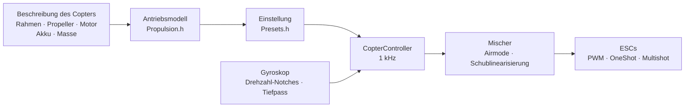

# COPTER.md – Firmware für Multicopter

Dieselbe Firmware, dieselben Boards (Matek H743-WING V3, DevEBox H743),
dieselben Sensoren und Empfänger – aber statt eines Flugzeugs ein
Quadrocopter, Hexa, Okto, Y6 oder X8. Der Hauptunterschied zu Betaflight,
INAV und ArduPilot: **PID, Filter, Leerlauf und Raten werden nicht von Hand
eingestellt**. Sie beschreiben den Copter (Rahmen, Propeller, Motoren, Akku,
Masse), und die Firmware leitet die Einstellung selbst aus einem
physikalischen Modell ab – und passt sich im Flug an das an, was das Modell
ungenau geschätzt hat.

> **Ehrlich gesagt.** Die Copter-Firmware ist bisher nur im Simulator
> geprüft (ein Modell mit 6 Freiheitsgraden, 12 Builds × 3 Varianten
> „falscher“ Physik) und durch das Bauen für die Boards. In der Luft war
> sie noch nicht. Dass sie besser fliegt als Betaflight oder ArduPilot, lässt
> sich erst nach Flugtests behaupten – bis dahin ist das ein Ziel, keine
> Tatsache.

## Wie es funktioniert



1. **Antriebsmodell** (`copter/Propulsion.h`): ein Motor mit Gegen-EMK und
   Wicklungswiderstand (aus KV und Statorvolumen), Schub und Drehmoment des
   Propellers (aus Durchmesser, Steigung und Blattzahl), Trägheit des Rotors
   mit Propeller. Für 5" 2207 1950KV an 6S liefert das Modell ~28 000 U/min,
   ~1,6 kg Schub und ~45 A bei Vollgas – wie auf Prüfständen.
2. **Was daraus folgt** (`copter/Presets.h`): Schwebegas, Drehzahl im
   Leerlauf/Schweben/Vollgas, Motorverzögerung τ, Trägheitsmomente des
   Rahmens, Schub-Gewichts-Verhältnis, Strom.
3. **Der Drehratenregelkreis** wird nach dem Frequenzgang gewählt: Motor,
   Filter, Notches, Zyklus- und ESC-Verzögerung – alles im Modell. Die
   Durchtrittsfrequenz ist die höchste mit 50° Phasenreserve (Gier 55°) und
   **12 dB Amplitudenreserve**: Die Einstellung hält einen Copter aus, dessen
   Schub und Trägheit um den Faktor zwei „falsch“ sind. Der D-Anteil wird
   durch Suche gewählt – der, bei dem der Regelkreis am breitesten ist. Aus
   der Durchtrittsfrequenz folgen P, I, D und Vorsteuerung (FF).
4. **Gaskorrektur der Verstärkung (TPA)** – aus demselben Modell: bei wenig
   Gas reagiert der Motor schwächer, bei viel Gas stärker.
5. **Im Flug** lernt die Firmware das Schwebegas selbst (schwererer Akku,
   Gimbal) und führt die Notches der Drehzahl nach.

## Build-Katalog

| Build | Rahmen | Propeller · Motor · Akku | Masse | Schub/Gewicht | Schweben | Regelbandbreite |
|---|---|---|---|---|---|---|
| `whoop65` | Quad X 65 mm | 31 mm ×4 · 0702 23000KV · 1S | 22 g | 4,2 | 31 % | 16 Hz |
| `whoop75` | Quad X 75 mm | 40 mm ×4 · 0802 19000KV · 1S | 32 g | 4,3 | 27 % | 16 Hz |
| `toothpick25` | Quad X 115 mm | 2.5" · 1103 8000KV · 3S | 70 g | 12,1 | 8 % | 14 Hz |
| `micro3` | Quad X 140 mm | 3" · 1404 4500KV · 4S | 190 g | 8,3 | 15 % | 14 Hz |
| `cinewhoop3` | Quad X 150 mm | 3" 5-Blatt · 1504 3600KV · 4S | 330 g | 4,1 | 32 % | 16 Hz |
| `freestyle5` | Quad X 225 mm | 5.1" · 2207 1950KV · 6S | 680 g | 9,0 | 15 % | 13 Hz |
| `race5` | Quad X gestreckt | 5.1" · 2306 2000KV · 6S | 560 g | 10,8 | 11 % | 12 Hz |
| `longrange7` | Quad X 315 mm | 7" · 2806.5 1300KV · 6S | 1,0 kg | 7,0 | 20 % | 11 Hz |
| `heavy10` | Quad X 450 mm | 10" · 3115 900KV · 6S | 2,2 kg | 6,6 | 25 % | 10 Hz |
| `cinelifter8` | X8 380 mm | 8" · 2812 1100KV · 6S | 3,5 kg | 6,4 | 23 % | 11 Hz |
| `hex13` | Hex X 700 mm | 13" · 3510 600KV · 6S | 4,0 kg | 3,7 | 35 % | 8 Hz |
| `hex15` | Hex X 900 mm | 15" · 4114 400KV · 6S | 6,0 kg | 3,0 | 45 % | 8 Hz |

Rahmen: Quad X, gestrecktes X, H, Deadcat, „+“, Hex X/+, Y6, Okto X/+, X8.
Motornummerierung wie in Betaflight (Quad: 1 – hinten rechts, 2 – vorne
rechts, 3 – hinten links, 4 – vorne links), Propeller nach innen oder nach
außen. Flugstile – Indoor, Freestyle, Rennen, Filmaufnahmen, Langstrecke,
Lastenflug: Sie bestimmen die Raten und die maximale Neigung.

## Ihr eigener Copter

`include/config/CopterConfig.h`:

```cpp
#define COPTER_BUILD "freestyle5"     // der nächstliegende Build aus dem Katalog
constexpr float MASS_G = 742;          // mit Akku wiegen – das Wichtigste
constexpr float PROP_DIAMETER_IN = 5.1f, PROP_PITCH_IN = 3.6f;
constexpr float MOTOR_KV = 2150;       // 0 – wie im Build
constexpr copter::EscProtocol ESC_PROTOCOL = copter::EscProtocol::ONESHOT125;
```

Der Build lässt sich auch per Flag wählen: `-D COPTER_BUILD=\"race5\"`. Nach
dem Flashen zeigt die Taste `t` in der Konsole, was abgeleitet wurde, und
warnt, wenn etwas nicht stimmt: zu wenig Schub, der Motor schafft diesen
Propeller nicht, benachbarte Propeller berühren sich, Schweben über 60 %
Gas, Motoren drehen schneller als die halbe Zyklusfrequenz.

## Flashen und erster Start

```bash
pio run -e matek-h743-quad -t upload          # Matek H743-WING V3: BOOT-Taste + USB
pio run -e stm32h743-devebox-quad -t upload   # DevEBox H743
```

Motorausgänge der Reihe nach: Matek – S1…S8, DevEBox – PA0–PA3, PD14, PD15,
PE9. **Erster Start – ohne Propeller**, serieller Monitor mit 115200:

| Taste | Was sie tut |
|---|---|
| `t` | Einstellung: Schub, Schweben, Drehzahl, Motor-τ, Filter, Bandbreite und Reserven des Regelkreises, P/I/D/FF, Raten, Warnungen |
| `m` | Motortest: verlangt Bestätigung mit `y` (Propeller ab!), dreht jeden Motor 2 s und sagt, wo er sitzt und wohin er drehen muss |
| `s` | Zustand und **warum nicht gearmt wird** – jeder Grund in Worten |
| `o` | Einbaukalibrierung des Boards mit drei Lagen (beim Matek vor ARM Pflicht) |
| `i` · `r` · `l` · `D` | Gyroskop · Senderkanäle · Live-Zeile · DFU-Bootloader |

Der falsche Motor dreht – die Reihenfolge in `CopterConfig::MOTOR_PINS`
ändern; er dreht falsch herum – die Richtung im ESC-Konfigurator
(BLHeliSuite, ESC-Configurator) einstellen, keine Kabel umlöten.

## Sender und Modi

Mode 2: CH1 Roll, CH2 Nick, CH3 Gas, CH4 Gier. **ARM** – SwA (CH5), wie beim
Flugzeug. **Modus** – SwC (CH7):

| SwC | Modus | Was der Knüppel tut |
|---|---|---|
| oben | ANGLE | Neigung (bis zur Grenze des Stils); loslassen – der Copter richtet sich aus; Gier – um die Senkrechte |
| Mitte | ALT_HOLD | ANGLE + Höhe: Gas in der Mitte – schwebt, darüber/darunter – Steigen bis 3 m/s, Sinken bis 2 m/s |
| unten | ACRO | Drehrate nach der Ratenkurve; Airmode – steuerbar auch bei null Gas |

HORIZON (nahe der Mitte ANGLE, am Rand ACRO) wird durch Ändern einer Zeile
in `CopterConfig.h` eingeschaltet.

## Schutzfunktionen

- **ARM** – nur wenn: die Verbindung steht, das Gas unten ist, der Copter
  gerade steht (bis 25°) und nicht bewegt wird, das Gyroskop antwortet, die
  Lage bestimmt ist, der Akku nicht leer ist, kein Motortest läuft, der
  Einbau des Boards kalibriert ist (wo nötig). Ein zu früh eingeschalteter
  ARM-Schalter muss aus- und wieder eingeschaltet werden.
- **ARM-Schalter nach unten – Motoren stoppen im selben Zyklus**, in jedem
  Modus.
- **Signalverlust**: ein Aussetzer bis 0,3 s ändert nichts; länger – am
  Boden sofort DISARM, in der Luft – Horizont und Sinken mit 0,7 m/s (nach
  dem Barometer, ohne es – nach dem Beschleunigungssensor), Bodenberührung –
  DISARM. Ist die Verbindung 1 s zurück, hat der Pilot wieder die Kontrolle.
- **Absturz**: in ANGLE/ALT_HOLD Neigung über 90° länger als 0,7 s oder
  mehr als 30° abweichend von dem, was der Knüppel verlangt, länger als 2 s
  (ausgefallener Motor, liegt auf der Seite); in jedem Modus 1 s auf dem
  Rücken – Motoren stopp. Erneutes ARM – erst nach Ausschalten des
  Schalters.
- **Am Boden läuft der Integralanteil nicht auf** – der Copter springt beim
  Start nicht und kippt nicht um.

## Was drin ist – kurz

| Datei | Was |
|---|---|
| `copter/Propulsion.h` | Modell von Motor und Propeller |
| `copter/Presets.h` | Build-Katalog, Ableitung der Einstellung, Warnungen |
| `copter/Frames.h` · `Mixer.h` | Rahmen und Mischer (Airmode, Vorrang von Roll/Nick vor Gier, Schublinearisierung) |
| `copter/RateController.h` | P, I (Relax bei Flips und beim Beschleunigen, Anti-Gravity), D auf dem Gyroskop, FF |
| `copter/Attitude.h` | Lage als Quaternion; dem Beschleunigungssensor wird bei Rucken, bei Drehung und bei Widerspruch zum Gyroskop nicht vertraut |
| `copter/AltitudeHold.h` | Höhe: Barometer + Beschleunigungssensor, das Schwebegas wird gelernt |
| `copter/GyroFilter.h` | Notches bei 1× und 2× Drehzahl und beim Blattdurchgang + Tiefpass |
| `copter/CopterController.h` | alles zusammen: ARM, Modi, Failsafe, Absturz |
| `hal/stm32/Stm32MotorOutput.h` · `src/stm32/main_copter.cpp` | ESCs und Einstiegspunkt auf dem STM32 |

## Wie es geprüft wurde

`test/native/test_copter_sim` – der **echte** `CopterController` und ein
Copter-Modell mit 6 Freiheitsgraden: Motoren mit Gegen-EMK, Spannungseinbruch
des Akkus unter Strom, Reaktionsmoment der Propeller, Luftwiderstand, böiger
Wind, ESC-Verzögerung, ein Gyroskop mit Rauschen und Motorvibration
(Vibration über der halben Zyklusfrequenz faltet sich zurück wie auf dem
Board), ein 50-Hz-Barometer, der Boden. Jeder Katalog-Build fliegt mit
seiner Einstellung und auf einem Modell, das absichtlich nicht zur
Beschreibung passt:

- **„träge“**: der Propeller zieht 20 % weniger, Motor und Rahmen sind 30 %
  träger, 20 % schwerer, Schwerpunkt nach vorne verschoben;
- **„quirlig“**: Schub +20 %, Trägheit −30 %, Masse −15 %, Schwerpunkt zur
  Seite verschoben – die Kreisverstärkung ist fast doppelt so hoch wie
  berechnet.

| Was | Ergebnis über 36 Flüge (12 Builds × 3 Physiken) |
|---|---|
| Start und Schweben in ALT_HOLD | Höhe ±0,3 m, Neigung < 1°, Schwebegas gelernt (beim „quirligen“ Whoop 0,22 statt berechneter 0,31) |
| ANGLE: voller Knüppel | 90 % der Neigung in 0,14–0,35 s, Überschwingen < 3 %, Ausrichten auf 3° in 0,15–0,4 s |
| ACRO: voller Knüppel | 90 % der Rate in 0,04–0,15 s, Überschwingen < 12 % |
| Signalverlust in 10 m | Sinken ≤ 0,94 m/s, Aufsetzen – DISARM, 17–28 s |

Und separat am 5": Airmode bei null Gas, Gier, 4,5 m/s Wind mit Böen,
Failsafe ohne Barometer, einfache PWM-ESCs, Verbindungsaussetzer und
Rückkehr, Sturz auf den Rücken, Motorausfall, Motortest, Spannungseinbruch
des Akkus. `test_copter` prüft jeden Baustein einzeln (41 Tests),
`native_stm32/test_app_stm32_copter` – die ganze Firmware auf Fakes des
Matek H743: „Stopp“-Impulse vor ARM, Einbaukalibrierung, Leerlauf nach ARM, Modi
vom Schalter, Signalverlust am Boden, die Konsole.

Der Simulator hat echte Fehler gefunden und beheben helfen, die in der
Rechnung unsichtbar sind: Notches, die nach jedem Mischerzyklus sprangen;
zusätzliche Phase durch Notches nahe der Regelbandbreite; Aufintegrieren
beim Beschleunigen des „trägen“ Hexa (32 % Überschwingen); einen
Beschleunigungssensor, der im Flip bei Schwebegas genau 1 g zeigt und den
Horizont um 10° verschob; einen Copter mit ausgefallenem Motor, der am
Boden weiterdrehte.

## Was es noch nicht gibt

- **DShot** (auch bidirektional – genaue Drehzahl für die Notches): braucht
  einen DMA-Treiber; Rahmen- und CRC-Berechnung gibt es schon
  (`copter/EscProtocol.h`).
- **Ein Zyklus schneller als 1 kHz** – für Whoops, deren Motoren schneller
  als 500 Hz drehen (die Simulation zeigt, dass es ihnen bei 4 kHz deutlich
  besser geht).
- Blackbox, MAVLink und OpenPlane Studio für den Copter; Positionshalten per
  GPS, Rückkehr zum Startpunkt, Missionen.
- Flugtests.
