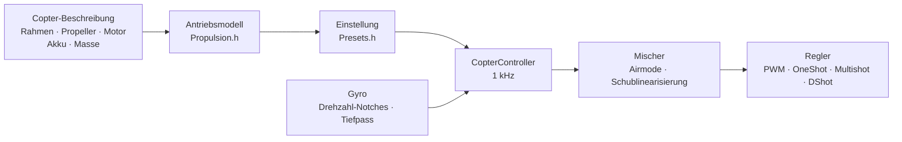

# COPTER.md – Firmware für Multicopter

Dieselbe Firmware, dieselben Boards (Matek H743-WING V3, DevEBox H743 und
fast jeder F405, auf dem Betaflight läuft), dieselben Sensoren und Empfänger
– aber statt eines Flugzeugs ein Quadrocopter, Hexa, Okto, Y6 oder X8. Der
Hauptunterschied zu Betaflight, INAV und ArduPilot: **PID, Filter, Leerlauf
und Raten werden nicht von Hand eingestellt**. Du beschreibst den Copter
(Rahmen, Propeller, Motoren, Akku, Masse), und die Firmware leitet die
Einstellung aus einem physikalischen Modell selbst ab – und passt sich im
Flug an das an, was das Modell ungenau geschätzt hat.

> **Ehrlich gesagt.** Die Copter-Firmware ist bisher nur im Simulator
> geprüft (ein Modell mit 6 Freiheitsgraden, 12 Builds × 3 Varianten
> „falscher“ Physik) und durch den Build für die Boards. In der Luft war
> sie noch nicht. Ob sie besser fliegt als Betaflight oder ArduPilot, lässt
> sich erst nach Flugtests sagen – bis dahin ist das ein Ziel, keine
> Tatsache.

## Wie es funktioniert



1. **Das Antriebsmodell** (`copter/Propulsion.h`): ein Motor mit Gegen-EMK
   und Wicklungswiderstand (aus KV und Statorvolumen), Schub und Moment des
   Propellers (aus Durchmesser, Steigung und Blattzahl), Trägheit von Rotor
   samt Propeller. Für einen 5" 2207 1950KV an 6S liefert das Modell
   ~28 000 U/min, ~1,6 kg Schub und ~45 A bei Vollgas – wie auf Prüfständen.
2. **Was daraus folgt** (`copter/Presets.h`): Schwebegas, Drehzahl im
   Leerlauf/Schweben/bei Vollgas, Motorverzögerung τ, Trägheitsmomente des
   Rahmens, Schub-Gewichts-Verhältnis, Strom.
3. **Der Drehratenregelkreis** wird über den Frequenzgang gewählt: Motor,
   Filter, Notches, Verzögerung von Schleife und Regler – alles im Modell.
   Die Durchtrittsfrequenz ist die höchste, bei der die Phasenreserve 50°
   (Gier 55°) und die **Amplitudenreserve 12 dB** beträgt: Die Einstellung
   verkraftet einen Copter, dessen Schub und Trägheit um das Doppelte
   „falsch“ sind. Der D-Anteil wird durch Suche gefunden – der, bei dem der
   Kreis am breitesten ist. Aus der Durchtrittsfrequenz folgen P, I, D und
   Vorsteuerung (FF).
4. **Gaskorrektur der Verstärkung (TPA)** – aus demselben Modell: Bei wenig
   Gas reagiert der Motor schwächer, bei viel Gas stärker. Die
   Betaflight-Kurve gibt es auch (`tpa_mode = PD` oder `D`).
5. **Im Flug** lernt die Firmware das Schwebegas selbst (schwererer Akku,
   Gimbal) und führt die Notches der Drehzahl nach.

## Build-Katalog

| Build | Rahmen | Propeller · Motor · Akku | Masse | Schub/Gewicht | Schweben | Bandbreite |
|---|---|---|---|---|---|---|
| `whoop65` | Quad X 65 mm | 31 mm ×4 · 0702 23000KV · 1S | 22 g | 4,2 | 31 % | 16 Hz |
| `whoop75` | Quad X 75 mm | 40 mm ×4 · 0802 19000KV · 1S | 32 g | 4,3 | 27 % | 16 Hz |
| `toothpick25` | Quad X 115 mm | 2,5" · 1103 8000KV · 3S | 70 g | 12,1 | 8 % | 14 Hz |
| `micro3` | Quad X 140 mm | 3" · 1404 4500KV · 4S | 190 g | 8,3 | 15 % | 14 Hz |
| `cinewhoop3` | Quad X 150 mm | 3" 5-Blatt · 1504 3600KV · 4S | 330 g | 4,1 | 32 % | 16 Hz |
| `freestyle5` | Quad X 225 mm | 5,1" · 2207 1950KV · 6S | 680 g | 9,0 | 15 % | 13 Hz |
| `race5` | Quad X gestreckt | 5,1" · 2306 2000KV · 6S | 560 g | 10,8 | 11 % | 12 Hz |
| `longrange7` | Quad X 315 mm | 7" · 2806.5 1300KV · 6S | 1,0 kg | 7,0 | 20 % | 11 Hz |
| `longrange7li` | Quad X 315 mm | 7" 2-Blatt · 2810 1300KV · 6S Li-Ion 4000 | 1,05 kg | 7,5 | 23 % | 12 Hz |
| `heavy10` | Quad X 450 mm | 10" · 3115 900KV · 6S | 2,2 kg | 6,6 | 25 % | 10 Hz |
| `cinelifter8` | X8 380 mm | 8" · 2812 1100KV · 6S | 3,5 kg | 6,4 | 23 % | 11 Hz |
| `hex13` | Hex X 700 mm | 13" · 3510 600KV · 6S | 4,0 kg | 3,7 | 35 % | 8 Hz |
| `hex15` | Hex X 900 mm | 15" · 4114 400KV · 6S | 6,0 kg | 3,0 | 45 % | 8 Hz |

Rahmen: Quad X, gestrecktes X, H, Deadcat, „+“, Hex X/+, Y6, Okto X/+, X8.
Motornummerierung wie in Betaflight (Quad: 1 – hinten rechts, 2 – vorne
rechts, 3 – hinten links, 4 – vorne links), Propeller nach innen oder nach
außen. Flugstile – Indoor, Freestyle, Rennen, Filmaufnahmen, Langstrecke,
Lasten: Sie bestimmen die Raten und die größte Neigung.

## Eigener Copter

`include/config/CopterConfig.h`:

```cpp
#define COPTER_BUILD "freestyle5"     // der nächstliegende Build aus dem Katalog
constexpr float MASS_G = 742;          // mit Akku wiegen – das Wichtigste
constexpr float PROP_DIAMETER_IN = 5.1f, PROP_PITCH_IN = 3.6f;
constexpr float MOTOR_KV = 2150;       // 0 – wie im Build
constexpr copter::EscProtocol ESC_PROTOCOL = copter::EscProtocol::ONESHOT125;
```

Den Build kann man auch per Flag wählen, `-D COPTER_BUILD=\"race5\"`, oder
ohne Neubau – im CLI: `set copter_build = race5`, `set copter_mass_g = 742`,
`save` (Einstellungen unten; die Datei ist dann nur der Standard). Nach dem
Flashen zeigt die Taste `t` in der Konsole, was abgeleitet wurde, und warnt,
wenn etwas nicht stimmt: zu wenig Schub, der Motor zieht diesen Propeller
nicht, benachbarte Propeller berühren sich, er schwebt über 60 % Gas, die
Motoren drehen schneller als die halbe Schleifenfrequenz. Ein anderer Rahmen
mit anderer Motorzahl funktioniert nach einem Neustart: bis dahin ist ARM
gesperrt (`REBOOT_REQD`).

## Flashen und erster Start

```bash
pio run -e matek-h743-quad -t upload          # Matek H743-WING V3: Taste BOOT + USB
pio run -e stm32h743-devebox-quad -t upload   # DevEBox H743
pio run -e aocodarc-f405v3-quad -t upload     # F405-Flugcontroller aus Betaflight – siehe unten
```

Motorausgänge der Reihe nach: Matek – S1…S8, DevEBox – PA0–PA3, PD14,
PD15, PE9. **Erster Start – ohne Propeller**, serieller Monitor auf 115200:

| Taste | Was sie tut |
|---|---|
| `t` | Einstellung: Schub, Schweben, Drehzahl, Motor-τ, Filter, Bandbreite und Reserven des Kreises, P/I/D/FF, Raten, Warnungen |
| `m` | Motortest: fragt nach Bestätigung mit `y` (Propeller ab!), dreht jeden 2 s und sagt, wo er sitzt und wohin er drehen muss |
| `s` | Status, wie `status` in Betaflight: Schleifenlast, Frequenzen, Akku und **warum er nicht armt** – jeder Grund als BF-Code (`RXLOSS`, `ANGLE`, `CLI`…) und in Worten |
| `o` | Kalibrierung der Board-Einbaulage in drei Posen (beim Matek vor ARM Pflicht) |
| `c` | Kompasskalibrierung: den Copter 15 s um alle Achsen drehen (Kompass – QMC5883L oder QMC5883P am GPS-Modul, je nachdem, welcher antwortet) |
| `i` · `r` · `l` · `D` | Gyro · Fernsteuerkanäle · Live-Zeile · DFU-Bootloader |
| `#` | CLI wie in Betaflight: `set`, `get`, `diff`, `aux`, `map`, `profile`, `save` – [unten](#einstellungen-cli-wie-in-betaflight) |

Der falsche Motor dreht – Reihenfolge in `CopterConfig::MOTOR_PINS` ändern;
er dreht falsch herum – Richtung im Regler-Konfigurator ändern
(BLHeliSuite, ESC-Configurator), keine Kabel umlöten.

### F405-Flugcontroller aus Betaflight

Fast jeder Quadrocopter-Flugcontroller mit STM32F405 (Betaflight, 8-MHz-Quarz)
passt, wenn er einen ICM-42688-P und ein Barometer SPL06 oder DPS310 hat.
Die Pinbelegung holen wir bei Betaflight selbst – so funktioniert auch ein
Board, dessen Target in keinem Repository steht (GETFUN F405V3):

```bash
# 1. Auf dem Board läuft noch Betaflight; der Configurator ist geschlossen. CLI-Dump in eine Datei
#    (das Python von PlatformIO – es hat pyserial):
~/.platformio/penv/Scripts/python tools/bf_board.py read --port COM5 --out stack/MEINBOARD_bf.txt
# 2. Die komplette Original-Firmware – um Betaflight notfalls zurückzuholen
#    (Board im DFU: BOOT halten und USB einstecken):
python tools/bf_board.py backup --out stack/MEINBOARD_original.bin
# 3. Board-Header: was an welchem Pin hängt (den Barometertyp kennt BF nicht – laut Beschreibung):
python tools/bf_board.py header stack/MEINBOARD_bf.txt --baro SPL06 --out include/config/boards/MEINBOARD.h
```

Dann ein env in `platformio.ini` wie `aocodarc-f405v3-quad` (das
Referenzboard: seine Pinbelegung ist öffentlich, der F405-Kern wird immer
dagegen gebaut und geprüft), mit
`-D OP_BOARD_FILE=\"config/boards/MEINBOARD.h\"`. Motoren – M1…M8 nach
Betaflight-Nummern, Empfänger, GPS und Telemetrie – an den UARTs, wo
Betaflight sie hatte; der Timer jedes Motors ist der, den Betaflight gewählt
hat (die Dump-Zeilen `timer B06 AF2` -> `OPB_MOTOR_AF`: Ein Pin kann zwei
oder drei Timer haben, und BF hat sie auf diesem Board ohne DMA-Konflikte
gewählt). Der Blackbox-Flash kommt mit Bus und CS aus dem Dump. Ein Board,
das schon unsere Firmware hat – `bf_board.py header` aus der `config.h` in
[github.com/betaflight/config](https://github.com/betaflight/config).

Der F405 hat nur eine Flash-Bank: Das Schreiben der Einstellungen hält die
CPU 1–2 s an, deshalb werden Einstellungen nur ohne ARM geschrieben.

## Einstellungen: CLI wie in Betaflight

Was aus der Beschreibung abgeleitet wurde, lässt sich von Hand korrigieren
– ohne Neubau, zeilenweise, wie im Betaflight-CLI. `#` in der Konsole ist
der Einstieg (nur ohne ARM; solange das CLI offen ist, ist ARM gesperrt):

```text
# get p_roll                     ← Wert, Grenzen, Standard und woher er kommt
# set p_roll = 50                ← in Betaflight-Einheiten
# set tune_source = BETAFLIGHT   ← BF-4.5-Standards statt des Modells
# profile 1                      ← PID-Profil 0–3 (rateprofile – Raten); sofort, im Betrieb
# diff                           ← nur Geändertes, im BF-Format
# save                           ← in den Flash, Einstellung neu berechnet, Ausstieg
```

- **Was nicht von Hand gesetzt ist, ist der Standard, und bei PID und Raten
  ist das keine Zahl aus einer Tabelle, sondern ein Ergebnis der
  Copter-Beschreibung** (`get` sagt „aus dem Copter-Modell“). Ändert sich
  die Beschreibung, verschiebt sich alles, was du nicht angefasst hast; was
  von Hand gesetzt ist, bleibt. Einen Wert gleich dem Standard zu setzen,
  ist dasselbe, wie den Standard zurückzuholen.
- **Einheiten wie in Betaflight**: ein PID-Glied = Zahl × BF-Skala × Fehler,
  die Summe ÷ 1000 geht in den Mischer (P 0,032029, I 0,244381 und beim
  Gieren noch ×2,5, D 0,000529, F 0,013754 × 0,01). `t` zeigt auch die
  Modell-Einstellung in diesen Zahlen: Für einen 5" sind das P 25, I 41,
  D 28, F 35 gegenüber den BF-Standards 45/80/40/120 – das Modell ist
  weicher, weil es 12 dB Amplitudenreserve hält.
- **Ein Diff aus Betaflight lässt sich komplett einfügen** (`diff all` 4.5):
  Bekannte Einstellungen werden gesetzt, `profile`/`rateprofile` schalten
  um, `map`, `aux`, `rxrange`, `vtx` und `rxfail` landen in ihren Tabellen,
  Kommentare werden übersprungen, eine unbekannte Einstellung ergibt eine
  Zeile `###FEHLER…###`. BF-Hardwarebefehle (`resource`, `timer`, `dma`,
  `serial`, `feature`, `board_name`…: bei uns ist das der Board-Header)
  werden mit einem Kommentar `# übersprungen` ausgelassen, und
  `defaults nosave` aus dem Diff lässt die Copter-Beschreibung in Ruhe (BF
  hat keine). Bei `batch end` (oder bei einem `save` innerhalb des
  Einfügens) – eine Übersicht: `# eingefügt: N Zeilen angewendet; M nicht
  übernommen: Namen…`. Nach einem solchen `save` zählt der Rest des
  Einfügens eine halbe Sekunde lang nicht als Konsolentasten.
- `tune_source = BETAFLIGHT` – die kompletten BF-4.5-Standards: PID
  45/80/40/120, 47/84/46/125, 45/80/0/120; Raten Actual 70/670/0; TPA nur
  auf D, 65 % ab Gas 1350, bei wenig Gas −20 % bis zum Abheben;
  `iterm_limit` 400; PID-Summe 500 (Gier 400); Anti-Gravity 80, 5 Hz,
  P 100; `throttle_boost` 5; ANGLE 5 °/s pro Grad, bis 60°;
  `yaw_lowpass_hz` 100; Filter – umgerechnet auf unsere Kette (Gyro PT2
  250 Hz, D – PT1 60 Hz: dieselbe Verzögerung an der Bandbreite des
  Kreises). Die Drehzahl-Notches bleiben unsere.
- Im Flash steht nur, was von Hand gesetzt ist (und die gewählten Profile);
  Neuflashen löscht es nicht, `defaults` schon. `exit` ohne `save` –
  Abbruch.

| Befehl | Was er tut |
|---|---|
| `set` · `set Name = Wert` | alle Einstellungen · setzen (wirkt nach `save`) |
| `get Namensteil` | Wert, Grenzen, Standard, was das ist |
| `diff [all]` · `dump [all]` | Geändertes · alles; `all` – alle Profile |
| `profile [0-3]` · `rateprofile [0-3]` | PID-Profil · Ratenprofil wählen |
| `aux` · `aux Nr. Modus Kanal von bis [Logik Verknüpfung]` · `aux help` | Tabelle der Modi auf Schaltern · eine Zeile · Modusnummern – [unten](#fernsteuerung-und-modi) |
| `map [AETR1234]` · `rxrange [0-3 min max]` | Kanalreihenfolge · Knüppelenden für Rollen/Nicken/Gieren/Gas |
| `rxfail` · `rxfail Kanal a\|h\|s [Wert]` | was mit einem Kanal ohne Verbindung geschieht, wie in BF: Knüppel 0–3 – `a` (Failsafe-Automatik) oder `h` (letzten halten), AUX 4–17 – `h` oder `s 750…2250` (setzen); die ersten 0,3 s – immer der letzte gültige |
| `vtx` · `vtx Nr. Kanal Band VTX-Kanal Leistung von bis` · `vtx_info` | Videosender per Schalter, wie in BF · was er geantwortet hat und seine Leistungen – [unten](#videosender) |
| `dshot_telemetry_info` | wie in BF: eRPM, Drehzahl, Hz und Anteil der Frames ohne Antwort je Motor (`dshot_bidir`) |
| `flash_info` · `flash_erase` | Blackbox-Flash (F405): Chip, Größe, JEDEC-ID, Zustand und Flüge · alles löschen (ein Befehl, wartet bis zu einer Minute, wie in BF) |
| `save` · `defaults [nosave]` | speichern und neu berechnen · alles auf Standard |
| `status` · `tasks` | Zustand (wie `s`) · Zeit jedes Schleifenteils: Frequenz, Mittel und Schlimmstes, CPU-Anteil |
| `version` · `help` · `exit` | Version · Liste · Ausstieg |

### Einstellungen

| Einstellung | Wo | Bereich | Standard | Was |
|---|---|---|---|---|
| `tune_source` | global | `MODEL`, `BETAFLIGHT` | `MODEL` | woher PID, Filter und TPA kommen: aus der Copter-Beschreibung oder die BF-4.5-Standards |
| `profile_name` | PID-Profil | bis 8 Zeichen | – | Name des PID-Profils |
| `p_roll` `i_roll` `d_roll` `f_roll` | PID-Profil | P, I, D 0–250; F 0–1000 | aus dem Modell; BF: 45, 80, 40, 120 | Roll-PID in BF-Einheiten |
| `p_pitch` `i_pitch` `d_pitch` `f_pitch` | PID-Profil | ebenso | aus dem Modell; BF: 47, 84, 46, 125 | Nick-PID |
| `p_yaw` `i_yaw` `d_yaw` `f_yaw` | PID-Profil | ebenso | aus dem Modell; BF: 45, 80, 0, 120 | Gier-PID |
| `d_max_roll` `d_max_pitch` `d_max_yaw` | PID-Profil | 0–250 | 0 (D konstant) | D bei scharfen Bewegungen, wie in BF 2025.12: dann ist `d_*` das D in Ruhe |
| `d_min_roll` `d_min_pitch` `d_min_yaw` | PID-Profil | 0–250 | 0; BF: 30, 34, 0 | wie in BF 4.5: D in Ruhe, `d_*` – bei scharfen Bewegungen (wenn `d_max_*` nicht gesetzt ist) |
| `d_max_gain` (`d_min_gain`) | PID-Profil | 0–100 | 37 | wie leicht D bei Gyro-Rucken steigt: bei 37 – vollständig bei ~5000 °/s² |
| `d_max_advance` (`d_min_advance`) | PID-Profil | 0–200 | 20 | wie früh D bei Knüppelbewegung steigt: bei 20 – vollständig bei ~2500 °/s² Sollwert |
| `iterm_relax` | PID-Profil | `OFF`, `RP`, `RPY`, `RP_INC`, `RPY_INC` | `RPY`; BF: `RP` | auf welchen Achsen I wartet, solange sich der Sollwert scharf ändert (kein Zurückfedern nach einem Flip); `_INC` – nur das Wachstum wird gebremst |
| `iterm_relax_type` | PID-Profil | `GYRO`, `SETPOINT` | `SETPOINT` | `SETPOINT` – I sammelt langsamer; `GYRO` – I zum geglätteten Sollwert, nahe daran null |
| `iterm_relax_cutoff` | PID-Profil | 1–50 Hz | 10; BF: 15 | Glättung des Sollwerts für Relax: weniger – wartet länger |
| `iterm_relax_error` | PID-Profil | `OFF`, `ON` | `ON` | unseres: ein großer Fehler beim Beschleunigen auf einen neuen Sollwert (Flip) sammelt sich nicht in I; ein Fehler ohne Knüppelbewegung (Böe, Gasstoß) schon |
| `iterm_rotation` | PID-Profil | `OFF`, `ON` | `OFF` | I dreht mit dem Rahmen: In einer Pirouette geht das auf Rollen Gesammelte ins Nicken über |
| `iterm_windup` | PID-Profil | 30–100 % | 100 (aus); BF: 85 | je weiter die Motoren auseinanderliegen, desto schwächer sammelt I; bei vollem Auseinanderlaufen steht es |
| `iterm_limit` | PID-Profil | 0–500 | aus dem Modell (300); BF: 400 | I-Grenze, 1000 – der ganze Motorweg |
| `pidsum_limit` · `pidsum_limit_yaw` | PID-Profil | 100–1000 | 1000; BF: 500 · 400 | Grenze der PID-Summe für Rollen und Nicken · Gieren (1000 – der ganze Weg); an der Grenze sammelt I nicht |
| `anti_gravity_gain` | PID-Profil | 0–250 | 80 | ein Gasstoß macht I stärker, die Nase sackt nicht ab: beim vollen Stoß (der ganze Weg in 0,1 s) um das 1 + gain/10-Fache |
| `anti_gravity_cutoff_hz` | PID-Profil | 2–50 Hz | 5 | Glättung der Gasgeschwindigkeit: weniger – niedrigere, aber längere Spitze |
| `anti_gravity_p_gain` | PID-Profil | 0–250 % | 0; BF: 100 | auch P für Rollen und Nicken wird stärker: bei 100 – um 50 % beim vollen Stoß |
| `throttle_boost` · `throttle_boost_cutoff` | PID-Profil | 0–100 (×0,1) · 5–50 Hz | 0; BF: 5 · 15 | ein Gasruck am Knüppel (Gas minus sein Tiefpass) wird um das 1 + boost/10-Fache verstärkt – die Motoren holen den Knüppel früher ein; nicht in ALT_HOLD |
| `tpa_mode` | PID-Profil | `PD`, `D`, `MODEL` | `MODEL`; BF: `D` | Gaskorrektur von PD: `PD`/`D` – die BF-Kurve (zwei Zeilen unten), `MODEL` – aus dem Modell auf P und D |
| `tpa_rate` · `tpa_breakpoint` | PID-Profil | 0–100 % · 750–2250 µs | 65 · 1350 | `PD`/`D`: oberhalb des Knickpunkts wird PD (oder nur D) linear schwächer, bei Vollgas um `tpa_rate` |
| `tpa_low_rate` · `tpa_low_breakpoint` | PID-Profil | −128…100 % · 750–2250 µs | 0; BF: 20 · 1050 | bei null Gas ist PD (D) um `tpa_low_rate` schwächer (unter 0 – stärker), bis zum Knickpunkt linear |
| `tpa_low_always` | PID-Profil | `OFF`, `ON` | `OFF` | `OFF` – nur bis das Gas nach ARM über `tpa_low_breakpoint` ging (am Boden), `ON` – immer |
| `feedforward_transition` | PID-Profil | 0–100 % | 0 | näher an der Knüppelmitte als dieser Wert ist die Vorsteuerung schwächer (linear bis null) – weicher um die Mitte |
| `feedforward_averaging` | PID-Profil | `OFF`, `2_POINT`, `3_POINT`, `4_POINT` | `OFF` | die Knüppelgeschwindigkeit für die Vorsteuerung – gemittelt über 2–4 Empfängerframes: ruhiger bei seltenen Frames, aber später |
| `feedforward_smooth_factor` | PID-Profil | 0–95 % | 0; BF: 25 | Glättung der Vorsteuerung von Frame zu Frame (Anteil des alten Werts je Frame) |
| `feedforward_jitter_factor` | PID-Profil | 0–20 | 0; BF: 7 | der Knüppel bewegte sich in einem Frame weniger (500 – halber Knüppel) – die Vorsteuerung wird schwächer, sanft bis null: Fingerzittern schüttelt die Motoren nicht |
| `feedforward_boost` | PID-Profil | 0–50 | 0; BF: 15 | ein Zuschlag aus der Knüppelbeschleunigung (15 – 3 ms Vorhalt, nicht mehr als die Knüppelgeschwindigkeit selbst) |
| `feedforward_max_rate_limit` | PID-Profil | 0–150 % | 0; BF: 90 | steht der Sollwert bei diesem Anteil der größten Rate, ist die Vorsteuerung nach außen nicht größer als das, was P auf den verbleibenden Spielraum gäbe, darüber – null: ein Flip mit vollem Knüppel ohne Überschwingen |
| `yaw_lowpass_hz` | PID-Profil | 0–500 Hz | aus dem Modell (30–100); BF: 100 | Tiefpass am Ausgang des Gier-PID (0 – kein Filter); die PID des Modells sind mit der Frequenz des Modells berechnet |
| `use_integrated_yaw` · `integrated_yaw_relax` | PID-Profil | `OFF`, `ON` · 0–255 | `OFF` · 200 | Gieren über das Integral der PID-Summe (×100 1/s, Leck relax × 0,08 1/s) – für große Propeller, bei denen das Gieren den Propeller beschleunigt. BF-Zahlen – wie in BF (I ohne ×2,5; ein 5" braucht `d_yaw`, sonst schwingt er); nicht gesetzte Gier-PID aus dem Modell werden so umgerechnet, dass der Kreis gleich bleibt |
| `abs_control_gain` | PID-Profil | 0–20 (°/s pro °) | 0 (aus) | ACRO: Winkel und Kurs, die durch Böe oder Schubungleichgewicht verloren gingen, kommen zurück; Rollen und Nicken – nur in ACRO, Gieren – in jedem Modus, in der Luft |
| `abs_control_limit` · `abs_control_error_limit` · `abs_control_cutoff` | PID-Profil | 10–255 °/s · 1–45° · 1–45 Hz | 90 · 20 · 11 | Grenze der Korrektur · des gesammelten Winkelfehlers · Tiefpass des Sollwerts (das Nachhinken des Rahmens bei schnellem Knüppel sammelt sich nicht) |
| `thrust_linear` | PID-Profil | 0–150 % | aus dem Modell (15–30); BF: 0 | Schublinearisierung: wenig Gas reagiert wie viel Gas |
| `motor_output_limit` | PID-Profil | 1–100 % | 100 | Anteil des Motorwegs über dem Leerlauf: ein 6S-Akku an Motoren für 4S – 66 |
| `rateprofile_name` | Ratenprofil | bis 8 Zeichen | – | Name des Ratenprofils |
| `roll_rc_rate` `pitch_rc_rate` `yaw_rc_rate` | Ratenprofil | 1–255 (×10 °/s) | nach Flugstil; BF: 7 | Rate in der Knüppelmitte |
| `roll_srate` `pitch_srate` `yaw_srate` | Ratenprofil | 0–255 (×10 °/s) | nach Flugstil; BF: 67 | Rate bei vollem Knüppel |
| `roll_expo` `pitch_expo` `yaw_expo` | Ratenprofil | 0–100 % | nach Flugstil; BF: 0 | Expo: weicher um die Mitte |
| `serialrx_provider` | global | `IBUS`, `SBUS`, `CRSF` | `RX_PROTOCOL` aus `Config.h` | Empfängerprotokoll; wechselt nach `save` ohne Neustart |
| `rx_min_usec` `rx_max_usec` | global | 750–2250 µs | 885, 2115 | ein Impuls außerhalb davon ist ein Kanalfehler: am Knüppel – Verbindungsverlust, an AUX bleibt der vorige Wert |
| `copter_build` | global | Builds des Katalogs | `COPTER_BUILD` | Grundlage der Copter-Beschreibung |
| `copter_mass_g` | global | 0–30000 g (0 – Schätzung) | aus dem Build | Abflugmasse mit Akku |
| `copter_wheelbase_mm` | global | 30–2000 mm | aus dem Build | zwischen den Achsen gegenüberliegender Motoren |
| `prop_diameter_in` `prop_pitch_in` `prop_blades` | global | 0,5–40", 0,3–30", 2–8 | aus dem Build | Propeller |
| `motor_stator_mm` `motor_height_mm` `motor_kv` | global | 3–120 mm, 0,5–60 mm, 50–80000 | aus dem Build | Motor: 2207 – 22 und 7 |
| `battery_cells` `battery_mah` | global | 1–14 S, 50–50000 mAh | aus dem Build | Akku |
| `props_out` | global | `OFF`, `ON` | `PROPS_OUT` | Propeller nach außen: alle Motoren drehen andersherum |
| `battery_chemistry` | global | `LIPO`, `LIHV`, `LIION` | aus dem Build (LiPo) | Chemie: Zellschwellen und Spannung unter Last für das Schubmodell (3,75 / 3,85 / 3,5 V) |
| `vbat_min_cell_voltage` `vbat_warning_cell_voltage` `vbat_max_cell_voltage` | global | 100–500 (×0,01 V) | nach Chemie: LiPo 330/350/430, LiHV 330/350/440, Li-Ion 280/310/425 | Zelle: leer (CRITICAL) · Zeit für den Heimweg (WARNING; darunter ohne Last – nicht armen) · voll |
| `vbat_full_cell_voltage` | global | 100–500 (×0,01 V) | nach Chemie: LiPo 410, LiHV 425, Li-Ion 410 | eine Zelle darüber beim Anstecken – der Akku ist voll; sonst zeigt das OSD ohne ARM `BATT < FULL` |
| `vbat_scale` · `vbat_divider` · `vbat_multiplier` | global | 0–255 · 1–255 · 1–255 | Teiler des Boards (110 · 10 · 1 – 1:11; F405 – aus dem Board-Dump) | Volt = mV am Pin × `vbat_scale` / (1000 × `vbat_divider` × `vbat_multiplier`), wie in BF |
| `battery_meter` | global | `NONE`, `ADC`, `ESC` | `ADC`, wenn das Board einen Akkueingang hat | woher die Spannung kommt (`ESC` – aus der Regler-Telemetrie, wirkt noch nicht) |
| `current_meter` · `ibata_scale` · `ibata_offset` | global | `NONE`/`ADC`/`VIRTUAL`/`ESC`/`MSP` · ±16000 (×0,1 mV/A) · ±32000 mV | `ADC`, wenn das Board einen Stromeingang hat; 400 (Matek – 250, F405 – aus dem Board-Dump); 0 | Stromsensor: Strom, verbrauchte mAh, Rest (`VIRTUAL`, `ESC`, `MSP` werden aus einem BF-Diff übernommen, liefern aber noch keinen Strom) |
| `vbat_detect_cell_voltage` | global | 0–2000 (×0,01 V) | 300 | ein Akku ist da, wenn die Spannung zwischen diesem Wert und einer vollen Zelle (1S) liegt oder über zweien davon; sonst – USB-Versorgung |
| `force_battery_cell_count` | global | 0–24 S | 0 | Zellenzahl; 0 – aus der Copter-Beschreibung (`battery_cells`). In BF bedeutet 0 Raten nach der Spannung; wir raten nicht: Ein leerer Li-Ion-6S (17 V) ist von einem vollen 4S-LiPo nicht zu unterscheiden |
| `bat_capacity` | global | 0–20000 mAh | 0 | Kapazität für den Rest und den Verbrauchsalarm; 0 – `battery_mah` aus der Beschreibung |
| `vbat_hysteresis` | global | 0–250 (×0,01 V) | 1 | der Alarm kommt, wenn die Spannung noch so viel unter der Schwelle liegt (für den ganzen Akku, wie in BF); zurück – über der Schwelle |
| `vbat_duration_for_warning` · `vbat_duration_for_critical` | global | 0–150 (×0,1 s) | 20 · 20 (BF: 0 · 0) | so lange am Stück unter der Schwelle – WARNING · CRITICAL: ein Einbruch beim Gasstoß ist kein Alarm |
| `use_vbat_alerts` · `use_cbat_alerts` · `cbat_alert_percent` | global | `OFF`/`ON` · `OFF`/`ON` · 0–100 % | `ON` · `OFF` · 10 | den Akkualarm piepen und anzeigen · Alarm auch nach mAh (höchstens `cbat_alert_percent` übrig – WARNING, null – CRITICAL; braucht einen Stromsensor) |
| `vbat_cutoff_percent` | global | 0–100 % | 100 (keine) | ab dem ersten CRITICAL wird das Knüppelgas in 10 s sanft auf diesen Anteil begrenzt (LVC von BF); nicht die Höhenhaltung und nicht die Failsafe-Automatik |
| `vbat_display_lpf_period` · `vbat_sag_lpf_period` · `ibat_lpf_period` | global | 1–255 (×0,1 s) | 30 · 2 · 10 | Glättung (Tiefpass 10/Periode Hz, wie in BF): Anzeige und Alarme · Spannung für die Einbruchkompensation · Strom |
| `vtx_protocol` | global | `AUTO`, `SMARTAUDIO`, `TRAMP`, `NONE` | `AUTO`, wenn das Board eine VTX-Leitung hat | Steuerleitung des Videosenders |
| `vtx_band` · `vtx_channel` · `vtx_freq` | global | 0–10 · 1–8 · 0–6200 MHz | 5 (R) · 1 · 0 | Band (1 A, 2 B, 3 E, 4 F, 5 R, 6 L, 7 X, 8 V, 9 G, 10 S; 0 – Frequenz als Zahl) |
| `vtx_power` | global | 1–12 | 1 | Leistungsstufe, 1 – die schwächste; die Tabelle kommt vom Sender (`vtx_info`) |
| `vtx_max_power_mw` | global | 0–10000 mW | 0 (keine) | **Obergrenze**: höher geht es weder per Schalter noch per Taste am Sender |
| `vtx_low_power_disarm` | global | `OFF`, `ON`, `UNTIL_FIRST_ARM` | `OFF` | ohne ARM – die schwächste Stufe |
| `gps_minimum_sats` | global | 4–50 | 8 | das Zuhause wird bei ARM gesetzt, wenn mindestens so viele Satelliten da sind |
| `crsf_telemetry` | global | `OFF`, `ON` | `ON` | Telemetrie zur Fernsteuerung über CRSF |
| `blackbox_device` | global | `NONE`, `SPIFLASH`, `SDCARD`, `SERIAL` | `SPIFLASH` beim F405, `SDCARD` beim H743 | wohin die Blackbox schreibt; sie schreibt nur, wenn das Medium dieses Boards gewählt ist (`SERIAL` wird aus einem BF-Diff übernommen, schreibt aber nicht) |
| `blackbox_mode` | global | `NORMAL`, `MOTOR_TEST`, `ALWAYS` | `NORMAL` | wann aufgezeichnet wird: solange ARM, solange die Motoren drehen, immer |
| `blackbox_sample_rate` | global | `1/1` … `1/32` | `1/1` (F405 mit Flash – `1/2`) | Gyro, PID und Motoren – jede wievielte Schleife |
| `motor_poles` | global | 4–255 | 14 | Magnete im Rotor: Drehzahl = eRPM × 2 / `motor_poles` |
| `dshot_bidir` | global | `OFF`, `ON` | `OFF` | bidirektionales DShot: der Regler antwortet mit der Drehzahl; wirkt nach einem Neustart (bis dahin ist ARM gesperrt, `REBOOT_REQD`); damit ist die Schleifengrenze niedriger – Frame, 30 µs und Antwort: DShot600 – bis 11,8 kHz, 300 – 7,2, 150 – 4,0 |
| `small_angle` | global | 0–180° | 25 | steht er stärker geneigt – nicht armen; 180 – keine Prüfung |
| `auto_disarm_delay` | global | 0–60 s | 5 | scharf geschaltet, aber er steht so lange mit Gas unten am Boden – DISARM (in BF nur beim Armen per Knüppel; bei uns auch mit Schalter); 0 – nie |
| `runaway_takeoff_prevention` | global | `OFF`, `ON` | `ON` | nach ARM ist der Regler am Anschlag und der Copter dreht sich – DISARM |
| `runaway_takeoff_deactivate_delay` | global | 100–1000 ms | 500 | so lange ruhiger Flug – die Runaway-Prüfung schaltet bis zum nächsten ARM ab |
| `runaway_takeoff_deactivate_throttle_percent` | global | 0–100 % | 20 | Gas, über dem der Flug zählt (oder der Copter ist schon über einen Meter gestiegen) |
| `failsafe_delay` | global | 1–200 (×0,1 s) | 15 | so lange keine Verbindung – Stufe 2; davor Stufe 1: gerade und hält die Höhe (in BF – Knüppel in die Mitte, Gas 0) |
| `failsafe_procedure` | global | `AUTO-LAND`, `DROP`, `GPS-RESCUE` | `AUTO-LAND` (BF: `DROP`) | Stufe 2: gerade und Sinken · Motoren aus · Rückkehr (vorerst ohne GPS – wie AUTO-LAND, die Steuerung kommt per Knüppel zurück) |
| `failsafe_landing_time` | global | 1–250 s | 120 (BF: 60) | AUTO-LAND ist in dieser Zeit nicht gelandet – DISARM; bei uns folgt das Sinken der Höhe und endet beim Aufsetzen, das ist eine Reserve |
| `failsafe_throttle` | global | 1000–2000 µs | 1000 | AUTO-LAND: 1000 – Sinken mit 0,7 m/s nach Höhe; mehr – konstantes Gas, wie in BF |
| `failsafe_throttle_low_delay` | global | 0–300 (×0,1 s) | 100 | das Gas war vor dem Verbindungsverlust länger unten – sofort DISARM (der Copter steht offenbar am Boden); 0 – nein |
| `failsafe_recovery_delay` | global | 1–200 (×0,1 s) | 5 | die Verbindung hält so lange – die Steuerung geht an den Piloten zurück (Stufe 2) und nach einem Failsafe-DISARM ist ARM wieder möglich |
| `failsafe_stick_threshold` | global | 0–50 % | 30 | GPS-RESCUE: die Verbindung ist zurück – die Steuerung geht an den Piloten, wenn ein Knüppel weiter ausgelenkt wird |
| `failsafe_switch_mode` | global | `STAGE1`, `KILL`, `STAGE2` | `STAGE1` | FAILSAFE-Modus per Schalter: wie Verbindungsverlust · Motoren sofort aus (ARM nach 1 s) · gleich Stufe 2 |
| `craft_name` | global | bis 16 Zeichen | – | Name des Copters: BF-Configurator (`MSP_NAME`) und Log |
| `vbat_sag_compensation` | PID-Profil | 0–150 % | 100 (BF: 0) | Motorkorrektur für den Akkueinbruch: 100 – mit leerem Akku reagieren sie wie mit vollem, 0 – keine Korrektur |

Die Copter-Beschreibung (`copter_build` … `props_out`): Der Standard ist
der Build aus dem Katalog mit den Korrekturen „eigener Copter“ aus
`CopterConfig.h`; wechselt der Build, kommen die Standards für Masse,
Propeller, Motor und Akku aus dem neuen, und was von Hand gesetzt ist,
bleibt. PID und Filter werden bei `save` für die neue Beschreibung neu
berechnet.

Die Ratenkurve ist vorerst unsere: in der Mitte `rc_rate`, am Anschlag
`srate`, Expo macht die Mitte weicher; mit Expo 0 deckt sie sich mit Actual
aus Betaflight. Für die 13"/15"-Hexas verlangt das Modell D über 250 und F
über 1000 – `get` zeigt den an die Grenze gedrückten Standard, es wirkt aber
der genaue Modellwert.

## Fernsteuerung und Modi

Standardmäßig Mode 2: CH1 Rollen, CH2 Nicken, CH3 Gas, CH4 Gieren.
**ARM** – SwA (CH5), wie beim Flugzeug. **Modus** – SwC (CH7):

| SwC | Modus | Was der Knüppel tut |
|---|---|---|
| oben | ANGLE | Neigung (bis zur Grenze des Stils), loslassen – der Copter richtet sich aus; Gieren – um die Senkrechte |
| Mitte | ALT_HOLD | ANGLE + Höhe: Gas in der Mitte – schwebt, darüber/darunter – Steigen bis 3 m/s, Sinken bis 2 m/s |
| unten | ACRO | Drehrate nach der Ratenkurve; Airmode – steuerbar auch bei null Gas |

All das lässt sich im CLI ändern, wie in Betaflight:

- `map TAER1234` – Kanalreihenfolge: ein Buchstabe an der Stelle jedes
  Kanals (A – Rollen, E – Nicken, T – Gas, R – Gieren, 1–4 – AUX1–AUX4). Die
  Failsafe-Gasschwelle (`RX_FAILSAFE_THROTTLE_US`) folgt dem Gas.
- `rxrange 3 1050 1950` – die Enden des Gasknüppels werden auf 1000–2000
  gestreckt (0 – Rollen, 1 – Nicken, 2 – Gieren, 3 – Gas).
- `aux 0 0 1 1700 2100 0 0` – der Modus ist an, solange der Kanal im
  Bereich ist: Zeilennummer 0–19, Modus (BF-Nummer), Kanal (0 – AUX1, also
  CH5 bei `map AETR1234`), von und bis in µs in 25er-Schritten, Logik (0 –
  irgendeine Zeile des Modus genügt, 1 – alle nötig), Verknüpfung (der
  Modus schaltet zusammen mit einem anderen). `aux` ohne Argumente – die
  Tabelle, `aux help` – die Modusnummern.

| Modus | BF-Nummer | Was er tut |
|---|---|---|
| ARM | 0 | Motoren an |
| ANGLE · HORIZON · ALTHOLD | 1 · 2 · 3 | Flugmodus; sind mehrere an – ALTHOLD, dann ANGLE, dann HORIZON; keiner – ACRO |
| FAILSAFE | 27 | wie Verbindungsverlust (Failsafe-Prüfung am Boden) |
| AIR MODE | 28 | Airmode auch bei ausgeschaltetem `AIRMODE` in `CopterConfig.h` |
| PREARM | 36 | steht er in der Tabelle – ARM nur bei eingeschaltetem PREARM |
| USER1 … USER4 | 40 … 43 | PINIO-Pins des Boards (beim GETFUN F405V3: USER1 – Kamera CAM1/CAM2, USER2 – 12-V-Versorgung) |
| VTX PIT MODE · VTX CONTROL DISABLE | 39 · 48 | Videosender in PIT · den Sender nicht anfassen |

**Ist die Tabelle leer (so nach `defaults`), arbeiten die Schalter aus
`CopterConfig.h`** (`aux` zeigt sie als Zeilen zum Kopieren). Gibt es auch
nur eine Zeile, arbeitet nur die Tabelle, wie in BF: Ein eingefügter
Betaflight-Diff beschreibt sie vollständig, die Standards der Firmware
werden nicht beigemischt. Kein ARM in der Tabelle – der Copter armt nicht
(`NO_ARM_AUX`). BF-Modi, die wir noch nicht haben (BEEPER, GPS RESCUE…),
werden übernommen und gespeichert, tun aber nichts – `aux` sagt das.

## Videosender

Einen analogen Sender mit Steuerleitung (SmartAudio oder Tramp –
`vtx_protocol = AUTO` findet ihn selbst) hält die Firmware auf Frequenz und
Leistung aus den Einstellungen:

```text
# set vtx_band = 5            ← R
# set vtx_channel = 1         ← R1, 5658 MHz
# set vtx_max_power_mw = 400  ← Obergrenze „in der Stadt“
# vtx 0 2 0 0 2 900 1300      ← AUX3 (SwC) oben – Stufe 2
# vtx 1 2 0 0 6 1700 2100     ← AUX3 unten – Stufe 6 (aber nicht über der Obergrenze)
# vtx_info                    ← was der Sender geantwortet hat, seine Leistungen
# save
```

- **Die Obergrenze `vtx_max_power_mw`** ist das Wichtigste: Weder eine
  `vtx`-Zeile per Schalter noch `vtx_power` heben die Leistung darüber, und
  wurde der Sender mit seiner eigenen Taste hochgestellt, holt die Firmware
  ihn nach einer Sekunde zurück. Obergrenze aufheben –
  `set vtx_max_power_mw = 0`.
- **Leistung von der Fernsteuerung** – `vtx`-Zeilen, wie in Betaflight:
  Solange AUX im Bereich ist, hat der Sender dieses Band, diesen Kanal und
  diese Stufe (0 – nicht anfassen). Schalter, Drehknopf oder
  programmierbarer EdgeTX-Kanal – egal.
- Die Leistungstabelle kommt vom Sender selbst: SmartAudio 2.1 meldet seine
  Stufen in dBm (36 dBm – „4 W“), Tramp – die Grenze in mW; SmartAudio
  1.0/2.0 hat die Stufen 25/200/500/800 mW, wie der TBS Unify.
- Frequenzen – die Sendertabelle mit 80 Kanälen 4,9–6,1 GHz: A, B, E, F, R,
  L (beim Händler – D), X, V, G, S. **Eine analoge Brille (Cobra X V4)
  empfängt nur A, B, E, F, R und L** – auf X/V/G/S gibt es darin kein Bild.
- Modus VTX PIT MODE – PIT (am Boden andere nicht stören), USER2 beim
  GETFUN – die 12-V-Versorgung des ganzen Senders. Antwortet der Sender
  nicht, sagt `status` „VTX: antwortet nicht“; dann stellt man Frequenz und
  Leistung mit seinen Tasten ein.

## OSD und Summer

**OSD** – der Chip AT7456E/MAX7456 auf dem Flugcontroller (bei Boards aus
Betaflight kommen sein Bus und CS aus dem Board-Dump). Das Kamerabild läuft
immer durch den Chip, das OSD liegt darüber: Verbindung (LQ), Modus,
Satelliten, VTX-Leistung, Fadenkreuz, Pfeil und Entfernung nach Hause, Höhe,
Spannung (auch je Zelle), Strom, mAh, Flugzeit und **eine Hauptwarnung** in
der Mitte: FAILSAFE, RXLOSS, BATT CRITICAL, LOW BATTERY, ohne ARM – warum er
nicht armt (ein BF-Code, zum Beispiel THROTTLE) oder DISARMED. Die Schrift
ist die im Chip (bei Boards unter Betaflight – die BF-Schrift), daher die
Beschriftung in lateinischen Buchstaben. PAL/NTSC – nach der Kamera, von
selbst; der Modus OSD DISABLE blendet alles aus.

**Summer**: ARM – lang, DISARM – zweimal kurz, nach dem Einschalten, sobald
man armen kann, – kurz; Akku WARNING – kurz alle 2 s, CRITICAL – oft;
Failsafe – Alarm; Modus BEEPER – „Modell suchen“ (auch ohne Verbindung –
AUX hält den letzten Wert), BEEPER MUTE – Ruhe (außer der Suche).

## GPS, Kompass und Telemetrie zur Fernsteuerung

- **GPS** (u-blox M10) – am UART, wo Betaflight es hatte. `status` zeigt
  Fix, Satelliten, Genauigkeit, Geschwindigkeit und **das Zuhause**: Es wird
  bei ARM gesetzt, wenn ein 3D-Fix da ist und mindestens
  `gps_minimum_sats` Satelliten; sonst – beim ersten guten Fix schon im
  Flug („schon im Flug gesetzt“). Entfernung und Richtung nach Hause – in
  `status`, `@live` und auf der Fernsteuerung. GPS-Modi (Rückkehr nach
  Hause, Positionshaltung) **gibt es noch nicht**.
- **Kompass** am GPS-Modul – QMC5883L oder QMC5883P, die Firmware probiert
  beide. Kalibrierung – `c` in der Konsole. Der Kurs der Nase kommt vom
  Kompass (falls kalibriert), über 3 m/s – vom GPS, sonst – vom Gyro seit
  dem Einschalten. Die Neigung wird noch nicht ausgeglichen: Im schnellen
  Flug kann der Kompasskurs um etwa zehn Grad danebenliegen.
- **CRSF-Telemetrie** (ELRS, Crossfire) – in denselben UART, aus dem die
  Kanäle kommen: Akku (V, A, mAh, %), GPS, Lage, Modus (`ACRO`, `ANGL`,
  `HOR`, `ALTH`, `!FS!`; ohne ARM – mit „*“), Vertikalgeschwindigkeit. In
  EdgeTX (RadioMaster TX12) – „Sensoren suchen“ auf der Telemetrieseite des
  Modells.

## Blackbox

Beim H743 (Matek H743, DevEBox) schreibt der Copter den Flug auf die
SD-Karte – im selben Format und in dieselbe Datei `BLACKBOX.BIN` wie das
Flugzeug (Vorbereitung der Karte – [BLACKBOX.md](BLACKBOX.md#sd-karte-stm32h743)).
Beim F405 – in den SPI-Flash des Boards (`blackbox_device = SPIFLASH`, wie
in BF): W25Q128, W25Q64, M25P16, GD25Q und Verwandte werden an der JEDEC-ID
erkannt (bis 16 MB); dasselbe Format und derselbe Download. Die Hälfte des
Flashs wird gelöscht gehalten (16 MB bei `1/2` – etwa 8 Minuten Flug), alte
Flüge werden am Boden komplett gelöscht, der älteste zuerst – und nicht
„voll – Aufzeichnung gestoppt“ wie bei BF. Die Warteschlange der Einträge
liegt im CCM-RAM des F405 (60 KB), ein Flash am selben Bus wie das OSD teilt
sich mit ihm einen Mutex, ein Flash am Gyro-Bus wird nicht verwendet.
`flash_info` und `flash_erase` im CLI – wie bei BF.

| Eintrag | Rate | Was drin ist |
|---|---|---|
| `QGYRO` | jede Schleife (`blackbox_sample_rate`) | Gyro vor und nach den Filtern, Sollwerte, Arbeitszeit der Schleife |
| `QCTRL` | zur selben Zeit | P, I, D, F je Achse (Anteil am Motorweg), Motoren 1–4, Mischergas |
| `QMOT8` | zur selben Zeit, wenn es mehr als 4 Motoren sind | Motoren 5–8 |
| `QSTATE` | 50 Hz | Winkel, Höhe und Ziel, Steigen, Knüppel, Schwebegas, Akku (V, A, mAh), Drehzahl, LQ, Modus, Flags, ARM-Sperren |
| `GPS`, `SYS` | neue Lösung, 1 Hz | wie beim Flugzeug |
| `EVENT` | – | ARM/DISARM, Modus, FAILSAFE, Absturz, Verbindung, Akku, Profil, „ARM abgelehnt: BF-Codes“, GPS und Zuhause, Motortest, Verluste der Warteschlange |

Am Anfang des Flugs – Build, Rahmen, PID in BF-Einheiten, Raten, Filter und
alles, was im CLI gesetzt ist (`set.<Name>=<Wert>`, wie `diff`).

Wann aufgezeichnet wird – `blackbox_mode`, wie in Betaflight: `NORMAL` –
solange ARM (von 2 s davor bis 2 s danach), `MOTOR_TEST` – solange die
Motoren drehen (auch der Motortest auf dem Tisch), `ALWAYS` – ab dem
Einschalten. `blackbox_device = NONE` – nicht aufzeichnen. Bei 1 kHz ist der
Strom ~70 KB/s: auf die Karte gehen Blöcke zu 512 Byte, eine 256-MB-Datei
reicht für etwa eine Stunde. Steht im Log „Warteschlange übergelaufen“ –
`blackbox_sample_rate = 1/2`.

Ansehen – **OpenPlane Studio, Bereich „Blackbox“**: Flüge von der Karte über
USB (Taste „Herunterladen“, die Datei landet im Projektordner), gespeicherte
Logs oder `BLACKBOX.BIN` direkt von der Karte. Eine Zeitleiste mit Modi und
Ereignissen, Diagramme von Sollwert und Gyro (vor und nach den Filtern), PID
je Achse, Motoren, Gas, Höhe, Akku – mit gemeinsamem Cursor, Zoom per
Mausrad und Wiedergabe; das Rauschspektrum des Gyros im sichtbaren Fenster
mit Marken der Motordrehzahl; der Copter in 3D am Cursor. Ohne App –
`python tools/blackbox.py download` und `decode` (eine CSV je Eintragstyp).
Konsole: `k` – Zustand und Flüge.

**Betaflight-Format** (`.BFL` – Blackbox Explorer, PIDtoolbox):
`python tools/blackbox.py download --bfl` – das Board wandelt den Flug
selbst um (`bb bfl N`, `telemetry/BflEncoder.h`) und liefert eine fertige
Datei. Ein Frame je aufgezeichneter Schleife: `axisP/I/D/F` (Tausendstel
des Motorwegs, wie in BF), `rcCommand`, `setpoint`, `gyroADC` und
`gyroUnfilt` (°/s), `motor` (48–2047), `vbatLatest`, `amperageLatest`;
Modi und Failsafe – als S-Frames. Der Header gibt sich als
`Betaflight 4.5.0 (OpenPlane …)` aus – sonst weiß der Explorer nicht, wie er
die Felder lesen soll. Die Datei ist etwa halb so groß wie unser Log.

Im Simulator geprüft: Ein Flug mit Flips, Pirouette und Gasstoß wird
vollständig aufgezeichnet (`test/native/test_copter_blackbox`;
`OPENPLANE_COPTER_BLACKBOX_DUMP=Datei` speichert das Log für Studio,
`OPENPLANE_COPTER_BFL_DUMP=Datei.bfl` – denselben Flug für den Blackbox
Explorer), die Firmware mit Karte – `test_app_stm32_copter_blackbox`, der
F405 mit Flash – `test_app_stm32_f405_copter_blackbox` (ein
W25Q128-Emulator). Ob sich `.BFL` im Blackbox Explorer selbst öffnet, prüft
der Nutzer: Das Format ist gegen seine Beschreibung geprüft, unser Parser
liest es nach seinem eigenen Header.

## Betaflight-Configurator (MSP)

Der Betaflight-Configurator verbindet sich über dieselbe USB-Konsole mit dem
Copter: MSP-Frames (`$M<…` v1 und `$X<…` v2, `telemetry/Msp.h`) kommen
gemischt mit Tasten und App-Zeilen. Der Copter gibt sich als **Betaflight
4.5** aus (FC_VARIANT `BTFL`, MSP API 1.46, FC_VERSION 4.5.0) – danach
entscheidet der Configurator, welche Reiter er zeigt; in BOARD_INFO und
BUILD_INFO steht ehrlich `OpenPlane`, der Boardname und der Commit
(`telemetry/CopterMsp.h`).

| Was | Nachrichten | Wie bei uns |
|---|---|---|
| Verbinden und Board | `API_VERSION`, `FC_VARIANT`, `FC_VERSION`, `BOARD_INFO`, `BUILD_INFO`, `UID`, `NAME`/`SET_NAME` | der Name ist `craft_name` |
| Live-Daten | `STATUS`, `STATUS_EX`, `RAW_IMU`, `ATTITUDE`, `ALTITUDE`, `ANALOG`, `BATTERY_STATE`, `RC`, `MOTOR`, `BOXNAMES`, `BOXIDS` | ARM-Sperren – nach BF-Nummern (`status`), Modi – unsere Tabelle |
| PID, Raten | `PID`, `RC_TUNING`, `PID_ADVANCED` und `SET_*` | ins Register, BF-Einheiten; der Ratentyp ist `ACTUAL` (unsere Kurve), LEVEL und MAG – BF-Standards, werden nicht geändert |
| Filter | `FILTER_CONFIG`, `SET_FILTER_CONFIG` | gezeigt werden die Filter aus dem Modell; schreiben lässt sich nur `yaw_lowpass_hz` |
| Modi, Empfänger | `MODE_RANGES`, `SET_MODE_RANGE`, `RX_CONFIG`, `RX_MAP`, `RXFAIL_CONFIG` und `SET_*` | die Tabellen `aux`, `map`, `rxfail`, `serialrx_provider`, `rx_min/max_usec` |
| Motoren, Sicherheit, Akku | `MOTOR_CONFIG`, `ADVANCED_CONFIG`, `FAILSAFE_CONFIG`, `ARMING_CONFIG`, `BATTERY_CONFIG`, `MIXER_CONFIG`, `FEATURE_CONFIG` und `SET_*` | `motor_poles`, `dshot_bidir`, `failsafe_*`, `small_angle`, `auto_disarm_delay`, `vbat_*`; das Reglerprotokoll – per Build, Features – nur angezeigt |
| Profile, Speichern, Neustart | `SELECT_SETTING`, `EEPROM_WRITE`, `REBOOT` (0 – Board, 1 – DFU), `SET_ARMING_DISABLED` | wie `save` im CLI |

Schreibbefehle (`SET_*`) ändern die Einstellungen im Speicher,
`EEPROM_WRITE` speichert und wendet sie an; bis dahin ist ARM gesperrt (Flag
`MSP`), ebenso, solange der Configurator `SET_ARMING_DISABLED` hält und das
Board abfragt (3 s Stille – das Flag fällt). Bei ARM ändern sich die
Einstellungen nicht (Antwort `!`). Einen Motortest aus dem Configurator
(`SET_MOTOR`) gibt es noch nicht – die Konsole, `m`. Wie der Configurator das
alles anzeigt – Punkt 160 des Plans (Prüfstand).

## Verbindung zur App

PC-Befehle wie beim Flugzeug: ein STX-Byte (0x02), eine Zeile, ein
Zeilenumbruch. Die Antwort ist eine Zeile `@Name {JSON}`
(`telemetry/CopterLink.h`):

| Befehl | Antwort |
|---|---|
| `id` | `@id`: Firmware, Board, Commit, Build, Pass von der App (Hash und Modellname), Empfängerprotokoll |
| `params` | `@params` (Anzahl, Profile, Build), je Einstellung ein `@param` – Name, Typ, Gruppe (= Reiter), Grenzen, Standard und woher er kommt, Einheiten, Beschreibung, Wert, bei Profileinstellungen alle vier; `@rc` – `map`, `rxrange`, die `aux`-Tabelle und die Schalter der Firmware; `@modes` – BF-Modi |
| `set Name Wert` | `@set`: ok oder ein Fehler und der neue Wert |
| `profile N` · `rateprofile N` | `@profile` |
| `aux …` · `map …` · `rxrange …` · `vtx …` · `rxfail …` | `@rc` (darin auch die geänderten `rxfail`: `[Kanal, "a/h/s", µs]`) |
| `calibrate vbat V` · `calibrate ibat A` | nach dem Multimeter: ein neuer `vbat_scale` · `ibata_scale`, Antwort wie bei `set` (behalten – `save`) |
| `save` · `revert` | `@save` (in den Flash und in Betrieb) · `@revert` (Ungespeichertes verwerfen) |
| `live` · `live 0` | `@live` 20-mal pro Sekunde noch 3 s: ARM, Modus, Verbindung, Kanäle, Winkel, Höhe, Gas, Motoren, Akku, ARM-Sperren, aktive Modi, Last · genug |

Ändern geht nur ohne ARM und bei geschlossenem CLI; solange Änderungen aus
der App weder gespeichert noch verworfen sind, ist ARM gesperrt (`MSP`, wie
bei verbundenem BF-Configurator).

**OpenPlane Studio** führt den Copter im Hangar neben den Flugzeugen: Build
der Firmware (ein env aus `platformio.ini`) und Bauteile. Geflasht wird mit
derselben Taste: Build, Board in DFU, Upload und Passprüfung – die App
schreibt in `config/Project.h` nur Namen und Hash (`opconfig.py apply` mit
`"vehicle": "copter"`), die Copter-Einstellungen bleiben auf dem Board.
Solange der Board-Header ein Platzhalter ist (`needsBoardDump` in der
Firmwarebeschreibung), zeigt die App statt der Taste die drei Befehle von
`tools/bf_board.py`. Die erste Einrichtung – CRSF-Empfänger, Videosender
mit Leistungsobergrenze, Schalter für ARM, Modi, Summer und Videoleistung –
schreibt die App mit den Befehlen oben und `save` aufs Board.

## Schutzfunktionen

- **ARM** – nur wenn: eine Verbindung besteht, das Gas unten ist, der Copter
  gerade steht (bis `small_angle`, 25°) und nicht wackelt, der Gyro
  antwortet, die Lage sich eingestellt hat, der Akku nicht leer ist, kein
  Motortest läuft, die Board-Einbaulage kalibriert ist (wo nötig), das CLI
  geschlossen ist, die Einstellungen aus der App gespeichert sind, die
  Schleife mitkommt, nach einem Failsafe die Verbindung
  `failsafe_recovery_delay` gehalten hat. Ein zu früh eingeschaltetes ARM
  muss aus- und wieder eingeschaltet werden. Jeder Grund ist ein
  ARM-Sperrflag von Betaflight 4.5: dieselbe Bitnummer (0–25, der
  BF-Configurator liest die Maske nach Nummern) und derselbe Code in
  `status` (`NOGYRO`, `FAILSAFE`, `RXLOSS`, `NOT_DISARMED`, `BOXFAILSAFE`,
  `RUNAWAY`, `CRASH`, `THROTTLE`, `ANGLE`, `NOPREARM`, `LOAD`, `CALIB`,
  `CLI`, `MSP`, `REBOOT_REQD`, `NO_ACC_CAL`, `ARMSWITCH`; `BOOTGRACE`, `CMS`,
  `BST`, `PARALYZE`, `GPS`, `RESC`, `RPMFILTER`, `DSHOT_BBANG`,
  `MOTOR_PROTO` – reserviert für das, was sie setzen wird). Eigene, die BF
  nicht hat, ab Bit 26: `MOVING`, `BATTERY`, `MOTOR_TEST`, `NO_ARM_AUX`,
  `CONFIG`. Und jeder hat Worte.
- **ARM-Schalter nach unten – Motoren aus im selben Zyklus**, in jedem
  Modus.
- **Auto-Disarm**: scharf geschaltet, steht am Boden, Gas unten für
  `auto_disarm_delay` (5 s) – DISARM; wieder ARM – Schalter aus- und
  einschalten (`NOT_DISARMED`).
- **Runaway Takeoff** (`runaway_takeoff_prevention`): Nach ARM ist die
  PID-Summe einer Achse über 60 % des Motorwegs, während sich der Copter um
  sie schneller als 15 °/s dreht (Gieren – 50 °/s), 75 ms am Stück –
  DISARM (`RUNAWAY`): Motoren an fremden Ausgängen, Propeller falsch herum,
  Board verdreht. Im Simulator wird ein 5" mit zwei vertauschten Motoren in
  0,26 s entschärft, nachdem er sich um 46° geneigt hat. Die Prüfung
  erlischt, sobald der Copter eine halbe Sekunde ruhig fliegt (Gas über
  20 % oder höher als einen Meter) – Flips danach lösen sie nicht aus.
- **Verbindungsverlust** (oder FAILSAFE-Modus per Schalter,
  `failsafe_switch_mode`): ein Aussetzer bis 0,3 s – die letzten Knüppel,
  nichts ändert sich. Länger am Boden (oder war das Gas länger als
  `failsafe_throttle_low_delay` unten) – sofort DISARM. In der Luft Stufe 1
  bis `failsafe_delay` (1,5 s) – gerade und hält die Höhe (ein Knüppel mit
  `rxfail … h` – seine letzte Stellung; Gas `rxfail 3 h` – das letzte Gas
  statt der Höhe, wie in BF); die AUX-Kanäle nehmen nach 0,3 s die Werte von
  `rxfail` an (`h` – den letzten, `s` – den gesetzten); dann Stufe 2 nach
  `failsafe_procedure`: `AUTO-LAND` – waagerecht und Sinken mit 0,7 m/s
  (nach dem Barometer, ohne es – nach dem Beschleunigungsmesser; mit
  `failsafe_throttle` über 1000 – konstantes Gas, wie in BF), Aufsetzen oder
  `failsafe_landing_time` – DISARM; `DROP` – Motoren aus; `GPS-RESCUE` –
  vorerst wie `AUTO-LAND`. Kommt die Verbindung in Stufe 1 zurück, hat der
  Pilot sofort die Steuerung, in Stufe 2 – nach `failsafe_recovery_delay`
  (0,5 s), bei `GPS-RESCUE` – zusätzlich, wenn der Pilot einen Knüppel weiter
  als `failsafe_stick_threshold` auslenkt; der FAILSAFE-Schalter zurück –
  sofort. Solange der Failsafe nicht vorbei ist, bewirken die Knüppel
  nichts. Nach einem Failsafe-DISARM ist ARM möglich, wenn die Verbindung
  `failsafe_recovery_delay` gehalten hat (nach `KILL` – 1 s) und der
  ARM-Schalter aus war.
- **Absturz**: in ANGLE/ALT_HOLD eine Neigung über 90° länger als 0,7 s oder
  eine andere als vom Knüppel verlangt, um mehr als 30° länger als 2 s
  (Motor ausgefallen, liegt auf der Seite); in jedem Modus 1 s auf dem
  Rücken oder ein Gieren, das um mehr als 200 °/s länger als 1,5 s vom
  Sollwert abweicht (ein Motor ausgefallen, der Copter dreht sich wie ein
  Kreisel auf dreien und hält dabei die Neigung) – Motoren aus. Erneutes
  ARM – nach Ausschalten des Schalters.
- **Am Boden sammelt sich das Integral nicht** – der Copter springt nicht
  und kippt beim Abheben nicht um.

## Was drin ist – kurz

| Datei | Was |
|---|---|
| `copter/Propulsion.h` | Motor- und Propellermodell |
| `copter/Presets.h` | Build-Katalog, Ableitung der Einstellung, Warnungen |
| `copter/Frames.h` · `Mixer.h` | Rahmen und Mischer (Airmode, Vorrang von Rollen/Nicken vor Gieren, Schublinearisierung) |
| `copter/RateController.h` | P, I (Relax beim Flip und Beschleunigen, Anti-Gravity), D am Gyro, FF, Summengrenzen |
| `copter/Attitude.h` | Lage als Quaternion; dem Beschleunigungsmesser wird beim Ruck, in der Drehung und bei Abweichung vom Gyro nicht geglaubt |
| `copter/AltitudeHold.h` | Höhe: Barometer + Beschleunigungsmesser, das Schwebegas wird gelernt |
| `copter/GyroFilter.h` | Notches bei 1×, 2× Drehzahl und Blattdurchgang + Tiefpass |
| `copter/CopterController.h` | alles zusammen: ARM, Modi, Failsafe, Absturz |
| `copter/Params.h` | Einstellungsregister: Betaflight-Namen, Einheiten und Standards, Profile, Copter-Beschreibung, Flash |
| `copter/RcSetup.h` | Fernsteuerung: `map`, `rxrange`, Modi auf Schaltern (`aux`) |
| `copter/Battery.h` | Akku: Spannung, Strom, mAh, Zellschwellen nach Chemie (LiPo, LiHV, Li-Ion) |
| `copter/Vtx.h` · `hal/stm32/Stm32VtxPort.h` | Videosender: SmartAudio 1/2/2.1 und Tramp, Frequenztabelle, Leistungsobergrenze |
| `copter/GpsHome.h` · `copter/CrsfTelemetry.h` | Zuhause per GPS (Entfernung, Richtung) · Telemetrieframes zur Fernsteuerung |
| `copter/Osd.h` · `hal/Max7456.h` | OSD-Bildschirm · Chip AT7456E/MAX7456 |
| `copter/Beeper.h` | was wann piept |
| `tools/bf_board.py` · `include/config/boards/` | ein Board aus Betaflight: CLI-Dump vom Board, Original-Firmware per DFU, Header mit Pinbelegung |
| `copter/CopterCli.h` | CLI wie in Betaflight (`telemetry/CopterConsole.h` – die Tastenkonsole) |
| `telemetry/CopterLink.h` | Einstellungsprotokoll und Live-Daten für die App |
| `hal/stm32/Stm32MotorOutput.h` · `hal/stm32/Stm32Dshot.h` | Regler: Impulse (PWM, OneShot, Multishot) · DShot am Timer mit DMA, Antwort des Reglers |
| `telemetry/CopterBlackBox.h` · `hal/SpiNorFlash.h` · `telemetry/BflEncoder.h` | Blackbox · SPI-Flash des F405 · Betaflight-Format (.BFL) |
| `telemetry/Msp.h` · `telemetry/CopterMsp.h` | MSP: Frames v1/v2 · Antworten an den Betaflight-Configurator |
| `src/stm32/main_copter.cpp` | Einstiegspunkt auf dem STM32 |

## Wie es geprüft ist

`test/native/test_copter_sim` – **der echte** `CopterController` und ein
Coptermodell mit 6 Freiheitsgraden: Motoren mit Gegen-EMK, Akkueinbruch
unter Strom, Reaktionsmoment der Propeller, Luftwiderstand, Wind mit Böen,
Reglerverzögerung, ein Gyro mit Rauschen und Motorvibration (Vibration über
der halben Schleifenfrequenz faltet sich, wie auf dem Board), ein
50-Hz-Barometer, der Boden. Jeder Build des Katalogs fliegt mit seiner
Einstellung und mit einem Modell, das absichtlich nicht zur Beschreibung
passt:

- **„träge“**: der Propeller zieht 20 % weniger, Motor und Rahmen sind 30 %
  träger, 20 % schwerer, der Schwerpunkt nach vorne verschoben;
- **„quirlig“**: Schub +20 %, Trägheit −30 %, Masse −15 %, der Schwerpunkt
  zur Seite verschoben – die Kreisverstärkung ist fast doppelt so hoch wie
  berechnet.

| Was | Ergebnis über 36 Flüge (12 Builds × 3 Physiken) |
|---|---|
| Start und Schweben in ALT_HOLD | Höhe ±0,3 m, Neigung < 1°, Schwebegas gelernt (beim „quirligen“ Whoop – 0,22 statt der berechneten 0,31) |
| ANGLE: voller Knüppel | 90 % der Neigung in 0,14–0,35 s, Überschwingen < 3 %, Ausrichten auf 3° in 0,15–0,4 s |
| ACRO: voller Knüppel | 90 % der Rate in 0,04–0,15 s, Überschwingen < 12 % |
| Verbindungsverlust in 10 m | 1,5 s Schweben auf Höhe, dann Sinken ≤ 0,94 m/s, Aufsetzen – DISARM |
| Runaway Takeoff beim normalen Start | löst nicht aus, die Prüfung erlischt nach dem Start bei allen 36 |

Und eigens am 5": Airmode bei null Gas, Gieren, Wind 4,5 m/s mit Böen,
Failsafe ohne Barometer, gewöhnliche PWM-Regler, Aussetzer und Rückkehr der
Verbindung, Failsafe-Stufen und die Verfahren DROP / GPS-RESCUE, der
FAILSAFE-Schalter (STAGE2, KILL), vertauschte Motorkabel (Runaway Takeoff),
Fall auf den Rücken, Motorausfall, Motortest, Akkueinbruch. In
`test_copter` – jeder Baustein einzeln (108 Tests, darunter
Einstellungsregister, BF-Einheiten, Profile, das CLI und das Einfügen eines
BF-Diffs, MSP, Akku, DShot und die Antwort des Reglers), in
`native_stm32/test_app_stm32_copter` – die ganze Firmware auf
Matek-H743-Fakes: Impulse „Stopp“ vor ARM, Kalibrierung der Einbaulage,
Leerlauf nach ARM, Modi per Schalter, Verbindungsverlust am Boden, Konsole,
CLI → `save` → Flash → „Neustart“.

### Betaflight-Standards auf unserer Schleife

`tune_source = BETAFLIGHT`, 1-kHz-Schleife, OneShot125, nominale Physik:
4 s Schweben in ALT_HOLD und voller Knüppel in ACRO – dieselben Maßstäbe wie
bei der Einstellung aus dem Modell (`test_betaflight_defaults_on_our_loop`).
Die BF-Standards sind für einen 5" mit DShot und einer 4–8-kHz-Schleife
gewählt:

| Build | Schweben (Schaukeln) | ACRO: 90 % der Rate · Überschwingen |
|---|---|---|
| `whoop65` · `whoop75` | ja (0,3 · 0,1 °/s) | 0,039 s · 6–8 % |
| `toothpick25` · `micro3` · `cinewhoop3` | ja (0,1 °/s) | 0,035–0,041 s · 1–4 % |
| `freestyle5` · `race5` | ja (0,1 °/s) | 0,041–0,043 s · 1 % |
| `longrange7` · `longrange7li` · `heavy10` · `cinelifter8` | ja (≤ 0,1 °/s) | 0,049–0,064 s · 1–7 % |
| `hex13` · `hex15` | **nein: Schwingen ~95–150 °/s** | 0,11–0,21 s, hält die Rate nicht (Fehler 6–26 %) |

Mit einem D, das bei Bewegung steigt (`d_min` 30/34 → `d_*` 40/46),
I-Relax `RP` 15 Hz, `iterm_windup` 85 %, PID-Summe 500/400, Anti-Gravity
80/5 Hz/100, `throttle_boost` 5, TPA bei wenig Gas,
`feedforward_max_rate_limit` 90 und `thrust_linear` 0 – wie in BF 4.5. Die
FF-Grenze kostet den 5" ~6 ms bis 90 % der Rate (0,037 → 0,043 s), dafür
überschwingt der „quirlige“ 5" beim Flip mit vollem Knüppel um 1,3 % statt
um 7,9 % (`test_feedforward_max_rate_limit_on_a_full_stick_flip`); ohne
Schublinearisierung halten die Hexas die Rate noch schlechter (`hex13`
Fehler 26 % statt 10 %). Den Hexas fehlen bei den BF-Standards P und D, und
sie schweben schwingend; früher dämpfte das unser Relax nach dem Fehler ein
wenig (~40 °/s), jetzt hält er I ohne Knüppelbewegung nicht mehr fest.

**D bei Bewegung im Modell** (`d_max_*`, `test_d_max_keeps_hover_quiet`):
D in Ruhe 30 % unter dem abgeleiteten, beim Manöver wie bisher. Das
Motorrauschen beim Schweben ist bei allen Builds 25–30 % niedriger, Acro wie
gehabt. Whoops, deren Motoren schneller als die halbe Schleifenfrequenz
drehen (`WARN_VIBRATION_ALIAS`) – nur mit 4-kHz-Schleife: Bei 1 kHz fällt die
Vibration in die Bandbreite des Kreises, und D wächst vom Rauschen
(`whoop65` Rauschen +5 %). **I-Relax wie in BF** (`RP`, 15 Hz, `SETPOINT`
oder `GYRO`) bei den „trägen“ Hexas – Überschwingen 10–12 %
(`test_bf_iterm_relax_on_sluggish_hexa`).

**Gasstoß** (`test_anti_gravity_holds_the_nose_on_punch`): vom Schweben auf
Vollgas in ACRO. Liegt der Schwerpunkt nicht in der Mitte, wächst das
Schubungleichgewicht mit dem Gas, und I muss es einholen. Unser Relax nach
dem Fehler hielt einen solchen Fehler (Dutzende °/s) früher für das
Beschleunigen auf einen Sollwert und ließ I nicht sammeln – beim „trägen“
und „quirligen“ 5" ging die Nase um 44–83° weg. Jetzt bremst Relax nur den
Fehler, den die Knüppelbewegung der letzten ~0,2 s erklärt, und
Anti-Gravity im Modell ist wie in BF 4.3+ (80, 5 Hz, ohne P): 3,1° und 2,4°
(ohne Anti-Gravity – 13° und 10°, mit dem alten – 11° und 7°), wie in der
Beschreibung – 0,05°. `throttle_boost` 5 (wie in BF) ergibt 50 ms nach dem
Stoß eine um 12 % höhere Steigrate, 10 – um 24 %. Vollgas – kein Schwingen
bei jedem `tpa_mode`, null Gas mit `tpa_low_always` (−20 % und +50 %) –
ebenfalls.

Die Einstellungen `feedforward_*` wirken nur auf den Knüppelanteil des
Sollwerts (in ANGLE geht die Horizontkorrektur wie bisher in die
Vorsteuerung) und zählen Empfängerframes (ohne Frames – 250 Hz). Die
BF-Standards (25 / 7 / 15) bei einem Flick um einen halben Knüppel in 20 ms
mit 250-Hz-Frames: derselbe Anstieg auf die Rate, Überschwingen 10,3 %
gegenüber 13,4 % ohne sie („träge“ – 18,5 gegenüber 20,1, „quirlig“ – 8,7
gegenüber 9,0).

**Integrated Yaw** (`test_integrated_yaw_on_big_hexa`): Bei großen
Propellern beschleunigt das Gieren den Propeller (im Simulator ist das drin).
Ein 15"-Hexa mit BF-Zahlen und `use_integrated_yaw = ON` hält halben
Gierknüppel mit einem Fehler von 1,3 °/s RMS und 3,9 % Überschwingen – ohne
Integral 11,9 °/s und 14,7 %. Mit den PID aus dem Modell (umgerechnet) hält
er die Rate bei allen drei Physiken (Fehler bis 0,9 °/s). Beim 5" schwingen
die BF-Zahlen mit Integral und ohne `d_yaw` – eine Funktion für große
Propeller, wie in BF.

**Absolute Control** (`test_absolute_control_holds_attitude_against_torque`):
ACRO, Knüppel in der Mitte, 2 s drückt ein Moment auf den Rahmen – 5 % der
Steuerwirkung auf Rollen und Gieren. Ohne verliert ein 5" 2–5° Rollwinkel
und 16–49° Kurs und holt sie nicht zurück; mit `abs_control_gain = 10` –
weniger als 0,03° und 0,3°.

Hexas mit 13"/15"-Propellern reichen die BF-Standards nicht: Das Modell
verlangt P 150–220 und D 250 (in BF-Einheiten), BF gibt 45 und 40 – der
Copter schwebt schwingend. Für sie – nur `tune_source = MODEL`. Die
Einstellung aus dem Modell in BF-Einheiten (Rollen):

| Build | P · I · D · F | Build | P · I · D · F |
|---|---|---|---|
| `whoop65` | 42 · 88 · 60 · 29 | `race5` | 20 · 31 · 23 · 30 |
| `toothpick25` | 19 · 36 · 31 · 16 | `longrange7` | 37 · 53 · 61 · 61 |
| `micro3` | 22 · 42 · 29 · 23 | `heavy10` | 58 · 77 · 74 · 107 |
| `cinewhoop3` | 40 · 83 · 56 · 36 | `cinelifter8` | 48 · 69 · 53 · 81 |
| `freestyle5` | 25 · 41 · 28 · 35 | `hex13` · `hex15` | 168–221 · 179–222 · 250+ · 304–508 |

Der Simulator hat echte Fehler gefunden und beheben geholfen, die in der
Rechnung nicht sichtbar sind: Notches, die jedem Mischerzyklus
hinterhersprangen; zusätzliche Phase von den Notches an der Bandbreite des
Kreises; das Aufladen des Integrals beim Beschleunigen der „trägen“ Hexa
(Überschwingen 32 %); einen Beschleunigungsmesser, der im Flip bei
Schwebegas genau 1 g zeigt und den Horizont um 10° verzog; einen Copter, der
sich mit ausgefallenem Motor am Boden drehte.

## Was es noch nicht gibt

- **DShot ist auf der Hardware nicht geprüft**: Es gibt einen Treiber
  (`hal/stm32/Stm32Dshot.h`: ein Timer im Burst-Modus + ein DMA-Stream auf
  das Update-Ereignis, ohne Interrupts, F405 und H743; eingeschaltet mit
  `-D COPTER_ESC_PROTOCOL=DSHOT600` im env), Frames, CRC, Bitzeiten und das
  Auslassen eines belegten Streams sind an einem DMA-Fake geprüft. Eine
  Schleife, die schneller ist, als das Protokoll mitkommt (ein Frame und
  ebenso viel Pause: DShot150 – bis 4,7 kHz, 300 – 9,4, 600 – 18,8), sperrt
  ARM. Bis zu 4 Timer (M1–M8) starten mit einem `write`; die DMA-Streams
  verschiedener Timer überschneiden sich nicht, die übrigen Treiber nutzen
  kein DMA.
- **Drehzahl von den Reglern (`dshot_bidir`) – vorerst ohne Lesen der
  Antwort**: Bidir-Frames (invertierte Leitung und CRC), das Entschlüsseln
  der Antwort (GCR, CRC, Periode -> eRPM, aus Abtastwerten der Leitung), der
  Fehleranteil und `dshot_telemetry_info` sind fertig und an
  Referenzantworten geprüft, das Lesen des Pins auf der Hardware gibt es
  aber noch nicht (beim F405 kann nur DMA2 einen Port lesen, und seine
  Streams gehören TIM1/TIM8 – BF hat dafür einen eigenen Bitbang-Treiber).
  Das wird am Prüfstand gemacht; bis dahin liegen die Telemetriefehler bei
  100 %, die Motoren drehen trotzdem.
- **Eine Schleife schneller als 1 kHz** – für Whoops, deren Motoren
  schneller als 500 Hz drehen (die Simulation zeigt, dass es ihnen bei 4 kHz
  merklich besser geht).
- MAVLink für den Copter, PID und die übrigen Einstellungen in OpenPlane
  Studio (vorerst – das CLI); Positionshaltung per GPS, Rückkehr nach Hause,
  Missionen.
- Neigungsausgleich des Kompasses und Wahl seiner Achsen (`align_mag`).
- Ein eigenes OSD-Layout (`osd_*_pos`) und eine eigene Schrift.
- Flugtests.
