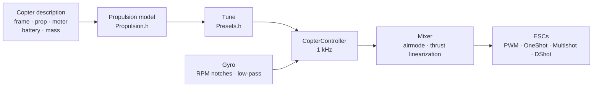

# COPTER.md — firmware for multicopters

The same firmware, the same boards (Matek H743-WING V3, DevEBox H743 and
almost any F405 that runs Betaflight), the same sensors and receivers — but
instead of an airplane, a quadcopter, hex, octo, Y6 or X8. The main
difference from Betaflight, INAV and ArduPilot is that **PID, filters, idle
and rates are not tuned by hand**: you describe the copter (frame, props,
motors, battery, mass), and the firmware derives the tune itself from a
physical model — and adapts in flight to whatever the model guessed
imprecisely.

> **Honestly.** The copter firmware has so far been checked only in a
> simulator (a 6-DOF model, 12 builds × 3 variants of “wrong” physics) and
> by building it for the boards. It has not been in the air yet. Saying
> that it flies better than Betaflight or ArduPilot will only be possible
> after flight tests — until then it is a goal, not a fact.

## How it works



1. **The propulsion model** (`copter/Propulsion.h`): a motor with back-EMF
   and winding resistance (from KV and stator volume), prop thrust and
   torque (from diameter, pitch and blade count), rotor-plus-prop inertia.
   For a 5" 2207 1950KV on 6S the model gives ~28 000 rpm, ~1.6 kg of
   thrust and ~45 A at full throttle — as on test stands.
2. **What follows from it** (`copter/Presets.h`): hover throttle, RPM at
   idle/hover/full throttle, motor lag τ, frame moments of inertia,
   thrust-to-weight ratio, current.
3. **The rate loop** is chosen from the frequency response: motor,
   filters, notches, loop and ESC delay — all in the model. The crossover
   frequency is the highest at which the phase margin is 50° (yaw 55°) and
   the **gain margin is 12 dB**: the tune survives a copter whose thrust and
   inertia are off by a factor of two. The D share is found by search — the
   one that makes the loop widest. P, I, D and feedforward (FF) follow from
   the crossover frequency.
4. **Throttle gain correction (TPA)** — from the same model: at low
   throttle the motor responds weaker, at high throttle stronger. The
   Betaflight curve is available too (`tpa_mode = PD` or `D`).
5. **In flight** the firmware learns the hover throttle itself (heavier
   battery, gimbal) and moves the notches with the RPM.

## Build catalog

| Build | Frame | Prop · motor · battery | Mass | Thrust/weight | Hover | Loop bandwidth |
|---|---|---|---|---|---|---|
| `whoop65` | Quad X 65 mm | 31 mm ×4 · 0702 23000KV · 1S | 22 g | 4.2 | 31 % | 16 Hz |
| `whoop75` | Quad X 75 mm | 40 mm ×4 · 0802 19000KV · 1S | 32 g | 4.3 | 27 % | 16 Hz |
| `toothpick25` | Quad X 115 mm | 2.5" · 1103 8000KV · 3S | 70 g | 12.1 | 8 % | 14 Hz |
| `micro3` | Quad X 140 mm | 3" · 1404 4500KV · 4S | 190 g | 8.3 | 15 % | 14 Hz |
| `cinewhoop3` | Quad X 150 mm | 3" 5-blade · 1504 3600KV · 4S | 330 g | 4.1 | 32 % | 16 Hz |
| `freestyle5` | Quad X 225 mm | 5.1" · 2207 1950KV · 6S | 680 g | 9.0 | 15 % | 13 Hz |
| `race5` | Stretched Quad X | 5.1" · 2306 2000KV · 6S | 560 g | 10.8 | 11 % | 12 Hz |
| `longrange7` | Quad X 315 mm | 7" · 2806.5 1300KV · 6S | 1.0 kg | 7.0 | 20 % | 11 Hz |
| `longrange7li` | Quad X 315 mm | 7" 2-blade · 2810 1300KV · 6S Li-ion 4000 | 1.05 kg | 7.5 | 23 % | 12 Hz |
| `heavy10` | Quad X 450 mm | 10" · 3115 900KV · 6S | 2.2 kg | 6.6 | 25 % | 10 Hz |
| `cinelifter8` | X8 380 mm | 8" · 2812 1100KV · 6S | 3.5 kg | 6.4 | 23 % | 11 Hz |
| `hex13` | Hex X 700 mm | 13" · 3510 600KV · 6S | 4.0 kg | 3.7 | 35 % | 8 Hz |
| `hex15` | Hex X 900 mm | 15" · 4114 400KV · 6S | 6.0 kg | 3.0 | 45 % | 8 Hz |

Frames: Quad X, stretched X, H, Deadcat, “+”, Hex X/+, Y6, Octo X/+, X8.
Motor numbering is as in Betaflight (quad: 1 — rear right, 2 — front
right, 3 — rear left, 4 — front left), props in or props out. Flying
styles — indoor, freestyle, racing, cinematic, long range, cargo: they set
the rates and the maximum tilt.

## Your own copter

`include/config/CopterConfig.h`:

```cpp
#define COPTER_BUILD "freestyle5"     // the closest build from the catalog
constexpr float MASS_G = 742;          // weigh it with the battery — the main thing
constexpr float PROP_DIAMETER_IN = 5.1f, PROP_PITCH_IN = 3.6f;
constexpr float MOTOR_KV = 2150;       // 0 — as in the build
constexpr copter::EscProtocol ESC_PROTOCOL = copter::EscProtocol::ONESHOT125;
```

The build can also be chosen with a flag, `-D COPTER_BUILD=\"race5\"`, or
without rebuilding — in the CLI: `set copter_build = race5`,
`set copter_mass_g = 742`, `save` (settings below; the file is then only the
default). After flashing, the `t` key in the console shows what was derived
and warns if something is off: too little thrust, the motor cannot spin
this prop, neighbouring props touch, it hovers above 60 % throttle, the
motors spin faster than half the loop rate. A different frame with a
different motor count starts working after a reboot: until then ARM is
blocked (`REBOOT_REQD`).

## Flashing and first start

```bash
pio run -e matek-h743-quad -t upload          # Matek H743-WING V3: BOOT button + USB
pio run -e stm32h743-devebox-quad -t upload   # DevEBox H743
pio run -e aocodarc-f405v3-quad -t upload     # an F405 flight controller from Betaflight — below
```

Motor outputs in order: Matek — S1…S8, DevEBox — PA0–PA3, PD14, PD15, PE9.
**First start — without props**, serial monitor at 115200:

| Key | What it does |
|---|---|
| `t` | tune: thrust, hover, RPM, motor τ, filters, loop bandwidth and margins, P/I/D/FF, rates, warnings |
| `m` | motor test: asks to confirm with `y` (props off!), spins each one for 2 s and tells where it is and which way it must spin |
| `s` | status, like `status` in Betaflight: loop load, rates, battery and **why it does not arm** — every reason as a BF code (`RXLOSS`, `ANGLE`, `CLI`…) and in words |
| `o` | board mounting calibration in three poses (required on the Matek before ARM) |
| `c` | compass calibration: rotate the copter around all axes for 15 s (compass — QMC5883L or QMC5883P on the GPS module, whichever answers) |
| `i` · `r` · `l` · `D` | gyro · radio channels · live line · DFU bootloader |
| `#` | CLI like Betaflight's: `set`, `get`, `diff`, `aux`, `map`, `profile`, `save` — [below](#settings-a-cli-like-betaflights) |

The wrong motor spins — change the order in `CopterConfig::MOTOR_PINS`; it
spins the wrong way — change the direction in the ESC configurator
(BLHeliSuite, ESC-Configurator), do not resolder wires.

### A Betaflight F405 flight controller

Almost any quadcopter flight controller on an STM32F405 (Betaflight, 8 MHz
crystal) fits if it has an ICM-42688-P and an SPL06 or DPS310 barometer.
The pinout is taken from Betaflight itself — this way even a board whose
target is in no repository at all works (GETFUN F405V3):

```bash
# 1. Betaflight is still on the board; the Configurator is closed. CLI dump to a file
#    (PlatformIO's Python — it has pyserial):
~/.platformio/penv/Scripts/python tools/bf_board.py read --port COM5 --out stack/MYBOARD_bf.txt
# 2. The whole original firmware — to bring Betaflight back if needed
#    (board in DFU: hold BOOT and plug in USB):
python tools/bf_board.py backup --out stack/MYBOARD_original.bin
# 3. The board header: what is on which pin (BF does not know the barometer type — from the description):
python tools/bf_board.py header stack/MYBOARD_bf.txt --baro SPL06 --out include/config/boards/MYBOARD.h
```

Then an env in `platformio.ini` like `aocodarc-f405v3-quad` (the reference
board: its pinout is public, and the F405 core is always built and tested
against it), with `-D OP_BOARD_FILE=\"config/boards/MYBOARD.h\"`. Motors are
M1…M8 by Betaflight numbers, the receiver, GPS and telemetry are on the
UARTs where Betaflight had them; each motor's timer is the one Betaflight
chose (the dump's `timer B06 AF2` lines -> `OPB_MOTOR_AF`: a pin can have
two or three timers, and BF picked them without DMA conflicts on this
board). The black-box flash comes with its bus and CS from the dump. A
board that already runs our firmware — `bf_board.py header` from the
`config.h` in [github.com/betaflight/config](https://github.com/betaflight/config).

An F405 has a single flash bank: writing settings stops the CPU for
1–2 s, so settings are written only while disarmed.

## Settings: a CLI like Betaflight's

What was derived from the description can be corrected by hand — without
rebuilding, line by line, as in the Betaflight CLI. `#` in the console
enters it (only while disarmed; while the CLI is open, ARM is blocked):

```text
# get p_roll                     ← value, limits, default and where it comes from
# set p_roll = 50                ← in Betaflight units
# set tune_source = BETAFLIGHT   ← BF 4.5 defaults instead of the model
# profile 1                      ← PID profile 0–3 (rateprofile — rates); immediately, on the fly
# diff                           ← only what changed, in BF format
# save                           ← to flash, the tune is recomputed, exit
```

- **What is not set by hand is the default, and for PID and rates it is not
  a number from a table but a result of the copter description** (`get`
  says “from the copter model”). Change the description — everything you
  did not touch moves; what you set by hand stays. Setting a value equal to
  the default is the same as returning to the default.
- **Units are as in Betaflight**: a PID term = number × BF scale × error,
  the sum ÷ 1000 goes to the mixer (P 0.032029, I 0.244381 and for yaw also
  ×2.5, D 0.000529, F 0.013754 × 0.01). `t` also shows the model tune in
  these numbers: for a 5" it is P 25, I 41, D 28, F 35 against BF's default
  45/80/40/120 — the model is softer because it keeps a 12 dB gain margin.
- **A Betaflight diff can be pasted whole** (`diff all` 4.5): known
  settings are applied, `profile`/`rateprofile` switch, `map`, `aux`,
  `rxrange`, `vtx` and `rxfail` go into their tables, comments are skipped,
  an unknown setting gives an `###ERROR…###` line. BF hardware commands
  (`resource`, `timer`, `dma`, `serial`, `feature`, `board_name`…: for us
  this is the board header) are skipped with a `# skipped` comment, and
  `defaults nosave` from the diff does not touch the copter description (BF
  has none). On `batch end` (or on a `save` inside the paste) — a summary:
  `# pasted: N lines applied; M not carried over: names…`. After such a
  `save` the rest of the paste is not taken as console keys for half a
  second.
- `tune_source = BETAFLIGHT` — the whole BF 4.5 defaults: PID 45/80/40/120,
  47/84/46/125, 45/80/0/120; rates Actual 70/670/0; TPA on D only, 65 %
  from throttle 1350, −20 % at low throttle until takeoff; `iterm_limit`
  400; PID sum 500 (yaw 400); anti-gravity 80, 5 Hz, P 100;
  `throttle_boost` 5; ANGLE 5 °/s per degree, up to 60°; `yaw_lowpass_hz`
  100; filters — converted to our chain (gyro PT2 250 Hz, D — PT1 60 Hz: the
  same lag at the loop bandwidth). The RPM notches stay ours.
- Flash holds only what was set by hand (and the selected profiles);
  reflashing does not erase it, `defaults` does. `exit` without `save`
  cancels.

| Command | What it does |
|---|---|
| `set` · `set name = value` | all settings · set one (takes effect after `save`) |
| `get part_of_name` | value, limits, default, what it is |
| `diff [all]` · `dump [all]` | what changed · everything; `all` — all profiles |
| `profile [0-3]` · `rateprofile [0-3]` | select the PID profile · the rate profile |
| `aux` · `aux # mode channel from to [logic link]` · `aux help` | table of modes on switches · a table row · mode numbers — [below](#radio-and-modes) |
| `map [AETR1234]` · `rxrange [0-3 min max]` | channel order · stick ends of roll/pitch/yaw/throttle |
| `rxfail` · `rxfail channel a\|h\|s [value]` | what to do with a channel without link, as in BF: sticks 0–3 — `a` (failsafe automation) or `h` (hold the last), AUX 4–17 — `h` or `s 750…2250` (set); the first 0.3 s — always the last good value |
| `vtx` · `vtx # channel band vtx_channel power from to` · `vtx_info` | video transmitter from a switch, as in BF · what it answered and its powers — [below](#video-transmitter) |
| `dshot_telemetry_info` | as in BF: eRPM, RPM, Hz and the share of frames without a reply, per motor (`dshot_bidir`) |
| `flash_info` · `flash_erase` | black-box flash (F405): chip, size, JEDEC ID, state and flights · erase everything (one command, waits up to a minute, as in BF) |
| `save` · `defaults [nosave]` | save and recompute · everything to defaults |
| `status` · `tasks` | status (like `s`) · time of each part of the loop: rate, average and worst, CPU share |
| `version` · `help` · `exit` | version · list · exit |

### Settings

| Setting | Where | Range | Default | What |
|---|---|---|---|---|
| `tune_source` | global | `MODEL`, `BETAFLIGHT` | `MODEL` | where PID, filters and TPA come from: the copter description or the BF 4.5 defaults |
| `profile_name` | PID profile | up to 8 characters | — | PID profile name |
| `p_roll` `i_roll` `d_roll` `f_roll` | PID profile | P, I, D 0–250; F 0–1000 | from the model; BF: 45, 80, 40, 120 | roll PID in BF units |
| `p_pitch` `i_pitch` `d_pitch` `f_pitch` | PID profile | the same | from the model; BF: 47, 84, 46, 125 | pitch PID |
| `p_yaw` `i_yaw` `d_yaw` `f_yaw` | PID profile | the same | from the model; BF: 45, 80, 0, 120 | yaw PID |
| `d_max_roll` `d_max_pitch` `d_max_yaw` | PID profile | 0–250 | 0 (constant D) | D on sharp moves, as in BF 2025.12: then `d_*` is D at rest |
| `d_min_roll` `d_min_pitch` `d_min_yaw` | PID profile | 0–250 | 0; BF: 30, 34, 0 | as in BF 4.5: D at rest, `d_*` — on sharp moves (if `d_max_*` is not set) |
| `d_max_gain` (`d_min_gain`) | PID profile | 0–100 | 37 | how easily D rises from gyro jerks: at 37 — fully at ~5000 °/s² |
| `d_max_advance` (`d_min_advance`) | PID profile | 0–200 | 20 | how early D rises from stick movement: at 20 — fully at ~2500 °/s² of setpoint |
| `iterm_relax` | PID profile | `OFF`, `RP`, `RPY`, `RP_INC`, `RPY_INC` | `RPY`; BF: `RP` | on which axes I waits while the setpoint changes sharply (no bounce-back after a flip); `_INC` — only growth is held back |
| `iterm_relax_type` | PID profile | `GYRO`, `SETPOINT` | `SETPOINT` | `SETPOINT` — I accumulates slower; `GYRO` — I towards the smoothed setpoint, zero near it |
| `iterm_relax_cutoff` | PID profile | 1–50 Hz | 10; BF: 15 | setpoint smoothing for relax: lower — waits longer |
| `iterm_relax_error` | PID profile | `OFF`, `ON` | `ON` | ours: a large error while accelerating to a new setpoint (a flip) does not accumulate in I; an error without stick movement (a gust, a throttle punch) does |
| `iterm_rotation` | PID profile | `OFF`, `ON` | `OFF` | I rotates with the frame: in a pirouette what accumulated on roll moves to pitch |
| `iterm_windup` | PID profile | 30–100 % | 100 (off); BF: 85 | the more the motors spread, the weaker I accumulates; at full spread it stops |
| `iterm_limit` | PID profile | 0–500 | from the model (300); BF: 400 | I limit, 1000 — the whole motor range |
| `pidsum_limit` · `pidsum_limit_yaw` | PID profile | 100–1000 | 1000; BF: 500 · 400 | limit of the PID sum for roll and pitch · yaw (1000 — the whole range); I does not accumulate at the limit |
| `anti_gravity_gain` | PID profile | 0–250 | 80 | a throttle punch makes I stronger so the nose does not dip: on a full punch (the whole range in 0.1 s) by 1 + gain/10 times |
| `anti_gravity_cutoff_hz` | PID profile | 2–50 Hz | 5 | smoothing of the throttle rate: lower — a lower but longer peak |
| `anti_gravity_p_gain` | PID profile | 0–250 % | 0; BF: 100 | roll and pitch P are stronger too: at 100 — by 50 % on a full punch |
| `throttle_boost` · `throttle_boost_cutoff` | PID profile | 0–100 (×0.1) · 5–50 Hz | 0; BF: 5 · 15 | a stick throttle jerk (throttle minus its low-pass) is amplified by 1 + boost/10 — the motors catch up with the stick sooner; not in ALT_HOLD |
| `tpa_mode` | PID profile | `PD`, `D`, `MODEL` | `MODEL`; BF: `D` | PD throttle correction: `PD`/`D` — the BF curve (two rows below), `MODEL` — from the model on P and D |
| `tpa_rate` · `tpa_breakpoint` | PID profile | 0–100 % · 750–2250 µs | 65 · 1350 | `PD`/`D`: above the breakpoint PD (or only D) weakens linearly, at full throttle by `tpa_rate` |
| `tpa_low_rate` · `tpa_low_breakpoint` | PID profile | −128…100 % · 750–2250 µs | 0; BF: 20 · 1050 | at zero throttle PD (D) is weaker by `tpa_low_rate` (below 0 — stronger), linearly up to the breakpoint |
| `tpa_low_always` | PID profile | `OFF`, `ON` | `OFF` | `OFF` — only until throttle has gone above `tpa_low_breakpoint` after ARM (on the ground), `ON` — always |
| `feedforward_transition` | PID profile | 0–100 % | 0 | closer to the stick centre than this, feedforward is weaker (linearly to zero) — smoother around centre |
| `feedforward_averaging` | PID profile | `OFF`, `2_POINT`, `3_POINT`, `4_POINT` | `OFF` | the stick rate for feedforward is averaged over 2–4 receiver frames: smoother with sparse frames, but later |
| `feedforward_smooth_factor` | PID profile | 0–95 % | 0; BF: 25 | frame-to-frame feedforward smoothing (share of the old value per frame) |
| `feedforward_jitter_factor` | PID profile | 0–20 | 0; BF: 7 | the stick moved less in a frame (500 — half a stick) — feedforward is weaker, smoothly down to zero: finger tremor does not shake the motors |
| `feedforward_boost` | PID profile | 0–50 | 0; BF: 15 | a term from stick acceleration (15 — 3 ms of lead, no more than the stick rate itself) |
| `feedforward_max_rate_limit` | PID profile | 0–150 % | 0; BF: 90 | with the setpoint at this share of the maximum rate, outward feedforward is no larger than P would give for the remaining headroom, beyond it — zero: a full-stick flip without overshoot |
| `yaw_lowpass_hz` | PID profile | 0–500 Hz | from the model (30–100); BF: 100 | low-pass on the yaw PID output (0 — no filter); the model's PID are computed with the model's frequency |
| `use_integrated_yaw` · `integrated_yaw_relax` | PID profile | `OFF`, `ON` · 0–255 | `OFF` · 200 | yaw through the integral of the PID sum (×100 1/s, leak relax × 0.08 1/s) — for big props whose yaw spins the prop up. BF numbers behave as in BF (I without ×2.5; a 5" needs `d_yaw`, otherwise it oscillates); unset yaw PID from the model are recomputed so that the loop stays the same |
| `abs_control_gain` | PID profile | 0–20 (°/s per °) | 0 (off) | ACRO: angle and heading lost to a gust or a thrust imbalance come back; roll and pitch — only in ACRO, yaw — in any mode, in the air |
| `abs_control_limit` · `abs_control_error_limit` · `abs_control_cutoff` | PID profile | 10–255 °/s · 1–45° · 1–45 Hz | 90 · 20 · 11 | correction limit · accumulated angle error limit · setpoint low-pass (the frame lagging a fast stick does not accumulate) |
| `thrust_linear` | PID profile | 0–150 % | from the model (15–30); BF: 0 | thrust linearization: low throttle responds like high |
| `motor_output_limit` | PID profile | 1–100 % | 100 | share of the motor range above idle: a 6S battery on motors for 4S — 66 |
| `rateprofile_name` | rate profile | up to 8 characters | — | rate profile name |
| `roll_rc_rate` `pitch_rc_rate` `yaw_rc_rate` | rate profile | 1–255 (×10 °/s) | by flying style; BF: 7 | rate at the stick centre |
| `roll_srate` `pitch_srate` `yaw_srate` | rate profile | 0–255 (×10 °/s) | by flying style; BF: 67 | rate at full stick |
| `roll_expo` `pitch_expo` `yaw_expo` | rate profile | 0–100 % | by flying style; BF: 0 | expo: softer around centre |
| `serialrx_provider` | global | `IBUS`, `SBUS`, `CRSF` | `RX_PROTOCOL` from `Config.h` | receiver protocol; changes after `save` without a reboot |
| `rx_min_usec` `rx_max_usec` | global | 750–2250 µs | 885, 2115 | a pulse outside them is a channel error: on a stick — link loss, on AUX the previous value is held |
| `copter_build` | global | catalog builds | `COPTER_BUILD` | basis of the copter description |
| `copter_mass_g` | global | 0–30000 g (0 — estimate) | from the build | takeoff mass with the battery |
| `copter_wheelbase_mm` | global | 30–2000 mm | from the build | between the axes of opposite motors |
| `prop_diameter_in` `prop_pitch_in` `prop_blades` | global | 0.5–40", 0.3–30", 2–8 | from the build | prop |
| `motor_stator_mm` `motor_height_mm` `motor_kv` | global | 3–120 mm, 0.5–60 mm, 50–80000 | from the build | motor: 2207 — 22 and 7 |
| `battery_cells` `battery_mah` | global | 1–14 S, 50–50000 mAh | from the build | battery |
| `props_out` | global | `OFF`, `ON` | `PROPS_OUT` | props out: all motors spin the other way |
| `battery_chemistry` | global | `LIPO`, `LIHV`, `LIION` | from the build (Li-Po) | chemistry: cell thresholds and the loaded voltage for the thrust model (3.75 / 3.85 / 3.5 V) |
| `vbat_min_cell_voltage` `vbat_warning_cell_voltage` `vbat_max_cell_voltage` | global | 100–500 (×0.01 V) | by chemistry: Li-Po 330/350/430, Li-HV 330/350/440, Li-ion 280/310/425 | cell: empty (CRITICAL) · time to go home (WARNING; below it unloaded — do not arm) · full |
| `vbat_full_cell_voltage` | global | 100–500 (×0.01 V) | by chemistry: Li-Po 410, Li-HV 425, Li-ion 410 | a cell above it when plugged in — the battery is full; otherwise the OSD shows `BATT < FULL` while disarmed |
| `vbat_scale` · `vbat_divider` · `vbat_multiplier` | global | 0–255 · 1–255 · 1–255 | the board divider (110 · 10 · 1 — 1:11; F405 — from the board dump) | volts = pin mV × `vbat_scale` / (1000 × `vbat_divider` × `vbat_multiplier`), as in BF |
| `battery_meter` | global | `NONE`, `ADC`, `ESC` | `ADC` if the board has a battery input | where the voltage comes from (`ESC` — from ESC telemetry, not working yet) |
| `current_meter` · `ibata_scale` · `ibata_offset` | global | `NONE`/`ADC`/`VIRTUAL`/`ESC`/`MSP` · ±16000 (×0.1 mV/A) · ±32000 mV | `ADC` if the board has a current input; 400 (Matek — 250, F405 — from the board dump); 0 | current sensor: current, mAh drawn, remaining (`VIRTUAL`, `ESC`, `MSP` are accepted from a BF diff but give no current yet) |
| `vbat_detect_cell_voltage` | global | 0–2000 (×0.01 V) | 300 | a battery is present if the voltage is between this and a full cell (1S) or above two of these; otherwise — USB power |
| `force_battery_cell_count` | global | 0–24 S | 0 | cell count; 0 — from the copter description (`battery_cells`). In BF 0 means guess from the voltage; we do not guess: a flat Li-ion 6S (17 V) cannot be told from a full 4S Li-Po |
| `bat_capacity` | global | 0–20000 mAh | 0 | capacity for the remaining share and the consumption alarm; 0 — `battery_mah` from the description |
| `vbat_hysteresis` | global | 0–250 (×0.01 V) | 1 | the alarm fires when the voltage is this much below the threshold (for the whole pack, as in BF); it clears above the threshold |
| `vbat_duration_for_warning` · `vbat_duration_for_critical` | global | 0–150 (×0.1 s) | 20 · 20 (BF: 0 · 0) | this long below the threshold in a row — WARNING · CRITICAL: a sag on a punch is not an alarm |
| `use_vbat_alerts` · `use_cbat_alerts` · `cbat_alert_percent` | global | `OFF`/`ON` · `OFF`/`ON` · 0–100 % | `ON` · `OFF` · 10 | beep and show the battery alarm · also alarm by mAh (no more than `cbat_alert_percent` left — WARNING, zero — CRITICAL; needs a current sensor) |
| `vbat_cutoff_percent` | global | 0–100 % | 100 (none) | from the first CRITICAL the stick throttle is smoothly limited to this share over 10 s (BF's LVC); not altitude hold and not the failsafe automation |
| `vbat_display_lpf_period` · `vbat_sag_lpf_period` · `ibat_lpf_period` | global | 1–255 (×0.1 s) | 30 · 2 · 10 | smoothing (low-pass 10/period Hz, as in BF): display and alarms · voltage for sag compensation · current |
| `vtx_protocol` | global | `AUTO`, `SMARTAUDIO`, `TRAMP`, `NONE` | `AUTO` if the board has a VTX wire | the video transmitter control wire |
| `vtx_band` · `vtx_channel` · `vtx_freq` | global | 0–10 · 1–8 · 0–6200 MHz | 5 (R) · 1 · 0 | band (1 A, 2 B, 3 E, 4 F, 5 R, 6 L, 7 X, 8 V, 9 G, 10 S; 0 — frequency as a number) |
| `vtx_power` | global | 1–12 | 1 | power level, 1 — the weakest; the table comes from the transmitter (`vtx_info`) |
| `vtx_max_power_mw` | global | 0–10000 mW | 0 (none) | **the cap**: it will not go above it from a switch or from the button on the transmitter |
| `vtx_low_power_disarm` | global | `OFF`, `ON`, `UNTIL_FIRST_ARM` | `OFF` | while disarmed — the weakest level |
| `gps_minimum_sats` | global | 4–50 | 8 | home is set at ARM if there are at least this many satellites |
| `crsf_telemetry` | global | `OFF`, `ON` | `ON` | telemetry to the radio over CRSF |
| `blackbox_device` | global | `NONE`, `SPIFLASH`, `SDCARD`, `SERIAL` | `SPIFLASH` on the F405, `SDCARD` on the H743 | where to record the black box; it records only if this board's medium is selected (`SERIAL` is accepted from a BF diff but does not record) |
| `blackbox_mode` | global | `NORMAL`, `MOTOR_TEST`, `ALWAYS` | `NORMAL` | when to record: while armed, while the motors spin, always |
| `blackbox_sample_rate` | global | `1/1` … `1/32` | `1/1` (F405 with flash — `1/2`) | gyro, PID and motors — every which loop |
| `motor_poles` | global | 4–255 | 14 | magnets in the rotor: RPM = eRPM × 2 / `motor_poles` |
| `dshot_bidir` | global | `OFF`, `ON` | `OFF` | bidirectional DShot: the ESC replies with RPM; changes after a reboot (until then ARM is blocked, `REBOOT_REQD`); with it the loop limit is lower — frame, 30 µs and reply: DShot600 — up to 11.8 kHz, 300 — 7.2, 150 — 4.0 |
| `small_angle` | global | 0–180° | 25 | standing tilted more than this — do not arm; 180 — no check |
| `auto_disarm_delay` | global | 0–60 s | 5 | armed but standing on the ground with throttle down this long — DISARM (in BF only when armed with sticks; here with the switch too); 0 — never |
| `runaway_takeoff_prevention` | global | `OFF`, `ON` | `ON` | after ARM the controller is saturated and the copter rotates — DISARM |
| `runaway_takeoff_deactivate_delay` | global | 100–1000 ms | 500 | this long in calm flight — the runaway check turns off until the next ARM |
| `runaway_takeoff_deactivate_throttle_percent` | global | 0–100 % | 20 | throttle above which flight counts (or the copter has already climbed above a metre) |
| `failsafe_delay` | global | 1–200 (×0.1 s) | 15 | no link this long — stage 2; before that stage 1: level and holds altitude (in BF — sticks centred, throttle 0) |
| `failsafe_procedure` | global | `AUTO-LAND`, `DROP`, `GPS-RESCUE` | `AUTO-LAND` (BF: `DROP`) | stage 2: level and descend · motors stop · return (without GPS for now — like AUTO-LAND, control comes back with the stick) |
| `failsafe_landing_time` | global | 1–250 s | 120 (BF: 60) | AUTO-LAND has not landed in this time — DISARM; our descent follows altitude and ends on touchdown, this is a margin |
| `failsafe_throttle` | global | 1000–2000 µs | 1000 | AUTO-LAND: 1000 — descend at 0.7 m/s by altitude; more — constant throttle, as in BF |
| `failsafe_throttle_low_delay` | global | 0–300 (×0.1 s) | 100 | throttle was down longer than this before the link loss — DISARM at once (the copter is obviously on the ground); 0 — no |
| `failsafe_recovery_delay` | global | 1–200 (×0.1 s) | 5 | the link holds this long — control goes back to the pilot (stage 2) and ARM is possible again after a failsafe DISARM |
| `failsafe_stick_threshold` | global | 0–50 % | 30 | GPS-RESCUE: the link is back — control goes to the pilot when a stick is moved further than this |
| `failsafe_switch_mode` | global | `STAGE1`, `KILL`, `STAGE2` | `STAGE1` | FAILSAFE mode from a switch: like link loss · motors stop at once (ARM after 1 s) · straight to stage 2 |
| `craft_name` | global | up to 16 characters | — | the copter's name: BF Configurator (`MSP_NAME`) and the log |
| `vbat_sag_compensation` | PID profile | 0–150 % | 100 (BF: 0) | motor correction for battery sag: 100 — with a sagging battery they respond as with a full one, 0 — no correction |

The copter description (`copter_build` … `props_out`): the default is the
catalog build with the “your own copter” corrections from
`CopterConfig.h`; change the build — the defaults for mass, prop, motor and
battery come from the new one, and what was set by hand stays. PID and
filters are recomputed for the new description on `save`.

The rate curve is ours for now: `rc_rate` at the centre, `srate` at full
stick, expo makes the centre softer; with expo 0 it matches Betaflight's
Actual. For the 13"/15" hexes the model asks for D above 250 and F above
1000 — `get` shows the default clamped to the limit, but the exact model
value is what works.

## Radio and modes

Mode 2 by default: CH1 roll, CH2 pitch, CH3 throttle, CH4 yaw. **ARM** —
SwA (CH5), as on the airplane. **Mode** — SwC (CH7):

| SwC | Mode | What the stick does |
|---|---|---|
| up | ANGLE | tilt (up to the style's limit), let go — the copter levels; yaw — around the vertical |
| middle | ALT_HOLD | ANGLE + altitude: throttle at centre — hovers, above/below — climb up to 3 m/s, descend up to 2 m/s |
| down | ACRO | angular rate by the rate curve; airmode — control even at zero throttle |

All of this changes in the CLI, as in Betaflight:

- `map TAER1234` — channel order: a letter in place of each channel (A —
  roll, E — pitch, T — throttle, R — yaw, 1–4 — AUX1–AUX4). The throttle
  failsafe threshold (`RX_FAILSAFE_THROTTLE_US`) follows the throttle.
- `rxrange 3 1050 1950` — the throttle stick ends are stretched to
  1000–2000 (0 — roll, 1 — pitch, 2 — yaw, 3 — throttle).
- `aux 0 0 1 1700 2100 0 0` — the mode is on while the channel is in the
  range: row number 0–19, mode (BF number), channel (0 — AUX1, i.e. CH5
  with `map AETR1234`), from and to in µs in steps of 25, logic (0 — any
  row of the mode is enough, 1 — all are needed), link (the mode turns on
  together with another). `aux` without arguments — the table, `aux help` —
  mode numbers.

| Mode | BF number | What it does |
|---|---|---|
| ARM | 0 | motors on |
| ANGLE · HORIZON · ALTHOLD | 1 · 2 · 3 | flight mode; with several on — ALTHOLD, then ANGLE, then HORIZON; none — ACRO |
| FAILSAFE | 27 | like link loss (a failsafe check on the ground) |
| AIR MODE | 28 | airmode even with `AIRMODE` off in `CopterConfig.h` |
| PREARM | 36 | if it is in the table — ARM only with PREARM on |
| USER1 … USER4 | 40 … 43 | the board's PINIO pins (on the GETFUN F405V3: USER1 — camera CAM1/CAM2, USER2 — 12 V power) |
| VTX PIT MODE · VTX CONTROL DISABLE | 39 · 48 | video transmitter in PIT · leave the transmitter alone |

**With an empty table (as after `defaults`) the switches from
`CopterConfig.h` work** (`aux` shows them as rows to copy). With at least
one row only the table works, as in BF: a pasted Betaflight diff describes
it completely, and the firmware defaults are not mixed in. No ARM in the
table — the copter does not arm (`NO_ARM_AUX`). BF modes we do not have yet
(BEEPER, GPS RESCUE…) are accepted and stored but do nothing — `aux` says
so.

## Video transmitter

An analog transmitter with a control wire (SmartAudio or Tramp —
`vtx_protocol = AUTO` finds it itself) is kept by the firmware on the
frequency and power from the settings:

```text
# set vtx_band = 5            ← R
# set vtx_channel = 1         ← R1, 5658 MHz
# set vtx_max_power_mw = 400  ← the “in town” cap
# vtx 0 2 0 0 2 900 1300      ← AUX3 (SwC) up — level 2
# vtx 1 2 0 0 6 1700 2100     ← AUX3 down — level 6 (but not above the cap)
# vtx_info                    ← what the transmitter answered, its powers
# save
```

- **The `vtx_max_power_mw` cap** is the main thing: neither a `vtx` row from
  a switch nor `vtx_power` raises the power above it, and if the
  transmitter was raised with its own button, the firmware brings it back
  down within a second. To remove the cap — `set vtx_max_power_mw = 0`.
- **Power from the radio** — `vtx` rows, as in Betaflight: while AUX is in
  the range, the transmitter has this band, channel and level (0 — leave
  it). A switch, a knob or an EdgeTX programmable channel — all the same.
- The power table comes from the transmitter itself: SmartAudio 2.1
  reports its levels in dBm (36 dBm — “4 W”), Tramp — the limit in mW;
  SmartAudio 1.0/2.0 have the steps 25/200/500/800 mW, as on the TBS Unify.
- Frequencies — the transmitter's 80-channel table, 4.9–6.1 GHz: A, B, E,
  F, R, L (the seller calls it D), X, V, G, S. **An analog goggle (Cobra X
  V4) receives only A, B, E, F, R and L** — there will be no picture in it
  on X/V/G/S.
- VTX PIT MODE — PIT (do not disturb others on the ground), USER2 on the
  GETFUN — 12 V power for the whole transmitter. The transmitter does not
  answer — `status` says “VTX: not answering”; then frequency and power are
  set with its buttons.

## OSD and beeper

**OSD** — the AT7456E/MAX7456 chip on the flight controller (for Betaflight
boards its bus and CS come from the board dump). The camera picture always
passes through the chip, the OSD goes on top: link (LQ), mode, satellites,
VTX power, crosshair, arrow and distance home, altitude, voltage (and per
cell), current, mAh, flight time and **one main warning** in the centre:
FAILSAFE, RXLOSS, BATT CRITICAL, LOW BATTERY, while disarmed — why it does
not arm (a BF code, for example THROTTLE) or DISARMED. The font is the one
in the chip (on Betaflight boards — the BF font), so the labels are in
Latin letters. PAL/NTSC — from the camera, automatically; OSD DISABLE mode
hides everything.

**Beeper**: ARM — long, DISARM — two short, after power-up when it can be
armed — short; battery WARNING — a short one every 2 s, CRITICAL — often;
failsafe — alarm; BEEPER mode — “find the model” (without link too — AUX
holds the last value), BEEPER MUTE — silence (except finding).

## GPS, compass and telemetry to the radio

- **GPS** (u-blox M10) — on the UART where Betaflight had it. `status`
  shows the fix, satellites, accuracy, speed and **home**: it is set at ARM
  with a 3D fix and at least `gps_minimum_sats` satellites; if not — at the
  first good fix, already in flight (“set already in flight”). Distance
  and direction home — in `status`, `@live` and on the radio. GPS modes
  (return home, position hold) **do not exist yet**.
- **Compass** on the GPS module — QMC5883L or QMC5883P, the firmware tries
  both. Calibration — `c` in the console. The nose heading comes from the
  compass (if calibrated), above 3 m/s — from GPS, otherwise — from the gyro
  since power-up. Tilt is not compensated yet: in fast flight the compass
  heading can be off by ten degrees or so.
- **CRSF telemetry** (ELRS, Crossfire) — into the same UART the channels
  come from: battery (V, A, mAh, %), GPS, attitude, mode (`ACRO`, `ANGL`,
  `HOR`, `ALTH`, `!FS!`; while disarmed — with “*”), vertical speed. In
  EdgeTX (RadioMaster TX12) — “Discover sensors” on the model's telemetry
  page.

## Black box

On the H743 (Matek H743, DevEBox) the copter records the flight to the SD
card — in the same format and the same `BLACKBOX.BIN` file as the airplane
(card preparation — [BLACKBOX.md](BLACKBOX.md#sd-card-stm32h743)). On the
F405 — to the board's SPI flash (`blackbox_device = SPIFLASH`, as in BF):
W25Q128, W25Q64, M25P16, GD25Q and their relatives are recognised by JEDEC
ID (up to 16 MB); the same format and the same download. Half of the flash
is kept erased (16 MB at `1/2` — about 8 minutes of flight), old flights
are erased on the ground whole, oldest first — not “full — stopped
recording” as in BF. The record queue is in the F405's CCM RAM (60 KB), a
flash on the same bus as the OSD shares a mutex with it, a flash on the
gyro bus is not used. `flash_info` and `flash_erase` in the CLI — as in BF.

| Record | Rate | What is in it |
|---|---|---|
| `QGYRO` | every loop (`blackbox_sample_rate`) | gyro before and after filters, setpoints, loop work time |
| `QCTRL` | at the same time | P, I, D, F per axis (share of motor range), motors 1–4, mixer throttle |
| `QMOT8` | at the same time, if there are more than 4 motors | motors 5–8 |
| `QSTATE` | 50 Hz | angles, altitude and target, climb, sticks, hover throttle, battery (V, A, mAh), RPM, LQ, mode, flags, ARM blockers |
| `GPS`, `SYS` | a new solution, 1 Hz | as on the airplane |
| `EVENT` | — | ARM/DISARM, mode, FAILSAFE, crash, link, battery, profile, “ARM refused: BF codes”, GPS and home, motor test, queue losses |

At the start of the flight — build, frame, PID in BF units, rates, filters
and everything set in the CLI (`set.<name>=<value>`, like `diff`).

When it records — `blackbox_mode`, as in Betaflight: `NORMAL` — while armed
(from 2 s before to 2 s after), `MOTOR_TEST` — while the motors spin (and
the motor test on the bench), `ALWAYS` — from power-up.
`blackbox_device = NONE` — do not record. At 1 kHz the stream is ~70 KB/s:
blocks of 512 bytes go to the card, a 256 MB file is about an hour. If the
log says “queue overflow” — `blackbox_sample_rate = 1/2`.

To view it — **OpenPlane Studio, the “Black box” section**: flights from the
card over USB (the “Download” button, the file lands in the project
folder), saved logs or `BLACKBOX.BIN` straight from the card. A timeline
with modes and events, graphs of setpoint and gyro (before and after
filters), PID per axis, motors, throttle, altitude, battery — with a shared
cursor, wheel zoom and playback; the gyro noise spectrum in the visible
window with motor RPM marks; the copter in 3D at the cursor. Without the
app — `python tools/blackbox.py download` and `decode` (a CSV per record
type). Console: `k` — state and flights.

**Betaflight format** (`.BFL` — Blackbox Explorer, PIDtoolbox):
`python tools/blackbox.py download --bfl` — the board converts the flight
itself (`bb bfl N`, `telemetry/BflEncoder.h`) and hands over a ready file.
A frame for every recorded loop: `axisP/I/D/F` (thousandths of the motor
range, as in BF), `rcCommand`, `setpoint`, `gyroADC` and `gyroUnfilt`
(°/s), `motor` (48–2047), `vbatLatest`, `amperageLatest`; modes and
failsafe — as S frames. The header presents itself as
`Betaflight 4.5.0 (OpenPlane …)` — otherwise Explorer does not know how to
read the fields. The file is about half the size of our log.

Tested in the simulator: a flight with flips, a pirouette and a throttle
punch is recorded whole (`test/native/test_copter_blackbox`;
`OPENPLANE_COPTER_BLACKBOX_DUMP=file` saves the log for Studio,
`OPENPLANE_COPTER_BFL_DUMP=file.bfl` — the same flight for Blackbox
Explorer), the firmware with a card — `test_app_stm32_copter_blackbox`, the
F405 with flash — `test_app_stm32_f405_copter_blackbox` (a W25Q128
emulator). Whether `.BFL` opens in Blackbox Explorer itself is checked by
the user: the format is checked against its description, our parser reads
it by its own header.

## Betaflight Configurator (MSP)

The Betaflight Configurator connects to the copter over the same USB
console: MSP frames (`$M<…` v1 and `$X<…` v2, `telemetry/Msp.h`) arrive
mixed with keys and app lines. The copter presents itself as **Betaflight
4.5** (FC_VARIANT `BTFL`, MSP API 1.46, FC_VERSION 4.5.0) — the Configurator
decides which tabs to show from these; BOARD_INFO and BUILD_INFO honestly
say `OpenPlane`, the board name and the commit (`telemetry/CopterMsp.h`).

| What | Messages | How it works here |
|---|---|---|
| Connect and board | `API_VERSION`, `FC_VARIANT`, `FC_VERSION`, `BOARD_INFO`, `BUILD_INFO`, `UID`, `NAME`/`SET_NAME` | the name is `craft_name` |
| Live data | `STATUS`, `STATUS_EX`, `RAW_IMU`, `ATTITUDE`, `ALTITUDE`, `ANALOG`, `BATTERY_STATE`, `RC`, `MOTOR`, `BOXNAMES`, `BOXIDS` | ARM blockers — by BF numbers (`status`), modes — our table |
| PID, rates | `PID`, `RC_TUNING`, `PID_ADVANCED` and `SET_*` | into the registry, BF units; the rates type is `ACTUAL` (our curve), LEVEL and MAG — BF defaults, not changed |
| Filters | `FILTER_CONFIG`, `SET_FILTER_CONFIG` | the model's filters are shown; only `yaw_lowpass_hz` can be written |
| Modes, receiver | `MODE_RANGES`, `SET_MODE_RANGE`, `RX_CONFIG`, `RX_MAP`, `RXFAIL_CONFIG` and `SET_*` | the `aux`, `map`, `rxfail` tables, `serialrx_provider`, `rx_min/max_usec` |
| Motors, safety, battery | `MOTOR_CONFIG`, `ADVANCED_CONFIG`, `FAILSAFE_CONFIG`, `ARMING_CONFIG`, `BATTERY_CONFIG`, `MIXER_CONFIG`, `FEATURE_CONFIG` and `SET_*` | `motor_poles`, `dshot_bidir`, `failsafe_*`, `small_angle`, `auto_disarm_delay`, `vbat_*`; the ESC protocol — by the build, features — shown only |
| Profiles, saving, reboot | `SELECT_SETTING`, `EEPROM_WRITE`, `REBOOT` (0 — board, 1 — DFU), `SET_ARMING_DISABLED` | like `save` in the CLI |

Writes (`SET_*`) change the settings in memory, `EEPROM_WRITE` saves and
applies them; until then ARM is blocked (the `MSP` flag), as it is while
the Configurator holds `SET_ARMING_DISABLED` and polls the board (3 s of
silence — the flag clears). While armed the settings do not change (the
reply is `!`). There is no motor test from the Configurator (`SET_MOTOR`)
yet — the console, `m`. How the Configurator shows all this — item 160 of
the plan (bench).

## Link to the app

PC commands are as on the airplane: an STX byte (0x02), a line, a newline.
The reply is a line `@name {JSON}` (`telemetry/CopterLink.h`):

| Command | Reply |
|---|---|
| `id` | `@id`: firmware, board, commit, build, passport from the app (hash and model name), receiver protocol |
| `params` | `@params` (count, profiles, build), one `@param` per setting — name, type, group (= tab), limits, default and where it comes from, units, description, value, all four for profile settings; `@rc` — `map`, `rxrange`, the `aux` table and the firmware switches; `@modes` — BF modes |
| `set name value` | `@set`: ok or an error and the new value |
| `profile N` · `rateprofile N` | `@profile` |
| `aux …` · `map …` · `rxrange …` · `vtx …` · `rxfail …` | `@rc` (it also has the changed `rxfail`: `[channel, "a/h/s", µs]`) |
| `calibrate vbat V` · `calibrate ibat A` | from a multimeter: a new `vbat_scale` · `ibata_scale`, the reply is as for `set` (to keep it — `save`) |
| `save` · `revert` | `@save` (to flash and into work) · `@revert` (cancel what is unsaved) |
| `live` · `live 0` | `@live` 20 times a second for 3 more seconds: ARM, mode, link, channels, angles, altitude, throttle, motors, battery, ARM blockers, active modes, load · stop |

Changes are only possible while disarmed and with the CLI closed; while
changes from the app are neither saved nor cancelled, ARM is blocked
(`MSP`, as with the BF Configurator connected).

**OpenPlane Studio** keeps the copter in the hangar next to the airplanes:
the firmware build (an env from `platformio.ini`) and the parts. Flashing
uses the same button: build, board into DFU, upload and passport check —
the app writes only the name and the hash into `config/Project.h`
(`opconfig.py apply` with `"vehicle": "copter"`), the copter settings stay
on the board. While the board header is a stub (`needsBoardDump` in the
firmware description), the app shows the three `tools/bf_board.py`
commands instead of the button. The first setup — CRSF receiver, video
transmitter with a power cap, switches for ARM, modes, beeper and video
power — the app writes to the board with the commands above and `save`.

## Protections

- **ARM** — only if: there is a link, the throttle is down, the copter
  stands level (up to `small_angle`, 25°) and does not rock, the gyro
  answers, the attitude has settled, the battery is not empty, no motor
  test is running, the board mounting is calibrated (where needed), the
  CLI is closed, the settings from the app are saved, the loop keeps up,
  after a failsafe the link has held for `failsafe_recovery_delay`. An ARM
  switched on too early must be switched off and on again. Every reason is
  a Betaflight 4.5 arming-disable flag: the same bit number (0–25, the BF
  Configurator reads the mask by numbers) and the same code in `status`
  (`NOGYRO`, `FAILSAFE`, `RXLOSS`, `NOT_DISARMED`, `BOXFAILSAFE`, `RUNAWAY`,
  `CRASH`, `THROTTLE`, `ANGLE`, `NOPREARM`, `LOAD`, `CALIB`, `CLI`, `MSP`,
  `REBOOT_REQD`, `NO_ACC_CAL`, `ARMSWITCH`; `BOOTGRACE`, `CMS`, `BST`,
  `PARALYZE`, `GPS`, `RESC`, `RPMFILTER`, `DSHOT_BBANG`, `MOTOR_PROTO` — are
  reserved for what will set them). Our own, which BF does not have, start
  at bit 26: `MOVING`, `BATTERY`, `MOTOR_TEST`, `NO_ARM_AUX`, `CONFIG`. And
  each one has words.
- **ARM switch down — motors stop in the same loop**, in any mode.
- **Auto-disarm**: armed, standing on the ground, throttle down for
  `auto_disarm_delay` (5 s) — DISARM; ARM again by switching the switch off
  and on (`NOT_DISARMED`).
- **Runaway takeoff** (`runaway_takeoff_prevention`): after ARM the PID sum
  of some axis is above 60 % of the motor range while the copter rotates
  around it faster than 15 °/s (yaw — 50 °/s), for 75 ms in a row —
  DISARM (`RUNAWAY`): motors on the wrong outputs, props the wrong way
  round, the board rotated. In the simulator a 5" with two motors swapped
  disarms in 0.26 s, having tilted by 46°. The check turns off once the
  copter has flown calmly for half a second (throttle above 20 % or above a
  metre) — flips after that do not trigger it.
- **Link loss** (or FAILSAFE mode from a switch, `failsafe_switch_mode`):
  a dropout up to 0.3 s — the last sticks, nothing changes. Longer on the
  ground (or with the throttle down longer than
  `failsafe_throttle_low_delay`) — DISARM at once. In the air stage 1 until
  `failsafe_delay` (1.5 s) — level and holds altitude (a stick with
  `rxfail … h` — its last position; throttle `rxfail 3 h` — the last
  throttle instead of altitude, as in BF); after 0.3 s the AUX channels take
  the `rxfail` values (`h` — the last, `s` — the set one); then stage 2 by
  `failsafe_procedure`: `AUTO-LAND` — level and descend at 0.7 m/s (by the
  barometer, without it — by the accelerometer; with `failsafe_throttle`
  above 1000 — constant throttle, as in BF), touchdown or
  `failsafe_landing_time` — DISARM; `DROP` — motors stop; `GPS-RESCUE` — for
  now like `AUTO-LAND`. The link is back in stage 1 — control goes to the
  pilot at once, in stage 2 — after `failsafe_recovery_delay` (0.5 s), for
  `GPS-RESCUE` — also when the pilot moves a stick further than
  `failsafe_stick_threshold`; the FAILSAFE switch back — at once. Until the
  failsafe ends the radio sticks affect nothing. After a failsafe DISARM,
  ARM is possible when the link has held for `failsafe_recovery_delay`
  (after `KILL` — 1 s) and the ARM switch has been off.
- **Crash**: in ANGLE/ALT_HOLD a tilt above 90° for longer than 0.7 s or not
  the one the stick asks for, by more than 30° for longer than 2 s (a motor
  failed, it lies on its side); in any mode lying upside down for 1 s or yaw
  diverging from the setpoint by more than 200 °/s for longer than 1.5 s (a
  motor failed and the copter spins like a top on three while holding its
  tilt) — motors stop. Re-ARM — after switching the switch off.
- **On the ground the integral does not accumulate** — the copter does not
  jump or tip over on takeoff.

## What's inside, briefly

| File | What |
|---|---|
| `copter/Propulsion.h` | motor and prop model |
| `copter/Presets.h` | build catalog, deriving the tune, warnings |
| `copter/Frames.h` · `Mixer.h` | frames and mixer (airmode, roll/pitch priority over yaw, thrust linearization) |
| `copter/RateController.h` | P, I (relax on flips and acceleration, anti-gravity), D on gyro, FF, sum limits |
| `copter/Attitude.h` | attitude as a quaternion; the accelerometer is not trusted during jerks, in rotation and when it disagrees with the gyro |
| `copter/AltitudeHold.h` | altitude: barometer + accelerometer, the hover throttle is learned |
| `copter/GyroFilter.h` | notches at 1×, 2× RPM and blade pass + low-pass |
| `copter/CopterController.h` | everything together: ARM, modes, failsafe, crash |
| `copter/Params.h` | settings registry: Betaflight names, units and defaults, profiles, copter description, flash |
| `copter/RcSetup.h` | radio: `map`, `rxrange`, modes on switches (`aux`) |
| `copter/Battery.h` | battery: voltage, current, mAh, cell thresholds by chemistry (Li-Po, Li-HV, Li-ion) |
| `copter/Vtx.h` · `hal/stm32/Stm32VtxPort.h` | video transmitter: SmartAudio 1/2/2.1 and Tramp, frequency table, power cap |
| `copter/GpsHome.h` · `copter/CrsfTelemetry.h` | GPS home (distance, direction) · telemetry frames to the radio |
| `copter/Osd.h` · `hal/Max7456.h` | OSD screen · the AT7456E/MAX7456 chip |
| `copter/Beeper.h` | what beeps and when |
| `tools/bf_board.py` · `include/config/boards/` | a board from Betaflight: CLI dump from the board, the original firmware over DFU, a header with the pinout |
| `copter/CopterCli.h` | CLI like Betaflight's (`telemetry/CopterConsole.h` — the key console) |
| `telemetry/CopterLink.h` | settings protocol and live data for the app |
| `hal/stm32/Stm32MotorOutput.h` · `hal/stm32/Stm32Dshot.h` | ESCs: pulses (PWM, OneShot, Multishot) · DShot on a timer with DMA, the ESC reply |
| `telemetry/CopterBlackBox.h` · `hal/SpiNorFlash.h` · `telemetry/BflEncoder.h` | black box · F405 SPI flash · Betaflight format (.BFL) |
| `telemetry/Msp.h` · `telemetry/CopterMsp.h` | MSP: v1/v2 frames · replies to the Betaflight Configurator |
| `src/stm32/main_copter.cpp` | entry point on STM32 |

## How it was tested

`test/native/test_copter_sim` — **the real** `CopterController` and a
6-DOF copter model: motors with back-EMF, battery sag under current, prop
reaction torque, air drag, wind with gusts, ESC delay, a gyro with noise
and motor vibration (vibration above half the loop rate aliases, as on the
board), a 50 Hz barometer, the ground. Every catalog build flies on its own
tune and on a model that deliberately does not match the description:

- **“sluggish”**: the prop pulls 20 % less, motor and frame are 30 % more
  inertial, 20 % heavier, the centre of gravity moved forward;
- **“twitchy”**: thrust +20 %, inertia −30 %, mass −15 %, the centre of
  gravity moved sideways — the loop gain is almost twice the calculated one.

| What | Result over 36 flights (12 builds × 3 physics) |
|---|---|
| Takeoff and hover in ALT_HOLD | altitude ±0.3 m, tilt < 1°, hover throttle learned (the “twitchy” whoop — 0.22 instead of the calculated 0.31) |
| ANGLE: full stick | 90 % of the tilt in 0.14–0.35 s, overshoot < 3 %, levelling to 3° in 0.15–0.4 s |
| ACRO: full stick | 90 % of the rate in 0.04–0.15 s, overshoot < 12 % |
| Link loss at 10 m | 1.5 s hovering at altitude, then descent ≤ 0.94 m/s, touchdown — DISARM |
| Runaway takeoff on a normal takeoff | does not fire, the check turns off after takeoff on all 36 |

And separately on a 5": airmode at zero throttle, yaw, 4.5 m/s wind with
gusts, failsafe without a barometer, plain PWM ESCs, link dropout and
return, failsafe stages and the DROP / GPS-RESCUE procedures, the FAILSAFE
switch (STAGE2, KILL), swapped motor wires (runaway takeoff), falling upside
down, motor failure, motor test, battery sag. In `test_copter` — every
block separately (108 tests, among them the settings registry, BF units,
profiles, the CLI and pasting a BF diff, MSP, battery, DShot and the ESC
reply), in `native_stm32/test_app_stm32_copter` — the whole firmware on
Matek H743 fakes: “stop” pulses before ARM, mounting calibration, idle
after ARM, modes from a switch, link loss on the ground, console, CLI →
`save` → flash → “reboot”.

### Betaflight defaults on our loop

`tune_source = BETAFLIGHT`, 1 kHz loop, OneShot125, nominal physics: a 4 s
hover in ALT_HOLD and a full stick in ACRO — the same measures as for the
tune from the model (`test_betaflight_defaults_on_our_loop`). The BF
defaults are picked for a 5" with DShot and a 4–8 kHz loop:

| Build | Hover (rocking) | ACRO: 90 % of rate · overshoot |
|---|---|---|
| `whoop65` · `whoop75` | yes (0.3 · 0.1 °/s) | 0.039 s · 6–8 % |
| `toothpick25` · `micro3` · `cinewhoop3` | yes (0.1 °/s) | 0.035–0.041 s · 1–4 % |
| `freestyle5` · `race5` | yes (0.1 °/s) | 0.041–0.043 s · 1 % |
| `longrange7` · `longrange7li` · `heavy10` · `cinelifter8` | yes (≤ 0.1 °/s) | 0.049–0.064 s · 1–7 % |
| `hex13` · `hex15` | **no: oscillation ~95–150 °/s** | 0.11–0.21 s, does not hold the rate (error 6–26 %) |

With D that rises on movement (`d_min` 30/34 → `d_*` 40/46), I-relax `RP`
15 Hz, `iterm_windup` 85 %, PID sum 500/400, anti-gravity 80/5 Hz/100,
`throttle_boost` 5, TPA at low throttle, `feedforward_max_rate_limit` 90
and `thrust_linear` 0 — as in BF 4.5. The FF limit costs a 5" ~6 ms to
90 % of the rate (0.037 → 0.043 s), but the “twitchy” 5" overshoots a
full-stick flip by 1.3 %, not 7.9 %
(`test_feedforward_max_rate_limit_on_a_full_stick_flip`); without thrust
linearization the hexes hold the rate even worse (`hex13` error 26 %
instead of 10 %). The BF defaults lack P and D for the hexes, and they hover
oscillating; our error relax used to damp it a little (~40 °/s), now it
does not hold I without stick movement.

**D on movement in the model** (`d_max_*`, `test_d_max_keeps_hover_quiet`):
D at rest 30 % below the derived one, the same on manoeuvres. Motor noise
in hover is 25–30 % lower on all builds, acro as before. Whoops whose
motors spin faster than half the loop rate (`WARN_VIBRATION_ALIAS`) — only
with a 4 kHz loop: at 1 kHz the vibration falls into the loop bandwidth and
D grows from noise (`whoop65` noise +5 %). **I-relax as in BF** (`RP`,
15 Hz, `SETPOINT` or `GYRO`) on the “sluggish” hexes — overshoot 10–12 %
(`test_bf_iterm_relax_on_sluggish_hexa`).

**Throttle punch** (`test_anti_gravity_holds_the_nose_on_punch`): from hover
to full throttle in ACRO. If the centre of gravity is off centre, the thrust
imbalance grows with throttle, and I must catch up with it. Our error relax
used to take such an error (tens of °/s) for acceleration towards a
setpoint and kept I from accumulating — the nose of the “sluggish” and
“twitchy” 5" went 44–83°. Now relax holds back only the error explained by
stick movement over the last ~0.2 s, and anti-gravity in the model is as in
BF 4.3+ (80, 5 Hz, no P): 3.1° and 2.4° (without anti-gravity — 13° and
10°, with the old one — 11° and 7°), as described — 0.05°. `throttle_boost`
5 (as in BF) gives a 12 % higher climb rate 50 ms after the punch, 10 —
24 %. Full throttle — no oscillation with any `tpa_mode`, zero throttle
with `tpa_low_always` (−20 % and +50 %) — too.

The `feedforward_*` settings act only on the stick part of the setpoint
(in ANGLE the levelling correction goes into feedforward as before) and
count receiver frames (without frames — 250 Hz). The BF defaults
(25 / 7 / 15) on a half-stick flick in 20 ms with 250 Hz frames: the same
rise to rate, overshoot 10.3 % against 13.4 % without them (“sluggish” —
18.5 against 20.1, “twitchy” — 8.7 against 9.0).

**Integrated yaw** (`test_integrated_yaw_on_big_hexa`): on big props yaw
spins the prop up (the simulator has it). A 15" hex with BF numbers and
`use_integrated_yaw = ON` holds half-stick yaw with an error of 1.3 °/s RMS
and an overshoot of 3.9 % — without the integral 11.9 °/s and 14.7 %. With
the model's PID (recomputed) it holds the rate on all three physics (error
up to 0.9 °/s). On a 5" the BF numbers with the integral and without
`d_yaw` oscillate — a feature for big props, as in BF.

**Absolute control** (`test_absolute_control_holds_attitude_against_torque`):
ACRO, sticks centred, a torque presses on the frame for 2 s — 5 % of the
roll and yaw authority. Without it a 5" loses 2–5° of roll and 16–49° of
heading and does not get them back; with `abs_control_gain = 10` — under
0.03° and 0.3°.

The BF defaults are too little for hexes with 13"/15" props: the model asks
for P 150–220 and D 250 (in BF units), BF gives 45 and 40 — the copter
hovers oscillating. For them — only `tune_source = MODEL`. The tune from
the model in BF units (roll):

| Build | P · I · D · F | Build | P · I · D · F |
|---|---|---|---|
| `whoop65` | 42 · 88 · 60 · 29 | `race5` | 20 · 31 · 23 · 30 |
| `toothpick25` | 19 · 36 · 31 · 16 | `longrange7` | 37 · 53 · 61 · 61 |
| `micro3` | 22 · 42 · 29 · 23 | `heavy10` | 58 · 77 · 74 · 107 |
| `cinewhoop3` | 40 · 83 · 56 · 36 | `cinelifter8` | 48 · 69 · 53 · 81 |
| `freestyle5` | 25 · 41 · 28 · 35 | `hex13` · `hex15` | 168–221 · 179–222 · 250+ · 304–508 |

The simulator found and helped fix real bugs that do not show in the
calculation: notches that jumped after every mixer loop; extra phase from
the notches at the loop bandwidth; the integral winding up while the
“sluggish” hex accelerated (32 % overshoot); an accelerometer that shows
exactly 1 g in a flip at hover throttle and pulled the horizon by 10°; a
copter that spun on the ground with a failed motor.

## Not there yet

- **DShot is not checked on hardware**: there is a driver
  (`hal/stm32/Stm32Dshot.h`: a timer in burst mode + a DMA stream on the
  update event, no interrupts, F405 and H743; enabled with
  `-D COPTER_ESC_PROTOCOL=DSHOT600` in the env), frames, CRC, bit timings
  and skipping a busy stream are checked on a DMA fake. A loop faster than
  the protocol can keep up with (a frame and as much pause: DShot150 — up
  to 4.7 kHz, 300 — 9.4, 600 — 18.8) blocks ARM. Up to 4 timers (M1–M8)
  start with one `write`; the DMA streams of different timers do not
  overlap, the other drivers do not use DMA.
- **RPM from the ESCs (`dshot_bidir`) — without reading the reply yet**:
  bidir frames (inverted line and CRC), decoding the reply (GCR, CRC,
  period -> eRPM, from line samples), the error share and
  `dshot_telemetry_info` are ready and checked on reference replies, but
  reading the pin on hardware is not there yet (on the F405 only DMA2 can
  read a port, and its streams belong to TIM1/TIM8 — BF has its own bitbang
  driver for this). It is done on the bench; until then the telemetry errors
  are 100 %, and the motors still spin.
- **A loop faster than 1 kHz** — for whoops whose motors spin faster than
  500 Hz (the simulation shows they do noticeably better at 4 kHz).
- MAVLink for the copter, PID and the other settings in OpenPlane Studio
  (for now — the CLI); GPS position hold, return home, missions.
- Compass tilt compensation and choosing its axes (`align_mag`).
- A custom OSD layout (`osd_*_pos`) and a custom font.
- Flight tests.
