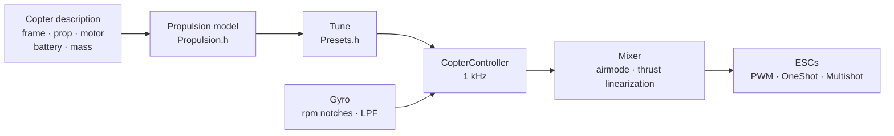

# COPTER.md — firmware for multicopters

The same firmware, the same boards (Matek H743-WING V3, DevEBox H743), the
same sensors and receivers — but instead of an airplane, a quadcopter, hex,
octo, Y6 or X8. The main difference from Betaflight, INAV and ArduPilot is
that **PID, filters, idle and rates are not tuned by hand**: you describe
the copter (frame, props, motors, battery, mass), and the firmware derives
the tune itself from a physical model — and adapts in flight to whatever the
model guessed imprecisely.

> **Honestly.** The copter firmware has so far been checked only in a
> simulator (a 6-DOF model, 12 builds × 3 variants of “wrong” physics) and
> by building it for the boards. It has not been in the air yet. Claiming it
> flies better than Betaflight or ArduPilot will only be possible after
> flight tests — until then it is a goal, not a fact.

## How it works



1. **Propulsion model** (`copter/Propulsion.h`): a motor with back-EMF and
   winding resistance (from KV and stator volume), prop thrust and torque
   (from diameter, pitch and blade count), inertia of the rotor with the
   prop. For a 5" 2207 1950KV on 6S the model gives ~28k rpm, ~1.6 kg of
   thrust and ~45 A at full throttle — as on test stands.
2. **What follows from it** (`copter/Presets.h`): hover throttle, rpm at
   idle/hover/full throttle, motor lag τ, frame moments of inertia,
   thrust-to-weight ratio, current.
3. **The rate loop** is chosen from the frequency response: motor, filters,
   notches, loop and ESC delay — all in the model. The crossover frequency
   is the highest one with a 50° phase margin (55° for yaw) and a **12 dB
   gain margin**: the tune holds a copter whose thrust and inertia are off
   by a factor of two. The D share is picked by search — the one that makes
   the loop widest. P, I, D and feedforward (FF) follow from the crossover.
4. **Throttle gain correction (TPA)** comes from the same model: at low
   throttle the motor responds weaker, at high throttle stronger.
5. **In flight** the firmware learns the hover throttle itself (a heavier
   battery, a gimbal) and moves its notch filters with the rpm.

## Build catalog

| Build | Frame | Prop · motor · battery | Mass | Thrust/weight | Hover | Loop bandwidth |
|---|---|---|---|---|---|---|
| `whoop65` | Quad X 65 mm | 31 mm ×4 · 0702 23000KV · 1S | 22 g | 4.2 | 31% | 16 Hz |
| `whoop75` | Quad X 75 mm | 40 mm ×4 · 0802 19000KV · 1S | 32 g | 4.3 | 27% | 16 Hz |
| `toothpick25` | Quad X 115 mm | 2.5" · 1103 8000KV · 3S | 70 g | 12.1 | 8% | 14 Hz |
| `micro3` | Quad X 140 mm | 3" · 1404 4500KV · 4S | 190 g | 8.3 | 15% | 14 Hz |
| `cinewhoop3` | Quad X 150 mm | 3" 5-blade · 1504 3600KV · 4S | 330 g | 4.1 | 32% | 16 Hz |
| `freestyle5` | Quad X 225 mm | 5.1" · 2207 1950KV · 6S | 680 g | 9.0 | 15% | 13 Hz |
| `race5` | Quad X stretched | 5.1" · 2306 2000KV · 6S | 560 g | 10.8 | 11% | 12 Hz |
| `longrange7` | Quad X 315 mm | 7" · 2806.5 1300KV · 6S | 1.0 kg | 7.0 | 20% | 11 Hz |
| `heavy10` | Quad X 450 mm | 10" · 3115 900KV · 6S | 2.2 kg | 6.6 | 25% | 10 Hz |
| `cinelifter8` | X8 380 mm | 8" · 2812 1100KV · 6S | 3.5 kg | 6.4 | 23% | 11 Hz |
| `hex13` | Hex X 700 mm | 13" · 3510 600KV · 6S | 4.0 kg | 3.7 | 35% | 8 Hz |
| `hex15` | Hex X 900 mm | 15" · 4114 400KV · 6S | 6.0 kg | 3.0 | 45% | 8 Hz |

Frames: Quad X, stretched X, H, Deadcat, “+”, Hex X/+, Y6, Octo X/+, X8.
Motor numbering is as in Betaflight (quad: 1 — rear right, 2 — front right,
3 — rear left, 4 — front left), props in or props out. Flying styles —
indoor, freestyle, racing, cinematic, long range, heavy lift: they set the
rates and the maximum tilt.

## Your own copter

`include/config/CopterConfig.h`:

```cpp
#define COPTER_BUILD "freestyle5"     // the nearest build from the catalog
constexpr float MASS_G = 742;          // weigh it with the battery — that matters most
constexpr float PROP_DIAMETER_IN = 5.1f, PROP_PITCH_IN = 3.6f;
constexpr float MOTOR_KV = 2150;       // 0 — as in the build
constexpr copter::EscProtocol ESC_PROTOCOL = copter::EscProtocol::ONESHOT125;
```

The build can also be chosen with a flag: `-D COPTER_BUILD=\"race5\"`. After
flashing, the `t` key in the console shows what was derived and warns if
something is wrong: too little thrust, the motor cannot handle this prop,
neighboring props touch, hover above 60% throttle, motors spin faster than
half the loop rate.

## Flashing and first start

```bash
pio run -e matek-h743-quad -t upload          # Matek H743-WING V3: BOOT button + USB
pio run -e stm32h743-devebox-quad -t upload   # DevEBox H743
```

Motor outputs in order: Matek — S1…S8, DevEBox — PA0–PA3, PD14, PD15, PE9.
**First start — without props**, serial monitor at 115200:

| Key | What it does |
|---|---|
| `t` | the tune: thrust, hover, rpm, motor τ, filters, loop bandwidth and margins, P/I/D/FF, rates, warnings |
| `m` | motor test: asks to confirm with `y` (props off!), spins each motor for 2 s and says where it is and which way it must spin |
| `s` | state and **why it will not arm** — each reason in words |
| `o` | board mounting calibration with three poses (mandatory on the Matek before ARM) |
| `i` · `r` · `l` · `D` | gyro · transmitter channels · live line · DFU bootloader |

The wrong motor spins — change the order in `CopterConfig::MOTOR_PINS`; it
spins the wrong way — set the direction in the ESC configurator
(BLHeliSuite, ESC-Configurator), do not resolder wires.

## Transmitter and modes

Mode 2: CH1 roll, CH2 pitch, CH3 throttle, CH4 yaw. **ARM** — SwA (CH5), as
on the airplane. **Mode** — SwC (CH7):

| SwC | Mode | What the stick does |
|---|---|---|
| up | ANGLE | tilt (up to the style limit); let go — the copter levels itself; yaw — around the vertical |
| middle | ALT_HOLD | ANGLE + altitude: throttle centered — hovers, above/below — climb up to 3 m/s, descent up to 2 m/s |
| down | ACRO | rotation rate along the rate curve; airmode — controllable even at zero throttle |

HORIZON (ANGLE near the center, ACRO at the edges) is enabled by changing
one line in `CopterConfig.h`.

## Protections

- **ARM** — only if: the link is up, throttle is low, the copter stands
  level (up to 25°) and is not being moved, the gyro responds, the attitude
  has settled, the battery is not empty, no motor test is running, the board
  mounting is calibrated (where required). An ARM switch turned on too early
  must be turned off and on again.
- **ARM switch down — motors stop in the same cycle**, in any mode.
- **Link loss**: a dropout of up to 0.3 s changes nothing; longer — on the
  ground immediate DISARM, in the air — level and descend at 0.7 m/s (by the
  barometer, without it — by the accelerometer), touching the ground —
  DISARM. When the link is back for 1 s, the pilot has control again.
- **Crash**: in ANGLE/ALT_HOLD a tilt beyond 90° for more than 0.7 s, or a
  tilt more than 30° away from what the stick asks for more than 2 s (a
  failed motor, lying on its side); in any mode lying on its back for 1 s —
  motors stop. ARM again — only after switching the ARM switch off.
- **On the ground the integral does not wind up** — the copter does not
  jump or tip over on takeoff.

## What is inside — briefly

| File | What |
|---|---|
| `copter/Propulsion.h` | motor and prop model |
| `copter/Presets.h` | build catalog, tune derivation, warnings |
| `copter/Frames.h` · `Mixer.h` | frames and the mixer (airmode, roll/pitch priority over yaw, thrust linearization) |
| `copter/RateController.h` | P, I (relax on flips and on the run-up, anti-gravity), D on the gyro, FF |
| `copter/Attitude.h` | attitude as a quaternion; the accelerometer is not trusted during jerks, rotation, or when it disagrees with the gyro |
| `copter/AltitudeHold.h` | altitude: barometer + accelerometer, hover throttle is learned |
| `copter/GyroFilter.h` | notches at 1× and 2× rpm and at the blade pass + LPF |
| `copter/CopterController.h` | everything together: ARM, modes, failsafe, crash |
| `hal/stm32/Stm32MotorOutput.h` · `src/stm32/main_copter.cpp` | ESCs and the entry point on the STM32 |

## How it was checked

`test/native/test_copter_sim` — the **real** `CopterController` and a 6-DOF
copter model: motors with back-EMF, battery sag under current, prop reaction
torque, air drag, gusty wind, ESC delay, a gyro with noise and motor
vibration (vibration above half the loop rate folds back, as on the board),
a 50 Hz barometer, the ground. Every catalog build flies on its own tune and
on a model that deliberately does not match the description:

- **“sluggish”**: the prop pulls 20% less, motor and frame are 30% more
  inert, 20% heavier, the center of gravity shifted forward;
- **“twitchy”**: thrust +20%, inertia −30%, mass −15%, the center of gravity
  shifted sideways — the loop gain is almost twice the computed one.

| What | Result over 36 flights (12 builds × 3 physics) |
|---|---|
| Takeoff and hover in ALT_HOLD | altitude ±0.3 m, tilt < 1°, hover throttle learned (the “twitchy” whoop: 0.22 instead of the computed 0.31) |
| ANGLE: full stick | 90% of the tilt in 0.14–0.35 s, overshoot < 3%, leveling to 3° in 0.15–0.4 s |
| ACRO: full stick | 90% of the rate in 0.04–0.15 s, overshoot < 12% |
| Link loss at 10 m | descent ≤ 0.94 m/s, touchdown — DISARM, 17–28 s |

And separately on the 5": airmode at zero throttle, yaw, 4.5 m/s wind with
gusts, failsafe without a barometer, plain PWM ESCs, a link dropout and
return, a fall onto its back, a motor failure, the motor test, battery sag.
`test_copter` checks each block separately (41 tests),
`native_stm32/test_app_stm32_copter` — the whole firmware on Matek H743
fakes: “stop” pulses before ARM, mounting calibration, idle after ARM, modes
from the switch, link loss on the ground, the console.

The simulator found and helped fix real bugs that are invisible in the
calculation: notches that jumped after every mixer cycle; extra phase lag
from notches near the loop bandwidth; integral wind-up during the run-up of
the “sluggish” hex (32% overshoot); an accelerometer that reads exactly 1 g
in a flip at hover throttle and dragged the horizon off by 10°; a copter
with a failed motor that kept spinning on the ground.

## What is not there yet

- **DShot** (and bidirectional — exact rpm for the notches): needs a DMA
  driver; frame and CRC calculation already exist (`copter/EscProtocol.h`).
- **A loop faster than 1 kHz** — for whoops, whose motors spin faster than
  500 Hz (the simulation shows they are noticeably better at 4 kHz).
- Black box, MAVLink and OpenPlane Studio for the copter; GPS position hold,
  return to home, missions.
- Flight tests.
