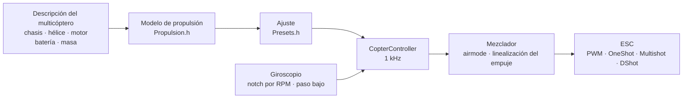

# COPTER.md — firmware para multicópteros

El mismo firmware, las mismas placas (Matek H743-WING V3, DevEBox H743 y casi
cualquier F405 que funcione con Betaflight), los mismos sensores y
receptores — pero en lugar de un avión, un cuadricóptero, un hexa, un octo,
un Y6 o un X8. La diferencia principal con Betaflight, INAV y ArduPilot:
**los PID, los filtros, el ralentí y los rates no se ajustan a mano**. Usted
describe el multicóptero (chasis, hélices, motores, batería, masa) y el
firmware deduce el ajuste a partir de un modelo físico — y en vuelo se adapta
a lo que el modelo estimó con poca precisión.

> **Con franqueza.** Por ahora el firmware de multicóptero solo se ha
> comprobado en simulador (un modelo de 6 grados de libertad,
> 12 configuraciones × 3 variantes de física «equivocada») y compilando para
> las placas. Todavía no ha volado. Decir que vuela mejor que Betaflight o
> ArduPilot solo será posible tras pruebas de vuelo — hasta entonces es un
> objetivo, no un hecho.

## Cómo funciona



1. **El modelo de propulsión** (`copter/Propulsion.h`): un motor con fuerza
   contraelectromotriz y resistencia del bobinado (a partir del KV y del
   volumen del estátor), empuje y par de la hélice (a partir del diámetro,
   el paso y el número de palas), inercia del rotor con la hélice. Para un
   5" 2207 1950KV en 6S el modelo da ~28 000 rpm, ~1,6 kg de empuje y ~45 A
   a todo gas — como en los bancos de pruebas.
2. **Lo que se deduce de él** (`copter/Presets.h`): gas de vuelo
   estacionario, régimen en ralentí/estacionario/todo gas, retardo del motor
   τ, momentos de inercia del chasis, relación empuje/peso, corriente.
3. **El lazo de velocidad angular** se elige por la respuesta en
   frecuencia: motor, filtros, notch, retardo del lazo y del ESC — todo está
   en el modelo. La frecuencia de corte es la más alta con la que el margen
   de fase es de 50° (guiñada 55°) y el **margen de ganancia de 12 dB**: el
   ajuste aguanta en un multicóptero cuyo empuje e inercia están
   «equivocados» por un factor dos. La proporción de D se encuentra por
   búsqueda — la que hace el lazo más ancho. P, I, D y la anticipación (FF)
   se derivan de la frecuencia de corte.
4. **La corrección de la ganancia según el gas (TPA)** — del mismo modelo: a
   bajas RPM el motor responde más blando, a altas más fuerte. También está
   la curva de Betaflight (`tpa_mode = PD` o `D`).
5. **En vuelo** el firmware aprende solo el gas de estacionario (batería
   más pesada, gimbal) y hace que los notch sigan las RPM.

## Catálogo de configuraciones

| Configuración | Chasis | Hélice · motor · batería | Masa | Empuje/peso | Estacionario | Banda del lazo |
|---|---|---|---|---|---|---|
| `whoop65` | Quad X 65 mm | 31 mm ×4 · 0702 23000KV · 1S | 22 g | 4,2 | 31 % | 16 Hz |
| `whoop75` | Quad X 75 mm | 40 mm ×4 · 0802 19000KV · 1S | 32 g | 4,3 | 27 % | 16 Hz |
| `toothpick25` | Quad X 115 mm | 2,5" · 1103 8000KV · 3S | 70 g | 12,1 | 8 % | 14 Hz |
| `micro3` | Quad X 140 mm | 3" · 1404 4500KV · 4S | 190 g | 8,3 | 15 % | 14 Hz |
| `cinewhoop3` | Quad X 150 mm | 3" 5 palas · 1504 3600KV · 4S | 330 g | 4,1 | 32 % | 16 Hz |
| `freestyle5` | Quad X 225 mm | 5,1" · 2207 1950KV · 6S | 680 g | 9,0 | 15 % | 13 Hz |
| `race5` | Quad X estirado | 5,1" · 2306 2000KV · 6S | 560 g | 10,8 | 11 % | 12 Hz |
| `longrange7` | Quad X 315 mm | 7" · 2806.5 1300KV · 6S | 1,0 kg | 7,0 | 20 % | 11 Hz |
| `longrange7li` | Quad X 315 mm | 7" bipala · 2810 1300KV · 6S Li-ion 4000 | 1,05 kg | 7,5 | 23 % | 12 Hz |
| `heavy10` | Quad X 450 mm | 10" · 3115 900KV · 6S | 2,2 kg | 6,6 | 25 % | 10 Hz |
| `cinelifter8` | X8 380 mm | 8" · 2812 1100KV · 6S | 3,5 kg | 6,4 | 23 % | 11 Hz |
| `hex13` | Hex X 700 mm | 13" · 3510 600KV · 6S | 4,0 kg | 3,7 | 35 % | 8 Hz |
| `hex15` | Hex X 900 mm | 15" · 4114 400KV · 6S | 6,0 kg | 3,0 | 45 % | 8 Hz |

Chasis: Quad X, X estirado, H, Deadcat, «+», Hex X/+, Y6, Octo X/+, X8. La
numeración de motores es la de Betaflight (quad: 1 — trasero derecho,
2 — delantero derecho, 3 — trasero izquierdo, 4 — delantero izquierdo),
hélices hacia dentro o hacia fuera. Estilos de vuelo — interior, freestyle,
carreras, filmación, largo alcance, carga: fijan los rates y la inclinación
máxima.

## Su propio multicóptero

`include/config/CopterConfig.h`:

```cpp
#define COPTER_BUILD "freestyle5"     // la configuración más parecida del catálogo
constexpr float MASS_G = 742;          // péselo con la batería — es lo más importante
constexpr float PROP_DIAMETER_IN = 5.1f, PROP_PITCH_IN = 3.6f;
constexpr float MOTOR_KV = 2150;       // 0 — como en la configuración
constexpr copter::EscProtocol ESC_PROTOCOL = copter::EscProtocol::ONESHOT125;
```

La configuración también se elige con un flag, `-D COPTER_BUILD=\"race5\"`,
o sin recompilar — en el CLI: `set copter_build = race5`,
`set copter_mass_g = 742`, `save` (ajustes más abajo; el archivo pasa a ser
solo el valor por defecto). Tras grabar el firmware, la tecla `t` de la
consola muestra lo que se dedujo y avisa si algo va mal: poco empuje, el
motor no puede mover esa hélice, las hélices vecinas se tocan, mantiene el
estacionario por encima del 60 % de gas, los motores giran más rápido que la
mitad de la frecuencia del lazo. Otro chasis con otro número de motores
funciona tras un reinicio: hasta entonces el ARM está bloqueado
(`REBOOT_REQD`).

## Grabación del firmware y primer arranque

```bash
pio run -e matek-h743-quad -t upload          # Matek H743-WING V3: botón BOOT + USB
pio run -e stm32h743-devebox-quad -t upload   # DevEBox H743
pio run -e aocodarc-f405v3-quad -t upload     # controladora F405 de Betaflight — ver más abajo
```

Salidas de motores en orden: Matek — S1…S8, DevEBox — PA0–PA3, PD14, PD15,
PE9. **Primer arranque — sin hélices**, monitor serie a 115200:

| Tecla | Qué hace |
|---|---|
| `t` | ajuste: empuje, estacionario, RPM, τ del motor, filtros, banda y márgenes del lazo, P/I/D/FF, rates, avisos |
| `m` | prueba de motores: pide confirmar con `y` (¡hélices quitadas!), hace girar cada uno 2 s y dice dónde está y hacia dónde debe girar |
| `s` | estado, como `status` en Betaflight: carga del lazo, frecuencias, batería y **por qué no arma** — cada causa con código BF (`RXLOSS`, `ANGLE`, `CLI`…) y en palabras |
| `o` | calibración del montaje de la placa en tres posiciones (obligatoria en la Matek antes del ARM) |
| `c` | calibración de la brújula: girar el multicóptero en todos los ejes durante 15 s (brújula — QMC5883L o QMC5883P en el módulo GPS, la que responda) |
| `i` · `r` · `l` · `D` | giroscopio · canales de la emisora · línea en vivo · cargador DFU |
| `#` | CLI como en Betaflight: `set`, `get`, `diff`, `aux`, `map`, `profile`, `save` — [más abajo](#ajustes-un-cli-como-en-betaflight) |

Gira el motor equivocado — cambie el orden en `CopterConfig::MOTOR_PINS`;
gira hacia el lado equivocado — cambie el sentido en el configurador del ESC
(BLHeliSuite, ESC-Configurator), no vuelva a soldar cables.

### Una controladora F405 de Betaflight

Sirve casi cualquier controladora de cuadricóptero con STM32F405
(Betaflight, cristal de 8 MHz) si lleva un ICM-42688-P y un barómetro SPL06
o DPS310. El pinout se toma del propio Betaflight — así funciona incluso una
placa cuyo target no está en ningún repositorio (GETFUN F405V3):

```bash
# 1. La placa aún tiene Betaflight; el Configurator está cerrado. Volcado del CLI a un archivo
#    (el Python de PlatformIO — tiene pyserial):
~/.platformio/penv/Scripts/python tools/bf_board.py read --port COM5 --out stack/MIPLACA_bf.txt
# 2. Todo el firmware original — para volver a Betaflight si hace falta
#    (placa en DFU: mantener BOOT y conectar el USB):
python tools/bf_board.py backup --out stack/MIPLACA_original.bin
# 3. La cabecera de la placa: qué hay en cada pin (BF no conoce el tipo de barómetro — según la descripción):
python tools/bf_board.py header stack/MIPLACA_bf.txt --baro SPL06 --out include/config/boards/MIPLACA.h
```

Después, un env en `platformio.ini` como `aocodarc-f405v3-quad` (la placa de
referencia: su pinout es público, el núcleo F405 siempre se compila y se
prueba con ella), con `-D OP_BOARD_FILE=\"config/boards/MIPLACA.h\"`. Los
motores son M1…M8 según los números de Betaflight; receptor, GPS y
telemetría van en las UART donde los tenía Betaflight; el timer de cada
motor es el que eligió Betaflight (las líneas `timer B06 AF2` del volcado
-> `OPB_MOTOR_AF`: un pin puede tener dos o tres timers, y BF los eligió sin
conflictos de DMA en esa placa). La flash de la caja negra viene con su bus y
CS del volcado. Una placa que ya tiene nuestro firmware — `bf_board.py
header` a partir del `config.h` de
[github.com/betaflight/config](https://github.com/betaflight/config).

El F405 tiene un solo banco de flash: escribir los ajustes detiene el
procesador 1–2 s, por eso los ajustes solo se escriben desarmado.

## Ajustes: un CLI como en Betaflight

Lo deducido de la descripción se puede corregir a mano — sin recompilar,
línea a línea, como en el CLI de Betaflight. `#` en la consola entra en él
(solo desarmado; mientras el CLI está abierto, el ARM está bloqueado):

```text
# get p_roll                     ← valor, límites, defecto y de dónde sale
# set p_roll = 50                ← en unidades de Betaflight
# set tune_source = BETAFLIGHT   ← los defectos de BF 4.5 en lugar del modelo
# profile 1                      ← perfil PID 0–3 (rateprofile — rates); en el acto, en marcha
# diff                           ← solo lo cambiado, en formato BF
# save                           ← a flash, ajuste recalculado, salida
```

- **Lo que no se fija a mano toma el valor por defecto, y para los PID y los
  rates no es un número de una tabla sino el resultado de la descripción del
  multicóptero** (`get` lo indica como «del modelo del multicóptero»).
  Cambie la descripción — se mueve todo lo que no ha tocado; lo fijado a
  mano se queda. Poner un valor igual al defecto equivale a volver al
  defecto.
- **Las unidades son las de Betaflight**: un término PID = número × escala
  BF × error, la suma ÷ 1000 va al mezclador (P 0,032029, I 0,244381 y en
  guiñada además ×2,5, D 0,000529, F 0,013754 × 0,01). `t` muestra también
  el ajuste del modelo en estos números: para un 5" son P 25, I 41, D 28,
  F 35 frente a los defectos 45/80/40/120 de BF — el modelo es más suave
  porque guarda un margen de ganancia de 12 dB.
- **Un diff de Betaflight se puede pegar entero** (`diff all` 4.5): los
  ajustes conocidos se aplican, `profile`/`rateprofile` cambian, `map`,
  `aux`, `rxrange`, `vtx` y `rxfail` van a sus tablas, los comentarios se
  ignoran, un ajuste desconocido da una línea `###ERROR…###`. Los comandos de
  hardware de BF (`resource`, `timer`, `dma`, `serial`, `feature`,
  `board_name`…: aquí eso es la cabecera de la placa) se saltan con un
  comentario `# omitido`, y `defaults nosave` del diff no toca la
  descripción del multicóptero (BF no la tiene). En `batch end` (o en un
  `save` en medio del pegado) — un resumen: `# pegado: aplicadas N líneas;
  no trasladadas M: nombres…`. Tras ese `save`, el resto del pegado no cuenta
  como teclas de la consola durante medio segundo.
- `tune_source = BETAFLIGHT` — todos los defectos de BF 4.5: PID
  45/80/40/120, 47/84/46/125, 45/80/0/120; rates Actual 70/670/0; TPA solo
  sobre D, 65 % desde gas 1350, −20 % a bajo gas hasta el despegue;
  `iterm_limit` 400; suma PID 500 (guiñada 400); anti-gravity 80, 5 Hz,
  P 100; `throttle_boost` 5; ANGLE 5 °/s por grado, hasta 60°;
  `yaw_lowpass_hz` 100; filtros — convertidos a nuestra cadena (giroscopio
  PT2 250 Hz, D — PT1 60 Hz: el mismo retardo en la banda del lazo). Los
  notch por RPM siguen siendo los nuestros.
- En flash solo se guarda lo fijado a mano (y los perfiles elegidos); una
  regrabación no lo borra, `defaults` sí. `exit` sin `save` — cancela.

| Comando | Qué hace |
|---|---|
| `set` · `set nombre = valor` | todos los ajustes · fijar (entra en vigor tras `save`) |
| `get parte_del_nombre` | valor, límites, defecto, qué es |
| `diff [all]` · `dump [all]` | lo cambiado · todo; `all` — todos los perfiles |
| `profile [0-3]` · `rateprofile [0-3]` | elegir perfil PID · perfil de rates |
| `aux` · `aux n.º modo canal desde hasta [lógica enlace]` · `aux help` | tabla de modos en interruptores · una línea · números de modos — [más abajo](#radio-y-modos) |
| `map [AETR1234]` · `rxrange [0-3 min max]` | orden de canales · extremos de los sticks alabeo/cabeceo/guiñada/gas |
| `rxfail` · `rxfail canal a\|h\|s [valor]` | qué hacer con un canal sin enlace, como en BF: sticks 0–3 — `a` (autómata de failsafe) o `h` (mantener el último), AUX 4–17 — `h` o `s 750…2250` (fijar); los primeros 0,3 s — siempre el último valor válido |
| `vtx` · `vtx n.º canal banda canal_VTX potencia desde hasta` · `vtx_info` | transmisor de vídeo desde un interruptor, como en BF · qué respondió y sus potencias — [más abajo](#transmisor-de-vídeo) |
| `dshot_telemetry_info` | como en BF: eRPM, rpm, Hz y proporción de tramas sin respuesta por motor (`dshot_bidir`) |
| `flash_info` · `flash_erase` | flash de la caja negra (F405): chip, tamaño, JEDEC ID, ocupación y vuelos · borrar todo (un comando, espera hasta un minuto, como en BF) |
| `save` · `defaults [nosave]` | guardar y recalcular · todo por defecto |
| `status` · `tasks` | estado (como `s`) · tiempo de cada parte del lazo: frecuencia, media y peor, proporción del procesador |
| `version` · `help` · `exit` | versión · lista · salida |

### Ajustes

| Ajuste | Dónde | Rango | Por defecto | Qué |
|---|---|---|---|---|
| `tune_source` | general | `MODEL`, `BETAFLIGHT` | `MODEL` | de dónde salen PID, filtros y TPA: de la descripción del multicóptero o de los defectos de BF 4.5 |
| `profile_name` | perfil PID | hasta 8 caracteres | — | nombre del perfil PID |
| `p_roll` `i_roll` `d_roll` `f_roll` | perfil PID | P, I, D 0–250; F 0–1000 | del modelo; BF: 45, 80, 40, 120 | PID de alabeo en unidades BF |
| `p_pitch` `i_pitch` `d_pitch` `f_pitch` | perfil PID | igual | del modelo; BF: 47, 84, 46, 125 | PID de cabeceo |
| `p_yaw` `i_yaw` `d_yaw` `f_yaw` | perfil PID | igual | del modelo; BF: 45, 80, 0, 120 | PID de guiñada |
| `d_max_roll` `d_max_pitch` `d_max_yaw` | perfil PID | 0–250 | 0 (D constante) | D en un movimiento brusco, como en BF 2025.12: entonces `d_*` es el D en reposo |
| `d_min_roll` `d_min_pitch` `d_min_yaw` | perfil PID | 0–250 | 0; BF: 30, 34, 0 | como en BF 4.5: D en reposo, `d_*` — en un movimiento brusco (si `d_max_*` no está fijado) |
| `d_max_gain` (`d_min_gain`) | perfil PID | 0–100 | 37 | con qué facilidad sube D con las sacudidas del giroscopio: con 37 — por completo hacia ~5000 °/s² |
| `d_max_advance` (`d_min_advance`) | perfil PID | 0–200 | 20 | cuánto antes sube D con el movimiento del stick: con 20 — por completo hacia ~2500 °/s² de consigna |
| `iterm_relax` | perfil PID | `OFF`, `RP`, `RPY`, `RP_INC`, `RPY_INC` | `RPY`; BF: `RP` | en qué ejes I espera mientras la consigna cambia bruscamente (sin rebote tras un flip); `_INC` — solo se retiene el crecimiento |
| `iterm_relax_type` | perfil PID | `GYRO`, `SETPOINT` | `SETPOINT` | `SETPOINT` — I acumula más despacio; `GYRO` — I hacia la consigna suavizada, cero muy cerca de ella |
| `iterm_relax_cutoff` | perfil PID | 1–50 Hz | 10; BF: 15 | suavizado de la consigna para el relax: más bajo — espera más |
| `iterm_relax_error` | perfil PID | `OFF`, `ON` | `ON` | el nuestro: un error grande al acelerar hacia una nueva consigna (un flip) no se acumula en I; un error sin movimiento del stick (ráfaga, golpe de gas) sí |
| `iterm_rotation` | perfil PID | `OFF`, `ON` | `OFF` | I gira con el chasis: en una pirueta, lo acumulado en alabeo pasa a cabeceo |
| `iterm_windup` | perfil PID | 30–100 % | 100 (desactivado); BF: 85 | cuanto más se separan los motores, más débil acumula I; con la separación completa se detiene |
| `iterm_limit` | perfil PID | 0–500 | del modelo (300); BF: 400 | límite de I, 1000 — todo el recorrido de los motores |
| `pidsum_limit` · `pidsum_limit_yaw` | perfil PID | 100–1000 | 1000; BF: 500 · 400 | límite de la suma PID en alabeo y cabeceo · en guiñada (1000 — todo el recorrido); en el límite I no acumula |
| `anti_gravity_gain` | perfil PID | 0–250 | 80 | un golpe de gas hace I más fuerte, el morro no cae: en un golpe completo (todo el recorrido en 0,1 s), 1 + gain/10 veces |
| `anti_gravity_cutoff_hz` | perfil PID | 2–50 Hz | 5 | suavizado de la velocidad del gas: más bajo — un pico más bajo pero más largo |
| `anti_gravity_p_gain` | perfil PID | 0–250 % | 0; BF: 100 | también se refuerza el P de alabeo y cabeceo: con 100 — un 50 % en un golpe completo |
| `throttle_boost` · `throttle_boost_cutoff` | perfil PID | 0–100 (×0,1) · 5–50 Hz | 0; BF: 5 · 15 | un golpe de gas en el stick (gas menos su paso bajo) se amplifica 1 + boost/10 veces — los motores alcanzan antes al stick; no en ALT_HOLD |
| `tpa_mode` | perfil PID | `PD`, `D`, `MODEL` | `MODEL`; BF: `D` | corrección PD según el gas: `PD`/`D` — la curva BF (dos líneas más abajo), `MODEL` — del modelo sobre P y D |
| `tpa_rate` · `tpa_breakpoint` | perfil PID | 0–100 % · 750–2250 µs | 65 · 1350 | `PD`/`D`: por encima del punto PD (o solo D) se debilita linealmente, a todo gas en `tpa_rate` |
| `tpa_low_rate` · `tpa_low_breakpoint` | perfil PID | −128…100 % · 750–2250 µs | 0; BF: 20 · 1050 | con gas cero PD (D) es más débil en `tpa_low_rate` (bajo 0 — más fuerte), linealmente hasta el punto |
| `tpa_low_always` | perfil PID | `OFF`, `ON` | `OFF` | `OFF` — solo mientras tras el ARM el gas no ha subido por encima de `tpa_low_breakpoint` (en el suelo), `ON` — siempre |
| `feedforward_transition` | perfil PID | 0–100 % | 0 | más cerca del centro del stick que esto la anticipación es más débil (linealmente hasta cero) — más suave en el centro |
| `feedforward_averaging` | perfil PID | `OFF`, `2_POINT`, `3_POINT`, `4_POINT` | `OFF` | la velocidad del stick para la anticipación se promedia sobre 2–4 tramas del receptor: más uniforme con tramas escasas, pero más tardía |
| `feedforward_smooth_factor` | perfil PID | 0–95 % | 0; BF: 25 | suavizado de la anticipación de trama a trama (proporción del valor anterior por trama) |
| `feedforward_jitter_factor` | perfil PID | 0–20 | 0; BF: 7 | el stick se movió menos que esto en una trama (500 — medio stick) — la anticipación se debilita, suavemente hasta cero: el temblor del dedo no sacude los motores |
| `feedforward_boost` | perfil PID | 0–50 | 0; BF: 15 | un aporte según la aceleración del stick (15 — 3 ms de adelanto, no más que la propia velocidad del stick) |
| `feedforward_max_rate_limit` | perfil PID | 0–150 % | 0; BF: 90 | con la consigna en esta proporción del rate máximo, la anticipación hacia fuera no es mayor que lo que P daría por el margen restante, más allá — cero: un flip con stick a fondo sin sobreimpulso |
| `yaw_lowpass_hz` | perfil PID | 0–500 Hz | del modelo (30–100); BF: 100 | paso bajo a la salida del PID de guiñada (0 — sin filtro); los PID del modelo se calculan con la frecuencia del modelo |
| `use_integrated_yaw` · `integrated_yaw_relax` | perfil PID | `OFF`, `ON` · 0–255 | `OFF` · 200 | guiñada por la integral de la suma PID (×100 1/s, fuga relax × 0,08 1/s) — para hélices grandes, cuya guiñada acelera la hélice. Los números de BF se comportan como en BF (I sin ×2,5; un 5" necesita `d_yaw`, si no oscila); los PID de guiñada del modelo no fijados se recalculan para que el lazo siga igual |
| `abs_control_gain` | perfil PID | 0–20 (°/s por °) | 0 (desactivado) | ACRO: el ángulo y el rumbo perdidos por una ráfaga o un desequilibrio de empuje vuelven; alabeo y cabeceo — solo en ACRO, guiñada — en cualquier modo, en el aire |
| `abs_control_limit` · `abs_control_error_limit` · `abs_control_cutoff` | perfil PID | 10–255 °/s · 1–45° · 1–45 Hz | 90 · 20 · 11 | límite de la corrección · del error de ángulo acumulado · paso bajo de la consigna (el retraso del chasis con un stick rápido no se acumula) |
| `thrust_linear` | perfil PID | 0–150 % | del modelo (15–30); BF: 0 | linealización del empuje: el gas bajo responde como el alto |
| `motor_output_limit` | perfil PID | 1–100 % | 100 | proporción del recorrido de los motores sobre el ralentí: batería 6S en motores para 4S — 66 |
| `rateprofile_name` | perfil de rates | hasta 8 caracteres | — | nombre del perfil de rates |
| `roll_rc_rate` `pitch_rc_rate` `yaw_rc_rate` | perfil de rates | 1–255 (×10 °/s) | según el estilo de vuelo; BF: 7 | rate en el centro del stick |
| `roll_srate` `pitch_srate` `yaw_srate` | perfil de rates | 0–255 (×10 °/s) | según el estilo de vuelo; BF: 67 | rate con el stick a fondo |
| `roll_expo` `pitch_expo` `yaw_expo` | perfil de rates | 0–100 % | según el estilo de vuelo; BF: 0 | expo: más suave en el centro |
| `serialrx_provider` | general | `IBUS`, `SBUS`, `CRSF` | `RX_PROTOCOL` de `Config.h` | protocolo del receptor; cambia tras `save` sin reinicio |
| `rx_min_usec` `rx_max_usec` | general | 750–2250 µs | 885, 2115 | un pulso fuera de estos límites es un error de canal: en un stick — pérdida de enlace, en AUX se mantiene el valor anterior |
| `copter_build` | general | configuraciones del catálogo | `COPTER_BUILD` | base de la descripción del multicóptero |
| `copter_mass_g` | general | 0–30000 g (0 — estimación) | de la configuración | masa al despegue con batería |
| `copter_wheelbase_mm` | general | 30–2000 mm | de la configuración | entre ejes de motores opuestos |
| `prop_diameter_in` `prop_pitch_in` `prop_blades` | general | 0,5–40", 0,3–30", 2–8 | de la configuración | hélice |
| `motor_stator_mm` `motor_height_mm` `motor_kv` | general | 3–120 mm, 0,5–60 mm, 50–80000 | de la configuración | motor: 2207 — 22 y 7 |
| `battery_cells` `battery_mah` | general | 1–14 S, 50–50000 mAh | de la configuración | batería |
| `props_out` | general | `OFF`, `ON` | `PROPS_OUT` | hélices hacia fuera: todos los motores giran al revés |
| `battery_chemistry` | general | `LIPO`, `LIHV`, `LIION` | de la configuración (LiPo) | química: umbrales de celda y tensión bajo carga para el modelo de empuje (3,75 / 3,85 / 3,5 V) |
| `vbat_min_cell_voltage` `vbat_warning_cell_voltage` `vbat_max_cell_voltage` | general | 100–500 (×0,01 V) | según la química: LiPo 330/350/430, LiHV 330/350/440, Li-ion 280/310/425 | celda: vacía (CRITICAL) · hora de volver (WARNING; por debajo en reposo — no armar) · llena |
| `vbat_full_cell_voltage` | general | 100–500 (×0,01 V) | según la química: LiPo 410, LiHV 425, Li-ion 410 | una celda por encima al conectar — la batería está llena; si no, el OSD muestra `BATT < FULL` desarmado |
| `vbat_scale` · `vbat_divider` · `vbat_multiplier` | general | 0–255 · 1–255 · 1–255 | divisor de la placa (110 · 10 · 1 — 1:11; F405 — del volcado de la placa) | voltios = mV del pin × `vbat_scale` / (1000 × `vbat_divider` × `vbat_multiplier`), como en BF |
| `battery_meter` | general | `NONE`, `ADC`, `ESC` | `ADC` si la placa tiene entrada de batería | de dónde sale la tensión (`ESC` — de la telemetría del ESC, aún no funciona) |
| `current_meter` · `ibata_scale` · `ibata_offset` | general | `NONE`/`ADC`/`VIRTUAL`/`ESC`/`MSP` · ±16000 (×0,1 mV/A) · ±32000 mV | `ADC` si la placa tiene entrada de corriente; 400 (Matek — 250, F405 — del volcado de la placa); 0 | sensor de corriente: corriente, mAh gastados, resto (`VIRTUAL`, `ESC`, `MSP` se aceptan de un diff de BF pero aún no dan corriente) |
| `vbat_detect_cell_voltage` | general | 0–2000 (×0,01 V) | 300 | hay batería si la tensión está entre este valor y una celda llena (1S) o por encima del doble de este valor; si no — alimentación por USB |
| `force_battery_cell_count` | general | 0–24 S | 0 | número de celdas; 0 — de la descripción del multicóptero (`battery_cells`). En BF 0 significa adivinar por la tensión; nosotros no adivinamos: un Li-ion 6S vacío (17 V) no se distingue de un LiPo 4S lleno |
| `bat_capacity` | general | 0–20000 mAh | 0 | capacidad para el resto y la alarma de consumo; 0 — `battery_mah` de la descripción |
| `vbat_hysteresis` | general | 0–250 (×0,01 V) | 1 | la alarma salta cuando la tensión está aún este valor por debajo del umbral (para toda la batería, como en BF); se quita por encima del umbral |
| `vbat_duration_for_warning` · `vbat_duration_for_critical` | general | 0–150 (×0,1 s) | 20 · 20 (BF: 0 · 0) | tanto tiempo seguido bajo el umbral — WARNING · CRITICAL: una caída en un golpe de gas no es alarma |
| `use_vbat_alerts` · `use_cbat_alerts` · `cbat_alert_percent` | general | `OFF`/`ON` · `OFF`/`ON` · 0–100 % | `ON` · `OFF` · 10 | pitar y mostrar la alarma de batería · alarma también por mAh (queda como mucho `cbat_alert_percent` — WARNING, cero — CRITICAL; hace falta sensor de corriente) |
| `vbat_cutoff_percent` | general | 0–100 % | 100 (ninguno) | desde el primer CRITICAL el gas del stick se limita suavemente a esta proporción en 10 s (el LVC de BF); no el mantenimiento de altitud ni el autómata de failsafe |
| `vbat_display_lpf_period` · `vbat_sag_lpf_period` · `ibat_lpf_period` | general | 1–255 (×0,1 s) | 30 · 2 · 10 | suavizado (paso bajo 10/periodo Hz, como en BF): visualización y alarmas · tensión para la compensación de caída · corriente |
| `vtx_protocol` | general | `AUTO`, `SMARTAUDIO`, `TRAMP`, `NONE` | `AUTO` si la placa tiene cable VTX | cable de control del transmisor de vídeo |
| `vtx_band` · `vtx_channel` · `vtx_freq` | general | 0–10 · 1–8 · 0–6200 MHz | 5 (R) · 1 · 0 | banda (1 A, 2 B, 3 E, 4 F, 5 R, 6 L, 7 X, 8 V, 9 G, 10 S; 0 — frecuencia como número) |
| `vtx_power` | general | 1–12 | 1 | nivel de potencia, 1 — el más bajo; la tabla viene del transmisor (`vtx_info`) |
| `vtx_max_power_mw` | general | 0–10000 mW | 0 (ninguno) | **el techo**: no se sube por encima ni con un interruptor ni con el botón del transmisor |
| `vtx_low_power_disarm` | general | `OFF`, `ON`, `UNTIL_FIRST_ARM` | `OFF` | desarmado — el nivel más bajo |
| `gps_minimum_sats` | general | 4–50 | 8 | la casa se fija en el ARM si hay al menos esos satélites |
| `crsf_telemetry` | general | `OFF`, `ON` | `ON` | telemetría a la emisora por CRSF |
| `blackbox_device` | general | `NONE`, `SPIFLASH`, `SDCARD`, `SERIAL` | `SPIFLASH` en el F405, `SDCARD` en el H743 | dónde grabar la caja negra; solo graba si se elige el soporte de esta placa (`SERIAL` se acepta de un diff de BF pero no graba) |
| `blackbox_mode` | general | `NORMAL`, `MOTOR_TEST`, `ALWAYS` | `NORMAL` | cuándo grabar: mientras está armado, mientras giran los motores, siempre |
| `blackbox_sample_rate` | general | `1/1` … `1/32` | `1/1` (F405 con flash — `1/2`) | giroscopio, PID y motores — un ciclo de cuántos |
| `motor_poles` | general | 4–255 | 14 | imanes del rotor: rpm = eRPM × 2 / `motor_poles` |
| `dshot_bidir` | general | `OFF`, `ON` | `OFF` | DShot bidireccional: el ESC responde con las RPM; cambia tras un reinicio (hasta entonces el ARM está bloqueado, `REBOOT_REQD`); con él el límite del lazo es más bajo — trama, 30 µs y respuesta: DShot600 — hasta 11,8 kHz, 300 — 7,2, 150 — 4,0 |
| `small_angle` | general | 0–180° | 25 | apoyado más inclinado que esto — no armar; 180 — sin comprobación |
| `auto_disarm_delay` | general | 0–60 s | 5 | armado pero en el suelo con gas abajo durante este tiempo — DISARM (en BF solo con ARM por sticks; aquí también con interruptor); 0 — nunca |
| `runaway_takeoff_prevention` | general | `OFF`, `ON` | `ON` | tras el ARM el regulador está en el tope y el multicóptero gira — DISARM |
| `runaway_takeoff_deactivate_delay` | general | 100–1000 ms | 500 | tanto vuelo tranquilo — la comprobación de runaway se apaga hasta el siguiente ARM |
| `runaway_takeoff_deactivate_throttle_percent` | general | 0–100 % | 20 | el gas por encima del cual el vuelo cuenta (o el multicóptero ya subió más de un metro) |
| `failsafe_delay` | general | 1–200 (×0,1 s) | 15 | sin enlace durante este tiempo — etapa 2; antes, etapa 1: nivelado y mantiene la altitud (en BF — sticks al centro, gas 0) |
| `failsafe_procedure` | general | `AUTO-LAND`, `DROP`, `GPS-RESCUE` | `AUTO-LAND` (BF: `DROP`) | etapa 2: nivelado y descenso · motores apagados · retorno (por ahora sin GPS — como AUTO-LAND, el control vuelve con el stick) |
| `failsafe_landing_time` | general | 1–250 s | 120 (BF: 60) | AUTO-LAND no aterrizó en este tiempo — DISARM; aquí el descenso sigue la altitud y termina al tocar el suelo, es un margen |
| `failsafe_throttle` | general | 1000–2000 µs | 1000 | AUTO-LAND: 1000 — descenso a 0,7 m/s según la altitud; más — gas fijo, como en BF |
| `failsafe_throttle_low_delay` | general | 0–300 (×0,1 s) | 100 | el gas estuvo abajo más tiempo que esto antes de la pérdida de enlace — DISARM inmediato (el multicóptero está claramente en el suelo); 0 — no |
| `failsafe_recovery_delay` | general | 1–200 (×0,1 s) | 5 | el enlace aguanta este tiempo — el control vuelve al piloto (etapa 2) y el ARM vuelve a ser posible tras un DISARM por failsafe |
| `failsafe_stick_threshold` | general | 0–50 % | 30 | GPS-RESCUE: el enlace volvió — el control pasa al piloto cuando un stick se mueve más allá |
| `failsafe_switch_mode` | general | `STAGE1`, `KILL`, `STAGE2` | `STAGE1` | modo FAILSAFE desde un interruptor: como una pérdida de enlace · motores apagados de inmediato (ARM tras 1 s) · directamente la etapa 2 |
| `craft_name` | general | hasta 16 caracteres | — | nombre del multicóptero: configurador BF (`MSP_NAME`) y registro |
| `vbat_sag_compensation` | perfil PID | 0–150 % | 100 (BF: 0) | corrección de los motores por la caída de tensión: 100 — con la batería bajando responden como con una llena, 0 — sin corrección |

La descripción del multicóptero (`copter_build` … `props_out`): el defecto
es la configuración del catálogo con las correcciones de «su propio
multicóptero» de `CopterConfig.h`; cambie de configuración — los defectos de
masa, hélice, motor y batería vienen de la nueva, y lo fijado a mano se
queda. Los PID y los filtros se recalculan para la nueva descripción en
`save`.

La curva de rates por ahora es la nuestra: en el centro `rc_rate`, en el
tope `srate`, la expo suaviza el centro; con expo 0 coincide con Actual de
Betaflight. Para los hexa de 13"/15" el modelo pide un D por encima de 250 y
un F por encima de 1000 — `get` muestra el defecto recortado al límite, pero
se aplica el valor exacto del modelo.

## Radio y modos

Por defecto Mode 2: CH1 alabeo, CH2 cabeceo, CH3 gas, CH4 guiñada. **ARM** —
SwA (CH5), como en el avión. **Modo** — SwC (CH7):

| SwC | Modo | Qué hace el stick |
|---|---|---|
| arriba | ANGLE | inclinación (hasta el límite del estilo), soltado — el multicóptero se nivela; guiñada — alrededor de la vertical |
| centro | ALT_HOLD | ANGLE + altitud: gas al centro — estacionario, por encima/por debajo — subida hasta 3 m/s, bajada hasta 2 m/s |
| abajo | ACRO | velocidad angular según la curva de rates; airmode — controlable incluso con gas cero |

Todo esto se cambia en el CLI, como en Betaflight:

- `map TAER1234` — orden de canales: una letra en lugar de cada canal
  (A — alabeo, E — cabeceo, T — gas, R — guiñada, 1–4 — AUX1–AUX4). El
  umbral de failsafe del gas (`RX_FAILSAFE_THROTTLE_US`) sigue al gas.
- `rxrange 3 1050 1950` — los extremos del stick de gas se estiran a
  1000–2000 (0 — alabeo, 1 — cabeceo, 2 — guiñada, 3 — gas).
- `aux 0 0 1 1700 2100 0 0` — el modo está activo mientras el canal está en
  el rango: número de línea 0–19, modo (número BF), canal (0 — AUX1, es
  decir CH5 con `map AETR1234`), desde y hasta en µs en pasos de 25, lógica
  (0 — basta cualquier línea del modo, 1 — hacen falta todas), enlace (el
  modo se activa junto con otro). `aux` sin argumentos — la tabla,
  `aux help` — los números de modos.

| Modo | Número BF | Qué hace |
|---|---|---|
| ARM | 0 | motores en marcha |
| ANGLE · HORIZON · ALTHOLD | 1 · 2 · 3 | modo de vuelo; si hay varios — ALTHOLD, luego ANGLE, luego HORIZON; ninguno — ACRO |
| FAILSAFE | 27 | como una pérdida de enlace (comprobación del failsafe en el suelo) |
| AIR MODE | 28 | airmode incluso con `AIRMODE` desactivado en `CopterConfig.h` |
| PREARM | 36 | si está en la tabla — ARM solo con PREARM activo |
| USER1 … USER4 | 40 … 43 | pines PINIO de la placa (en la GETFUN F405V3: USER1 — cámara CAM1/CAM2, USER2 — alimentación 12 V) |
| VTX PIT MODE · VTX CONTROL DISABLE | 39 · 48 | transmisor de vídeo en PIT · no tocar el transmisor |

**Cuando la tabla está vacía (como tras `defaults`), funcionan los
interruptores de `CopterConfig.h`** (`aux` los muestra como líneas para
copiar). En cuanto hay una línea, solo funciona la tabla, como en BF: un
diff de Betaflight pegado la describe entera, los defectos del firmware no
se mezclan. Sin ARM en la tabla — el multicóptero no arma (`NO_ARM_AUX`).
Los modos BF que aún no tenemos (BEEPER, GPS RESCUE…) se aceptan y se
guardan pero no hacen nada — `aux` lo indica.

## Transmisor de vídeo

Un transmisor analógico con cable de control (SmartAudio o Tramp —
`vtx_protocol = AUTO` lo encuentra solo) lo mantiene el firmware en la
frecuencia y la potencia de los ajustes:

```text
# set vtx_band = 5            ← R
# set vtx_channel = 1         ← R1, 5658 MHz
# set vtx_max_power_mw = 400  ← techo «en la ciudad»
# vtx 0 2 0 0 2 900 1300      ← AUX3 (SwC) arriba — nivel 2
# vtx 1 2 0 0 6 1700 2100     ← AUX3 abajo — nivel 6 (pero no por encima del techo)
# vtx_info                    ← qué respondió el transmisor, sus potencias
# save
```

- **El techo `vtx_max_power_mw`** es lo principal: ni una línea `vtx` desde
  un interruptor ni `vtx_power` lo superan, y si el transmisor se subió con
  su propio botón, el firmware lo baja en un segundo. Para quitar el techo —
  `set vtx_max_power_mw = 0`.
- **La potencia desde la emisora** — líneas `vtx`, como en Betaflight:
  mientras el AUX está en el rango, el transmisor tiene esa banda, canal y
  nivel (0 — no tocar). Un interruptor, un potenciómetro o un canal lógico
  de EdgeTX — da igual.
- La tabla de potencias viene del propio transmisor: SmartAudio 2.1 informa
  sus niveles en dBm (36 dBm — «4 W»), Tramp — el límite en mW;
  SmartAudio 1.0/2.0 tiene los escalones 25/200/500/800 mW, como el TBS
  Unify.
- Frecuencias — la tabla del transmisor de 80 canales 4,9–6,1 GHz: A, B, E,
  F, R, L (del vendedor — D), X, V, G, S. **Unas gafas analógicas (Cobra X
  V4) solo reciben A, B, E, F, R y L** — en X/V/G/S no habrá imagen.
- El modo VTX PIT MODE — PIT (no molestar a otros en el suelo), USER2 en la
  GETFUN — la alimentación de 12 V de todo el transmisor. El transmisor no
  responde — `status` muestra «VTX: no responde»; entonces frecuencia y
  potencia se ponen con sus botones.

## OSD y zumbador

**OSD** — el chip AT7456E/MAX7456 de la controladora (en las placas de
Betaflight su bus y CS salen del volcado de la placa). La imagen de la
cámara siempre pasa por el chip, el OSD se superpone: enlace (LQ), modo,
satélites, potencia del VTX, retícula, flecha y distancia a casa, altitud,
tensión (y por celda), corriente, mAh, tiempo de vuelo y **un aviso
principal** en el centro: FAILSAFE, RXLOSS, BATT CRITICAL, LOW BATTERY,
desarmado — por qué no arma (un código BF, por ejemplo THROTTLE) o DISARMED.
La fuente es la del chip (en placas con Betaflight — la fuente de BF), de
ahí los textos en letras latinas. PAL/NTSC — según la cámara,
automáticamente; el modo OSD DISABLE lo oculta todo.

**Zumbador**: ARM — largo, DISARM — dos cortos, tras el encendido, cuando
se puede armar, — corto; batería WARNING — uno corto cada 2 s, CRITICAL — a
menudo; failsafe — alarma; modo BEEPER — «buscar el modelo» (incluso sin
enlace — el AUX mantiene el último valor), BEEPER MUTE — silencio (excepto
la búsqueda).

## GPS, brújula y telemetría a la emisora

- **GPS** (u-blox M10) — en la UART donde lo tenía Betaflight. `status`
  muestra el fix, los satélites, la precisión, la velocidad y **la casa**:
  se fija en el ARM con fix 3D y al menos `gps_minimum_sats` satélites; si
  no — con el primer buen fix, ya en vuelo («fijada ya en vuelo»).
  Distancia y dirección a casa — en `status`, `@live` y en la emisora. Los
  modos GPS (vuelta a casa, mantenimiento de posición) **aún no existen**.
- **Brújula** en el módulo GPS — QMC5883L o QMC5883P, el firmware prueba
  ambas. Calibración — `c` en la consola. El rumbo del morro viene de la
  brújula (si está calibrada), por encima de 3 m/s — del GPS, si no — del
  giroscopio desde el encendido. La inclinación aún no se compensa: en
  vuelo rápido el rumbo de la brújula puede equivocarse una decena de
  grados.
- **Telemetría CRSF** (ELRS, Crossfire) — en la misma UART por donde llegan
  los canales: batería (V, A, mAh, %), GPS, actitud, modo (`ACRO`, `ANGL`,
  `HOR`, `ALTH`, `!FS!`; desarmado — con «*»), velocidad vertical. En EdgeTX
  (RadioMaster TX12) — «Descubrir sensores» en la página de telemetría del
  modelo.

## Caja negra

En el H743 (Matek H743, DevEBox) el multicóptero graba el vuelo en la
tarjeta SD — en el mismo formato y el mismo archivo `BLACKBOX.BIN` que el
avión (preparar la tarjeta — [BLACKBOX.md](BLACKBOX.md#tarjeta-sd-stm32h743)).
En el F405 — en la flash SPI de la placa (`blackbox_device = SPIFLASH`, como
en BF): W25Q128, W25Q64, M25P16, GD25Q y similares se reconocen por su
JEDEC ID (hasta 16 MB); el mismo formato y la misma descarga. La mitad de la
flash se mantiene borrada (16 MB con `1/2` — unos 8 minutos de vuelo), los
vuelos antiguos se borran en el suelo enteros, el más viejo primero — y no
«llena — grabación detenida» como en BF. La cola de registros está en la
CCM RAM del F405 (60 KB), una flash en el mismo bus que el OSD comparte con
él un mutex, una flash en el bus del giroscopio no se usa. `flash_info` y
`flash_erase` en el CLI — como en BF.

| Registro | Frecuencia | Qué contiene |
|---|---|---|
| `QGYRO` | cada ciclo (`blackbox_sample_rate`) | giroscopio antes y después de los filtros, consignas, tiempo de trabajo del ciclo |
| `QCTRL` | en el mismo momento | P, I, D, F por eje (proporción del recorrido de los motores), motores 1–4, gas del mezclador |
| `QMOT8` | en el mismo momento, si hay más de 4 motores | motores 5–8 |
| `QSTATE` | 50 Hz | ángulos, altitud y objetivo, subida, sticks, gas de estacionario, batería (V, A, mAh), RPM, LQ, modo, flags, bloqueos del ARM |
| `GPS`, `SYS` | nueva solución, 1 Hz | como en el avión |
| `EVENT` | — | ARM/DISARM, modo, FAILSAFE, choque, enlace, batería, perfil, «ARM rechazado: códigos BF», GPS y casa, prueba de motores, pérdidas de la cola |

Al principio del vuelo — configuración, chasis, PID en unidades BF, rates,
filtros y todo lo fijado en el CLI (`set.<nombre>=<valor>`, como `diff`).

Cuándo graba — `blackbox_mode`, como en Betaflight: `NORMAL` — mientras está
armado (desde 2 s antes hasta 2 s después), `MOTOR_TEST` — mientras giran los
motores (y la prueba de motores en el banco), `ALWAYS` — desde el encendido.
`blackbox_device = NONE` — no grabar. A 1 kHz el flujo es de ~70 KB/s: a la
tarjeta van bloques de 512 bytes, un archivo de 256 MB dura una hora más o
menos. Si el registro dice «cola llena» — `blackbox_sample_rate = 1/2`.

Para verlo — **OpenPlane Studio, la sección «Caja negra»**: los vuelos de
la placa por USB (el botón «Descargar», el archivo va a la carpeta del
proyecto), los registros guardados o `BLACKBOX.BIN` directamente de la
tarjeta. Una línea de tiempo con modos y eventos, gráficas de consigna y
giroscopio (antes y después de los filtros), PID por eje, motores, gas,
altitud, batería — con un cursor común, zoom con la rueda y reproducción; el
espectro del ruido del giroscopio en la ventana visible con marcas de las
RPM del motor; el multicóptero en 3D en el cursor. Sin la aplicación —
`python tools/blackbox.py download` y `decode` (un CSV por tipo de
registro). Consola: `k` — estado y vuelos.

**Formato Betaflight** (`.BFL` — Blackbox Explorer, PIDtoolbox):
`python tools/blackbox.py download --bfl` — la placa convierte el vuelo ella
misma (`bb bfl N`, `telemetry/BflEncoder.h`) y entrega un archivo listo. Una
trama por ciclo grabado: `axisP/I/D/F` (milésimas del recorrido de los
motores, como en BF), `rcCommand`, `setpoint`, `gyroADC` y `gyroUnfilt`
(°/s), `motor` (48–2047), `vbatLatest`, `amperageLatest`; modos y failsafe —
en tramas S. La cabecera se presenta como `Betaflight 4.5.0 (OpenPlane …)`
— si no, Explorer no sabe cómo leer los campos. El archivo es más o menos
la mitad de nuestro registro.

Comprobado en simulador: un vuelo con flips, pirueta y golpe de gas se graba
completo (`test/native/test_copter_blackbox`;
`OPENPLANE_COPTER_BLACKBOX_DUMP=archivo` guarda el registro para Studio,
`OPENPLANE_COPTER_BFL_DUMP=archivo.bfl` — el mismo vuelo para Blackbox
Explorer), el firmware con tarjeta — `test_app_stm32_copter_blackbox`, el
F405 con flash — `test_app_stm32_f405_copter_blackbox` (un emulador de
W25Q128). Que `.BFL` se abra en el propio Blackbox Explorer lo comprueba el
usuario: el formato se verifica según su descripción, nuestro analizador lo
lee según su propia cabecera.

## Configurador de Betaflight (MSP)

El configurador de Betaflight se conecta al multicóptero por la misma
consola USB: las tramas MSP (`$M<…` v1 y `$X<…` v2, `telemetry/Msp.h`)
llegan mezcladas con las teclas y las líneas de la aplicación. El
multicóptero se presenta como **Betaflight 4.5** (FC_VARIANT `BTFL`, MSP
API 1.46, FC_VERSION 4.5.0) — con ellos decide el configurador qué
pestañas mostrar; BOARD_INFO y BUILD_INFO dicen con franqueza `OpenPlane`,
el nombre de la placa y el commit (`telemetry/CopterMsp.h`).

| Qué | Mensajes | Cómo lo hacemos |
|---|---|---|
| Conexión y placa | `API_VERSION`, `FC_VARIANT`, `FC_VERSION`, `BOARD_INFO`, `BUILD_INFO`, `UID`, `NAME`/`SET_NAME` | el nombre es `craft_name` |
| Datos en vivo | `STATUS`, `STATUS_EX`, `RAW_IMU`, `ATTITUDE`, `ALTITUDE`, `ANALOG`, `BATTERY_STATE`, `RC`, `MOTOR`, `BOXNAMES`, `BOXIDS` | bloqueos del ARM — por números BF (`status`), modos — nuestra tabla |
| PID, rates | `PID`, `RC_TUNING`, `PID_ADVANCED` y `SET_*` | en el registro, unidades BF; el tipo de rates es `ACTUAL` (nuestra curva), LEVEL y MAG — defectos de BF, sin cambios |
| Filtros | `FILTER_CONFIG`, `SET_FILTER_CONFIG` | se muestran los filtros del modelo; solo se puede escribir `yaw_lowpass_hz` |
| Modos, receptor | `MODE_RANGES`, `SET_MODE_RANGE`, `RX_CONFIG`, `RX_MAP`, `RXFAIL_CONFIG` y `SET_*` | las tablas `aux`, `map`, `rxfail`, `serialrx_provider`, `rx_min/max_usec` |
| Motores, seguridad, batería | `MOTOR_CONFIG`, `ADVANCED_CONFIG`, `FAILSAFE_CONFIG`, `ARMING_CONFIG`, `BATTERY_CONFIG`, `MIXER_CONFIG`, `FEATURE_CONFIG` y `SET_*` | `motor_poles`, `dshot_bidir`, `failsafe_*`, `small_angle`, `auto_disarm_delay`, `vbat_*`; el protocolo de los ESC — por la compilación, las features — solo se muestran |
| Perfiles, guardado, reinicio | `SELECT_SETTING`, `EEPROM_WRITE`, `REBOOT` (0 — placa, 1 — DFU), `SET_ARMING_DISABLED` | como `save` en el CLI |

Las escrituras (`SET_*`) cambian los ajustes en memoria, `EEPROM_WRITE` los
guarda y aplica; hasta entonces el ARM está bloqueado (el flag `MSP`), igual
que mientras el configurador mantiene `SET_ARMING_DISABLED` y consulta la
placa (3 s de silencio — el flag cae). Armado, los ajustes no cambian
(respuesta `!`). Aún no hay prueba de motores desde el configurador
(`SET_MOTOR`) — la consola, `m`. Cómo muestra todo esto el configurador — el
punto 160 del plan (banco).

## Enlace con la aplicación

Los comandos del PC son como en el avión: un byte STX (0x02), una línea, un
salto de línea. La respuesta es una línea `@nombre {JSON}`
(`telemetry/CopterLink.h`):

| Comando | Respuesta |
|---|---|
| `id` | `@id`: firmware, placa, commit, configuración, pasaporte de la aplicación (hash y nombre del modelo), protocolo del receptor |
| `params` | `@params` (número, perfiles, configuración), un `@param` por ajuste — nombre, tipo, grupo (= pestaña), límites, defecto y de dónde sale, unidades, descripción, valor, los cuatro en los ajustes de perfil; `@rc` — `map`, `rxrange`, la tabla `aux` y los interruptores del firmware; `@modes` — modos BF |
| `set nombre valor` | `@set`: ok o un error y el nuevo valor |
| `profile N` · `rateprofile N` | `@profile` |
| `aux …` · `map …` · `rxrange …` · `vtx …` · `rxfail …` | `@rc` (incluye también los `rxfail` cambiados: `[canal, "a/h/s", µs]`) |
| `calibrate vbat V` · `calibrate ibat A` | según un multímetro: un nuevo `vbat_scale` · `ibata_scale`, respuesta como en `set` (para guardar — `save`) |
| `save` · `revert` | `@save` (a flash y en marcha) · `@revert` (descartar lo no guardado) |
| `live` · `live 0` | `@live` 20 veces por segundo durante 3 s más: ARM, modo, enlace, canales, ángulos, altitud, gas, motores, batería, bloqueos del ARM, modos activos, carga · basta |

Solo se puede cambiar desarmado y con el CLI cerrado; mientras los cambios
desde la aplicación no estén guardados ni descartados, el ARM está bloqueado
(`MSP`, como con el configurador BF conectado).

**OpenPlane Studio** guarda el multicóptero en el hangar junto a los
aviones: la compilación del firmware (un env de `platformio.ini`) y los
componentes. La grabación es con el mismo botón: compilación, placa en DFU,
envío y comprobación del pasaporte — la aplicación solo escribe en
`config/Project.h` el nombre y el hash (`opconfig.py apply` con
`"vehicle": "copter"`), los ajustes del multicóptero se quedan en la placa.
Mientras la cabecera de la placa sea un marcador (`needsBoardDump` en la
descripción del firmware), la aplicación muestra los tres comandos de
`tools/bf_board.py` en lugar del botón. La primera configuración —
receptor CRSF, transmisor de vídeo con techo de potencia, interruptores de
ARM, modos, zumbador y potencia de vídeo — la aplicación la escribe en la
placa con los comandos de arriba y `save`.

## Protecciones

- **ARM** — solo si: hay enlace, el gas está abajo, el multicóptero está
  apoyado nivelado (hasta `small_angle`, 25°) y no se mueve, el giroscopio
  responde, la actitud se ha estabilizado, la batería no está vacía, no hay
  prueba de motores en curso, el montaje de la placa está calibrado (donde
  hace falta), el CLI está cerrado, los ajustes de la aplicación están
  guardados, el ciclo llega a tiempo, tras un failsafe el enlace aguantó
  `failsafe_recovery_delay`. Un ARM activado demasiado pronto hay que
  quitarlo y volver a ponerlo. Cada causa es un flag de prohibición de ARM
  de Betaflight 4.5: el mismo número de bit (0–25, el configurador BF lee la
  máscara por números) y el mismo código en `status` (`NOGYRO`, `FAILSAFE`,
  `RXLOSS`, `NOT_DISARMED`, `BOXFAILSAFE`, `RUNAWAY`, `CRASH`, `THROTTLE`,
  `ANGLE`, `NOPREARM`, `LOAD`, `CALIB`, `CLI`, `MSP`, `REBOOT_REQD`,
  `NO_ACC_CAL`, `ARMSWITCH`; `BOOTGRACE`, `CMS`, `BST`, `PARALYZE`, `GPS`,
  `RESC`, `RPMFILTER`, `DSHOT_BBANG`, `MOTOR_PROTO` — reservados para lo que
  los vaya a poner). Los nuestros, que BF no tiene, desde el bit 26:
  `MOVING`, `BATTERY`, `MOTOR_TEST`, `NO_ARM_AUX`, `CONFIG`. Y cada uno tiene
  además palabras.
- **Interruptor de ARM abajo — motores apagados en el mismo ciclo**, en
  cualquier modo.
- **Desarme automático**: armado, en el suelo, gas abajo durante
  `auto_disarm_delay` (5 s) — DISARM; para volver a armar — quitar y poner
  el interruptor (`NOT_DISARMED`).
- **Runaway takeoff** (`runaway_takeoff_prevention`): tras el ARM la suma
  PID de un eje supera el 60 % del recorrido de los motores mientras el
  multicóptero gira sobre él más rápido que 15 °/s (guiñada — 50 °/s),
  75 ms seguidos — DISARM (`RUNAWAY`): motores en salidas equivocadas,
  hélices al revés, placa girada. En simulador un 5" con dos motores
  intercambiados se desarma en 0,26 s tras inclinarse 46°. La comprobación
  se apaga en cuanto el multicóptero ha volado tranquilo medio segundo (gas
  por encima del 20 % o más alto que un metro) — los flips posteriores no
  la disparan.
- **Pérdida de enlace** (o modo FAILSAFE desde un interruptor,
  `failsafe_switch_mode`): un corte de hasta 0,3 s — los últimos sticks,
  nada cambia. Más largo en el suelo (o si el gas estuvo abajo más tiempo
  que `failsafe_throttle_low_delay`) — DISARM inmediato. En el aire, etapa 1
  hasta `failsafe_delay` (1,5 s) — nivelado y mantiene la altitud (un stick
  con `rxfail … h` — su última posición; el gas `rxfail 3 h` — el último gas
  en lugar de la altitud, como en BF); tras 0,3 s los canales AUX toman los
  valores `rxfail` (`h` — el último, `s` — el fijado); luego la etapa 2
  según `failsafe_procedure`: `AUTO-LAND` — nivelado y descenso a 0,7 m/s
  (según el barómetro, sin él — según el acelerómetro; con
  `failsafe_throttle` por encima de 1000 — gas fijo, como en BF), contacto
  con el suelo o `failsafe_landing_time` — DISARM; `DROP` — motores
  apagados; `GPS-RESCUE` — por ahora como `AUTO-LAND`. El enlace vuelve en la
  etapa 1 — el control vuelve al piloto de inmediato, en la etapa 2 — tras
  `failsafe_recovery_delay` (0,5 s), en `GPS-RESCUE` — además cuando el
  piloto mueve un stick más allá de `failsafe_stick_threshold`; el
  interruptor FAILSAFE quitado — de inmediato. Mientras el failsafe no
  termina, los sticks de la emisora no tienen efecto. Tras un DISARM por
  failsafe, el ARM es posible cuando el enlace aguantó
  `failsafe_recovery_delay` (tras `KILL` — 1 s) y el interruptor de ARM se
  quitó.
- **Choque**: en ANGLE/ALT_HOLD, una inclinación de más de 90° durante más
  de 0,7 s o distinta de la pedida por el stick en más de 30° durante más de
  2 s (falló un motor, está tumbado de lado); en cualquier modo, boca abajo
  durante 1 s o una guiñada que se aparta de la consigna más de 200 °/s
  durante más de 1,5 s (falló un motor, el multicóptero gira como una peonza
  sobre tres manteniendo la inclinación) — motores apagados. Nuevo ARM —
  tras quitar el interruptor.
- **En el suelo la integral no se acumula** — el multicóptero no salta ni
  vuelca al despegar.

## Qué hay dentro, en breve

| Archivo | Qué |
|---|---|
| `copter/Propulsion.h` | modelo del motor y la hélice |
| `copter/Presets.h` | catálogo de configuraciones, deducción del ajuste, avisos |
| `copter/Frames.h` · `Mixer.h` | chasis y mezclador (airmode, prioridad de alabeo/cabeceo sobre guiñada, linealización del empuje) |
| `copter/RateController.h` | P, I (relax en flips y aceleraciones, anti-gravity), D sobre el giroscopio, FF, límites de la suma |
| `copter/Attitude.h` | actitud en cuaternión; no se cree al acelerómetro en sacudidas, en giros y cuando contradice al giroscopio |
| `copter/AltitudeHold.h` | altitud: barómetro + acelerómetro, el gas de estacionario se aprende |
| `copter/GyroFilter.h` | notch a 1×, 2× las RPM y en el paso de las palas + paso bajo |
| `copter/CopterController.h` | todo junto: ARM, modos, failsafe, choque |
| `copter/Params.h` | registro de ajustes: nombres, unidades y defectos de Betaflight, perfiles, descripción del multicóptero, flash |
| `copter/RcSetup.h` | emisora: `map`, `rxrange`, modos en interruptores (`aux`) |
| `copter/Battery.h` | batería: tensión, corriente, mAh, umbrales de celda según la química (LiPo, LiHV, Li-ion) |
| `copter/Vtx.h` · `hal/stm32/Stm32VtxPort.h` | transmisor de vídeo: SmartAudio 1/2/2.1 y Tramp, tabla de frecuencias, techo de potencia |
| `copter/GpsHome.h` · `copter/CrsfTelemetry.h` | la casa por GPS (distancia, dirección) · tramas de telemetría a la emisora |
| `copter/Osd.h` · `hal/Max7456.h` | pantalla OSD · el chip AT7456E/MAX7456 |
| `copter/Beeper.h` | qué pita y cuándo |
| `tools/bf_board.py` · `include/config/boards/` | una placa de Betaflight: volcado del CLI de la placa, firmware original por DFU, cabecera con el pinout |
| `copter/CopterCli.h` | CLI como en Betaflight (`telemetry/CopterConsole.h` — la consola de teclas) |
| `telemetry/CopterLink.h` | protocolo de ajustes y datos en vivo para la aplicación |
| `hal/stm32/Stm32MotorOutput.h` · `hal/stm32/Stm32Dshot.h` | ESC: pulsos (PWM, OneShot, Multishot) · DShot en un timer con DMA, respuesta del ESC |
| `telemetry/CopterBlackBox.h` · `hal/SpiNorFlash.h` · `telemetry/BflEncoder.h` | caja negra · flash SPI del F405 · formato Betaflight (.BFL) |
| `telemetry/Msp.h` · `telemetry/CopterMsp.h` | MSP: tramas v1/v2 · respuestas al configurador de Betaflight |
| `src/stm32/main_copter.cpp` | punto de entrada en STM32 |

## Cómo se comprueba

`test/native/test_copter_sim` — **el `CopterController` real** y un modelo
de multicóptero de 6 grados de libertad: motores con fuerza
contraelectromotriz, caída de la batería bajo corriente, par reactivo de
las hélices, resistencia, viento con ráfagas, retardo del ESC, giroscopio
con ruido y vibración de los motores (la vibración por encima de la mitad
de la frecuencia del lazo se repliega, como en la placa), barómetro a
50 Hz, el suelo. Cada configuración del catálogo vuela con su propio ajuste
y sobre un modelo que a propósito no coincide con la descripción:

- **«blando»**: la hélice tira un 20 % menos, motor y chasis un 30 % más
  inertes, un 20 % más pesado, centro de gravedad desplazado hacia delante;
- **«nervioso»**: empuje +20 %, inercia −30 %, masa −15 %, centro de
  gravedad desplazado a un lado — la ganancia del lazo es casi el doble de
  la calculada.

| Qué | Resultado en 36 vuelos (12 configuraciones × 3 físicas) |
|---|---|
| Despegue y estacionario en ALT_HOLD | altitud ±0,3 m, inclinación < 1°, gas de estacionario aprendido (el whoop «nervioso» — 0,22 en lugar de los 0,31 calculados) |
| ANGLE: stick a fondo | 90 % de la inclinación en 0,14–0,35 s, sobreimpulso < 3 %, nivelado a 3° en 0,15–0,4 s |
| ACRO: stick a fondo | 90 % del rate en 0,04–0,15 s, sobreimpulso < 12 % |
| Pérdida de enlace a 10 m | 1,5 s de estacionario a la altitud, luego descenso ≤ 0,94 m/s, contacto — DISARM |
| Runaway takeoff en un despegue normal | no salta, la comprobación se apaga tras el despegue en los 36 |

Y aparte, en el 5": airmode con gas cero, guiñada, viento de 4,5 m/s con
ráfagas, failsafe sin barómetro, ESC PWM normales, corte y vuelta del
enlace, etapas del failsafe y procedimientos DROP / GPS-RESCUE, el
interruptor FAILSAFE (STAGE2, KILL), cables de motores intercambiados
(runaway takeoff), caída boca abajo, fallo de un motor, prueba de motores,
caída de la batería. En `test_copter` — cada bloque por separado (108
pruebas, entre ellas el registro de ajustes, las unidades BF, los perfiles,
el CLI y el pegado de un diff de BF, MSP, la batería, DShot y la respuesta
del ESC), en `native_stm32/test_app_stm32_copter` — el firmware entero
sobre simulacros de la Matek H743: pulsos «stop» antes del ARM, calibración
del montaje, ralentí tras el ARM, modos desde un interruptor, pérdida de
enlace en el suelo, consola, CLI → `save` → flash → «reinicio».

### Los defectos de Betaflight en nuestro lazo

`tune_source = BETAFLIGHT`, lazo de 1 kHz, OneShot125, física nominal:
estacionario de 4 s en ALT_HOLD y stick a fondo en ACRO — las mismas
medidas que para el ajuste del modelo
(`test_betaflight_defaults_on_our_loop`). Los defectos de BF están elegidos
para un 5" con DShot y un lazo de 4–8 kHz:

| Configuración | Estacionario (balanceo) | ACRO: 90 % del rate · sobreimpulso |
|---|---|---|
| `whoop65` · `whoop75` | sí (0,3 · 0,1 °/s) | 0,039 s · 6–8 % |
| `toothpick25` · `micro3` · `cinewhoop3` | sí (0,1 °/s) | 0,035–0,041 s · 1–4 % |
| `freestyle5` · `race5` | sí (0,1 °/s) | 0,041–0,043 s · 1 % |
| `longrange7` · `longrange7li` · `heavy10` · `cinelifter8` | sí (≤ 0,1 °/s) | 0,049–0,064 s · 1–7 % |
| `hex13` · `hex15` | **no: oscilación ~95–150 °/s** | 0,11–0,21 s, no mantiene el rate (error 6–26 %) |

Con un D que sube con el movimiento (`d_min` 30/34 → `d_*` 40/46), I-relax
`RP` 15 Hz, `iterm_windup` 85 %, suma PID 500/400, anti-gravity
80/5 Hz/100, `throttle_boost` 5, TPA a bajo gas,
`feedforward_max_rate_limit` 90 y `thrust_linear` 0 — como en BF 4.5. El
límite de FF le cuesta al 5" ~6 ms hasta el 90 % del rate (0,037 →
0,043 s), pero el 5" «nervioso» en un flip con stick a fondo se pasa solo un
1,3 % y no un 7,9 %
(`test_feedforward_max_rate_limit_on_a_full_stick_flip`); sin
linealización del empuje los hexa mantienen el rate aún peor (`hex13` error
del 26 % en lugar del 10 %). A los hexa les faltan P y D con los defectos de
BF, y mantienen el estacionario oscilando; antes nuestro relax de error lo
amortiguaba un poco (~40 °/s), ahora ya no retiene I sin movimiento del
stick.

**D con el movimiento en el modelo** (`d_max_*`,
`test_d_max_keeps_hover_quiet`): D en reposo un 30 % por debajo del
deducido, en maniobra el mismo que antes. El ruido de los motores en
estacionario baja un 25–30 % en todas las configuraciones, el acro como
antes. Los whoops cuyos motores giran más rápido que la mitad de la
frecuencia del lazo (`WARN_VIBRATION_ALIAS`) — solo con lazo de 4 kHz: a
1 kHz la vibración cae en la banda del lazo y D sube con el ruido
(`whoop65` ruido +5 %). **I-relax como en BF** (`RP`, 15 Hz, `SETPOINT` o
`GYRO`) en los hexa «blandos» — sobreimpulso del 10–12 %
(`test_bf_iterm_relax_on_sluggish_hexa`).

**Golpe de gas** (`test_anti_gravity_holds_the_nose_on_punch`): de
estacionario a todo gas en ACRO. Si el centro de gravedad no está en el
centro, el desequilibrio de empuje crece con el gas, e I debe compensarlo.
Nuestro relax de error antes tomaba ese error (decenas de °/s) por una
aceleración hacia una consigna y no dejaba acumular I — el morro de los 5"
«blando» y «nervioso» se iba 44–83°. Ahora el relax solo retiene el error
explicado por el movimiento del stick en los últimos ~0,2 s, y el
anti-gravity del modelo es como en BF 4.3+ (80, 5 Hz, sin P): 3,1° y 2,4°
(sin anti-gravity — 13° y 10°, con el antiguo — 11° y 7°), como en la
descripción — 0,05°. `throttle_boost` 5 (como en BF) da 50 ms después del
golpe una velocidad de subida un 12 % mayor, 10 — un 24 %. A todo gas — sin
oscilación con ningún `tpa_mode`, a gas cero con `tpa_low_always` (−20 % y
+50 %) — tampoco.

Los ajustes `feedforward_*` solo actúan sobre la parte de la consigna que
viene del stick (en ANGLE la corrección del horizonte va a la anticipación
como antes) y cuentan las tramas del receptor (sin tramas — 250 Hz). Los
defectos de BF (25 / 7 / 15) en un golpe de medio stick en 20 ms con tramas
a 250 Hz: la misma subida al rate, sobreimpulso del 10,3 % frente al 13,4 %
sin ellos («blando» — 18,5 frente a 20,1, «nervioso» — 8,7 frente a 9,0).

**Integrated yaw** (`test_integrated_yaw_on_big_hexa`): en hélices grandes
la guiñada acelera la hélice (el simulador lo tiene en cuenta). Un hexa de
15" con los números de BF y `use_integrated_yaw = ON` mantiene medio stick
de guiñada con un error de 1,3 °/s RMS y un sobreimpulso del 3,9 % — sin la
integral 11,9 °/s y 14,7 %. Con los PID del modelo (recalculados) mantiene
el rate en las tres físicas (error hasta 0,9 °/s). En un 5" los números de
BF con la integral y sin `d_yaw` oscilan — una función para hélices
grandes, como en BF.

**Absolute control** (`test_absolute_control_holds_attitude_against_torque`):
ACRO, sticks al centro, un par empuja el chasis durante 2 s — el 5 % de la
autoridad en alabeo y guiñada. Sin él un 5" pierde 2–5° de alabeo y 16–49°
de rumbo y no los recupera; con `abs_control_gain = 10` — menos de 0,03° y
0,3°.

A los hexa con hélices de 13"/15" no les bastan los defectos de BF: el
modelo pide P 150–220 y D 250 (en unidades BF), BF da 45 y 40 — el
multicóptero mantiene el estacionario oscilando. Para ellos — solo
`tune_source = MODEL`. El ajuste del modelo en unidades BF (alabeo):

| Configuración | P · I · D · F | Configuración | P · I · D · F |
|---|---|---|---|
| `whoop65` | 42 · 88 · 60 · 29 | `race5` | 20 · 31 · 23 · 30 |
| `toothpick25` | 19 · 36 · 31 · 16 | `longrange7` | 37 · 53 · 61 · 61 |
| `micro3` | 22 · 42 · 29 · 23 | `heavy10` | 58 · 77 · 74 · 107 |
| `cinewhoop3` | 40 · 83 · 56 · 36 | `cinelifter8` | 48 · 69 · 53 · 81 |
| `freestyle5` | 25 · 41 · 28 · 35 | `hex13` · `hex15` | 168–221 · 179–222 · 250+ · 304–508 |

El simulador encontró y ayudó a corregir errores reales invisibles en el
cálculo: notch que saltaban tras cada ciclo del mezclador; una fase de más
de los notch en la banda del lazo; la integral que se disparaba durante la
aceleración del hexa «blando» (sobreimpulso del 32 %); un acelerómetro que
en un flip con gas de estacionario marca exactamente 1 g y hacía derivar el
horizonte 10°; un multicóptero que con un motor fallado giraba sobre sí
mismo en el suelo.

## Qué falta todavía

- **DShot no está comprobado en hardware**: hay un driver
  (`hal/stm32/Stm32Dshot.h`: un timer en modo burst + un flujo DMA en el
  evento de actualización, sin interrupciones, F405 y H743; se activa con
  `-D COPTER_ESC_PROTOCOL=DSHOT600` en el env), las tramas, el CRC, las
  duraciones de bit y el salto de un flujo ocupado están comprobados sobre
  un simulacro de DMA. Un lazo más rápido de lo que el protocolo sigue (una
  trama y otro tanto de pausa: DShot150 — hasta 4,7 kHz, 300 — 9,4, 600 —
  18,8) bloquea el ARM. Hasta 4 timers (M1–M8) arrancan con un solo
  `write`; los flujos DMA de timers distintos no se solapan, los demás
  drivers no usan DMA.
- **Las RPM de los ESC (`dshot_bidir`) — por ahora sin leer la
  respuesta**: las tramas bidir (línea y CRC invertidos), la decodificación
  de la respuesta (GCR, CRC, periodo -> eRPM, a partir de muestras de la
  línea), la proporción de errores y `dshot_telemetry_info` están listos y
  comprobados con respuestas de referencia, pero la lectura del pin en el
  hardware aún no existe (en el F405 solo DMA2 sabe leer un puerto, y sus
  flujos pertenecen a TIM1/TIM8 — BF tiene para ello su propio driver
  bitbang). Se hace en el banco; hasta entonces los errores de telemetría
  son del 100 %, los motores giran igual.
- **Un lazo más rápido que 1 kHz** — para los whoops cuyos motores giran
  más rápido que 500 Hz (la simulación muestra que a 4 kHz van claramente
  mejor).
- MAVLink para el multicóptero, PID y demás ajustes en OpenPlane Studio
  (por ahora — el CLI); mantenimiento de posición por GPS, vuelta a casa,
  misiones.
- La compensación de inclinación de la brújula y la elección de sus ejes
  (`align_mag`).
- Una disposición de OSD propia (`osd_*_pos`) y una fuente propia.
- Las pruebas de vuelo.
