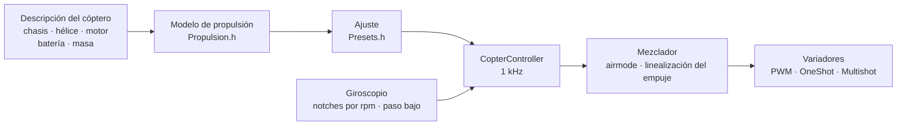

# COPTER.md — firmware para multicópteros

El mismo firmware, las mismas placas (Matek H743-WING V3, DevEBox H743),
los mismos sensores y receptores, pero en lugar de un avión, un cuadricóptero,
hexa, octo, Y6 o X8. La diferencia principal con Betaflight, INAV y
ArduPilot: **los PID, los filtros, el ralentí y las tasas no se ajustan a
mano**. Describes el cóptero (chasis, hélices, motores, batería, masa) y el
firmware deduce el ajuste por sí mismo a partir de un modelo físico, y en
vuelo se adapta a lo que el modelo estimó con poca precisión.

> **Con honestidad.** El firmware de cóptero de momento solo se ha
> comprobado en un simulador (un modelo de 6 grados de libertad, 12 montajes
> × 3 variantes de física «equivocada») y compilándolo para las placas.
> Todavía no ha volado. Afirmar que vuela mejor que Betaflight o ArduPilot
> solo será posible tras las pruebas de vuelo; hasta entonces es un
> objetivo, no un hecho.

## Cómo funciona



1. **Modelo de propulsión** (`copter/Propulsion.h`): un motor con fuerza
   contraelectromotriz y resistencia del bobinado (a partir del KV y del
   volumen del estátor), empuje y par de la hélice (a partir del diámetro, el
   paso y el número de palas), inercia del rotor con la hélice. Para un 5"
   2207 1950KV con 6S el modelo da ~28 000 rpm, ~1.6 kg de empuje y ~45 A a
   todo gas, como en los bancos de prueba.
2. **Lo que se deduce de él** (`copter/Presets.h`): el gas de vuelo
   estacionario, las rpm al ralentí/en estacionario/a todo gas, el retardo
   del motor τ, los momentos de inercia del chasis, la relación
   empuje/peso, la corriente.
3. **El lazo de velocidad angular** se elige por la respuesta en
   frecuencia: motor, filtros, notches, retardo del ciclo y del variador,
   todo está en el modelo. La frecuencia de cruce es la más alta con 50° de
   margen de fase (55° en guiñada) y **12 dB de margen de ganancia**: el
   ajuste aguanta un cóptero cuyo empuje e inercia están equivocados por un
   factor de dos. La proporción de D se busca por barrido: la que hace el
   lazo más ancho. De la frecuencia de cruce salen P, I, D y la
   prealimentación (FF).
4. **La corrección de ganancia por gas (TPA)** sale del mismo modelo: con
   poco gas el motor responde más débil; con mucho, más fuerte.
5. **En vuelo** el firmware aprende solo el gas de estacionario (una batería
   más pesada, un gimbal) y mueve los notches según las rpm.

## Catálogo de montajes

| Montaje | Chasis | Hélice · motor · batería | Masa | Empuje/peso | Estacionario | Ancho de banda del lazo |
|---|---|---|---|---|---|---|
| `whoop65` | Quad X 65 mm | 31 mm ×4 · 0702 23000KV · 1S | 22 g | 4.2 | 31 % | 16 Hz |
| `whoop75` | Quad X 75 mm | 40 mm ×4 · 0802 19000KV · 1S | 32 g | 4.3 | 27 % | 16 Hz |
| `toothpick25` | Quad X 115 mm | 2.5" · 1103 8000KV · 3S | 70 g | 12.1 | 8 % | 14 Hz |
| `micro3` | Quad X 140 mm | 3" · 1404 4500KV · 4S | 190 g | 8.3 | 15 % | 14 Hz |
| `cinewhoop3` | Quad X 150 mm | 3" de 5 palas · 1504 3600KV · 4S | 330 g | 4.1 | 32 % | 16 Hz |
| `freestyle5` | Quad X 225 mm | 5.1" · 2207 1950KV · 6S | 680 g | 9.0 | 15 % | 13 Hz |
| `race5` | Quad X alargado | 5.1" · 2306 2000KV · 6S | 560 g | 10.8 | 11 % | 12 Hz |
| `longrange7` | Quad X 315 mm | 7" · 2806.5 1300KV · 6S | 1.0 kg | 7.0 | 20 % | 11 Hz |
| `heavy10` | Quad X 450 mm | 10" · 3115 900KV · 6S | 2.2 kg | 6.6 | 25 % | 10 Hz |
| `cinelifter8` | X8 380 mm | 8" · 2812 1100KV · 6S | 3.5 kg | 6.4 | 23 % | 11 Hz |
| `hex13` | Hex X 700 mm | 13" · 3510 600KV · 6S | 4.0 kg | 3.7 | 35 % | 8 Hz |
| `hex15` | Hex X 900 mm | 15" · 4114 400KV · 6S | 6.0 kg | 3.0 | 45 % | 8 Hz |

Chasis: Quad X, X alargado, H, Deadcat, «+», Hex X/+, Y6, Octo X/+, X8. La
numeración de motores es la de Betaflight (cuadricóptero: 1 — trasero
derecho, 2 — delantero derecho, 3 — trasero izquierdo, 4 — delantero
izquierdo), hélices hacia dentro o hacia fuera. Estilos de vuelo — interior,
freestyle, carreras, filmación, largo alcance, carga: de ellos dependen las
tasas y la inclinación máxima.

## Tu propio cóptero

`include/config/CopterConfig.h`:

```cpp
#define COPTER_BUILD "freestyle5"     // el montaje más parecido del catálogo
constexpr float MASS_G = 742;          // pésalo con la batería: es lo más importante
constexpr float PROP_DIAMETER_IN = 5.1f, PROP_PITCH_IN = 3.6f;
constexpr float MOTOR_KV = 2150;       // 0: como en el montaje
constexpr copter::EscProtocol ESC_PROTOCOL = copter::EscProtocol::ONESHOT125;
```

El montaje también se elige con un flag: `-D COPTER_BUILD=\"race5\"`. Tras
cargar el firmware, la tecla `t` de la consola muestra lo que se dedujo y
avisa si algo va mal: poco empuje, el motor no puede con esa hélice, las
hélices vecinas se tocan, estacionario por encima del 60 % de gas, los
motores giran más rápido que la mitad de la frecuencia del ciclo.

## Carga del firmware y primer arranque

```bash
pio run -e matek-h743-quad -t upload          # Matek H743-WING V3: botón BOOT + USB
pio run -e stm32h743-devebox-quad -t upload   # DevEBox H743
```

Salidas a los motores, por orden: Matek — S1…S8, DevEBox — PA0–PA3, PD14,
PD15, PE9. **Primer arranque — sin hélices**, monitor serie a 115200:

| Tecla | Qué hace |
|---|---|
| `t` | el ajuste: empuje, estacionario, rpm, τ del motor, filtros, ancho de banda y márgenes del lazo, P/I/D/FF, tasas, avisos |
| `m` | prueba de motores: pide confirmar con `y` (¡sin hélices!), hace girar cada motor 2 s y dice dónde está y hacia dónde debe girar |
| `s` | estado y **por qué no arma**, cada motivo con palabras |
| `o` | calibración del montaje de la placa con tres posturas (en la Matek es obligatoria antes de ARM) |
| `i` · `r` · `l` · `D` | giroscopio · canales de la emisora · línea en vivo · cargador DFU |

Gira el motor equivocado: cambia el orden en `CopterConfig::MOTOR_PINS`;
gira al revés: cambia el sentido en el configurador del variador
(BLHeliSuite, ESC-Configurator), sin volver a soldar cables.

## Emisora y modos

Modo 2: CH1 alabeo, CH2 cabeceo, CH3 gas, CH4 guiñada. **ARM** — SwA (CH5),
como en el avión. **Modo** — SwC (CH7):

| SwC | Modo | Qué hace el stick |
|---|---|---|
| arriba | ANGLE | inclinación (hasta el límite del estilo); al soltar, el cóptero se nivela; la guiñada, alrededor de la vertical |
| centro | ALT_HOLD | ANGLE + altura: gas al centro — se mantiene, por encima/por debajo — sube hasta 3 m/s, baja hasta 2 m/s |
| abajo | ACRO | velocidad de giro según la curva de tasas; airmode: se controla incluso con gas a cero |

HORIZON (ANGLE cerca del centro, ACRO en los extremos) se activa cambiando
una línea en `CopterConfig.h`.

## Protecciones

- **ARM** solo si: hay enlace, el gas está abajo, el cóptero está nivelado
  (hasta 25°) y nadie lo mueve, el giroscopio responde, la orientación se ha
  determinado, la batería no está vacía, no hay prueba de motores en curso,
  el montaje de la placa está calibrado (donde hace falta). Si el
  interruptor ARM se activó antes de tiempo, hay que desactivarlo y volver a
  activarlo.
- **Interruptor ARM abajo: los motores se paran en el mismo ciclo**, en
  cualquier modo.
- **Pérdida de señal**: un corte de hasta 0.3 s no cambia nada; más largo —
  en el suelo, DISARM inmediato; en el aire, nivelación y descenso a
  0.7 m/s (por el barómetro, sin él por el acelerómetro); al tocar el suelo,
  DISARM. Si el enlace vuelve durante 1 s, el piloto recupera el control.
- **Accidente**: en ANGLE/ALT_HOLD, inclinación de más de 90° durante más de
  0.7 s, o más de 30° distinta de la que pide el stick durante más de 2 s
  (motor averiado, tumbado de lado); en cualquier modo, 1 s boca arriba —
  los motores se paran. Para volver a armar, primero hay que desactivar el
  interruptor.
- **En el suelo el integral no se acumula**: el cóptero no salta ni vuelca
  al despegar.

## Qué hay dentro, en breve

| Archivo | Qué |
|---|---|
| `copter/Propulsion.h` | modelo del motor y de la hélice |
| `copter/Presets.h` | catálogo de montajes, deducción del ajuste, avisos |
| `copter/Frames.h` · `Mixer.h` | chasis y mezclador (airmode, prioridad de alabeo/cabeceo sobre guiñada, linealización del empuje) |
| `copter/RateController.h` | P, I (relax en flips y en la aceleración, anti-gravity), D sobre el giroscopio, FF |
| `copter/Attitude.h` | orientación con cuaternión; no se confía en el acelerómetro en tirones, en giros ni cuando discrepa del giroscopio |
| `copter/AltitudeHold.h` | altura: barómetro + acelerómetro, el gas de estacionario se aprende |
| `copter/GyroFilter.h` | notches en 1× y 2× las rpm y en el paso de palas + paso bajo |
| `copter/CopterController.h` | todo junto: ARM, modos, failsafe, accidente |
| `hal/stm32/Stm32MotorOutput.h` · `src/stm32/main_copter.cpp` | variadores y punto de entrada en la STM32 |

## Cómo se comprobó

`test/native/test_copter_sim`: el `CopterController` **real** y un modelo de
cóptero de 6 grados de libertad: motores con fuerza contraelectromotriz,
caída de tensión de la batería con la corriente, par de reacción de las
hélices, resistencia del aire, viento con ráfagas, retardo del variador, un
giroscopio con ruido y vibración de los motores (la vibración por encima de
la mitad de la frecuencia del ciclo se pliega, como en la placa), un
barómetro de 50 Hz, el suelo. Cada montaje del catálogo vuela con su propio
ajuste y con un modelo que a propósito no coincide con la descripción:

- **«perezoso»**: la hélice tira un 20 % menos, el motor y el chasis tienen
  un 30 % más de inercia, un 20 % más de peso, el centro de gravedad
  desplazado hacia delante;
- **«nervioso»**: empuje +20 %, inercia −30 %, masa −15 %, el centro de
  gravedad desplazado a un lado: la ganancia del lazo es casi el doble de la
  calculada.

| Qué | Resultado en 36 vuelos (12 montajes × 3 físicas) |
|---|---|
| Despegue y estacionario en ALT_HOLD | altura ±0.3 m, inclinación < 1°, gas de estacionario aprendido (el whoop «nervioso»: 0.22 en vez de los 0.31 calculados) |
| ANGLE: stick a fondo | 90 % de la inclinación en 0.14–0.35 s, sobreoscilación < 3 %, nivelación a 3° en 0.15–0.4 s |
| ACRO: stick a fondo | 90 % de la tasa en 0.04–0.15 s, sobreoscilación < 12 % |
| Pérdida de señal a 10 m | descenso ≤ 0.94 m/s, al tocar el suelo — DISARM, 17–28 s |

Y aparte, con el 5": airmode con gas a cero, guiñada, viento de 4.5 m/s con
ráfagas, failsafe sin barómetro, variadores PWM corrientes, corte y vuelta
del enlace, caída boca arriba, fallo de motor, prueba de motores, caída de
tensión de la batería. `test_copter` comprueba cada bloque por separado
(41 pruebas), `native_stm32/test_app_stm32_copter` — el firmware completo
sobre los fakes de la Matek H743: pulsos de «parada» antes de ARM,
calibración del montaje, ralentí tras ARM, modos desde el interruptor,
pérdida de señal en el suelo, la consola.

El simulador encontró y ayudó a corregir errores reales que no se ven en el
cálculo: notches que saltaban con cada ciclo del mezclador; fase extra por
los notches cerca del ancho de banda del lazo; acumulación del integral
durante la aceleración del hexa «perezoso» (sobreoscilación del 32 %); un
acelerómetro que en un flip con gas de estacionario marca exactamente 1 g y
desviaba el horizonte 10°; un cóptero con un motor averiado que seguía
girando en el suelo.

## Lo que aún falta

- **DShot** (también bidireccional: rpm exactas para los notches): hace
  falta un controlador con DMA; el cálculo de tramas y CRC ya existe
  (`copter/EscProtocol.h`).
- **Un ciclo de más de 1 kHz** para los whoops, cuyos motores giran a más de
  500 Hz (la simulación muestra que a 4 kHz van claramente mejor).
- Caja negra, MAVLink y OpenPlane Studio para el cóptero; mantener la
  posición por GPS, regreso a casa, misiones.
- Pruebas de vuelo.
