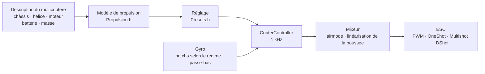

# COPTER.md — firmware pour multicoptères

Le même firmware, les mêmes cartes (Matek H743-WING V3, DevEBox H743 et
presque n’importe quel F405 qui tourne sous Betaflight), les mêmes capteurs
et récepteurs — mais au lieu d’un avion, un quadricoptère, un hexa, un octo,
un Y6 ou un X8. La principale différence avec Betaflight, INAV et
ArduPilot : **les PID, les filtres, le ralenti et les rates ne se règlent pas
à la main**. Vous décrivez le multicoptère (châssis, hélices, moteurs,
batterie, masse), et le firmware en déduit lui-même le réglage à partir d’un
modèle physique — puis s’adapte en vol à ce que le modèle a estimé de façon
imprécise.

> **Honnêtement.** Le firmware multicoptère n’a été vérifié pour l’instant
> qu’en simulateur (un modèle à 6 degrés de liberté, 12 configurations ×
> 3 variantes de physique « fausse ») et par la compilation pour les cartes.
> Il n’a pas encore volé. Dire qu’il vole mieux que Betaflight ou ArduPilot
> ne sera possible qu’après des essais en vol — d’ici là, c’est un but, pas
> un fait.

## Comment ça marche



1. **Le modèle de propulsion** (`copter/Propulsion.h`) : un moteur avec
   force contre-électromotrice et résistance de bobinage (à partir du KV et
   du volume du stator), poussée et couple de l’hélice (à partir du
   diamètre, du pas et du nombre de pales), inertie du rotor avec l’hélice.
   Pour un 5" 2207 1950KV en 6S, le modèle donne ~28 000 tr/min, ~1,6 kg de
   poussée et ~45 A plein gaz — comme sur les bancs d’essai.
2. **Ce qui en découle** (`copter/Presets.h`) : gaz de vol stationnaire,
   régime au ralenti/en stationnaire/plein gaz, retard du moteur τ, moments
   d’inertie du châssis, rapport poussée/poids, courant.
3. **La boucle de vitesse angulaire** est choisie d’après la réponse en
   fréquence : moteur, filtres, notchs, retard de la boucle et de l’ESC —
   tout est dans le modèle. La fréquence de coupure est la plus haute pour
   laquelle la marge de phase vaut 50° (lacet 55°) et la **marge de gain
   12 dB** : le réglage tient sur un multicoptère dont la poussée et
   l’inertie sont « fausses » d’un facteur deux. La part de D est trouvée
   par recherche — celle qui rend la boucle la plus large. P, I, D et
   l’anticipation (FF) découlent de la fréquence de coupure.
4. **La correction du gain selon les gaz (TPA)** — du même modèle : à bas
   régime le moteur répond plus mollement, à haut régime plus fort. La
   courbe de Betaflight existe aussi (`tpa_mode = PD` ou `D`).
5. **En vol**, le firmware apprend lui-même le gaz de stationnaire
   (batterie plus lourde, nacelle) et fait suivre les notchs au régime.

## Catalogue des configurations

| Configuration | Châssis | Hélice · moteur · batterie | Masse | Poussée/poids | Stationnaire | Bande de la boucle |
|---|---|---|---|---|---|---|
| `whoop65` | Quad X 65 mm | 31 mm ×4 · 0702 23000KV · 1S | 22 g | 4,2 | 31 % | 16 Hz |
| `whoop75` | Quad X 75 mm | 40 mm ×4 · 0802 19000KV · 1S | 32 g | 4,3 | 27 % | 16 Hz |
| `toothpick25` | Quad X 115 mm | 2,5" · 1103 8000KV · 3S | 70 g | 12,1 | 8 % | 14 Hz |
| `micro3` | Quad X 140 mm | 3" · 1404 4500KV · 4S | 190 g | 8,3 | 15 % | 14 Hz |
| `cinewhoop3` | Quad X 150 mm | 3" 5 pales · 1504 3600KV · 4S | 330 g | 4,1 | 32 % | 16 Hz |
| `freestyle5` | Quad X 225 mm | 5,1" · 2207 1950KV · 6S | 680 g | 9,0 | 15 % | 13 Hz |
| `race5` | Quad X allongé | 5,1" · 2306 2000KV · 6S | 560 g | 10,8 | 11 % | 12 Hz |
| `longrange7` | Quad X 315 mm | 7" · 2806.5 1300KV · 6S | 1,0 kg | 7,0 | 20 % | 11 Hz |
| `longrange7li` | Quad X 315 mm | 7" bipale · 2810 1300KV · 6S Li-ion 4000 | 1,05 kg | 7,5 | 23 % | 12 Hz |
| `heavy10` | Quad X 450 mm | 10" · 3115 900KV · 6S | 2,2 kg | 6,6 | 25 % | 10 Hz |
| `cinelifter8` | X8 380 mm | 8" · 2812 1100KV · 6S | 3,5 kg | 6,4 | 23 % | 11 Hz |
| `hex13` | Hex X 700 mm | 13" · 3510 600KV · 6S | 4,0 kg | 3,7 | 35 % | 8 Hz |
| `hex15` | Hex X 900 mm | 15" · 4114 400KV · 6S | 6,0 kg | 3,0 | 45 % | 8 Hz |

Châssis : Quad X, X allongé, H, Deadcat, « + », Hex X/+, Y6, Octo X/+, X8.
La numérotation des moteurs est celle de Betaflight (quad : 1 — arrière
droit, 2 — avant droit, 3 — arrière gauche, 4 — avant gauche), hélices vers
l’intérieur ou vers l’extérieur. Styles de vol — intérieur, freestyle,
course, prise de vue, longue distance, transport : ils fixent les rates et
l’inclinaison maximale.

## Votre propre multicoptère

`include/config/CopterConfig.h 

```cpp
#define COPTER_BUILD "freestyle5"     // la configuration la plus proche du catalogue
constexpr float MASS_G = 742;          // pesez-le avec la batterie — c’est l’essentiel
constexpr float PROP_DIAMETER_IN = 5.1f, PROP_PITCH_IN = 3.6f;
constexpr float MOTOR_KV = 2150;       // 0 — comme dans la configuration
constexpr copter::EscProtocol ESC_PROTOCOL = copter::EscProtocol::ONESHOT125;
```

La configuration peut aussi se choisir par un drapeau,
`-D COPTER_BUILD=\"race5\"`, ou sans recompiler — dans le CLI :
`set copter_build = race5`, `set copter_mass_g = 742`, `save` (réglages
ci-dessous ; le fichier n’est alors que la valeur par défaut). Après le
flashage, la touche `t` de la console montre ce qui a été déduit et prévient
si quelque chose cloche : trop peu de poussée, le moteur ne fait pas tourner
cette hélice, des hélices voisines se touchent, il tient le stationnaire
au-dessus de 60 % de gaz, les moteurs tournent plus vite que la moitié de la
fréquence de boucle. Un autre châssis avec un autre nombre de moteurs
fonctionne après un redémarrage : jusque-là l’ARM est bloqué
(`REBOOT_REQD`).

## Flashage et premier démarrage

```bash
pio run -e matek-h743-quad -t upload          # Matek H743-WING V3 : bouton BOOT + USB
pio run -e stm32h743-devebox-quad -t upload   # DevEBox H743
pio run -e aocodarc-f405v3-quad -t upload     # contrôleur F405 venu de Betaflight — voir plus bas
```

Les sorties moteurs dans l’ordre : Matek — S1…S8, DevEBox — PA0–PA3, PD14,
PD15, PE9. **Premier démarrage — sans hélices**, moniteur série à 115200 :

| Touche | Ce qu’elle fait |
|---|---|
| `t` | réglage : poussée, stationnaire, régime, τ du moteur, filtres, bande et marges de la boucle, P/I/D/FF, rates, avertissements |
| `m` | test des moteurs : demande de confirmer par `y` (hélices retirées !), fait tourner chacun 2 s et dit où il se trouve et dans quel sens il doit tourner |
| `s` | état, comme `status` dans Betaflight : charge de la boucle, fréquences, batterie et **pourquoi il ne s’arme pas** — chaque raison en code BF (`RXLOSS`, `ANGLE`, `CLI`…) et en mots |
| `o` | calibration du montage de la carte en trois poses (obligatoire sur la Matek avant l’ARM) |
| `c` | calibration du compas : faire tourner le multicoptère autour de tous les axes pendant 15 s (compas — QMC5883L ou QMC5883P sur le module GPS, celui qui répond) |
| `i` · `r` · `l` · `D` | gyro · voies de la radio · ligne en direct · chargeur DFU |
| `#` | CLI comme dans Betaflight : `set`, `get`, `diff`, `aux`, `map`, `profile`, `save` — [plus bas](#réglages-un-cli-comme-dans-betaflight) |

Le mauvais moteur tourne — changez l’ordre dans `CopterConfig::MOTOR_PINS 
il tourne dans le mauvais sens — changez le sens dans le configurateur de
l’ESC (BLHeliSuite, ESC-Configurator), ne ressoudez pas de fils.

### Un contrôleur F405 venu de Betaflight

Presque n’importe quel contrôleur de quadricoptère à STM32F405 (Betaflight,
quartz 8 MHz) convient s’il porte un ICM-42688-P et un baromètre SPL06 ou
DPS310. Le brochage est pris chez Betaflight lui-même — ainsi fonctionne même
une carte dont la cible ne figure dans aucun dépôt (GETFUN F405V3) :

```bash
# 1. La carte a encore Betaflight ; le Configurator est fermé. Dump du CLI dans un fichier
#    (le Python de PlatformIO — il a pyserial) :
~/.platformio/penv/Scripts/python tools/bf_board.py read --port COM5 --out stack/MACARTE_bf.txt
# 2. Tout le firmware d’origine — pour remettre Betaflight si besoin
#    (carte en DFU : maintenir BOOT et brancher l’USB) :
python tools/bf_board.py backup --out stack/MACARTE_original.bin
# 3. L’en-tête de la carte : qu’est-ce qui est sur quelle broche (BF ne connaît pas le type de baromètre — d’après la description) :
python tools/bf_board.py header stack/MACARTE_bf.txt --baro SPL06 --out include/config/boards/MACARTE.h
```

Puis un env dans `platformio.ini` comme `aocodarc-f405v3-quad` (la carte de
référence : son brochage est public, le cœur F405 est toujours compilé et
testé dessus), avec `-D OP_BOARD_FILE=\"config/boards/MACARTE.h\"`. Les
moteurs sont M1…M8 selon les numéros de Betaflight, le récepteur, le GPS et
la télémétrie sont sur les UART où Betaflight les avait ; le timer de chaque
moteur est celui qu’a choisi Betaflight (les lignes `timer B06 AF2` du dump
-> `OPB_MOTOR_AF  une broche peut avoir deux ou trois timers, et BF les a
choisis sans conflit DMA sur cette carte). La flash de la boîte noire vient
avec son bus et son CS du dump. Une carte qui a déjà notre firmware —
`bf_board.py header` à partir du `config.h` de
[github.com/betaflight/config](https://github.com/betaflight/config).

Le F405 n’a qu’une banque de flash : l’écriture des réglages arrête le
processeur pendant 1–2 s, c’est pourquoi les réglages ne s’écrivent que
désarmé.

## Réglages : un CLI comme dans Betaflight

Ce qui a été déduit de la description peut être corrigé à la main — sans
recompiler, ligne par ligne, comme dans le CLI de Betaflight. `#` dans la
console y fait entrer (seulement désarmé ; tant que le CLI est ouvert, l’ARM
est bloqué) :

```text
# get p_roll                     ← valeur, limites, défaut et sa provenance
# set p_roll = 50                ← en unités Betaflight
# set tune_source = BETAFLIGHT   ← les défauts de BF 4.5 au lieu du modèle
# profile 1                      ← profil PID 0–3 (rateprofile — rates) ; tout de suite, en marche
# diff                           ← seulement ce qui a changé, au format BF
# save                           ← en flash, réglage recalculé, sortie
```

- **Ce qui n’est pas réglé à la main prend la valeur par défaut, et pour les
  PID et les rates ce n’est pas un nombre d’une table mais le résultat de la
  description du multicoptère** (`get` indique « du modèle du
  multicoptère »). Changez la description — tout ce que vous n’avez pas
  touché bouge ; ce qui est réglé à la main reste. Donner une valeur égale
  au défaut revient à remettre le défaut.
- **Les unités sont celles de Betaflight** : un terme PID = nombre × échelle
  BF × erreur, la somme ÷ 1000 va au mixeur (P 0,032029, I 0,244381 et en
  lacet encore ×2,5, D 0,000529, F 0,013754 × 0,01). `t` montre aussi le
  réglage du modèle dans ces nombres : pour un 5", c’est P 25, I 41, D 28,
  F 35 contre les défauts 45/80/40/120 de BF — le modèle est plus doux parce
  qu’il garde une marge de gain de 12 dB.
- **Un diff de Betaflight peut être collé en entier** (`diff all` 4.5) : les
  réglages connus sont appliqués, `profile`/`rateprofile` basculent, `map`,
  `aux`, `rxrange`, `vtx` et `rxfail` vont dans leurs tables, les
  commentaires sont ignorés, un réglage inconnu donne une ligne
  `###ERREUR…###`. Les commandes matérielles de BF (`resource`, `timer`,
  `dma`, `serial`, `feature`, `board_name`… : chez nous, c’est l’en-tête de
  la carte) sont passées avec un commentaire `# ignoré`, et
  `defaults nosave` du diff ne touche pas la description du multicoptère (BF
  n’en a pas). Sur `batch end` (ou sur un `save` au milieu du collage) — un
  bilan : `# collé : N lignes appliquées ; M non reprises : noms…`. Après un
  tel `save`, le reste du collage ne compte pas comme des touches de la
  console pendant une demi-seconde.
- `tune_source = BETAFLIGHT` — tous les défauts de BF 4.5 : PID
  45/80/40/120, 47/84/46/125, 45/80/0/120 ; rates Actual 70/670/0 ; TPA
  seulement sur D, 65 % à partir des gaz 1350, −20 % à bas régime jusqu’au
  décollage ; `iterm_limit` 400 ; somme PID 500 (lacet 400) ; anti-gravity
  80, 5 Hz, P 100 ; `throttle_boost` 5 ; ANGLE 5 °/s par degré, jusqu’à
  60° ; `yaw_lowpass_hz` 100 ; filtres — convertis pour notre chaîne (gyro
  PT2 250 Hz, D — PT1 60 Hz : le même retard à la bande de la boucle). Les
  notchs selon le régime restent les nôtres.
- La flash ne garde que ce qui est réglé à la main (et les profils choisis) ;
  un reflashage ne l’efface pas, `defaults` si. `exit` sans `save` — annule.

| Commande | Ce qu’elle fait |
|---|---|
| `set` · `set nom = valeur` | tous les réglages · régler (prend effet après `save`) |
| `get partie_du_nom` | valeur, limites, défaut, ce que c’est |
| `diff [all]` · `dump [all]` | ce qui a changé · tout ; `all` — tous les profils |
| `profile [0-3]` · `rateprofile [0-3]` | choisir le profil PID · le profil de rates |
| `aux` · `aux n° mode voie de à [logique lien]` · `aux help` | table des modes sur les interrupteurs · une ligne · numéros des modes — [plus bas](#radiocommande-et-modes) |
| `map [AETR1234]` · `rxrange [0-3 min max]` | ordre des voies · extrémités des manches roulis/tangage/lacet/gaz |
| `rxfail` · `rxfail voie a\|h\|s [valeur]` | quoi faire d’une voie sans liaison, comme dans BF : manches 0–3 — `a` (automate de failsafe) ou `h` (garder la dernière), AUX 4–17 — `h` ou `s 750…2250` (fixer) ; les 0,3 premières secondes — toujours la dernière valeur valable |
| `vtx` · `vtx n° voie bande canal_VTX puissance de à` · `vtx_info` | émetteur vidéo depuis un interrupteur, comme dans BF · ce qu’il a répondu et ses puissances — [plus bas](#émetteur-vidéo) |
| `dshot_telemetry_info` | comme dans BF : eRPM, tr/min, Hz et part des trames sans réponse par moteur (`dshot_bidir`) |
| `flash_info` · `flash_erase` | flash de la boîte noire (F405) : puce, taille, JEDEC ID, état et vols · tout effacer (une commande, attend jusqu’à une minute, comme dans BF) |
| `save` · `defaults [nosave]` | enregistrer et recalculer · tout par défaut |
| `status` · `tasks` | état (comme `s`) · temps de chaque partie de la boucle : fréquence, moyenne et pire, part du processeur |
| `version` · `help` · `exit` | version · liste · sortie |

### Réglages

| Réglage | Où | Plage | Par défaut | Quoi |
|---|---|---|---|---|
| `tune_source` | général | `MODEL`, `BETAFLIGHT` | `MODEL` | d’où viennent les PID, filtres et TPA : de la description du multicoptère ou des défauts de BF 4.5 |
| `profile_name` | profil PID | jusqu’à 8 caractères | — | nom du profil PID |
| `p_roll` `i_roll` `d_roll` `f_roll` | profil PID | P, I, D 0–250 ; F 0–1000 | du modèle ; BF : 45, 80, 40, 120 | PID de roulis en unités BF |
| `p_pitch` `i_pitch` `d_pitch` `f_pitch` | profil PID | idem | du modèle ; BF : 47, 84, 46, 125 | PID de tangage |
| `p_yaw` `i_yaw` `d_yaw` `f_yaw` | profil PID | idem | du modèle ; BF : 45, 80, 0, 120 | PID de lacet |
| `d_max_roll` `d_max_pitch` `d_max_yaw` | profil PID | 0–250 | 0 (D constant) | D sur un mouvement brusque, comme dans BF 2025.12 : alors `d_*` est le D au repos |
| `d_min_roll` `d_min_pitch` `d_min_yaw` | profil PID | 0–250 | 0 ; BF : 30, 34, 0 | comme dans BF 4.5 : D au repos, `d_*` — sur un mouvement brusque (si `d_max_*` n’est pas réglé) |
| `d_max_gain` (`d_min_gain`) | profil PID | 0–100 | 37 | avec quelle facilité D monte sur les secousses du gyro : à 37 — entièrement vers ~5000 °/s² |
| `d_max_advance` (`d_min_advance`) | profil PID | 0–200 | 20 | à quel point D monte tôt sur le mouvement du manche : à 20 — entièrement vers ~2500 °/s² de consigne |
| `iterm_relax` | profil PID | `OFF`, `RP`, `RPY`, `RP_INC`, `RPY_INC` | `RPY  BF : `RP` | sur quels axes I attend pendant que la consigne change brusquement (pas de rebond après un flip) ; `_INC` — seule la croissance est retenue |
| `iterm_relax_type` | profil PID | `GYRO`, `SETPOINT` | `SETPOINT` | `SETPOINT` — I s’accumule plus lentement ; `GYRO` — I vers la consigne lissée, nul tout près d’elle |
| `iterm_relax_cutoff` | profil PID | 1–50 Hz | 10 ; BF : 15 | lissage de la consigne pour le relax : plus bas — attend plus longtemps |
| `iterm_relax_error` | profil PID | `OFF`, `ON` | `ON` | le nôtre : une grande erreur en accélérant vers une nouvelle consigne (un flip) ne s’accumule pas dans I ; une erreur sans mouvement du manche (une rafale, un coup de gaz) si |
| `iterm_rotation` | profil PID | `OFF`, `ON` | `OFF` | I tourne avec le châssis : dans une pirouette, ce qui s’est accumulé en roulis passe en tangage |
| `iterm_windup` | profil PID | 30–100 % | 100 (désactivé) ; BF : 85 | plus les moteurs s’écartent, plus I s’accumule faiblement ; à l’écart total il s’arrête |
| `iterm_limit` | profil PID | 0–500 | du modèle (300) ; BF : 400 | limite de I, 1000 — toute la course des moteurs |
| `pidsum_limit` · `pidsum_limit_yaw` | profil PID | 100–1000 | 1000 ; BF : 500 · 400 | limite de la somme PID en roulis et tangage · en lacet (1000 — toute la course) ; à la limite, I ne s’accumule pas |
| `anti_gravity_gain` | profil PID | 0–250 | 80 | un coup de gaz rend I plus fort, le nez ne pique pas : sur un coup complet (toute la course en 0,1 s), 1 + gain/10 fois |
| `anti_gravity_cutoff_hz` | profil PID | 2–50 Hz | 5 | lissage de la vitesse des gaz : plus bas — un pic plus bas mais plus long |
| `anti_gravity_p_gain` | profil PID | 0–250 % | 0 ; BF : 100 | le P de roulis et de tangage est plus fort aussi : à 100 — de 50 % sur un coup complet |
| `throttle_boost` · `throttle_boost_cutoff` | profil PID | 0–100 (×0,1) · 5–50 Hz | 0 ; BF : 5 · 15 | un coup de gaz au manche (gaz moins son passe-bas) est amplifié 1 + boost/10 fois — les moteurs rattrapent le manche plus tôt ; pas en ALT_HOLD |
| `tpa_mode` | profil PID | `PD`, `D`, `MODEL` | `MODEL  BF : `D` | correction PD selon les gaz : `PD`/`D` — la courbe BF (deux lignes plus bas), `MODEL` — du modèle sur P et D |
| `tpa_rate` · `tpa_breakpoint` | profil PID | 0–100 % · 750–2250 µs | 65 · 1350 | `PD`/`D  au-dessus du point, PD (ou seulement D) faiblit linéairement, plein gaz de `tpa_rate` |
| `tpa_low_rate` · `tpa_low_breakpoint` | profil PID | −128…100 % · 750–2250 µs | 0 ; BF : 20 · 1050 | à gaz nul, PD (D) est plus faible de `tpa_low_rate` (sous 0 — plus fort), linéairement jusqu’au point |
| `tpa_low_always` | profil PID | `OFF`, `ON` | `OFF` | `OFF` — seulement tant qu’après l’ARM les gaz ne sont pas montés au-dessus de `tpa_low_breakpoint` (au sol), `ON` — toujours |
| `feedforward_transition` | profil PID | 0–100 % | 0 | plus près du centre du manche que cela, l’anticipation est plus faible (linéairement jusqu’à zéro) — plus doux au centre |
| `feedforward_averaging` | profil PID | `OFF`, `2_POINT`, `3_POINT`, `4_POINT` | `OFF` | la vitesse du manche pour l’anticipation est moyennée sur 2–4 trames du récepteur : plus régulière avec des trames rares, mais plus tardive |
| `feedforward_smooth_factor` | profil PID | 0–95 % | 0 ; BF : 25 | lissage de l’anticipation d’une trame à l’autre (part de l’ancienne valeur par trame) |
| `feedforward_jitter_factor` | profil PID | 0–20 | 0 ; BF : 7 | le manche a bougé moins que cela en une trame (500 — un demi-manche) — l’anticipation faiblit, doucement jusqu’à zéro : le tremblement du doigt ne secoue pas les moteurs |
| `feedforward_boost` | profil PID | 0–50 | 0 ; BF : 15 | un apport selon l’accélération du manche (15 — 3 ms d’avance, pas plus que la vitesse du manche elle-même) |
| `feedforward_max_rate_limit` | profil PID | 0–150 % | 0 ; BF : 90 | avec la consigne à cette part du rate maximal, l’anticipation vers l’extérieur n’est pas plus grande que ce que P donnerait pour la marge restante, au-delà — zéro : un flip manche à fond sans dépassement |
| `yaw_lowpass_hz` | profil PID | 0–500 Hz | du modèle (30–100) ; BF : 100 | passe-bas sur la sortie du PID de lacet (0 — sans filtre) ; les PID du modèle sont calculés avec la fréquence du modèle |
| `use_integrated_yaw` · `integrated_yaw_relax` | profil PID | `OFF`, `ON` · 0–255 | `OFF` · 200 | lacet par l’intégrale de la somme PID (×100 1/s, fuite relax × 0,08 1/s) — pour les grandes hélices, dont le lacet accélère l’hélice. Les nombres de BF se comportent comme dans BF (I sans ×2,5 ; un 5" a besoin de `d_yaw`, sinon il oscille) ; les PID de lacet du modèle non réglés sont recalculés pour que la boucle reste la même |
| `abs_control_gain` | profil PID | 0–20 (°/s par °) | 0 (désactivé) | ACRO : l’angle et le cap perdus à cause d’une rafale ou d’un déséquilibre de poussée reviennent ; roulis et tangage — seulement en ACRO, lacet — dans tout mode, en l’air |
| `abs_control_limit` · `abs_control_error_limit` · `abs_control_cutoff` | profil PID | 10–255 °/s · 1–45° · 1–45 Hz | 90 · 20 · 11 | limite de la correction · de l’erreur d’angle accumulée · passe-bas de la consigne (le retard du châssis sur un manche rapide ne s’accumule pas) |
| `thrust_linear` | profil PID | 0–150 % | du modèle (15–30) ; BF : 0 | linéarisation de la poussée : les bas gaz répondent comme les hauts |
| `motor_output_limit` | profil PID | 1–100 % | 100 | part de la course des moteurs au-dessus du ralenti : une batterie 6S sur des moteurs pour 4S — 66 |
| `rateprofile_name` | profil de rates | jusqu’à 8 caractères | — | nom du profil de rates |
| `roll_rc_rate` `pitch_rc_rate` `yaw_rc_rate` | profil de rates | 1–255 (×10 °/s) | selon le style de vol ; BF : 7 | rate au centre du manche |
| `roll_srate` `pitch_srate` `yaw_srate` | profil de rates | 0–255 (×10 °/s) | selon le style de vol ; BF : 67 | rate manche à fond |
| `roll_expo` `pitch_expo` `yaw_expo` | profil de rates | 0–100 % | selon le style de vol ; BF : 0 | expo : plus doux au centre |
| `serialrx_provider` | général | `IBUS`, `SBUS`, `CRSF` | `RX_PROTOCOL` de `Config.h` | protocole du récepteur ; change après `save` sans redémarrage |
| `rx_min_usec` `rx_max_usec` | général | 750–2250 µs | 885, 2115 | une impulsion hors de ces bornes est une erreur de voie : sur un manche — perte de liaison, sur AUX la valeur précédente est gardée |
| `copter_build` | général | configurations du catalogue | `COPTER_BUILD` | base de la description du multicoptère |
| `copter_mass_g` | général | 0–30000 g (0 — estimation) | de la configuration | masse au décollage avec la batterie |
| `copter_wheelbase_mm` | général | 30–2000 mm | de la configuration | entre les axes de moteurs opposés |
| `prop_diameter_in` `prop_pitch_in` `prop_blades` | général | 0,5–40", 0,3–30", 2–8 | de la configuration | hélice |
| `motor_stator_mm` `motor_height_mm` `motor_kv` | général | 3–120 mm, 0,5–60 mm, 50–80000 | de la configuration | moteur : 2207 — 22 et 7 |
| `battery_cells` `battery_mah` | général | 1–14 S, 50–50000 mAh | de la configuration | batterie |
| `props_out` | général | `OFF`, `ON` | `PROPS_OUT` | hélices vers l’extérieur : tous les moteurs tournent dans l’autre sens |
| `battery_chemistry` | général | `LIPO`, `LIHV`, `LIION` | de la configuration (LiPo) | chimie : seuils d’élément et tension sous charge pour le modèle de poussée (3,75 / 3,85 / 3,5 V) |
| `vbat_min_cell_voltage` `vbat_warning_cell_voltage` `vbat_max_cell_voltage` | général | 100–500 (×0,01 V) | selon la chimie : LiPo 330/350/430, LiHV 330/350/440, Li-ion 280/310/425 | élément : vide (CRITICAL) · il est temps de rentrer (WARNING ; en dessous à vide — ne pas armer) · plein |
| `vbat_full_cell_voltage` | général | 100–500 (×0,01 V) | selon la chimie : LiPo 410, LiHV 425, Li-ion 410 | un élément au-dessus au branchement — la batterie est pleine ; sinon l’OSD affiche `BATT < FULL` désarmé |
| `vbat_scale` · `vbat_divider` · `vbat_multiplier` | général | 0–255 · 1–255 · 1–255 | diviseur de la carte (110 · 10 · 1 — 1:11 ; F405 — du dump de la carte) | volts = mV de la broche × `vbat_scale` / (1000 × `vbat_divider` × `vbat_multiplier`), comme dans BF |
| `battery_meter` | général | `NONE`, `ADC`, `ESC` | `ADC` si la carte a une entrée batterie | d’où vient la tension (`ESC` — de la télémétrie de l’ESC, pas encore en service) |
| `current_meter` · `ibata_scale` · `ibata_offset` | général | `NONE`/`ADC`/`VIRTUAL`/`ESC`/`MSP` · ±16000 (×0,1 mV/A) · ±32000 mV | `ADC` si la carte a une entrée courant ; 400 (Matek — 250, F405 — du dump de la carte) ; 0 | capteur de courant : courant, mAh consommés, reste (`VIRTUAL`, `ESC`, `MSP` sont acceptés d’un diff BF mais ne donnent pas encore de courant) |
| `vbat_detect_cell_voltage` | général | 0–2000 (×0,01 V) | 300 | une batterie est présente si la tension est entre cette valeur et un élément plein (1S) ou au-dessus de deux fois cette valeur ; sinon — alimentation USB |
| `force_battery_cell_count` | général | 0–24 S | 0 | nombre d’éléments ; 0 — de la description du multicoptère (`battery_cells`). Dans BF, 0 veut dire deviner d’après la tension ; nous ne devinons pas : un Li-ion 6S vide (17 V) ne se distingue pas d’un LiPo 4S plein |
| `bat_capacity` | général | 0–20000 mAh | 0 | capacité pour le reste et l’alarme de consommation ; 0 — `battery_mah` de la description |
| `vbat_hysteresis` | général | 0–250 (×0,01 V) | 1 | l’alarme se déclenche quand la tension est encore de cette valeur sous le seuil (pour toute la batterie, comme dans BF) ; elle cesse au-dessus du seuil |
| `vbat_duration_for_warning` · `vbat_duration_for_critical` | général | 0–150 (×0,1 s) | 20 · 20 (BF : 0 · 0) | autant de temps de suite sous le seuil — WARNING · CRITICAL : une chute sur un coup de gaz n’est pas une alarme |
| `use_vbat_alerts` · `use_cbat_alerts` · `cbat_alert_percent` | général | `OFF`/`ON` · `OFF`/`ON` · 0–100 % | `ON` · `OFF` · 10 | biper et afficher l’alarme batterie · alarme aussi selon les mAh (il reste au plus `cbat_alert_percent` — WARNING, zéro — CRITICAL ; il faut un capteur de courant) |
| `vbat_cutoff_percent` | général | 0–100 % | 100 (aucune) | dès le premier CRITICAL, les gaz du manche sont limités en douceur à cette part en 10 s (le LVC de BF) ; pas le maintien d’altitude ni l’automate de failsafe |
| `vbat_display_lpf_period` · `vbat_sag_lpf_period` · `ibat_lpf_period` | général | 1–255 (×0,1 s) | 30 · 2 · 10 | lissage (passe-bas 10/période Hz, comme dans BF) : affichage et alarmes · tension pour la compensation de chute · courant |
| `vtx_protocol` | général | `AUTO`, `SMARTAUDIO`, `TRAMP`, `NONE` | `AUTO` si la carte a un fil VTX | fil de commande de l’émetteur vidéo |
| `vtx_band` · `vtx_channel` · `vtx_freq` | général | 0–10 · 1–8 · 0–6200 MHz | 5 (R) · 1 · 0 | bande (1 A, 2 B, 3 E, 4 F, 5 R, 6 L, 7 X, 8 V, 9 G, 10 S ; 0 — fréquence en nombre) |
| `vtx_power` | général | 1–12 | 1 | niveau de puissance, 1 — le plus faible ; la table vient de l’émetteur (`vtx_info`) |
| `vtx_max_power_mw` | général | 0–10000 mW | 0 (aucun) | **le plafond** : on ne monte pas au-dessus, ni par un interrupteur, ni par le bouton de l’émetteur |
| `vtx_low_power_disarm` | général | `OFF`, `ON`, `UNTIL_FIRST_ARM` | `OFF` | désarmé — le niveau le plus faible |
| `gps_minimum_sats` | général | 4–50 | 8 | la maison est fixée à l’ARM s’il y a au moins autant de satellites |
| `crsf_telemetry` | général | `OFF`, `ON` | `ON` | télémétrie vers la radio par CRSF |
| `blackbox_device` | général | `NONE`, `SPIFLASH`, `SDCARD`, `SERIAL` | `SPIFLASH` sur le F405, `SDCARD` sur le H743 | où enregistrer la boîte noire ; elle n’enregistre que si le support de cette carte est choisi (`SERIAL` est accepté d’un diff BF mais n’enregistre pas) |
| `blackbox_mode` | général | `NORMAL`, `MOTOR_TEST`, `ALWAYS` | `NORMAL` | quand enregistrer : tant que c’est armé, tant que les moteurs tournent, toujours |
| `blackbox_sample_rate` | général | `1/1` … `1/32` | `1/1` (F405 avec flash — `1/2`) | gyro, PID et moteurs — une boucle sur combien |
| `motor_poles` | général | 4–255 | 14 | aimants du rotor : tr/min = eRPM × 2 / `motor_poles` |
| `dshot_bidir` | général | `OFF`, `ON` | `OFF` | DShot bidirectionnel : l’ESC répond avec le régime ; change après un redémarrage (jusque-là l’ARM est bloqué, `REBOOT_REQD`) ; avec lui la limite de boucle est plus basse — trame, 30 µs et réponse : DShot600 — jusqu’à 11,8 kHz, 300 — 7,2, 150 — 4,0 |
| `small_angle` | général | 0–180° | 25 | posé plus incliné que cela — ne pas armer ; 180 — pas de contrôle |
| `auto_disarm_delay` | général | 0–60 s | 5 | armé mais posé au sol gaz en bas pendant ce temps — DISARM (dans BF seulement avec l’ARM aux manches ; chez nous aussi avec l’interrupteur) ; 0 — jamais |
| `runaway_takeoff_prevention` | général | `OFF`, `ON` | `ON` | après l’ARM, le régulateur est en butée et le multicoptère tourne — DISARM |
| `runaway_takeoff_deactivate_delay` | général | 100–1000 ms | 500 | autant de vol calme — le contrôle de runaway se désactive jusqu’au prochain ARM |
| `runaway_takeoff_deactivate_throttle_percent` | général | 0–100 % | 20 | les gaz au-dessus desquels le vol compte (ou le multicoptère est déjà monté au-dessus d’un mètre) |
| `failsafe_delay` | général | 1–200 (×0,1 s) | 15 | pas de liaison pendant ce temps — étape 2 ; avant, étape 1 : à plat et tient l’altitude (dans BF — manches au centre, gaz 0) |
| `failsafe_procedure` | général | `AUTO-LAND`, `DROP`, `GPS-RESCUE` | `AUTO-LAND` (BF : `DROP`) | étape 2 : à plat et descente · moteurs coupés · retour (pour l’instant sans GPS — comme AUTO-LAND, la commande revient par le manche) |
| `failsafe_landing_time` | général | 1–250 s | 120 (BF : 60) | AUTO-LAND ne s’est pas posé dans ce temps — DISARM ; chez nous la descente suit l’altitude et se termine au toucher, c’est une marge |
| `failsafe_throttle` | général | 1000–2000 µs | 1000 | AUTO-LAND : 1000 — descente à 0,7 m/s selon l’altitude ; plus — gaz constants, comme dans BF |
| `failsafe_throttle_low_delay` | général | 0–300 (×0,1 s) | 100 | les gaz étaient en bas plus longtemps que cela avant la perte de liaison — DISARM tout de suite (le multicoptère est visiblement au sol) ; 0 — non |
| `failsafe_recovery_delay` | général | 1–200 (×0,1 s) | 5 | la liaison tient ce temps — la commande revient au pilote (étape 2) et l’ARM redevient possible après un DISARM par failsafe |
| `failsafe_stick_threshold` | général | 0–50 % | 30 | GPS-RESCUE : la liaison est revenue — la commande va au pilote quand un manche est poussé plus loin |
| `failsafe_switch_mode` | général | `STAGE1`, `KILL`, `STAGE2` | `STAGE1` | mode FAILSAFE depuis un interrupteur : comme une perte de liaison · moteurs coupés tout de suite (ARM après 1 s) · directement l’étape 2 |
| `craft_name` | général | jusqu’à 16 caractères | — | nom du multicoptère : configurateur BF (`MSP_NAME`) et journal |
| `vbat_sag_compensation` | profil PID | 0–150 % | 100 (BF : 0) | correction des moteurs pour la chute de tension : 100 — avec une batterie qui faiblit, ils répondent comme avec une pleine, 0 — sans correction |

La description du multicoptère (`copter_build` … `props_out`) : le défaut
est la configuration du catalogue avec les corrections « votre propre
multicoptère » de `CopterConfig.h  changez de configuration — les défauts
de masse, d’hélice, de moteur et de batterie viennent de la nouvelle, et ce
qui est réglé à la main reste. Les PID et les filtres sont recalculés pour
la nouvelle description au `save`.

La courbe de rates est la nôtre pour l’instant : au centre `rc_rate`, en
butée `srate`, l’expo adoucit le centre ; avec expo 0, elle coïncide avec
Actual de Betaflight. Pour les hexas 13"/15", le modèle demande un D
au-dessus de 250 et un F au-dessus de 1000 — `get` montre le défaut ramené à
la limite, mais c’est la valeur exacte du modèle qui est appliquée.

## Radiocommande et modes

Par défaut Mode 2 : CH1 roulis, CH2 tangage, CH3 gaz, CH4 lacet. **ARM** —
SwA (CH5), comme sur l’avion. **Mode** — SwC (CH7) :

| SwC | Mode | Ce que fait le manche |
|---|---|---|
| en haut | ANGLE | inclinaison (jusqu’à la limite du style), relâché — le multicoptère se remet à plat ; lacet — autour de la verticale |
| au milieu | ALT_HOLD | ANGLE + altitude : gaz au centre — stationnaire, au-dessus/au-dessous — montée jusqu’à 3 m/s, descente jusqu’à 2 m/s |
| en bas | ACRO | vitesse angulaire selon la courbe de rates ; airmode — pilotable même à gaz nul |

Tout cela se change dans le CLI, comme dans Betaflight :

- `map TAER1234` — ordre des voies : une lettre à la place de chaque voie
  (A — roulis, E — tangage, T — gaz, R — lacet, 1–4 — AUX1–AUX4). Le seuil
  de failsafe des gaz (`RX_FAILSAFE_THROTTLE_US`) suit les gaz.
- `rxrange 3 1050 1950` — les extrémités du manche des gaz sont étirées à
  1000–2000 (0 — roulis, 1 — tangage, 2 — lacet, 3 — gaz).
- `aux 0 0 1 1700 2100 0 0` — le mode est actif tant que la voie est dans la
  plage : numéro de ligne 0–19, mode (numéro BF), voie (0 — AUX1, c’est-à-dire
  CH5 avec `map AETR1234`), de et à en µs par pas de 25, logique (0 —
  n’importe quelle ligne du mode suffit, 1 — il les faut toutes), lien (le
  mode s’active avec un autre). `aux` sans arguments — la table,
  `aux help` — les numéros des modes.

| Mode | Numéro BF | Ce qu’il fait |
|---|---|---|
| ARM | 0 | moteurs en marche |
| ANGLE · HORIZON · ALTHOLD | 1 · 2 · 3 | mode de vol ; s’il y en a plusieurs — ALTHOLD, puis ANGLE, puis HORIZON ; aucun — ACRO |
| FAILSAFE | 27 | comme une perte de liaison (vérification du failsafe au sol) |
| AIR MODE | 28 | airmode même avec `AIRMODE` désactivé dans `CopterConfig.h` |
| PREARM | 36 | s’il est dans la table — ARM seulement avec PREARM actif |
| USER1 … USER4 | 40 … 43 | broches PINIO de la carte (sur la GETFUN F405V3 : USER1 — caméra CAM1/CAM2, USER2 — alimentation 12 V) |
| VTX PIT MODE · VTX CONTROL DISABLE | 39 · 48 | émetteur vidéo en PIT · ne pas toucher l’émetteur |

**Quand la table est vide (comme après `defaults`), ce sont les
interrupteurs de `CopterConfig.h` qui fonctionnent** (`aux` les montre en
lignes à copier). Dès qu’il y a une ligne, seule la table fonctionne, comme
dans BF : un diff de Betaflight collé la décrit entièrement, les défauts du
firmware ne s’y mélangent pas. Pas d’ARM dans la table — le multicoptère ne
s’arme pas (`NO_ARM_AUX`). Les modes BF que nous n’avons pas encore (BEEPER,
GPS RESCUE…) sont acceptés et conservés mais ne font rien — `aux` le dit.

## Émetteur vidéo

Un émetteur analogique avec un fil de commande (SmartAudio ou Tramp —
`vtx_protocol = AUTO` le trouve tout seul) est tenu par le firmware sur la
fréquence et la puissance des réglages :

```text
# set vtx_band = 5            ← R
# set vtx_channel = 1         ← R1, 5658 MHz
# set vtx_max_power_mw = 400  ← plafond « en ville »
# vtx 0 2 0 0 2 900 1300      ← AUX3 (SwC) en haut — niveau 2
# vtx 1 2 0 0 6 1700 2100     ← AUX3 en bas — niveau 6 (mais pas au-dessus du plafond)
# vtx_info                    ← ce qu’a répondu l’émetteur, ses puissances
# save
```

- **Le plafond `vtx_max_power_mw`** est l’essentiel : ni une ligne `vtx`
  depuis un interrupteur ni `vtx_power` ne montent au-dessus, et si
  l’émetteur a été monté avec son propre bouton, le firmware le redescend en
  une seconde. Pour retirer le plafond — `set vtx_max_power_mw = 0`.
- **La puissance depuis la radio** — des lignes `vtx`, comme dans
  Betaflight : tant que l’AUX est dans la plage, l’émetteur a cette bande,
  ce canal et ce niveau (0 — ne pas toucher). Un interrupteur, un
  potentiomètre ou une voie programmable d’EdgeTX — peu importe.
- La table des puissances vient de l’émetteur lui-même : SmartAudio 2.1
  annonce ses niveaux en dBm (36 dBm — « 4 W »), Tramp — la limite en mW ;
  SmartAudio 1.0/2.0 a les paliers 25/200/500/800 mW, comme le TBS Unify.
- Fréquences — la table de l’émetteur à 80 canaux 4,9–6,1 GHz : A, B, E, F,
  R, L (chez le vendeur — D), X, V, G, S. **Un masque analogique (Cobra X V4)
  ne reçoit que A, B, E, F, R et L** — sur X/V/G/S il n’y aura pas d’image.
- Le mode VTX PIT MODE — PIT (ne pas gêner les autres au sol), USER2 sur la
  GETFUN — l’alimentation 12 V de tout l’émetteur. L’émetteur ne répond
  pas — `status` indique « VTX : ne répond pas » ; on règle alors la
  fréquence et la puissance avec ses boutons.

## OSD et buzzer

**OSD** — la puce AT7456E/MAX7456 du contrôleur (sur les cartes venues de
Betaflight, son bus et son CS viennent du dump de la carte). L’image de la
caméra traverse toujours la puce, l’OSD se superpose : liaison (LQ), mode,
satellites, puissance du VTX, réticule, flèche et distance vers la maison,
altitude, tension (et par élément), courant, mAh, temps de vol et **un
avertissement principal** au centre : FAILSAFE, RXLOSS, BATT CRITICAL, LOW
BATTERY, désarmé — pourquoi il ne s’arme pas (un code BF, par exemple
THROTTLE) ou DISARMED. La police est celle de la puce (sur les cartes sous
Betaflight — la police BF), d’où les inscriptions en lettres latines.
PAL/NTSC — selon la caméra, automatiquement ; le mode OSD DISABLE masque
tout.

**Buzzer** : ARM — long, DISARM — deux courts, après la mise sous tension,
quand on peut armer, — court ; batterie WARNING — un court toutes les 2 s,
CRITICAL — souvent ; failsafe — alarme ; mode BEEPER — « retrouver le
modèle » (même sans liaison — l’AUX garde la dernière valeur), BEEPER MUTE —
silence (sauf la recherche).

## GPS, compas et télémétrie vers la radio

- **GPS** (u-blox M10) — sur l’UART où Betaflight l’avait. `status` montre
  le fix, les satellites, la précision, la vitesse et **la maison** : elle
  est fixée à l’ARM avec un fix 3D et au moins `gps_minimum_sats`
  satellites ; sinon — au premier bon fix, déjà en vol (« fixée déjà en
  vol »). Distance et direction de la maison — dans `status`, `@live` et sur
  la radio. Les modes GPS (retour à la maison, maintien de position)
  **n’existent pas encore**.
- **Compas** sur le module GPS — QMC5883L ou QMC5883P, le firmware essaie
  les deux. Calibration — `c` dans la console. Le cap du nez vient du compas
  (s’il est calibré), au-dessus de 3 m/s — du GPS, sinon — du gyro depuis la
  mise sous tension. L’inclinaison n’est pas encore compensée : en vol
  rapide, le cap du compas peut se tromper d’une dizaine de degrés.
- **Télémétrie CRSF** (ELRS, Crossfire) — dans le même UART que celui d’où
  arrivent les voies : batterie (V, A, mAh, %), GPS, attitude, mode (`ACRO`,
  `ANGL`, `HOR`, `ALTH`, `!FS!  désarmé — avec « * »), vitesse verticale.
  Dans EdgeTX (RadioMaster TX12) — « Découvrir les capteurs » sur la page
  télémétrie du modèle.

## Boîte noire

Sur le H743 (Matek H743, DevEBox), le multicoptère enregistre le vol sur la
carte SD — au même format et dans le même fichier `BLACKBOX.BIN` que l’avion
(préparation de la carte — [BLACKBOX.md](BLACKBOX.md#carte-sd-stm32h743)).
Sur le F405 — dans la flash SPI de la carte (`blackbox_device = SPIFLASH`,
comme dans BF) : W25Q128, W25Q64, M25P16, GD25Q et leurs semblables sont
reconnus par leur JEDEC ID (jusqu’à 16 Mo) ; le même format et le même
téléchargement. La moitié de la flash est gardée effacée (16 Mo à `1/2` —
environ 8 minutes de vol), les anciens vols sont effacés au sol en entier,
le plus ancien d’abord — et non « pleine — enregistrement arrêté » comme
dans BF. La file des enregistrements est dans la CCM RAM du F405 (60 Ko),
une flash sur le même bus que l’OSD partage avec lui un mutex, une flash sur
le bus du gyro n’est pas utilisée. `flash_info` et `flash_erase` dans le
CLI — comme dans BF.

| Enregistrement | Fréquence | Ce qu’il contient |
|---|---|---|
| `QGYRO` | à chaque boucle (`blackbox_sample_rate`) | gyro avant et après les filtres, consignes, temps de travail de la boucle |
| `QCTRL` | au même moment | P, I, D, F par axe (part de la course des moteurs), moteurs 1–4, gaz du mixeur |
| `QMOT8` | au même moment, s’il y a plus de 4 moteurs | moteurs 5–8 |
| `QSTATE` | 50 Hz | angles, altitude et cible, montée, manches, gaz de stationnaire, batterie (V, A, mAh), régime, LQ, mode, drapeaux, blocages de l’ARM |
| `GPS`, `SYS` | nouvelle solution, 1 Hz | comme sur l’avion |
| `EVENT` | — | ARM/DISARM, mode, FAILSAFE, crash, liaison, batterie, profil, « ARM refusé : codes BF », GPS et maison, test des moteurs, pertes de la file |

Au début du vol — configuration, châssis, PID en unités BF, rates, filtres
et tout ce qui est réglé dans le CLI (`set.<nom>=<valeur>`, comme `diff`).

Quand il enregistre — `blackbox_mode`, comme dans Betaflight : `NORMAL` —
tant que c’est armé (de 2 s avant à 2 s après), `MOTOR_TEST` — tant que les
moteurs tournent (et le test des moteurs sur l’établi), `ALWAYS` — dès la
mise sous tension. `blackbox_device = NONE` — ne pas enregistrer. À 1 kHz le
flux est de ~70 Ko/s : des blocs de 512 octets vont sur la carte, un fichier
de 256 Mo dure environ une heure. Si le journal indique « file pleine » —
`blackbox_sample_rate = 1/2`.

Pour regarder — **OpenPlane Studio, la section « Boîte noire »** : les vols
de la carte par USB (le bouton « Télécharger », le fichier arrive dans le
dossier du projet), les journaux enregistrés ou `BLACKBOX.BIN` directement
depuis la carte. Une frise avec modes et événements, des graphiques de
consigne et de gyro (avant et après les filtres), PID par axe, moteurs, gaz,
altitude, batterie — avec un curseur commun, un zoom à la molette et la
lecture ; le spectre du bruit du gyro dans la fenêtre visible avec des
repères du régime moteur ; le multicoptère en 3D au curseur. Sans
l’application — `python tools/blackbox.py download` et `decode` (un CSV par
type d’enregistrement). Console : `k` — état et vols.

**Format Betaflight** (`.BFL` — Blackbox Explorer, PIDtoolbox) :
`python tools/blackbox.py download --bfl` — la carte convertit elle-même le
vol (`bb bfl N`, `telemetry/BflEncoder.h`) et livre un fichier prêt. Une
trame par boucle enregistrée : `axisP/I/D/F` (millièmes de la course des
moteurs, comme dans BF), `rcCommand`, `setpoint`, `gyroADC` et `gyroUnfilt`
(°/s), `motor` (48–2047), `vbatLatest`, `amperageLatest  modes et
failsafe — en trames S. L’en-tête se présente comme
`Betaflight 4.5.0 (OpenPlane …)` — sinon Explorer ne sait pas comment lire
les champs. Le fichier fait à peu près la moitié de notre journal.

Vérifié en simulateur : un vol avec flips, pirouette et coup de gaz est
enregistré en entier (`test/native/test_copter_blackbox 
`OPENPLANE_COPTER_BLACKBOX_DUMP=fichier` enregistre le journal pour Studio,
`OPENPLANE_COPTER_BFL_DUMP=fichier.bfl` — le même vol pour Blackbox
Explorer), le firmware avec une carte — `test_app_stm32_copter_blackbox`, le
F405 avec flash — `test_app_stm32_f405_copter_blackbox` (un émulateur de
W25Q128). Que `.BFL` s’ouvre dans Blackbox Explorer lui-même, c’est
l’utilisateur qui le vérifie : le format est contrôlé d’après sa
description, notre analyseur le lit d’après son propre en-tête.

## Configurateur Betaflight (MSP)

Le configurateur Betaflight se connecte au multicoptère par la même console
USB : les trames MSP (`$M<…` v1 et `$X<…` v2, `telemetry/Msp.h`) arrivent
mélangées aux touches et aux lignes de l’application. Le multicoptère se
présente comme **Betaflight 4.5** (FC_VARIANT `BTFL`, MSP API 1.46,
FC_VERSION 4.5.0) — c’est d’après eux que le configurateur décide quels
onglets montrer ; BOARD_INFO et BUILD_INFO disent honnêtement `OpenPlane`,
le nom de la carte et le commit (`telemetry/CopterMsp.h`).

| Quoi | Messages | Comment chez nous |
|---|---|---|
| Connexion et carte | `API_VERSION`, `FC_VARIANT`, `FC_VERSION`, `BOARD_INFO`, `BUILD_INFO`, `UID`, `NAME`/`SET_NAME` | le nom est `craft_name` |
| Données en direct | `STATUS`, `STATUS_EX`, `RAW_IMU`, `ATTITUDE`, `ALTITUDE`, `ANALOG`, `BATTERY_STATE`, `RC`, `MOTOR`, `BOXNAMES`, `BOXIDS` | blocages de l’ARM — par numéros BF (`status`), modes — notre table |
| PID, rates | `PID`, `RC_TUNING`, `PID_ADVANCED` et `SET_*` | dans le registre, unités BF ; le type de rates est `ACTUAL` (notre courbe), LEVEL et MAG — défauts de BF, inchangés |
| Filtres | `FILTER_CONFIG`, `SET_FILTER_CONFIG` | on affiche les filtres du modèle ; seul `yaw_lowpass_hz` peut s’écrire |
| Modes, récepteur | `MODE_RANGES`, `SET_MODE_RANGE`, `RX_CONFIG`, `RX_MAP`, `RXFAIL_CONFIG` et `SET_*` | les tables `aux`, `map`, `rxfail`, `serialrx_provider`, `rx_min/max_usec` |
| Moteurs, sécurité, batterie | `MOTOR_CONFIG`, `ADVANCED_CONFIG`, `FAILSAFE_CONFIG`, `ARMING_CONFIG`, `BATTERY_CONFIG`, `MIXER_CONFIG`, `FEATURE_CONFIG` et `SET_*` | `motor_poles`, `dshot_bidir`, `failsafe_*`, `small_angle`, `auto_disarm_delay`, `vbat_*  le protocole des ESC — par la compilation, les features — seulement affichées |
| Profils, enregistrement, redémarrage | `SELECT_SETTING`, `EEPROM_WRITE`, `REBOOT` (0 — carte, 1 — DFU), `SET_ARMING_DISABLED` | comme `save` dans le CLI |

Les écritures (`SET_*`) changent les réglages en mémoire, `EEPROM_WRITE` les
enregistre et les applique ; jusque-là l’ARM est bloqué (le drapeau `MSP`),
comme aussi tant que le configurateur tient `SET_ARMING_DISABLED` et
interroge la carte (3 s de silence — le drapeau tombe). Armé, les réglages
ne changent pas (réponse `!`). Il n’y a pas encore de test des moteurs depuis
le configurateur (`SET_MOTOR`) — la console, `m`. Comment le configurateur
affiche tout cela — le point 160 du plan (banc).

## Liaison avec l’application

Les commandes du PC sont comme pour l’avion : un octet STX (0x02), une
ligne, un saut de ligne. La réponse est une ligne `@nom {JSON}`
(`telemetry/CopterLink.h`) :

| Commande | Réponse |
|---|---|
| `id` | `@id  firmware, carte, commit, configuration, passeport de l’application (hash et nom du modèle), protocole du récepteur |
| `params` | `@params` (nombre, profils, configuration), un `@param` par réglage — nom, type, groupe (= onglet), limites, défaut et sa provenance, unités, description, valeur, les quatre pour les réglages de profil ; `@rc` — `map`, `rxrange`, la table `aux` et les interrupteurs du firmware ; `@modes` — modes BF |
| `set nom valeur` | `@set  ok ou une erreur et la nouvelle valeur |
| `profile N` · `rateprofile N` | `@profile` |
| `aux …` · `map …` · `rxrange …` · `vtx …` · `rxfail …` | `@rc` (il contient aussi les `rxfail` modifiés : `[voie, "a/h/s", µs]`) |
| `calibrate vbat V` · `calibrate ibat A` | d’après un multimètre : un nouveau `vbat_scale` · `ibata_scale`, réponse comme pour `set` (pour garder — `save`) |
| `save` · `revert` | `@save` (en flash et en service) · `@revert` (annuler ce qui n’est pas enregistré) |
| `live` · `live 0` | `@live` 20 fois par seconde pendant encore 3 s : ARM, mode, liaison, voies, angles, altitude, gaz, moteurs, batterie, blocages de l’ARM, modes actifs, charge · assez |

On ne peut changer que désarmé et avec le CLI fermé ; tant que les
changements venus de l’application ne sont ni enregistrés ni annulés, l’ARM
est bloqué (`MSP`, comme avec le configurateur BF connecté).

**OpenPlane Studio** range le multicoptère dans le hangar à côté des avions :
la compilation du firmware (un env de `platformio.ini`) et les composants.
Le flashage passe par le même bouton : compilation, carte en DFU, envoi et
vérification du passeport — l’application n’inscrit dans `config/Project.h`
que le nom et le hash (`opconfig.py apply` avec `"vehicle": "copter"`), les
réglages du multicoptère restent sur la carte. Tant que l’en-tête de la
carte est un bouchon (`needsBoardDump` dans la description du firmware),
l’application affiche les trois commandes de `tools/bf_board.py` au lieu du
bouton. La première configuration — récepteur CRSF, émetteur vidéo avec
plafond de puissance, interrupteurs d’ARM, de modes, de buzzer et de
puissance vidéo — l’application l’écrit sur la carte avec les commandes
ci-dessus et `save`.

## Protections

- **ARM** — seulement si : il y a une liaison, les gaz sont en bas, le
  multicoptère est posé à plat (jusqu’à `small_angle`, 25°) et ne bouge
  pas, le gyro répond, l’attitude s’est stabilisée, la batterie n’est pas
  vide, aucun test des moteurs n’est en cours, le montage de la carte est
  calibré (là où il le faut), le CLI est fermé, les réglages de
  l’application sont enregistrés, la boucle tient le rythme, après un
  failsafe la liaison a tenu `failsafe_recovery_delay`. Un ARM activé trop
  tôt doit être coupé puis remis. Chaque raison est un drapeau d’interdiction
  d’ARM de Betaflight 4.5 : le même numéro de bit (0–25, le configurateur BF
  lit le masque par numéros) et le même code dans `status` (`NOGYRO`,
  `FAILSAFE`, `RXLOSS`, `NOT_DISARMED`, `BOXFAILSAFE`, `RUNAWAY`, `CRASH`,
  `THROTTLE`, `ANGLE`, `NOPREARM`, `LOAD`, `CALIB`, `CLI`, `MSP`,
  `REBOOT_REQD`, `NO_ACC_CAL`, `ARMSWITCH  `BOOTGRACE`, `CMS`, `BST`,
  `PARALYZE`, `GPS`, `RESC`, `RPMFILTER`, `DSHOT_BBANG`, `MOTOR_PROTO` —
  réservés à ce qui les posera). Les nôtres, que BF n’a pas, à partir du
  bit 26 : `MOVING`, `BATTERY`, `MOTOR_TEST`, `NO_ARM_AUX`, `CONFIG`. Et
  chacun a aussi des mots.
- **Interrupteur d’ARM vers le bas — moteurs coupés dans la même boucle**,
  dans tout mode.
- **Désarmement automatique** : armé, posé au sol, gaz en bas pendant
  `auto_disarm_delay` (5 s) — DISARM ; pour réarmer — couper et remettre
  l’interrupteur (`NOT_DISARMED`).
- **Runaway takeoff** (`runaway_takeoff_prevention`) : après l’ARM, la somme
  PID d’un axe dépasse 60 % de la course des moteurs alors que le
  multicoptère tourne autour de lui plus vite que 15 °/s (lacet — 50 °/s),
  75 ms de suite — DISARM (`RUNAWAY`) : moteurs sur les mauvaises sorties,
  hélices à l’envers, carte tournée. En simulateur, un 5" avec deux moteurs
  intervertis se désarme en 0,26 s, après s’être incliné de 46°. Le contrôle
  s’éteint dès que le multicoptère a volé calmement une demi-seconde (gaz
  au-dessus de 20 % ou plus haut qu’un mètre) — les flips ensuite ne le
  déclenchent pas.
- **Perte de liaison** (ou mode FAILSAFE depuis un interrupteur,
  `failsafe_switch_mode`) : une coupure jusqu’à 0,3 s — les derniers
  manches, rien ne change. Plus longue au sol (ou si les gaz étaient en bas
  plus longtemps que `failsafe_throttle_low_delay`) — DISARM tout de suite.
  En l’air, étape 1 jusqu’à `failsafe_delay` (1,5 s) — à plat et tient
  l’altitude (un manche avec `rxfail … h` — sa dernière position ; les gaz
  `rxfail 3 h` — les derniers gaz au lieu de l’altitude, comme dans BF) ;
  après 0,3 s, les voies AUX prennent les valeurs `rxfail` (`h` — la
  dernière, `s` — celle fixée) ; puis l’étape 2 selon
  `failsafe_procedure  `AUTO-LAND` — à plat et descente à 0,7 m/s (selon
  le baromètre, sans lui — selon l’accéléromètre ; avec `failsafe_throttle`
  au-dessus de 1000 — gaz constants, comme dans BF), toucher du sol ou
  `failsafe_landing_time` — DISARM ; `DROP` — moteurs coupés ;
  `GPS-RESCUE` — pour l’instant comme `AUTO-LAND`. La liaison revient à
  l’étape 1 — la commande revient au pilote tout de suite, à l’étape 2 —
  après `failsafe_recovery_delay` (0,5 s), pour `GPS-RESCUE` — en plus quand
  le pilote pousse un manche plus loin que `failsafe_stick_threshold 
  l’interrupteur FAILSAFE remis — tout de suite. Tant que le failsafe n’est
  pas fini, les manches de la radio n’ont aucun effet. Après un DISARM par
  failsafe, l’ARM est possible quand la liaison a tenu
  `failsafe_recovery_delay` (après `KILL` — 1 s) et que l’interrupteur d’ARM
  a été coupé.
- **Crash** : en ANGLE/ALT_HOLD, une inclinaison au-delà de 90° plus de 0,7 s
  ou différente de celle demandée par le manche, de plus de 30° pendant plus
  de 2 s (un moteur a lâché, il est couché sur le côté) ; dans tout mode,
  sur le dos pendant 1 s ou un lacet qui s’écarte de la consigne de plus de
  200 °/s pendant plus de 1,5 s (un moteur a lâché, le multicoptère tourne
  comme une toupie sur trois tout en tenant son inclinaison) — moteurs
  coupés. Nouvel ARM — après avoir coupé l’interrupteur.
- **Au sol, l’intégrale ne s’accumule pas** — le multicoptère ne saute pas et
  ne bascule pas au décollage.

## Ce qu’il y a dedans, en bref

| Fichier | Quoi |
|---|---|
| `copter/Propulsion.h` | modèle du moteur et de l’hélice |
| `copter/Presets.h` | catalogue des configurations, déduction du réglage, avertissements |
| `copter/Frames.h` · `Mixer.h` | châssis et mixeur (airmode, priorité du roulis/tangage sur le lacet, linéarisation de la poussée) |
| `copter/RateController.h` | P, I (relax sur les flips et les accélérations, anti-gravity), D sur le gyro, FF, limites de la somme |
| `copter/Attitude.h` | attitude en quaternion ; on ne croit pas l’accéléromètre pendant les secousses, en rotation et quand il contredit le gyro |
| `copter/AltitudeHold.h` | altitude : baromètre + accéléromètre, le gaz de stationnaire est appris |
| `copter/GyroFilter.h` | notchs à 1×, 2× le régime et au passage des pales + passe-bas |
| `copter/CopterController.h` | tout ensemble : ARM, modes, failsafe, crash |
| `copter/Params.h` | registre des réglages : noms, unités et défauts de Betaflight, profils, description du multicoptère, flash |
| `copter/RcSetup.h` | radio : `map`, `rxrange`, modes sur les interrupteurs (`aux`) |
| `copter/Battery.h` | batterie : tension, courant, mAh, seuils d’élément selon la chimie (LiPo, LiHV, Li-ion) |
| `copter/Vtx.h` · `hal/stm32/Stm32VtxPort.h` | émetteur vidéo : SmartAudio 1/2/2.1 et Tramp, table des fréquences, plafond de puissance |
| `copter/GpsHome.h` · `copter/CrsfTelemetry.h` | la maison par GPS (distance, direction) · trames de télémétrie vers la radio |
| `copter/Osd.h` · `hal/Max7456.h` | écran OSD · la puce AT7456E/MAX7456 |
| `copter/Beeper.h` | ce qui bipe et quand |
| `tools/bf_board.py` · `include/config/boards/` | une carte venue de Betaflight : dump du CLI de la carte, firmware d’origine par DFU, en-tête avec le brochage |
| `copter/CopterCli.h` | CLI comme dans Betaflight (`telemetry/CopterConsole.h` — la console à touches) |
| `telemetry/CopterLink.h` | protocole des réglages et données en direct pour l’application |
| `hal/stm32/Stm32MotorOutput.h` · `hal/stm32/Stm32Dshot.h` | ESC : impulsions (PWM, OneShot, Multishot) · DShot sur un timer avec DMA, réponse de l’ESC |
| `telemetry/CopterBlackBox.h` · `hal/SpiNorFlash.h` · `telemetry/BflEncoder.h` | boîte noire · flash SPI du F405 · format Betaflight (.BFL) |
| `telemetry/Msp.h` · `telemetry/CopterMsp.h` | MSP : trames v1/v2 · réponses au configurateur Betaflight |
| `src/stm32/main_copter.cpp` | point d’entrée sur STM32 |

## Comment c’est vérifié

`test/native/test_copter_sim` — **le vrai** `CopterController` et un modèle
de multicoptère à 6 degrés de liberté : moteurs avec force
contre-électromotrice, chute de la batterie sous courant, couple de réaction
des hélices, traînée, vent avec rafales, retard de l’ESC, gyro avec bruit et
vibration des moteurs (la vibration au-dessus de la moitié de la fréquence
de boucle se replie, comme sur la carte), baromètre à 50 Hz, le sol. Chaque
configuration du catalogue vole sur son propre réglage et sur un modèle qui
ne correspond volontairement pas à la description :

- **« mou »** : l’hélice tire 20 % de moins, moteur et châssis sont 30 % plus
  inertes, 20 % plus lourds, centre de gravité déplacé vers l’avant ;
- **« nerveux »** : poussée +20 %, inertie −30 %, masse −15 %, centre de
  gravité déplacé sur le côté — le gain de boucle est presque le double du
  calcul.

| Quoi | Résultat sur 36 vols (12 configurations × 3 physiques) |
|---|---|
| Décollage et stationnaire en ALT_HOLD | altitude ±0,3 m, inclinaison < 1°, gaz de stationnaire appris (le whoop « nerveux » — 0,22 au lieu des 0,31 calculés) |
| ANGLE : manche à fond | 90 % de l’inclinaison en 0,14–0,35 s, dépassement < 3 %, remise à plat à 3° en 0,15–0,4 s |
| ACRO : manche à fond | 90 % du rate en 0,04–0,15 s, dépassement < 12 % |
| Perte de liaison à 10 m | 1,5 s de stationnaire à l’altitude, puis descente ≤ 0,94 m/s, toucher — DISARM |
| Runaway takeoff sur un décollage normal | ne se déclenche pas, le contrôle s’éteint après le décollage sur les 36 |

Et à part, sur le 5" : airmode à gaz nul, lacet, vent de 4,5 m/s avec
rafales, failsafe sans baromètre, ESC PWM ordinaires, coupure et retour de la
liaison, étapes du failsafe et procédures DROP / GPS-RESCUE, l’interrupteur
FAILSAFE (STAGE2, KILL), fils des moteurs intervertis (runaway takeoff),
chute sur le dos, panne d’un moteur, test des moteurs, chute de la batterie.
Dans `test_copter` — chaque bloc séparément (108 tests, dont le registre des
réglages, les unités BF, les profils, le CLI et le collage d’un diff BF, le
MSP, la batterie, le DShot et la réponse de l’ESC), dans
`native_stm32/test_app_stm32_copter` — le firmware entier sur des simulacres
de Matek H743 : impulsions « stop » avant l’ARM, calibration du montage,
ralenti après l’ARM, modes depuis un interrupteur, perte de liaison au sol,
console, CLI → `save` → flash → « redémarrage ».

### Les défauts de Betaflight sur notre boucle

`tune_source = BETAFLIGHT`, boucle 1 kHz, OneShot125, physique nominale :
stationnaire de 4 s en ALT_HOLD et manche à fond en ACRO — les mêmes mesures
que pour le réglage du modèle (`test_betaflight_defaults_on_our_loop`). Les
défauts de BF sont choisis pour un 5" en DShot avec une boucle de 4–8 kHz :

| Configuration | Stationnaire (balancement) | ACRO : 90 % du rate · dépassement |
|---|---|---|
| `whoop65` · `whoop75` | oui (0,3 · 0,1 °/s) | 0,039 s · 6–8 % |
| `toothpick25` · `micro3` · `cinewhoop3` | oui (0,1 °/s) | 0,035–0,041 s · 1–4 % |
| `freestyle5` · `race5` | oui (0,1 °/s) | 0,041–0,043 s · 1 % |
| `longrange7` · `longrange7li` · `heavy10` · `cinelifter8` | oui (≤ 0,1 °/s) | 0,049–0,064 s · 1–7 % |
| `hex13` · `hex15` | **non : oscillation ~95–150 °/s** | 0,11–0,21 s, ne tient pas le rate (erreur 6–26 %) |

Avec un D qui monte sur le mouvement (`d_min` 30/34 → `d_*` 40/46), I-relax
`RP` 15 Hz, `iterm_windup` 85 %, somme PID 500/400, anti-gravity
80/5 Hz/100, `throttle_boost` 5, TPA à bas gaz,
`feedforward_max_rate_limit` 90 et `thrust_linear` 0 — comme dans BF 4.5.
La limite de FF coûte au 5" ~6 ms jusqu’à 90 % du rate (0,037 → 0,043 s),
mais le 5" « nerveux » ne dépasse, sur un flip manche à fond, que de 1,3 % et
non de 7,9 % (`test_feedforward_max_rate_limit_on_a_full_stick_flip`) ;
sans linéarisation de la poussée, les hexas tiennent le rate encore plus mal
(`hex13` erreur de 26 % au lieu de 10 %). Il manque P et D aux hexas avec les
défauts de BF, et ils tiennent le stationnaire en oscillant ; avant, notre
relax d’erreur l’amortissait un peu (~40 °/s), maintenant il ne retient plus
I sans mouvement du manche.

**D sur le mouvement dans le modèle** (`d_max_*`,
`test_d_max_keeps_hover_quiet`) : D au repos 30 % sous celui déduit, le même
qu’avant en manœuvre. Le bruit des moteurs en stationnaire est 25–30 % plus
bas sur toutes les configurations, l’acro comme avant. Les whoops dont les
moteurs tournent plus vite que la moitié de la fréquence de boucle
(`WARN_VIBRATION_ALIAS`) — seulement avec une boucle de 4 kHz : à 1 kHz, la
vibration tombe dans la bande de la boucle, et D monte avec le bruit
(`whoop65` bruit +5 %). **I-relax comme dans BF** (`RP`, 15 Hz, `SETPOINT`
ou `GYRO`) sur les hexas « mous » — dépassement de 10–12 %
(`test_bf_iterm_relax_on_sluggish_hexa`).

**Coup de gaz** (`test_anti_gravity_holds_the_nose_on_punch`) : du
stationnaire à plein gaz en ACRO. Si le centre de gravité n’est pas au
centre, le déséquilibre de poussée grandit avec les gaz, et I doit le
rattraper. Notre relax d’erreur prenait autrefois une telle erreur (des
dizaines de °/s) pour une accélération vers une consigne et empêchait I de
s’accumuler — le nez des 5" « mou » et « nerveux » partait de 44–83°.
Maintenant le relax ne retient que l’erreur expliquée par le mouvement du
manche sur les ~0,2 dernières secondes, et l’anti-gravity du modèle est
comme dans BF 4.3+ (80, 5 Hz, sans P) : 3,1° et 2,4° (sans anti-gravity —
13° et 10°, avec l’ancien — 11° et 7°), comme dans la description — 0,05°.
`throttle_boost` 5 (comme dans BF) donne 50 ms après le coup une vitesse de
montée 12 % plus forte, 10 — 24 %. Plein gaz — pas d’oscillation avec aucun
`tpa_mode`, gaz nul avec `tpa_low_always` (−20 % et +50 %) — non plus.

Les réglages `feedforward_*` n’agissent que sur la part de la consigne qui
vient du manche (en ANGLE, la correction d’horizon va dans l’anticipation
comme avant) et comptent les trames du récepteur (sans trames — 250 Hz). Les
défauts de BF (25 / 7 / 15) sur un coup de demi-manche en 20 ms avec des
trames à 250 Hz : la même montée au rate, dépassement de 10,3 % contre
13,4 % sans eux (« mou » — 18,5 contre 20,1, « nerveux » — 8,7 contre 9,0).

**Integrated yaw** (`test_integrated_yaw_on_big_hexa`) : sur de grandes
hélices, le lacet accélère l’hélice (le simulateur le prend en compte). Un
hexa 15" avec les nombres de BF et `use_integrated_yaw = ON` tient un
demi-manche de lacet avec une erreur de 1,3 °/s RMS et un dépassement de
3,9 % — sans l’intégrale 11,9 °/s et 14,7 %. Avec les PID du modèle
(recalculés), il tient le rate sur les trois physiques (erreur jusqu’à
0,9 °/s). Sur un 5", les nombres de BF avec l’intégrale et sans `d_yaw`
oscillent — une fonction pour les grandes hélices, comme dans BF.

**Absolute control** (`test_absolute_control_holds_attitude_against_torque`) :
ACRO, manches au centre, un couple appuie sur le châssis pendant 2 s — 5 %
de l’autorité en roulis et en lacet. Sans lui, un 5" perd 2–5° de roulis et
16–49° de cap et ne les récupère pas ; avec `abs_control_gain = 10` — moins
de 0,03° et 0,3°.

Les défauts de BF ne suffisent pas aux hexas à hélices de 13"/15" : le
modèle demande P 150–220 et D 250 (en unités BF), BF donne 45 et 40 — le
multicoptère tient le stationnaire en oscillant. Pour eux — seulement
`tune_source = MODEL`. Le réglage du modèle en unités BF (roulis) :

| Configuration | P · I · D · F | Configuration | P · I · D · F |
|---|---|---|---|
| `whoop65` | 42 · 88 · 60 · 29 | `race5` | 20 · 31 · 23 · 30 |
| `toothpick25` | 19 · 36 · 31 · 16 | `longrange7` | 37 · 53 · 61 · 61 |
| `micro3` | 22 · 42 · 29 · 23 | `heavy10` | 58 · 77 · 74 · 107 |
| `cinewhoop3` | 40 · 83 · 56 · 36 | `cinelifter8` | 48 · 69 · 53 · 81 |
| `freestyle5` | 25 · 41 · 28 · 35 | `hex13` · `hex15` | 168–221 · 179–222 · 250+ · 304–508 |

Le simulateur a trouvé et aidé à corriger de vraies erreurs invisibles dans
le calcul : des notchs qui sautaient après chaque cycle du mixeur ; une
phase de trop venant des notchs à la bande de la boucle ; l’intégrale qui
s’emballait pendant l’accélération de l’hexa « mou » (dépassement de
32 %) ; un accéléromètre qui, dans un flip au gaz de stationnaire, affiche
exactement 1 g et faisait dériver l’horizon de 10° ; un multicoptère qui,
avec un moteur en panne, tournait sur lui-même au sol.

## Ce qui manque encore

- **Le DShot n’est pas vérifié sur le matériel** : il y a un pilote
  (`hal/stm32/Stm32Dshot.h  un timer en mode burst + un flux DMA sur
  l’événement de mise à jour, sans interruptions, F405 et H743 ; activé par
  `-D COPTER_ESC_PROTOCOL=DSHOT600` dans l’env), les trames, le CRC, les
  durées de bit et le saut d’un flux occupé sont vérifiés sur un simulacre
  de DMA. Une boucle plus rapide que ce que le protocole suit (une trame et
  autant de pause : DShot150 — jusqu’à 4,7 kHz, 300 — 9,4, 600 — 18,8)
  bloque l’ARM. Jusqu’à 4 timers (M1–M8) démarrent d’un seul `write  les
  flux DMA de timers différents ne se chevauchent pas, les autres pilotes
  n’utilisent pas le DMA.
- **Le régime venant des ESC (`dshot_bidir`) — sans lecture de la réponse
  pour l’instant** : les trames bidir (ligne et CRC inversés), le décodage de
  la réponse (GCR, CRC, période -> eRPM, à partir d’échantillons de la
  ligne), la part d’erreurs et `dshot_telemetry_info` sont prêts et vérifiés
  sur des réponses de référence, mais la lecture de la broche sur le
  matériel n’existe pas encore (sur le F405, seul le DMA2 sait lire un port,
  et ses flux appartiennent à TIM1/TIM8 — BF a pour cela son propre pilote
  bitbang). Cela se fait au banc ; d’ici là, les erreurs de télémétrie sont à
  100 %, les moteurs tournent quand même.
- **Une boucle plus rapide que 1 kHz** — pour les whoops dont les moteurs
  tournent plus vite que 500 Hz (la simulation montre qu’à 4 kHz ils s’en
  sortent nettement mieux).
- MAVLink pour le multicoptère, les PID et les autres réglages dans
  OpenPlane Studio (pour l’instant — le CLI) ; maintien de position par GPS,
  retour à la maison, missions.
- La compensation d’inclinaison du compas et le choix de ses axes
  (`align_mag`).
- Une disposition d’OSD à soi (`osd_*_pos`) et une police à soi.
- Les essais en vol.
