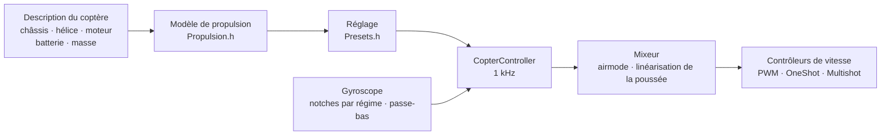

# COPTER.md — firmware pour multicoptères

Le même firmware, les mêmes cartes (Matek H743-WING V3, DevEBox H743), les
mêmes capteurs et récepteurs — mais à la place d’un avion, un quadricoptère,
un hexa, un octo, un Y6 ou un X8. La différence principale avec Betaflight,
INAV et ArduPilot : **les PID, les filtres, le ralenti et les taux ne se
règlent pas à la main**. Vous décrivez le coptère (châssis, hélices, moteurs,
batterie, masse), et le firmware en déduit lui-même le réglage à partir d’un
modèle physique — puis s’adapte en vol à ce que le modèle a estimé
imprécisément.

> **Honnêtement.** Le firmware coptère n’a pour l’instant été vérifié qu’en
> simulateur (un modèle à 6 degrés de liberté, 12 montages × 3 variantes de
> physique « fausse ») et en le compilant pour les cartes. Il n’a pas encore
> volé. Affirmer qu’il vole mieux que Betaflight ou ArduPilot ne sera possible
> qu’après les essais en vol — d’ici là, c’est un objectif, pas un fait.

## Comment ça marche



1. **Modèle de propulsion** (`copter/Propulsion.h`) : un moteur avec force
   contre-électromotrice et résistance du bobinage (à partir du KV et du
   volume du stator), poussée et couple de l’hélice (à partir du diamètre, du
   pas et du nombre de pales), inertie du rotor avec l’hélice. Pour un 5"
   2207 1950KV en 6S, le modèle donne ~28 000 tr/min, ~1,6 kg de poussée et
   ~45 A plein gaz — comme sur les bancs d’essai.
2. **Ce qui en découle** (`copter/Presets.h`) : les gaz de stationnaire, le
   régime au ralenti/en stationnaire/plein gaz, le retard du moteur τ, les
   moments d’inertie du châssis, le rapport poussée/poids, le courant.
3. **La boucle de vitesse angulaire** est choisie d’après la réponse en
   fréquence : moteur, filtres, notches, retard du cycle et du contrôleur —
   tout est dans le modèle. La fréquence de coupure est la plus haute avec
   50° de marge de phase (55° en lacet) et **12 dB de marge de gain** : le
   réglage tient un coptère dont la poussée et l’inertie sont fausses d’un
   facteur deux. La part de D est trouvée par recherche — celle qui rend la
   boucle la plus large. P, I, D et l’anticipation (FF) découlent de la
   fréquence de coupure.
4. **La correction du gain selon les gaz (TPA)** vient du même modèle : à
   bas régime le moteur répond plus faiblement, à haut régime plus fortement.
5. **En vol**, le firmware apprend lui-même les gaz de stationnaire (une
   batterie plus lourde, une nacelle) et déplace ses notches avec le régime.

## Catalogue de montages

| Montage | Châssis | Hélice · moteur · batterie | Masse | Poussée/poids | Stationnaire | Bande passante de la boucle |
|---|---|---|---|---|---|---|
| `whoop65` | Quad X 65 mm | 31 mm ×4 · 0702 23000KV · 1S | 22 g | 4,2 | 31 % | 16 Hz |
| `whoop75` | Quad X 75 mm | 40 mm ×4 · 0802 19000KV · 1S | 32 g | 4,3 | 27 % | 16 Hz |
| `toothpick25` | Quad X 115 mm | 2.5" · 1103 8000KV · 3S | 70 g | 12,1 | 8 % | 14 Hz |
| `micro3` | Quad X 140 mm | 3" · 1404 4500KV · 4S | 190 g | 8,3 | 15 % | 14 Hz |
| `cinewhoop3` | Quad X 150 mm | 3" 5 pales · 1504 3600KV · 4S | 330 g | 4,1 | 32 % | 16 Hz |
| `freestyle5` | Quad X 225 mm | 5.1" · 2207 1950KV · 6S | 680 g | 9,0 | 15 % | 13 Hz |
| `race5` | Quad X allongé | 5.1" · 2306 2000KV · 6S | 560 g | 10,8 | 11 % | 12 Hz |
| `longrange7` | Quad X 315 mm | 7" · 2806.5 1300KV · 6S | 1,0 kg | 7,0 | 20 % | 11 Hz |
| `heavy10` | Quad X 450 mm | 10" · 3115 900KV · 6S | 2,2 kg | 6,6 | 25 % | 10 Hz |
| `cinelifter8` | X8 380 mm | 8" · 2812 1100KV · 6S | 3,5 kg | 6,4 | 23 % | 11 Hz |
| `hex13` | Hex X 700 mm | 13" · 3510 600KV · 6S | 4,0 kg | 3,7 | 35 % | 8 Hz |
| `hex15` | Hex X 900 mm | 15" · 4114 400KV · 6S | 6,0 kg | 3,0 | 45 % | 8 Hz |

Châssis : Quad X, X allongé, H, Deadcat, « + », Hex X/+, Y6, Octo X/+, X8.
La numérotation des moteurs est celle de Betaflight (quad : 1 — arrière
droit, 2 — avant droit, 3 — arrière gauche, 4 — avant gauche), hélices vers
l’intérieur ou vers l’extérieur. Styles de vol — intérieur, freestyle, course,
prise de vue, longue distance, charge lourde : ils fixent les taux et
l’inclinaison maximale.

## Votre propre coptère

`include/config/CopterConfig.h` :

```cpp
#define COPTER_BUILD "freestyle5"     // le montage le plus proche du catalogue
constexpr float MASS_G = 742;          // pesez-le avec la batterie — c’est l’essentiel
constexpr float PROP_DIAMETER_IN = 5.1f, PROP_PITCH_IN = 3.6f;
constexpr float MOTOR_KV = 2150;       // 0 — comme dans le montage
constexpr copter::EscProtocol ESC_PROTOCOL = copter::EscProtocol::ONESHOT125;
```

Le montage peut aussi être choisi par un indicateur :
`-D COPTER_BUILD=\"race5\"`. Après le téléversement, la touche `t` de la
console montre ce qui a été déduit et prévient si quelque chose ne va pas :
trop peu de poussée, le moteur ne supporte pas cette hélice, des hélices
voisines se touchent, stationnaire au-dessus de 60 % des gaz, moteurs plus
rapides que la moitié de la fréquence du cycle.

## Téléversement et premier démarrage

```bash
pio run -e matek-h743-quad -t upload          # Matek H743-WING V3 : bouton BOOT + USB
pio run -e stm32h743-devebox-quad -t upload   # DevEBox H743
```

Sorties moteurs, dans l’ordre : Matek — S1…S8, DevEBox — PA0–PA3, PD14,
PD15, PE9. **Premier démarrage — sans hélices**, moniteur série à 115200 :

| Touche | Ce qu’elle fait |
|---|---|
| `t` | le réglage : poussée, stationnaire, régimes, τ du moteur, filtres, bande passante et marges de la boucle, P/I/D/FF, taux, avertissements |
| `m` | test des moteurs : demande de confirmer par `y` (hélices retirées !), fait tourner chaque moteur 2 s et dit où il est et dans quel sens il doit tourner |
| `s` | l’état et **pourquoi il ne s’arme pas** — chaque raison en toutes lettres |
| `o` | calibration du montage de la carte en trois poses (obligatoire sur la Matek avant ARM) |
| `i` · `r` · `l` · `D` | gyroscope · voies de la radio · ligne en direct · chargeur DFU |

Le mauvais moteur tourne — changez l’ordre dans `CopterConfig::MOTOR_PINS` ;
il tourne à l’envers — réglez le sens dans le configurateur du contrôleur
(BLHeliSuite, ESC-Configurator), sans ressouder les fils.

## Radio et modes

Mode 2 : CH1 roulis, CH2 tangage, CH3 gaz, CH4 lacet. **ARM** — SwA (CH5),
comme sur l’avion. **Mode** — SwC (CH7) :

| SwC | Mode | Ce que fait le stick |
|---|---|---|
| haut | ANGLE | inclinaison (jusqu’à la limite du style) ; relâché, le coptère se remet à plat ; lacet — autour de la verticale |
| milieu | ALT_HOLD | ANGLE + altitude : gaz au centre — stationnaire, au-dessus/en dessous — montée jusqu’à 3 m/s, descente jusqu’à 2 m/s |
| bas | ACRO | vitesse de rotation selon la courbe de taux ; airmode — pilotable même à gaz zéro |

HORIZON (ANGLE près du centre, ACRO aux extrémités) s’active en changeant
une ligne de `CopterConfig.h`.

## Protections

- **ARM** — seulement si : la liaison est là, les gaz sont en bas, le
  coptère est à plat (jusqu’à 25°) et immobile, le gyroscope répond,
  l’attitude est établie, la batterie n’est pas vide, aucun test de moteurs
  n’est en cours, le montage de la carte est calibré (là où c’est requis). Un
  interrupteur ARM basculé trop tôt doit être remis à zéro puis rebasculé.
- **Interrupteur ARM vers le bas — moteurs arrêtés dans le même cycle**,
  dans tous les modes.
- **Perte de signal** : une coupure jusqu’à 0,3 s ne change rien ; plus
  longue — au sol, DISARM immédiat ; en vol, mise à plat et descente à
  0,7 m/s (par le baromètre, sans lui — par l’accéléromètre), contact avec le
  sol — DISARM. Si la liaison revient pendant 1 s, le pilote reprend la main.
- **Accident** : en ANGLE/ALT_HOLD, inclinaison au-delà de 90° pendant plus
  de 0,7 s, ou écart de plus de 30° avec ce que demande le stick pendant plus
  de 2 s (moteur en panne, couché sur le côté) ; dans tous les modes, 1 s sur
  le dos — moteurs arrêtés. Réarmer — seulement après avoir coupé
  l’interrupteur.
- **Au sol, l’intégrale ne s’accumule pas** — le coptère ne saute pas et ne
  bascule pas au décollage.

## Ce qu’il y a dedans — en bref

| Fichier | Quoi |
|---|---|
| `copter/Propulsion.h` | modèle du moteur et de l’hélice |
| `copter/Presets.h` | catalogue de montages, déduction du réglage, avertissements |
| `copter/Frames.h` · `Mixer.h` | châssis et mixeur (airmode, priorité du roulis/tangage sur le lacet, linéarisation de la poussée) |
| `copter/RateController.h` | P, I (relax en flip et pendant l’accélération, anti-gravity), D sur le gyroscope, FF |
| `copter/Attitude.h` | attitude en quaternion ; l’accéléromètre n’est pas cru pendant les à-coups, en rotation, ni quand il contredit le gyroscope |
| `copter/AltitudeHold.h` | altitude : baromètre + accéléromètre, les gaz de stationnaire sont appris |
| `copter/GyroFilter.h` | notches à 1× et 2× le régime et au passage des pales + passe-bas |
| `copter/CopterController.h` | tout ensemble : ARM, modes, failsafe, accident |
| `hal/stm32/Stm32MotorOutput.h` · `src/stm32/main_copter.cpp` | contrôleurs de vitesse et point d’entrée sur la STM32 |

## Comment c’est vérifié

`test/native/test_copter_sim` — le **vrai** `CopterController` et un modèle
de coptère à 6 degrés de liberté : moteurs avec force contre-électromotrice,
chute de tension de la batterie sous le courant, couple de réaction des
hélices, traînée, vent en rafales, retard du contrôleur, un gyroscope avec
bruit et vibrations des moteurs (les vibrations au-dessus de la moitié de la
fréquence du cycle se replient, comme sur la carte), un baromètre à 50 Hz,
le sol. Chaque montage du catalogue vole avec son propre réglage et sur un
modèle qui, exprès, ne correspond pas à la description :

- **« mou »** : l’hélice tire 20 % de moins, le moteur et le châssis ont 30 %
  d’inertie en plus, 20 % plus lourd, centre de gravité avancé ;
- **« vif »** : poussée +20 %, inertie −30 %, masse −15 %, centre de gravité
  décalé sur le côté — le gain de boucle est presque le double du calcul.

| Quoi | Résultat sur 36 vols (12 montages × 3 physiques) |
|---|---|
| Décollage et stationnaire en ALT_HOLD | altitude ±0,3 m, inclinaison < 1°, gaz de stationnaire appris (le whoop « vif » : 0,22 au lieu des 0,31 calculés) |
| ANGLE : stick à fond | 90 % de l’inclinaison en 0,14–0,35 s, dépassement < 3 %, retour à 3° en 0,15–0,4 s |
| ACRO : stick à fond | 90 % du taux en 0,04–0,15 s, dépassement < 12 % |
| Perte de signal à 10 m | descente ≤ 0,94 m/s, contact — DISARM, 17–28 s |

Et à part, sur le 5" : airmode à gaz zéro, lacet, vent de 4,5 m/s en
rafales, failsafe sans baromètre, contrôleurs PWM ordinaires, coupure et
retour de la liaison, chute sur le dos, panne de moteur, test des moteurs,
chute de tension de la batterie. `test_copter` vérifie chaque bloc
séparément (41 tests), `native_stm32/test_app_stm32_copter` — le firmware
entier sur les simulacres de la Matek H743 : impulsions « arrêt » avant ARM,
calibration du montage, ralenti après ARM, modes depuis l’interrupteur,
perte de signal au sol, la console.

Le simulateur a trouvé et aidé à corriger de vrais défauts, invisibles dans
le calcul : des notches qui sautaient à chaque cycle du mixeur ; de la phase
en trop due aux notches près de la bande passante ; l’accumulation de
l’intégrale pendant l’accélération de l’hexa « mou » (dépassement de 32 %) ;
un accéléromètre qui, en flip aux gaz de stationnaire, lit exactement 1 g et
décalait l’horizon de 10° ; un coptère au moteur en panne qui continuait à
tourner au sol.

## Ce qui manque encore

- **DShot** (et bidirectionnel — régime exact pour les notches) : il faut un
  pilote DMA ; le calcul des trames et du CRC existe déjà
  (`copter/EscProtocol.h`).
- **Un cycle plus rapide que 1 kHz** — pour les whoops, dont les moteurs
  tournent au-delà de 500 Hz (la simulation montre qu’ils vont nettement
  mieux à 4 kHz).
- Boîte noire, MAVLink et OpenPlane Studio pour le coptère ; maintien de
  position par GPS, retour au point de départ, missions.
- Essais en vol.
