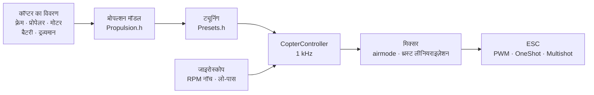

# COPTER.md — मल्टीकॉप्टर के लिए फ़र्मवेयर

वही फ़र्मवेयर, वही बोर्ड (Matek H743-WING V3, DevEBox H743), वही सेंसर और रिसीवर — लेकिन हवाई जहाज़ की जगह क्वाडकॉप्टर, हेक्सा, ऑक्टो, Y6 या X8। Betaflight, INAV और ArduPilot से मुख्य अंतर: **PID, फ़िल्टर, आइडल और रेट हाथ से नहीं बैठाए जाते**। आप कॉप्टर का विवरण देते हैं (फ़्रेम, प्रोपेलर, मोटर, बैटरी, द्रव्यमान), और फ़र्मवेयर भौतिक मॉडल से ट्यूनिंग खुद निकालता है — और उड़ान में खुद उस हिस्से को ठीक करता है जिसे मॉडल ने ठीक से नहीं आँका।

> **ईमानदारी से।** कॉप्टर फ़र्मवेयर अब तक सिर्फ़ सिमुलेटर (6 डिग्री ऑफ़ फ़्रीडम वाला मॉडल, 12 बिल्ड × “गलत” भौतिकी के 3 रूप) में और बोर्डों के लिए बिल्ड करके जाँचा गया है। यह अभी हवा में नहीं उड़ा है। यह Betaflight या ArduPilot से बेहतर उड़ता है — यह दावा उड़ान परीक्षणों के बाद ही किया जा सकेगा; तब तक यह लक्ष्य है, तथ्य नहीं।

## यह कैसे काम करता है



1. **प्रोपल्शन मॉडल** (`copter/Propulsion.h`): बैक-EMF और वाइंडिंग प्रतिरोध वाली मोटर (KV और स्टेटर के आयतन से), प्रोपेलर का थ्रस्ट और टॉर्क (व्यास, पिच और ब्लेड की संख्या से), प्रोपेलर सहित रोटर का जड़त्व। 6S पर 5" 2207 1950KV के लिए मॉडल फ़ुल थ्रॉटल पर ~28 000 rpm, ~1.6 kg थ्रस्ट और ~45 A देता है — जैसा टेस्ट बेंच पर मिलता है।
2. **इससे क्या निकलता है** (`copter/Presets.h`): होवर थ्रॉटल, आइडल/होवर/फ़ुल थ्रॉटल पर RPM, मोटर की देरी τ, फ़्रेम के जड़त्व आघूर्ण, थ्रस्ट-से-वज़न अनुपात, करंट।
3. **कोणीय वेग लूप** आवृत्ति प्रतिक्रिया से चुना जाता है: मोटर, फ़िल्टर, नॉच, साइकल और ESC की देरी — सब मॉडल में है। क्रॉसओवर आवृत्ति वह सबसे ऊँची आवृत्ति है जिस पर फ़ेज़ मार्जिन 50° (यॉ के लिए 55°) और **गेन मार्जिन 12 dB** रहता है: ऐसी ट्यूनिंग उस कॉप्टर को भी सँभाल लेती है जिसका थ्रस्ट और जड़त्व दोगुना “गलत” हो। D का हिस्सा खोज से चुना जाता है — वह जिससे लूप सबसे चौड़ा हो। P, I, D और फ़ीडफ़ॉरवर्ड (FF) क्रॉसओवर आवृत्ति से निकलते हैं।
4. **थ्रॉटल के अनुसार गेन सुधार (TPA)** उसी मॉडल से आता है: कम थ्रॉटल पर मोटर कमज़ोर प्रतिक्रिया देती है, ज़्यादा पर तेज़।
5. **उड़ान में** फ़र्मवेयर होवर थ्रॉटल खुद सीखता है (भारी बैटरी, जिम्बल) और नॉच को RPM के साथ खिसकाता है।

## बिल्ड कैटलॉग

| बिल्ड | फ़्रेम | प्रोपेलर · मोटर · बैटरी | द्रव्यमान | थ्रस्ट/वज़न | होवर | लूप बैंडविड्थ |
|---|---|---|---|---|---|---|
| `whoop65` | Quad X 65 mm | 31 mm ×4 · 0702 23000KV · 1S | 22 g | 4.2 | 31% | 16 Hz |
| `whoop75` | Quad X 75 mm | 40 mm ×4 · 0802 19000KV · 1S | 32 g | 4.3 | 27% | 16 Hz |
| `toothpick25` | Quad X 115 mm | 2.5" · 1103 8000KV · 3S | 70 g | 12.1 | 8% | 14 Hz |
| `micro3` | Quad X 140 mm | 3" · 1404 4500KV · 4S | 190 g | 8.3 | 15% | 14 Hz |
| `cinewhoop3` | Quad X 150 mm | 3" 5-ब्लेड · 1504 3600KV · 4S | 330 g | 4.1 | 32% | 16 Hz |
| `freestyle5` | Quad X 225 mm | 5.1" · 2207 1950KV · 6S | 680 g | 9.0 | 15% | 13 Hz |
| `race5` | लंबा Quad X | 5.1" · 2306 2000KV · 6S | 560 g | 10.8 | 11% | 12 Hz |
| `longrange7` | Quad X 315 mm | 7" · 2806.5 1300KV · 6S | 1.0 kg | 7.0 | 20% | 11 Hz |
| `heavy10` | Quad X 450 mm | 10" · 3115 900KV · 6S | 2.2 kg | 6.6 | 25% | 10 Hz |
| `cinelifter8` | X8 380 mm | 8" · 2812 1100KV · 6S | 3.5 kg | 6.4 | 23% | 11 Hz |
| `hex13` | Hex X 700 mm | 13" · 3510 600KV · 6S | 4.0 kg | 3.7 | 35% | 8 Hz |
| `hex15` | Hex X 900 mm | 15" · 4114 400KV · 6S | 6.0 kg | 3.0 | 45% | 8 Hz |

फ़्रेम: Quad X, लंबा X, H, Deadcat, “+”, Hex X/+, Y6, Octo X/+, X8। मोटरों की नंबरिंग Betaflight जैसी है (क्वाड: 1 — पीछे दाएँ, 2 — आगे दाएँ, 3 — पीछे बाएँ, 4 — आगे बाएँ), प्रोपेलर अंदर या बाहर की ओर घूम सकते हैं। उड़ान शैलियाँ — इनडोर, फ़्रीस्टाइल, रेसिंग, फ़िल्मांकन, लंबी दूरी, भारी सामान: इनसे रेट और अधिकतम झुकाव तय होते हैं।

## आपका अपना कॉप्टर

`include/config/CopterConfig.h`:

```cpp
#define COPTER_BUILD "freestyle5"     // कैटलॉग का सबसे नज़दीकी बिल्ड
constexpr float MASS_G = 742;          // बैटरी समेत तौलें — यही सबसे ज़रूरी है
constexpr float PROP_DIAMETER_IN = 5.1f, PROP_PITCH_IN = 3.6f;
constexpr float MOTOR_KV = 2150;       // 0 — बिल्ड जैसा
constexpr copter::EscProtocol ESC_PROTOCOL = copter::EscProtocol::ONESHOT125;
```

बिल्ड फ़्लैग से भी चुना जा सकता है: `-D COPTER_BUILD=\"race5\"`। फ़र्मवेयर फ़्लैश करने के बाद कंसोल में `t` कुंजी दिखाती है कि क्या निकाला गया, और कुछ गड़बड़ हो तो चेतावनी देती है: थ्रस्ट कम है, मोटर यह प्रोपेलर नहीं सँभाल सकती, पड़ोसी प्रोपेलर टकराते हैं, होवर 60% थ्रॉटल से ऊपर है, मोटरें साइकल आवृत्ति के आधे से तेज़ घूमती हैं।

## फ़्लैश करना और पहला स्टार्ट

```bash
pio run -e matek-h743-quad -t upload          # Matek H743-WING V3: BOOT बटन + USB
pio run -e stm32h743-devebox-quad -t upload   # DevEBox H743
```

मोटर आउटपुट क्रम से: Matek — S1…S8, DevEBox — PA0–PA3, PD14, PD15, PE9। **पहला स्टार्ट — बिना प्रोपेलर के**, सीरियल मॉनिटर 115200 पर:

| कुंजी | क्या करती है |
|---|---|
| `t` | ट्यूनिंग: थ्रस्ट, होवर, RPM, मोटर τ, फ़िल्टर, लूप की बैंडविड्थ और मार्जिन, P/I/D/FF, रेट, चेतावनियाँ |
| `m` | मोटर टेस्ट: `y` से पुष्टि माँगता है (प्रोपेलर उतारें!), हर मोटर को 2 s घुमाता है और बताता है कि वह कहाँ है और किस दिशा में घूमनी चाहिए |
| `s` | स्थिति और **ARM क्यों नहीं हो रहा** — हर कारण शब्दों में |
| `o` | तीन मुद्राओं से बोर्ड माउंटिंग कैलिब्रेशन (Matek पर ARM से पहले अनिवार्य) |
| `i` · `r` · `l` · `D` | जाइरोस्कोप · रिमोट के चैनल · लाइव लाइन · DFU बूटलोडर |

गलत मोटर घूमे — `CopterConfig::MOTOR_PINS` में क्रम बदलें; उल्टी दिशा में घूमे — ESC कॉन्फ़िगरेटर (BLHeliSuite, ESC-Configurator) में दिशा बदलें, तार दोबारा न टाँकें।

## रिमोट और मोड

Mode 2: CH1 रोल, CH2 पिच, CH3 थ्रॉटल, CH4 यॉ। **ARM** — SwA (CH5), हवाई जहाज़ की तरह। **मोड** — SwC (CH7):

| SwC | मोड | स्टिक क्या करती है |
|---|---|---|
| ऊपर | ANGLE | झुकाव (शैली की सीमा तक); छोड़ दें — कॉप्टर खुद सीधा हो जाता है; यॉ — ऊर्ध्वाधर के चारों ओर |
| बीच | ALT_HOLD | ANGLE + ऊँचाई: थ्रॉटल बीच में — होवर, ऊपर/नीचे — 3 m/s तक चढ़ाई, 2 m/s तक उतराई |
| नीचे | ACRO | रेट कर्व के अनुसार घूमने की गति; airmode — शून्य थ्रॉटल पर भी नियंत्रण |

HORIZON (बीच के पास ANGLE, किनारों पर ACRO) `CopterConfig.h` में एक पंक्ति बदलकर चालू होता है।

## सुरक्षा

- **ARM** तभी होता है जब: लिंक है, थ्रॉटल नीचे है, कॉप्टर सीधा खड़ा है (25° तक) और हिलाया नहीं जा रहा, जाइरोस्कोप जवाब देता है, ओरिएंटेशन तय हो चुका है, बैटरी खाली नहीं है, मोटर टेस्ट नहीं चल रहा, बोर्ड माउंटिंग कैलिब्रेटेड है (जहाँ ज़रूरी हो)। समय से पहले चालू किए गए ARM स्विच को बंद करके दोबारा चालू करना होगा।
- **ARM स्विच नीचे — उसी साइकल में मोटरें रुकती हैं**, किसी भी मोड में।
- **सिग्नल खो जाना**: 0.3 s तक की रुकावट से कुछ नहीं बदलता; ज़्यादा लंबी — ज़मीन पर तुरंत DISARM, हवा में — सीधा होना और 0.7 m/s से उतरना (बैरोमीटर से, उसके बिना एक्सेलेरोमीटर से), ज़मीन छूना — DISARM। लिंक 1 s तक लौट आए तो नियंत्रण फिर पायलट के पास।
- **दुर्घटना**: ANGLE/ALT_HOLD में 90° से ज़्यादा झुकाव 0.7 s से अधिक, या स्टिक की माँग से 30° से ज़्यादा अलग झुकाव 2 s से अधिक (मोटर ख़राब, करवट पड़ा है); किसी भी मोड में 1 s पीठ के बल — मोटरें रुकती हैं। दोबारा ARM — स्विच बंद करने के बाद ही।
- **ज़मीन पर इंटीग्रल जमा नहीं होता** — टेकऑफ़ पर कॉप्टर उछलता या पलटता नहीं।

## अंदर क्या है — संक्षेप में

| फ़ाइल | क्या |
|---|---|
| `copter/Propulsion.h` | मोटर और प्रोपेलर का मॉडल |
| `copter/Presets.h` | बिल्ड कैटलॉग, ट्यूनिंग निकालना, चेतावनियाँ |
| `copter/Frames.h` · `Mixer.h` | फ़्रेम और मिक्सर (airmode, यॉ से ऊपर रोल/पिच की प्राथमिकता, थ्रस्ट लीनियराइज़ेशन) |
| `copter/RateController.h` | P, I (फ़्लिप और गति पकड़ते समय relax, anti-gravity), जाइरोस्कोप पर D, FF |
| `copter/Attitude.h` | क्वाटर्नियन से ओरिएंटेशन; झटके, घूमते समय या जाइरोस्कोप से मेल न खाने पर एक्सेलेरोमीटर पर भरोसा नहीं |
| `copter/AltitudeHold.h` | ऊँचाई: बैरोमीटर + एक्सेलेरोमीटर, होवर थ्रॉटल सीखा जाता है |
| `copter/GyroFilter.h` | RPM के 1× और 2× तथा ब्लेड-पास पर नॉच + लो-पास |
| `copter/CopterController.h` | सब एक साथ: ARM, मोड, failsafe, दुर्घटना |
| `hal/stm32/Stm32MotorOutput.h` · `src/stm32/main_copter.cpp` | STM32 पर ESC और एंट्री पॉइंट |

## कैसे जाँचा गया

`test/native/test_copter_sim` — **असली** `CopterController` और 6 डिग्री ऑफ़ फ़्रीडम वाला कॉप्टर मॉडल: बैक-EMF वाली मोटरें, करंट से बैटरी वोल्टेज गिरना, प्रोपेलर का प्रतिक्रिया टॉर्क, हवा का प्रतिरोध, झोंकों वाली हवा, ESC की देरी, शोर और मोटर कंपन वाला जाइरोस्कोप (साइकल आवृत्ति के आधे से ऊपर का कंपन बोर्ड की तरह मुड़कर लौटता है), 50 Hz बैरोमीटर, ज़मीन। कैटलॉग का हर बिल्ड अपनी ट्यूनिंग पर उड़ता है, और ऐसे मॉडल पर भी जो जानबूझकर विवरण से मेल नहीं खाता:

- **“सुस्त”**: प्रोपेलर 20% कम खींचता है, मोटर और फ़्रेम का जड़त्व 30% ज़्यादा, 20% भारी, गुरुत्व केंद्र आगे खिसका;
- **“फुर्तीला”**: थ्रस्ट +20%, जड़त्व −30%, द्रव्यमान −15%, गुरुत्व केंद्र बगल में खिसका — लूप गेन गणना से लगभग दोगुना।

| क्या | 36 उड़ानों (12 बिल्ड × 3 भौतिकी) का नतीजा |
|---|---|
| ALT_HOLD में टेकऑफ़ और होवर | ऊँचाई ±0.3 m, झुकाव < 1°, होवर थ्रॉटल सीखा गया (“फुर्तीला” whoop: गणना के 0.31 की जगह 0.22) |
| ANGLE: पूरी स्टिक | 0.14–0.35 s में झुकाव का 90%, ओवरशूट < 3%, 0.15–0.4 s में 3° तक सीधा |
| ACRO: पूरी स्टिक | 0.04–0.15 s में रेट का 90%, ओवरशूट < 12% |
| 10 m पर सिग्नल खो जाना | उतराई ≤ 0.94 m/s, ज़मीन छूना — DISARM, 17–28 s |

और अलग से 5" पर: शून्य थ्रॉटल पर airmode, यॉ, झोंकों के साथ 4.5 m/s हवा, बैरोमीटर के बिना failsafe, साधारण PWM ESC, लिंक का टूटना और लौटना, पीठ के बल गिरना, मोटर ख़राब होना, मोटर टेस्ट, बैटरी वोल्टेज गिरना। `test_copter` हर ब्लॉक अलग से जाँचता है (41 टेस्ट), `native_stm32/test_app_stm32_copter` — Matek H743 के फ़ेक पर पूरा फ़र्मवेयर: ARM से पहले “स्टॉप” पल्स, माउंटिंग कैलिब्रेशन, ARM के बाद आइडल, स्विच से मोड, ज़मीन पर सिग्नल खो जाना, कंसोल।

सिमुलेटर ने ऐसी असली गड़बड़ियाँ ढूँढीं और ठीक करवाईं जो गणना में नहीं दिखतीं: नॉच जो मिक्सर के हर साइकल के साथ उछलते थे; लूप बैंडविड्थ के पास नॉच से अतिरिक्त फ़ेज़ देरी; “सुस्त” हेक्सा के गति पकड़ते समय इंटीग्रल का जमा होना (32% ओवरशूट); एक्सेलेरोमीटर जो होवर थ्रॉटल पर फ़्लिप में ठीक 1 g दिखाता था और क्षितिज को 10° खिसका देता था; ख़राब मोटर वाला कॉप्टर जो ज़मीन पर घूमता रहता था।

## अभी क्या नहीं है

- **DShot** (और द्विदिश — नॉच के लिए सटीक RPM): DMA ड्राइवर चाहिए; फ़्रेम और CRC की गणना पहले से है (`copter/EscProtocol.h`)।
- **1 kHz से तेज़ साइकल** — उन whoop के लिए जिनकी मोटरें 500 Hz से तेज़ घूमती हैं (सिमुलेशन दिखाता है कि 4 kHz पर वे साफ़ बेहतर हैं)।
- कॉप्टर के लिए ब्लैक बॉक्स, MAVLink और OpenPlane Studio; GPS से पोज़ीशन होल्ड, होम पर वापसी, मिशन।
- उड़ान परीक्षण।
