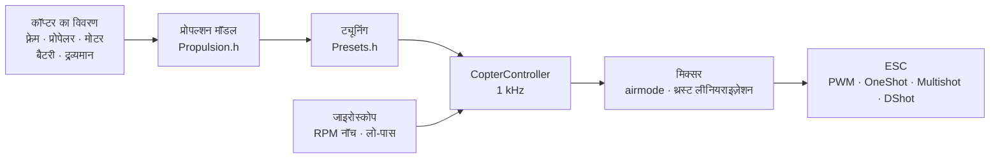

# COPTER.md — मल्टीकॉप्टर के लिए फ़र्मवेयर

वही फ़र्मवेयर, वही बोर्ड (Matek H743-WING V3, DevEBox H743 और Betaflight चलाने वाला लगभग कोई भी F405), वही सेंसर और रिसीवर — लेकिन हवाई जहाज़ की जगह क्वाडकॉप्टर, हेक्सा, ऑक्टो, Y6 या X8। Betaflight, INAV और ArduPilot से मुख्य अंतर: **PID, फ़िल्टर, आइडल और रेट हाथ से नहीं बैठाए जाते**। आप कॉप्टर का विवरण देते हैं (फ़्रेम, प्रोपेलर, मोटर, बैटरी, द्रव्यमान), और फ़र्मवेयर भौतिक मॉडल से ट्यूनिंग खुद निकालता है — और उड़ान में खुद उस हिस्से को ठीक करता है जिसे मॉडल ने ठीक से नहीं आँका।

> **ईमानदारी से।** कॉप्टर फ़र्मवेयर अब तक सिर्फ़ सिमुलेटर (6 डिग्री ऑफ़ फ़्रीडम वाला मॉडल, 12 बिल्ड × “गलत” भौतिकी के 3 रूप) में और बोर्डों के लिए बिल्ड करके जाँचा गया है। यह अभी हवा में नहीं उड़ा है। यह Betaflight या ArduPilot से बेहतर उड़ता है — यह दावा उड़ान परीक्षणों के बाद ही किया जा सकेगा; तब तक यह लक्ष्य है, तथ्य नहीं।

## यह कैसे काम करता है



1. **प्रोपल्शन मॉडल** (`copter/Propulsion.h`): बैक-EMF और वाइंडिंग प्रतिरोध वाली मोटर (KV और स्टेटर के आयतन से), प्रोपेलर का थ्रस्ट और टॉर्क (व्यास, पिच और ब्लेड की संख्या से), प्रोपेलर सहित रोटर का जड़त्व। 6S पर 5" 2207 1950KV के लिए मॉडल फ़ुल थ्रॉटल पर ~28 000 rpm, ~1.6 kg थ्रस्ट और ~45 A देता है — जैसा टेस्ट बेंच पर मिलता है।
2. **इससे क्या निकलता है** (`copter/Presets.h`): होवर थ्रॉटल, आइडल/होवर/फ़ुल थ्रॉटल पर RPM, मोटर की देरी τ, फ़्रेम के जड़त्व आघूर्ण, थ्रस्ट-से-वज़न अनुपात, करंट।
3. **कोणीय वेग लूप** आवृत्ति प्रतिक्रिया से चुना जाता है: मोटर, फ़िल्टर, नॉच, साइकल और ESC की देरी — सब मॉडल में है। क्रॉसओवर आवृत्ति वह सबसे ऊँची आवृत्ति है जिस पर फ़ेज़ मार्जिन 50° (यॉ के लिए 55°) और **गेन मार्जिन 12 dB** रहता है: ऐसी ट्यूनिंग उस कॉप्टर को भी सँभाल लेती है जिसका थ्रस्ट और जड़त्व दोगुना “गलत” हो। D का हिस्सा खोज से चुना जाता है — वह जिससे लूप सबसे चौड़ा हो। P, I, D और फ़ीडफ़ॉरवर्ड (FF) क्रॉसओवर आवृत्ति से निकलते हैं।
4. **थ्रॉटल के अनुसार गेन सुधार (TPA)** उसी मॉडल से आता है: कम थ्रॉटल पर मोटर कमज़ोर प्रतिक्रिया देती है, ज़्यादा पर तेज़। Betaflight का कर्व भी उपलब्ध है (`tpa_mode = PD` या `D`)।
5. **उड़ान में** फ़र्मवेयर होवर थ्रॉटल खुद सीखता है (भारी बैटरी, जिम्बल) और नॉच को RPM के साथ खिसकाता है।

## बिल्ड कैटलॉग

| बिल्ड | फ़्रेम | प्रोपेलर · मोटर · बैटरी | द्रव्यमान | थ्रस्ट/वज़न | होवर | लूप बैंडविड्थ |
|---|---|---|---|---|---|---|
| `whoop65` | Quad X 65 mm | 31 mm ×4 · 0702 23000KV · 1S | 22 g | 4.2 | 31% | 16 Hz |
| `whoop75` | Quad X 75 mm | 40 mm ×4 · 0802 19000KV · 1S | 32 g | 4.3 | 27% | 16 Hz |
| `toothpick25` | Quad X 115 mm | 2.5" · 1103 8000KV · 3S | 70 g | 12.1 | 8% | 14 Hz |
| `micro3` | Quad X 140 mm | 3" · 1404 4500KV · 4S | 190 g | 8.3 | 15% | 14 Hz |
| `cinewhoop3` | Quad X 150 mm | 3" पाँच ब्लेड · 1504 3600KV · 4S | 330 g | 4.1 | 32% | 16 Hz |
| `freestyle5` | Quad X 225 mm | 5.1" · 2207 1950KV · 6S | 680 g | 9.0 | 15% | 13 Hz |
| `race5` | स्ट्रेच Quad X | 5.1" · 2306 2000KV · 6S | 560 g | 10.8 | 11% | 12 Hz |
| `longrange7` | Quad X 315 mm | 7" · 2806.5 1300KV · 6S | 1.0 kg | 7.0 | 20% | 11 Hz |
| `longrange7li` | Quad X 315 mm | 7" दो ब्लेड · 2810 1300KV · 6S Li-ion 4000 | 1.05 kg | 7.5 | 23% | 12 Hz |
| `heavy10` | Quad X 450 mm | 10" · 3115 900KV · 6S | 2.2 kg | 6.6 | 25% | 10 Hz |
| `cinelifter8` | X8 380 mm | 8" · 2812 1100KV · 6S | 3.5 kg | 6.4 | 23% | 11 Hz |
| `hex13` | Hex X 700 mm | 13" · 3510 600KV · 6S | 4.0 kg | 3.7 | 35% | 8 Hz |
| `hex15` | Hex X 900 mm | 15" · 4114 400KV · 6S | 6.0 kg | 3.0 | 45% | 8 Hz |

फ़्रेम: Quad X, स्ट्रेच X, H, Deadcat, “+”, Hex X/+, Y6, Octo X/+, X8। मोटरों की नंबरिंग Betaflight जैसी है (क्वाड: 1 — पीछे दाएँ, 2 — आगे दाएँ, 3 — पीछे बाएँ, 4 — आगे बाएँ), प्रोपेलर अंदर या बाहर की ओर घूम सकते हैं। उड़ान शैलियाँ — इनडोर, फ़्रीस्टाइल, रेसिंग, फ़िल्मिंग, लॉन्ग रेंज, भार ढोना: ये रेट और अधिकतम झुकाव तय करती हैं।

## आपका अपना कॉप्टर

`include/config/CopterConfig.h`:

```cpp
#define COPTER_BUILD "freestyle5"     // कैटलॉग का सबसे नज़दीकी बिल्ड
constexpr float MASS_G = 742;          // बैटरी के साथ तौलें — यही सबसे ज़रूरी है
constexpr float PROP_DIAMETER_IN = 5.1f, PROP_PITCH_IN = 3.6f;
constexpr float MOTOR_KV = 2150;       // 0 — बिल्ड जैसा
constexpr copter::EscProtocol ESC_PROTOCOL = copter::EscProtocol::ONESHOT125;
```

बिल्ड फ़्लैग से भी चुना जा सकता है, `-D COPTER_BUILD=\"race5\"`, या बिना दोबारा बिल्ड किए — CLI में: `set copter_build = race5`, `set copter_mass_g = 742`, `save` (सेटिंग्स नीचे; तब फ़ाइल का मान सिर्फ़ डिफ़ॉल्ट रह जाता है)। फ़्लैश करने के बाद कंसोल में `t` दबाने पर निकाले गए मान दिखते हैं, और कुछ गड़बड़ हो तो चेतावनी आती है: थ्रस्ट कम है, मोटर यह प्रोपेलर नहीं घुमा पाएगी, पड़ोसी प्रोपेलर टकराते हैं, 60% थ्रॉटल से ऊपर होवर करता है, मोटरें लूप आवृत्ति के आधे से तेज़ घूमती हैं। अलग संख्या की मोटरों वाला दूसरा फ़्रेम रीस्टार्ट के बाद काम करता है: तब तक ARM वर्जित है (`REBOOT_REQD`)।

## फ़्लैश करना और पहला स्टार्ट

```bash
pio run -e matek-h743-quad -t upload          # Matek H743-WING V3: BOOT बटन + USB
pio run -e stm32h743-devebox-quad -t upload   # DevEBox H743
pio run -e aocodarc-f405v3-quad -t upload     # Betaflight वाला F405 फ़्लाइट कंट्रोलर — नीचे देखें
```

मोटर आउटपुट क्रम से: Matek — S1…S8, DevEBox — PA0–PA3, PD14, PD15, PE9। **पहला स्टार्ट — प्रोपेलर उतारकर**, सीरियल मॉनिटर 115200 पर:

| कुंजी | क्या करती है |
|---|---|
| `t` | ट्यूनिंग: थ्रस्ट, होवर, RPM, मोटर τ, फ़िल्टर, लूप बैंडविड्थ और मार्जिन, P/I/D/FF, रेट, चेतावनियाँ |
| `m` | मोटर टेस्ट: `y` से पुष्टि माँगता है (प्रोपेलर उतारे हुए!), हर मोटर को 2 s घुमाता है और बताता है कि वह कहाँ है और किस ओर घूमनी चाहिए |
| `s` | स्थिति, Betaflight के `status` जैसी: लूप लोड, आवृत्तियाँ, बैटरी और **ARM क्यों नहीं हो रहा** — हर कारण BF कोड (`RXLOSS`, `ANGLE`, `CLI`…) और शब्दों में |
| `o` | तीन स्थितियों में बोर्ड माउंटिंग का कैलिब्रेशन (Matek पर ARM से पहले ज़रूरी) |
| `c` | कंपास कैलिब्रेशन: 15 s तक कॉप्टर को सभी अक्षों पर घुमाएँ (कंपास — GPS मॉड्यूल पर QMC5883L या QMC5883P, जो जवाब दे) |
| `i` · `r` · `l` · `D` | जाइरोस्कोप · रिमोट के चैनल · लाइव पंक्ति · DFU बूटलोडर |
| `#` | Betaflight जैसा CLI: `set`, `get`, `diff`, `aux`, `map`, `profile`, `save` — [नीचे](#सेटिंग्स-betaflight-जैसा-cli) |

गलत मोटर घूमती है — `CopterConfig::MOTOR_PINS` में क्रम बदलें; उल्टी दिशा में घूमती है — ESC कॉन्फ़िगरेटर (BLHeliSuite, ESC-Configurator) में दिशा बदलें, तार दोबारा न टाँकें।

### Betaflight वाला F405 फ़्लाइट कंट्रोलर

STM32F405 वाला लगभग कोई भी क्वाड फ़्लाइट कंट्रोलर (Betaflight, 8 MHz क्रिस्टल) चलेगा, अगर उस पर ICM-42688-P और SPL06 या DPS310 बैरोमीटर हो। पिन-आउट खुद Betaflight से लिया जाता है — इसलिए वह बोर्ड भी चलता है जिसका टारगेट किसी रिपॉज़िटरी में नहीं है (GETFUN F405V3):

```bash
# 1. बोर्ड पर अभी Betaflight है; Configurator बंद है। CLI डंप फ़ाइल में
#    (PlatformIO का Python — उसमें pyserial है):
~/.platformio/penv/Scripts/python tools/bf_board.py read --port COM5 --out stack/MYBOARD_bf.txt
# 2. पूरा मूल फ़र्मवेयर — ज़रूरत हो तो Betaflight वापस लाने के लिए
#    (बोर्ड DFU में: BOOT दबाए रखें और USB लगाएँ):
python tools/bf_board.py backup --out stack/MYBOARD_original.bin
# 3. बोर्ड का हेडर: किस पिन पर क्या है (BF बैरोमीटर का प्रकार नहीं जानता — विवरण के अनुसार):
python tools/bf_board.py header stack/MYBOARD_bf.txt --baro SPL06 --out include/config/boards/MYBOARD.h
```

फिर `platformio.ini` में `aocodarc-f405v3-quad` जैसा एक env बनाएँ (संदर्भ बोर्ड: उसका पिन-आउट सार्वजनिक है, F405 कोर हमेशा उसी पर बिल्ड और टेस्ट होता है), `-D OP_BOARD_FILE=\"config/boards/MYBOARD.h\"` के साथ। मोटरें Betaflight के नंबरों के अनुसार M1…M8 हैं; रिसीवर, GPS और टेलीमेट्री उन्हीं UART पर जहाँ Betaflight के पास थे; हर मोटर का टाइमर वही है जो Betaflight ने चुना था (डंप की `timer B06 AF2` पंक्तियाँ -> `OPB_MOTOR_AF`: एक पिन पर दो-तीन टाइमर हो सकते हैं, और BF ने उस बोर्ड पर DMA टकराव के बिना वाले चुने थे)। ब्लैक बॉक्स का फ़्लैश अपनी बस और CS के साथ डंप से आता है। जिस बोर्ड पर पहले से हमारा फ़र्मवेयर है — [github.com/betaflight/config](https://github.com/betaflight/config) के `config.h` से `bf_board.py header`।

F405 में फ़्लैश का एक ही बैंक है: सेटिंग्स लिखते समय प्रोसेसर 1–2 s रुक जाता है, इसलिए सेटिंग्स सिर्फ़ DISARM हालत में लिखी जाती हैं।

## सेटिंग्स: Betaflight जैसा CLI

विवरण से निकाले गए मान हाथ से सुधारे जा सकते हैं — बिना दोबारा बिल्ड किए, पंक्ति-दर-पंक्ति, Betaflight के CLI की तरह। कंसोल में `#` दबाने से उसमें पहुँचते हैं (सिर्फ़ DISARM हालत में; CLI खुला रहने तक ARM वर्जित है):

```text
# get p_roll                     ← मान, सीमाएँ, डिफ़ॉल्ट और वह कहाँ से आया
# set p_roll = 50                ← Betaflight की इकाइयों में
# set tune_source = BETAFLIGHT   ← मॉडल की जगह BF 4.5 के डिफ़ॉल्ट
# profile 1                      ← PID प्रोफ़ाइल 0–3 (rateprofile — रेट); तुरंत, चलते हुए
# diff                           ← सिर्फ़ बदला हुआ, BF फ़ॉर्मैट में
# save                           ← फ़्लैश में, ट्यूनिंग दोबारा गिनी गई, बाहर
```

- **जो हाथ से तय नहीं किया गया वह डिफ़ॉल्ट रहता है, और PID व रेट के लिए यह किसी तालिका की संख्या नहीं बल्कि कॉप्टर के विवरण से निकला परिणाम है** (`get` में “कॉप्टर मॉडल से” दिखता है)। विवरण बदलें — जो कुछ आपने नहीं छुआ, सब उसके साथ बदलता है; हाथ से तय किया हुआ बना रहता है। डिफ़ॉल्ट के बराबर मान देना डिफ़ॉल्ट पर लौटने जैसा है।
- **इकाइयाँ Betaflight की हैं**: PID पद = संख्या × BF स्केल × त्रुटि, योग ÷ 1000 मिक्सर में जाता है (P 0.032029, I 0.244381 और यॉ में ऊपर से ×2.5, D 0.000529, F 0.013754 × 0.01)। `t` मॉडल की ट्यूनिंग भी इन्हीं संख्याओं में दिखाता है: 5" के लिए P 25, I 41, D 28, F 35, जबकि BF के डिफ़ॉल्ट 45/80/40/120 — मॉडल नरम है क्योंकि वह 12 dB का गेन मार्जिन रखता है।
- **Betaflight का diff पूरा चिपकाया जा सकता है** (4.5 का `diff all`): जानी-पहचानी सेटिंग्स लागू होती हैं, `profile`/`rateprofile` बदलते हैं, `map`, `aux`, `rxrange`, `vtx` और `rxfail` अपनी तालिकाओं में जाते हैं, टिप्पणियाँ अनदेखी होती हैं, अनजानी सेटिंग पर `###त्रुटि…###` पंक्ति आती है। BF के हार्डवेयर कमांड (`resource`, `timer`, `dma`, `serial`, `feature`, `board_name`…: हमारे यहाँ यह बोर्ड का हेडर है) `# छोड़ा गया` टिप्पणी के साथ छोड़ दिए जाते हैं, और diff का `defaults nosave` कॉप्टर के विवरण को नहीं छूता (BF में विवरण नहीं होता)। `batch end` पर (या चिपकाने के बीच `save` पर) — सारांश: `# चिपकाया गया: N पंक्तियाँ लागू; M नहीं ले जाई गईं: नाम…`। ऐसे `save` के बाद आधे सेकंड तक चिपकाए गए पाठ का बाकी हिस्सा कंसोल की कुंजियों के रूप में नहीं गिना जाता।
- `tune_source = BETAFLIGHT` — BF 4.5 के सभी डिफ़ॉल्ट: PID 45/80/40/120, 47/84/46/125, 45/80/0/120; रेट Actual 70/670/0; TPA सिर्फ़ D पर, थ्रॉटल 1350 से 65%, टेकऑफ़ तक कम थ्रॉटल पर −20%; `iterm_limit` 400; PID योग 500 (यॉ 400); anti-gravity 80, 5 Hz, P 100; `throttle_boost` 5; ANGLE प्रति डिग्री 5 °/s, 60° तक; `yaw_lowpass_hz` 100; फ़िल्टर — हमारी शृंखला के लिए बदले गए (जाइरो PT2 250 Hz, D — PT1 60 Hz: लूप बैंडविड्थ पर वही देरी)। RPM नॉच हमारे ही रहते हैं।
- फ़्लैश में सिर्फ़ हाथ से तय किया हुआ (और चुनी गई प्रोफ़ाइलें) सहेजा जाता है; दोबारा फ़्लैश करने से नहीं मिटता, `defaults` से मिटता है। `save` के बिना `exit` — रद्द।

| कमांड | क्या करता है |
|---|---|
| `set` · `set नाम = मान` | सभी सेटिंग्स · तय करें (`save` के बाद लागू) |
| `get नाम_का_हिस्सा` | मान, सीमाएँ, डिफ़ॉल्ट, यह क्या है |
| `diff [all]` · `dump [all]` | बदला हुआ · सब कुछ; `all` — सभी प्रोफ़ाइलें |
| `profile [0-3]` · `rateprofile [0-3]` | PID प्रोफ़ाइल · रेट प्रोफ़ाइल चुनें |
| `aux` · `aux क्रमांक मोड चैनल से तक [तर्क लिंक]` · `aux help` | स्विचों पर मोड की तालिका · एक पंक्ति · मोड नंबर — [नीचे](#रिमोट-और-मोड) |
| `map [AETR1234]` · `rxrange [0-3 min max]` | चैनलों का क्रम · रोल/पिच/यॉ/थ्रॉटल स्टिक के सिरे |
| `rxfail` · `rxfail चैनल a\|h\|s [मान]` | लिंक के बिना चैनल का क्या हो, BF जैसा: स्टिक 0–3 — `a` (failsafe ऑटोमेटन) या `h` (आख़िरी रखें), AUX 4–17 — `h` या `s 750…2250` (तय मान); पहले 0.3 s — हमेशा आख़िरी सही मान |
| `vtx` · `vtx क्रमांक चैनल बैंड VTX_चैनल पावर से तक` · `vtx_info` | स्विच से वीडियो ट्रांसमीटर, BF जैसा · उसने क्या जवाब दिया और उसकी पावर — [नीचे](#वीडियो-ट्रांसमीटर) |
| `dshot_telemetry_info` | BF जैसा: हर मोटर के लिए eRPM, rpm, Hz और बिना जवाब वाले फ़्रेम का हिस्सा (`dshot_bidir`) |
| `flash_info` · `flash_erase` | ब्लैक बॉक्स फ़्लैश (F405): चिप, आकार, JEDEC ID, भराव और उड़ानें · सब मिटाएँ (एक कमांड, एक मिनट तक प्रतीक्षा, BF जैसा) |
| `save` · `defaults [nosave]` | सहेजें और दोबारा गिनें · सब डिफ़ॉल्ट |
| `status` · `tasks` | स्थिति (`s` जैसी) · लूप के हर हिस्से का समय: आवृत्ति, औसत और सबसे बुरा, प्रोसेसर का हिस्सा |
| `version` · `help` · `exit` | संस्करण · सूची · बाहर |

### सेटिंग्स

| सेटिंग | कहाँ | सीमा | डिफ़ॉल्ट | क्या |
|---|---|---|---|---|
| `tune_source` | सामान्य | `MODEL`, `BETAFLIGHT` | `MODEL` | PID, फ़िल्टर और TPA कहाँ से: कॉप्टर के विवरण से या BF 4.5 के डिफ़ॉल्ट से |
| `profile_name` | PID प्रोफ़ाइल | 8 अक्षर तक | — | PID प्रोफ़ाइल का नाम |
| `p_roll` `i_roll` `d_roll` `f_roll` | PID प्रोफ़ाइल | P, I, D 0–250; F 0–1000 | मॉडल से; BF: 45, 80, 40, 120 | रोल PID, BF इकाइयों में |
| `p_pitch` `i_pitch` `d_pitch` `f_pitch` | PID प्रोफ़ाइल | वही | मॉडल से; BF: 47, 84, 46, 125 | पिच PID |
| `p_yaw` `i_yaw` `d_yaw` `f_yaw` | PID प्रोफ़ाइल | वही | मॉडल से; BF: 45, 80, 0, 120 | यॉ PID |
| `d_max_roll` `d_max_pitch` `d_max_yaw` | PID प्रोफ़ाइल | 0–250 | 0 (स्थिर D) | तेज़ हरकत पर D, BF 2025.12 जैसा: तब `d_*` विराम का D है |
| `d_min_roll` `d_min_pitch` `d_min_yaw` | PID प्रोफ़ाइल | 0–250 | 0; BF: 30, 34, 0 | BF 4.5 जैसा: विराम का D, `d_*` — तेज़ हरकत पर (अगर `d_max_*` तय नहीं) |
| `d_max_gain` (`d_min_gain`) | PID प्रोफ़ाइल | 0–100 | 37 | जाइरो के झटकों पर D कितनी आसानी से बढ़ता है: 37 पर — ~5000 °/s² पर पूरा |
| `d_max_advance` (`d_min_advance`) | PID प्रोफ़ाइल | 0–200 | 20 | स्टिक की हरकत पर D कितनी जल्दी बढ़ता है: 20 पर — ~2500 °/s² सेटपॉइंट पर पूरा |
| `iterm_relax` | PID प्रोफ़ाइल | `OFF`, `RP`, `RPY`, `RP_INC`, `RPY_INC` | `RPY`; BF: `RP` | किन अक्षों पर सेटपॉइंट तेज़ी से बदलते समय I रुकता है (फ़्लिप के बाद उछाल नहीं); `_INC` — सिर्फ़ बढ़त रोकी जाती है |
| `iterm_relax_type` | PID प्रोफ़ाइल | `GYRO`, `SETPOINT` | `SETPOINT` | `SETPOINT` — I धीरे जमा होता है; `GYRO` — I चिकने सेटपॉइंट की ओर, उसके बिल्कुल पास शून्य |
| `iterm_relax_cutoff` | PID प्रोफ़ाइल | 1–50 Hz | 10; BF: 15 | relax के लिए सेटपॉइंट का चिकनापन: कम — ज़्यादा देर रुकता है |
| `iterm_relax_error` | PID प्रोफ़ाइल | `OFF`, `ON` | `ON` | हमारा अपना: नए सेटपॉइंट की ओर त्वरण (फ़्लिप) की बड़ी त्रुटि I में जमा नहीं होती; स्टिक की हरकत के बिना त्रुटि (झोंका, थ्रॉटल पंच) जमा होती है |
| `iterm_rotation` | PID प्रोफ़ाइल | `OFF`, `ON` | `OFF` | I फ़्रेम के साथ घूमता है: पिरुएट में रोल पर जमा हिस्सा पिच पर चला जाता है |
| `iterm_windup` | PID प्रोफ़ाइल | 30–100% | 100 (बंद); BF: 85 | मोटरों के आउटपुट जितने अलग, I उतना कमज़ोर जमा होता है; पूरे अंतर पर रुक जाता है |
| `iterm_limit` | PID प्रोफ़ाइल | 0–500 | मॉडल से (300); BF: 400 | I की सीमा, 1000 — मोटरों का पूरा स्ट्रोक |
| `pidsum_limit` · `pidsum_limit_yaw` | PID प्रोफ़ाइल | 100–1000 | 1000; BF: 500 · 400 | रोल और पिच पर PID योग की सीमा · यॉ पर (1000 — पूरा स्ट्रोक); सीमा पर I जमा नहीं होता |
| `anti_gravity_gain` | PID प्रोफ़ाइल | 0–250 | 80 | थ्रॉटल पंच पर I मज़बूत होता है, नाक नहीं झुकती: पूरे पंच (0.1 s में पूरा स्ट्रोक) पर 1 + gain/10 गुना |
| `anti_gravity_cutoff_hz` | PID प्रोफ़ाइल | 2–50 Hz | 5 | थ्रॉटल की गति का चिकनापन: कम — शिखर नीचा पर लंबा |
| `anti_gravity_p_gain` | PID प्रोफ़ाइल | 0–250% | 0; BF: 100 | रोल और पिच का P भी मज़बूत: 100 पर — पूरे पंच पर 50% |
| `throttle_boost` · `throttle_boost_cutoff` | PID प्रोफ़ाइल | 0–100 (×0.1) · 5–50 Hz | 0; BF: 5 · 15 | स्टिक पर थ्रॉटल पंच (थ्रॉटल माइनस उसका लो-पास) 1 + boost/10 गुना बढ़ाया जाता है — मोटरें स्टिक को जल्दी पकड़ती हैं; ALT_HOLD में नहीं |
| `tpa_mode` | PID प्रोफ़ाइल | `PD`, `D`, `MODEL` | `MODEL`; BF: `D` | थ्रॉटल के अनुसार PD सुधार: `PD`/`D` — BF कर्व (दो पंक्तियाँ नीचे), `MODEL` — P और D पर मॉडल का सुधार |
| `tpa_rate` · `tpa_breakpoint` | PID प्रोफ़ाइल | 0–100% · 750–2250 µs | 65 · 1350 | `PD`/`D`: इस बिंदु से ऊपर PD (या सिर्फ़ D) रैखिक रूप से कमज़ोर होता है, फ़ुल थ्रॉटल पर `tpa_rate` तक |
| `tpa_low_rate` · `tpa_low_breakpoint` | PID प्रोफ़ाइल | −128…100% · 750–2250 µs | 0; BF: 20 · 1050 | शून्य थ्रॉटल पर PD (D) `tpa_low_rate` से कमज़ोर (0 से नीचे — मज़बूत), बिंदु तक रैखिक |
| `tpa_low_always` | PID प्रोफ़ाइल | `OFF`, `ON` | `OFF` | `OFF` — सिर्फ़ तब तक जब तक ARM के बाद थ्रॉटल `tpa_low_breakpoint` से ऊपर नहीं गया (ज़मीन पर), `ON` — हमेशा |
| `feedforward_transition` | PID प्रोफ़ाइल | 0–100% | 0 | स्टिक के केंद्र के इससे ज़्यादा पास फ़ीडफ़ॉरवर्ड कमज़ोर (शून्य तक रैखिक) — केंद्र में नरम |
| `feedforward_averaging` | PID प्रोफ़ाइल | `OFF`, `2_POINT`, `3_POINT`, `4_POINT` | `OFF` | फ़ीडफ़ॉरवर्ड के लिए स्टिक की गति रिसीवर के 2–4 फ़्रेम पर औसत: विरल फ़्रेम पर समान, पर देर से |
| `feedforward_smooth_factor` | PID प्रोफ़ाइल | 0–95% | 0; BF: 25 | फ़्रेम-दर-फ़्रेम फ़ीडफ़ॉरवर्ड का चिकनापन (प्रति फ़्रेम पुराने मान का हिस्सा) |
| `feedforward_jitter_factor` | PID प्रोफ़ाइल | 0–20 | 0; BF: 7 | एक फ़्रेम में स्टिक इससे कम हिली (500 — आधी स्टिक) — फ़ीडफ़ॉरवर्ड नरमी से शून्य तक कमज़ोर: उँगली का काँपना मोटरों को नहीं हिलाता |
| `feedforward_boost` | PID प्रोफ़ाइल | 0–50 | 0; BF: 15 | स्टिक के त्वरण से जोड़ (15 — 3 ms आगे, स्टिक की अपनी गति से ज़्यादा नहीं) |
| `feedforward_max_rate_limit` | PID प्रोफ़ाइल | 0–150% | 0; BF: 90 | सेटपॉइंट अधिकतम रेट के इस हिस्से पर हो तो बाहर की ओर फ़ीडफ़ॉरवर्ड उतने से ज़्यादा नहीं जितना P बचे मार्जिन के लिए देता, आगे — शून्य: पूरी स्टिक पर फ़्लिप बिना ओवरशूट |
| `yaw_lowpass_hz` | PID प्रोफ़ाइल | 0–500 Hz | मॉडल से (30–100); BF: 100 | यॉ PID के आउटपुट पर लो-पास (0 — बिना फ़िल्टर); मॉडल के PID मॉडल की आवृत्ति से गिने जाते हैं |
| `use_integrated_yaw` · `integrated_yaw_relax` | PID प्रोफ़ाइल | `OFF`, `ON` · 0–255 | `OFF` · 200 | PID योग के इंटीग्रल से यॉ (×100 1/s, रिसाव relax × 0.08 1/s) — बड़े प्रोपेलरों के लिए, जिनका यॉ प्रोपेलर को तेज़ करता है। BF की संख्याएँ BF जैसा व्यवहार करती हैं (I बिना ×2.5; 5" को `d_yaw` चाहिए, नहीं तो दोलन); मॉडल के हाथ से तय न किए गए यॉ PID दोबारा गिने जाते हैं ताकि लूप वही रहे |
| `abs_control_gain` | PID प्रोफ़ाइल | 0–20 (°/s प्रति °) | 0 (बंद) | ACRO: झोंके या थ्रस्ट असंतुलन से खोया कोण और दिशा लौटती है; रोल और पिच — सिर्फ़ ACRO में, यॉ — किसी भी मोड में, हवा में |
| `abs_control_limit` · `abs_control_error_limit` · `abs_control_cutoff` | PID प्रोफ़ाइल | 10–255 °/s · 1–45° · 1–45 Hz | 90 · 20 · 11 | सुधार की सीमा · जमा कोण त्रुटि की सीमा · सेटपॉइंट का लो-पास (तेज़ स्टिक पर फ़्रेम की देरी जमा नहीं होती) |
| `thrust_linear` | PID प्रोफ़ाइल | 0–150% | मॉडल से (15–30); BF: 0 | थ्रस्ट लीनियराइज़ेशन: कम थ्रॉटल भी ऊँचे जैसी प्रतिक्रिया देता है |
| `motor_output_limit` | PID प्रोफ़ाइल | 1–100% | 100 | आइडल से ऊपर मोटर स्ट्रोक का हिस्सा: 4S मोटरों पर 6S बैटरी — 66 |
| `rateprofile_name` | रेट प्रोफ़ाइल | 8 अक्षर तक | — | रेट प्रोफ़ाइल का नाम |
| `roll_rc_rate` `pitch_rc_rate` `yaw_rc_rate` | रेट प्रोफ़ाइल | 1–255 (×10 °/s) | उड़ान शैली के अनुसार; BF: 7 | स्टिक के केंद्र पर रेट |
| `roll_srate` `pitch_srate` `yaw_srate` | रेट प्रोफ़ाइल | 0–255 (×10 °/s) | उड़ान शैली के अनुसार; BF: 67 | पूरी स्टिक पर रेट |
| `roll_expo` `pitch_expo` `yaw_expo` | रेट प्रोफ़ाइल | 0–100% | उड़ान शैली के अनुसार; BF: 0 | एक्सपो: केंद्र में नरम |
| `serialrx_provider` | सामान्य | `IBUS`, `SBUS`, `CRSF` | `Config.h` का `RX_PROTOCOL` | रिसीवर प्रोटोकॉल; `save` के बाद बिना रीस्टार्ट बदलता है |
| `rx_min_usec` `rx_max_usec` | सामान्य | 750–2250 µs | 885, 2115 | इन सीमाओं के बाहर पल्स — चैनल त्रुटि: स्टिक पर — लिंक खोना, AUX पर पिछला मान रखा जाता है |
| `copter_build` | सामान्य | कैटलॉग के बिल्ड | `COPTER_BUILD` | कॉप्टर के विवरण का आधार |
| `copter_mass_g` | सामान्य | 0–30000 g (0 — अनुमान) | बिल्ड से | बैटरी के साथ टेकऑफ़ द्रव्यमान |
| `copter_wheelbase_mm` | सामान्य | 30–2000 mm | बिल्ड से | आमने-सामने की मोटरों के अक्षों के बीच |
| `prop_diameter_in` `prop_pitch_in` `prop_blades` | सामान्य | 0.5–40", 0.3–30", 2–8 | बिल्ड से | प्रोपेलर |
| `motor_stator_mm` `motor_height_mm` `motor_kv` | सामान्य | 3–120 mm, 0.5–60 mm, 50–80000 | बिल्ड से | मोटर: 2207 — 22 और 7 |
| `battery_cells` `battery_mah` | सामान्य | 1–14 S, 50–50000 mAh | बिल्ड से | बैटरी |
| `props_out` | सामान्य | `OFF`, `ON` | `PROPS_OUT` | प्रोपेलर बाहर की ओर: सभी मोटरें उल्टी घूमती हैं |
| `battery_chemistry` | सामान्य | `LIPO`, `LIHV`, `LIION` | बिल्ड से (LiPo) | रसायन: सेल की सीमाएँ और थ्रस्ट मॉडल के लिए लोड पर वोल्टेज (3.75 / 3.85 / 3.5 V) |
| `vbat_min_cell_voltage` `vbat_warning_cell_voltage` `vbat_max_cell_voltage` | सामान्य | 100–500 (×0.01 V) | रसायन के अनुसार: LiPo 330/350/430, LiHV 330/350/440, Li-ion 280/310/425 | सेल: खाली (CRITICAL) · लौटने का समय (WARNING; विराम में इससे नीचे — ARM नहीं) · भरा |
| `vbat_full_cell_voltage` | सामान्य | 100–500 (×0.01 V) | रसायन के अनुसार: LiPo 410, LiHV 425, Li-ion 410 | जोड़ते समय सेल इससे ऊपर — बैटरी भरी है; नहीं तो DISARM हालत में OSD पर `BATT < FULL` |
| `vbat_scale` · `vbat_divider` · `vbat_multiplier` | सामान्य | 0–255 · 1–255 · 1–255 | बोर्ड का डिवाइडर (110 · 10 · 1 — 1:11; F405 — बोर्ड के डंप से) | वोल्ट = पिन के mV × `vbat_scale` / (1000 × `vbat_divider` × `vbat_multiplier`), BF जैसा |
| `battery_meter` | सामान्य | `NONE`, `ADC`, `ESC` | बोर्ड पर बैटरी इनपुट हो तो `ADC` | वोल्टेज कहाँ से (`ESC` — ESC टेलीमेट्री से, अभी काम नहीं करता) |
| `current_meter` · `ibata_scale` · `ibata_offset` | सामान्य | `NONE`/`ADC`/`VIRTUAL`/`ESC`/`MSP` · ±16000 (×0.1 mV/A) · ±32000 mV | बोर्ड पर करंट इनपुट हो तो `ADC`; 400 (Matek — 250, F405 — बोर्ड के डंप से); 0 | करंट सेंसर: करंट, ख़र्च हुए mAh, बचा हुआ (`VIRTUAL`, `ESC`, `MSP` BF diff से लिए जाते हैं पर अभी करंट नहीं देते) |
| `vbat_detect_cell_voltage` | सामान्य | 0–2000 (×0.01 V) | 300 | वोल्टेज इस मान और भरे सेल (1S) के बीच या इसके दोगुने से ऊपर हो तो बैटरी है; नहीं तो — USB बिजली |
| `force_battery_cell_count` | सामान्य | 0–24 S | 0 | सेल की संख्या; 0 — कॉप्टर के विवरण (`battery_cells`) से। BF में 0 का मतलब वोल्टेज से अंदाज़ा; हम अंदाज़ा नहीं लगाते: खाली 6S Li-ion (17 V) भरी 4S LiPo से अलग नहीं पहचानी जा सकती |
| `bat_capacity` | सामान्य | 0–20000 mAh | 0 | बचे हुए और ख़र्च अलार्म के लिए क्षमता; 0 — विवरण का `battery_mah` |
| `vbat_hysteresis` | सामान्य | 0–250 (×0.01 V) | 1 | वोल्टेज सीमा से इतना और नीचे हो तब अलार्म (पूरी बैटरी के लिए, BF जैसा); सीमा से ऊपर हटता है |
| `vbat_duration_for_warning` · `vbat_duration_for_critical` | सामान्य | 0–150 (×0.1 s) | 20 · 20 (BF: 0 · 0) | सीमा से नीचे लगातार इतना समय — WARNING · CRITICAL: थ्रॉटल पंच पर गिरावट अलार्म नहीं |
| `use_vbat_alerts` · `use_cbat_alerts` · `cbat_alert_percent` | सामान्य | `OFF`/`ON` · `OFF`/`ON` · 0–100% | `ON` · `OFF` · 10 | बैटरी अलार्म बजाना और दिखाना · mAh पर भी अलार्म (`cbat_alert_percent` तक बचा — WARNING, शून्य — CRITICAL; करंट सेंसर चाहिए) |
| `vbat_cutoff_percent` | सामान्य | 0–100% | 100 (कोई नहीं) | पहले CRITICAL से स्टिक का थ्रॉटल 10 s में नरमी से इस हिस्से तक सीमित (BF का LVC); ऊँचाई बनाए रखना और failsafe ऑटोमेटन नहीं |
| `vbat_display_lpf_period` · `vbat_sag_lpf_period` · `ibat_lpf_period` | सामान्य | 1–255 (×0.1 s) | 30 · 2 · 10 | चिकनापन (लो-पास 10/अवधि Hz, BF जैसा): प्रदर्शन और अलार्म · गिरावट क्षतिपूर्ति के लिए वोल्टेज · करंट |
| `vtx_protocol` | सामान्य | `AUTO`, `SMARTAUDIO`, `TRAMP`, `NONE` | बोर्ड पर VTX तार हो तो `AUTO` | वीडियो ट्रांसमीटर का नियंत्रण तार |
| `vtx_band` · `vtx_channel` · `vtx_freq` | सामान्य | 0–10 · 1–8 · 0–6200 MHz | 5 (R) · 1 · 0 | बैंड (1 A, 2 B, 3 E, 4 F, 5 R, 6 L, 7 X, 8 V, 9 G, 10 S; 0 — आवृत्ति संख्या में) |
| `vtx_power` | सामान्य | 1–12 | 1 | पावर स्तर, 1 — सबसे कम; तालिका ट्रांसमीटर से (`vtx_info`) |
| `vtx_max_power_mw` | सामान्य | 0–10000 mW | 0 (कोई नहीं) | **छत**: इससे ऊपर न स्विच से, न ट्रांसमीटर के बटन से |
| `vtx_low_power_disarm` | सामान्य | `OFF`, `ON`, `UNTIL_FIRST_ARM` | `OFF` | DISARM हालत में — सबसे कम स्तर |
| `gps_minimum_sats` | सामान्य | 4–50 | 8 | कम से कम इतने उपग्रह हों तो ARM पर होम तय होता है |
| `crsf_telemetry` | सामान्य | `OFF`, `ON` | `ON` | CRSF से रिमोट को टेलीमेट्री |
| `blackbox_device` | सामान्य | `NONE`, `SPIFLASH`, `SDCARD`, `SERIAL` | F405 पर `SPIFLASH`, H743 पर `SDCARD` | ब्लैक बॉक्स कहाँ लिखें; सिर्फ़ तब लिखता है जब इस बोर्ड का माध्यम चुना हो (`SERIAL` BF diff से लिया जाता है पर लिखता नहीं) |
| `blackbox_mode` | सामान्य | `NORMAL`, `MOTOR_TEST`, `ALWAYS` | `NORMAL` | कब लिखें: ARM रहने तक, मोटरें घूमने तक, हमेशा |
| `blackbox_sample_rate` | सामान्य | `1/1` … `1/32` | `1/1` (फ़्लैश वाला F405 — `1/2`) | जाइरो, PID और मोटरें — कितने लूप में से एक |
| `motor_poles` | सामान्य | 4–255 | 14 | रोटर के चुंबक: rpm = eRPM × 2 / `motor_poles` |
| `dshot_bidir` | सामान्य | `OFF`, `ON` | `OFF` | द्विदिश DShot: ESC RPM लौटाता है; रीस्टार्ट के बाद बदलता है (तब तक ARM वर्जित, `REBOOT_REQD`); इसके साथ लूप की सीमा कम — फ़्रेम, 30 µs और जवाब: DShot600 — 11.8 kHz तक, 300 — 7.2, 150 — 4.0 |
| `small_angle` | सामान्य | 0–180° | 25 | इससे ज़्यादा झुका रखा हो — ARM नहीं; 180 — कोई जाँच नहीं |
| `auto_disarm_delay` | सामान्य | 0–60 s | 5 | ARM है पर ज़मीन पर थ्रॉटल नीचे इतनी देर — DISARM (BF में सिर्फ़ स्टिक से ARM पर; हमारे यहाँ स्विच से भी); 0 — कभी नहीं |
| `runaway_takeoff_prevention` | सामान्य | `OFF`, `ON` | `ON` | ARM के बाद नियंत्रक सीमा पर है और कॉप्टर घूम रहा है — DISARM |
| `runaway_takeoff_deactivate_delay` | सामान्य | 100–1000 ms | 500 | इतनी शांत उड़ान — runaway जाँच अगले ARM तक बंद |
| `runaway_takeoff_deactivate_throttle_percent` | सामान्य | 0–100% | 20 | वह थ्रॉटल जिसके ऊपर उड़ान गिनी जाती है (या कॉप्टर पहले ही एक मीटर से ऊपर उठ चुका है) |
| `failsafe_delay` | सामान्य | 1–200 (×0.1 s) | 15 | इतनी देर लिंक नहीं — चरण 2; उससे पहले चरण 1: सीधा होकर ऊँचाई बनाए रखता है (BF में — स्टिक केंद्र में, थ्रॉटल 0) |
| `failsafe_procedure` | सामान्य | `AUTO-LAND`, `DROP`, `GPS-RESCUE` | `AUTO-LAND` (BF: `DROP`) | चरण 2: सीधा होकर उतरना · मोटरें बंद · वापसी (अभी GPS के बिना — AUTO-LAND जैसा, स्टिक से नियंत्रण लौटता है) |
| `failsafe_landing_time` | सामान्य | 1–250 s | 120 (BF: 60) | AUTO-LAND इतने समय में नहीं उतरा — DISARM; हमारे यहाँ उतरना ऊँचाई के अनुसार है और ज़मीन छूने पर ख़त्म होता है, यह गुंजाइश है |
| `failsafe_throttle` | सामान्य | 1000–2000 µs | 1000 | AUTO-LAND: 1000 — ऊँचाई के अनुसार 0.7 m/s से उतरना; ज़्यादा — स्थिर थ्रॉटल, BF जैसा |
| `failsafe_throttle_low_delay` | सामान्य | 0–300 (×0.1 s) | 100 | लिंक खोने से पहले थ्रॉटल इससे ज़्यादा देर नीचे था — तुरंत DISARM (कॉप्टर साफ़ तौर पर ज़मीन पर है); 0 — नहीं |
| `failsafe_recovery_delay` | सामान्य | 1–200 (×0.1 s) | 5 | लिंक इतनी देर टिका — नियंत्रण पायलट को (चरण 2) और failsafe से DISARM के बाद फिर ARM संभव |
| `failsafe_stick_threshold` | सामान्य | 0–50% | 30 | GPS-RESCUE: लिंक लौटा — स्टिक इससे आगे ले जाने पर नियंत्रण पायलट को |
| `failsafe_switch_mode` | सामान्य | `STAGE1`, `KILL`, `STAGE2` | `STAGE1` | स्विच से FAILSAFE मोड: लिंक खोने जैसा · मोटरें तुरंत बंद (1 s बाद ARM) · सीधे चरण 2 |
| `craft_name` | सामान्य | 16 अक्षर तक | — | कॉप्टर का नाम: BF कॉन्फ़िगरेटर (`MSP_NAME`) और लॉग |
| `vbat_sag_compensation` | PID प्रोफ़ाइल | 0–150% | 100 (BF: 0) | वोल्टेज गिरावट के लिए मोटरों का सुधार: 100 — गिरती बैटरी पर भी भरी जैसी प्रतिक्रिया, 0 — कोई सुधार नहीं |

कॉप्टर का विवरण (`copter_build` … `props_out`): डिफ़ॉल्ट है कैटलॉग का बिल्ड, `CopterConfig.h` के “आपका अपना कॉप्टर” सुधारों के साथ; बिल्ड बदलें — द्रव्यमान, प्रोपेलर, मोटर और बैटरी के डिफ़ॉल्ट नए से आते हैं, और हाथ से तय किया हुआ बना रहता है। PID और फ़िल्टर `save` पर नए विवरण के लिए दोबारा गिने जाते हैं।

रेट कर्व अभी हमारा अपना है: केंद्र में `rc_rate`, आख़िरी छोर पर `srate`, एक्सपो केंद्र को नरम करता है; एक्सपो 0 पर यह Betaflight के Actual से मेल खाता है। 13"/15" हेक्सा के लिए मॉडल 250 से ऊपर D और 1000 से ऊपर F माँगता है — `get` सीमा पर कटा डिफ़ॉल्ट दिखाता है, पर लागू मॉडल का सटीक मान होता है।

## रिमोट और मोड

डिफ़ॉल्ट Mode 2: CH1 रोल, CH2 पिच, CH3 थ्रॉटल, CH4 यॉ। **ARM** — SwA (CH5), हवाई जहाज़ की तरह। **मोड** — SwC (CH7):

| SwC | मोड | स्टिक क्या करती है |
|---|---|---|
| ऊपर | ANGLE | झुकाव (शैली की सीमा तक), छोड़ने पर — कॉप्टर सीधा हो जाता है; यॉ — ऊर्ध्वाधर के चारों ओर |
| बीच | ALT_HOLD | ANGLE + ऊँचाई: थ्रॉटल बीच में — होवर, ऊपर/नीचे — 3 m/s तक चढ़ना, 2 m/s तक उतरना |
| नीचे | ACRO | रेट कर्व के अनुसार घूमने की गति; airmode — शून्य थ्रॉटल पर भी नियंत्रण |

यह सब CLI में बदला जा सकता है, Betaflight की तरह:

- `map TAER1234` — चैनलों का क्रम: हर चैनल की जगह एक अक्षर (A — रोल, E — पिच, T — थ्रॉटल, R — यॉ, 1–4 — AUX1–AUX4)। थ्रॉटल का failsafe सीमा-मान (`RX_FAILSAFE_THROTTLE_US`) थ्रॉटल के साथ चलता है।
- `rxrange 3 1050 1950` — थ्रॉटल स्टिक के सिरे 1000–2000 तक खींचे जाते हैं (0 — रोल, 1 — पिच, 2 — यॉ, 3 — थ्रॉटल)।
- `aux 0 0 1 1700 2100 0 0` — चैनल सीमा में रहने तक मोड सक्रिय: पंक्ति क्रमांक 0–19, मोड (BF नंबर), चैनल (0 — AUX1, यानी `map AETR1234` के साथ CH5), से और तक µs में 25 के क़दम से, तर्क (0 — मोड की कोई एक पंक्ति काफ़ी, 1 — सभी चाहिए), लिंक (मोड किसी दूसरे के साथ चालू होता है)। बिना तर्क `aux` — तालिका, `aux help` — मोड नंबर।

| मोड | BF नंबर | क्या करता है |
|---|---|---|
| ARM | 0 | मोटरें चालू |
| ANGLE · HORIZON · ALTHOLD | 1 · 2 · 3 | उड़ान मोड; कई हों तो — ALTHOLD, फिर ANGLE, फिर HORIZON; कोई नहीं — ACRO |
| FAILSAFE | 27 | लिंक खोने जैसा (ज़मीन पर failsafe जाँच) |
| AIR MODE | 28 | `CopterConfig.h` में `AIRMODE` बंद होने पर भी airmode |
| PREARM | 36 | तालिका में हो तो — ARM सिर्फ़ PREARM सक्रिय रहने पर |
| USER1 … USER4 | 40 … 43 | बोर्ड के PINIO पिन (GETFUN F405V3 पर: USER1 — कैमरा CAM1/CAM2, USER2 — 12 V बिजली) |
| VTX PIT MODE · VTX CONTROL DISABLE | 39 · 48 | वीडियो ट्रांसमीटर PIT में · ट्रांसमीटर को न छुएँ |

**तालिका ख़ाली हो (जैसे `defaults` के बाद) तो `CopterConfig.h` के स्विच काम करते हैं** (`aux` उन्हें कॉपी करने लायक पंक्तियों के रूप में दिखाता है)। एक भी पंक्ति हो तो सिर्फ़ तालिका काम करती है, BF की तरह: चिपकाया गया Betaflight diff उसे पूरा बताता है, फ़र्मवेयर के डिफ़ॉल्ट नहीं मिलते। तालिका में ARM नहीं — कॉप्टर ARM नहीं होता (`NO_ARM_AUX`)। BF के जो मोड हमारे पास अभी नहीं हैं (BEEPER, GPS RESCUE…) वे लिए और सहेजे जाते हैं पर कुछ नहीं करते — `aux` यह बताता है।

## वीडियो ट्रांसमीटर

नियंत्रण तार वाला एनालॉग ट्रांसमीटर (SmartAudio या Tramp — `vtx_protocol = AUTO` खुद ढूँढ लेता है) फ़र्मवेयर सेटिंग्स की आवृत्ति और पावर पर रखता है:

```text
# set vtx_band = 5            ← R
# set vtx_channel = 1         ← R1, 5658 MHz
# set vtx_max_power_mw = 400  ← “शहर में” छत
# vtx 0 2 0 0 2 900 1300      ← AUX3 (SwC) ऊपर — स्तर 2
# vtx 1 2 0 0 6 1700 2100     ← AUX3 नीचे — स्तर 6 (पर छत से ऊपर नहीं)
# vtx_info                    ← ट्रांसमीटर ने क्या जवाब दिया, उसकी पावर
# save
```

- **छत `vtx_max_power_mw`** सबसे ज़रूरी है: न स्विच की `vtx` पंक्ति, न `vtx_power` इससे ऊपर जाते हैं, और अगर ट्रांसमीटर को उसके अपने बटन से बढ़ाया गया तो फ़र्मवेयर एक सेकंड में उसे नीचे ले आता है। छत हटाने के लिए — `set vtx_max_power_mw = 0`।
- **रिमोट से पावर** — `vtx` पंक्तियाँ, Betaflight की तरह: AUX सीमा में रहने तक ट्रांसमीटर पर वह बैंड, चैनल और स्तर (0 — न छुएँ)। स्विच, पोटेंशियोमीटर या EdgeTX का लॉजिकल चैनल — कोई फ़र्क़ नहीं।
- पावर की तालिका ट्रांसमीटर खुद देता है: SmartAudio 2.1 अपने स्तर dBm में बताता है (36 dBm — “4 W”), Tramp — mW में सीमा; SmartAudio 1.0/2.0 के स्तर 25/200/500/800 mW हैं, TBS Unify जैसे।
- आवृत्तियाँ — 80 चैनल 4.9–6.1 GHz ट्रांसमीटर की तालिका: A, B, E, F, R, L (विक्रेता के यहाँ — D), X, V, G, S। **एनालॉग गॉगल (Cobra X V4) सिर्फ़ A, B, E, F, R और L पकड़ते हैं** — X/V/G/S पर तस्वीर नहीं आएगी।
- VTX PIT MODE मोड — PIT (ज़मीन पर दूसरों को परेशान न करे), GETFUN पर USER2 — पूरे ट्रांसमीटर की 12 V बिजली। ट्रांसमीटर जवाब नहीं देता — `status` में “VTX: जवाब नहीं” दिखता है; तब आवृत्ति और पावर उसके बटनों से सेट करें।

## OSD और बज़र

**OSD** — फ़्लाइट कंट्रोलर की AT7456E/MAX7456 चिप (Betaflight वाले बोर्डों पर उसकी बस और CS बोर्ड के डंप से आते हैं)। कैमरे की तस्वीर हमेशा चिप से गुज़रती है, OSD ऊपर चढ़ता है: लिंक (LQ), मोड, उपग्रह, VTX पावर, निशाना, होम की ओर तीर और दूरी, ऊँचाई, वोल्टेज (और प्रति सेल), करंट, mAh, उड़ान समय और बीच में **एक मुख्य चेतावनी**: FAILSAFE, RXLOSS, BATT CRITICAL, LOW BATTERY, DISARM हालत में — ARM क्यों नहीं (BF कोड, जैसे THROTTLE) या DISARMED। फ़ॉन्ट चिप का है (Betaflight वाले बोर्डों पर — BF फ़ॉन्ट), इसलिए लिखावट लैटिन अक्षरों में है। PAL/NTSC — कैमरे के अनुसार, अपने आप; OSD DISABLE मोड सब छिपा देता है।

**बज़र**: ARM — लंबी, DISARM — दो छोटी, चालू करने के बाद जब ARM हो सके — छोटी; बैटरी WARNING — हर 2 s एक छोटी, CRITICAL — बार-बार; failsafe — अलार्म; BEEPER मोड — “मॉडल ढूँढें” (लिंक के बिना भी — AUX आख़िरी मान रखता है), BEEPER MUTE — चुप (खोज को छोड़कर)।

## GPS, कंपास और रिमोट को टेलीमेट्री

- **GPS** (u-blox M10) — उसी UART पर जहाँ Betaflight के पास था। `status` फ़िक्स, उपग्रह, सटीकता, गति और **होम** दिखाता है: वह ARM पर 3D फ़िक्स और कम से कम `gps_minimum_sats` उपग्रहों के साथ तय होता है; नहीं तो — पहले अच्छे फ़िक्स पर, उड़ान में भी (“उड़ान में तय”)। होम की दूरी और दिशा — `status`, `@live` और रिमोट पर। GPS मोड (होम वापसी, जगह पर टिके रहना) **अभी नहीं हैं**।
- **कंपास** GPS मॉड्यूल पर — QMC5883L या QMC5883P, फ़र्मवेयर दोनों आज़माता है। कैलिब्रेशन — कंसोल में `c`। नाक की दिशा कंपास से (अगर कैलिब्रेटेड), 3 m/s से ऊपर — GPS से, नहीं तो — चालू होने से जाइरो से। झुकाव की क्षतिपूर्ति अभी नहीं है: तेज़ उड़ान में कंपास की दिशा दस-एक डिग्री गलत हो सकती है।
- **CRSF टेलीमेट्री** (ELRS, Crossfire) — उसी UART में जिससे चैनल आते हैं: बैटरी (V, A, mAh, %), GPS, ओरिएंटेशन, मोड (`ACRO`, `ANGL`, `HOR`, `ALTH`, `!FS!`; DISARM हालत में — “*” के साथ), ऊर्ध्वाधर गति। EdgeTX (RadioMaster TX12) में — मॉडल के टेलीमेट्री पेज पर “सेंसर खोजें”।

## ब्लैक बॉक्स

H743 (Matek H743, DevEBox) पर कॉप्टर उड़ान को SD कार्ड पर लिखता है — उसी फ़ॉर्मैट और उसी फ़ाइल `BLACKBOX.BIN` में जैसे हवाई जहाज़ (कार्ड की तैयारी — [BLACKBOX.md](BLACKBOX.md#sd-कार्ड-stm32h743))। F405 पर — बोर्ड के SPI फ़्लैश में (`blackbox_device = SPIFLASH`, BF जैसा): W25Q128, W25Q64, M25P16, GD25Q और इनके जैसे JEDEC ID से पहचाने जाते हैं (16 MB तक); वही फ़ॉर्मैट और वही डाउनलोड। आधा फ़्लैश मिटा हुआ रखा जाता है (16 MB, `1/2` पर — लगभग 8 मिनट की उड़ान), पुरानी उड़ानें ज़मीन पर पूरी मिटती हैं, सबसे पुरानी पहले — BF की तरह “भरा — लिखना बंद” नहीं। रिकॉर्ड की कतार F405 की CCM RAM (60 KB) में है, OSD वाली बस पर फ़्लैश उसके साथ म्यूटेक्स बाँटता है, जाइरो की बस पर फ़्लैश इस्तेमाल नहीं होता। CLI में `flash_info` और `flash_erase` — BF जैसे।

| रिकॉर्ड | आवृत्ति | क्या है |
|---|---|---|
| `QGYRO` | हर लूप (`blackbox_sample_rate`) | फ़िल्टर से पहले और बाद जाइरो, सेटपॉइंट, लूप का काम का समय |
| `QCTRL` | उसी क्षण | हर अक्ष पर P, I, D, F (मोटर स्ट्रोक का हिस्सा), मोटर 1–4, मिक्सर का थ्रॉटल |
| `QMOT8` | उसी क्षण, अगर 4 से ज़्यादा मोटरें हों | मोटर 5–8 |
| `QSTATE` | 50 Hz | कोण, ऊँचाई और लक्ष्य, चढ़ाई, स्टिक, होवर थ्रॉटल, बैटरी (V, A, mAh), RPM, LQ, मोड, फ़्लैग, ARM रोक |
| `GPS`, `SYS` | नया हल, 1 Hz | हवाई जहाज़ जैसा |
| `EVENT` | — | ARM/DISARM, मोड, FAILSAFE, दुर्घटना, लिंक, बैटरी, प्रोफ़ाइल, “ARM अस्वीकृत: BF कोड”, GPS और होम, मोटर टेस्ट, कतार में खोया डेटा |

उड़ान की शुरुआत में — बिल्ड, फ़्रेम, BF इकाइयों में PID, रेट, फ़िल्टर और CLI में तय सब कुछ (`set.<नाम>=<मान>`, `diff` जैसा)।

कब लिखता है — `blackbox_mode`, Betaflight की तरह: `NORMAL` — ARM रहने तक (2 s पहले से 2 s बाद तक), `MOTOR_TEST` — मोटरें घूमने तक (और बेंच पर मोटर टेस्ट), `ALWAYS` — चालू होने से। `blackbox_device = NONE` — न लिखें। 1 kHz पर प्रवाह ~70 KB/s है: कार्ड पर 512 बाइट के ब्लॉक जाते हैं, 256 MB की फ़ाइल लगभग एक घंटे चलती है। लॉग में “कतार भरी” हो तो — `blackbox_sample_rate = 1/2`।

देखने के लिए — **OpenPlane Studio, “ब्लैक बॉक्स” सेक्शन**: USB से बोर्ड की उड़ानें (“डाउनलोड” बटन, फ़ाइल प्रोजेक्ट फ़ोल्डर में जाती है), सहेजे गए लॉग या सीधे कार्ड से `BLACKBOX.BIN`। मोड और घटनाओं वाली टाइमलाइन, सेटपॉइंट और जाइरो (फ़िल्टर से पहले और बाद), हर अक्ष का PID, मोटरें, थ्रॉटल, ऊँचाई, बैटरी के ग्राफ़ — साझा कर्सर, व्हील से ज़ूम और प्लेबैक के साथ; दिखती खिड़की में जाइरो शोर का स्पेक्ट्रम, मोटर RPM के निशानों के साथ; कर्सर पर कॉप्टर 3D में। ऐप के बिना — `python tools/blackbox.py download` और `decode` (हर रिकॉर्ड प्रकार की एक CSV)। कंसोल: `k` — स्थिति और उड़ानें।

**Betaflight फ़ॉर्मैट** (`.BFL` — Blackbox Explorer, PIDtoolbox): `python tools/blackbox.py download --bfl` — बोर्ड खुद उड़ान को बदलता है (`bb bfl N`, `telemetry/BflEncoder.h`) और तैयार फ़ाइल देता है। हर लिखे लूप पर एक फ़्रेम: `axisP/I/D/F` (मोटर स्ट्रोक के हज़ारवें हिस्से, BF जैसा), `rcCommand`, `setpoint`, `gyroADC` और `gyroUnfilt` (°/s), `motor` (48–2047), `vbatLatest`, `amperageLatest`; मोड और failsafe — S फ़्रेम में। हेडर खुद को `Betaflight 4.5.0 (OpenPlane …)` बताता है — नहीं तो Explorer नहीं जानता कि फ़ील्ड कैसे पढ़ें। फ़ाइल हमारे लॉग की लगभग आधी होती है।

सिमुलेटर में जाँचा गया: फ़्लिप, पिरुएट और थ्रॉटल पंच वाली उड़ान पूरी लिखी जाती है (`test/native/test_copter_blackbox`; `OPENPLANE_COPTER_BLACKBOX_DUMP=फ़ाइल` Studio के लिए लॉग सहेजता है, `OPENPLANE_COPTER_BFL_DUMP=फ़ाइल.bfl` — वही उड़ान Blackbox Explorer के लिए), कार्ड के साथ फ़र्मवेयर — `test_app_stm32_copter_blackbox`, फ़्लैश के साथ F405 — `test_app_stm32_f405_copter_blackbox` (W25Q128 का एमुलेटर)। `.BFL` खुद Blackbox Explorer में खुलता है — यह उपयोगकर्ता जाँचता है: फ़ॉर्मैट उसके विवरण से जाँचा गया है, हमारा पार्सर उसे उसके अपने हेडर से पढ़ता है।

## Betaflight कॉन्फ़िगरेटर (MSP)

Betaflight कॉन्फ़िगरेटर उसी USB कंसोल से कॉप्टर से जुड़ता है: MSP फ़्रेम (`$M<…` v1 और `$X<…` v2, `telemetry/Msp.h`) कुंजियों और ऐप की पंक्तियों के साथ मिले-जुले आते हैं। कॉप्टर खुद को **Betaflight 4.5** बताता है (FC_VARIANT `BTFL`, MSP API 1.46, FC_VERSION 4.5.0) — इन्हीं से कॉन्फ़िगरेटर तय करता है कि कौन-से टैब दिखाने हैं; BOARD_INFO और BUILD_INFO ईमानदारी से `OpenPlane`, बोर्ड का नाम और कमिट बताते हैं (`telemetry/CopterMsp.h`)।

| क्या | संदेश | हमारे यहाँ कैसे |
|---|---|---|
| जुड़ाव और बोर्ड | `API_VERSION`, `FC_VARIANT`, `FC_VERSION`, `BOARD_INFO`, `BUILD_INFO`, `UID`, `NAME`/`SET_NAME` | नाम `craft_name` है |
| लाइव डेटा | `STATUS`, `STATUS_EX`, `RAW_IMU`, `ATTITUDE`, `ALTITUDE`, `ANALOG`, `BATTERY_STATE`, `RC`, `MOTOR`, `BOXNAMES`, `BOXIDS` | ARM रोक — BF नंबरों से (`status`), मोड — हमारी तालिका |
| PID, रेट | `PID`, `RC_TUNING`, `PID_ADVANCED` और `SET_*` | रजिस्ट्री में, BF इकाइयाँ; रेट का प्रकार `ACTUAL` (हमारा कर्व), LEVEL और MAG — BF के डिफ़ॉल्ट, बिना बदलाव |
| फ़िल्टर | `FILTER_CONFIG`, `SET_FILTER_CONFIG` | मॉडल के फ़िल्टर दिखाए जाते हैं; सिर्फ़ `yaw_lowpass_hz` लिखा जा सकता है |
| मोड, रिसीवर | `MODE_RANGES`, `SET_MODE_RANGE`, `RX_CONFIG`, `RX_MAP`, `RXFAIL_CONFIG` और `SET_*` | तालिकाएँ `aux`, `map`, `rxfail`, `serialrx_provider`, `rx_min/max_usec` |
| मोटरें, सुरक्षा, बैटरी | `MOTOR_CONFIG`, `ADVANCED_CONFIG`, `FAILSAFE_CONFIG`, `ARMING_CONFIG`, `BATTERY_CONFIG`, `MIXER_CONFIG`, `FEATURE_CONFIG` और `SET_*` | `motor_poles`, `dshot_bidir`, `failsafe_*`, `small_angle`, `auto_disarm_delay`, `vbat_*`; ESC प्रोटोकॉल — बिल्ड से, features — सिर्फ़ दिखाए जाते हैं |
| प्रोफ़ाइल, सहेजना, रीस्टार्ट | `SELECT_SETTING`, `EEPROM_WRITE`, `REBOOT` (0 — बोर्ड, 1 — DFU), `SET_ARMING_DISABLED` | CLI के `save` जैसा |

लेखन (`SET_*`) मेमोरी में सेटिंग्स बदलते हैं, `EEPROM_WRITE` उन्हें सहेजकर लागू करता है; तब तक ARM वर्जित है (`MSP` फ़्लैग), वैसे ही जब तक कॉन्फ़िगरेटर `SET_ARMING_DISABLED` रखे और बोर्ड से पूछता रहे (3 s चुप्पी — फ़्लैग हटता है)। ARM हालत में सेटिंग्स नहीं बदलतीं (जवाब `!`)। कॉन्फ़िगरेटर से मोटर टेस्ट (`SET_MOTOR`) अभी नहीं है — कंसोल, `m`। कॉन्फ़िगरेटर यह सब कैसे दिखाता है — योजना का बिंदु 160 (बेंच)।

## ऐप से जुड़ाव

PC से कमांड हवाई जहाज़ जैसे हैं: एक STX बाइट (0x02), एक पंक्ति, नई पंक्ति। जवाब एक पंक्ति `@नाम {JSON}` है (`telemetry/CopterLink.h`):

| कमांड | जवाब |
|---|---|
| `id` | `@id`: फ़र्मवेयर, बोर्ड, कमिट, बिल्ड, ऐप का पासपोर्ट (हैश और मॉडल का नाम), रिसीवर प्रोटोकॉल |
| `params` | `@params` (संख्या, प्रोफ़ाइल, बिल्ड), हर सेटिंग के लिए एक `@param` — नाम, प्रकार, समूह (= टैब), सीमाएँ, डिफ़ॉल्ट और वह कहाँ से, इकाइयाँ, विवरण, मान, प्रोफ़ाइल सेटिंग्स के चारों; `@rc` — `map`, `rxrange`, `aux` तालिका और फ़र्मवेयर के स्विच; `@modes` — BF मोड |
| `set नाम मान` | `@set`: ok या त्रुटि और नया मान |
| `profile N` · `rateprofile N` | `@profile` |
| `aux …` · `map …` · `rxrange …` · `vtx …` · `rxfail …` | `@rc` (इसमें बदले हुए `rxfail` भी हैं: `[चैनल, "a/h/s", µs]`) |
| `calibrate vbat V` · `calibrate ibat A` | मल्टीमीटर के अनुसार: नया `vbat_scale` · `ibata_scale`, जवाब `set` जैसा (रखने के लिए — `save`) |
| `save` · `revert` | `@save` (फ़्लैश में और काम में) · `@revert` (न सहेजा हुआ छोड़ें) |
| `live` · `live 0` | `@live` प्रति सेकंड 20 बार, और 3 s तक: ARM, मोड, लिंक, चैनल, कोण, ऊँचाई, थ्रॉटल, मोटरें, बैटरी, ARM रोक, सक्रिय मोड, लोड · बस |

बदलाव सिर्फ़ DISARM हालत में और CLI बंद होने पर; जब तक ऐप से आए बदलाव न सहेजे गए हों न छोड़े गए, ARM वर्जित है (`MSP`, जैसे BF कॉन्फ़िगरेटर जुड़ा हो)।

**OpenPlane Studio** कॉप्टर को हैंगर में हवाई जहाज़ों के बगल में रखता है: फ़र्मवेयर बिल्ड (`platformio.ini` का एक env) और पुर्ज़े। फ़्लैश उसी बटन से: बिल्ड, बोर्ड DFU में, भेजना और पासपोर्ट की जाँच — ऐप `config/Project.h` में सिर्फ़ नाम और हैश लिखता है (`opconfig.py apply` `"vehicle": "copter"` के साथ), कॉप्टर की सेटिंग्स बोर्ड पर रहती हैं। जब तक बोर्ड का हेडर अस्थायी है (फ़र्मवेयर विवरण में `needsBoardDump`), ऐप बटन की जगह `tools/bf_board.py` के तीन कमांड दिखाता है। पहली सेटिंग — CRSF रिसीवर, पावर छत वाला वीडियो ट्रांसमीटर, ARM, मोड, बज़र और वीडियो पावर के स्विच — ऐप ऊपर के कमांड और `save` से बोर्ड पर लिखता है।

## सुरक्षा

- **ARM** तभी होता है जब: लिंक है, थ्रॉटल नीचे है, कॉप्टर सीधा खड़ा है (`small_angle` तक, 25°) और हिलाया नहीं जा रहा, जाइरोस्कोप जवाब देता है, ओरिएंटेशन तय हो चुका है, बैटरी खाली नहीं है, मोटर टेस्ट नहीं चल रहा, बोर्ड माउंटिंग कैलिब्रेटेड है (जहाँ ज़रूरी हो), CLI बंद है, ऐप की सेटिंग्स सहेजी गई हैं, लूप समय पर चलता है, failsafe के बाद लिंक `failsafe_recovery_delay` तक टिका। समय से पहले चालू किए गए ARM को बंद करके दोबारा चालू करना होगा। हर कारण Betaflight 4.5 का ARM-रोक फ़्लैग है: वही बिट नंबर (0–25, BF कॉन्फ़िगरेटर मास्क को नंबरों से पढ़ता है) और `status` में वही कोड (`NOGYRO`, `FAILSAFE`, `RXLOSS`, `NOT_DISARMED`, `BOXFAILSAFE`, `RUNAWAY`, `CRASH`, `THROTTLE`, `ANGLE`, `NOPREARM`, `LOAD`, `CALIB`, `CLI`, `MSP`, `REBOOT_REQD`, `NO_ACC_CAL`, `ARMSWITCH`; `BOOTGRACE`, `CMS`, `BST`, `PARALYZE`, `GPS`, `RESC`, `RPMFILTER`, `DSHOT_BBANG`, `MOTOR_PROTO` — उनके लिए आरक्षित जो इन्हें लगाएँगे)। हमारे अपने, जो BF में नहीं, बिट 26 से: `MOVING`, `BATTERY`, `MOTOR_TEST`, `NO_ARM_AUX`, `CONFIG`। और हर एक के शब्द भी हैं।
- **ARM स्विच नीचे — उसी लूप में मोटरें रुकती हैं**, किसी भी मोड में।
- **अपने आप DISARM**: ARM है, ज़मीन पर, थ्रॉटल नीचे `auto_disarm_delay` (5 s) तक — DISARM; दोबारा ARM के लिए — स्विच बंद करके चालू करें (`NOT_DISARMED`)।
- **Runaway takeoff** (`runaway_takeoff_prevention`): ARM के बाद किसी अक्ष पर PID योग मोटर स्ट्रोक के 60% से ऊपर जाए जबकि कॉप्टर उसी अक्ष पर 15 °/s (यॉ — 50 °/s) से तेज़ घूम रहा हो, लगातार 75 ms — DISARM (`RUNAWAY`): मोटरें गलत आउटपुट पर, प्रोपेलर उल्टे, बोर्ड घुमा हुआ। सिमुलेटर में दो मोटरें आपस में बदली हुई 5" 46° झुकने के बाद 0.26 s में DISARM होती है। कॉप्टर आधा सेकंड शांति से उड़ ले (थ्रॉटल 20% से ऊपर या एक मीटर से ऊँचा) तो जाँच बंद हो जाती है — बाद के फ़्लिप इसे नहीं चलाते।
- **लिंक खोना** (या स्विच से FAILSAFE मोड, `failsafe_switch_mode`): 0.3 s तक की रुकावट — आख़िरी स्टिक, कुछ नहीं बदलता। ज़मीन पर इससे लंबी (या थ्रॉटल `failsafe_throttle_low_delay` से ज़्यादा देर नीचे था) — तुरंत DISARM। हवा में `failsafe_delay` (1.5 s) तक चरण 1 — सीधा होकर ऊँचाई बनाए रखता है (`rxfail … h` वाली स्टिक — उसकी आख़िरी स्थिति; थ्रॉटल `rxfail 3 h` — ऊँचाई की जगह आख़िरी थ्रॉटल, BF जैसा); 0.3 s बाद AUX चैनल `rxfail` के मान लेते हैं (`h` — आख़िरी, `s` — तय); फिर `failsafe_procedure` के अनुसार चरण 2: `AUTO-LAND` — सीधा होकर 0.7 m/s से उतरना (बैरोमीटर से, उसके बिना — एक्सेलेरोमीटर से; `failsafe_throttle` 1000 से ऊपर हो तो — स्थिर थ्रॉटल, BF जैसा), ज़मीन छूना या `failsafe_landing_time` — DISARM; `DROP` — मोटरें बंद; `GPS-RESCUE` — अभी `AUTO-LAND` जैसा। चरण 1 में लिंक लौटे — नियंत्रण तुरंत पायलट को, चरण 2 में — `failsafe_recovery_delay` (0.5 s) के बाद, `GPS-RESCUE` के लिए — इसके अलावा जब पायलट कोई स्टिक `failsafe_stick_threshold` से आगे ले जाए; FAILSAFE स्विच हटाया — तुरंत। failsafe ख़त्म होने तक रिमोट की स्टिकों का असर नहीं होता। failsafe से DISARM के बाद ARM तब संभव है जब लिंक `failsafe_recovery_delay` तक टिका हो (`KILL` के बाद — 1 s) और ARM स्विच बंद किया गया हो।
- **दुर्घटना**: ANGLE/ALT_HOLD में 90° से ज़्यादा झुकाव 0.7 s से अधिक, या स्टिक की माँग से 30° से ज़्यादा अलग झुकाव 2 s से अधिक (मोटर ख़राब, करवट पड़ा है); किसी भी मोड में 1 s पीठ के बल या यॉ सेटपॉइंट से 200 °/s से ज़्यादा 1.5 s से अधिक हटे (मोटर ख़राब, कॉप्टर तीन पर झुकाव बनाए लट्टू की तरह घूम रहा है) — मोटरें रुकती हैं। दोबारा ARM — स्विच बंद करने के बाद।
- **ज़मीन पर इंटीग्रल जमा नहीं होता** — टेकऑफ़ पर कॉप्टर उछलता या पलटता नहीं।

## अंदर क्या है — संक्षेप में

| फ़ाइल | क्या |
|---|---|
| `copter/Propulsion.h` | मोटर और प्रोपेलर का मॉडल |
| `copter/Presets.h` | बिल्ड कैटलॉग, ट्यूनिंग निकालना, चेतावनियाँ |
| `copter/Frames.h` · `Mixer.h` | फ़्रेम और मिक्सर (airmode, यॉ पर रोल/पिच की प्राथमिकता, थ्रस्ट लीनियराइज़ेशन) |
| `copter/RateController.h` | P, I (फ़्लिप और त्वरण पर relax, anti-gravity), जाइरो पर D, FF, योग की सीमाएँ |
| `copter/Attitude.h` | क्वाटर्नियन में ओरिएंटेशन; झटकों, घुमाव में और जाइरो से टकराव पर एक्सेलेरोमीटर पर भरोसा नहीं |
| `copter/AltitudeHold.h` | ऊँचाई: बैरोमीटर + एक्सेलेरोमीटर, होवर थ्रॉटल सीखा जाता है |
| `copter/GyroFilter.h` | 1×, 2× RPM और ब्लेड पासिंग पर नॉच + लो-पास |
| `copter/CopterController.h` | सब एक साथ: ARM, मोड, failsafe, दुर्घटना |
| `copter/Params.h` | सेटिंग्स रजिस्ट्री: Betaflight के नाम, इकाइयाँ और डिफ़ॉल्ट, प्रोफ़ाइलें, कॉप्टर का विवरण, फ़्लैश |
| `copter/RcSetup.h` | रिमोट: `map`, `rxrange`, स्विचों पर मोड (`aux`) |
| `copter/Battery.h` | बैटरी: वोल्टेज, करंट, mAh, रसायन (LiPo, LiHV, Li-ion) के अनुसार सेल की सीमाएँ |
| `copter/Vtx.h` · `hal/stm32/Stm32VtxPort.h` | वीडियो ट्रांसमीटर: SmartAudio 1/2/2.1 और Tramp, आवृत्ति तालिका, पावर छत |
| `copter/GpsHome.h` · `copter/CrsfTelemetry.h` | GPS से होम (दूरी, दिशा) · रिमोट को टेलीमेट्री फ़्रेम |
| `copter/Osd.h` · `hal/Max7456.h` | OSD स्क्रीन · AT7456E/MAX7456 चिप |
| `copter/Beeper.h` | क्या और कब बजता है |
| `tools/bf_board.py` · `include/config/boards/` | Betaflight वाला बोर्ड: बोर्ड के CLI का डंप, DFU से मूल फ़र्मवेयर, पिन-आउट वाला हेडर |
| `copter/CopterCli.h` | Betaflight जैसा CLI (`telemetry/CopterConsole.h` — कुंजियों वाला कंसोल) |
| `telemetry/CopterLink.h` | ऐप के लिए सेटिंग्स और लाइव डेटा का प्रोटोकॉल |
| `hal/stm32/Stm32MotorOutput.h` · `hal/stm32/Stm32Dshot.h` | ESC: पल्स (PWM, OneShot, Multishot) · DMA वाले टाइमर पर DShot, ESC का जवाब |
| `telemetry/CopterBlackBox.h` · `hal/SpiNorFlash.h` · `telemetry/BflEncoder.h` | ब्लैक बॉक्स · F405 का SPI फ़्लैश · Betaflight फ़ॉर्मैट (.BFL) |
| `telemetry/Msp.h` · `telemetry/CopterMsp.h` | MSP: v1/v2 फ़्रेम · Betaflight कॉन्फ़िगरेटर को जवाब |
| `src/stm32/main_copter.cpp` | STM32 पर प्रवेश बिंदु |

## कैसे जाँचा गया

`test/native/test_copter_sim` — **असली** `CopterController` और 6 डिग्री ऑफ़ फ़्रीडम वाला कॉप्टर मॉडल: बैक-EMF वाली मोटरें, करंट से बैटरी की गिरावट, प्रोपेलरों का प्रतिक्रिया टॉर्क, खिंचाव, झोंकों वाली हवा, ESC की देरी, शोर और मोटर कंपन वाला जाइरो (लूप आवृत्ति के आधे से ऊपर का कंपन मुड़ जाता है, बोर्ड की तरह), 50 Hz बैरोमीटर, ज़मीन। कैटलॉग का हर बिल्ड अपनी ट्यूनिंग पर उड़ता है और ऐसे मॉडल पर भी जो जानबूझकर विवरण से मेल नहीं खाता:

- **“सुस्त”**: प्रोपेलर 20% कम खींचता है, मोटर और फ़्रेम 30% ज़्यादा जड़, 20% भारी, गुरुत्व केंद्र आगे खिसका;
- **“चंचल”**: थ्रस्ट +20%, जड़त्व −30%, द्रव्यमान −15%, गुरुत्व केंद्र बगल में खिसका — लूप गेन गणना से लगभग दोगुना।

| क्या | 36 उड़ानों (12 बिल्ड × 3 भौतिकी) का परिणाम |
|---|---|
| ALT_HOLD में टेकऑफ़ और होवर | ऊँचाई ±0.3 m, झुकाव < 1°, होवर थ्रॉटल सीखा गया (“चंचल” whoop — गणना के 0.31 की जगह 0.22) |
| ANGLE: पूरी स्टिक | 0.14–0.35 s में झुकाव का 90%, ओवरशूट < 3%, 0.15–0.4 s में 3° तक सीधा |
| ACRO: पूरी स्टिक | 0.04–0.15 s में रेट का 90%, ओवरशूट < 12% |
| 10 m पर लिंक खोना | उसी ऊँचाई पर 1.5 s होवर, फिर ≤ 0.94 m/s से उतरना, ज़मीन छूना — DISARM |
| सामान्य टेकऑफ़ पर runaway takeoff | नहीं चलता, सभी 36 में टेकऑफ़ के बाद जाँच बंद |

और अलग से, 5" पर: शून्य थ्रॉटल पर airmode, यॉ, झोंकों वाली 4.5 m/s हवा, बिना बैरोमीटर failsafe, साधारण PWM ESC, लिंक का टूटना और लौटना, failsafe के चरण और DROP / GPS-RESCUE प्रक्रियाएँ, FAILSAFE स्विच (STAGE2, KILL), मोटरों के तार आपस में बदले (runaway takeoff), पीठ के बल गिरना, मोटर ख़राबी, मोटर टेस्ट, बैटरी की गिरावट। `test_copter` में — हर ब्लॉक अलग से (108 टेस्ट, उनमें सेटिंग्स रजिस्ट्री, BF इकाइयाँ, प्रोफ़ाइलें, CLI और BF diff चिपकाना, MSP, बैटरी, DShot और ESC का जवाब), `native_stm32/test_app_stm32_copter` में — Matek H743 के नकली हार्डवेयर पर पूरा फ़र्मवेयर: ARM से पहले “स्टॉप” पल्स, माउंटिंग कैलिब्रेशन, ARM के बाद आइडल, स्विच से मोड, ज़मीन पर लिंक खोना, कंसोल, CLI → `save` → फ़्लैश → “रीस्टार्ट”।

### हमारे लूप पर Betaflight के डिफ़ॉल्ट

`tune_source = BETAFLIGHT`, 1 kHz लूप, OneShot125, नाममात्र भौतिकी: ALT_HOLD में 4 s होवर और ACRO में पूरी स्टिक — वही माप जो मॉडल की ट्यूनिंग के लिए (`test_betaflight_defaults_on_our_loop`)। BF के डिफ़ॉल्ट DShot और 4–8 kHz लूप वाले 5" के लिए चुने गए हैं:

| बिल्ड | होवर (डोलना) | ACRO: रेट का 90% · ओवरशूट |
|---|---|---|
| `whoop65` · `whoop75` | हाँ (0.3 · 0.1 °/s) | 0.039 s · 6–8% |
| `toothpick25` · `micro3` · `cinewhoop3` | हाँ (0.1 °/s) | 0.035–0.041 s · 1–4% |
| `freestyle5` · `race5` | हाँ (0.1 °/s) | 0.041–0.043 s · 1% |
| `longrange7` · `longrange7li` · `heavy10` · `cinelifter8` | हाँ (≤ 0.1 °/s) | 0.049–0.064 s · 1–7% |
| `hex13` · `hex15` | **नहीं: ~95–150 °/s दोलन** | 0.11–0.21 s, रेट नहीं रख पाता (त्रुटि 6–26%) |

हरकत पर बढ़ने वाले D (`d_min` 30/34 → `d_*` 40/46), I-relax `RP` 15 Hz, `iterm_windup` 85%, PID योग 500/400, anti-gravity 80/5 Hz/100, `throttle_boost` 5, कम थ्रॉटल पर TPA, `feedforward_max_rate_limit` 90 और `thrust_linear` 0 के साथ — BF 4.5 जैसा। FF सीमा 5" को रेट के 90% तक ~6 ms की क़ीमत देती है (0.037 → 0.043 s), पर “चंचल” 5" पूरी स्टिक के फ़्लिप पर 7.9% नहीं, सिर्फ़ 1.3% ओवरशूट करता है (`test_feedforward_max_rate_limit_on_a_full_stick_flip`); थ्रस्ट लीनियराइज़ेशन के बिना हेक्सा रेट और भी बुरा रखते हैं (`hex13` त्रुटि 10% की जगह 26%)। BF के डिफ़ॉल्ट पर हेक्सा को P और D कम पड़ते हैं, और वे दोलन करते हुए होवर करते हैं; पहले हमारा त्रुटि relax इसे थोड़ा दबाता था (~40 °/s), अब वह स्टिक की हरकत के बिना I को नहीं रोकता।

**मॉडल में हरकत पर D** (`d_max_*`, `test_d_max_keeps_hover_quiet`): विराम में D निकाले गए से 30% कम, युक्ति में पहले जैसा। होवर में मोटरों का शोर सभी बिल्ड पर 25–30% कम, एक्रो पहले जैसा। जिन whoop की मोटरें लूप आवृत्ति के आधे से तेज़ घूमती हैं (`WARN_VIBRATION_ALIAS`) — सिर्फ़ 4 kHz लूप के साथ: 1 kHz पर कंपन लूप बैंड में आता है, और D शोर के साथ बढ़ता है (`whoop65` शोर +5%)। **BF जैसा I-relax** (`RP`, 15 Hz, `SETPOINT` या `GYRO`) “सुस्त” हेक्सा पर — 10–12% ओवरशूट (`test_bf_iterm_relax_on_sluggish_hexa`)।

**थ्रॉटल पंच** (`test_anti_gravity_holds_the_nose_on_punch`): ACRO में होवर से फ़ुल थ्रॉटल। गुरुत्व केंद्र बीच में न हो तो थ्रस्ट असंतुलन थ्रॉटल के साथ बढ़ता है, और I को उसे पकड़ना होता है। हमारा त्रुटि relax पहले ऐसी त्रुटि (दसियों °/s) को सेटपॉइंट की ओर त्वरण समझकर I को जमा नहीं होने देता था — “सुस्त” और “चंचल” 5" की नाक 44–83° भटकती थी। अब relax सिर्फ़ वह त्रुटि रोकता है जो पिछले ~0.2 s की स्टिक हरकत से समझाई जा सके, और मॉडल का anti-gravity BF 4.3+ जैसा है (80, 5 Hz, बिना P): 3.1° और 2.4° (बिना anti-gravity — 13° और 10°, पुराने के साथ — 11° और 7°), विवरण जैसे पर — 0.05°। `throttle_boost` 5 (BF जैसा) पंच के 50 ms बाद चढ़ाई की गति 12% ज़्यादा देता है, 10 — 24%। फ़ुल थ्रॉटल — किसी भी `tpa_mode` के साथ दोलन नहीं, शून्य थ्रॉटल `tpa_low_always` (−20% और +50%) के साथ — भी नहीं।

`feedforward_*` सेटिंग्स सिर्फ़ सेटपॉइंट के उस हिस्से पर असर करती हैं जो स्टिक से आता है (ANGLE में क्षितिज सुधार पहले की तरह फ़ीडफ़ॉरवर्ड में जाता है) और रिसीवर के फ़्रेम गिनती हैं (फ़्रेम के बिना — 250 Hz)। BF के डिफ़ॉल्ट (25 / 7 / 15) 250 Hz फ़्रेम के साथ 20 ms में आधी स्टिक के पंच पर: रेट तक वही चढ़ाव, ओवरशूट 10.3% जबकि उनके बिना 13.4% (“सुस्त” — 18.5 बनाम 20.1, “चंचल” — 8.7 बनाम 9.0)।

**Integrated yaw** (`test_integrated_yaw_on_big_hexa`): बड़े प्रोपेलरों पर यॉ प्रोपेलर को तेज़ करता है (सिमुलेटर इसे गिनता है)। BF की संख्याओं और `use_integrated_yaw = ON` वाला 15" हेक्सा आधी यॉ स्टिक 1.3 °/s RMS त्रुटि और 3.9% ओवरशूट के साथ रखता है — इंटीग्रल के बिना 11.9 °/s और 14.7%। मॉडल के PID (दोबारा गिने गए) के साथ तीनों भौतिकी पर रेट रखता है (त्रुटि 0.9 °/s तक)। 5" पर इंटीग्रल के साथ और `d_yaw` के बिना BF की संख्याएँ दोलन करती हैं — बड़े प्रोपेलरों के लिए फ़ीचर, BF जैसा।

**Absolute control** (`test_absolute_control_holds_attitude_against_torque`): ACRO, स्टिक केंद्र में, 2 s तक फ़्रेम पर टॉर्क — रोल और यॉ की क्षमता का 5%। इसके बिना 5" 2–5° रोल और 16–49° दिशा खोता है और वापस नहीं लाता; `abs_control_gain = 10` के साथ — 0.03° और 0.3° से कम।

13"/15" प्रोपेलर वाले हेक्सा को BF के डिफ़ॉल्ट काफ़ी नहीं: मॉडल P 150–220 और D 250 (BF इकाइयों में) माँगता है, BF देता है 45 और 40 — कॉप्टर दोलन करते हुए होवर करता है। उनके लिए — सिर्फ़ `tune_source = MODEL`। BF इकाइयों में मॉडल की ट्यूनिंग (रोल):

| बिल्ड | P · I · D · F | बिल्ड | P · I · D · F |
|---|---|---|---|
| `whoop65` | 42 · 88 · 60 · 29 | `race5` | 20 · 31 · 23 · 30 |
| `toothpick25` | 19 · 36 · 31 · 16 | `longrange7` | 37 · 53 · 61 · 61 |
| `micro3` | 22 · 42 · 29 · 23 | `heavy10` | 58 · 77 · 74 · 107 |
| `cinewhoop3` | 40 · 83 · 56 · 36 | `cinelifter8` | 48 · 69 · 53 · 81 |
| `freestyle5` | 25 · 41 · 28 · 35 | `hex13` · `hex15` | 168–221 · 179–222 · 250+ · 304–508 |

सिमुलेटर ने गणना में न दिखने वाली असली गलतियाँ ढूँढीं और उन्हें ठीक करने में मदद की: मिक्सर के हर साइकल के बाद उछलते नॉच; लूप बैंड पर नॉच से अतिरिक्त फ़ेज़; “सुस्त” हेक्सा के त्वरण पर इंटीग्रल का भाग जाना (32% ओवरशूट); होवर थ्रॉटल पर फ़्लिप में ठीक 1 g दिखाने वाला एक्सेलेरोमीटर, जिससे क्षितिज 10° खिसकता था; ख़राब मोटर वाला कॉप्टर जो ज़मीन पर अपनी जगह घूमता रहता था।

## अभी क्या नहीं है

- **DShot हार्डवेयर पर जाँचा नहीं गया**: ड्राइवर है (`hal/stm32/Stm32Dshot.h`: बर्स्ट मोड में टाइमर + अपडेट इवेंट पर एक DMA स्ट्रीम, बिना इंटरप्ट, F405 और H743; env में `-D COPTER_ESC_PROTOCOL=DSHOT600` से चालू), फ़्रेम, CRC, बिट अवधियाँ और व्यस्त स्ट्रीम को छोड़ना नकली DMA पर जाँचे गए हैं। प्रोटोकॉल जितना सँभाल सके उससे तेज़ लूप (एक फ़्रेम और उतना ही विराम: DShot150 — 4.7 kHz तक, 300 — 9.4, 600 — 18.8) ARM रोकता है। 4 टाइमर तक (M1–M8) एक ही `write` से शुरू होते हैं; अलग टाइमरों की DMA स्ट्रीम आपस में नहीं टकरातीं, बाकी ड्राइवर DMA इस्तेमाल नहीं करते।
- **ESC से RPM (`dshot_bidir`) — अभी जवाब पढ़े बिना**: bidir फ़्रेम (उल्टी लाइन और CRC), जवाब की डिकोडिंग (GCR, CRC, अवधि -> eRPM, लाइन के नमूनों से), त्रुटियों का हिस्सा और `dshot_telemetry_info` तैयार हैं और संदर्भ जवाबों पर जाँचे गए हैं, पर हार्डवेयर पर पिन पढ़ना अभी नहीं है (F405 पर सिर्फ़ DMA2 पोर्ट पढ़ सकता है, और उसकी स्ट्रीम TIM1/TIM8 की हैं — BF के पास इसके लिए अपना bitbang ड्राइवर है)। यह बेंच पर होगा; तब तक टेलीमेट्री त्रुटियाँ 100% हैं, मोटरें फिर भी घूमती हैं।
- **1 kHz से तेज़ लूप** — उन whoop के लिए जिनकी मोटरें 500 Hz से तेज़ घूमती हैं (सिमुलेशन दिखाता है कि 4 kHz पर वे साफ़ बेहतर रहते हैं)।
- कॉप्टर के लिए MAVLink, OpenPlane Studio में PID और बाकी सेटिंग्स (अभी — CLI); GPS से जगह पर टिके रहना, होम वापसी, मिशन।
- कंपास की झुकाव क्षतिपूर्ति और उसके अक्षों का चुनाव (`align_mag`)।
- अपना OSD लेआउट (`osd_*_pos`) और अपना फ़ॉन्ट।
- उड़ान परीक्षण।
