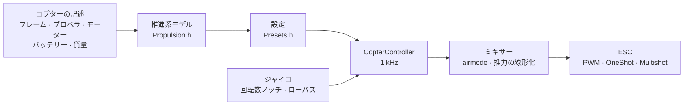

# COPTER.md — マルチコプター用ファームウェア

同じファームウェア、同じボード（Matek H743-WING V3、DevEBox H743）、同じセンサーと受信機です。ただし飛ばすのは飛行機ではなく、クアッドコプター、ヘキサ、オクト、Y6、X8 です。Betaflight、INAV、ArduPilot との一番の違いは、**PID、フィルター、アイドル、レートを手で調整しない**ことです。コプターの構成（フレーム、プロペラ、モーター、バッテリー、質量）を記述すれば、ファームウェアが物理モデルから設定を自分で導き出し、モデルの推定がずれていた部分は飛行中に自分で合わせ込みます。

> **正直に言うと。** コプター用ファームウェアは今のところシミュレーター（6 自由度モデル、12 構成 × 3 種類の「ずれた」物理）とボード向けのビルドでしか確認していません。まだ空を飛んでいません。Betaflight や ArduPilot より良く飛ぶと言えるのは飛行試験の後です。それまでは事実ではなく目標です。

## しくみ



1. **推進系モデル**（`copter/Propulsion.h`）：逆起電力と巻線抵抗（KV とステーター体積から）を持つモーター、プロペラの推力とトルク（直径、ピッチ、ブレード数から）、プロペラ付きローターの慣性。6S の 5" 2207 1950KV では、フルスロットルで約 28 000 rpm、約 1.6 kg の推力、約 45 A になります。試験台の値と一致します。
2. **そこから導かれるもの**（`copter/Presets.h`）：ホバリングスロットル、アイドル／ホバリング／フルスロットル時の回転数、モーターの遅れ τ、フレームの慣性モーメント、推力重量比、電流。
3. **角速度ループ**は周波数応答から選びます。モーター、フィルター、ノッチ、制御周期と ESC の遅れはすべてモデルに含まれます。クロスオーバー周波数は、位相余裕 50°（ヨーは 55°）と**ゲイン余裕 12 dB** を満たす最も高い値です。推力と慣性が 2 倍「ずれた」コプターでも持ちこたえる設定になります。D の比率は探索で選びます。ループが最も広くなる値です。P、I、D、フィードフォワード（FF）はクロスオーバー周波数から決まります。
4. **スロットルによるゲイン補正（TPA）**も同じモデルから求めます。低スロットルではモーターの応答が弱く、高スロットルでは強くなります。
5. **飛行中**、ファームウェアはホバリングスロットルを自分で学習し（重いバッテリー、ジンバル）、ノッチを回転数に合わせて動かします。

## 構成カタログ

| 構成 | フレーム | プロペラ · モーター · バッテリー | 質量 | 推力重量比 | ホバリング | ループ帯域 |
|---|---|---|---|---|---|---|
| `whoop65` | Quad X 65 mm | 31 mm ×4 · 0702 23000KV · 1S | 22 g | 4.2 | 31% | 16 Hz |
| `whoop75` | Quad X 75 mm | 40 mm ×4 · 0802 19000KV · 1S | 32 g | 4.3 | 27% | 16 Hz |
| `toothpick25` | Quad X 115 mm | 2.5" · 1103 8000KV · 3S | 70 g | 12.1 | 8% | 14 Hz |
| `micro3` | Quad X 140 mm | 3" · 1404 4500KV · 4S | 190 g | 8.3 | 15% | 14 Hz |
| `cinewhoop3` | Quad X 150 mm | 3" 5 枚羽根 · 1504 3600KV · 4S | 330 g | 4.1 | 32% | 16 Hz |
| `freestyle5` | Quad X 225 mm | 5.1" · 2207 1950KV · 6S | 680 g | 9.0 | 15% | 13 Hz |
| `race5` | ストレッチ Quad X | 5.1" · 2306 2000KV · 6S | 560 g | 10.8 | 11% | 12 Hz |
| `longrange7` | Quad X 315 mm | 7" · 2806.5 1300KV · 6S | 1.0 kg | 7.0 | 20% | 11 Hz |
| `heavy10` | Quad X 450 mm | 10" · 3115 900KV · 6S | 2.2 kg | 6.6 | 25% | 10 Hz |
| `cinelifter8` | X8 380 mm | 8" · 2812 1100KV · 6S | 3.5 kg | 6.4 | 23% | 11 Hz |
| `hex13` | Hex X 700 mm | 13" · 3510 600KV · 6S | 4.0 kg | 3.7 | 35% | 8 Hz |
| `hex15` | Hex X 900 mm | 15" · 4114 400KV · 6S | 6.0 kg | 3.0 | 45% | 8 Hz |

フレーム：Quad X、ストレッチ X、H、Deadcat、「+」、Hex X/+、Y6、Octo X/+、X8。モーター番号は Betaflight と同じです（クアッド：1 — 右後、2 — 右前、3 — 左後、4 — 左前）。プロペラは内回し・外回しのどちらも使えます。飛行スタイル（屋内、フリースタイル、レース、空撮、長距離、重量物）でレートと最大傾斜が決まります。

## 自分のコプター

`include/config/CopterConfig.h`：

```cpp
#define COPTER_BUILD "freestyle5"     // カタログで一番近い構成
constexpr float MASS_G = 742;          // バッテリー込みで量る — これが一番大事
constexpr float PROP_DIAMETER_IN = 5.1f, PROP_PITCH_IN = 3.6f;
constexpr float MOTOR_KV = 2150;       // 0 — 構成のまま
constexpr copter::EscProtocol ESC_PROTOCOL = copter::EscProtocol::ONESHOT125;
```

構成はビルドフラグでも選べます：`-D COPTER_BUILD=\"race5\"`。書き込んだ後、コンソールで `t` キーを押すと導き出された内容が表示され、問題があれば警告されます：推力が足りない、モーターがこのプロペラを回しきれない、隣のプロペラが接触する、ホバリングがスロットル 60% を超える、モーターの回転が制御周期の半分より速い。

## 書き込みと初回起動

```bash
pio run -e matek-h743-quad -t upload          # Matek H743-WING V3：BOOT ボタン + USB
pio run -e stm32h743-devebox-quad -t upload   # DevEBox H743
```

モーター出力は順番に、Matek — S1…S8、DevEBox — PA0–PA3、PD14、PD15、PE9 です。**初回起動はプロペラを外して**、シリアルモニター 115200 で：

| キー | 動作 |
|---|---|
| `t` | 設定：推力、ホバリング、回転数、モーター τ、フィルター、ループ帯域と余裕、P/I/D/FF、レート、警告 |
| `m` | モーターテスト：`y` での確認を求め（プロペラは外す！）、各モーターを 2 s ずつ回して、位置と回るべき方向を表示します |
| `s` | 状態と**アームできない理由** — 理由を一つずつ言葉で |
| `o` | 3 つの姿勢によるボード取り付けキャリブレーション（Matek では ARM 前に必須） |
| `i` · `r` · `l` · `D` | ジャイロ · 送信機チャンネル · ライブ行 · DFU ブートローダー |

違うモーターが回る場合は `CopterConfig::MOTOR_PINS` の順番を変えます。回転方向が逆なら ESC の設定ツール（BLHeliSuite、ESC-Configurator）で方向を変えます。配線のはんだ付けはやり直しません。

## 送信機とモード

モード 2：CH1 ロール、CH2 ピッチ、CH3 スロットル、CH4 ヨー。**ARM** — SwA（CH5）、飛行機と同じです。**モード** — SwC（CH7）：

| SwC | モード | スティックの働き |
|---|---|---|
| 上 | ANGLE | 傾き（スタイルの上限まで）。離すとコプターは水平に戻ります。ヨーは鉛直軸まわり |
| 中央 | ALT_HOLD | ANGLE + 高度維持：スロットル中央でホバリング、上下で最大 3 m/s の上昇、最大 2 m/s の降下 |
| 下 | ACRO | レートカーブに沿った回転角速度。airmode — スロットルゼロでも操縦できます |

HORIZON（中央付近は ANGLE、端では ACRO）は `CopterConfig.h` の 1 行を変えると有効になります。

## 保護機能

- **ARM** できるのは次の場合だけです：リンクがある、スロットルが下、コプターが水平（25° まで）で動かされていない、ジャイロが応答する、姿勢が確定している、バッテリーが空でない、モーターテスト中でない、ボードの取り付けがキャリブレーション済み（必要な場合）。早すぎるタイミングで入れた ARM スイッチは、一度切ってから入れ直す必要があります。
- **ARM スイッチを下げると、同じ周期でモーターが止まります**。どのモードでも同じです。
- **信号喪失**：0.3 s までの途切れでは何も変わりません。それより長いと、地上では即座に DISARM、空中では水平にして 0.7 m/s で降下し（気圧センサー、なければ加速度センサーで）、接地で DISARM します。リンクが 1 s 戻れば操縦はパイロットに戻ります。
- **事故**：ANGLE/ALT_HOLD で 90° を超える傾きが 0.7 s 以上続く、またはスティックが求める傾きと 30° 以上ずれた状態が 2 s 以上続く（モーター故障、横倒し）、どのモードでも 1 s 裏返しのまま — モーター停止。再 ARM はスイッチを切ってからです。
- **地上では積分が溜まりません** — 離陸時にコプターが跳ねたり倒れたりしません。

## 中身 — 概要

| ファイル | 内容 |
|---|---|
| `copter/Propulsion.h` | モーターとプロペラのモデル |
| `copter/Presets.h` | 構成カタログ、設定の導出、警告 |
| `copter/Frames.h` · `Mixer.h` | フレームとミキサー（airmode、ヨーよりロール／ピッチを優先、推力の線形化） |
| `copter/RateController.h` | P、I（フリップや加速中の relax、anti-gravity）、ジャイロに対する D、FF |
| `copter/Attitude.h` | クォータニオンによる姿勢。急な加速、回転中、ジャイロと食い違うときは加速度センサーを信用しません |
| `copter/AltitudeHold.h` | 高度：気圧センサー + 加速度センサー、ホバリングスロットルを学習 |
| `copter/GyroFilter.h` | 回転数の 1× と 2× およびブレード通過周波数のノッチ + ローパス |
| `copter/CopterController.h` | すべてをまとめる：ARM、モード、failsafe、事故 |
| `hal/stm32/Stm32MotorOutput.h` · `src/stm32/main_copter.cpp` | STM32 上の ESC 出力とエントリーポイント |

## どう確認したか

`test/native/test_copter_sim` — **本物の** `CopterController` と 6 自由度のコプターモデル：逆起電力付きのモーター、電流によるバッテリー電圧降下、プロペラの反トルク、空気抵抗、突風のある風、ESC の遅れ、ノイズとモーター振動のあるジャイロ（制御周期の半分を超える振動はボードと同じく折り返されます）、50 Hz の気圧センサー、地面。カタログの各構成は自分の設定で、さらに意図的に記述と合わないモデルでも飛びます：

- **「鈍い」**：プロペラの推力が 20% 少なく、モーターとフレームの慣性が 30% 大きく、20% 重く、重心が前寄り。
- **「敏感」**：推力 +20%、慣性 −30%、質量 −15%、重心が横にずれる — ループゲインは計算値のほぼ 2 倍です。

| 項目 | 36 回の飛行（12 構成 × 3 種類の物理）の結果 |
|---|---|
| ALT_HOLD での離陸とホバリング | 高度 ±0.3 m、傾き < 1°、ホバリングスロットルを学習（「敏感」な whoop：計算値 0.31 に対して 0.22） |
| ANGLE：スティック最大 | 傾きの 90% まで 0.14–0.35 s、オーバーシュート < 3%、0.15–0.4 s で 3° 以内に水平復帰 |
| ACRO：スティック最大 | レートの 90% まで 0.04–0.15 s、オーバーシュート < 12% |
| 高度 10 m での信号喪失 | 降下 ≤ 0.94 m/s、接地で DISARM、17–28 s |

さらに 5" では個別に：スロットルゼロでの airmode、ヨー、4.5 m/s の突風、気圧センサーなしの failsafe、普通の PWM ESC、リンクの途切れと復帰、裏返しの落下、モーター故障、モーターテスト、バッテリー電圧降下。`test_copter` は各ブロックを個別に確認し（41 テスト）、`native_stm32/test_app_stm32_copter` は Matek H743 のフェイク上でファームウェア全体を動かします：ARM 前の「停止」パルス、取り付けキャリブレーション、ARM 後のアイドル、スイッチによるモード、地上での信号喪失、コンソール。

シミュレーターは、計算では見えない本物の不具合を見つけ、修正に役立ちました：ミキサーの周期ごとに跳ねていたノッチ、ループ帯域近くのノッチによる余分な位相遅れ、「鈍い」ヘキサの加速中に溜まる積分（オーバーシュート 32%）、ホバリングスロットルでのフリップ中にちょうど 1 g を示して水平線を 10° ずらしていた加速度センサー、モーターが故障したまま地上で回り続けていたコプター。

## まだないもの

- **DShot**（双方向も — ノッチ用の正確な回転数）：DMA ドライバーが必要です。フレームと CRC の計算はすでにあります（`copter/EscProtocol.h`）。
- **1 kHz より速い制御周期** — モーターが 500 Hz より速く回る whoop 向け（シミュレーションでは 4 kHz で明らかに良くなります）。
- コプター用のブラックボックス、MAVLink、OpenPlane Studio。GPS による位置保持、帰還、ミッション。
- 飛行試験。
