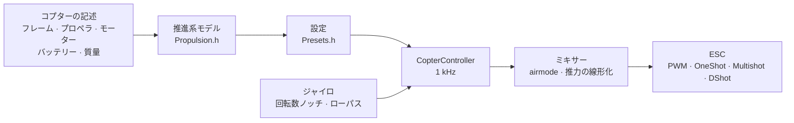

# COPTER.md — マルチコプター用ファームウェア

同じファームウェア、同じボード（Matek H743-WING V3、DevEBox H743、そして Betaflight が動くほぼすべての F405）、同じセンサーと受信機です。ただし飛ばすのは飛行機ではなく、クアッドコプター、ヘキサ、オクト、Y6、X8 です。Betaflight、INAV、ArduPilot との一番の違いは、**PID、フィルター、アイドル、レートを手で調整しない**ことです。コプターの構成（フレーム、プロペラ、モーター、バッテリー、質量）を記述すれば、ファームウェアが物理モデルから設定を自分で導き出し、モデルの推定がずれていた部分は飛行中に自分で合わせ込みます。

> **正直に言うと。** コプター用ファームウェアは今のところシミュレーター（6 自由度モデル、12 構成 × 3 種類の「ずれた」物理）とボード向けのビルドでしか確認していません。まだ空を飛んでいません。Betaflight や ArduPilot より良く飛ぶと言えるのは飛行試験の後です。それまでは事実ではなく目標です。

## しくみ



1. **推進系モデル**（`copter/Propulsion.h`）：逆起電力と巻線抵抗を持つモーター（KV とステーター体積から）、プロペラの推力とトルク（直径、ピッチ、羽根の枚数から）、プロペラを含むローターの慣性。6S の 5" 2207 1950KV なら、モデルはフルスロットルで約 28 000 rpm、約 1.6 kg の推力、約 45 A を出します — 推力テストベンチの値と同じです。
2. **そこから導かれるもの**（`copter/Presets.h`）：ホバリングスロットル、アイドル/ホバリング/フルスロットル時の回転数、モーターの遅れ τ、フレームの慣性モーメント、推力重量比、電流。
3. **角速度ループ**は周波数応答から選びます。モーター、フィルター、ノッチ、ループと ESC の遅れ — すべてモデルに入っています。交差周波数は、位相余裕 50°（ヨー 55°）と **ゲイン余裕 12 dB** を満たす最も高い値です。推力や慣性が 2 倍「ずれた」コプターでも持ちこたえる設定になります。D の割合は探索で決めます — ループが最も広くなる値です。P、I、D とフィードフォワード（FF）は交差周波数から導かれます。
4. **スロットルによるゲイン補正（TPA）** — 同じモデルから求めます。低回転ではモーターの反応が鈍く、高回転では強くなります。Betaflight の曲線も使えます（`tpa_mode = PD` または `D`）。
5. **飛行中**、ファームウェアはホバリングスロットルを自分で学習し（重いバッテリー、ジンバル）、ノッチを回転数に追従させます。

## 構成カタログ

| 構成 | フレーム | プロペラ · モーター · バッテリー | 質量 | 推力重量比 | ホバリング | ループ帯域 |
|---|---|---|---|---|---|---|
| `whoop65` | Quad X 65 mm | 31 mm ×4 · 0702 23000KV · 1S | 22 g | 4.2 | 31% | 16 Hz |
| `whoop75` | Quad X 75 mm | 40 mm ×4 · 0802 19000KV · 1S | 32 g | 4.3 | 27% | 16 Hz |
| `toothpick25` | Quad X 115 mm | 2.5" · 1103 8000KV · 3S | 70 g | 12.1 | 8% | 14 Hz |
| `micro3` | Quad X 140 mm | 3" · 1404 4500KV · 4S | 190 g | 8.3 | 15% | 14 Hz |
| `cinewhoop3` | Quad X 150 mm | 3" 5 枚羽根 · 1504 3600KV · 4S | 330 g | 4.1 | 32% | 16 Hz |
| `freestyle5` | Quad X 225 mm | 5.1" · 2207 1950KV · 6S | 680 g | 9.0 | 15% | 13 Hz |
| `race5` | ストレッチ Quad X | 5.1" · 2306 2000KV · 6S | 560 g | 10.8 | 11% | 12 Hz |
| `longrange7` | Quad X 315 mm | 7" · 2806.5 1300KV · 6S | 1.0 kg | 7.0 | 20% | 11 Hz |
| `longrange7li` | Quad X 315 mm | 7" 2 枚羽根 · 2810 1300KV · 6S Li-ion 4000 | 1.05 kg | 7.5 | 23% | 12 Hz |
| `heavy10` | Quad X 450 mm | 10" · 3115 900KV · 6S | 2.2 kg | 6.6 | 25% | 10 Hz |
| `cinelifter8` | X8 380 mm | 8" · 2812 1100KV · 6S | 3.5 kg | 6.4 | 23% | 11 Hz |
| `hex13` | Hex X 700 mm | 13" · 3510 600KV · 6S | 4.0 kg | 3.7 | 35% | 8 Hz |
| `hex15` | Hex X 900 mm | 15" · 4114 400KV · 6S | 6.0 kg | 3.0 | 45% | 8 Hz |

フレーム：Quad X、ストレッチ X、H、Deadcat、「+」、Hex X/+、Y6、Octo X/+、X8。モーター番号は Betaflight と同じ（クアッド：1 — 右後、2 — 右前、3 — 左後、4 — 左前）、プロペラは内回し・外回しのどちらでも。飛行スタイル — 室内、フリースタイル、レース、空撮、ロングレンジ、運搬：レートと最大傾きを決めます。

## 自分のコプター

`include/config/CopterConfig.h`：

```cpp
#define COPTER_BUILD "freestyle5"     // カタログで一番近い構成
constexpr float MASS_G = 742;          // バッテリー込みで量る — これが一番大事
constexpr float PROP_DIAMETER_IN = 5.1f, PROP_PITCH_IN = 3.6f;
constexpr float MOTOR_KV = 2150;       // 0 — 構成と同じ
constexpr copter::EscProtocol ESC_PROTOCOL = copter::EscProtocol::ONESHOT125;
```

構成はフラグ `-D COPTER_BUILD=\"race5\"` でも選べますし、再ビルドせずに CLI で `set copter_build = race5`、`set copter_mass_g = 742`、`save` としても選べます（設定は下記。ファイルの値は既定値になるだけです）。書き込み後、コンソールで `t` を押すと導かれた値が表示され、問題があれば警告が出ます：推力不足、モーターがそのプロペラを回しきれない、隣のプロペラが接触する、スロットル 60% 超でホバリングする、モーターの回転がループ周波数の半分を超える。モーター数の違う別のフレームは再起動後に有効になります。それまでは ARM が禁止されます（`REBOOT_REQD`）。

## 書き込みと初回起動

```bash
pio run -e matek-h743-quad -t upload          # Matek H743-WING V3：BOOT ボタン + USB
pio run -e stm32h743-devebox-quad -t upload   # DevEBox H743
pio run -e aocodarc-f405v3-quad -t upload     # Betaflight 由来の F405 フライトコントローラー — 下記参照
```

モーター出力は順番に、Matek — S1…S8、DevEBox — PA0–PA3、PD14、PD15、PE9 です。**初回起動はプロペラを外して**、シリアルモニター 115200 で：

| キー | 動作 |
|---|---|
| `t` | 設定：推力、ホバリング、回転数、モーター τ、フィルター、ループ帯域と余裕、P/I/D/FF、レート、警告 |
| `m` | モーターテスト：`y` での確認を求め（プロペラは外す！）、各モーターを 2 s ずつ回して、位置と回るべき方向を表示します |
| `s` | 状態。Betaflight の `status` と同様：ループ負荷、周波数、バッテリー、**アームできない理由** — 理由ごとに BF コード（`RXLOSS`、`ANGLE`、`CLI`…）と言葉で |
| `o` | 3 つの姿勢によるボード取り付けキャリブレーション（Matek では ARM 前に必須） |
| `c` | コンパスのキャリブレーション：15 s の間、コプターを全軸まわりに回す（コンパス — GPS モジュール上の QMC5883L または QMC5883P、応答した方） |
| `i` · `r` · `l` · `D` | ジャイロ · 送信機チャンネル · ライブ行 · DFU ブートローダー |
| `#` | Betaflight のような CLI：`set`、`get`、`diff`、`aux`、`map`、`profile`、`save` — [下記](#設定betaflight-のような-cli) |

違うモーターが回る場合は `CopterConfig::MOTOR_PINS` の順番を変えます。回転方向が逆なら ESC の設定ツール（BLHeliSuite、ESC-Configurator）で方向を変えます。配線のはんだ付けはやり直しません。

### Betaflight 由来の F405 フライトコントローラー

STM32F405 を載せたクアッド用フライトコントローラー（Betaflight、8 MHz 水晶）なら、ICM-42688-P と SPL06 または DPS310 の気圧計があればほぼ何でも使えます。ピン配置は Betaflight 自身から取るので、ターゲットがどのリポジトリにもないボード（GETFUN F405V3）でも動きます：

```bash
# 1. ボードにはまだ Betaflight が入っている。Configurator は閉じておく。CLI ダンプをファイルへ
#    （PlatformIO の Python — pyserial が入っている）：
~/.platformio/penv/Scripts/python tools/bf_board.py read --port COM5 --out stack/MYBOARD_bf.txt
# 2. 純正ファームウェア全体 — 必要なら Betaflight に戻すため
#    （ボードを DFU に：BOOT を押したまま USB を挿す）：
python tools/bf_board.py backup --out stack/MYBOARD_original.bin
# 3. ボードのヘッダー：どのピンに何があるか（BF は気圧計の種類を知らない — 製品説明に従う）：
python tools/bf_board.py header stack/MYBOARD_bf.txt --baro SPL06 --out include/config/boards/MYBOARD.h
```

あとは `platformio.ini` に `aocodarc-f405v3-quad` と同じような env を作り（基準ボード：ピン配置が公開されていて、F405 コアは常にこれでビルド・テストしています）、`-D OP_BOARD_FILE=\"config/boards/MYBOARD.h\"` を付けます。モーターは Betaflight の番号どおり M1…M8、受信機・GPS・テレメトリーは Betaflight が使っていた UART に、各モーターのタイマーは Betaflight が選んだものです（ダンプの `timer B06 AF2` 行 -> `OPB_MOTOR_AF`：1 本のピンに 2〜3 個のタイマーがあることがあり、BF はそのボードで DMA が衝突しない組み合わせを選んでいます）。ブラックボックスのフラッシュもバスと CS ごとダンプから取ります。すでに当ファームウェアが入っているボードは、[github.com/betaflight/config](https://github.com/betaflight/config) の `config.h` から `bf_board.py header` を作ります。

F405 のフラッシュはバンクが 1 つだけです。設定の書き込み中はプロセッサーが 1〜2 s 止まるので、設定はディスアーム中にしか書き込みません。

## 設定：Betaflight のような CLI

記述から導かれた値は手で直せます — 再ビルドなしに、1 行ずつ、Betaflight の CLI と同じように。コンソールで `#` を押すと入ります（ディスアーム中のみ。CLI を開いている間は ARM が禁止されます）：

```text
# get p_roll                     ← 値、範囲、既定値とその出どころ
# set p_roll = 50                ← Betaflight の単位で
# set tune_source = BETAFLIGHT   ← モデルの代わりに BF 4.5 の既定値
# profile 1                      ← PID プロファイル 0〜3（rateprofile — レート）。即座に、動作中でも
# diff                           ← 変更分だけ、BF 形式で
# save                           ← フラッシュへ、設定を再計算、終了
```

- **手で設定しなかった項目は既定値になります。PID とレートの既定値は表の固定値ではなく、コプターの記述から計算した結果です**（`get` では「コプターのモデルから」と表示）。記述を変えると、触っていない項目はすべて追従し、手で設定した項目はそのまま残ります。既定値と同じ値を設定するのは、既定値に戻すのと同じです。
- **単位は Betaflight と同じ**：PID の項 = 数値 × BF の係数 × 誤差、合計 ÷ 1000 がミキサーへ（P 0.032029、I 0.244381、ヨーではさらに ×2.5、D 0.000529、F 0.013754 × 0.01）。`t` はモデルの設定もこの数値で表示します：5" なら P 25、I 41、D 28、F 35。BF の既定値 45/80/40/120 よりおとなしいのは、モデルが 12 dB のゲイン余裕を確保しているからです。
- **Betaflight の diff は丸ごと貼り付けられます**（4.5 の `diff all`）：既知の設定は適用され、`profile`/`rateprofile` は切り替わり、`map`、`aux`、`rxrange`、`vtx`、`rxfail` はそれぞれの表に入り、コメントは無視され、未知の設定には `###エラー…###` 行が出ます。BF のハードウェア系コマンド（`resource`、`timer`、`dma`、`serial`、`feature`、`board_name`…：こちらではボードのヘッダーが担当）は `# スキップ` のコメント付きで飛ばされ、diff の `defaults nosave` はコプターの記述に触れません（BF には記述がないため）。`batch end`（または貼り付け途中の `save`）でまとめが出ます：`# 貼り付け：N 行を適用、M 件は移行せず：名前…`。その `save` の後 0.5 秒間は、貼り付けの残りをコンソールのキー入力として扱いません。
- `tune_source = BETAFLIGHT` — BF 4.5 の既定値一式：PID 45/80/40/120、47/84/46/125、45/80/0/120。レート Actual 70/670/0。TPA は D のみ、スロットル 1350 から 65%、離陸まで低スロットルで −20%。`iterm_limit` 400。PID 合計 500（ヨー 400）。anti-gravity 80、5 Hz、P 100。`throttle_boost` 5。ANGLE は 1° あたり 5 °/s、最大 60°。`yaw_lowpass_hz` 100。フィルターは当方のチェーンに換算（ジャイロ PT2 250 Hz、D — PT1 60 Hz：ループ帯域での遅れが同じ）。回転数ノッチは当方のままです。
- フラッシュに保存するのは手で設定した項目（と選んだプロファイル）だけです。書き直しでは消えず、`defaults` で消えます。`save` せずに `exit` — 取り消し。

| コマンド | 動作 |
|---|---|
| `set` · `set 名前 = 値` | 全設定 · 設定（`save` 後に有効） |
| `get 名前の一部` | 値、範囲、既定値、意味 |
| `diff [all]` · `dump [all]` | 変更分 · すべて。`all` — 全プロファイル |
| `profile [0-3]` · `rateprofile [0-3]` | PID プロファイル · レートプロファイルを選ぶ |
| `aux` · `aux 番号 モード チャンネル 下限 上限 [論理 連動]` · `aux help` | スイッチのモード表 · 1 行 · モード番号 — [下記](#送信機とモード) |
| `map [AETR1234]` · `rxrange [0-3 min max]` | チャンネル順 · ロール/ピッチ/ヨー/スロットルのスティック端点 |
| `rxfail` · `rxfail チャンネル a\|h\|s [値]` | リンクがないチャンネルの扱い、BF と同じ：スティック 0〜3 — `a`（フェイルセーフの自動処理）または `h`（最後の値を保持）、AUX 4〜17 — `h` または `s 750…2250`（固定）。最初の 0.3 s は常に最後の有効値 |
| `vtx` · `vtx 番号 チャンネル バンド VTXチャンネル 出力 下限 上限` · `vtx_info` | スイッチで映像送信機を操作、BF と同じ · 送信機の応答と出力段 — [下記](#映像送信機) |
| `dshot_telemetry_info` | BF と同じ：モーターごとの eRPM、rpm、Hz、応答なしフレームの割合（`dshot_bidir`） |
| `flash_info` · `flash_erase` | ブラックボックスのフラッシュ（F405）：チップ、容量、JEDEC ID、使用量とフライト · 全消去（1 コマンド、最大 1 分待つ、BF と同じ） |
| `save` · `defaults [nosave]` | 保存して再計算 · すべて既定値に |
| `status` · `tasks` | 状態（`s` と同じ）· ループ各部の時間：周波数、平均と最悪、プロセッサーの割合 |
| `version` · `help` · `exit` | バージョン · 一覧 · 終了 |

### 設定項目

| 設定 | 場所 | 範囲 | 既定値 | 内容 |
|---|---|---|---|---|
| `tune_source` | 共通 | `MODEL`、`BETAFLIGHT` | `MODEL` | PID、フィルター、TPA の出どころ：コプターの記述か BF 4.5 の既定値か |
| `profile_name` | PID プロファイル | 8 文字まで | — | PID プロファイル名 |
| `p_roll` `i_roll` `d_roll` `f_roll` | PID プロファイル | P、I、D 0〜250、F 0〜1000 | モデルから。BF：45、80、40、120 | ロール PID（BF 単位） |
| `p_pitch` `i_pitch` `d_pitch` `f_pitch` | PID プロファイル | 同上 | モデルから。BF：47、84、46、125 | ピッチ PID |
| `p_yaw` `i_yaw` `d_yaw` `f_yaw` | PID プロファイル | 同上 | モデルから。BF：45、80、0、120 | ヨー PID |
| `d_max_roll` `d_max_pitch` `d_max_yaw` | PID プロファイル | 0〜250 | 0（D 一定） | 急な動きのときの D、BF 2025.12 と同じ：このとき `d_*` は静止時の D |
| `d_min_roll` `d_min_pitch` `d_min_yaw` | PID プロファイル | 0〜250 | 0。BF：30、34、0 | BF 4.5 と同じ：静止時の D、`d_*` — 急な動きのとき（`d_max_*` 未設定の場合） |
| `d_max_gain`（`d_min_gain`） | PID プロファイル | 0〜100 | 37 | ジャイロの揺れで D がどれだけ上がりやすいか：37 なら約 5000 °/s² で完全に |
| `d_max_advance`（`d_min_advance`） | PID プロファイル | 0〜200 | 20 | スティックの動きで D がどれだけ早く上がるか：20 なら目標値約 2500 °/s² で完全に |
| `iterm_relax` | PID プロファイル | `OFF`、`RP`、`RPY`、`RP_INC`、`RPY_INC` | `RPY`。BF：`RP` | 目標値が急に変わる間 I が待つ軸（フリップ後に跳ね返らない）。`_INC` — 増加だけを抑える |
| `iterm_relax_type` | PID プロファイル | `GYRO`、`SETPOINT` | `SETPOINT` | `SETPOINT` — I の蓄積が遅くなる。`GYRO` — I は平滑化した目標値に向かい、ごく近くではゼロ |
| `iterm_relax_cutoff` | PID プロファイル | 1〜50 Hz | 10。BF：15 | relax 用の目標値の平滑化：低いほど長く待つ |
| `iterm_relax_error` | PID プロファイル | `OFF`、`ON` | `ON` | 当方独自：新しい目標値へ加速するとき（フリップ）の大きな誤差は I にためない。スティックを動かしていない誤差（突風、スロットルパンチ）はためる |
| `iterm_rotation` | PID プロファイル | `OFF`、`ON` | `OFF` | I をフレームと一緒に回す：ピルエットでロールにたまった分がピッチに移る |
| `iterm_windup` | PID プロファイル | 30〜100% | 100（無効）。BF：85 | モーター出力の開きが大きいほど I の蓄積を弱め、開き切ると止める |
| `iterm_limit` | PID プロファイル | 0〜500 | モデルから（300）。BF：400 | I の上限、1000 — モーターの全ストローク |
| `pidsum_limit` · `pidsum_limit_yaw` | PID プロファイル | 100〜1000 | 1000。BF：500 · 400 | ロールとピッチの PID 合計の上限 · ヨー（1000 — 全ストローク）。上限では I をためない |
| `anti_gravity_gain` | PID プロファイル | 0〜250 | 80 | スロットルパンチで I を強め、機首が下がらないようにする：フルパンチ（0.1 s で全ストローク）で 1 + gain/10 倍 |
| `anti_gravity_cutoff_hz` | PID プロファイル | 2〜50 Hz | 5 | スロットル変化速度の平滑化：低いほどピークは低く長い |
| `anti_gravity_p_gain` | PID プロファイル | 0〜250% | 0。BF：100 | ロールとピッチの P も強める：100 ならフルパンチで 50% |
| `throttle_boost` · `throttle_boost_cutoff` | PID プロファイル | 0〜100（×0.1）· 5〜50 Hz | 0。BF：5 · 15 | スティックのスロットルパンチ（スロットルからそのローパスを引いたもの）を 1 + boost/10 倍に強める — モーターが早くスティックに追いつく。ALT_HOLD では無効 |
| `tpa_mode` | PID プロファイル | `PD`、`D`、`MODEL` | `MODEL`。BF：`D` | スロットルによる PD 補正：`PD`/`D` — BF の曲線（下の 2 行）、`MODEL` — P と D へのモデルの補正 |
| `tpa_rate` · `tpa_breakpoint` | PID プロファイル | 0〜100% · 750〜2250 µs | 65 · 1350 | `PD`/`D`：この点より上で PD（または D のみ）を直線的に弱め、フルスロットルで `tpa_rate` |
| `tpa_low_rate` · `tpa_low_breakpoint` | PID プロファイル | −128…100% · 750〜2250 µs | 0。BF：20 · 1050 | スロットルゼロで PD（D）を `tpa_low_rate` だけ弱める（0 未満なら強める）、点まで直線的に |
| `tpa_low_always` | PID プロファイル | `OFF`、`ON` | `OFF` | `OFF` — ARM 後にスロットルが `tpa_low_breakpoint` を超えるまで（地上）だけ、`ON` — 常に |
| `feedforward_transition` | PID プロファイル | 0〜100% | 0 | スティック中央からこれより近いとフィードフォワードを弱める（ゼロまで直線的に）— 中央がおとなしくなる |
| `feedforward_averaging` | PID プロファイル | `OFF`、`2_POINT`、`3_POINT`、`4_POINT` | `OFF` | フィードフォワード用のスティック速度を受信フレーム 2〜4 個で平均：フレームがまばらでも滑らかだが遅れる |
| `feedforward_smooth_factor` | PID プロファイル | 0〜95% | 0。BF：25 | フレーム間のフィードフォワード平滑化（1 フレームあたりの旧値の割合） |
| `feedforward_jitter_factor` | PID プロファイル | 0〜20 | 0。BF：7 | 1 フレームのスティック移動がこれより小さい（500 — スティック半分）とフィードフォワードを滑らかにゼロまで弱める：指の震えでモーターが揺れない |
| `feedforward_boost` | PID プロファイル | 0〜50 | 0。BF：15 | スティックの加速度による上乗せ（15 — 3 ms の先行、スティック速度そのものは超えない） |
| `feedforward_max_rate_limit` | PID プロファイル | 0〜150% | 0。BF：90 | 目標値が最大レートのこの割合に達すると、外向きのフィードフォワードは残りの余裕に対して P が出す量を超えず、その先はゼロ：フルスティックのフリップでオーバーシュートしない |
| `yaw_lowpass_hz` | PID プロファイル | 0〜500 Hz | モデルから（30〜100）。BF：100 | ヨー PID 出力のローパス（0 — フィルターなし）。モデルの PID はモデルの周波数で計算 |
| `use_integrated_yaw` · `integrated_yaw_relax` | PID プロファイル | `OFF`、`ON` · 0〜255 | `OFF` · 200 | PID 合計の積分でヨーを制御（×100 1/s、リーク relax × 0.08 1/s）— ヨーでプロペラの回転が変わる大径プロペラ向け。BF の数値は BF と同じ振る舞い（I に ×2.5 なし。5" では `d_yaw` が必要で、ないと発振）。手で設定していないモデルのヨー PID は、ループが変わらないよう再計算 |
| `abs_control_gain` | PID プロファイル | 0〜20（°/s / °） | 0（無効） | ACRO：突風や推力の不均衡で失った角度と方位を取り戻す。ロールとピッチ — ACRO のみ、ヨー — 全モードで、空中で |
| `abs_control_limit` · `abs_control_error_limit` · `abs_control_cutoff` | PID プロファイル | 10〜255 °/s · 1〜45° · 1〜45 Hz | 90 · 20 · 11 | 補正の上限 · 蓄積した角度誤差の上限 · 目標値のローパス（速いスティックでのフレームの遅れをためない） |
| `thrust_linear` | PID プロファイル | 0〜150% | モデルから（15〜30）。BF：0 | 推力の線形化：低スロットルでも高スロットルと同じ反応 |
| `motor_output_limit` | PID プロファイル | 1〜100% | 100 | アイドルより上のモーターストロークの割合：4S 用モーターに 6S バッテリー — 66 |
| `rateprofile_name` | レートプロファイル | 8 文字まで | — | レートプロファイル名 |
| `roll_rc_rate` `pitch_rc_rate` `yaw_rc_rate` | レートプロファイル | 1〜255（×10 °/s） | 飛行スタイルによる。BF：7 | スティック中央のレート |
| `roll_srate` `pitch_srate` `yaw_srate` | レートプロファイル | 0〜255（×10 °/s） | 飛行スタイルによる。BF：67 | フルスティックのレート |
| `roll_expo` `pitch_expo` `yaw_expo` | レートプロファイル | 0〜100% | 飛行スタイルによる。BF：0 | エキスポ：中央がおとなしくなる |
| `serialrx_provider` | 共通 | `IBUS`、`SBUS`、`CRSF` | `Config.h` の `RX_PROTOCOL` | 受信機のプロトコル。`save` 後、再起動なしで切り替わる |
| `rx_min_usec` `rx_max_usec` | 共通 | 750〜2250 µs | 885、2115 | この範囲外のパルスはチャンネルエラー：スティックならリンク喪失、AUX は前の値を保持 |
| `copter_build` | 共通 | カタログの構成 | `COPTER_BUILD` | コプターの記述のベース |
| `copter_mass_g` | 共通 | 0〜30000 g（0 — 推定） | 構成から | バッテリー込みの離陸質量 |
| `copter_wheelbase_mm` | 共通 | 30〜2000 mm | 構成から | 対角モーターの軸間距離 |
| `prop_diameter_in` `prop_pitch_in` `prop_blades` | 共通 | 0.5〜40"、0.3〜30"、2〜8 | 構成から | プロペラ |
| `motor_stator_mm` `motor_height_mm` `motor_kv` | 共通 | 3〜120 mm、0.5〜60 mm、50〜80000 | 構成から | モーター：2207 — 22 と 7 |
| `battery_cells` `battery_mah` | 共通 | 1〜14 S、50〜50000 mAh | 構成から | バッテリー |
| `props_out` | 共通 | `OFF`、`ON` | `PROPS_OUT` | プロペラ外回し：全モーターが逆回転 |
| `battery_chemistry` | 共通 | `LIPO`、`LIHV`、`LIION` | 構成から（LiPo） | 化学種：セルのしきい値と推力モデル用の負荷時電圧（3.75 / 3.85 / 3.5 V） |
| `vbat_min_cell_voltage` `vbat_warning_cell_voltage` `vbat_max_cell_voltage` | 共通 | 100〜500（×0.01 V） | 化学種による：LiPo 330/350/430、LiHV 330/350/440、Li-ion 280/310/425 | セル：空（CRITICAL）· 帰還すべき（WARNING。静止時にこれ未満ならアームしない）· 満充電 |
| `vbat_full_cell_voltage` | 共通 | 100〜500（×0.01 V） | 化学種による：LiPo 410、LiHV 425、Li-ion 410 | 接続時にセルがこれ以上ならバッテリーは満充電。そうでなければディスアーム中の OSD に `BATT < FULL` |
| `vbat_scale` · `vbat_divider` · `vbat_multiplier` | 共通 | 0〜255 · 1〜255 · 1〜255 | ボードの分圧（110 · 10 · 1 — 1:11。F405 — ボードのダンプから） | ボルト = ピンの mV × `vbat_scale` /（1000 × `vbat_divider` × `vbat_multiplier`）、BF と同じ |
| `battery_meter` | 共通 | `NONE`、`ADC`、`ESC` | ボードにバッテリー入力があれば `ADC` | 電圧の出どころ（`ESC` — ESC テレメトリーから、まだ動かない） |
| `current_meter` · `ibata_scale` · `ibata_offset` | 共通 | `NONE`/`ADC`/`VIRTUAL`/`ESC`/`MSP` · ±16000（×0.1 mV/A）· ±32000 mV | ボードに電流入力があれば `ADC`。400（Matek — 250、F405 — ボードのダンプから）。0 | 電流センサー：電流、消費 mAh、残量（`VIRTUAL`、`ESC`、`MSP` は BF の diff から受け付けるが、まだ電流は出ない） |
| `vbat_detect_cell_voltage` | 共通 | 0〜2000（×0.01 V） | 300 | 電圧がこの値と満充電セル（1S）の間、またはこの値の 2 倍より上ならバッテリーあり。そうでなければ USB 給電 |
| `force_battery_cell_count` | 共通 | 0〜24 S | 0 | セル数。0 — コプターの記述（`battery_cells`）から。BF では 0 は電圧から推測の意味だが、当方は推測しない：空の 6S Li-ion（17 V）と満充電の 4S LiPo は区別できない |
| `bat_capacity` | 共通 | 0〜20000 mAh | 0 | 残量と消費アラーム用の容量。0 — 記述の `battery_mah` |
| `vbat_hysteresis` | 共通 | 0〜250（×0.01 V） | 1 | 電圧がしきい値よりさらにこれだけ低いとアラーム（バッテリー全体で、BF と同じ）。しきい値を超えると解除 |
| `vbat_duration_for_warning` · `vbat_duration_for_critical` | 共通 | 0〜150（×0.1 s） | 20 · 20（BF：0 · 0） | しきい値未満がこれだけ続くと WARNING · CRITICAL：スロットルパンチでの電圧降下はアラームにしない |
| `use_vbat_alerts` · `use_cbat_alerts` · `cbat_alert_percent` | 共通 | `OFF`/`ON` · `OFF`/`ON` · 0〜100% | `ON` · `OFF` · 10 | バッテリーアラームの鳴動と表示 · mAh でもアラーム（残り `cbat_alert_percent` 以下 — WARNING、ゼロ — CRITICAL。電流センサーが必要） |
| `vbat_cutoff_percent` | 共通 | 0〜100% | 100（なし） | 最初の CRITICAL から 10 s かけて、スティックのスロットルをこの割合まで滑らかに制限（BF の LVC）。高度保持とフェイルセーフの自動処理は対象外 |
| `vbat_display_lpf_period` · `vbat_sag_lpf_period` · `ibat_lpf_period` | 共通 | 1〜255（×0.1 s） | 30 · 2 · 10 | 平滑化（ローパス 10/周期 Hz、BF と同じ）：表示とアラーム · 電圧降下補償用の電圧 · 電流 |
| `vtx_protocol` | 共通 | `AUTO`、`SMARTAUDIO`、`TRAMP`、`NONE` | ボードに VTX 線があれば `AUTO` | 映像送信機の制御線 |
| `vtx_band` · `vtx_channel` · `vtx_freq` | 共通 | 0〜10 · 1〜8 · 0〜6200 MHz | 5（R）· 1 · 0 | バンド（1 A、2 B、3 E、4 F、5 R、6 L、7 X、8 V、9 G、10 S。0 — 周波数を数値で） |
| `vtx_power` | 共通 | 1〜12 | 1 | 出力段、1 — 最低。表は送信機から（`vtx_info`） |
| `vtx_max_power_mw` | 共通 | 0〜10000 mW | 0（なし） | **上限**：スイッチでも送信機のボタンでもこれより上げない |
| `vtx_low_power_disarm` | 共通 | `OFF`、`ON`、`UNTIL_FIRST_ARM` | `OFF` | ディスアーム中 — 最低出力段 |
| `gps_minimum_sats` | 共通 | 4〜50 | 8 | 衛星がこれ以上あれば ARM 時にホームを記録 |
| `crsf_telemetry` | 共通 | `OFF`、`ON` | `ON` | CRSF で送信機へテレメトリー |
| `blackbox_device` | 共通 | `NONE`、`SPIFLASH`、`SDCARD`、`SERIAL` | F405 では `SPIFLASH`、H743 では `SDCARD` | ブラックボックスの書き込み先。このボードの媒体を選んだときだけ記録（`SERIAL` は BF の diff から受け付けるが記録しない） |
| `blackbox_mode` | 共通 | `NORMAL`、`MOTOR_TEST`、`ALWAYS` | `NORMAL` | いつ記録するか：アーム中、モーター回転中、常に |
| `blackbox_sample_rate` | 共通 | `1/1` … `1/32` | `1/1`（フラッシュ付き F405 — `1/2`） | ジャイロ、PID、モーター — 何ループに 1 回か |
| `motor_poles` | 共通 | 4〜255 | 14 | ローターの磁極数：rpm = eRPM × 2 / `motor_poles` |
| `dshot_bidir` | 共通 | `OFF`、`ON` | `OFF` | 双方向 DShot：ESC が回転数を返す。再起動後に切り替わる（それまでは ARM 禁止、`REBOOT_REQD`）。有効だとループの上限が下がる — フレーム、30 µs、応答：DShot600 — 11.8 kHz まで、300 — 7.2、150 — 4.0 |
| `small_angle` | 共通 | 0〜180° | 25 | これより傾けて置いてあるとアームしない。180 — チェックなし |
| `auto_disarm_delay` | 共通 | 0〜60 s | 5 | アームしたまま地上でスロットルを下げてこれだけ経つと DISARM（BF ではスティックアームのときだけ。当方はスイッチでも）。0 — しない |
| `runaway_takeoff_prevention` | 共通 | `OFF`、`ON` | `ON` | ARM 後に制御が張り付き、コプターが回っている — DISARM |
| `runaway_takeoff_deactivate_delay` | 共通 | 100〜1000 ms | 500 | これだけ落ち着いて飛ぶと runaway チェックを次の ARM まで切る |
| `runaway_takeoff_deactivate_throttle_percent` | 共通 | 0〜100% | 20 | 飛行とみなすスロットル（またはコプターがすでに 1 m 以上上昇） |
| `failsafe_delay` | 共通 | 1〜200（×0.1 s） | 15 | リンクがこれだけないと段階 2。それまでは段階 1：水平にして高度を保つ（BF では — スティック中央、スロットル 0） |
| `failsafe_procedure` | 共通 | `AUTO-LAND`、`DROP`、`GPS-RESCUE` | `AUTO-LAND`（BF：`DROP`） | 段階 2：水平にして降下 · モーター停止 · 帰還（今は GPS なし — AUTO-LAND と同じ、スティックで操縦を取り戻せる） |
| `failsafe_landing_time` | 共通 | 1〜250 s | 120（BF：60） | AUTO-LAND がこの時間内に着陸しないと DISARM。当方の降下は高度に従い接地で終わるので、これは余裕分 |
| `failsafe_throttle` | 共通 | 1000〜2000 µs | 1000 | AUTO-LAND：1000 — 高度に従い 0.7 m/s で降下。それ以上 — 固定スロットル、BF と同じ |
| `failsafe_throttle_low_delay` | 共通 | 0〜300（×0.1 s） | 100 | リンク喪失前にスロットルがこれより長く下がっていたら即 DISARM（明らかに地上にある）。0 — しない |
| `failsafe_recovery_delay` | 共通 | 1〜200（×0.1 s） | 5 | リンクがこれだけ続くと操縦がパイロットに戻り（段階 2）、フェイルセーフによる DISARM の後も再びアームできる |
| `failsafe_stick_threshold` | 共通 | 0〜50% | 30 | GPS-RESCUE：リンク復帰後、スティックをこれより大きく動かすと操縦がパイロットに戻る |
| `failsafe_switch_mode` | 共通 | `STAGE1`、`KILL`、`STAGE2` | `STAGE1` | スイッチによる FAILSAFE モード：リンク喪失と同じ · 即モーター停止（1 s 後に ARM 可）· いきなり段階 2 |
| `craft_name` | 共通 | 16 文字まで | — | コプターの名前：BF コンフィギュレーター（`MSP_NAME`）とログ |
| `vbat_sag_compensation` | PID プロファイル | 0〜150% | 100（BF：0） | 電圧降下に対するモーター補正：100 — 電圧が下がっても満充電と同じ反応、0 — 補正なし |

コプターの記述（`copter_build` … `props_out`）：既定値はカタログの構成に `CopterConfig.h` の「自分のコプター」の修正を加えたものです。構成を変えると、質量、プロペラ、モーター、バッテリーの既定値は新しい構成から取られ、手で設定した値はそのまま残ります。PID とフィルターは `save` 時に新しい記述で再計算されます。

レート曲線は今のところ当方独自です：中央で `rc_rate`、フルスティックで `srate`、エキスポで中央をおとなしくします。エキスポ 0 なら Betaflight の Actual と一致します。13"/15" ヘキサではモデルが 250 超の D と 1000 超の F を求めます — `get` は上限で切った既定値を表示しますが、実際にはモデルの正確な値を使います。

## 送信機とモード

既定はモード 2：CH1 ロール、CH2 ピッチ、CH3 スロットル、CH4 ヨー。**ARM** — SwA（CH5）、飛行機と同じです。**モード** — SwC（CH7）：

| SwC | モード | スティックの働き |
|---|---|---|
| 上 | ANGLE | 傾き（スタイルの上限まで）。離すとコプターは水平に戻る。ヨー — 鉛直軸まわり |
| 中 | ALT_HOLD | ANGLE + 高度：スロットル中央 — ホバリング、上/下 — 上昇最大 3 m/s、降下最大 2 m/s |
| 下 | ACRO | レート曲線に従う角速度。airmode — スロットルゼロでも操縦できる |

これらはすべて CLI で変えられます。Betaflight と同じです：

- `map TAER1234` — チャンネル順：各チャンネルを 1 文字で（A — ロール、E — ピッチ、T — スロットル、R — ヨー、1〜4 — AUX1〜AUX4）。スロットルのフェイルセーフしきい値（`RX_FAILSAFE_THROTTLE_US`）はスロットルに付いて移ります。
- `rxrange 3 1050 1950` — スロットルスティックの端点を 1000〜2000 に引き伸ばす（0 — ロール、1 — ピッチ、2 — ヨー、3 — スロットル）。
- `aux 0 0 1 1700 2100 0 0` — チャンネルが範囲内にある間モードが有効：行番号 0〜19、モード（BF 番号）、チャンネル（0 — AUX1、つまり `map AETR1234` なら CH5）、下限と上限（µs、25 刻み）、論理（0 — そのモードのどれか 1 行で十分、1 — 全行が必要）、連動（別のモードと一緒にオン）。引数なしの `aux` — 表、`aux help` — モード番号。

| モード | BF 番号 | 働き |
|---|---|---|
| ARM | 0 | モーター始動 |
| ANGLE · HORIZON · ALTHOLD | 1 · 2 · 3 | 飛行モード。複数あれば ALTHOLD、次に ANGLE、次に HORIZON。どれもなければ ACRO |
| FAILSAFE | 27 | リンク喪失と同じ（地上でのフェイルセーフ確認） |
| AIR MODE | 28 | `CopterConfig.h` で `AIRMODE` を切っていても airmode |
| PREARM | 36 | 表にあれば、PREARM が有効なときだけ ARM できる |
| USER1 … USER4 | 40 … 43 | ボードの PINIO ピン（GETFUN F405V3 では：USER1 — カメラ CAM1/CAM2、USER2 — 12 V 電源） |
| VTX PIT MODE · VTX CONTROL DISABLE | 39 · 48 | 映像送信機を PIT に · 送信機に触らない |

**表が空のとき（`defaults` の後など）は `CopterConfig.h` のスイッチが働きます**（`aux` はそれをコピー用の行として表示します）。1 行でもあれば表だけが働きます。BF と同じで、貼り付けた Betaflight の diff が表をすべて記述し、ファームウェアの既定値は混ざりません。表に ARM がなければコプターはアームしません（`NO_ARM_AUX`）。当方にまだない BF のモード（BEEPER、GPS RESCUE…）は受け付けて保存しますが何もしません — `aux` がそう表示します。

## 映像送信機

制御線付きのアナログ送信機（SmartAudio または Tramp — `vtx_protocol = AUTO` が自動で見つけます）は、ファームウェアが設定の周波数と出力に保ちます：

```text
# set vtx_band = 5            ← R
# set vtx_channel = 1         ← R1、5658 MHz
# set vtx_max_power_mw = 400  ← 「街中」の上限
# vtx 0 2 0 0 2 900 1300      ← AUX3（SwC）上 — 出力段 2
# vtx 1 2 0 0 6 1700 2100     ← AUX3 下 — 出力段 6（ただし上限を超えない）
# vtx_info                    ← 送信機の応答と出力段
# save
```

- **上限 `vtx_max_power_mw`** が一番大事です：スイッチの `vtx` 行も `vtx_power` もこれを超えません。送信機のボタンで出力を上げても、ファームウェアが 1 秒以内に下げ戻します。上限をなくすには `set vtx_max_power_mw = 0`。
- **送信機（プロポ）からの出力操作** — `vtx` 行、Betaflight と同じ：AUX が範囲内にある間、送信機はそのバンド、チャンネル、出力段になります（0 — 変えない）。スイッチ、ポット、EdgeTX の論理チャンネル — どれでも構いません。
- 出力段の表は送信機自身から取ります：SmartAudio 2.1 は出力段を dBm で報告し（36 dBm — 「4 W」）、Tramp は上限を mW で報告します。SmartAudio 1.0/2.0 は 25/200/500/800 mW の段で、TBS Unify と同じです。
- 周波数 — 80 チャンネル 4.9〜6.1 GHz 送信機の表：A、B、E、F、R、L（販売元の呼び方では D）、X、V、G、S。**アナログゴーグル（Cobra X V4）が受信できるのは A、B、E、F、R、L だけ**です — X/V/G/S では映りません。
- VTX PIT MODE モード — PIT（地上で他の人の邪魔をしない）、GETFUN の USER2 — 送信機全体の 12 V 電源。送信機が応答しない場合は `status` に「VTX：応答なし」と出ます。そのときは送信機のボタンで周波数と出力を設定します。

## OSD とブザー

**OSD** — フライトコントローラーの AT7456E/MAX7456 チップ（Betaflight 由来のボードでは、そのバスと CS はボードのダンプから）。カメラ映像は常にチップを通り、OSD が重ねられます：リンク（LQ）、モード、衛星数、VTX 出力、照準、ホームへの矢印と距離、高度、電圧（とセルあたり）、電流、mAh、飛行時間、そして中央に**主な警告 1 つ**：FAILSAFE、RXLOSS、BATT CRITICAL、LOW BATTERY、ディスアーム中は — アームできない理由（BF コード、例えば THROTTLE）か DISARMED。フォントはチップのもの（Betaflight のボードでは BF のフォント）なので、表示はラテン文字です。PAL/NTSC はカメラに合わせて自動。OSD DISABLE モードですべて隠れます。

**ブザー**：ARM — 長音、DISARM — 短音 2 回、電源投入後にアームできるようになると — 短音。バッテリー WARNING — 2 s ごとに短音 1 回、CRITICAL — 頻繁に。フェイルセーフ — 警報。BEEPER モード — 「機体を探す」（リンクがなくても — AUX は最後の値を保持）、BEEPER MUTE — 消音（捜索音は除く）。

## GPS、コンパス、送信機へのテレメトリー

- **GPS**（u-blox M10）— Betaflight が使っていた UART に。`status` には測位状態、衛星数、精度、速度、そして**ホーム**が出ます：ARM 時に 3D 測位で衛星が `gps_minimum_sats` 以上あれば記録。なければ最初の良い測位で、すでに飛行中でも記録（「飛行中に記録」）。ホームまでの距離と方向 — `status`、`@live`、送信機で表示。GPS モード（帰還、位置保持）は**まだありません**。
- **コンパス**は GPS モジュール上 — QMC5883L または QMC5883P、ファームウェアは両方を試します。キャリブレーション — コンソールで `c`。機首方位はコンパスから（キャリブレーション済みなら）、3 m/s を超えると GPS から、それ以外は電源投入からのジャイロから。傾き補正はまだないので、速く飛ぶとコンパスの方位が十数度ずれることがあります。
- **CRSF テレメトリー**（ELRS、Crossfire）— チャンネルが来るのと同じ UART で：バッテリー（V、A、mAh、%）、GPS、姿勢、モード（`ACRO`、`ANGL`、`HOR`、`ALTH`、`!FS!`。ディスアーム中は「*」付き）、上昇率。EdgeTX（RadioMaster TX12）では、モデルのテレメトリーページで「センサーを検出」。

## ブラックボックス

H743（Matek H743、DevEBox）では、コプターは飛行を SD カードに記録します — 飛行機と同じ形式、同じファイル `BLACKBOX.BIN` です（カードの準備 — [BLACKBOX.md](BLACKBOX.md#sd-カードstm32h743)）。F405 ではボードの SPI フラッシュに記録します（`blackbox_device = SPIFLASH`、BF と同じ）：W25Q128、W25Q64、M25P16、GD25Q などは JEDEC ID で認識します（16 MB まで）。形式もダウンロードも同じです。フラッシュの半分は常に消去済みに保ち（16 MB、`1/2` で約 8 分の飛行）、古いフライトは地上で丸ごと、古い順に消します — BF のように「満杯 — 記録停止」にはなりません。記録キューは F405 の CCM RAM（60 KB）に置き、OSD と同じバスのフラッシュは OSD とミューテックスを共有し、ジャイロのバス上のフラッシュは使いません。CLI の `flash_info` と `flash_erase` — BF と同じです。

| レコード | 頻度 | 内容 |
|---|---|---|
| `QGYRO` | 毎ループ（`blackbox_sample_rate`） | フィルター前後のジャイロ、目標値、ループの処理時間 |
| `QCTRL` | 同じ時刻 | 軸ごとの P、I、D、F（モーターストロークに対する割合）、モーター 1〜4、ミキサーのスロットル |
| `QMOT8` | 同じ時刻、モーターが 4 個より多い場合 | モーター 5〜8 |
| `QSTATE` | 50 Hz | 角度、高度と目標、上昇率、スティック、ホバリングスロットル、バッテリー（V、A、mAh）、回転数、LQ、モード、フラグ、ARM 禁止理由 |
| `GPS`、`SYS` | 新しい解、1 Hz | 飛行機と同じ |
| `EVENT` | — | ARM/DISARM、モード、FAILSAFE、墜落、リンク、バッテリー、プロファイル、「ARM 拒否：BF コード」、GPS とホーム、モーターテスト、キューの取りこぼし |

フライトの先頭には — 構成、フレーム、BF 単位の PID、レート、フィルター、CLI で設定したすべての項目（`set.<名前>=<値>`、`diff` と同じ）。

いつ記録するか — `blackbox_mode`、Betaflight と同じ：`NORMAL` — アーム中（2 s 前から 2 s 後まで）、`MOTOR_TEST` — モーター回転中（ベンチでのモーターテストも）、`ALWAYS` — 電源投入から。`blackbox_device = NONE` — 記録しない。1 kHz でデータ量は約 70 KB/s：カードへは 512 バイトのブロックで書き、256 MB のファイルで約 1 時間です。ログに「キュー満杯」と出たら — `blackbox_sample_rate = 1/2`。

見るには — **OpenPlane Studio の「ブラックボックス」セクション**：USB でボードのフライト（「ダウンロード」ボタン、ファイルはプロジェクトフォルダーへ）、保存済みのログ、またはカードの `BLACKBOX.BIN` を直接。モードとイベントのタイムライン、目標値とジャイロ（フィルター前後）、軸ごとの PID、モーター、スロットル、高度、バッテリーのグラフ — 共通カーソル、ホイールでズーム、再生付き。表示範囲のジャイロノイズのスペクトル（モーター回転数の目印付き）、カーソル位置のコプターの 3D 表示。アプリなしなら — `python tools/blackbox.py download` と `decode`（レコードの種類ごとに CSV 1 つ）。コンソール：`k` — 状態とフライト。

**Betaflight 形式**（`.BFL` — Blackbox Explorer、PIDtoolbox）：`python tools/blackbox.py download --bfl` — ボード自身がフライトを変換し（`bb bfl N`、`telemetry/BflEncoder.h`）、完成したファイルを渡します。記録ループごとに 1 フレーム：`axisP/I/D/F`（モーターストロークの 1/1000、BF と同じ）、`rcCommand`、`setpoint`、`gyroADC` と `gyroUnfilt`（°/s）、`motor`（48〜2047）、`vbatLatest`、`amperageLatest`。モードとフェイルセーフは S フレームで。ヘッダーは `Betaflight 4.5.0 (OpenPlane …)` と名乗ります — そうしないと Explorer がフィールドの読み方を判断できません。ファイルは当方のログのおよそ半分の大きさです。

シミュレーターで確認済み：フリップ、ピルエット、スロットルパンチを含むフライトが丸ごと記録されます（`test/native/test_copter_blackbox`。`OPENPLANE_COPTER_BLACKBOX_DUMP=ファイル` で Studio 用のログを保存、`OPENPLANE_COPTER_BFL_DUMP=ファイル.bfl` で同じフライトを Blackbox Explorer 用に）。カード付きのファームウェア — `test_app_stm32_copter_blackbox`、フラッシュ付きの F405 — `test_app_stm32_f405_copter_blackbox`（W25Q128 のエミュレーター）。`.BFL` が Blackbox Explorer 本体で開けるかはユーザーが確認します：形式は仕様に照らして検査し、当方のパーサーはファイル自身のヘッダーに従って読みます。

## Betaflight コンフィギュレーター（MSP）

Betaflight コンフィギュレーターは同じ USB コンソールでコプターにつながります：MSP フレーム（`$M<…` v1 と `$X<…` v2、`telemetry/Msp.h`）が、キー入力やアプリの行と混ざって届きます。コプターは **Betaflight 4.5** と名乗ります（FC_VARIANT `BTFL`、MSP API 1.46、FC_VERSION 4.5.0）— コンフィギュレーターはこれを見てどのタブを表示するか決めます。BOARD_INFO と BUILD_INFO は正直に `OpenPlane`、ボード名、コミットを返します（`telemetry/CopterMsp.h`）。

| 内容 | メッセージ | 当方での扱い |
|---|---|---|
| 接続とボード | `API_VERSION`、`FC_VARIANT`、`FC_VERSION`、`BOARD_INFO`、`BUILD_INFO`、`UID`、`NAME`/`SET_NAME` | 名前は `craft_name` |
| ライブデータ | `STATUS`、`STATUS_EX`、`RAW_IMU`、`ATTITUDE`、`ALTITUDE`、`ANALOG`、`BATTERY_STATE`、`RC`、`MOTOR`、`BOXNAMES`、`BOXIDS` | ARM 禁止理由 — BF の番号で（`status`）、モード — 当方の表 |
| PID、レート | `PID`、`RC_TUNING`、`PID_ADVANCED` と `SET_*` | レジストリーに、BF 単位で。レートの種類は `ACTUAL`（当方の曲線）、LEVEL と MAG — BF の既定値のまま |
| フィルター | `FILTER_CONFIG`、`SET_FILTER_CONFIG` | モデルのフィルターを表示。書き込めるのは `yaw_lowpass_hz` だけ |
| モード、受信機 | `MODE_RANGES`、`SET_MODE_RANGE`、`RX_CONFIG`、`RX_MAP`、`RXFAIL_CONFIG` と `SET_*` | `aux`、`map`、`rxfail` の表、`serialrx_provider`、`rx_min/max_usec` |
| モーター、安全、バッテリー | `MOTOR_CONFIG`、`ADVANCED_CONFIG`、`FAILSAFE_CONFIG`、`ARMING_CONFIG`、`BATTERY_CONFIG`、`MIXER_CONFIG`、`FEATURE_CONFIG` と `SET_*` | `motor_poles`、`dshot_bidir`、`failsafe_*`、`small_angle`、`auto_disarm_delay`、`vbat_*`。ESC プロトコル — ビルドで決まる、features — 表示のみ |
| プロファイル、保存、再起動 | `SELECT_SETTING`、`EEPROM_WRITE`、`REBOOT`（0 — ボード、1 — DFU）、`SET_ARMING_DISABLED` | CLI の `save` と同じ |

書き込み（`SET_*`）はメモリー上の設定を変え、`EEPROM_WRITE` で保存して適用します。それまでは ARM 禁止です（`MSP` フラグ）。コンフィギュレーターが `SET_ARMING_DISABLED` を保ってボードを問い合わせている間も同じです（3 s 無通信でフラグ解除）。アーム中は設定は変わりません（応答 `!`）。コンフィギュレーターからのモーターテスト（`SET_MOTOR`）はまだありません — コンソールの `m` を使います。コンフィギュレーターでこれらがどう表示されるかは計画の 160 番（ベンチ）で確認します。

## アプリとの通信

PC からのコマンドは飛行機と同じです：STX バイト（0x02）、1 行、改行。応答は 1 行の `@名前 {JSON}`（`telemetry/CopterLink.h`）：

| コマンド | 応答 |
|---|---|
| `id` | `@id`：ファームウェア、ボード、コミット、構成、アプリのパスポート（ハッシュとモデル名）、受信機プロトコル |
| `params` | `@params`（件数、プロファイル、構成）、設定ごとに `@param` — 名前、型、グループ（= タブ）、範囲、既定値とその出どころ、単位、説明、値、プロファイル設定では 4 つすべて。`@rc` — `map`、`rxrange`、`aux` の表とファームウェアのスイッチ。`@modes` — BF のモード |
| `set 名前 値` | `@set`：ok またはエラーと新しい値 |
| `profile N` · `rateprofile N` | `@profile` |
| `aux …` · `map …` · `rxrange …` · `vtx …` · `rxfail …` | `@rc`（変更した `rxfail` も含む：`[チャンネル, "a/h/s", µs]`） |
| `calibrate vbat V` · `calibrate ibat A` | テスターの値から：新しい `vbat_scale` · `ibata_scale`、応答は `set` と同じ（残すには — `save`） |
| `save` · `revert` | `@save`（フラッシュへ、動作にも反映）· `@revert`（未保存分を破棄） |
| `live` · `live 0` | `@live` を毎秒 20 回、さらに 3 s：ARM、モード、リンク、チャンネル、角度、高度、スロットル、モーター、バッテリー、ARM 禁止理由、有効なモード、負荷 · 停止 |

変更できるのはディスアーム中で CLI を閉じているときだけです。アプリからの変更を保存も破棄もしていない間は ARM 禁止です（`MSP`、BF コンフィギュレーター接続時と同じ）。

**OpenPlane Studio** はコプターを飛行機と並べて格納庫に置きます：ファームウェアのビルド（`platformio.ini` の env）と部品。書き込みは同じボタンで：ビルド、ボードを DFU に、書き込み、パスポートの確認 — アプリが `config/Project.h` に書くのは名前とハッシュだけで（`opconfig.py apply`、`"vehicle": "copter"` 付き）、コプターの設定はボードに残ります。ボードのヘッダーが仮のもの（ファームウェア記述の `needsBoardDump`）の間は、ボタンの代わりに `tools/bf_board.py` の 3 つのコマンドを表示します。最初の設定 — CRSF 受信機、出力上限付きの映像送信機、ARM・モード・ブザー・映像出力のスイッチ — は、アプリが上のコマンドと `save` でボードに書き込みます。

## 保護機能

- **ARM** の条件：リンクがある、スロットルが下、コプターが水平に置かれていて（`small_angle`、25° まで）動いていない、ジャイロが応答する、姿勢が定まった、バッテリーが空でない、モーターテスト中でない、ボードの取り付けがキャリブレーション済み（必要な場合）、CLI が閉じている、アプリの設定が保存済み、ループが間に合っている、フェイルセーフ後にリンクが `failsafe_recovery_delay` 続いた。早すぎるタイミングで入れた ARM は、一度切ってから入れ直します。理由はそれぞれ Betaflight 4.5 の ARM 禁止フラグです：ビット番号が同じ（0〜25、BF コンフィギュレーターは番号でマスクを読みます）で、`status` のコードも同じです（`NOGYRO`、`FAILSAFE`、`RXLOSS`、`NOT_DISARMED`、`BOXFAILSAFE`、`RUNAWAY`、`CRASH`、`THROTTLE`、`ANGLE`、`NOPREARM`、`LOAD`、`CALIB`、`CLI`、`MSP`、`REBOOT_REQD`、`NO_ACC_CAL`、`ARMSWITCH`。`BOOTGRACE`、`CMS`、`BST`、`PARALYZE`、`GPS`、`RESC`、`RPMFILTER`、`DSHOT_BBANG`、`MOTOR_PROTO` — それを立てる機能のために予約）。BF にない当方独自のものはビット 26 から：`MOVING`、`BATTERY`、`MOTOR_TEST`、`NO_ARM_AUX`、`CONFIG`。どれにも言葉の説明があります。
- **ARM スイッチを下げると — 同じループでモーター停止**、どのモードでも。
- **自動ディスアーム**：アーム中、地上で、スロットルを下げて `auto_disarm_delay`（5 s）— DISARM。再アームには — スイッチを切って入れ直す（`NOT_DISARMED`）。
- **Runaway takeoff**（`runaway_takeoff_prevention`）：ARM 後、ある軸の PID 合計がモーターストロークの 60% を超え、同時にコプターがその軸まわりに 15 °/s（ヨー — 50 °/s）より速く回っている状態が 75 ms 続くと — DISARM（`RUNAWAY`）：モーターの出力違い、プロペラの付け間違い、ボードの向き違い。シミュレーターでは、モーター 2 個を入れ替えた 5" が 46° 傾いたあと 0.26 s でディスアームします。コプターが 0.5 秒落ち着いて飛ぶと（スロットル 20% 超、または 1 m より高い）チェックは切れます — その後のフリップでは作動しません。
- **リンク喪失**（またはスイッチによる FAILSAFE モード、`failsafe_switch_mode`）：0.3 s までの途切れ — 最後のスティックのまま、何も変わりません。地上でそれより長い場合（またはスロットルが `failsafe_throttle_low_delay` より長く下がっていた場合）— 即 DISARM。空中では `failsafe_delay`（1.5 s）まで段階 1 — 水平にして高度を保ちます（`rxfail … h` のスティック — 最後の位置、スロットル `rxfail 3 h` — 高度の代わりに最後のスロットル、BF と同じ）。0.3 s 後に AUX チャンネルは `rxfail` の値になります（`h` — 最後の値、`s` — 固定値）。その後 `failsafe_procedure` に従い段階 2：`AUTO-LAND` — 水平にして 0.7 m/s で降下（気圧計で、なければ加速度計で。`failsafe_throttle` が 1000 超なら固定スロットル、BF と同じ）、接地または `failsafe_landing_time` で DISARM。`DROP` — モーター停止。`GPS-RESCUE` — 今は `AUTO-LAND` と同じ。段階 1 でリンクが戻れば操縦はすぐパイロットに戻り、段階 2 では `failsafe_recovery_delay`（0.5 s）後、`GPS-RESCUE` ではさらにパイロットがスティックを `failsafe_stick_threshold` より大きく動かしたときに戻ります。FAILSAFE スイッチを戻した場合は — すぐ。フェイルセーフが終わるまで、送信機のスティックは効きません。フェイルセーフによる DISARM の後は、リンクが `failsafe_recovery_delay`（`KILL` の後は 1 s）続き、ARM スイッチを切ったらアームできます。
- **墜落**：ANGLE/ALT_HOLD で傾きが 90° を超えて 0.7 s 以上、またはスティックの要求と 30° 以上違う状態が 2 s 以上（モーター故障、横倒し）。どのモードでも、裏返しで 1 s、またはヨーが目標値から 200 °/s 以上ずれた状態が 1.5 s 以上（モーター故障で、コプターが 3 個で傾きを保ちながらコマのように回っている）— モーター停止。再アームは — スイッチを切ってから。
- **地上では積分をためない** — 離陸時にコプターが跳ねたりひっくり返ったりしません。

## 中身 — 概要

| ファイル | 内容 |
|---|---|
| `copter/Propulsion.h` | モーターとプロペラのモデル |
| `copter/Presets.h` | 構成カタログ、設定の導出、警告 |
| `copter/Frames.h` · `Mixer.h` | フレームとミキサー（airmode、ヨーよりロール/ピッチ優先、推力の線形化） |
| `copter/RateController.h` | P、I（フリップと加速時の relax、anti-gravity）、ジャイロによる D、FF、合計の上限 |
| `copter/Attitude.h` | クォータニオンによる姿勢。衝撃時、旋回中、ジャイロと矛盾するときは加速度計を信用しない |
| `copter/AltitudeHold.h` | 高度：気圧計 + 加速度計、ホバリングスロットルを学習 |
| `copter/GyroFilter.h` | 回転数の 1×、2× と羽根通過周波数のノッチ + ローパス |
| `copter/CopterController.h` | 全体の統合：ARM、モード、フェイルセーフ、墜落 |
| `copter/Params.h` | 設定レジストリー：Betaflight の名前・単位・既定値、プロファイル、コプターの記述、フラッシュ |
| `copter/RcSetup.h` | 送信機：`map`、`rxrange`、スイッチのモード（`aux`） |
| `copter/Battery.h` | バッテリー：電圧、電流、mAh、化学種（LiPo、LiHV、Li-ion）別のセルしきい値 |
| `copter/Vtx.h` · `hal/stm32/Stm32VtxPort.h` | 映像送信機：SmartAudio 1/2/2.1 と Tramp、周波数表、出力上限 |
| `copter/GpsHome.h` · `copter/CrsfTelemetry.h` | GPS によるホーム（距離、方向）· 送信機へのテレメトリーフレーム |
| `copter/Osd.h` · `hal/Max7456.h` | OSD 画面 · AT7456E/MAX7456 チップ |
| `copter/Beeper.h` | 何をいつ鳴らすか |
| `tools/bf_board.py` · `include/config/boards/` | Betaflight 由来のボード：ボードの CLI ダンプ、DFU による純正ファームウェアのバックアップ、ピン配置付きヘッダー |
| `copter/CopterCli.h` | Betaflight のような CLI（`telemetry/CopterConsole.h` — キー操作のコンソール） |
| `telemetry/CopterLink.h` | アプリ向けの設定とライブデータのプロトコル |
| `hal/stm32/Stm32MotorOutput.h` · `hal/stm32/Stm32Dshot.h` | ESC：パルス（PWM、OneShot、Multishot）· タイマーと DMA による DShot、ESC の応答 |
| `telemetry/CopterBlackBox.h` · `hal/SpiNorFlash.h` · `telemetry/BflEncoder.h` | ブラックボックス · F405 の SPI フラッシュ · Betaflight 形式（.BFL） |
| `telemetry/Msp.h` · `telemetry/CopterMsp.h` | MSP：v1/v2 フレーム · Betaflight コンフィギュレーターへの応答 |
| `src/stm32/main_copter.cpp` | STM32 でのエントリーポイント |

## どう確認したか

`test/native/test_copter_sim` — **本物の** `CopterController` と 6 自由度のコプターモデル：逆起電力のあるモーター、電流によるバッテリーの電圧降下、プロペラの反トルク、空気抵抗、突風のある風、ESC の遅れ、ノイズとモーター振動のあるジャイロ（ループ周波数の半分を超える振動はボードと同様に折り返されます）、50 Hz の気圧計、地面。カタログの各構成は自分の設定で飛び、さらにわざと記述と合わないモデルでも飛びます：

- **「鈍い」**：プロペラの推力が 20% 少なく、モーターとフレームの慣性が 30% 大きく、20% 重く、重心が前寄り。
- **「敏感」**：推力 +20%、慣性 −30%、質量 −15%、重心が横寄り — ループゲインが計算値のほぼ 2 倍。

| 項目 | 36 回の飛行（12 構成 × 3 種類の物理）の結果 |
|---|---|
| ALT_HOLD での離陸とホバリング | 高度 ±0.3 m、傾き < 1°、ホバリングスロットルを学習（「敏感」な whoop — 計算値 0.31 に対し 0.22） |
| ANGLE：フルスティック | 0.14〜0.35 s で傾きの 90%、オーバーシュート < 3%、0.15〜0.4 s で 3° 以内に水平復帰 |
| ACRO：フルスティック | 0.04〜0.15 s でレートの 90%、オーバーシュート < 12% |
| 高度 10 m でのリンク喪失 | その高度で 1.5 s ホバリング、その後 ≤ 0.94 m/s で降下、接地 — DISARM |
| 通常の離陸での runaway takeoff | 作動しない。36 回すべてで離陸後にチェックが切れる |

さらに 5" で個別に：スロットルゼロでの airmode、ヨー、突風のある 4.5 m/s の風、気圧計なしのフェイルセーフ、普通の PWM ESC、リンクの途切れと復帰、フェイルセーフの段階と DROP / GPS-RESCUE の手順、FAILSAFE スイッチ（STAGE2、KILL）、モーター配線の入れ替え（runaway takeoff）、裏返しの落下、モーター故障、モーターテスト、バッテリーの電圧降下。`test_copter` — 各ブロックを個別に（108 テスト。設定レジストリー、BF 単位、プロファイル、CLI と BF の diff の貼り付け、MSP、バッテリー、DShot と ESC の応答を含む）、`native_stm32/test_app_stm32_copter` — Matek H743 のモック上でファームウェア全体：ARM 前の「停止」パルス、取り付けキャリブレーション、ARM 後のアイドル、スイッチによるモード、地上でのリンク喪失、コンソール、CLI → `save` → フラッシュ →「再起動」。

### 当方のループでの Betaflight 既定値

`tune_source = BETAFLIGHT`、1 kHz ループ、OneShot125、公称の物理：ALT_HOLD で 4 s ホバリングし、ACRO でフルスティック — モデルの設定と同じ測定です（`test_betaflight_defaults_on_our_loop`）。BF の既定値は DShot と 4〜8 kHz ループの 5" 向けに選ばれています：

| 構成 | ホバリング（揺れ） | ACRO：レートの 90% · オーバーシュート |
|---|---|---|
| `whoop65` · `whoop75` | する（0.3 · 0.1 °/s） | 0.039 s · 6〜8% |
| `toothpick25` · `micro3` · `cinewhoop3` | する（0.1 °/s） | 0.035〜0.041 s · 1〜4% |
| `freestyle5` · `race5` | する（0.1 °/s） | 0.041〜0.043 s · 1% |
| `longrange7` · `longrange7li` · `heavy10` · `cinelifter8` | する（≤ 0.1 °/s） | 0.049〜0.064 s · 1〜7% |
| `hex13` · `hex15` | **しない：約 95〜150 °/s の発振** | 0.11〜0.21 s、レートを保てない（誤差 6〜26%） |

動きで上がる D（`d_min` 30/34 → `d_*` 40/46）、I-relax `RP` 15 Hz、`iterm_windup` 85%、PID 合計 500/400、anti-gravity 80/5 Hz/100、`throttle_boost` 5、低スロットルの TPA、`feedforward_max_rate_limit` 90、`thrust_linear` 0 — BF 4.5 と同じです。FF の上限で 5" はレートの 90% に達するのが約 6 ms 遅れます（0.037 → 0.043 s）が、「敏感」な 5" はフルスティックのフリップで 7.9% ではなく 1.3% しかオーバーシュートしません（`test_feedforward_max_rate_limit_on_a_full_stick_flip`）。推力の線形化がないと、ヘキサはさらにレートを保てなくなります（`hex13` の誤差が 10% でなく 26%）。BF の既定値ではヘキサの P と D が足りず、発振しながらホバリングします。以前は当方の誤差 relax が少し抑えていました（約 40 °/s）が、今はスティックを動かしていないときに I を抑えなくなりました。

**モデルでの動きで上がる D**（`d_max_*`、`test_d_max_keeps_hover_quiet`）：静止時の D は導出値より 30% 低く、機動時は以前と同じ。ホバリング中のモーターノイズはすべての構成で 25〜30% 下がり、アクロは以前と同じです。モーター回転がループ周波数の半分を超える whoop（`WARN_VIBRATION_ALIAS`）— 4 kHz ループのときのみ：1 kHz では振動がループ帯域に入り、D がノイズで上がります（`whoop65` ノイズ +5%）。**BF と同じ I-relax**（`RP`、15 Hz、`SETPOINT` または `GYRO`）は「鈍い」ヘキサで — オーバーシュート 10〜12%（`test_bf_iterm_relax_on_sluggish_hexa`）。

**スロットルパンチ**（`test_anti_gravity_holds_the_nose_on_punch`）：ACRO でホバリングからフルスロットルへ。重心が中心にないと、推力の不均衡はスロットルとともに大きくなり、I が追いつく必要があります。以前の当方の誤差 relax はこの誤差（数十 °/s）を目標値への加速と取り違えて I をためさせず — 「鈍い」と「敏感」な 5" は機首が 44〜83° 振られました。今の relax は直近約 0.2 s のスティックの動きで説明できる誤差だけを抑え、モデルの anti-gravity は BF 4.3+ と同じ（80、5 Hz、P なし）です：3.1° と 2.4°（anti-gravity なし — 13° と 10°、旧版 — 11° と 7°）、記述どおりの場合 — 0.05°。`throttle_boost` 5（BF と同じ）でパンチ後 50 ms の上昇速度が 12% 上がり、10 なら 24% です。フルスロットル — どの `tpa_mode` でも発振なし、スロットルゼロで `tpa_low_always`（−20% と +50%）— こちらも発振なし。

`feedforward_*` の設定は目標値のうちスティックから来る部分にだけ効き（ANGLE での水平補正は以前どおりフィードフォワードに入ります）、受信フレームを数えます（フレームがなければ 250 Hz）。BF の既定値（25 / 7 / 15）で、250 Hz のフレームで 20 ms にスティック半分を入れると：レートへの立ち上がりは同じ、オーバーシュートは使わない場合の 13.4% に対し 10.3%（「鈍い」— 18.5 対 20.1、「敏感」— 8.7 対 9.0）。

**Integrated yaw**（`test_integrated_yaw_on_big_hexa`）：大径プロペラではヨーでプロペラの回転が変わります（シミュレーターはこれを考慮します）。BF の数値と `use_integrated_yaw = ON` の 15" ヘキサは、ヨーのスティック半分を誤差 1.3 °/s RMS、オーバーシュート 3.9% で保ちます — 積分なしでは 11.9 °/s と 14.7%。モデルの PID（再計算後）では 3 種類の物理すべてでレートを保ちます（誤差 0.9 °/s まで）。5" では、積分ありで `d_yaw` なしの BF の数値は発振します — 大径プロペラ向けの機能で、BF と同じです。

**Absolute control**（`test_absolute_control_holds_attitude_against_torque`）：ACRO、スティック中央、フレームに 2 s 間トルクをかける — ロールとヨーの操縦力の 5%。これがないと 5" はロールで 2〜5°、方位で 16〜49° ずれて戻りません。`abs_control_gain = 10` なら — 0.03° と 0.3° 未満。

13"/15" プロペラのヘキサには BF の既定値では足りません：モデルは P 150〜220、D 250（BF 単位）を求めますが、BF は 45 と 40 — 発振しながらホバリングします。これらには `tune_source = MODEL` だけです。モデルの設定（BF 単位、ロール）：

| 構成 | P · I · D · F | 構成 | P · I · D · F |
|---|---|---|---|
| `whoop65` | 42 · 88 · 60 · 29 | `race5` | 20 · 31 · 23 · 30 |
| `toothpick25` | 19 · 36 · 31 · 16 | `longrange7` | 37 · 53 · 61 · 61 |
| `micro3` | 22 · 42 · 29 · 23 | `heavy10` | 58 · 77 · 74 · 107 |
| `cinewhoop3` | 40 · 83 · 56 · 36 | `cinelifter8` | 48 · 69 · 53 · 81 |
| `freestyle5` | 25 · 41 · 28 · 35 | `hex13` · `hex15` | 168〜221 · 179〜222 · 250+ · 304〜508 |

シミュレーターは、計算では見えない実際の誤りを見つけ、直す助けになりました：ミキサーの各サイクルの後にノッチが飛ぶ。ループ帯域付近でノッチによる余分な位相遅れ。「鈍い」ヘキサの加速中に積分が暴走（オーバーシュート 32%）。ホバリングスロットルでのフリップ中に加速度計がちょうど 1 g を示し、水平が 10° ずれる。モーターが故障したコプターが地上でその場で回り続ける。

## まだないもの

- **DShot は実機で未確認**：ドライバーはあります（`hal/stm32/Stm32Dshot.h`：タイマーのバーストモード + 更新イベントでの DMA ストリーム 1 本、割り込みなし、F405 と H743。env で `-D COPTER_ESC_PROTOCOL=DSHOT600` により有効化）。フレーム、CRC、ビット長、使用中ストリームのスキップは DMA のモックで確認済みです。プロトコルが追いつけないほど速いループ（フレームと同じ長さの休止：DShot150 — 4.7 kHz まで、300 — 9.4、600 — 18.8）は ARM を禁止します。最大 4 個のタイマー（M1〜M8）を 1 回の `write` で起動します。異なるタイマーの DMA ストリームは重ならず、他のドライバーは DMA を使いません。
- **ESC からの回転数（`dshot_bidir`）— 今のところ応答を読んでいない**：bidir フレーム（反転したラインと CRC）、応答のデコード（GCR、CRC、周期 -> eRPM、ラインのサンプルから）、エラー率、`dshot_telemetry_info` は完成し、基準応答で確認済みですが、実機でピンを読む部分はまだありません（F405 でポートを読めるのは DMA2 だけで、そのストリームは TIM1/TIM8 のもの — BF はそのために専用の bitbang ドライバーを持っています）。これはベンチで行います。それまではテレメトリーのエラーは 100% ですが、モーターは普通に回ります。
- **1 kHz より速いループ** — モーター回転が 500 Hz を超える whoop 向け（シミュレーションでは 4 kHz のほうがはっきり良い）。
- コプター用 MAVLink、OpenPlane Studio での PID などの設定（今は — CLI）。GPS による位置保持、帰還、ミッション。
- コンパスの傾き補正と軸の選択（`align_mag`）。
- 独自の OSD レイアウト（`osd_*_pos`）と独自フォント。
- 飛行試験。
