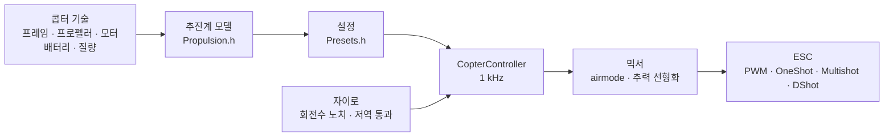

# COPTER.md — 멀티콥터용 펌웨어

같은 펌웨어, 같은 보드(Matek H743-WING V3, DevEBox H743, 그리고 Betaflight가 돌아가는 거의 모든 F405), 같은 센서와 수신기입니다. 다만 비행기 대신 쿼드콥터, 헥사, 옥토, Y6, X8을 날립니다. Betaflight, INAV, ArduPilot과 가장 큰 차이는 **PID, 필터, 아이들, 레이트를 손으로 조정하지 않는다**는 점입니다. 콥터의 구성(프레임, 프로펠러, 모터, 배터리, 질량)을 기술하면 펌웨어가 물리 모델로부터 설정을 스스로 도출하고, 모델이 부정확하게 추정한 부분은 비행 중에 스스로 맞춥니다.

> **솔직히 말씀드리면.** 콥터 펌웨어는 지금까지 시뮬레이터(6자유도 모델, 12개 구성 × 3가지 “틀린” 물리)와 보드용 빌드로만 확인했습니다. 아직 하늘을 날아 본 적이 없습니다. Betaflight나 ArduPilot보다 더 잘 난다고 말할 수 있는 것은 비행 시험 이후입니다. 그때까지 이것은 사실이 아니라 목표입니다.

## 동작 방식



1. **추진계 모델**(`copter/Propulsion.h`): 역기전력과 권선 저항을 가진 모터(KV와 스테이터 부피로부터), 프로펠러의 추력과 토크(지름, 피치, 날개 수로부터), 프로펠러를 포함한 로터의 관성. 6S의 5" 2207 1950KV라면 모델은 풀 스로틀에서 약 28 000 rpm, 약 1.6 kg 추력, 약 45 A를 냅니다 — 추력 테스트 벤치와 같은 값입니다.
2. **그로부터 도출되는 것**(`copter/Presets.h`): 호버링 스로틀, 아이들/호버링/풀 스로틀 회전수, 모터 지연 τ, 프레임 관성 모멘트, 추력 대 중량비, 전류.
3. **각속도 루프**는 주파수 응답으로 고릅니다. 모터, 필터, 노치, 루프와 ESC의 지연 — 모두 모델에 들어 있습니다. 교차 주파수는 위상 여유 50°(요 55°)와 **이득 여유 12 dB**를 만족하는 가장 높은 값입니다. 추력과 관성이 두 배 “틀린” 콥터에서도 버티는 설정입니다. D의 비율은 탐색으로 찾습니다 — 루프가 가장 넓어지는 값입니다. P, I, D와 피드포워드(FF)는 교차 주파수로부터 나옵니다.
4. **스로틀에 따른 이득 보정(TPA)** — 같은 모델에서 구합니다. 낮은 회전에서는 모터 반응이 무르고, 높은 회전에서는 강합니다. Betaflight 곡선도 있습니다(`tpa_mode = PD` 또는 `D`).
5. **비행 중**에는 펌웨어가 호버링 스로틀을 스스로 학습하고(더 무거운 배터리, 짐벌), 노치가 회전수를 따라가게 합니다.

## 구성 카탈로그

| 구성 | 프레임 | 프로펠러 · 모터 · 배터리 | 질량 | 추력/중량 | 호버링 | 루프 대역폭 |
|---|---|---|---|---|---|---|
| `whoop65` | Quad X 65 mm | 31 mm ×4 · 0702 23000KV · 1S | 22 g | 4.2 | 31% | 16 Hz |
| `whoop75` | Quad X 75 mm | 40 mm ×4 · 0802 19000KV · 1S | 32 g | 4.3 | 27% | 16 Hz |
| `toothpick25` | Quad X 115 mm | 2.5" · 1103 8000KV · 3S | 70 g | 12.1 | 8% | 14 Hz |
| `micro3` | Quad X 140 mm | 3" · 1404 4500KV · 4S | 190 g | 8.3 | 15% | 14 Hz |
| `cinewhoop3` | Quad X 150 mm | 3" 5엽 · 1504 3600KV · 4S | 330 g | 4.1 | 32% | 16 Hz |
| `freestyle5` | Quad X 225 mm | 5.1" · 2207 1950KV · 6S | 680 g | 9.0 | 15% | 13 Hz |
| `race5` | 스트레치 Quad X | 5.1" · 2306 2000KV · 6S | 560 g | 10.8 | 11% | 12 Hz |
| `longrange7` | Quad X 315 mm | 7" · 2806.5 1300KV · 6S | 1.0 kg | 7.0 | 20% | 11 Hz |
| `longrange7li` | Quad X 315 mm | 7" 2엽 · 2810 1300KV · 6S Li-ion 4000 | 1.05 kg | 7.5 | 23% | 12 Hz |
| `heavy10` | Quad X 450 mm | 10" · 3115 900KV · 6S | 2.2 kg | 6.6 | 25% | 10 Hz |
| `cinelifter8` | X8 380 mm | 8" · 2812 1100KV · 6S | 3.5 kg | 6.4 | 23% | 11 Hz |
| `hex13` | Hex X 700 mm | 13" · 3510 600KV · 6S | 4.0 kg | 3.7 | 35% | 8 Hz |
| `hex15` | Hex X 900 mm | 15" · 4114 400KV · 6S | 6.0 kg | 3.0 | 45% | 8 Hz |

프레임: Quad X, 스트레치 X, H, Deadcat, “+”, Hex X/+, Y6, Octo X/+, X8. 모터 번호는 Betaflight와 같습니다(쿼드: 1 — 오른쪽 뒤, 2 — 오른쪽 앞, 3 — 왼쪽 뒤, 4 — 왼쪽 앞). 프로펠러는 안쪽 회전이든 바깥쪽 회전이든 됩니다. 비행 스타일 — 실내, 프리스타일, 레이스, 촬영, 장거리, 운반: 레이트와 최대 기울기를 정합니다.

## 나만의 콥터

`include/config/CopterConfig.h`:

```cpp
#define COPTER_BUILD "freestyle5"     // 카탈로그에서 가장 가까운 구성
constexpr float MASS_G = 742;          // 배터리 포함 무게 — 가장 중요
constexpr float PROP_DIAMETER_IN = 5.1f, PROP_PITCH_IN = 3.6f;
constexpr float MOTOR_KV = 2150;       // 0 — 구성과 동일
constexpr copter::EscProtocol ESC_PROTOCOL = copter::EscProtocol::ONESHOT125;
```

구성은 플래그 `-D COPTER_BUILD=\"race5\"`로도 고를 수 있고, 다시 빌드하지 않고 CLI에서 `set copter_build = race5`, `set copter_mass_g = 742`, `save`로도 고를 수 있습니다(설정은 아래 참고. 이때 파일의 값은 기본값일 뿐입니다). 업로드 후 콘솔에서 `t`를 누르면 도출된 값이 나오고, 문제가 있으면 경고합니다: 추력 부족, 모터가 그 프로펠러를 돌리지 못함, 이웃 프로펠러가 닿음, 스로틀 60% 이상에서 호버링, 모터 회전이 루프 주파수의 절반보다 빠름. 모터 수가 다른 프레임은 재시작 후에 적용됩니다. 그때까지 ARM이 금지됩니다(`REBOOT_REQD`).

## 펌웨어 업로드와 첫 시동

```bash
pio run -e matek-h743-quad -t upload          # Matek H743-WING V3: BOOT 버튼 + USB
pio run -e stm32h743-devebox-quad -t upload   # DevEBox H743
pio run -e aocodarc-f405v3-quad -t upload     # Betaflight에서 온 F405 비행 컨트롤러 — 아래 참고
```

모터 출력 순서: Matek — S1…S8, DevEBox — PA0–PA3, PD14, PD15, PE9. **첫 시동은 프로펠러를 떼고**, 시리얼 모니터 115200으로:

| 키 | 동작 |
|---|---|
| `t` | 설정: 추력, 호버링, 회전수, 모터 τ, 필터, 루프 대역폭과 여유, P/I/D/FF, 레이트, 경고 |
| `m` | 모터 테스트: `y`로 확인을 받고(프로펠러 제거!), 모터마다 2 s씩 돌리며 위치와 돌아야 할 방향을 알려 줍니다 |
| `s` | 상태. Betaflight의 `status`처럼: 루프 부하, 주파수, 배터리, **왜 ARM이 안 되는지** — 원인마다 BF 코드(`RXLOSS`, `ANGLE`, `CLI`…)와 설명 |
| `o` | 세 가지 자세로 보드 장착 방향 보정(Matek에서는 ARM 전에 필수) |
| `c` | 컴퍼스 보정: 15 s 동안 콥터를 모든 축으로 돌립니다(컴퍼스 — GPS 모듈의 QMC5883L 또는 QMC5883P, 응답하는 쪽) |
| `i` · `r` · `l` · `D` | 자이로 · 조종기 채널 · 실시간 줄 · DFU 부트로더 |
| `#` | Betaflight 같은 CLI: `set`, `get`, `diff`, `aux`, `map`, `profile`, `save` — [아래](#설정-betaflight-같은-cli) |

엉뚱한 모터가 돌면 `CopterConfig::MOTOR_PINS`에서 순서를 바꿉니다. 방향이 반대면 ESC 설정 도구(BLHeliSuite, ESC-Configurator)에서 방향을 바꿉니다. 선을 다시 납땜하지 않습니다.

### Betaflight에서 온 F405 비행 컨트롤러

STM32F405 기반 쿼드 비행 컨트롤러(Betaflight, 8 MHz 크리스털)라면 ICM-42688-P와 SPL06 또는 DPS310 기압계가 있으면 거의 무엇이든 됩니다. 핀 배치는 Betaflight 자체에서 가져오므로, 타깃이 어느 저장소에도 없는 보드(GETFUN F405V3)도 동작합니다:

```bash
# 1. 보드에는 아직 Betaflight가 있음. Configurator는 닫아 둠. CLI 덤프를 파일로
#    (PlatformIO의 Python — pyserial 포함):
~/.platformio/penv/Scripts/python tools/bf_board.py read --port COM5 --out stack/MYBOARD_bf.txt
# 2. 순정 펌웨어 전체 — 필요하면 Betaflight로 되돌리기 위해
#    (보드를 DFU로: BOOT를 누른 채 USB 연결):
python tools/bf_board.py backup --out stack/MYBOARD_original.bin
# 3. 보드 헤더: 어느 핀에 무엇이 있는지(BF는 기압계 종류를 모름 — 제품 설명대로):
python tools/bf_board.py header stack/MYBOARD_bf.txt --baro SPL06 --out include/config/boards/MYBOARD.h
```

그다음 `platformio.ini`에 `aocodarc-f405v3-quad`처럼 env를 하나 만들고(기준 보드: 핀 배치가 공개되어 있고, F405 코어는 항상 이 보드로 빌드·테스트합니다), `-D OP_BOARD_FILE=\"config/boards/MYBOARD.h\"`를 붙입니다. 모터는 Betaflight 번호대로 M1…M8, 수신기·GPS·텔레메트리는 Betaflight가 쓰던 UART에, 모터마다 타이머는 Betaflight가 고른 것입니다(덤프의 `timer B06 AF2` 줄 -> `OPB_MOTOR_AF`: 한 핀에 타이머가 두세 개 있을 수 있고, BF는 그 보드에서 DMA 충돌이 없는 조합을 골랐습니다). 블랙박스 플래시도 버스와 CS째 덤프에서 가져옵니다. 이미 우리 펌웨어가 들어 있는 보드는 [github.com/betaflight/config](https://github.com/betaflight/config)의 `config.h`로 `bf_board.py header`를 만듭니다.

F405는 플래시 뱅크가 하나뿐입니다. 설정을 쓰는 동안 프로세서가 1–2 s 멈추므로 설정은 디스암 상태에서만 씁니다.

## 설정: Betaflight 같은 CLI

기술에서 도출된 값은 손으로 고칠 수 있습니다 — 다시 빌드하지 않고, 한 줄씩, Betaflight CLI처럼. 콘솔에서 `#`를 누르면 들어갑니다(디스암 상태에서만. CLI가 열려 있는 동안 ARM이 금지됩니다):

```text
# get p_roll                     ← 값, 범위, 기본값과 그 출처
# set p_roll = 50                ← Betaflight 단위로
# set tune_source = BETAFLIGHT   ← 모델 대신 BF 4.5 기본값
# profile 1                      ← PID 프로필 0–3(rateprofile — 레이트). 즉시, 동작 중에도
# diff                           ← 바뀐 것만, BF 형식으로
# save                           ← 플래시에 저장, 설정 재계산, 종료
```

- **손으로 정하지 않은 항목은 기본값이 되며, PID와 레이트의 기본값은 표의 숫자가 아니라 콥터 기술로 계산한 결과입니다**(`get`에 “콥터 모델에서”로 표시). 기술을 바꾸면 건드리지 않은 항목은 모두 따라 바뀌고, 손으로 정한 항목은 그대로 남습니다. 기본값과 같은 값을 넣으면 기본값으로 되돌리는 것과 같습니다.
- **단위는 Betaflight와 같습니다**: PID 항 = 숫자 × BF 계수 × 오차, 합 ÷ 1000이 믹서로 갑니다(P 0.032029, I 0.244381, 요에서는 추가로 ×2.5, D 0.000529, F 0.013754 × 0.01). `t`도 모델의 설정을 이 숫자로 보여 줍니다: 5"라면 P 25, I 41, D 28, F 35이고 BF 기본값은 45/80/40/120입니다 — 모델이 12 dB 이득 여유를 두기 때문에 더 부드럽습니다.
- **Betaflight의 diff를 통째로 붙여 넣을 수 있습니다**(4.5의 `diff all`): 아는 설정은 적용되고, `profile`/`rateprofile`은 전환되고, `map`, `aux`, `rxrange`, `vtx`, `rxfail`은 각자의 표로 들어가고, 주석은 무시되며, 모르는 설정에는 `###오류…###` 줄이 나옵니다. BF의 하드웨어 명령(`resource`, `timer`, `dma`, `serial`, `feature`, `board_name`…: 우리 쪽에서는 보드 헤더가 담당)은 `# 건너뜀` 주석과 함께 건너뛰고, diff의 `defaults nosave`는 콥터 기술을 건드리지 않습니다(BF에는 기술이 없으므로). `batch end`(또는 붙여 넣기 도중의 `save`)에서 요약이 나옵니다: `# 붙여 넣음: N줄 적용, M개 옮기지 않음: 이름…`. 그런 `save` 뒤 0.5초 동안은 붙여 넣기의 나머지를 콘솔 키 입력으로 취급하지 않습니다.
- `tune_source = BETAFLIGHT` — BF 4.5 기본값 전부: PID 45/80/40/120, 47/84/46/125, 45/80/0/120. 레이트 Actual 70/670/0. TPA는 D에만, 스로틀 1350부터 65%, 이륙 전 낮은 스로틀에서 −20%. `iterm_limit` 400. PID 합 500(요 400). anti-gravity 80, 5 Hz, P 100. `throttle_boost` 5. ANGLE은 1°당 5 °/s, 최대 60°. `yaw_lowpass_hz` 100. 필터 — 우리 체인으로 환산(자이로 PT2 250 Hz, D — PT1 60 Hz: 루프 대역폭에서 지연이 같음). 회전수 노치는 우리 것 그대로입니다.
- 플래시에는 손으로 정한 항목(과 고른 프로필)만 저장됩니다. 다시 업로드해도 지워지지 않고, `defaults`로 지워집니다. `save` 없이 `exit` — 취소.

| 명령 | 동작 |
|---|---|
| `set` · `set 이름 = 값` | 모든 설정 · 설정(`save` 후 적용) |
| `get 이름_일부` | 값, 범위, 기본값, 의미 |
| `diff [all]` · `dump [all]` | 바뀐 것 · 전부. `all` — 모든 프로필 |
| `profile [0-3]` · `rateprofile [0-3]` | PID 프로필 · 레이트 프로필 선택 |
| `aux` · `aux 번호 모드 채널 시작 끝 [논리 연동]` · `aux help` | 스위치 모드 표 · 한 줄 · 모드 번호 — [아래](#조종기와-모드) |
| `map [AETR1234]` · `rxrange [0-3 min max]` | 채널 순서 · 롤/피치/요/스로틀 스틱 끝점 |
| `rxfail` · `rxfail 채널 a\|h\|s [값]` | 링크가 없을 때 채널 처리, BF와 동일: 스틱 0–3 — `a`(페일세이프 자동 처리) 또는 `h`(마지막 값 유지), AUX 4–17 — `h` 또는 `s 750…2250`(고정값). 처음 0.3 s는 항상 마지막 유효값 |
| `vtx` · `vtx 번호 채널 밴드 VTX채널 출력 시작 끝` · `vtx_info` | 스위치로 영상 송신기 제어, BF와 동일 · 송신기의 응답과 출력 단계 — [아래](#영상-송신기) |
| `dshot_telemetry_info` | BF와 동일: 모터별 eRPM, rpm, Hz, 응답 없는 프레임 비율(`dshot_bidir`) |
| `flash_info` · `flash_erase` | 블랙박스 플래시(F405): 칩, 용량, JEDEC ID, 사용량과 비행 기록 · 전부 지우기(명령 하나, 최대 1분 대기, BF와 동일) |
| `save` · `defaults [nosave]` | 저장하고 재계산 · 모두 기본값으로 |
| `status` · `tasks` | 상태(`s`와 같음) · 루프 각 부분의 시간: 주파수, 평균과 최악, 프로세서 비율 |
| `version` · `help` · `exit` | 버전 · 목록 · 종료 |

### 설정 항목

| 설정 | 위치 | 범위 | 기본값 | 내용 |
|---|---|---|---|---|
| `tune_source` | 공통 | `MODEL`, `BETAFLIGHT` | `MODEL` | PID, 필터, TPA의 출처: 콥터 기술 또는 BF 4.5 기본값 |
| `profile_name` | PID 프로필 | 최대 8자 | — | PID 프로필 이름 |
| `p_roll` `i_roll` `d_roll` `f_roll` | PID 프로필 | P, I, D 0–250, F 0–1000 | 모델에서. BF: 45, 80, 40, 120 | 롤 PID(BF 단위) |
| `p_pitch` `i_pitch` `d_pitch` `f_pitch` | PID 프로필 | 위와 같음 | 모델에서. BF: 47, 84, 46, 125 | 피치 PID |
| `p_yaw` `i_yaw` `d_yaw` `f_yaw` | PID 프로필 | 위와 같음 | 모델에서. BF: 45, 80, 0, 120 | 요 PID |
| `d_max_roll` `d_max_pitch` `d_max_yaw` | PID 프로필 | 0–250 | 0(D 일정) | 급한 움직임에서의 D, BF 2025.12와 동일: 이때 `d_*`는 정지 시 D |
| `d_min_roll` `d_min_pitch` `d_min_yaw` | PID 프로필 | 0–250 | 0. BF: 30, 34, 0 | BF 4.5와 동일: 정지 시 D, `d_*` — 급한 움직임에서(`d_max_*`가 없을 때) |
| `d_max_gain`(`d_min_gain`) | PID 프로필 | 0–100 | 37 | 자이로 흔들림에 D가 얼마나 쉽게 오르는지: 37이면 약 5000 °/s²에서 완전히 |
| `d_max_advance`(`d_min_advance`) | PID 프로필 | 0–200 | 20 | 스틱 움직임에 D가 얼마나 일찍 오르는지: 20이면 목표값 약 2500 °/s²에서 완전히 |
| `iterm_relax` | PID 프로필 | `OFF`, `RP`, `RPY`, `RP_INC`, `RPY_INC` | `RPY`. BF: `RP` | 목표값이 급히 바뀌는 동안 I가 기다리는 축(플립 뒤 튀지 않음). `_INC` — 증가만 억제 |
| `iterm_relax_type` | PID 프로필 | `GYRO`, `SETPOINT` | `SETPOINT` | `SETPOINT` — I가 더 느리게 쌓임. `GYRO` — I가 평활한 목표값을 향하고, 아주 가까우면 0 |
| `iterm_relax_cutoff` | PID 프로필 | 1–50 Hz | 10. BF: 15 | relax용 목표값 평활: 낮을수록 오래 기다림 |
| `iterm_relax_error` | PID 프로필 | `OFF`, `ON` | `ON` | 우리 고유: 새 목표값으로 가속할 때(플립)의 큰 오차는 I에 쌓지 않음. 스틱 움직임 없는 오차(돌풍, 스로틀 펀치)는 쌓음 |
| `iterm_rotation` | PID 프로필 | `OFF`, `ON` | `OFF` | I를 프레임과 함께 회전: 피루엣에서 롤에 쌓인 것이 피치로 넘어감 |
| `iterm_windup` | PID 프로필 | 30–100% | 100(끔). BF: 85 | 모터 출력 차이가 클수록 I가 약하게 쌓이고, 끝까지 벌어지면 멈춤 |
| `iterm_limit` | PID 프로필 | 0–500 | 모델에서(300). BF: 400 | I 상한, 1000 — 모터 전체 스트로크 |
| `pidsum_limit` · `pidsum_limit_yaw` | PID 프로필 | 100–1000 | 1000. BF: 500 · 400 | 롤·피치 PID 합 상한 · 요(1000 — 전체 스트로크). 상한에서는 I가 쌓이지 않음 |
| `anti_gravity_gain` | PID 프로필 | 0–250 | 80 | 스로틀 펀치 때 I를 키워 기수가 숙여지지 않게 함: 풀 펀치(0.1 s에 전체 스트로크)에서 1 + gain/10배 |
| `anti_gravity_cutoff_hz` | PID 프로필 | 2–50 Hz | 5 | 스로틀 속도 평활: 낮을수록 피크는 낮고 길어짐 |
| `anti_gravity_p_gain` | PID 프로필 | 0–250% | 0. BF: 100 | 롤·피치 P도 키움: 100이면 풀 펀치에서 50% |
| `throttle_boost` · `throttle_boost_cutoff` | PID 프로필 | 0–100(×0.1) · 5–50 Hz | 0. BF: 5 · 15 | 스틱의 스로틀 펀치(스로틀에서 그 저역 통과를 뺀 것)를 1 + boost/10배로 키움 — 모터가 스틱을 더 빨리 따라잡음. ALT_HOLD에서는 안 함 |
| `tpa_mode` | PID 프로필 | `PD`, `D`, `MODEL` | `MODEL`. BF: `D` | 스로틀에 따른 PD 보정: `PD`/`D` — BF 곡선(아래 두 줄), `MODEL` — P와 D에 대한 모델 보정 |
| `tpa_rate` · `tpa_breakpoint` | PID 프로필 | 0–100% · 750–2250 µs | 65 · 1350 | `PD`/`D`: 이 점 위에서 PD(또는 D만)가 선형으로 약해지고, 풀 스로틀에서 `tpa_rate`만큼 |
| `tpa_low_rate` · `tpa_low_breakpoint` | PID 프로필 | −128…100% · 750–2250 µs | 0. BF: 20 · 1050 | 스로틀 0에서 PD(D)가 `tpa_low_rate`만큼 약함(0 미만 — 강함), 점까지 선형으로 |
| `tpa_low_always` | PID 프로필 | `OFF`, `ON` | `OFF` | `OFF` — ARM 뒤 스로틀이 `tpa_low_breakpoint`를 넘기 전(지상)까지만, `ON` — 항상 |
| `feedforward_transition` | PID 프로필 | 0–100% | 0 | 스틱 중앙에서 이보다 가까우면 피드포워드가 약함(0까지 선형) — 중앙이 부드러움 |
| `feedforward_averaging` | PID 프로필 | `OFF`, `2_POINT`, `3_POINT`, `4_POINT` | `OFF` | 피드포워드용 스틱 속도를 수신 프레임 2–4개로 평균: 프레임이 드물어도 고르지만 늦어짐 |
| `feedforward_smooth_factor` | PID 프로필 | 0–95% | 0. BF: 25 | 프레임 간 피드포워드 평활(프레임당 이전 값의 비율) |
| `feedforward_jitter_factor` | PID 프로필 | 0–20 | 0. BF: 7 | 한 프레임에 스틱이 이보다 적게 움직이면(500 — 스틱 절반) 피드포워드가 부드럽게 0까지 약해짐: 손가락 떨림이 모터를 흔들지 않음 |
| `feedforward_boost` | PID 프로필 | 0–50 | 0. BF: 15 | 스틱 가속도에 따른 추가(15 — 3 ms 앞섬, 스틱 속도 자체보다 크지 않음) |
| `feedforward_max_rate_limit` | PID 프로필 | 0–150% | 0. BF: 90 | 목표값이 최대 레이트의 이 비율에 이르면 바깥쪽 피드포워드는 남은 여유에 대해 P가 낼 만큼을 넘지 않고, 그 너머는 0: 풀 스틱 플립에서 오버슈트 없음 |
| `yaw_lowpass_hz` | PID 프로필 | 0–500 Hz | 모델에서(30–100). BF: 100 | 요 PID 출력의 저역 통과(0 — 필터 없음). 모델 PID는 모델 주파수로 계산 |
| `use_integrated_yaw` · `integrated_yaw_relax` | PID 프로필 | `OFF`, `ON` · 0–255 | `OFF` · 200 | PID 합의 적분으로 요 제어(×100 1/s, 누설 relax × 0.08 1/s) — 요가 프로펠러 회전을 바꾸는 큰 프로펠러용. BF 숫자는 BF처럼 동작(I에 ×2.5 없음. 5"에는 `d_yaw`가 필요, 없으면 진동). 손으로 정하지 않은 모델 요 PID는 루프가 같도록 재계산 |
| `abs_control_gain` | PID 프로필 | 0–20(°/s / °) | 0(끔) | ACRO: 돌풍이나 추력 불균형으로 잃은 각도와 방위를 되찾음. 롤·피치 — ACRO에서만, 요 — 모든 모드, 공중에서 |
| `abs_control_limit` · `abs_control_error_limit` · `abs_control_cutoff` | PID 프로필 | 10–255 °/s · 1–45° · 1–45 Hz | 90 · 20 · 11 | 보정 상한 · 누적 각도 오차 상한 · 목표값 저역 통과(빠른 스틱에서 프레임 지연을 쌓지 않음) |
| `thrust_linear` | PID 프로필 | 0–150% | 모델에서(15–30). BF: 0 | 추력 선형화: 낮은 스로틀도 높은 스로틀처럼 반응 |
| `motor_output_limit` | PID 프로필 | 1–100% | 100 | 아이들 위 모터 스트로크 비율: 4S용 모터에 6S 배터리 — 66 |
| `rateprofile_name` | 레이트 프로필 | 최대 8자 | — | 레이트 프로필 이름 |
| `roll_rc_rate` `pitch_rc_rate` `yaw_rc_rate` | 레이트 프로필 | 1–255(×10 °/s) | 비행 스타일에 따라. BF: 7 | 스틱 중앙의 레이트 |
| `roll_srate` `pitch_srate` `yaw_srate` | 레이트 프로필 | 0–255(×10 °/s) | 비행 스타일에 따라. BF: 67 | 풀 스틱 레이트 |
| `roll_expo` `pitch_expo` `yaw_expo` | 레이트 프로필 | 0–100% | 비행 스타일에 따라. BF: 0 | 엑스포: 중앙이 부드러움 |
| `serialrx_provider` | 공통 | `IBUS`, `SBUS`, `CRSF` | `Config.h`의 `RX_PROTOCOL` | 수신기 프로토콜. `save` 뒤 재시작 없이 바뀜 |
| `rx_min_usec` `rx_max_usec` | 공통 | 750–2250 µs | 885, 2115 | 이 범위 밖의 펄스는 채널 오류: 스틱이면 링크 끊김, AUX는 이전 값 유지 |
| `copter_build` | 공통 | 카탈로그의 구성 | `COPTER_BUILD` | 콥터 기술의 바탕 |
| `copter_mass_g` | 공통 | 0–30000 g(0 — 추정) | 구성에서 | 배터리 포함 이륙 질량 |
| `copter_wheelbase_mm` | 공통 | 30–2000 mm | 구성에서 | 대각 모터 축 사이 거리 |
| `prop_diameter_in` `prop_pitch_in` `prop_blades` | 공통 | 0.5–40", 0.3–30", 2–8 | 구성에서 | 프로펠러 |
| `motor_stator_mm` `motor_height_mm` `motor_kv` | 공통 | 3–120 mm, 0.5–60 mm, 50–80000 | 구성에서 | 모터: 2207 — 22와 7 |
| `battery_cells` `battery_mah` | 공통 | 1–14 S, 50–50000 mAh | 구성에서 | 배터리 |
| `props_out` | 공통 | `OFF`, `ON` | `PROPS_OUT` | 프로펠러 바깥쪽 회전: 모든 모터가 반대로 돎 |
| `battery_chemistry` | 공통 | `LIPO`, `LIHV`, `LIION` | 구성에서(LiPo) | 화학 종류: 셀 임계값과 추력 모델용 부하 전압(3.75 / 3.85 / 3.5 V) |
| `vbat_min_cell_voltage` `vbat_warning_cell_voltage` `vbat_max_cell_voltage` | 공통 | 100–500(×0.01 V) | 화학 종류에 따라: LiPo 330/350/430, LiHV 330/350/440, Li-ion 280/310/425 | 셀: 방전(CRITICAL) · 돌아올 때(WARNING. 정지 시 이보다 낮으면 ARM 안 됨) · 만충 |
| `vbat_full_cell_voltage` | 공통 | 100–500(×0.01 V) | 화학 종류에 따라: LiPo 410, LiHV 425, Li-ion 410 | 연결 시 셀이 이보다 높으면 배터리가 만충. 아니면 디스암 상태 OSD에 `BATT < FULL` |
| `vbat_scale` · `vbat_divider` · `vbat_multiplier` | 공통 | 0–255 · 1–255 · 1–255 | 보드의 분압(110 · 10 · 1 — 1:11. F405 — 보드 덤프에서) | 볼트 = 핀 mV × `vbat_scale` / (1000 × `vbat_divider` × `vbat_multiplier`), BF와 동일 |
| `battery_meter` | 공통 | `NONE`, `ADC`, `ESC` | 보드에 배터리 입력이 있으면 `ADC` | 전압의 출처(`ESC` — ESC 텔레메트리에서, 아직 동작 안 함) |
| `current_meter` · `ibata_scale` · `ibata_offset` | 공통 | `NONE`/`ADC`/`VIRTUAL`/`ESC`/`MSP` · ±16000(×0.1 mV/A) · ±32000 mV | 보드에 전류 입력이 있으면 `ADC`. 400(Matek — 250, F405 — 보드 덤프에서). 0 | 전류 센서: 전류, 소모 mAh, 잔량(`VIRTUAL`, `ESC`, `MSP`는 BF diff에서 받아들이지만 아직 전류를 내지 않음) |
| `vbat_detect_cell_voltage` | 공통 | 0–2000(×0.01 V) | 300 | 전압이 이 값과 만충 셀(1S) 사이이거나 이 값의 두 배보다 높으면 배터리 있음. 아니면 USB 전원 |
| `force_battery_cell_count` | 공통 | 0–24 S | 0 | 셀 수. 0 — 콥터 기술(`battery_cells`)에서. BF에서 0은 전압으로 추측한다는 뜻이지만 우리는 추측하지 않음: 방전된 6S Li-ion(17 V)과 만충 4S LiPo는 구별할 수 없음 |
| `bat_capacity` | 공통 | 0–20000 mAh | 0 | 잔량과 소모 알람용 용량. 0 — 기술의 `battery_mah` |
| `vbat_hysteresis` | 공통 | 0–250(×0.01 V) | 1 | 전압이 임계값보다 이만큼 더 낮으면 알람(배터리 전체 기준, BF와 동일). 임계값 위로 오르면 해제 |
| `vbat_duration_for_warning` · `vbat_duration_for_critical` | 공통 | 0–150(×0.1 s) | 20 · 20(BF: 0 · 0) | 임계값 아래가 이만큼 이어지면 WARNING · CRITICAL: 스로틀 펀치 때의 전압 강하는 알람이 아님 |
| `use_vbat_alerts` · `use_cbat_alerts` · `cbat_alert_percent` | 공통 | `OFF`/`ON` · `OFF`/`ON` · 0–100% | `ON` · `OFF` · 10 | 배터리 알람 소리와 표시 · mAh로도 알람(`cbat_alert_percent` 이하 남음 — WARNING, 0 — CRITICAL. 전류 센서 필요) |
| `vbat_cutoff_percent` | 공통 | 0–100% | 100(없음) | 첫 CRITICAL부터 10 s에 걸쳐 스틱 스로틀을 이 비율까지 부드럽게 제한(BF의 LVC). 고도 유지와 페일세이프 자동 처리는 제외 |
| `vbat_display_lpf_period` · `vbat_sag_lpf_period` · `ibat_lpf_period` | 공통 | 1–255(×0.1 s) | 30 · 2 · 10 | 평활(저역 통과 10/주기 Hz, BF와 동일): 표시와 알람 · 전압 강하 보상용 전압 · 전류 |
| `vtx_protocol` | 공통 | `AUTO`, `SMARTAUDIO`, `TRAMP`, `NONE` | 보드에 VTX 선이 있으면 `AUTO` | 영상 송신기 제어선 |
| `vtx_band` · `vtx_channel` · `vtx_freq` | 공통 | 0–10 · 1–8 · 0–6200 MHz | 5(R) · 1 · 0 | 밴드(1 A, 2 B, 3 E, 4 F, 5 R, 6 L, 7 X, 8 V, 9 G, 10 S. 0 — 주파수를 숫자로) |
| `vtx_power` | 공통 | 1–12 | 1 | 출력 단계, 1 — 최저. 표는 송신기에서(`vtx_info`) |
| `vtx_max_power_mw` | 공통 | 0–10000 mW | 0(없음) | **상한**: 스위치로도 송신기 버튼으로도 이보다 올리지 않음 |
| `vtx_low_power_disarm` | 공통 | `OFF`, `ON`, `UNTIL_FIRST_ARM` | `OFF` | 디스암 상태 — 최저 단계 |
| `gps_minimum_sats` | 공통 | 4–50 | 8 | 위성이 이 이상이면 ARM 때 홈을 기록 |
| `crsf_telemetry` | 공통 | `OFF`, `ON` | `ON` | CRSF로 조종기에 텔레메트리 |
| `blackbox_device` | 공통 | `NONE`, `SPIFLASH`, `SDCARD`, `SERIAL` | F405는 `SPIFLASH`, H743은 `SDCARD` | 블랙박스 기록 위치. 이 보드의 매체를 고른 경우에만 기록(`SERIAL`은 BF diff에서 받아들이지만 기록하지 않음) |
| `blackbox_mode` | 공통 | `NORMAL`, `MOTOR_TEST`, `ALWAYS` | `NORMAL` | 언제 기록: ARM 중, 모터가 도는 동안, 항상 |
| `blackbox_sample_rate` | 공통 | `1/1` … `1/32` | `1/1`(플래시 있는 F405 — `1/2`) | 자이로, PID, 모터 — 몇 루프에 한 번 |
| `motor_poles` | 공통 | 4–255 | 14 | 로터 자석 수: rpm = eRPM × 2 / `motor_poles` |
| `dshot_bidir` | 공통 | `OFF`, `ON` | `OFF` | 양방향 DShot: ESC가 회전수를 돌려줌. 재시작 후 바뀜(그때까지 ARM 금지, `REBOOT_REQD`). 켜면 루프 상한이 낮아짐 — 프레임, 30 µs, 응답: DShot600 — 11.8 kHz까지, 300 — 7.2, 150 — 4.0 |
| `small_angle` | 공통 | 0–180° | 25 | 이보다 기울어져 놓여 있으면 ARM 안 됨. 180 — 검사 없음 |
| `auto_disarm_delay` | 공통 | 0–60 s | 5 | ARM 상태로 지상에서 스로틀을 내린 채 이만큼 지나면 DISARM(BF에서는 스틱 ARM일 때만. 우리는 스위치도). 0 — 안 함 |
| `runaway_takeoff_prevention` | 공통 | `OFF`, `ON` | `ON` | ARM 뒤 제어기가 한계에 붙어 있고 콥터가 돌고 있음 — DISARM |
| `runaway_takeoff_deactivate_delay` | 공통 | 100–1000 ms | 500 | 이만큼 차분히 날면 다음 ARM까지 runaway 검사를 끔 |
| `runaway_takeoff_deactivate_throttle_percent` | 공통 | 0–100% | 20 | 비행으로 치는 스로틀(또는 콥터가 이미 1 m 넘게 상승) |
| `failsafe_delay` | 공통 | 1–200(×0.1 s) | 15 | 링크가 이만큼 없으면 2단계. 그 전까지 1단계: 수평을 잡고 고도 유지(BF에서는 스틱 중앙, 스로틀 0) |
| `failsafe_procedure` | 공통 | `AUTO-LAND`, `DROP`, `GPS-RESCUE` | `AUTO-LAND`(BF: `DROP`) | 2단계: 수평 잡고 하강 · 모터 정지 · 귀환(지금은 GPS 없이 — AUTO-LAND와 같음, 스틱으로 조종을 되찾음) |
| `failsafe_landing_time` | 공통 | 1–250 s | 120(BF: 60) | AUTO-LAND가 이 시간 안에 착륙하지 못하면 DISARM. 우리 하강은 고도를 따르고 접지로 끝나므로 여유분 |
| `failsafe_throttle` | 공통 | 1000–2000 µs | 1000 | AUTO-LAND: 1000 — 고도를 따라 0.7 m/s 하강. 그 이상 — 고정 스로틀, BF와 동일 |
| `failsafe_throttle_low_delay` | 공통 | 0–300(×0.1 s) | 100 | 링크가 끊기기 전 스로틀이 이보다 오래 내려가 있었으면 즉시 DISARM(분명히 지상). 0 — 안 함 |
| `failsafe_recovery_delay` | 공통 | 1–200(×0.1 s) | 5 | 링크가 이만큼 유지되면 조종이 파일럿에게 돌아가고(2단계), 페일세이프로 DISARM된 뒤에도 다시 ARM 가능 |
| `failsafe_stick_threshold` | 공통 | 0–50% | 30 | GPS-RESCUE: 링크가 돌아온 뒤 스틱을 이보다 더 움직이면 조종이 파일럿에게 |
| `failsafe_switch_mode` | 공통 | `STAGE1`, `KILL`, `STAGE2` | `STAGE1` | 스위치로 켠 FAILSAFE 모드: 링크 끊김과 같음 · 즉시 모터 정지(1 s 뒤 ARM 가능) · 바로 2단계 |
| `craft_name` | 공통 | 최대 16자 | — | 콥터 이름: BF 컨피규레이터(`MSP_NAME`)와 로그 |
| `vbat_sag_compensation` | PID 프로필 | 0–150% | 100(BF: 0) | 전압 강하에 대한 모터 보정: 100 — 배터리가 처져도 만충 때처럼 반응, 0 — 보정 없음 |

콥터 기술(`copter_build` … `props_out`): 기본값은 카탈로그의 구성에 `CopterConfig.h`의 “나만의 콥터” 수정을 더한 것입니다. 구성을 바꾸면 질량, 프로펠러, 모터, 배터리의 기본값은 새 구성에서 오고, 손으로 정한 값은 그대로 남습니다. PID와 필터는 `save` 때 새 기술로 다시 계산됩니다.

레이트 곡선은 아직 우리 것입니다: 중앙은 `rc_rate`, 풀 스틱은 `srate`, 엑스포가 중앙을 부드럽게 합니다. 엑스포 0이면 Betaflight의 Actual과 같습니다. 13"/15" 헥사에서는 모델이 250 넘는 D와 1000 넘는 F를 요구합니다 — `get`은 상한에서 자른 기본값을 보여 주지만, 실제로는 모델의 정확한 값을 씁니다.

## 조종기와 모드

기본은 모드 2: CH1 롤, CH2 피치, CH3 스로틀, CH4 요. **ARM** — SwA(CH5), 비행기와 같습니다. **모드** — SwC(CH7):

| SwC | 모드 | 스틱의 역할 |
|---|---|---|
| 위 | ANGLE | 기울기(스타일 한도까지). 놓으면 콥터가 수평으로 돌아옴. 요 — 수직축 둘레 |
| 가운데 | ALT_HOLD | ANGLE + 고도: 스로틀 중앙 — 호버링, 위/아래 — 상승 최대 3 m/s, 하강 최대 2 m/s |
| 아래 | ACRO | 레이트 곡선에 따른 각속도. airmode — 스로틀 0에서도 조종 가능 |

이 모두는 Betaflight처럼 CLI에서 바꿀 수 있습니다:

- `map TAER1234` — 채널 순서: 채널마다 글자 하나(A — 롤, E — 피치, T — 스로틀, R — 요, 1–4 — AUX1–AUX4). 스로틀 페일세이프 임계값(`RX_FAILSAFE_THROTTLE_US`)은 스로틀을 따라갑니다.
- `rxrange 3 1050 1950` — 스로틀 스틱 끝점을 1000–2000으로 늘림(0 — 롤, 1 — 피치, 2 — 요, 3 — 스로틀).
- `aux 0 0 1 1700 2100 0 0` — 채널이 범위 안에 있는 동안 모드 활성: 줄 번호 0–19, 모드(BF 번호), 채널(0 — AUX1, 즉 `map AETR1234`에서는 CH5), 시작과 끝(µs, 25 단위), 논리(0 — 그 모드의 줄 하나면 충분, 1 — 모두 필요), 연동(다른 모드와 함께 켜짐). 인수 없는 `aux` — 표, `aux help` — 모드 번호.

| 모드 | BF 번호 | 역할 |
|---|---|---|
| ARM | 0 | 모터 시동 |
| ANGLE · HORIZON · ALTHOLD | 1 · 2 · 3 | 비행 모드. 여러 개면 ALTHOLD, 그다음 ANGLE, 그다음 HORIZON. 없으면 ACRO |
| FAILSAFE | 27 | 링크 끊김과 같음(지상에서 페일세이프 점검) |
| AIR MODE | 28 | `CopterConfig.h`에서 `AIRMODE`를 꺼도 airmode |
| PREARM | 36 | 표에 있으면 PREARM이 켜져 있을 때만 ARM |
| USER1 … USER4 | 40 … 43 | 보드의 PINIO 핀(GETFUN F405V3: USER1 — 카메라 CAM1/CAM2, USER2 — 12 V 전원) |
| VTX PIT MODE · VTX CONTROL DISABLE | 39 · 48 | 영상 송신기를 PIT로 · 송신기를 건드리지 않음 |

**표가 비어 있으면(`defaults` 뒤처럼) `CopterConfig.h`의 스위치가 동작합니다**(`aux`는 이것을 복사용 줄로 보여 줍니다). 한 줄이라도 있으면 표만 동작합니다. BF와 같아서, 붙여 넣은 Betaflight diff가 표 전체를 기술하고 펌웨어 기본값은 섞이지 않습니다. 표에 ARM이 없으면 콥터는 ARM되지 않습니다(`NO_ARM_AUX`). 우리에게 아직 없는 BF 모드(BEEPER, GPS RESCUE…)는 받아서 저장하지만 아무것도 하지 않습니다 — `aux`가 그렇게 알려 줍니다.

## 영상 송신기

제어선이 있는 아날로그 송신기(SmartAudio 또는 Tramp — `vtx_protocol = AUTO`가 알아서 찾습니다)는 펌웨어가 설정의 주파수와 출력으로 유지합니다:

```text
# set vtx_band = 5            ← R
# set vtx_channel = 1         ← R1, 5658 MHz
# set vtx_max_power_mw = 400  ← “도심” 상한
# vtx 0 2 0 0 2 900 1300      ← AUX3(SwC) 위 — 단계 2
# vtx 1 2 0 0 6 1700 2100     ← AUX3 아래 — 단계 6(단, 상한을 넘지 않음)
# vtx_info                    ← 송신기의 응답, 출력 단계
# save
```

- **상한 `vtx_max_power_mw`**가 가장 중요합니다: 스위치의 `vtx` 줄도 `vtx_power`도 이를 넘지 못하며, 송신기 자체 버튼으로 출력을 올려도 펌웨어가 1초 안에 다시 내립니다. 상한을 없애려면 `set vtx_max_power_mw = 0`.
- **조종기로 출력 조절** — `vtx` 줄, Betaflight와 같습니다: AUX가 범위 안에 있는 동안 송신기는 그 밴드, 채널, 단계가 됩니다(0 — 바꾸지 않음). 스위치, 노브, EdgeTX의 논리 채널 — 무엇이든 됩니다.
- 출력 단계 표는 송신기 자신에게서 옵니다: SmartAudio 2.1은 단계를 dBm으로 알리고(36 dBm — “4 W”), Tramp는 상한을 mW로 알립니다. SmartAudio 1.0/2.0은 25/200/500/800 mW 단계로, TBS Unify와 같습니다.
- 주파수 — 80채널 4.9–6.1 GHz 송신기의 표: A, B, E, F, R, L(판매처 표기로는 D), X, V, G, S. **아날로그 고글(Cobra X V4)은 A, B, E, F, R, L만 받습니다** — X/V/G/S에서는 화면이 나오지 않습니다.
- VTX PIT MODE 모드 — PIT(지상에서 남을 방해하지 않음), GETFUN의 USER2 — 송신기 전체의 12 V 전원. 송신기가 응답하지 않으면 `status`에 “VTX: 응답 없음”이 나옵니다. 그때는 송신기 버튼으로 주파수와 출력을 맞춥니다.

## OSD와 부저

**OSD** — 비행 컨트롤러의 AT7456E/MAX7456 칩(Betaflight에서 온 보드는 그 버스와 CS를 보드 덤프에서 가져옴). 카메라 영상은 항상 칩을 지나고, OSD가 그 위에 겹칩니다: 링크(LQ), 모드, 위성 수, VTX 출력, 조준점, 홈 방향 화살표와 거리, 고도, 전압(과 셀당 전압), 전류, mAh, 비행 시간, 그리고 가운데 **주요 경고 하나**: FAILSAFE, RXLOSS, BATT CRITICAL, LOW BATTERY, 디스암 상태에서는 — 왜 ARM이 안 되는지(BF 코드, 예: THROTTLE) 또는 DISARMED. 글꼴은 칩의 것(Betaflight 보드에서는 BF 글꼴)이라 글자는 라틴 문자입니다. PAL/NTSC는 카메라에 맞춰 자동. OSD DISABLE 모드는 모두 숨깁니다.

**부저**: ARM — 길게, DISARM — 짧게 두 번, 전원을 켠 뒤 ARM할 수 있게 되면 — 짧게. 배터리 WARNING — 2 s마다 짧게 한 번, CRITICAL — 자주. 페일세이프 — 경보. BEEPER 모드 — “기체 찾기”(링크가 없어도 — AUX가 마지막 값을 유지), BEEPER MUTE — 무음(찾기 소리는 예외).

## GPS, 컴퍼스, 조종기로의 텔레메트리

- **GPS**(u-blox M10) — Betaflight가 쓰던 UART에. `status`에는 측위 상태, 위성 수, 정확도, 속도, **홈**이 나옵니다: ARM 때 3D 측위이고 위성이 `gps_minimum_sats` 이상이면 기록. 아니면 첫 좋은 측위 때, 이미 비행 중이어도 기록(“비행 중에 기록”). 홈까지 거리와 방향 — `status`, `@live`, 조종기에 표시. GPS 모드(귀환, 위치 유지)는 **아직 없습니다**.
- **컴퍼스**는 GPS 모듈에 — QMC5883L 또는 QMC5883P, 펌웨어가 둘 다 시도합니다. 보정 — 콘솔에서 `c`. 기수 방위는 컴퍼스에서(보정되었으면), 3 m/s를 넘으면 GPS에서, 그 밖에는 전원을 켠 뒤의 자이로에서. 기울기 보정은 아직 없어서, 빠르게 날면 컴퍼스 방위가 십여 도 틀릴 수 있습니다.
- **CRSF 텔레메트리**(ELRS, Crossfire) — 채널이 오는 같은 UART로: 배터리(V, A, mAh, %), GPS, 자세, 모드(`ACRO`, `ANGL`, `HOR`, `ALTH`, `!FS!`. 디스암 상태 — “*” 붙음), 상승률. EdgeTX(RadioMaster TX12)에서는 모델의 텔레메트리 페이지에서 “센서 찾기”.

## 블랙박스

H743(Matek H743, DevEBox)에서 콥터는 비행을 SD 카드에 기록합니다 — 비행기와 같은 형식, 같은 파일 `BLACKBOX.BIN`입니다(카드 준비 — [BLACKBOX.md](BLACKBOX.md#sd-카드stm32h743)). F405에서는 보드의 SPI 플래시에 기록합니다(`blackbox_device = SPIFLASH`, BF와 동일): W25Q128, W25Q64, M25P16, GD25Q 등은 JEDEC ID로 알아봅니다(16 MB까지). 형식도 내려받기도 같습니다. 플래시의 절반은 늘 지워 둔 상태로 두고(16 MB, `1/2`에서 약 8분 비행), 오래된 비행은 지상에서 통째로, 가장 오래된 것부터 지웁니다 — BF처럼 “가득 참 — 기록 중지”가 되지 않습니다. 기록 큐는 F405의 CCM RAM(60 KB)에 두고, OSD와 같은 버스의 플래시는 OSD와 뮤텍스를 공유하며, 자이로 버스의 플래시는 쓰지 않습니다. CLI의 `flash_info`와 `flash_erase` — BF와 같습니다.

| 레코드 | 빈도 | 내용 |
|---|---|---|
| `QGYRO` | 매 루프(`blackbox_sample_rate`) | 필터 전후 자이로, 목표값, 루프 처리 시간 |
| `QCTRL` | 같은 시각 | 축별 P, I, D, F(모터 스트로크 대비 비율), 모터 1–4, 믹서 스로틀 |
| `QMOT8` | 같은 시각, 모터가 4개보다 많을 때 | 모터 5–8 |
| `QSTATE` | 50 Hz | 각도, 고도와 목표, 상승률, 스틱, 호버링 스로틀, 배터리(V, A, mAh), 회전수, LQ, 모드, 플래그, ARM 금지 사유 |
| `GPS`, `SYS` | 새 해, 1 Hz | 비행기와 같음 |
| `EVENT` | — | ARM/DISARM, 모드, FAILSAFE, 추락, 링크, 배터리, 프로필, “ARM 거부: BF 코드”, GPS와 홈, 모터 테스트, 큐 손실 |

비행 시작 부분에는 — 구성, 프레임, BF 단위 PID, 레이트, 필터, CLI에서 정한 모든 항목(`set.<이름>=<값>`, `diff`와 같음).

언제 기록하는지 — `blackbox_mode`, Betaflight와 같습니다: `NORMAL` — ARM 동안(2 s 전부터 2 s 후까지), `MOTOR_TEST` — 모터가 도는 동안(벤치의 모터 테스트 포함), `ALWAYS` — 전원을 켤 때부터. `blackbox_device = NONE` — 기록 안 함. 1 kHz에서 데이터량은 약 70 KB/s: 카드에는 512바이트 블록으로 쓰며, 256 MB 파일이면 약 한 시간입니다. 로그에 “큐 가득 참”이 나오면 — `blackbox_sample_rate = 1/2`.

보려면 — **OpenPlane Studio의 “블랙박스” 섹션**: USB로 보드의 비행(“내려받기” 버튼, 파일은 프로젝트 폴더로), 저장된 로그, 또는 카드의 `BLACKBOX.BIN`을 직접. 모드와 이벤트가 있는 타임라인, 목표값과 자이로(필터 전후), 축별 PID, 모터, 스로틀, 고도, 배터리 그래프 — 공통 커서, 휠 확대, 재생. 보이는 구간의 자이로 노이즈 스펙트럼과 모터 회전수 표시, 커서 위치의 콥터 3D. 앱 없이 — `python tools/blackbox.py download`와 `decode`(레코드 종류마다 CSV 하나). 콘솔: `k` — 상태와 비행 기록.

**Betaflight 형식**(`.BFL` — Blackbox Explorer, PIDtoolbox): `python tools/blackbox.py download --bfl` — 보드가 직접 비행을 변환하고(`bb bfl N`, `telemetry/BflEncoder.h`) 완성된 파일을 내줍니다. 기록 루프마다 프레임 하나: `axisP/I/D/F`(모터 스트로크의 1/1000, BF와 동일), `rcCommand`, `setpoint`, `gyroADC`와 `gyroUnfilt`(°/s), `motor`(48–2047), `vbatLatest`, `amperageLatest`. 모드와 페일세이프 — S 프레임에. 헤더는 `Betaflight 4.5.0 (OpenPlane …)`로 자신을 소개합니다 — 그러지 않으면 Explorer가 필드를 어떻게 읽을지 모릅니다. 파일 크기는 우리 로그의 약 절반입니다.

시뮬레이터에서 확인: 플립, 피루엣, 스로틀 펀치가 있는 비행이 통째로 기록됩니다(`test/native/test_copter_blackbox`. `OPENPLANE_COPTER_BLACKBOX_DUMP=파일`은 Studio용 로그를 저장, `OPENPLANE_COPTER_BFL_DUMP=파일.bfl`은 같은 비행을 Blackbox Explorer용으로). 카드가 있는 펌웨어 — `test_app_stm32_copter_blackbox`, 플래시가 있는 F405 — `test_app_stm32_f405_copter_blackbox`(W25Q128 에뮬레이터). `.BFL`이 Blackbox Explorer 자체에서 열리는지는 사용자가 확인합니다: 형식은 사양에 비춰 검사하고, 우리 파서는 파일 자신의 헤더대로 읽습니다.

## Betaflight 컨피규레이터(MSP)

Betaflight 컨피규레이터는 같은 USB 콘솔로 콥터에 연결됩니다: MSP 프레임(`$M<…` v1과 `$X<…` v2, `telemetry/Msp.h`)이 키 입력, 앱의 줄과 섞여 들어옵니다. 콥터는 **Betaflight 4.5**로 자신을 소개합니다(FC_VARIANT `BTFL`, MSP API 1.46, FC_VERSION 4.5.0) — 컨피규레이터는 이를 보고 어떤 탭을 보일지 정합니다. BOARD_INFO와 BUILD_INFO는 솔직하게 `OpenPlane`, 보드 이름, 커밋을 알립니다(`telemetry/CopterMsp.h`).

| 무엇 | 메시지 | 우리 쪽 처리 |
|---|---|---|
| 연결과 보드 | `API_VERSION`, `FC_VARIANT`, `FC_VERSION`, `BOARD_INFO`, `BUILD_INFO`, `UID`, `NAME`/`SET_NAME` | 이름은 `craft_name` |
| 실시간 데이터 | `STATUS`, `STATUS_EX`, `RAW_IMU`, `ATTITUDE`, `ALTITUDE`, `ANALOG`, `BATTERY_STATE`, `RC`, `MOTOR`, `BOXNAMES`, `BOXIDS` | ARM 금지 사유 — BF 번호로(`status`), 모드 — 우리 표 |
| PID, 레이트 | `PID`, `RC_TUNING`, `PID_ADVANCED`와 `SET_*` | 레지스트리에, BF 단위로. 레이트 종류는 `ACTUAL`(우리 곡선), LEVEL과 MAG — BF 기본값 그대로 |
| 필터 | `FILTER_CONFIG`, `SET_FILTER_CONFIG` | 모델의 필터를 보여 줌. 쓸 수 있는 것은 `yaw_lowpass_hz`뿐 |
| 모드, 수신기 | `MODE_RANGES`, `SET_MODE_RANGE`, `RX_CONFIG`, `RX_MAP`, `RXFAIL_CONFIG`와 `SET_*` | `aux`, `map`, `rxfail` 표, `serialrx_provider`, `rx_min/max_usec` |
| 모터, 안전, 배터리 | `MOTOR_CONFIG`, `ADVANCED_CONFIG`, `FAILSAFE_CONFIG`, `ARMING_CONFIG`, `BATTERY_CONFIG`, `MIXER_CONFIG`, `FEATURE_CONFIG`와 `SET_*` | `motor_poles`, `dshot_bidir`, `failsafe_*`, `small_angle`, `auto_disarm_delay`, `vbat_*`. ESC 프로토콜 — 빌드로 정해짐, features — 표시만 |
| 프로필, 저장, 재시작 | `SELECT_SETTING`, `EEPROM_WRITE`, `REBOOT`(0 — 보드, 1 — DFU), `SET_ARMING_DISABLED` | CLI의 `save`와 같음 |

쓰기(`SET_*`)는 메모리의 설정을 바꾸고, `EEPROM_WRITE`가 저장하고 적용합니다. 그때까지 ARM이 금지됩니다(`MSP` 플래그). 컨피규레이터가 `SET_ARMING_DISABLED`를 유지하며 보드를 조회하는 동안도 마찬가지입니다(3 s 동안 조용하면 플래그 해제). ARM 상태에서는 설정이 바뀌지 않습니다(응답 `!`). 컨피규레이터에서의 모터 테스트(`SET_MOTOR`)는 아직 없습니다 — 콘솔의 `m`을 씁니다. 컨피규레이터가 이 모두를 어떻게 보여 주는지는 계획 160번(벤치)에서 확인합니다.

## 앱과의 연결

PC에서 오는 명령은 비행기와 같습니다: STX 바이트(0x02), 한 줄, 줄바꿈. 응답은 한 줄의 `@이름 {JSON}`(`telemetry/CopterLink.h`):

| 명령 | 응답 |
|---|---|
| `id` | `@id`: 펌웨어, 보드, 커밋, 구성, 앱 여권(해시와 모델 이름), 수신기 프로토콜 |
| `params` | `@params`(개수, 프로필, 구성), 설정마다 `@param` — 이름, 형식, 그룹(= 탭), 범위, 기본값과 그 출처, 단위, 설명, 값, 프로필 설정은 네 개 모두. `@rc` — `map`, `rxrange`, `aux` 표와 펌웨어 스위치. `@modes` — BF 모드 |
| `set 이름 값` | `@set`: ok 또는 오류와 새 값 |
| `profile N` · `rateprofile N` | `@profile` |
| `aux …` · `map …` · `rxrange …` · `vtx …` · `rxfail …` | `@rc`(바뀐 `rxfail`도 포함: `[채널, "a/h/s", µs]`) |
| `calibrate vbat V` · `calibrate ibat A` | 멀티미터 값으로: 새 `vbat_scale` · `ibata_scale`, 응답은 `set`과 같음(남기려면 — `save`) |
| `save` · `revert` | `@save`(플래시에 저장하고 동작에 반영) · `@revert`(저장 안 한 것 버림) |
| `live` · `live 0` | `@live`를 초당 20번, 3 s 더: ARM, 모드, 링크, 채널, 각도, 고도, 스로틀, 모터, 배터리, ARM 금지 사유, 켜진 모드, 부하 · 그만 |

디스암 상태이고 CLI가 닫혀 있을 때만 바꿀 수 있습니다. 앱에서 바꾼 것을 저장도 취소도 하지 않은 동안은 ARM이 금지됩니다(`MSP`, BF 컨피규레이터가 연결됐을 때와 같음).

**OpenPlane Studio**는 콥터를 비행기 옆 격납고에 둡니다: 펌웨어 빌드(`platformio.ini`의 env 하나)와 부품. 업로드는 같은 버튼으로: 빌드, 보드를 DFU로, 쓰기, 여권 확인 — 앱이 `config/Project.h`에 쓰는 것은 이름과 해시뿐이고(`opconfig.py apply`, `"vehicle": "copter"` 포함), 콥터 설정은 보드에 남습니다. 보드 헤더가 임시 파일인 동안(펌웨어 기술의 `needsBoardDump`)에는 버튼 대신 `tools/bf_board.py`의 명령 세 개를 보여 줍니다. 첫 설정 — CRSF 수신기, 출력 상한이 있는 영상 송신기, ARM·모드·부저·영상 출력 스위치 — 은 앱이 위의 명령과 `save`로 보드에 씁니다.

## 보호 기능

- **ARM** 조건: 링크가 있음, 스로틀이 아래, 콥터가 수평으로 놓여 있고(`small_angle`, 25°까지) 움직이지 않음, 자이로가 응답함, 자세가 정해짐, 배터리가 비지 않음, 모터 테스트 중이 아님, 보드 장착이 보정됨(필요한 경우), CLI가 닫혀 있음, 앱의 설정이 저장됨, 루프가 제때 돎, 페일세이프 뒤 링크가 `failsafe_recovery_delay` 동안 유지됨. 너무 일찍 켠 ARM은 껐다가 다시 켜야 합니다. 사유마다 Betaflight 4.5의 ARM 금지 플래그입니다: 비트 번호가 같고(0–25, BF 컨피규레이터는 번호로 마스크를 읽음), `status`의 코드도 같습니다(`NOGYRO`, `FAILSAFE`, `RXLOSS`, `NOT_DISARMED`, `BOXFAILSAFE`, `RUNAWAY`, `CRASH`, `THROTTLE`, `ANGLE`, `NOPREARM`, `LOAD`, `CALIB`, `CLI`, `MSP`, `REBOOT_REQD`, `NO_ACC_CAL`, `ARMSWITCH`. `BOOTGRACE`, `CMS`, `BST`, `PARALYZE`, `GPS`, `RESC`, `RPMFILTER`, `DSHOT_BBANG`, `MOTOR_PROTO` — 그것을 세울 기능을 위해 예약). BF에 없는 우리 고유의 것은 비트 26부터: `MOVING`, `BATTERY`, `MOTOR_TEST`, `NO_ARM_AUX`, `CONFIG`. 모두 말로 된 설명도 있습니다.
- **ARM 스위치를 내리면 — 같은 루프에서 모터 정지**, 어느 모드에서든.
- **자동 디스암**: ARM 상태, 지상, 스로틀을 내린 채 `auto_disarm_delay`(5 s) — DISARM. 다시 ARM하려면 — 스위치를 껐다 켭니다(`NOT_DISARMED`).
- **Runaway takeoff**(`runaway_takeoff_prevention`): ARM 뒤 한 축의 PID 합이 모터 스트로크의 60%를 넘고 콥터가 그 축으로 15 °/s(요 — 50 °/s)보다 빠르게 도는 상태가 75 ms 이어지면 — DISARM(`RUNAWAY`): 모터 출력이 엉뚱함, 프로펠러를 거꾸로 끼움, 보드 방향이 틀림. 시뮬레이터에서 모터 두 개를 바꿔 끼운 5"는 46° 기운 뒤 0.26 s 만에 디스암됩니다. 콥터가 0.5초 차분히 날면(스로틀 20% 초과 또는 1 m보다 높음) 검사가 꺼집니다 — 이후 플립으로는 작동하지 않습니다.
- **링크 끊김**(또는 스위치로 켠 FAILSAFE 모드, `failsafe_switch_mode`): 0.3 s까지의 끊김 — 마지막 스틱 그대로, 아무것도 바뀌지 않습니다. 지상에서 그보다 길면(또는 스로틀이 `failsafe_throttle_low_delay`보다 오래 내려가 있었으면) — 즉시 DISARM. 공중에서는 `failsafe_delay`(1.5 s)까지 1단계 — 수평을 잡고 고도를 유지합니다(`rxfail … h`인 스틱 — 마지막 위치, 스로틀 `rxfail 3 h` — 고도 대신 마지막 스로틀, BF와 같음). 0.3 s 뒤 AUX 채널은 `rxfail` 값이 됩니다(`h` — 마지막 값, `s` — 고정값). 그다음 `failsafe_procedure`에 따라 2단계: `AUTO-LAND` — 수평을 잡고 0.7 m/s로 하강(기압계로, 없으면 가속도계로. `failsafe_throttle`이 1000보다 크면 고정 스로틀, BF와 같음), 접지 또는 `failsafe_landing_time` — DISARM. `DROP` — 모터 정지. `GPS-RESCUE` — 지금은 `AUTO-LAND`와 같음. 1단계에서 링크가 돌아오면 조종이 곧바로 파일럿에게, 2단계에서는 `failsafe_recovery_delay`(0.5 s) 뒤, `GPS-RESCUE`에서는 추가로 파일럿이 스틱을 `failsafe_stick_threshold`보다 더 움직일 때 돌아갑니다. FAILSAFE 스위치를 끄면 — 곧바로. 페일세이프가 끝나기 전까지 조종기 스틱은 효과가 없습니다. 페일세이프로 DISARM된 뒤에는 링크가 `failsafe_recovery_delay`(`KILL` 뒤에는 1 s) 동안 유지되고 ARM 스위치를 껐으면 ARM할 수 있습니다.
- **추락**: ANGLE/ALT_HOLD에서 기울기가 90°를 넘은 채 0.7 s 넘게, 또는 스틱이 요구한 것과 30° 넘게 다른 채 2 s 넘게(모터 고장, 옆으로 누움). 모든 모드에서 뒤집힌 채 1 s, 또는 요가 목표값에서 200 °/s 넘게 벗어난 채 1.5 s 넘게(모터 고장으로 콥터가 셋으로 기울기를 유지하며 팽이처럼 돎) — 모터 정지. 다시 ARM하려면 — 스위치를 끈 뒤에.
- **지상에서는 적분이 쌓이지 않습니다** — 이륙할 때 콥터가 튀거나 뒤집히지 않습니다.

## 내부 구성 — 요약

| 파일 | 내용 |
|---|---|
| `copter/Propulsion.h` | 모터와 프로펠러 모델 |
| `copter/Presets.h` | 구성 카탈로그, 설정 도출, 경고 |
| `copter/Frames.h` · `Mixer.h` | 프레임과 믹서(airmode, 요보다 롤/피치 우선, 추력 선형화) |
| `copter/RateController.h` | P, I(플립과 가속 시 relax, anti-gravity), 자이로 기반 D, FF, 합 상한 |
| `copter/Attitude.h` | 쿼터니언 자세. 충격, 회전 중, 자이로와 어긋날 때는 가속도계를 믿지 않음 |
| `copter/AltitudeHold.h` | 고도: 기압계 + 가속도계, 호버링 스로틀 학습 |
| `copter/GyroFilter.h` | 회전수 1×, 2×와 날개 통과 주파수의 노치 + 저역 통과 |
| `copter/CopterController.h` | 전체 통합: ARM, 모드, 페일세이프, 추락 |
| `copter/Params.h` | 설정 레지스트리: Betaflight의 이름·단위·기본값, 프로필, 콥터 기술, 플래시 |
| `copter/RcSetup.h` | 조종기: `map`, `rxrange`, 스위치 모드(`aux`) |
| `copter/Battery.h` | 배터리: 전압, 전류, mAh, 화학 종류(LiPo, LiHV, Li-ion)별 셀 임계값 |
| `copter/Vtx.h` · `hal/stm32/Stm32VtxPort.h` | 영상 송신기: SmartAudio 1/2/2.1과 Tramp, 주파수 표, 출력 상한 |
| `copter/GpsHome.h` · `copter/CrsfTelemetry.h` | GPS 기반 홈(거리, 방향) · 조종기로 보내는 텔레메트리 프레임 |
| `copter/Osd.h` · `hal/Max7456.h` | OSD 화면 · AT7456E/MAX7456 칩 |
| `copter/Beeper.h` | 언제 무엇을 울리는지 |
| `tools/bf_board.py` · `include/config/boards/` | Betaflight에서 온 보드: 보드 CLI 덤프, DFU로 순정 펌웨어 백업, 핀 배치 헤더 |
| `copter/CopterCli.h` | Betaflight 같은 CLI(`telemetry/CopterConsole.h` — 키 콘솔) |
| `telemetry/CopterLink.h` | 앱용 설정과 실시간 데이터 프로토콜 |
| `hal/stm32/Stm32MotorOutput.h` · `hal/stm32/Stm32Dshot.h` | ESC: 펄스(PWM, OneShot, Multishot) · 타이머와 DMA 기반 DShot, ESC 응답 |
| `telemetry/CopterBlackBox.h` · `hal/SpiNorFlash.h` · `telemetry/BflEncoder.h` | 블랙박스 · F405의 SPI 플래시 · Betaflight 형식(.BFL) |
| `telemetry/Msp.h` · `telemetry/CopterMsp.h` | MSP: v1/v2 프레임 · Betaflight 컨피규레이터에 대한 응답 |
| `src/stm32/main_copter.cpp` | STM32 진입점 |

## 어떻게 확인했는가

`test/native/test_copter_sim` — **진짜** `CopterController`와 6자유도 콥터 모델: 역기전력이 있는 모터, 전류에 따른 배터리 전압 강하, 프로펠러 반토크, 공기 저항, 돌풍이 있는 바람, ESC 지연, 노이즈와 모터 진동이 있는 자이로(루프 주파수의 절반을 넘는 진동은 보드에서처럼 접힘), 50 Hz 기압계, 지면. 카탈로그의 각 구성은 자기 설정으로 날고, 일부러 기술과 맞지 않게 만든 모델에서도 납니다:

- **“둔함”**: 프로펠러 추력 20% 적음, 모터와 프레임 관성 30% 큼, 20% 무거움, 무게중심이 앞쪽;
- **“예민함”**: 추력 +20%, 관성 −30%, 질량 −15%, 무게중심이 옆쪽 — 루프 이득이 계산값의 거의 두 배.

| 항목 | 36회 비행(12개 구성 × 3가지 물리) 결과 |
|---|---|
| ALT_HOLD 이륙과 호버링 | 고도 ±0.3 m, 기울기 < 1°, 호버링 스로틀 학습(“예민한” whoop — 계산값 0.31 대신 0.22) |
| ANGLE: 풀 스틱 | 0.14–0.35 s에 기울기 90%, 오버슈트 < 3%, 0.15–0.4 s에 3° 이내로 수평 복귀 |
| ACRO: 풀 스틱 | 0.04–0.15 s에 레이트 90%, 오버슈트 < 12% |
| 고도 10 m에서 링크 끊김 | 그 고도에서 1.5 s 호버링, 그다음 ≤ 0.94 m/s로 하강, 접지 — DISARM |
| 일반 이륙에서의 runaway takeoff | 작동하지 않음. 36회 모두 이륙 뒤 검사가 꺼짐 |

그리고 5"에서 따로: 스로틀 0에서 airmode, 요, 돌풍 있는 4.5 m/s 바람, 기압계 없는 페일세이프, 일반 PWM ESC, 링크 끊김과 복귀, 페일세이프 단계와 DROP / GPS-RESCUE 절차, FAILSAFE 스위치(STAGE2, KILL), 모터 선 바꿔 끼움(runaway takeoff), 뒤집혀 떨어짐, 모터 고장, 모터 테스트, 배터리 전압 강하. `test_copter` — 블록마다 따로(108개 테스트. 설정 레지스트리, BF 단위, 프로필, CLI와 BF diff 붙여 넣기, MSP, 배터리, DShot과 ESC 응답 포함), `native_stm32/test_app_stm32_copter` — Matek H743 모의 환경에서 펌웨어 전체: ARM 전 “정지” 펄스, 장착 보정, ARM 뒤 아이들, 스위치로 모드 전환, 지상에서 링크 끊김, 콘솔, CLI → `save` → 플래시 → “재시작”.

### 우리 루프에서의 Betaflight 기본값

`tune_source = BETAFLIGHT`, 1 kHz 루프, OneShot125, 공칭 물리: ALT_HOLD에서 4 s 호버링, ACRO에서 풀 스틱 — 모델 설정과 같은 측정입니다(`test_betaflight_defaults_on_our_loop`). BF 기본값은 DShot과 4–8 kHz 루프의 5"에 맞춰 고른 값입니다:

| 구성 | 호버링(흔들림) | ACRO: 레이트 90% · 오버슈트 |
|---|---|---|
| `whoop65` · `whoop75` | 됨(0.3 · 0.1 °/s) | 0.039 s · 6–8% |
| `toothpick25` · `micro3` · `cinewhoop3` | 됨(0.1 °/s) | 0.035–0.041 s · 1–4% |
| `freestyle5` · `race5` | 됨(0.1 °/s) | 0.041–0.043 s · 1% |
| `longrange7` · `longrange7li` · `heavy10` · `cinelifter8` | 됨(≤ 0.1 °/s) | 0.049–0.064 s · 1–7% |
| `hex13` · `hex15` | **안 됨: 약 95–150 °/s 진동** | 0.11–0.21 s, 레이트를 유지 못 함(오차 6–26%) |

움직임에 따라 오르는 D(`d_min` 30/34 → `d_*` 40/46), I-relax `RP` 15 Hz, `iterm_windup` 85%, PID 합 500/400, anti-gravity 80/5 Hz/100, `throttle_boost` 5, 낮은 스로틀 TPA, `feedforward_max_rate_limit` 90, `thrust_linear` 0 — BF 4.5와 같습니다. FF 상한 때문에 5"가 레이트 90%에 이르는 시간이 약 6 ms 늦어지지만(0.037 → 0.043 s), “예민한” 5"는 풀 스틱 플립에서 7.9%가 아니라 1.3%만 오버슈트합니다(`test_feedforward_max_rate_limit_on_a_full_stick_flip`). 추력 선형화가 없으면 헥사는 레이트를 더 못 지킵니다(`hex13` 오차 10% 대신 26%). BF 기본값에서는 헥사의 P와 D가 모자라 진동하며 호버링합니다. 예전에는 우리 오차 relax가 조금 눌러 줬지만(약 40 °/s), 이제는 스틱 움직임이 없을 때 I를 억제하지 않습니다.

**모델에서 움직임에 따라 오르는 D**(`d_max_*`, `test_d_max_keeps_hover_quiet`): 정지 시 D는 도출값보다 30% 낮고, 기동 중에는 예전과 같습니다. 호버링 중 모터 노이즈는 모든 구성에서 25–30% 낮아지고, 아크로는 예전과 같습니다. 모터 회전이 루프 주파수의 절반보다 빠른 whoop(`WARN_VIBRATION_ALIAS`) — 4 kHz 루프에서만: 1 kHz에서는 진동이 루프 대역에 들어와 D가 노이즈와 함께 오릅니다(`whoop65` 노이즈 +5%). **BF와 같은 I-relax**(`RP`, 15 Hz, `SETPOINT` 또는 `GYRO`)는 “둔한” 헥사에서 — 오버슈트 10–12%(`test_bf_iterm_relax_on_sluggish_hexa`).

**스로틀 펀치**(`test_anti_gravity_holds_the_nose_on_punch`): ACRO에서 호버링에서 풀 스로틀로. 무게중심이 가운데가 아니면 추력 불균형이 스로틀과 함께 커지고, I가 따라잡아야 합니다. 예전 우리 오차 relax는 이 오차(수십 °/s)를 목표값으로의 가속으로 착각해 I가 쌓이지 못하게 했고 — “둔한”과 “예민한” 5"는 기수가 44–83° 돌아갔습니다. 이제 relax는 최근 약 0.2 s의 스틱 움직임으로 설명되는 오차만 억제하고, 모델의 anti-gravity는 BF 4.3+와 같습니다(80, 5 Hz, P 없음): 3.1°와 2.4°(anti-gravity 없음 — 13°와 10°, 예전 방식 — 11°와 7°), 기술대로인 경우 — 0.05°. `throttle_boost` 5(BF와 같음)는 펀치 50 ms 뒤 상승 속도를 12% 높이고, 10이면 24%입니다. 풀 스로틀 — 어떤 `tpa_mode`에서도 진동 없음, 스로틀 0에서 `tpa_low_always`(−20%와 +50%) — 역시 없음.

`feedforward_*` 설정은 목표값 중 스틱에서 오는 부분에만 작용하고(ANGLE의 수평 보정은 예전처럼 피드포워드로 들어감), 수신 프레임을 셉니다(프레임이 없으면 250 Hz). BF 기본값(25 / 7 / 15)으로 250 Hz 프레임에서 20 ms에 스틱 절반을 넣으면: 레이트로의 상승은 같고, 오버슈트는 쓰지 않을 때 13.4% 대비 10.3%(“둔함” — 18.5 대 20.1, “예민함” — 8.7 대 9.0).

**Integrated yaw**(`test_integrated_yaw_on_big_hexa`): 큰 프로펠러에서는 요가 프로펠러 회전을 바꿉니다(시뮬레이터가 이를 반영). BF 숫자와 `use_integrated_yaw = ON`의 15" 헥사는 요 스틱 절반을 오차 1.3 °/s RMS, 오버슈트 3.9%로 유지합니다 — 적분 없이는 11.9 °/s와 14.7%. 모델 PID(재계산)로는 세 가지 물리 모두에서 레이트를 유지합니다(오차 0.9 °/s까지). 5"에서는 적분이 있고 `d_yaw`가 없는 BF 숫자가 진동합니다 — 큰 프로펠러용 기능으로, BF와 같습니다.

**Absolute control**(`test_absolute_control_holds_attitude_against_torque`): ACRO, 스틱 중앙, 2 s 동안 프레임에 토크를 가함 — 롤과 요 조종력의 5%. 이것이 없으면 5"는 롤 2–5°, 방위 16–49°를 잃고 되찾지 못합니다. `abs_control_gain = 10`이면 — 0.03°와 0.3° 미만.

13"/15" 프로펠러 헥사에는 BF 기본값이 부족합니다: 모델은 P 150–220, D 250(BF 단위)을 요구하는데 BF는 45와 40 — 콥터가 진동하며 호버링합니다. 이들에게는 `tune_source = MODEL`뿐입니다. 모델 설정(BF 단위, 롤):

| 구성 | P · I · D · F | 구성 | P · I · D · F |
|---|---|---|---|
| `whoop65` | 42 · 88 · 60 · 29 | `race5` | 20 · 31 · 23 · 30 |
| `toothpick25` | 19 · 36 · 31 · 16 | `longrange7` | 37 · 53 · 61 · 61 |
| `micro3` | 22 · 42 · 29 · 23 | `heavy10` | 58 · 77 · 74 · 107 |
| `cinewhoop3` | 40 · 83 · 56 · 36 | `cinelifter8` | 48 · 69 · 53 · 81 |
| `freestyle5` | 25 · 41 · 28 · 35 | `hex13` · `hex15` | 168–221 · 179–222 · 250+ · 304–508 |

시뮬레이터는 계산에서는 보이지 않던 실제 오류를 찾아 고치도록 도왔습니다: 믹서 사이클마다 노치가 튐. 루프 대역 근처에서 노치가 더하는 위상 지연. “둔한” 헥사가 가속할 때 적분 폭주(오버슈트 32%). 호버링 스로틀 플립 중 가속도계가 정확히 1 g를 보여 수평이 10° 틀어짐. 모터가 고장 난 콥터가 지상에서 제자리 회전.

## 아직 없는 것

- **DShot은 실제 하드웨어에서 확인하지 않았습니다**: 드라이버는 있습니다(`hal/stm32/Stm32Dshot.h`: 타이머 버스트 모드 + 업데이트 이벤트의 DMA 스트림 하나, 인터럽트 없음, F405와 H743. env에서 `-D COPTER_ESC_PROTOCOL=DSHOT600`으로 켬). 프레임, CRC, 비트 길이, 사용 중인 스트림 건너뛰기는 DMA 모의 환경에서 확인했습니다. 프로토콜이 따라갈 수 없을 만큼 빠른 루프(프레임과 같은 길이의 휴지: DShot150 — 4.7 kHz까지, 300 — 9.4, 600 — 18.8)는 ARM을 금지합니다. 타이머 최대 4개(M1–M8)를 `write` 한 번으로 시작합니다. 서로 다른 타이머의 DMA 스트림은 겹치지 않으며, 다른 드라이버는 DMA를 쓰지 않습니다.
- **ESC에서 오는 회전수(`dshot_bidir`) — 아직 응답을 읽지 않음**: bidir 프레임(반전된 라인과 CRC), 응답 디코딩(GCR, CRC, 주기 -> eRPM, 라인 샘플로부터), 오류 비율, `dshot_telemetry_info`는 완성해 기준 응답으로 확인했지만, 하드웨어에서 핀을 읽는 부분은 아직 없습니다(F405에서 포트를 읽을 수 있는 것은 DMA2뿐이고, 그 스트림은 TIM1/TIM8 소유 — BF는 이를 위해 별도 bitbang 드라이버를 둡니다). 이것은 벤치에서 합니다. 그때까지 텔레메트리 오류는 100%이지만 모터는 그대로 돕니다.
- **1 kHz보다 빠른 루프** — 모터 회전이 500 Hz를 넘는 whoop용(시뮬레이션에서 4 kHz가 확연히 낫습니다).
- 콥터용 MAVLink, OpenPlane Studio에서 PID 등 설정(지금은 — CLI). GPS 위치 유지, 귀환, 미션.
- 컴퍼스 기울기 보정과 축 선택(`align_mag`).
- 자체 OSD 배치(`osd_*_pos`)와 자체 글꼴.
- 비행 시험.
