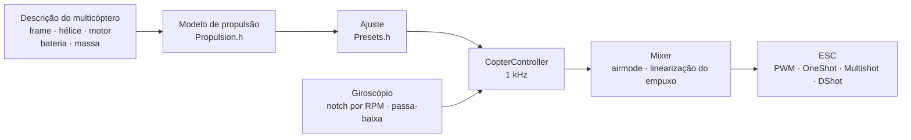

# COPTER.md — firmware para multicópteros

O mesmo firmware, as mesmas placas (Matek H743-WING V3, DevEBox H743 e quase
qualquer F405 que roda Betaflight), os mesmos sensores e receptores — mas em
vez de um avião, um quadricóptero, um hexa, um octo, um Y6 ou um X8. A
principal diferença em relação ao Betaflight, INAV e ArduPilot: **PID,
filtros, marcha lenta e rates não são ajustados à mão**. Você descreve o
multicóptero (frame, hélices, motores, bateria, massa), e o firmware deduz
sozinho o ajuste a partir de um modelo físico — e em voo se adapta ao que o
modelo estimou com pouca precisão.

> **Com franqueza.** Por enquanto o firmware de multicóptero só foi
> verificado em simulador (um modelo de 6 graus de liberdade,
> 12 configurações × 3 variantes de física «errada») e compilando para as
> placas. Ele ainda não voou. Dizer que voa melhor que Betaflight ou
> ArduPilot só será possível depois de testes de voo — até lá é uma meta,
> não um fato.

## Como funciona



1. **O modelo de propulsão** (`copter/Propulsion.h`): um motor com força
   contraeletromotriz e resistência do enrolamento (a partir do KV e do
   volume do estator), empuxo e torque da hélice (a partir do diâmetro, do
   passo e do número de pás), inércia do rotor com a hélice. Para um 5"
   2207 1950KV em 6S o modelo dá ~28 000 rpm, ~1,6 kg de empuxo e ~45 A com
   acelerador total — como nas bancadas de teste.
2. **O que decorre dele** (`copter/Presets.h`): acelerador de pairar, rotação
   em marcha lenta/pairando/acelerador total, atraso do motor τ, momentos de
   inércia do frame, relação empuxo/peso, corrente.
3. **A malha de velocidade angular** é escolhida pela resposta em
   frequência: motor, filtros, notch, atraso da malha e do ESC — tudo está
   no modelo. A frequência de corte é a mais alta com a qual a margem de
   fase é de 50° (guinada 55°) e a **margem de ganho de 12 dB**: o ajuste se
   mantém num multicóptero cujo empuxo e inércia estão «errados» por um
   fator dois. A proporção de D é encontrada por busca — a que deixa a malha
   mais larga. P, I, D e a antecipação (FF) decorrem da frequência de corte.
4. **A correção do ganho conforme o acelerador (TPA)** — do mesmo modelo: em
   baixa rotação o motor responde mais mole, em alta mais forte. A curva do
   Betaflight também existe (`tpa_mode = PD` ou `D`).
5. **Em voo** o firmware aprende sozinho o acelerador de pairar (bateria
   mais pesada, gimbal) e faz os notch seguirem a rotação.

## Catálogo de configurações

| Configuração | Frame | Hélice · motor · bateria | Massa | Empuxo/peso | Pairar | Banda da malha |
|---|---|---|---|---|---|---|
| `whoop65` | Quad X 65 mm | 31 mm ×4 · 0702 23000KV · 1S | 22 g | 4,2 | 31 % | 16 Hz |
| `whoop75` | Quad X 75 mm | 40 mm ×4 · 0802 19000KV · 1S | 32 g | 4,3 | 27 % | 16 Hz |
| `toothpick25` | Quad X 115 mm | 2,5" · 1103 8000KV · 3S | 70 g | 12,1 | 8 % | 14 Hz |
| `micro3` | Quad X 140 mm | 3" · 1404 4500KV · 4S | 190 g | 8,3 | 15 % | 14 Hz |
| `cinewhoop3` | Quad X 150 mm | 3" 5 pás · 1504 3600KV · 4S | 330 g | 4,1 | 32 % | 16 Hz |
| `freestyle5` | Quad X 225 mm | 5,1" · 2207 1950KV · 6S | 680 g | 9,0 | 15 % | 13 Hz |
| `race5` | Quad X alongado | 5,1" · 2306 2000KV · 6S | 560 g | 10,8 | 11 % | 12 Hz |
| `longrange7` | Quad X 315 mm | 7" · 2806.5 1300KV · 6S | 1,0 kg | 7,0 | 20 % | 11 Hz |
| `longrange7li` | Quad X 315 mm | 7" bipá · 2810 1300KV · 6S Li-ion 4000 | 1,05 kg | 7,5 | 23 % | 12 Hz |
| `heavy10` | Quad X 450 mm | 10" · 3115 900KV · 6S | 2,2 kg | 6,6 | 25 % | 10 Hz |
| `cinelifter8` | X8 380 mm | 8" · 2812 1100KV · 6S | 3,5 kg | 6,4 | 23 % | 11 Hz |
| `hex13` | Hex X 700 mm | 13" · 3510 600KV · 6S | 4,0 kg | 3,7 | 35 % | 8 Hz |
| `hex15` | Hex X 900 mm | 15" · 4114 400KV · 6S | 6,0 kg | 3,0 | 45 % | 8 Hz |

Frames: Quad X, X alongado, H, Deadcat, «+», Hex X/+, Y6, Octo X/+, X8. A
numeração dos motores é a do Betaflight (quad: 1 — traseiro direito,
2 — dianteiro direito, 3 — traseiro esquerdo, 4 — dianteiro esquerdo),
hélices para dentro ou para fora. Estilos de voo — indoor, freestyle,
corrida, filmagem, longo alcance, carga: definem os rates e a inclinação
máxima.

## Seu próprio multicóptero

`include/config/CopterConfig.h`:

```cpp
#define COPTER_BUILD "freestyle5"     // a configuração mais próxima do catálogo
constexpr float MASS_G = 742;          // pese com a bateria — é o mais importante
constexpr float PROP_DIAMETER_IN = 5.1f, PROP_PITCH_IN = 3.6f;
constexpr float MOTOR_KV = 2150;       // 0 — como na configuração
constexpr copter::EscProtocol ESC_PROTOCOL = copter::EscProtocol::ONESHOT125;
```

A configuração também pode ser escolhida por uma flag,
`-D COPTER_BUILD=\"race5\"`, ou sem recompilar — no CLI:
`set copter_build = race5`, `set copter_mass_g = 742`, `save` (configurações
abaixo; o arquivo passa a ser só o valor padrão). Depois de gravar, a tecla
`t` do console mostra o que foi deduzido e avisa se algo está errado: pouco
empuxo, o motor não gira essa hélice, hélices vizinhas se tocam, paira acima
de 60 % de acelerador, os motores giram mais rápido que metade da frequência
da malha. Outro frame com outro número de motores funciona após uma
reinicialização: até lá o ARM fica bloqueado (`REBOOT_REQD`).

## Gravação e primeira partida

```bash
pio run -e matek-h743-quad -t upload          # Matek H743-WING V3: botão BOOT + USB
pio run -e stm32h743-devebox-quad -t upload   # DevEBox H743
pio run -e aocodarc-f405v3-quad -t upload     # controladora F405 vinda do Betaflight — veja abaixo
```

Saídas dos motores em ordem: Matek — S1…S8, DevEBox — PA0–PA3, PD14, PD15,
PE9. **Primeira partida — sem hélices**, monitor serial a 115200:

| Tecla | O que faz |
|---|---|
| `t` | ajuste: empuxo, pairar, rotação, τ do motor, filtros, banda e margens da malha, P/I/D/FF, rates, avisos |
| `m` | teste dos motores: pede confirmação com `y` (hélices removidas!), gira cada um por 2 s e diz onde ele fica e para que lado deve girar |
| `s` | estado, como `status` no Betaflight: carga da malha, frequências, bateria e **por que não arma** — cada motivo com código BF (`RXLOSS`, `ANGLE`, `CLI`…) e em palavras |
| `o` | calibração da montagem da placa em três posições (obrigatória na Matek antes do ARM) |
| `c` | calibração da bússola: girar o multicóptero em todos os eixos por 15 s (bússola — QMC5883L ou QMC5883P no módulo GPS, a que responder) |
| `i` · `r` · `l` · `D` | giroscópio · canais do rádio · linha ao vivo · bootloader DFU |
| `#` | CLI como no Betaflight: `set`, `get`, `diff`, `aux`, `map`, `profile`, `save` — [abaixo](#configurações-um-cli-como-no-betaflight) |

Gira o motor errado — mude a ordem em `CopterConfig::MOTOR_PINS`; gira para
o lado errado — mude o sentido no configurador do ESC (BLHeliSuite,
ESC-Configurator), não ressolde fios.

### Uma controladora F405 vinda do Betaflight

Serve quase qualquer controladora de quadricóptero com STM32F405
(Betaflight, cristal de 8 MHz) se tiver um ICM-42688-P e um barômetro SPL06
ou DPS310. A pinagem é tirada do próprio Betaflight — assim funciona até uma
placa cujo target não está em nenhum repositório (GETFUN F405V3):

```bash
# 1. A placa ainda tem Betaflight; o Configurator está fechado. Dump do CLI em arquivo
#    (o Python do PlatformIO — tem pyserial):
~/.platformio/penv/Scripts/python tools/bf_board.py read --port COM5 --out stack/MINHAPLACA_bf.txt
# 2. Todo o firmware original — para voltar ao Betaflight se precisar
#    (placa em DFU: segure BOOT e conecte o USB):
python tools/bf_board.py backup --out stack/MINHAPLACA_original.bin
# 3. O cabeçalho da placa: o que está em cada pino (o BF não sabe o tipo de barômetro — conforme a descrição):
python tools/bf_board.py header stack/MINHAPLACA_bf.txt --baro SPL06 --out include/config/boards/MINHAPLACA.h
```

Depois, um env em `platformio.ini` como `aocodarc-f405v3-quad` (a placa de
referência: sua pinagem é pública, o núcleo F405 sempre é compilado e
testado nela), com `-D OP_BOARD_FILE=\"config/boards/MINHAPLACA.h\"`. Os
motores são M1…M8 pelos números do Betaflight; receptor, GPS e telemetria
ficam nas UARTs onde o Betaflight os tinha; o timer de cada motor é o que o
Betaflight escolheu (as linhas `timer B06 AF2` do dump -> `OPB_MOTOR_AF`: um
pino pode ter dois ou três timers, e o BF os escolheu sem conflitos de DMA
nessa placa). A flash da caixa-preta vem com seu barramento e CS do dump.
Uma placa que já tem nosso firmware — `bf_board.py header` a partir do
`config.h` de
[github.com/betaflight/config](https://github.com/betaflight/config).

O F405 tem um único banco de flash: gravar as configurações para o
processador por 1–2 s, por isso as configurações só são gravadas desarmado.

## Configurações: um CLI como no Betaflight

O que foi deduzido da descrição pode ser corrigido à mão — sem recompilar,
linha a linha, como no CLI do Betaflight. `#` no console entra nele (só
desarmado; enquanto o CLI está aberto, o ARM fica bloqueado):

```text
# get p_roll                     ← valor, limites, padrão e de onde vem
# set p_roll = 50                ← em unidades do Betaflight
# set tune_source = BETAFLIGHT   ← os padrões do BF 4.5 em vez do modelo
# profile 1                      ← perfil PID 0–3 (rateprofile — rates); na hora, em funcionamento
# diff                           ← só o que mudou, no formato BF
# save                           ← para a flash, ajuste recalculado, saída
```

- **O que não é definido à mão fica no padrão, e para PID e rates não é um
  número de tabela, mas o resultado da descrição do multicóptero** (`get`
  mostra «do modelo do multicóptero»). Mude a descrição — tudo o que você não
  tocou acompanha; o que foi definido à mão fica. Definir um valor igual ao
  padrão é o mesmo que voltar ao padrão.
- **As unidades são as do Betaflight**: um termo PID = número × escala BF ×
  erro, a soma ÷ 1000 vai para o mixer (P 0,032029, I 0,244381 e na guinada
  ainda ×2,5, D 0,000529, F 0,013754 × 0,01). `t` também mostra o ajuste do
  modelo nesses números: para um 5" são P 25, I 41, D 28, F 35 contra os
  padrões 45/80/40/120 do BF — o modelo é mais suave porque mantém uma margem
  de ganho de 12 dB.
- **Um diff do Betaflight pode ser colado inteiro** (`diff all` 4.5): as
  configurações conhecidas são aplicadas, `profile`/`rateprofile` alternam,
  `map`, `aux`, `rxrange`, `vtx` e `rxfail` vão para suas tabelas,
  comentários são ignorados, uma configuração desconhecida dá uma linha
  `###ERRO…###`. Os comandos de hardware do BF (`resource`, `timer`, `dma`,
  `serial`, `feature`, `board_name`…: aqui isso é o cabeçalho da placa) são
  pulados com um comentário `# ignorado`, e `defaults nosave` do diff não
  mexe na descrição do multicóptero (o BF não a tem). Em `batch end` (ou num
  `save` no meio da colagem) — um resumo: `# colado: aplicadas N linhas; não
  transferidas M: nomes…`. Depois desse `save`, o resto da colagem não conta
  como teclas do console por meio segundo.
- `tune_source = BETAFLIGHT` — todos os padrões do BF 4.5: PID
  45/80/40/120, 47/84/46/125, 45/80/0/120; rates Actual 70/670/0; TPA só em
  D, 65 % a partir do acelerador 1350, −20 % em acelerador baixo até a
  decolagem; `iterm_limit` 400; soma PID 500 (guinada 400); anti-gravity 80,
  5 Hz, P 100; `throttle_boost` 5; ANGLE 5 °/s por grau, até 60°;
  `yaw_lowpass_hz` 100; filtros — convertidos para a nossa cadeia
  (giroscópio PT2 250 Hz, D — PT1 60 Hz: o mesmo atraso na banda da malha).
  Os notch por rotação continuam os nossos.
- Na flash só fica o que foi definido à mão (e os perfis escolhidos); uma
  regravação não apaga, `defaults` apaga. `exit` sem `save` — cancela.

| Comando | O que faz |
|---|---|
| `set` · `set nome = valor` | todas as configurações · definir (vale após `save`) |
| `get parte_do_nome` | valor, limites, padrão, o que é |
| `diff [all]` · `dump [all]` | o que mudou · tudo; `all` — todos os perfis |
| `profile [0-3]` · `rateprofile [0-3]` | escolher perfil PID · perfil de rates |
| `aux` · `aux nº modo canal de até [lógica vínculo]` · `aux help` | tabela de modos nas chaves · uma linha · números dos modos — [abaixo](#rádio-e-modos) |
| `map [AETR1234]` · `rxrange [0-3 min max]` | ordem dos canais · extremos dos sticks rolagem/arfagem/guinada/acelerador |
| `rxfail` · `rxfail canal a\|h\|s [valor]` | o que fazer com um canal sem link, como no BF: sticks 0–3 — `a` (autômato de failsafe) ou `h` (manter o último), AUX 4–17 — `h` ou `s 750…2250` (fixar); os primeiros 0,3 s — sempre o último valor válido |
| `vtx` · `vtx nº canal banda canal_VTX potência de até` · `vtx_info` | transmissor de vídeo por chave, como no BF · o que ele respondeu e suas potências — [abaixo](#transmissor-de-vídeo) |
| `dshot_telemetry_info` | como no BF: eRPM, rpm, Hz e proporção de quadros sem resposta por motor (`dshot_bidir`) |
| `flash_info` · `flash_erase` | flash da caixa-preta (F405): chip, tamanho, JEDEC ID, ocupação e voos · apagar tudo (um comando, espera até um minuto, como no BF) |
| `save` · `defaults [nosave]` | salvar e recalcular · tudo no padrão |
| `status` · `tasks` | estado (como `s`) · tempo de cada parte do ciclo: frequência, média e pior, proporção do processador |
| `version` · `help` · `exit` | versão · lista · saída |

### Configurações

| Configuração | Onde | Faixa | Padrão | O quê |
|---|---|---|---|---|
| `tune_source` | geral | `MODEL`, `BETAFLIGHT` | `MODEL` | de onde vêm PID, filtros e TPA: da descrição do multicóptero ou dos padrões do BF 4.5 |
| `profile_name` | perfil PID | até 8 caracteres | — | nome do perfil PID |
| `p_roll` `i_roll` `d_roll` `f_roll` | perfil PID | P, I, D 0–250; F 0–1000 | do modelo; BF: 45, 80, 40, 120 | PID de rolagem em unidades BF |
| `p_pitch` `i_pitch` `d_pitch` `f_pitch` | perfil PID | idem | do modelo; BF: 47, 84, 46, 125 | PID de arfagem |
| `p_yaw` `i_yaw` `d_yaw` `f_yaw` | perfil PID | idem | do modelo; BF: 45, 80, 0, 120 | PID de guinada |
| `d_max_roll` `d_max_pitch` `d_max_yaw` | perfil PID | 0–250 | 0 (D constante) | D num movimento brusco, como no BF 2025.12: então `d_*` é o D em repouso |
| `d_min_roll` `d_min_pitch` `d_min_yaw` | perfil PID | 0–250 | 0; BF: 30, 34, 0 | como no BF 4.5: D em repouso, `d_*` — num movimento brusco (se `d_max_*` não estiver definido) |
| `d_max_gain` (`d_min_gain`) | perfil PID | 0–100 | 37 | com que facilidade D sobe com os trancos do giroscópio: com 37 — totalmente em ~5000 °/s² |
| `d_max_advance` (`d_min_advance`) | perfil PID | 0–200 | 20 | quão cedo D sobe com o movimento do stick: com 20 — totalmente em ~2500 °/s² de setpoint |
| `iterm_relax` | perfil PID | `OFF`, `RP`, `RPY`, `RP_INC`, `RPY_INC` | `RPY`; BF: `RP` | em quais eixos o I espera enquanto o setpoint muda bruscamente (sem rebote após um flip); `_INC` — só o crescimento é retido |
| `iterm_relax_type` | perfil PID | `GYRO`, `SETPOINT` | `SETPOINT` | `SETPOINT` — I acumula mais devagar; `GYRO` — I rumo ao setpoint suavizado, zero bem perto dele |
| `iterm_relax_cutoff` | perfil PID | 1–50 Hz | 10; BF: 15 | suavização do setpoint para o relax: mais baixo — espera mais |
| `iterm_relax_error` | perfil PID | `OFF`, `ON` | `ON` | o nosso: um erro grande ao acelerar para um novo setpoint (um flip) não se acumula no I; um erro sem movimento do stick (rajada, soco de acelerador) sim |
| `iterm_rotation` | perfil PID | `OFF`, `ON` | `OFF` | o I gira com o frame: numa pirueta, o acumulado na rolagem passa para a arfagem |
| `iterm_windup` | perfil PID | 30–100 % | 100 (desligado); BF: 85 | quanto mais os motores se afastam, mais fraco o I acumula; com o afastamento total ele para |
| `iterm_limit` | perfil PID | 0–500 | do modelo (300); BF: 400 | limite do I, 1000 — todo o curso dos motores |
| `pidsum_limit` · `pidsum_limit_yaw` | perfil PID | 100–1000 | 1000; BF: 500 · 400 | limite da soma PID em rolagem e arfagem · na guinada (1000 — todo o curso); no limite o I não acumula |
| `anti_gravity_gain` | perfil PID | 0–250 | 80 | um soco de acelerador deixa o I mais forte, o nariz não cai: num soco completo (todo o curso em 0,1 s), 1 + gain/10 vezes |
| `anti_gravity_cutoff_hz` | perfil PID | 2–50 Hz | 5 | suavização da velocidade do acelerador: mais baixo — um pico menor, porém mais longo |
| `anti_gravity_p_gain` | perfil PID | 0–250 % | 0; BF: 100 | o P de rolagem e arfagem também fica mais forte: com 100 — 50 % num soco completo |
| `throttle_boost` · `throttle_boost_cutoff` | perfil PID | 0–100 (×0,1) · 5–50 Hz | 0; BF: 5 · 15 | um soco de acelerador no stick (acelerador menos seu passa-baixa) é amplificado 1 + boost/10 vezes — os motores alcançam o stick mais cedo; não em ALT_HOLD |
| `tpa_mode` | perfil PID | `PD`, `D`, `MODEL` | `MODEL`; BF: `D` | correção PD conforme o acelerador: `PD`/`D` — a curva BF (duas linhas abaixo), `MODEL` — do modelo em P e D |
| `tpa_rate` · `tpa_breakpoint` | perfil PID | 0–100 % · 750–2250 µs | 65 · 1350 | `PD`/`D`: acima do ponto, PD (ou só D) enfraquece linearmente, no acelerador total em `tpa_rate` |
| `tpa_low_rate` · `tpa_low_breakpoint` | perfil PID | −128…100 % · 750–2250 µs | 0; BF: 20 · 1050 | com acelerador zero PD (D) fica mais fraco em `tpa_low_rate` (abaixo de 0 — mais forte), linearmente até o ponto |
| `tpa_low_always` | perfil PID | `OFF`, `ON` | `OFF` | `OFF` — só enquanto após o ARM o acelerador não subiu acima de `tpa_low_breakpoint` (no chão), `ON` — sempre |
| `feedforward_transition` | perfil PID | 0–100 % | 0 | mais perto do centro do stick que isso a antecipação é mais fraca (linearmente até zero) — mais suave no centro |
| `feedforward_averaging` | perfil PID | `OFF`, `2_POINT`, `3_POINT`, `4_POINT` | `OFF` | a velocidade do stick para a antecipação é calculada pela média de 2–4 quadros do receptor: mais uniforme com quadros raros, porém mais atrasada |
| `feedforward_smooth_factor` | perfil PID | 0–95 % | 0; BF: 25 | suavização da antecipação de quadro a quadro (proporção do valor anterior por quadro) |
| `feedforward_jitter_factor` | perfil PID | 0–20 | 0; BF: 7 | o stick se moveu menos que isso num quadro (500 — meio stick) — a antecipação enfraquece, suavemente até zero: o tremor do dedo não sacode os motores |
| `feedforward_boost` | perfil PID | 0–50 | 0; BF: 15 | um acréscimo pela aceleração do stick (15 — 3 ms de antecipação, não mais que a própria velocidade do stick) |
| `feedforward_max_rate_limit` | perfil PID | 0–150 % | 0; BF: 90 | com o setpoint nesta proporção do rate máximo, a antecipação para fora não é maior que o que o P daria pela margem restante, além disso — zero: um flip com stick no fim sem overshoot |
| `yaw_lowpass_hz` | perfil PID | 0–500 Hz | do modelo (30–100); BF: 100 | passa-baixa na saída do PID de guinada (0 — sem filtro); os PID do modelo são calculados com a frequência do modelo |
| `use_integrated_yaw` · `integrated_yaw_relax` | perfil PID | `OFF`, `ON` · 0–255 | `OFF` · 200 | guinada pela integral da soma PID (×100 1/s, vazamento relax × 0,08 1/s) — para hélices grandes, cuja guinada acelera a hélice. Os números do BF se comportam como no BF (I sem ×2,5; um 5" precisa de `d_yaw`, senão oscila); os PID de guinada do modelo não definidos são recalculados para que a malha continue a mesma |
| `abs_control_gain` | perfil PID | 0–20 (°/s por °) | 0 (desligado) | ACRO: o ângulo e o rumo perdidos por uma rajada ou desequilíbrio de empuxo voltam; rolagem e arfagem — só em ACRO, guinada — em qualquer modo, no ar |
| `abs_control_limit` · `abs_control_error_limit` · `abs_control_cutoff` | perfil PID | 10–255 °/s · 1–45° · 1–45 Hz | 90 · 20 · 11 | limite da correção · do erro de ângulo acumulado · passa-baixa do setpoint (o atraso do frame com stick rápido não se acumula) |
| `thrust_linear` | perfil PID | 0–150 % | do modelo (15–30); BF: 0 | linearização do empuxo: o acelerador baixo responde como o alto |
| `motor_output_limit` | perfil PID | 1–100 % | 100 | proporção do curso dos motores acima da marcha lenta: bateria 6S em motores para 4S — 66 |
| `rateprofile_name` | perfil de rates | até 8 caracteres | — | nome do perfil de rates |
| `roll_rc_rate` `pitch_rc_rate` `yaw_rc_rate` | perfil de rates | 1–255 (×10 °/s) | conforme o estilo de voo; BF: 7 | rate no centro do stick |
| `roll_srate` `pitch_srate` `yaw_srate` | perfil de rates | 0–255 (×10 °/s) | conforme o estilo de voo; BF: 67 | rate com o stick no fim |
| `roll_expo` `pitch_expo` `yaw_expo` | perfil de rates | 0–100 % | conforme o estilo de voo; BF: 0 | expo: mais suave no centro |
| `serialrx_provider` | geral | `IBUS`, `SBUS`, `CRSF` | `RX_PROTOCOL` do `Config.h` | protocolo do receptor; muda após `save` sem reinicializar |
| `rx_min_usec` `rx_max_usec` | geral | 750–2250 µs | 885, 2115 | um pulso fora desses limites é um erro de canal: num stick — perda de link, em AUX o valor anterior é mantido |
| `copter_build` | geral | configurações do catálogo | `COPTER_BUILD` | base da descrição do multicóptero |
| `copter_mass_g` | geral | 0–30000 g (0 — estimativa) | da configuração | massa de decolagem com bateria |
| `copter_wheelbase_mm` | geral | 30–2000 mm | da configuração | entre eixos de motores opostos |
| `prop_diameter_in` `prop_pitch_in` `prop_blades` | geral | 0,5–40", 0,3–30", 2–8 | da configuração | hélice |
| `motor_stator_mm` `motor_height_mm` `motor_kv` | geral | 3–120 mm, 0,5–60 mm, 50–80000 | da configuração | motor: 2207 — 22 e 7 |
| `battery_cells` `battery_mah` | geral | 1–14 S, 50–50000 mAh | da configuração | bateria |
| `props_out` | geral | `OFF`, `ON` | `PROPS_OUT` | hélices para fora: todos os motores giram ao contrário |
| `battery_chemistry` | geral | `LIPO`, `LIHV`, `LIION` | da configuração (LiPo) | química: limites de célula e tensão sob carga para o modelo de empuxo (3,75 / 3,85 / 3,5 V) |
| `vbat_min_cell_voltage` `vbat_warning_cell_voltage` `vbat_max_cell_voltage` | geral | 100–500 (×0,01 V) | conforme a química: LiPo 330/350/430, LiHV 330/350/440, Li-ion 280/310/425 | célula: vazia (CRITICAL) · hora de voltar (WARNING; abaixo em repouso — não armar) · cheia |
| `vbat_full_cell_voltage` | geral | 100–500 (×0,01 V) | conforme a química: LiPo 410, LiHV 425, Li-ion 410 | uma célula acima ao conectar — a bateria está cheia; senão o OSD mostra `BATT < FULL` desarmado |
| `vbat_scale` · `vbat_divider` · `vbat_multiplier` | geral | 0–255 · 1–255 · 1–255 | divisor da placa (110 · 10 · 1 — 1:11; F405 — do dump da placa) | volts = mV do pino × `vbat_scale` / (1000 × `vbat_divider` × `vbat_multiplier`), como no BF |
| `battery_meter` | geral | `NONE`, `ADC`, `ESC` | `ADC` se a placa tem entrada de bateria | de onde vem a tensão (`ESC` — da telemetria do ESC, ainda não funciona) |
| `current_meter` · `ibata_scale` · `ibata_offset` | geral | `NONE`/`ADC`/`VIRTUAL`/`ESC`/`MSP` · ±16000 (×0,1 mV/A) · ±32000 mV | `ADC` se a placa tem entrada de corrente; 400 (Matek — 250, F405 — do dump da placa); 0 | sensor de corrente: corrente, mAh gastos, restante (`VIRTUAL`, `ESC`, `MSP` são aceitos de um diff do BF mas ainda não dão corrente) |
| `vbat_detect_cell_voltage` | geral | 0–2000 (×0,01 V) | 300 | há bateria se a tensão estiver entre este valor e uma célula cheia (1S) ou acima do dobro deste valor; senão — alimentação por USB |
| `force_battery_cell_count` | geral | 0–24 S | 0 | número de células; 0 — da descrição do multicóptero (`battery_cells`). No BF 0 significa adivinhar pela tensão; nós não adivinhamos: um Li-ion 6S vazio (17 V) não se distingue de um LiPo 4S cheio |
| `bat_capacity` | geral | 0–20000 mAh | 0 | capacidade para o restante e o alarme de consumo; 0 — `battery_mah` da descrição |
| `vbat_hysteresis` | geral | 0–250 (×0,01 V) | 1 | o alarme dispara quando a tensão ainda está este valor abaixo do limite (para a bateria inteira, como no BF); some acima do limite |
| `vbat_duration_for_warning` · `vbat_duration_for_critical` | geral | 0–150 (×0,1 s) | 20 · 20 (BF: 0 · 0) | tanto tempo seguido abaixo do limite — WARNING · CRITICAL: uma queda num soco de acelerador não é alarme |
| `use_vbat_alerts` · `use_cbat_alerts` · `cbat_alert_percent` | geral | `OFF`/`ON` · `OFF`/`ON` · 0–100 % | `ON` · `OFF` · 10 | bipar e mostrar o alarme de bateria · alarme também por mAh (restam no máximo `cbat_alert_percent` — WARNING, zero — CRITICAL; precisa de sensor de corrente) |
| `vbat_cutoff_percent` | geral | 0–100 % | 100 (nenhum) | a partir do primeiro CRITICAL o acelerador do stick é limitado suavemente a esta proporção em 10 s (o LVC do BF); não a manutenção de altitude nem o autômato de failsafe |
| `vbat_display_lpf_period` · `vbat_sag_lpf_period` · `ibat_lpf_period` | geral | 1–255 (×0,1 s) | 30 · 2 · 10 | suavização (passa-baixa 10/período Hz, como no BF): exibição e alarmes · tensão para a compensação de queda · corrente |
| `vtx_protocol` | geral | `AUTO`, `SMARTAUDIO`, `TRAMP`, `NONE` | `AUTO` se a placa tem fio de VTX | fio de controle do transmissor de vídeo |
| `vtx_band` · `vtx_channel` · `vtx_freq` | geral | 0–10 · 1–8 · 0–6200 MHz | 5 (R) · 1 · 0 | banda (1 A, 2 B, 3 E, 4 F, 5 R, 6 L, 7 X, 8 V, 9 G, 10 S; 0 — frequência como número) |
| `vtx_power` | geral | 1–12 | 1 | nível de potência, 1 — o mais baixo; a tabela vem do transmissor (`vtx_info`) |
| `vtx_max_power_mw` | geral | 0–10000 mW | 0 (nenhum) | **o teto**: não sobe acima disso nem por chave nem pelo botão do transmissor |
| `vtx_low_power_disarm` | geral | `OFF`, `ON`, `UNTIL_FIRST_ARM` | `OFF` | desarmado — o nível mais baixo |
| `gps_minimum_sats` | geral | 4–50 | 8 | a casa é fixada no ARM se houver pelo menos tantos satélites |
| `crsf_telemetry` | geral | `OFF`, `ON` | `ON` | telemetria para o rádio via CRSF |
| `blackbox_device` | geral | `NONE`, `SPIFLASH`, `SDCARD`, `SERIAL` | `SPIFLASH` no F405, `SDCARD` no H743 | onde gravar a caixa-preta; só grava se a mídia desta placa for escolhida (`SERIAL` é aceito de um diff do BF mas não grava) |
| `blackbox_mode` | geral | `NORMAL`, `MOTOR_TEST`, `ALWAYS` | `NORMAL` | quando gravar: enquanto armado, enquanto os motores giram, sempre |
| `blackbox_sample_rate` | geral | `1/1` … `1/32` | `1/1` (F405 com flash — `1/2`) | giroscópio, PID e motores — um ciclo a cada quantos |
| `motor_poles` | geral | 4–255 | 14 | ímãs do rotor: rpm = eRPM × 2 / `motor_poles` |
| `dshot_bidir` | geral | `OFF`, `ON` | `OFF` | DShot bidirecional: o ESC responde com a rotação; muda após reinicialização (até lá o ARM fica bloqueado, `REBOOT_REQD`); com ele o limite do ciclo é menor — quadro, 30 µs e resposta: DShot600 — até 11,8 kHz, 300 — 7,2, 150 — 4,0 |
| `small_angle` | geral | 0–180° | 25 | apoiado mais inclinado que isso — não armar; 180 — sem verificação |
| `auto_disarm_delay` | geral | 0–60 s | 5 | armado mas no chão com acelerador baixo por este tempo — DISARM (no BF só com ARM pelos sticks; aqui também com chave); 0 — nunca |
| `runaway_takeoff_prevention` | geral | `OFF`, `ON` | `ON` | após o ARM o controlador está no limite e o multicóptero gira — DISARM |
| `runaway_takeoff_deactivate_delay` | geral | 100–1000 ms | 500 | tanto voo calmo — a verificação de runaway desliga até o próximo ARM |
| `runaway_takeoff_deactivate_throttle_percent` | geral | 0–100 % | 20 | o acelerador acima do qual o voo conta (ou o multicóptero já subiu mais de um metro) |
| `failsafe_delay` | geral | 1–200 (×0,1 s) | 15 | sem link por este tempo — estágio 2; antes, estágio 1: nivelado e mantém a altitude (no BF — sticks no centro, acelerador 0) |
| `failsafe_procedure` | geral | `AUTO-LAND`, `DROP`, `GPS-RESCUE` | `AUTO-LAND` (BF: `DROP`) | estágio 2: nivelado e descida · motores desligados · retorno (por enquanto sem GPS — como AUTO-LAND, o controle volta pelo stick) |
| `failsafe_landing_time` | geral | 1–250 s | 120 (BF: 60) | AUTO-LAND não pousou neste tempo — DISARM; aqui a descida segue a altitude e termina ao tocar o chão, é uma margem |
| `failsafe_throttle` | geral | 1000–2000 µs | 1000 | AUTO-LAND: 1000 — descida a 0,7 m/s pela altitude; mais — acelerador fixo, como no BF |
| `failsafe_throttle_low_delay` | geral | 0–300 (×0,1 s) | 100 | o acelerador ficou baixo mais tempo que isso antes da perda de link — DISARM imediato (o multicóptero claramente está no chão); 0 — não |
| `failsafe_recovery_delay` | geral | 1–200 (×0,1 s) | 5 | o link se mantém por este tempo — o controle volta ao piloto (estágio 2) e o ARM volta a ser possível após um DISARM por failsafe |
| `failsafe_stick_threshold` | geral | 0–50 % | 30 | GPS-RESCUE: o link voltou — o controle passa ao piloto quando um stick é movido além disso |
| `failsafe_switch_mode` | geral | `STAGE1`, `KILL`, `STAGE2` | `STAGE1` | modo FAILSAFE por chave: como uma perda de link · motores desligados na hora (ARM após 1 s) · direto o estágio 2 |
| `craft_name` | geral | até 16 caracteres | — | nome do multicóptero: configurador BF (`MSP_NAME`) e log |
| `vbat_sag_compensation` | perfil PID | 0–150 % | 100 (BF: 0) | correção dos motores pela queda de tensão: 100 — com a bateria caindo respondem como com uma cheia, 0 — sem correção |

A descrição do multicóptero (`copter_build` … `props_out`): o padrão é a
configuração do catálogo com as correções de «seu próprio multicóptero» do
`CopterConfig.h`; mude a configuração — os padrões de massa, hélice, motor e
bateria vêm da nova, e o que foi definido à mão fica. PID e filtros são
recalculados para a nova descrição no `save`.

A curva de rates por enquanto é a nossa: no centro `rc_rate`, no fim
`srate`, a expo suaviza o centro; com expo 0 coincide com o Actual do
Betaflight. Para os hexa de 13"/15" o modelo pede um D acima de 250 e um F
acima de 1000 — `get` mostra o padrão cortado no limite, mas o valor exato
do modelo é aplicado.

## Rádio e modos

Por padrão Mode 2: CH1 rolagem, CH2 arfagem, CH3 acelerador, CH4 guinada.
**ARM** — SwA (CH5), como no avião. **Modo** — SwC (CH7):

| SwC | Modo | O que o stick faz |
|---|---|---|
| em cima | ANGLE | inclinação (até o limite do estilo), solto — o multicóptero nivela; guinada — em torno da vertical |
| no meio | ALT_HOLD | ANGLE + altitude: acelerador no centro — pairar, acima/abaixo — subida até 3 m/s, descida até 2 m/s |
| embaixo | ACRO | velocidade angular pela curva de rates; airmode — controlável mesmo com acelerador zero |

Tudo isso se muda no CLI, como no Betaflight:

- `map TAER1234` — ordem dos canais: uma letra no lugar de cada canal
  (A — rolagem, E — arfagem, T — acelerador, R — guinada, 1–4 — AUX1–AUX4).
  O limiar de failsafe do acelerador (`RX_FAILSAFE_THROTTLE_US`) segue o
  acelerador.
- `rxrange 3 1050 1950` — os extremos do stick do acelerador são esticados
  para 1000–2000 (0 — rolagem, 1 — arfagem, 2 — guinada, 3 — acelerador).
- `aux 0 0 1 1700 2100 0 0` — o modo fica ativo enquanto o canal está na
  faixa: número da linha 0–19, modo (número BF), canal (0 — AUX1, ou seja
  CH5 com `map AETR1234`), de e até em µs em passos de 25, lógica (0 — basta
  qualquer linha do modo, 1 — precisa de todas), vínculo (o modo liga junto
  com outro). `aux` sem argumentos — a tabela, `aux help` — os números dos
  modos.

| Modo | Número BF | O que faz |
|---|---|---|
| ARM | 0 | motores ligados |
| ANGLE · HORIZON · ALTHOLD | 1 · 2 · 3 | modo de voo; se houver vários — ALTHOLD, depois ANGLE, depois HORIZON; nenhum — ACRO |
| FAILSAFE | 27 | como uma perda de link (teste do failsafe no chão) |
| AIR MODE | 28 | airmode mesmo com `AIRMODE` desligado no `CopterConfig.h` |
| PREARM | 36 | se estiver na tabela — ARM só com PREARM ativo |
| USER1 … USER4 | 40 … 43 | pinos PINIO da placa (na GETFUN F405V3: USER1 — câmera CAM1/CAM2, USER2 — alimentação 12 V) |
| VTX PIT MODE · VTX CONTROL DISABLE | 39 · 48 | transmissor de vídeo em PIT · não mexer no transmissor |

**Quando a tabela está vazia (como após `defaults`), funcionam as chaves do
`CopterConfig.h`** (`aux` as mostra como linhas para copiar). Assim que há
uma linha, só a tabela funciona, como no BF: um diff do Betaflight colado a
descreve por inteiro, os padrões do firmware não se misturam. Sem ARM na
tabela — o multicóptero não arma (`NO_ARM_AUX`). Os modos BF que ainda não
temos (BEEPER, GPS RESCUE…) são aceitos e guardados, mas não fazem nada —
`aux` avisa.

## Transmissor de vídeo

Um transmissor analógico com fio de controle (SmartAudio ou Tramp —
`vtx_protocol = AUTO` encontra sozinho) é mantido pelo firmware na
frequência e na potência das configurações:

```text
# set vtx_band = 5            ← R
# set vtx_channel = 1         ← R1, 5658 MHz
# set vtx_max_power_mw = 400  ← teto «na cidade»
# vtx 0 2 0 0 2 900 1300      ← AUX3 (SwC) em cima — nível 2
# vtx 1 2 0 0 6 1700 2100     ← AUX3 embaixo — nível 6 (mas não acima do teto)
# vtx_info                    ← o que o transmissor respondeu, suas potências
# save
```

- **O teto `vtx_max_power_mw`** é o principal: nem uma linha `vtx` por chave
  nem `vtx_power` passam dele, e se o transmissor foi aumentado pelo próprio
  botão, o firmware o abaixa em um segundo. Para tirar o teto —
  `set vtx_max_power_mw = 0`.
- **A potência pelo rádio** — linhas `vtx`, como no Betaflight: enquanto o
  AUX está na faixa, o transmissor tem essa banda, canal e nível (0 — não
  mexer). Uma chave, um potenciômetro ou um canal lógico do EdgeTX — tanto
  faz.
- A tabela de potências vem do próprio transmissor: SmartAudio 2.1 informa
  seus níveis em dBm (36 dBm — «4 W»), Tramp — o limite em mW;
  SmartAudio 1.0/2.0 tem os degraus 25/200/500/800 mW, como o TBS Unify.
- Frequências — a tabela do transmissor de 80 canais 4,9–6,1 GHz: A, B, E,
  F, R, L (no vendedor — D), X, V, G, S. **Um óculos analógico (Cobra X V4)
  só recebe A, B, E, F, R e L** — em X/V/G/S não haverá imagem.
- O modo VTX PIT MODE — PIT (não atrapalhar os outros no chão), USER2 na
  GETFUN — a alimentação de 12 V do transmissor inteiro. O transmissor não
  responde — `status` mostra «VTX: não responde»; então frequência e
  potência se ajustam pelos botões dele.

## OSD e buzzer

**OSD** — o chip AT7456E/MAX7456 da controladora (nas placas vindas do
Betaflight, seu barramento e CS vêm do dump da placa). A imagem da câmera
sempre passa pelo chip, o OSD se sobrepõe: link (LQ), modo, satélites,
potência do VTX, mira, seta e distância para casa, altitude, tensão (e por
célula), corrente, mAh, tempo de voo e **um aviso principal** no centro:
FAILSAFE, RXLOSS, BATT CRITICAL, LOW BATTERY, desarmado — por que não arma
(um código BF, por exemplo THROTTLE) ou DISARMED. A fonte é a do chip (nas
placas com Betaflight — a fonte do BF), daí os textos em letras latinas.
PAL/NTSC — conforme a câmera, automaticamente; o modo OSD DISABLE esconde
tudo.

**Buzzer**: ARM — longo, DISARM — dois curtos, depois de ligar, quando já
dá para armar, — curto; bateria WARNING — um curto a cada 2 s, CRITICAL — com
frequência; failsafe — alarme; modo BEEPER — «achar o modelo» (mesmo sem
link — o AUX mantém o último valor), BEEPER MUTE — silêncio (exceto a
busca).

## GPS, bússola e telemetria para o rádio

- **GPS** (u-blox M10) — na UART onde o Betaflight o tinha. `status` mostra
  o fix, os satélites, a precisão, a velocidade e **a casa**: ela é fixada no
  ARM com fix 3D e pelo menos `gps_minimum_sats` satélites; senão — no
  primeiro fix bom, já em voo («fixada já em voo»). Distância e direção para
  casa — em `status`, `@live` e no rádio. Os modos GPS (retorno para casa,
  manutenção de posição) **ainda não existem**.
- **Bússola** no módulo GPS — QMC5883L ou QMC5883P, o firmware tenta as
  duas. Calibração — `c` no console. O rumo do nariz vem da bússola (se
  calibrada), acima de 3 m/s — do GPS, senão — do giroscópio desde que foi
  ligado. A inclinação ainda não é compensada: em voo rápido o rumo da
  bússola pode errar uma dezena de graus.
- **Telemetria CRSF** (ELRS, Crossfire) — na mesma UART por onde chegam os
  canais: bateria (V, A, mAh, %), GPS, atitude, modo (`ACRO`, `ANGL`, `HOR`,
  `ALTH`, `!FS!`; desarmado — com «*»), velocidade vertical. No EdgeTX
  (RadioMaster TX12) — «Descobrir sensores» na página de telemetria do
  modelo.

## Caixa-preta

No H743 (Matek H743, DevEBox) o multicóptero grava o voo no cartão SD — no
mesmo formato e no mesmo arquivo `BLACKBOX.BIN` que o avião (preparar o
cartão — [BLACKBOX.md](BLACKBOX.md#cartão-sd-stm32h743)). No F405 — na
flash SPI da placa (`blackbox_device = SPIFLASH`, como no BF): W25Q128,
W25Q64, M25P16, GD25Q e semelhantes são reconhecidos pelo JEDEC ID (até
16 MB); o mesmo formato e o mesmo download. Metade da flash é mantida
apagada (16 MB com `1/2` — cerca de 8 minutos de voo), voos antigos são
apagados no chão inteiros, o mais antigo primeiro — e não «cheia — gravação
parada» como no BF. A fila de registros fica na CCM RAM do F405 (60 KB),
uma flash no mesmo barramento do OSD divide com ele um mutex, uma flash no
barramento do giroscópio não é usada. `flash_info` e `flash_erase` no CLI —
como no BF.

| Registro | Frequência | O que contém |
|---|---|---|
| `QGYRO` | a cada ciclo (`blackbox_sample_rate`) | giroscópio antes e depois dos filtros, setpoints, tempo de trabalho do ciclo |
| `QCTRL` | no mesmo momento | P, I, D, F por eixo (proporção do curso dos motores), motores 1–4, acelerador do mixer |
| `QMOT8` | no mesmo momento, se houver mais de 4 motores | motores 5–8 |
| `QSTATE` | 50 Hz | ângulos, altitude e alvo, subida, sticks, acelerador de pairar, bateria (V, A, mAh), rotação, LQ, modo, flags, bloqueios do ARM |
| `GPS`, `SYS` | nova solução, 1 Hz | como no avião |
| `EVENT` | — | ARM/DISARM, modo, FAILSAFE, queda, link, bateria, perfil, «ARM recusado: códigos BF», GPS e casa, teste dos motores, perdas da fila |

No início do voo — configuração, frame, PID em unidades BF, rates, filtros e
tudo o que foi definido no CLI (`set.<nome>=<valor>`, como `diff`).

Quando grava — `blackbox_mode`, como no Betaflight: `NORMAL` — enquanto
armado (de 2 s antes a 2 s depois), `MOTOR_TEST` — enquanto os motores giram
(e o teste dos motores na bancada), `ALWAYS` — desde que ligou.
`blackbox_device = NONE` — não gravar. A 1 kHz o fluxo é de ~70 KB/s: para o
cartão vão blocos de 512 bytes, um arquivo de 256 MB dura cerca de uma
hora. Se o log diz «fila cheia» — `blackbox_sample_rate = 1/2`.

Para ver — **OpenPlane Studio, a seção «Caixa-preta»**: os voos da placa
por USB (o botão «Baixar», o arquivo vai para a pasta do projeto), logs
salvos ou `BLACKBOX.BIN` direto do cartão. Uma linha do tempo com modos e
eventos, gráficos de setpoint e giroscópio (antes e depois dos filtros), PID
por eixo, motores, acelerador, altitude, bateria — com um cursor comum, zoom
pela roda e reprodução; o espectro do ruído do giroscópio na janela visível
com marcas da rotação dos motores; o multicóptero em 3D no cursor. Sem o
aplicativo — `python tools/blackbox.py download` e `decode` (um CSV por tipo
de registro). Console: `k` — estado e voos.

**Formato Betaflight** (`.BFL` — Blackbox Explorer, PIDtoolbox):
`python tools/blackbox.py download --bfl` — a placa converte o voo sozinha
(`bb bfl N`, `telemetry/BflEncoder.h`) e entrega um arquivo pronto. Um
quadro por ciclo gravado: `axisP/I/D/F` (milésimos do curso dos motores,
como no BF), `rcCommand`, `setpoint`, `gyroADC` e `gyroUnfilt` (°/s),
`motor` (48–2047), `vbatLatest`, `amperageLatest`; modos e failsafe — em
quadros S. O cabeçalho se apresenta como `Betaflight 4.5.0 (OpenPlane …)` —
senão o Explorer não sabe como ler os campos. O arquivo tem mais ou menos
metade do nosso log.

Verificado em simulador: um voo com flips, pirueta e soco de acelerador é
gravado inteiro (`test/native/test_copter_blackbox`;
`OPENPLANE_COPTER_BLACKBOX_DUMP=arquivo` salva o log para o Studio,
`OPENPLANE_COPTER_BFL_DUMP=arquivo.bfl` — o mesmo voo para o Blackbox
Explorer), o firmware com cartão — `test_app_stm32_copter_blackbox`, o F405
com flash — `test_app_stm32_f405_copter_blackbox` (um emulador de W25Q128).
Que o `.BFL` abre no próprio Blackbox Explorer quem verifica é o usuário: o
formato é conferido pela sua descrição, o nosso analisador o lê pelo próprio
cabeçalho.

## Configurador do Betaflight (MSP)

O configurador do Betaflight se conecta ao multicóptero pelo mesmo console
USB: os quadros MSP (`$M<…` v1 e `$X<…` v2, `telemetry/Msp.h`) chegam
misturados com as teclas e as linhas do aplicativo. O multicóptero se
apresenta como **Betaflight 4.5** (FC_VARIANT `BTFL`, MSP API 1.46,
FC_VERSION 4.5.0) — é por eles que o configurador decide quais abas mostrar;
BOARD_INFO e BUILD_INFO dizem com franqueza `OpenPlane`, o nome da placa e o
commit (`telemetry/CopterMsp.h`).

| O quê | Mensagens | Como fazemos |
|---|---|---|
| Conexão e placa | `API_VERSION`, `FC_VARIANT`, `FC_VERSION`, `BOARD_INFO`, `BUILD_INFO`, `UID`, `NAME`/`SET_NAME` | o nome é `craft_name` |
| Dados ao vivo | `STATUS`, `STATUS_EX`, `RAW_IMU`, `ATTITUDE`, `ALTITUDE`, `ANALOG`, `BATTERY_STATE`, `RC`, `MOTOR`, `BOXNAMES`, `BOXIDS` | bloqueios do ARM — por números BF (`status`), modos — a nossa tabela |
| PID, rates | `PID`, `RC_TUNING`, `PID_ADVANCED` e `SET_*` | no registro, unidades BF; o tipo de rates é `ACTUAL` (a nossa curva), LEVEL e MAG — padrões do BF, sem mudanças |
| Filtros | `FILTER_CONFIG`, `SET_FILTER_CONFIG` | mostramos os filtros do modelo; só `yaw_lowpass_hz` pode ser gravado |
| Modos, receptor | `MODE_RANGES`, `SET_MODE_RANGE`, `RX_CONFIG`, `RX_MAP`, `RXFAIL_CONFIG` e `SET_*` | as tabelas `aux`, `map`, `rxfail`, `serialrx_provider`, `rx_min/max_usec` |
| Motores, segurança, bateria | `MOTOR_CONFIG`, `ADVANCED_CONFIG`, `FAILSAFE_CONFIG`, `ARMING_CONFIG`, `BATTERY_CONFIG`, `MIXER_CONFIG`, `FEATURE_CONFIG` e `SET_*` | `motor_poles`, `dshot_bidir`, `failsafe_*`, `small_angle`, `auto_disarm_delay`, `vbat_*`; o protocolo dos ESC — pela compilação, as features — só exibidas |
| Perfis, gravação, reinicialização | `SELECT_SETTING`, `EEPROM_WRITE`, `REBOOT` (0 — placa, 1 — DFU), `SET_ARMING_DISABLED` | como `save` no CLI |

As escritas (`SET_*`) mudam as configurações na memória, `EEPROM_WRITE` as
salva e aplica; até lá o ARM fica bloqueado (a flag `MSP`), assim como
enquanto o configurador mantém `SET_ARMING_DISABLED` e consulta a placa
(3 s de silêncio — a flag cai). Armado, as configurações não mudam
(resposta `!`). Ainda não há teste dos motores pelo configurador
(`SET_MOTOR`) — o console, `m`. Como o configurador mostra tudo isso — o
item 160 do plano (bancada).

## Ligação com o aplicativo

Os comandos do PC são como no avião: um byte STX (0x02), uma linha, uma
quebra de linha. A resposta é uma linha `@nome {JSON}`
(`telemetry/CopterLink.h`):

| Comando | Resposta |
|---|---|
| `id` | `@id`: firmware, placa, commit, configuração, passaporte do aplicativo (hash e nome do modelo), protocolo do receptor |
| `params` | `@params` (quantidade, perfis, configuração), um `@param` por configuração — nome, tipo, grupo (= aba), limites, padrão e de onde vem, unidades, descrição, valor, os quatro nas configurações de perfil; `@rc` — `map`, `rxrange`, a tabela `aux` e as chaves do firmware; `@modes` — modos BF |
| `set nome valor` | `@set`: ok ou um erro e o novo valor |
| `profile N` · `rateprofile N` | `@profile` |
| `aux …` · `map …` · `rxrange …` · `vtx …` · `rxfail …` | `@rc` (inclui também os `rxfail` alterados: `[canal, "a/h/s", µs]`) |
| `calibrate vbat V` · `calibrate ibat A` | por um multímetro: um novo `vbat_scale` · `ibata_scale`, resposta como no `set` (para guardar — `save`) |
| `save` · `revert` | `@save` (para a flash e em funcionamento) · `@revert` (descartar o não salvo) |
| `live` · `live 0` | `@live` 20 vezes por segundo por mais 3 s: ARM, modo, link, canais, ângulos, altitude, acelerador, motores, bateria, bloqueios do ARM, modos ativos, carga · chega |

Só dá para mudar desarmado e com o CLI fechado; enquanto as mudanças vindas
do aplicativo não forem salvas nem descartadas, o ARM fica bloqueado (`MSP`,
como com o configurador BF conectado).

**OpenPlane Studio** guarda o multicóptero no hangar ao lado dos aviões: a
compilação do firmware (um env do `platformio.ini`) e os componentes. A
gravação é pelo mesmo botão: compilação, placa em DFU, envio e verificação
do passaporte — o aplicativo só escreve em `config/Project.h` o nome e o
hash (`opconfig.py apply` com `"vehicle": "copter"`), as configurações do
multicóptero ficam na placa. Enquanto o cabeçalho da placa for um
marcador (`needsBoardDump` na descrição do firmware), o aplicativo mostra os
três comandos de `tools/bf_board.py` no lugar do botão. A primeira
configuração — receptor CRSF, transmissor de vídeo com teto de potência,
chaves de ARM, modos, buzzer e potência de vídeo — o aplicativo grava na
placa com os comandos acima e `save`.

## Proteções

- **ARM** — só se: há link, o acelerador está embaixo, o multicóptero está
  apoiado nivelado (até `small_angle`, 25°) e não se mexe, o giroscópio
  responde, a atitude se estabilizou, a bateria não está vazia, não há teste
  de motores em andamento, a montagem da placa está calibrada (onde é
  preciso), o CLI está fechado, as configurações do aplicativo estão salvas,
  o ciclo dá conta, após um failsafe o link se manteve por
  `failsafe_recovery_delay`. Um ARM ligado cedo demais precisa ser
  desligado e ligado de novo. Cada motivo é uma flag de proibição de ARM do
  Betaflight 4.5: o mesmo número de bit (0–25, o configurador BF lê a máscara
  pelos números) e o mesmo código em `status` (`NOGYRO`, `FAILSAFE`,
  `RXLOSS`, `NOT_DISARMED`, `BOXFAILSAFE`, `RUNAWAY`, `CRASH`, `THROTTLE`,
  `ANGLE`, `NOPREARM`, `LOAD`, `CALIB`, `CLI`, `MSP`, `REBOOT_REQD`,
  `NO_ACC_CAL`, `ARMSWITCH`; `BOOTGRACE`, `CMS`, `BST`, `PARALYZE`, `GPS`,
  `RESC`, `RPMFILTER`, `DSHOT_BBANG`, `MOTOR_PROTO` — reservados para o que
  for defini-los). Os nossos, que o BF não tem, a partir do bit 26:
  `MOVING`, `BATTERY`, `MOTOR_TEST`, `NO_ARM_AUX`, `CONFIG`. E cada um tem
  também palavras.
- **Chave de ARM para baixo — motores desligados no mesmo ciclo**, em
  qualquer modo.
- **Desarme automático**: armado, no chão, acelerador baixo por
  `auto_disarm_delay` (5 s) — DISARM; para armar de novo — desligar e ligar
  a chave (`NOT_DISARMED`).
- **Runaway takeoff** (`runaway_takeoff_prevention`): após o ARM a soma PID
  de um eixo passa de 60 % do curso dos motores enquanto o multicóptero gira
  nele mais rápido que 15 °/s (guinada — 50 °/s), 75 ms seguidos — DISARM
  (`RUNAWAY`): motores nas saídas erradas, hélices invertidas, placa girada.
  No simulador um 5" com dois motores trocados desarma em 0,26 s, depois de
  inclinar 46°. A verificação desliga assim que o multicóptero voou calmo por
  meio segundo (acelerador acima de 20 % ou mais alto que um metro) — os
  flips depois não a disparam.
- **Perda de link** (ou modo FAILSAFE por chave, `failsafe_switch_mode`):
  um corte de até 0,3 s — os últimos sticks, nada muda. Mais longo no chão
  (ou se o acelerador ficou baixo mais tempo que
  `failsafe_throttle_low_delay`) — DISARM imediato. No ar, estágio 1 até
  `failsafe_delay` (1,5 s) — nivelado e mantém a altitude (um stick com
  `rxfail … h` — sua última posição; o acelerador `rxfail 3 h` — o último
  acelerador em vez da altitude, como no BF); após 0,3 s os canais AUX tomam
  os valores `rxfail` (`h` — o último, `s` — o fixado); depois o estágio 2
  conforme `failsafe_procedure`: `AUTO-LAND` — nivelado e descida a 0,7 m/s
  (pelo barômetro, sem ele — pelo acelerômetro; com `failsafe_throttle`
  acima de 1000 — acelerador fixo, como no BF), toque no chão ou
  `failsafe_landing_time` — DISARM; `DROP` — motores desligados;
  `GPS-RESCUE` — por enquanto como `AUTO-LAND`. O link volta no estágio 1 —
  o controle volta ao piloto na hora, no estágio 2 — após
  `failsafe_recovery_delay` (0,5 s), em `GPS-RESCUE` — além disso quando o
  piloto move um stick além de `failsafe_stick_threshold`; a chave FAILSAFE
  desligada — na hora. Enquanto o failsafe não termina, os sticks do rádio
  não têm efeito. Após um DISARM por failsafe, o ARM é possível quando o link
  se manteve por `failsafe_recovery_delay` (após `KILL` — 1 s) e a chave de
  ARM foi desligada.
- **Queda**: em ANGLE/ALT_HOLD, uma inclinação acima de 90° por mais de
  0,7 s ou diferente da pedida pelo stick em mais de 30° por mais de 2 s (um
  motor falhou, está deitado de lado); em qualquer modo, de cabeça para
  baixo por 1 s ou uma guinada que se afasta do setpoint mais de 200 °/s por
  mais de 1,5 s (um motor falhou, o multicóptero gira como um pião em três
  mantendo a inclinação) — motores desligados. Novo ARM — após desligar a
  chave.
- **No chão a integral não acumula** — o multicóptero não pula nem tomba na
  decolagem.

## O que há dentro, em resumo

| Arquivo | O quê |
|---|---|
| `copter/Propulsion.h` | modelo do motor e da hélice |
| `copter/Presets.h` | catálogo de configurações, dedução do ajuste, avisos |
| `copter/Frames.h` · `Mixer.h` | frames e mixer (airmode, prioridade de rolagem/arfagem sobre guinada, linearização do empuxo) |
| `copter/RateController.h` | P, I (relax em flips e acelerações, anti-gravity), D sobre o giroscópio, FF, limites da soma |
| `copter/Attitude.h` | atitude em quatérnio; não se confia no acelerômetro em trancos, em giros e quando contradiz o giroscópio |
| `copter/AltitudeHold.h` | altitude: barômetro + acelerômetro, o acelerador de pairar é aprendido |
| `copter/GyroFilter.h` | notch em 1×, 2× a rotação e na passagem das pás + passa-baixa |
| `copter/CopterController.h` | tudo junto: ARM, modos, failsafe, queda |
| `copter/Params.h` | registro de configurações: nomes, unidades e padrões do Betaflight, perfis, descrição do multicóptero, flash |
| `copter/RcSetup.h` | rádio: `map`, `rxrange`, modos nas chaves (`aux`) |
| `copter/Battery.h` | bateria: tensão, corrente, mAh, limites de célula conforme a química (LiPo, LiHV, Li-ion) |
| `copter/Vtx.h` · `hal/stm32/Stm32VtxPort.h` | transmissor de vídeo: SmartAudio 1/2/2.1 e Tramp, tabela de frequências, teto de potência |
| `copter/GpsHome.h` · `copter/CrsfTelemetry.h` | a casa por GPS (distância, direção) · quadros de telemetria para o rádio |
| `copter/Osd.h` · `hal/Max7456.h` | tela OSD · o chip AT7456E/MAX7456 |
| `copter/Beeper.h` | o que bipa e quando |
| `tools/bf_board.py` · `include/config/boards/` | uma placa vinda do Betaflight: dump do CLI da placa, firmware original por DFU, cabeçalho com a pinagem |
| `copter/CopterCli.h` | CLI como no Betaflight (`telemetry/CopterConsole.h` — o console de teclas) |
| `telemetry/CopterLink.h` | protocolo de configurações e dados ao vivo para o aplicativo |
| `hal/stm32/Stm32MotorOutput.h` · `hal/stm32/Stm32Dshot.h` | ESC: pulsos (PWM, OneShot, Multishot) · DShot num timer com DMA, resposta do ESC |
| `telemetry/CopterBlackBox.h` · `hal/SpiNorFlash.h` · `telemetry/BflEncoder.h` | caixa-preta · flash SPI do F405 · formato Betaflight (.BFL) |
| `telemetry/Msp.h` · `telemetry/CopterMsp.h` | MSP: quadros v1/v2 · respostas ao configurador do Betaflight |
| `src/stm32/main_copter.cpp` | ponto de entrada no STM32 |

## Como é verificado

`test/native/test_copter_sim` — **o `CopterController` de verdade** e um
modelo de multicóptero de 6 graus de liberdade: motores com força
contraeletromotriz, queda da bateria sob corrente, torque reativo das
hélices, arrasto, vento com rajadas, atraso do ESC, giroscópio com ruído e
vibração dos motores (a vibração acima de metade da frequência da malha se
dobra, como na placa), barômetro a 50 Hz, o chão. Cada configuração do
catálogo voa com o próprio ajuste e sobre um modelo que de propósito não
bate com a descrição:

- **«mole»**: a hélice puxa 20 % menos, motor e frame 30 % mais inertes,
  20 % mais pesado, centro de gravidade deslocado para a frente;
- **«nervoso»**: empuxo +20 %, inércia −30 %, massa −15 %, centro de
  gravidade deslocado para o lado — o ganho da malha é quase o dobro do
  calculado.

| O quê | Resultado em 36 voos (12 configurações × 3 físicas) |
|---|---|
| Decolagem e pairar em ALT_HOLD | altitude ±0,3 m, inclinação < 1°, acelerador de pairar aprendido (o whoop «nervoso» — 0,22 em vez dos 0,31 calculados) |
| ANGLE: stick no fim | 90 % da inclinação em 0,14–0,35 s, overshoot < 3 %, nivelamento a 3° em 0,15–0,4 s |
| ACRO: stick no fim | 90 % do rate em 0,04–0,15 s, overshoot < 12 % |
| Perda de link a 10 m | 1,5 s pairando na altitude, depois descida ≤ 0,94 m/s, toque — DISARM |
| Runaway takeoff numa decolagem normal | não dispara, a verificação desliga após a decolagem em todos os 36 |

E à parte, no 5": airmode com acelerador zero, guinada, vento de 4,5 m/s com
rajadas, failsafe sem barômetro, ESC PWM comuns, corte e volta do link,
estágios do failsafe e procedimentos DROP / GPS-RESCUE, a chave FAILSAFE
(STAGE2, KILL), fios de motores trocados (runaway takeoff), queda de cabeça
para baixo, falha de um motor, teste dos motores, queda da bateria. Em
`test_copter` — cada bloco em separado (108 testes, entre eles o registro de
configurações, as unidades BF, os perfis, o CLI e a colagem de um diff do
BF, MSP, a bateria, DShot e a resposta do ESC), em
`native_stm32/test_app_stm32_copter` — o firmware inteiro sobre simulacros
da Matek H743: pulsos «stop» antes do ARM, calibração da montagem, marcha
lenta após o ARM, modos por chave, perda de link no chão, console, CLI →
`save` → flash → «reinicialização».

### Os padrões do Betaflight na nossa malha

`tune_source = BETAFLIGHT`, malha de 1 kHz, OneShot125, física nominal:
pairar 4 s em ALT_HOLD e stick no fim em ACRO — as mesmas medidas que para o
ajuste do modelo (`test_betaflight_defaults_on_our_loop`). Os padrões do BF
são escolhidos para um 5" com DShot e malha de 4–8 kHz:

| Configuração | Pairar (balanço) | ACRO: 90 % do rate · overshoot |
|---|---|---|
| `whoop65` · `whoop75` | sim (0,3 · 0,1 °/s) | 0,039 s · 6–8 % |
| `toothpick25` · `micro3` · `cinewhoop3` | sim (0,1 °/s) | 0,035–0,041 s · 1–4 % |
| `freestyle5` · `race5` | sim (0,1 °/s) | 0,041–0,043 s · 1 % |
| `longrange7` · `longrange7li` · `heavy10` · `cinelifter8` | sim (≤ 0,1 °/s) | 0,049–0,064 s · 1–7 % |
| `hex13` · `hex15` | **não: oscilação ~95–150 °/s** | 0,11–0,21 s, não mantém o rate (erro 6–26 %) |

Com um D que sobe com o movimento (`d_min` 30/34 → `d_*` 40/46), I-relax
`RP` 15 Hz, `iterm_windup` 85 %, soma PID 500/400, anti-gravity
80/5 Hz/100, `throttle_boost` 5, TPA em acelerador baixo,
`feedforward_max_rate_limit` 90 e `thrust_linear` 0 — como no BF 4.5. O
limite de FF custa ao 5" ~6 ms até 90 % do rate (0,037 → 0,043 s), mas o 5"
«nervoso» num flip com stick no fim passa só 1,3 % e não 7,9 %
(`test_feedforward_max_rate_limit_on_a_full_stick_flip`); sem linearização
do empuxo os hexa mantêm o rate ainda pior (`hex13` erro de 26 % em vez de
10 %). Faltam P e D aos hexa com os padrões do BF, e eles pairam oscilando;
antes o nosso relax de erro amortecia um pouco (~40 °/s), agora ele já não
segura o I sem movimento do stick.

**D com o movimento no modelo** (`d_max_*`, `test_d_max_keeps_hover_quiet`):
D em repouso 30 % abaixo do deduzido, em manobra o mesmo de antes. O ruído
dos motores pairando cai 25–30 % em todas as configurações, o acro como
antes. Os whoops cujos motores giram mais rápido que metade da frequência
da malha (`WARN_VIBRATION_ALIAS`) — só com malha de 4 kHz: a 1 kHz a
vibração cai na banda da malha e o D sobe com o ruído (`whoop65` ruído
+5 %). **I-relax como no BF** (`RP`, 15 Hz, `SETPOINT` ou `GYRO`) nos hexa
«moles» — overshoot de 10–12 % (`test_bf_iterm_relax_on_sluggish_hexa`).

**Soco de acelerador** (`test_anti_gravity_holds_the_nose_on_punch`): de
pairar a acelerador total em ACRO. Se o centro de gravidade não está no
centro, o desequilíbrio de empuxo cresce com o acelerador, e o I precisa
compensá-lo. Nosso relax de erro antes tomava esse erro (dezenas de °/s) por
uma aceleração rumo a um setpoint e não deixava o I acumular — o nariz dos
5" «mole» e «nervoso» ia 44–83°. Agora o relax só segura o erro explicado
pelo movimento do stick nos últimos ~0,2 s, e o anti-gravity do modelo é
como no BF 4.3+ (80, 5 Hz, sem P): 3,1° e 2,4° (sem anti-gravity — 13° e
10°, com o antigo — 11° e 7°), como na descrição — 0,05°. `throttle_boost` 5
(como no BF) dá 50 ms após o soco uma velocidade de subida 12 % maior,
10 — 24 %. Acelerador total — sem oscilação com nenhum `tpa_mode`,
acelerador zero com `tpa_low_always` (−20 % e +50 %) — também não.

As configurações `feedforward_*` só agem sobre a parte do setpoint que vem
do stick (em ANGLE a correção do horizonte vai para a antecipação como
antes) e contam os quadros do receptor (sem quadros — 250 Hz). Os padrões do
BF (25 / 7 / 15) num soco de meio stick em 20 ms com quadros a 250 Hz: a
mesma subida ao rate, overshoot de 10,3 % contra 13,4 % sem eles («mole» —
18,5 contra 20,1, «nervoso» — 8,7 contra 9,0).

**Integrated yaw** (`test_integrated_yaw_on_big_hexa`): em hélices grandes a
guinada acelera a hélice (o simulador leva isso em conta). Um hexa de 15"
com os números do BF e `use_integrated_yaw = ON` mantém meio stick de
guinada com erro de 1,3 °/s RMS e overshoot de 3,9 % — sem a integral
11,9 °/s e 14,7 %. Com os PID do modelo (recalculados) mantém o rate nas
três físicas (erro até 0,9 °/s). Num 5" os números do BF com a integral e
sem `d_yaw` oscilam — uma função para hélices grandes, como no BF.

**Absolute control** (`test_absolute_control_holds_attitude_against_torque`):
ACRO, sticks no centro, um torque empurra o frame por 2 s — 5 % da
autoridade em rolagem e guinada. Sem ele um 5" perde 2–5° de rolagem e
16–49° de rumo e não os recupera; com `abs_control_gain = 10` — menos de
0,03° e 0,3°.

Os padrões do BF não bastam aos hexa com hélices de 13"/15": o modelo pede
P 150–220 e D 250 (em unidades BF), o BF dá 45 e 40 — o multicóptero paira
oscilando. Para eles — só `tune_source = MODEL`. O ajuste do modelo em
unidades BF (rolagem):

| Configuração | P · I · D · F | Configuração | P · I · D · F |
|---|---|---|---|
| `whoop65` | 42 · 88 · 60 · 29 | `race5` | 20 · 31 · 23 · 30 |
| `toothpick25` | 19 · 36 · 31 · 16 | `longrange7` | 37 · 53 · 61 · 61 |
| `micro3` | 22 · 42 · 29 · 23 | `heavy10` | 58 · 77 · 74 · 107 |
| `cinewhoop3` | 40 · 83 · 56 · 36 | `cinelifter8` | 48 · 69 · 53 · 81 |
| `freestyle5` | 25 · 41 · 28 · 35 | `hex13` · `hex15` | 168–221 · 179–222 · 250+ · 304–508 |

O simulador encontrou e ajudou a corrigir erros reais invisíveis no cálculo:
notch que pulavam após cada ciclo do mixer; uma fase a mais dos notch na
banda da malha; a integral que disparava durante a aceleração do hexa «mole»
(overshoot de 32 %); um acelerômetro que num flip com acelerador de pairar
mostra exatamente 1 g e fazia o horizonte derivar 10°; um multicóptero que
com um motor em falha girava em torno de si no chão.

## O que ainda falta

- **O DShot não foi verificado no hardware**: há um driver
  (`hal/stm32/Stm32Dshot.h`: um timer em modo burst + um fluxo DMA no evento
  de atualização, sem interrupções, F405 e H743; ativado com
  `-D COPTER_ESC_PROTOCOL=DSHOT600` no env), os quadros, o CRC, as durações
  de bit e o pulo de um fluxo ocupado foram verificados sobre um simulacro de
  DMA. Uma malha mais rápida do que o protocolo acompanha (um quadro e outro
  tanto de pausa: DShot150 — até 4,7 kHz, 300 — 9,4, 600 — 18,8) bloqueia o
  ARM. Até 4 timers (M1–M8) partem de um único `write`; os fluxos DMA de
  timers diferentes não se sobrepõem, os outros drivers não usam DMA.
- **A rotação vinda dos ESC (`dshot_bidir`) — por enquanto sem ler a
  resposta**: os quadros bidir (linha e CRC invertidos), a decodificação da
  resposta (GCR, CRC, período -> eRPM, a partir de amostras da linha), a
  proporção de erros e `dshot_telemetry_info` estão prontos e verificados com
  respostas de referência, mas a leitura do pino no hardware ainda não existe
  (no F405 só o DMA2 sabe ler uma porta, e seus fluxos pertencem a
  TIM1/TIM8 — o BF tem para isso o próprio driver bitbang). Isso se faz na
  bancada; até lá os erros de telemetria são de 100 %, os motores giram mesmo
  assim.
- **Uma malha mais rápida que 1 kHz** — para os whoops cujos motores giram
  mais rápido que 500 Hz (a simulação mostra que a 4 kHz eles vão nitidamente
  melhor).
- MAVLink para o multicóptero, PID e outras configurações no OpenPlane
  Studio (por enquanto — o CLI); manutenção de posição por GPS, retorno para
  casa, missões.
- A compensação de inclinação da bússola e a escolha dos seus eixos
  (`align_mag`).
- Um layout de OSD próprio (`osd_*_pos`) e uma fonte própria.
- Os testes de voo.
