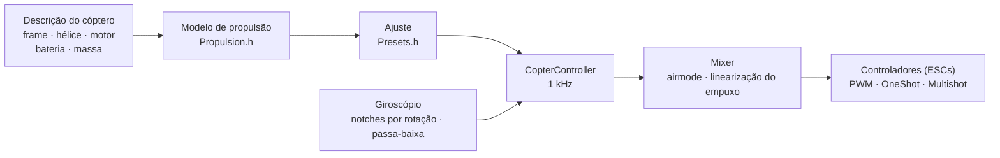

# COPTER.md — firmware para multicópteros

O mesmo firmware, as mesmas placas (Matek H743-WING V3, DevEBox H743), os
mesmos sensores e receptores — mas, em vez de um avião, um quadricóptero,
hexa, octo, Y6 ou X8. A principal diferença em relação ao Betaflight, INAV e
ArduPilot: **PID, filtros, marcha lenta e taxas não são ajustados à mão**.
Você descreve o cóptero (frame, hélices, motores, bateria, massa), e o
firmware deduz o ajuste sozinho a partir de um modelo físico — e, em voo, se
adapta àquilo que o modelo estimou com pouca precisão.

> **Com honestidade.** Por enquanto, o firmware de cóptero foi verificado só
> em simulador (um modelo de 6 graus de liberdade, 12 montagens × 3 variantes
> de física “errada”) e compilando-o para as placas. Ainda não voou. Dizer
> que ele voa melhor que o Betaflight ou o ArduPilot só será possível depois
> dos testes de voo — até lá, isso é um objetivo, não um fato.

## Como funciona



1. **Modelo de propulsão** (`copter/Propulsion.h`): um motor com força
   contraeletromotriz e resistência do enrolamento (a partir do KV e do
   volume do estator), empuxo e torque da hélice (a partir do diâmetro, do
   passo e do número de pás), inércia do rotor com a hélice. Para um 5" 2207
   1950KV em 6S, o modelo dá ~28 mil rpm, ~1,6 kg de empuxo e ~45 A em
   aceleração total — como nas bancadas.
2. **O que decorre dele** (`copter/Presets.h`): o acelerador de pairar, a
   rotação em marcha lenta/pairando/aceleração total, o atraso do motor τ,
   os momentos de inércia do frame, a relação empuxo/peso, a corrente.
3. **A malha de velocidade angular** é escolhida pela resposta em
   frequência: motor, filtros, notches, atraso do ciclo e do controlador —
   tudo está no modelo. A frequência de cruzamento é a mais alta com 50° de
   margem de fase (55° na guinada) e **12 dB de margem de ganho**: o ajuste
   aguenta um cóptero cujo empuxo e inércia estão errados por um fator de
   dois. A proporção de D é escolhida por busca — a que deixa a malha mais
   larga. P, I, D e o feedforward (FF) saem da frequência de cruzamento.
4. **A correção de ganho pelo acelerador (TPA)** vem do mesmo modelo: com
   pouco acelerador o motor responde mais fraco; com muito, mais forte.
5. **Em voo**, o firmware aprende sozinho o acelerador de pairar (uma
   bateria mais pesada, um gimbal) e move os notches conforme a rotação.

## Catálogo de montagens

| Montagem | Frame | Hélice · motor · bateria | Massa | Empuxo/peso | Pairar | Banda da malha |
|---|---|---|---|---|---|---|
| `whoop65` | Quad X 65 mm | 31 mm ×4 · 0702 23000KV · 1S | 22 g | 4,2 | 31% | 16 Hz |
| `whoop75` | Quad X 75 mm | 40 mm ×4 · 0802 19000KV · 1S | 32 g | 4,3 | 27% | 16 Hz |
| `toothpick25` | Quad X 115 mm | 2.5" · 1103 8000KV · 3S | 70 g | 12,1 | 8% | 14 Hz |
| `micro3` | Quad X 140 mm | 3" · 1404 4500KV · 4S | 190 g | 8,3 | 15% | 14 Hz |
| `cinewhoop3` | Quad X 150 mm | 3" de 5 pás · 1504 3600KV · 4S | 330 g | 4,1 | 32% | 16 Hz |
| `freestyle5` | Quad X 225 mm | 5.1" · 2207 1950KV · 6S | 680 g | 9,0 | 15% | 13 Hz |
| `race5` | Quad X alongado | 5.1" · 2306 2000KV · 6S | 560 g | 10,8 | 11% | 12 Hz |
| `longrange7` | Quad X 315 mm | 7" · 2806.5 1300KV · 6S | 1,0 kg | 7,0 | 20% | 11 Hz |
| `heavy10` | Quad X 450 mm | 10" · 3115 900KV · 6S | 2,2 kg | 6,6 | 25% | 10 Hz |
| `cinelifter8` | X8 380 mm | 8" · 2812 1100KV · 6S | 3,5 kg | 6,4 | 23% | 11 Hz |
| `hex13` | Hex X 700 mm | 13" · 3510 600KV · 6S | 4,0 kg | 3,7 | 35% | 8 Hz |
| `hex15` | Hex X 900 mm | 15" · 4114 400KV · 6S | 6,0 kg | 3,0 | 45% | 8 Hz |

Frames: Quad X, X alongado, H, Deadcat, “+”, Hex X/+, Y6, Octo X/+, X8. A
numeração dos motores é a do Betaflight (quad: 1 — traseiro direito, 2 —
dianteiro direito, 3 — traseiro esquerdo, 4 — dianteiro esquerdo), hélices
para dentro ou para fora. Estilos de voo — indoor, freestyle, corrida,
filmagem, longo alcance, carga: deles dependem as taxas e a inclinação
máxima.

## Seu próprio cóptero

`include/config/CopterConfig.h`:

```cpp
#define COPTER_BUILD "freestyle5"     // a montagem mais próxima do catálogo
constexpr float MASS_G = 742;          // pese com a bateria — é o mais importante
constexpr float PROP_DIAMETER_IN = 5.1f, PROP_PITCH_IN = 3.6f;
constexpr float MOTOR_KV = 2150;       // 0 — como na montagem
constexpr copter::EscProtocol ESC_PROTOCOL = copter::EscProtocol::ONESHOT125;
```

A montagem também pode ser escolhida por flag: `-D COPTER_BUILD=\"race5\"`.
Depois de gravar o firmware, a tecla `t` no console mostra o que foi deduzido
e avisa se algo estiver errado: empuxo de menos, o motor não aguenta essa
hélice, hélices vizinhas se tocam, pairar acima de 60% do acelerador,
motores girando mais rápido que a metade da frequência do ciclo.

## Gravação e primeira partida

```bash
pio run -e matek-h743-quad -t upload          # Matek H743-WING V3: botão BOOT + USB
pio run -e stm32h743-devebox-quad -t upload   # DevEBox H743
```

Saídas para os motores, em ordem: Matek — S1…S8, DevEBox — PA0–PA3, PD14,
PD15, PE9. **Primeira partida — sem hélices**, monitor serial a 115200:

| Tecla | O que faz |
|---|---|
| `t` | o ajuste: empuxo, pairar, rotações, τ do motor, filtros, banda e margens da malha, P/I/D/FF, taxas, avisos |
| `m` | teste dos motores: pede confirmação com `y` (sem hélices!), gira cada motor por 2 s e diz onde ele fica e para que lado deve girar |
| `s` | estado e **por que não arma** — cada motivo por extenso |
| `o` | calibração de montagem da placa com três posições (obrigatória na Matek antes do ARM) |
| `i` · `r` · `l` · `D` | giroscópio · canais do rádio · linha ao vivo · bootloader DFU |

Gira o motor errado — troque a ordem em `CopterConfig::MOTOR_PINS`; gira ao
contrário — mude o sentido no configurador do controlador (BLHeliSuite,
ESC-Configurator), sem ressoldar fios.

## Rádio e modos

Modo 2: CH1 rolagem, CH2 arfagem, CH3 acelerador, CH4 guinada. **ARM** — SwA
(CH5), como no avião. **Modo** — SwC (CH7):

| SwC | Modo | O que o stick faz |
|---|---|---|
| para cima | ANGLE | inclinação (até o limite do estilo); soltou — o cóptero nivela sozinho; guinada — em torno da vertical |
| meio | ALT_HOLD | ANGLE + altura: acelerador no centro — paira, acima/abaixo — sobe até 3 m/s, desce até 2 m/s |
| para baixo | ACRO | velocidade de rotação pela curva de taxas; airmode — controlável mesmo com acelerador zero |

O HORIZON (ANGLE perto do centro, ACRO nas extremidades) é ativado trocando
uma linha em `CopterConfig.h`.

## Proteções

- **ARM** — só se: há enlace, o acelerador está embaixo, o cóptero está
  nivelado (até 25°) e parado, o giroscópio responde, a orientação já foi
  determinada, a bateria não está vazia, não há teste de motores em curso, a
  montagem da placa está calibrada (onde for exigido). Uma chave ARM ligada
  cedo demais precisa ser desligada e ligada de novo.
- **Chave ARM para baixo — motores param no mesmo ciclo**, em qualquer modo.
- **Perda de sinal**: uma falha de até 0,3 s não muda nada; mais longa — no
  chão, DISARM imediato; no ar, nivelamento e descida a 0,7 m/s (pelo
  barômetro; sem ele, pelo acelerômetro); ao tocar o chão — DISARM. Se o
  enlace voltar por 1 s, o piloto retoma o controle.
- **Acidente**: em ANGLE/ALT_HOLD, inclinação acima de 90° por mais de
  0,7 s, ou diferente da pedida pelo stick em mais de 30° por mais de 2 s
  (motor com falha, caído de lado); em qualquer modo, 1 s de cabeça para
  baixo — motores param. Armar de novo — só depois de desligar a chave.
- **No chão, o integral não acumula** — o cóptero não pula nem tomba na
  decolagem.

## O que tem dentro — em resumo

| Arquivo | O quê |
|---|---|
| `copter/Propulsion.h` | modelo do motor e da hélice |
| `copter/Presets.h` | catálogo de montagens, dedução do ajuste, avisos |
| `copter/Frames.h` · `Mixer.h` | frames e mixer (airmode, prioridade de rolagem/arfagem sobre guinada, linearização do empuxo) |
| `copter/RateController.h` | P, I (relax em flips e na aceleração, anti-gravity), D sobre o giroscópio, FF |
| `copter/Attitude.h` | orientação em quatérnion; não se confia no acelerômetro em trancos, em rotação nem quando ele discorda do giroscópio |
| `copter/AltitudeHold.h` | altura: barômetro + acelerômetro, o acelerador de pairar é aprendido |
| `copter/GyroFilter.h` | notches em 1× e 2× a rotação e na passagem das pás + passa-baixa |
| `copter/CopterController.h` | tudo junto: ARM, modos, failsafe, acidente |
| `hal/stm32/Stm32MotorOutput.h` · `src/stm32/main_copter.cpp` | controladores e ponto de entrada na STM32 |

## Como foi verificado

`test/native/test_copter_sim` — o `CopterController` **real** e um modelo de
cóptero de 6 graus de liberdade: motores com força contraeletromotriz, queda
de tensão da bateria sob corrente, torque de reação das hélices, arrasto do
ar, vento com rajadas, atraso do controlador, um giroscópio com ruído e
vibração dos motores (vibração acima da metade da frequência do ciclo se
dobra, como na placa), um barômetro de 50 Hz, o chão. Cada montagem do
catálogo voa com o próprio ajuste e com um modelo que, de propósito, não
coincide com a descrição:

- **“preguiçoso”**: a hélice puxa 20% menos, motor e frame têm 30% mais
  inércia, 20% mais pesado, centro de gravidade deslocado para a frente;
- **“nervoso”**: empuxo +20%, inércia −30%, massa −15%, centro de gravidade
  deslocado para o lado — o ganho da malha é quase o dobro do calculado.

| O quê | Resultado em 36 voos (12 montagens × 3 físicas) |
|---|---|
| Decolagem e pairar em ALT_HOLD | altura ±0,3 m, inclinação < 1°, acelerador de pairar aprendido (o whoop “nervoso”: 0,22 em vez dos 0,31 calculados) |
| ANGLE: stick no máximo | 90% da inclinação em 0,14–0,35 s, sobressinal < 3%, nivelamento até 3° em 0,15–0,4 s |
| ACRO: stick no máximo | 90% da taxa em 0,04–0,15 s, sobressinal < 12% |
| Perda de sinal a 10 m | descida ≤ 0,94 m/s, toque no chão — DISARM, 17–28 s |

E, à parte, no 5": airmode com acelerador zero, guinada, vento de 4,5 m/s
com rajadas, failsafe sem barômetro, controladores PWM comuns, falha e
retorno do enlace, queda de costas, falha de motor, teste dos motores,
queda de tensão da bateria. `test_copter` verifica cada bloco separadamente
(41 testes), `native_stm32/test_app_stm32_copter` — o firmware inteiro sobre
os fakes da Matek H743: pulsos de “parada” antes do ARM, calibração de
montagem, marcha lenta após o ARM, modos pela chave, perda de sinal no chão,
o console.

O simulador encontrou e ajudou a corrigir defeitos reais, invisíveis no
cálculo: notches que pulavam a cada ciclo do mixer; fase extra dos notches
perto da banda da malha; acúmulo do integral durante a aceleração do hexa
“preguiçoso” (sobressinal de 32%); um acelerômetro que, num flip com
acelerador de pairar, marca exatamente 1 g e desviava o horizonte em 10°; um
cóptero com motor em falha que continuava girando no chão.

## O que ainda não existe

- **DShot** (e bidirecional — rotação exata para os notches): precisa de um
  driver com DMA; o cálculo de quadros e de CRC já existe
  (`copter/EscProtocol.h`).
- **Um ciclo mais rápido que 1 kHz** — para whoops, cujos motores giram
  acima de 500 Hz (a simulação mostra que a 4 kHz eles ficam bem melhores).
- Caixa-preta, MAVLink e OpenPlane Studio para o cóptero; manter posição por
  GPS, retorno ao ponto de partida, missões.
- Testes de voo.
