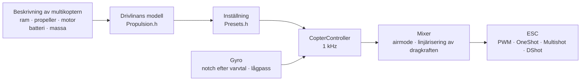

# COPTER.md — firmware för multikoptrar

Samma firmware, samma kort (Matek H743-WING V3, DevEBox H743 och nästan vilket
F405 som helst som kör Betaflight), samma sensorer och mottagare — men i
stället för ett flygplan en quadkopter, hexa, okto, Y6 eller X8. Den största
skillnaden mot Betaflight, INAV och ArduPilot: **PID, filter, tomgång och
rates ställs inte in för hand**. Du beskriver multikoptern (ram, propellrar,
motorer, batteri, massa), och firmwaren tar själv fram inställningen ur en
fysikalisk modell — och anpassar sig under flygning till det som modellen
uppskattade oprecist.

> **Ärligt talat.** Än så länge är multikopterfirmwaren bara provad i
> simulator (en modell med 6 frihetsgrader, 12 konfigurationer × 3 varianter
> av ”fel” fysik) och genom att byggas för korten. Den har inte flugit än.
> Att säga att den flyger bättre än Betaflight eller ArduPilot går först
> efter flygprov — till dess är det ett mål, inte ett faktum.

## Hur det fungerar



1. **Drivlinans modell** (`copter/Propulsion.h`): en motor med mot-EMK och
   lindningsresistans (ur KV och statorvolym), propellerns dragkraft och
   moment (ur diameter, stigning och antal blad), rotorns tröghet med
   propellern. För en 5" 2207 1950KV på 6S ger modellen ~28 000 rpm,
   ~1,6 kg dragkraft och ~45 A på full gas — som i provbänkarna.
2. **Vad som följer av den** (`copter/Presets.h`): gas för hovring, varvtal
   på tomgång/hovring/full gas, motorns fördröjning τ, ramens
   tröghetsmoment, dragkraft/vikt, ström.
3. **Vinkelhastighetsslingan** väljs efter frekvenssvaret: motor, filter,
   notch, slingans och ESC:ns fördröjning — allt finns i modellen.
   Brytfrekvensen är den högsta där fasmarginalen är 50° (gir 55°) och
   **förstärkningsmarginalen 12 dB**: inställningen håller på en multikopter
   vars dragkraft och tröghet är ”fel” med en faktor två. Andelen D hittas
   genom sökning — den som gör slingan bredast. P, I, D och framkopplingen
   (FF) följer av brytfrekvensen.
4. **Förstärkningskorrigering efter gas (TPA)** — ur samma modell: vid lågt
   varvtal svarar motorn mjukare, vid högt starkare. Betaflights kurva finns
   också (`tpa_mode = PD` eller `D`).
5. **Under flygning** lär sig firmwaren själv hovringsgasen (tyngre
   batteri, gimbal) och låter notcharna följa varvtalet.

## Katalog över konfigurationer

| Konfiguration | Ram | Propeller · motor · batteri | Massa | Dragkraft/vikt | Hovring | Slingans bandbredd |
|---|---|---|---|---|---|---|
| `whoop65` | Quad X 65 mm | 31 mm ×4 · 0702 23000KV · 1S | 22 g | 4,2 | 31 % | 16 Hz |
| `whoop75` | Quad X 75 mm | 40 mm ×4 · 0802 19000KV · 1S | 32 g | 4,3 | 27 % | 16 Hz |
| `toothpick25` | Quad X 115 mm | 2,5" · 1103 8000KV · 3S | 70 g | 12,1 | 8 % | 14 Hz |
| `micro3` | Quad X 140 mm | 3" · 1404 4500KV · 4S | 190 g | 8,3 | 15 % | 14 Hz |
| `cinewhoop3` | Quad X 150 mm | 3" 5-blads · 1504 3600KV · 4S | 330 g | 4,1 | 32 % | 16 Hz |
| `freestyle5` | Quad X 225 mm | 5,1" · 2207 1950KV · 6S | 680 g | 9,0 | 15 % | 13 Hz |
| `race5` | Utdragen Quad X | 5,1" · 2306 2000KV · 6S | 560 g | 10,8 | 11 % | 12 Hz |
| `longrange7` | Quad X 315 mm | 7" · 2806.5 1300KV · 6S | 1,0 kg | 7,0 | 20 % | 11 Hz |
| `longrange7li` | Quad X 315 mm | 7" 2-blads · 2810 1300KV · 6S Li-ion 4000 | 1,05 kg | 7,5 | 23 % | 12 Hz |
| `heavy10` | Quad X 450 mm | 10" · 3115 900KV · 6S | 2,2 kg | 6,6 | 25 % | 10 Hz |
| `cinelifter8` | X8 380 mm | 8" · 2812 1100KV · 6S | 3,5 kg | 6,4 | 23 % | 11 Hz |
| `hex13` | Hex X 700 mm | 13" · 3510 600KV · 6S | 4,0 kg | 3,7 | 35 % | 8 Hz |
| `hex15` | Hex X 900 mm | 15" · 4114 400KV · 6S | 6,0 kg | 3,0 | 45 % | 8 Hz |

Ramar: Quad X, utdragen X, H, Deadcat, ”+”, Hex X/+, Y6, Octo X/+, X8.
Motornumreringen är Betaflights (quad: 1 — bak höger, 2 — fram höger,
3 — bak vänster, 4 — fram vänster), propellrar inåt eller utåt. Flygstilar —
inomhus, freestyle, racing, filmning, long range, last: de bestämmer rates
och största lutning.

## Din egen multikopter

`include/config/CopterConfig.h`:

```cpp
#define COPTER_BUILD "freestyle5"     // den närmaste konfigurationen i katalogen
constexpr float MASS_G = 742;          // väg den med batteri — det viktigaste
constexpr float PROP_DIAMETER_IN = 5.1f, PROP_PITCH_IN = 3.6f;
constexpr float MOTOR_KV = 2150;       // 0 — som i konfigurationen
constexpr copter::EscProtocol ESC_PROTOCOL = copter::EscProtocol::ONESHOT125;
```

Konfigurationen kan också väljas med en flagga, `-D COPTER_BUILD=\"race5\"`,
eller utan att bygga om — i CLI:t: `set copter_build = race5`,
`set copter_mass_g = 742`, `save` (inställningar nedan; filen blir då bara
standardvärdet). Efter flashning visar tangenten `t` i konsolen vad som
togs fram och varnar om något är fel: för lite dragkraft, motorn orkar inte
vrida den propellern, grannpropellrar slår i varandra, den hovrar över
60 % gas, motorerna snurrar fortare än halva slingfrekvensen. En annan ram
med ett annat antal motorer fungerar efter en omstart: till dess är ARM
spärrat (`REBOOT_REQD`).

## Flashning och första start

```bash
pio run -e matek-h743-quad -t upload          # Matek H743-WING V3: BOOT-knappen + USB
pio run -e stm32h743-devebox-quad -t upload   # DevEBox H743
pio run -e aocodarc-f405v3-quad -t upload     # F405-styrkort från Betaflight — se nedan
```

Motorutgångar i ordning: Matek — S1…S8, DevEBox — PA0–PA3, PD14, PD15, PE9.
**Första start — utan propellrar**, seriell monitor på 115200:

| Tangent | Vad den gör |
|---|---|
| `t` | inställning: dragkraft, hovring, varvtal, motorns τ, filter, slingans bandbredd och marginaler, P/I/D/FF, rates, varningar |
| `m` | motortest: ber om bekräftelse med `y` (propellrarna borttagna!), snurrar var och en i 2 s och säger var den sitter och åt vilket håll den ska snurra |
| `s` | status, som `status` i Betaflight: slingans last, frekvenser, batteri och **varför den inte armar** — varje orsak med BF-kod (`RXLOSS`, `ANGLE`, `CLI`…) och i ord |
| `o` | kalibrering av kortets montering i tre lägen (obligatorisk på Matek före ARM) |
| `c` | kompasskalibrering: vrid multikoptern runt alla axlar i 15 s (kompass — QMC5883L eller QMC5883P på GPS-modulen, den som svarar) |
| `i` · `r` · `l` · `D` | gyro · radiokanaler · liverad · DFU-bootloader |
| `#` | CLI som i Betaflight: `set`, `get`, `diff`, `aux`, `map`, `profile`, `save` — [nedan](#inställningar-ett-cli-som-i-betaflight) |

Fel motor snurrar — ändra ordningen i `CopterConfig::MOTOR_PINS`; den
snurrar åt fel håll — ändra riktningen i ESC-konfiguratorn (BLHeliSuite,
ESC-Configurator), löd inte om några kablar.

### Ett F405-styrkort från Betaflight

Nästan vilket quadkopterstyrkort med STM32F405 som helst (Betaflight,
8 MHz-kristall) duger om det har en ICM-42688-P och en SPL06- eller
DPS310-barometer. Stiftplaceringen tas från Betaflight självt — så fungerar
även ett kort vars target inte finns i något förråd (GETFUN F405V3):

```bash
# 1. Kortet har fortfarande Betaflight; Configurator är stängd. CLI-dump till en fil
#    (PlatformIO:s Python — den har pyserial):
~/.platformio/penv/Scripts/python tools/bf_board.py read --port COM5 --out stack/MITTKORT_bf.txt
# 2. Hela originalfirmwaren — för att kunna gå tillbaka till Betaflight
#    (kortet i DFU: håll BOOT och anslut USB):
python tools/bf_board.py backup --out stack/MITTKORT_original.bin
# 3. Kortets header: vad som sitter på vilket stift (BF känner inte till barometertypen — enligt beskrivningen):
python tools/bf_board.py header stack/MITTKORT_bf.txt --baro SPL06 --out include/config/boards/MITTKORT.h
```

Sedan en env i `platformio.ini` som `aocodarc-f405v3-quad` (referenskortet:
dess stiftplacering är öppen, F405-kärnan byggs och testas alltid på det),
med `-D OP_BOARD_FILE=\"config/boards/MITTKORT.h\"`. Motorerna är M1…M8
enligt Betaflights nummer; mottagare, GPS och telemetri sitter på de UART
där Betaflight hade dem; varje motors timer är den som Betaflight valde
(raderna `timer B06 AF2` i dumpen -> `OPB_MOTOR_AF`: ett stift kan ha två
eller tre timrar, och BF valde dem utan DMA-krockar på just det kortet).
Svarta lådans flash kommer med sin buss och CS ur dumpen. Ett kort som
redan har vår firmware — `bf_board.py header` ur `config.h` från
[github.com/betaflight/config](https://github.com/betaflight/config).

F405 har en enda flashbank: att skriva inställningar stoppar processorn i
1–2 s, därför skrivs inställningar bara när den är avarmad.

## Inställningar: ett CLI som i Betaflight

Det som togs fram ur beskrivningen kan rättas för hand — utan att bygga om,
rad för rad, som i Betaflights CLI. `#` i konsolen tar dig dit (bara
avarmad; medan CLI:t är öppet är ARM spärrat):

```text
# get p_roll                     ← värde, gränser, standard och varifrån den kommer
# set p_roll = 50                ← i Betaflight-enheter
# set tune_source = BETAFLIGHT   ← standardvärdena från BF 4.5 i stället för modellen
# profile 1                      ← PID-profil 0–3 (rateprofile — rates); direkt, under drift
# diff                           ← bara det ändrade, i BF-format
# save                           ← till flash, inställningen räknas om, ut
```

- **Det som inte sätts för hand får standardvärdet, och för PID och rates
  är det inte ett tal ur en tabell utan resultatet av beskrivningen av
  multikoptern** (`get` visar ”ur multikopterns modell”). Ändra
  beskrivningen — allt du inte rört följer med; det du satt för hand ligger
  kvar. Att sätta ett värde lika med standard är detsamma som att återgå
  till standard.
- **Enheterna är Betaflights**: en PID-term = tal × BF-skala × fel, summan
  ÷ 1000 går till mixern (P 0,032029, I 0,244381 och på gir dessutom ×2,5,
  D 0,000529, F 0,013754 × 0,01). `t` visar också modellens inställning i
  dessa tal: för en 5" är det P 25, I 41, D 28, F 35 mot BF:s standard
  45/80/40/120 — modellen är mjukare eftersom den håller en
  förstärkningsmarginal på 12 dB.
- **En diff från Betaflight kan klistras in hel** (`diff all` 4.5): kända
  inställningar tillämpas, `profile`/`rateprofile` växlar, `map`, `aux`,
  `rxrange`, `vtx` och `rxfail` hamnar i sina tabeller, kommentarer ignoreras,
  en okänd inställning ger en rad `###FEL…###`. BF:s hårdvarukommandon
  (`resource`, `timer`, `dma`, `serial`, `feature`, `board_name`…: hos oss är
  det kortets header) hoppas över med kommentaren `# överhoppad`, och
  `defaults nosave` ur diffen rör inte multikopterns beskrivning (BF har
  ingen). Vid `batch end` (eller vid ett `save` mitt i inklistringen) — en
  sammanfattning: `# inklistrat: tillämpade N rader; inte överförda M:
  namn…`. Efter ett sådant `save` räknas resten av inklistringen inte som
  konsoltangenter under en halv sekund.
- `tune_source = BETAFLIGHT` — alla standardvärden från BF 4.5: PID
  45/80/40/120, 47/84/46/125, 45/80/0/120; rates Actual 70/670/0; TPA bara
  på D, 65 % från gas 1350, −20 % på låg gas fram till lyftet; `iterm_limit`
  400; PID-summa 500 (gir 400); anti-gravity 80, 5 Hz, P 100;
  `throttle_boost` 5; ANGLE 5 °/s per grad, upp till 60°; `yaw_lowpass_hz`
  100; filter — omräknade till vår kedja (gyro PT2 250 Hz, D — PT1 60 Hz:
  samma fördröjning vid slingans bandbredd). Notcharna efter varvtal är
  fortfarande våra.
- I flash sparas bara det som satts för hand (och valda profiler); en
  omflashning raderar det inte, `defaults` gör det. `exit` utan `save` —
  avbryter.

| Kommando | Vad det gör |
|---|---|
| `set` · `set namn = värde` | alla inställningar · sätt (gäller efter `save`) |
| `get del_av_namn` | värde, gränser, standard, vad det är |
| `diff [all]` · `dump [all]` | det ändrade · allt; `all` — alla profiler |
| `profile [0-3]` · `rateprofile [0-3]` | välj PID-profil · rate-profil |
| `aux` · `aux nr läge kanal från till [logik länk]` · `aux help` | tabell över lägen på brytare · en rad · lägesnummer — [nedan](#radio-och-lägen) |
| `map [AETR1234]` · `rxrange [0-3 min max]` | kanalordning · ändlägen för spakarna roll/pitch/gir/gas |
| `rxfail` · `rxfail kanal a\|h\|s [värde]` | vad som görs med en kanal utan länk, som i BF: spakar 0–3 — `a` (failsafe-automaten) eller `h` (håll det senaste), AUX 4–17 — `h` eller `s 750…2250` (fast värde); de första 0,3 s — alltid det senaste giltiga värdet |
| `vtx` · `vtx nr kanal band VTX-kanal effekt från till` · `vtx_info` | videosändare från en brytare, som i BF · vad den svarade och dess effekter — [nedan](#videosändare) |
| `dshot_telemetry_info` | som i BF: eRPM, rpm, Hz och andel ramar utan svar per motor (`dshot_bidir`) |
| `flash_info` · `flash_erase` | svarta lådans flash (F405): krets, storlek, JEDEC ID, fyllnad och flygningar · radera allt (ett kommando, väntar upp till en minut, som i BF) |
| `save` · `defaults [nosave]` | spara och räkna om · allt till standard |
| `status` · `tasks` | status (som `s`) · tid för varje del av slingan: frekvens, medel och värsta, andel av processorn |
| `version` · `help` · `exit` | version · lista · ut |

### Inställningar

| Inställning | Var | Intervall | Standard | Vad |
|---|---|---|---|---|
| `tune_source` | allmän | `MODEL`, `BETAFLIGHT` | `MODEL` | varifrån PID, filter och TPA kommer: ur multikopterns beskrivning eller BF 4.5:s standard |
| `profile_name` | PID-profil | upp till 8 tecken | — | PID-profilens namn |
| `p_roll` `i_roll` `d_roll` `f_roll` | PID-profil | P, I, D 0–250; F 0–1000 | ur modellen; BF: 45, 80, 40, 120 | roll-PID i BF-enheter |
| `p_pitch` `i_pitch` `d_pitch` `f_pitch` | PID-profil | samma | ur modellen; BF: 47, 84, 46, 125 | pitch-PID |
| `p_yaw` `i_yaw` `d_yaw` `f_yaw` | PID-profil | samma | ur modellen; BF: 45, 80, 0, 120 | gir-PID |
| `d_max_roll` `d_max_pitch` `d_max_yaw` | PID-profil | 0–250 | 0 (konstant D) | D vid en snabb rörelse, som i BF 2025.12: då är `d_*` D i vila |
| `d_min_roll` `d_min_pitch` `d_min_yaw` | PID-profil | 0–250 | 0; BF: 30, 34, 0 | som i BF 4.5: D i vila, `d_*` — vid en snabb rörelse (om `d_max_*` inte är satt) |
| `d_max_gain` (`d_min_gain`) | PID-profil | 0–100 | 37 | hur lätt D stiger av gyrots ryck: vid 37 — helt vid ~5000 °/s² |
| `d_max_advance` (`d_min_advance`) | PID-profil | 0–200 | 20 | hur tidigt D stiger av spakens rörelse: vid 20 — helt vid ~2500 °/s² börvärde |
| `iterm_relax` | PID-profil | `OFF`, `RP`, `RPY`, `RP_INC`, `RPY_INC` | `RPY`; BF: `RP` | på vilka axlar I väntar medan börvärdet ändras snabbt (ingen studs efter en flip); `_INC` — bara ökningen hålls tillbaka |
| `iterm_relax_type` | PID-profil | `GYRO`, `SETPOINT` | `SETPOINT` | `SETPOINT` — I ackumulerar långsammare; `GYRO` — I mot det utjämnade börvärdet, noll alldeles nära det |
| `iterm_relax_cutoff` | PID-profil | 1–50 Hz | 10; BF: 15 | utjämning av börvärdet för relax: lägre — väntar längre |
| `iterm_relax_error` | PID-profil | `OFF`, `ON` | `ON` | vår: ett stort fel vid acceleration mot ett nytt börvärde (en flip) samlas inte i I; ett fel utan spakrörelse (en by, en gasstöt) gör det |
| `iterm_rotation` | PID-profil | `OFF`, `ON` | `OFF` | I vrids med ramen: i en piruett går det som samlats på roll över till pitch |
| `iterm_windup` | PID-profil | 30–100 % | 100 (av); BF: 85 | ju mer motorerna går isär, desto svagare ackumulerar I; vid full spridning stannar det |
| `iterm_limit` | PID-profil | 0–500 | ur modellen (300); BF: 400 | gräns för I, 1000 — hela motorernas slag |
| `pidsum_limit` · `pidsum_limit_yaw` | PID-profil | 100–1000 | 1000; BF: 500 · 400 | gräns för PID-summan på roll och pitch · på gir (1000 — hela slaget); vid gränsen ackumulerar I inte |
| `anti_gravity_gain` | PID-profil | 0–250 | 80 | en gasstöt gör I starkare, nosen dyker inte: vid en full stöt (hela slaget på 0,1 s) 1 + gain/10 gånger |
| `anti_gravity_cutoff_hz` | PID-profil | 2–50 Hz | 5 | utjämning av gasens hastighet: lägre — en lägre men längre topp |
| `anti_gravity_p_gain` | PID-profil | 0–250 % | 0; BF: 100 | även P på roll och pitch blir starkare: vid 100 — med 50 % vid en full stöt |
| `throttle_boost` · `throttle_boost_cutoff` | PID-profil | 0–100 (×0,1) · 5–50 Hz | 0; BF: 5 · 15 | en gasstöt på spaken (gas minus dess lågpass) förstärks 1 + boost/10 gånger — motorerna hinner ikapp spaken tidigare; inte i ALT_HOLD |
| `tpa_mode` | PID-profil | `PD`, `D`, `MODEL` | `MODEL`; BF: `D` | PD-korrigering efter gas: `PD`/`D` — BF-kurvan (två rader ned), `MODEL` — ur modellen på P och D |
| `tpa_rate` · `tpa_breakpoint` | PID-profil | 0–100 % · 750–2250 µs | 65 · 1350 | `PD`/`D`: över punkten försvagas PD (eller bara D) linjärt, på full gas med `tpa_rate` |
| `tpa_low_rate` · `tpa_low_breakpoint` | PID-profil | −128…100 % · 750–2250 µs | 0; BF: 20 · 1050 | på noll gas är PD (D) svagare med `tpa_low_rate` (under 0 — starkare), linjärt fram till punkten |
| `tpa_low_always` | PID-profil | `OFF`, `ON` | `OFF` | `OFF` — bara så länge gasen efter ARM inte gått över `tpa_low_breakpoint` (på marken), `ON` — alltid |
| `feedforward_transition` | PID-profil | 0–100 % | 0 | närmare spakens mitt än så är framkopplingen svagare (linjärt ned till noll) — mjukare i mitten |
| `feedforward_averaging` | PID-profil | `OFF`, `2_POINT`, `3_POINT`, `4_POINT` | `OFF` | spakens hastighet för framkopplingen medelvärdesbildas över 2–4 mottagarramar: jämnare med glesa ramar, men senare |
| `feedforward_smooth_factor` | PID-profil | 0–95 % | 0; BF: 25 | utjämning av framkopplingen från ram till ram (andel av det gamla värdet per ram) |
| `feedforward_jitter_factor` | PID-profil | 0–20 | 0; BF: 7 | spaken rörde sig mindre än så på en ram (500 — en halv spak) — framkopplingen försvagas, mjukt ned till noll: fingrets darrning skakar inte motorerna |
| `feedforward_boost` | PID-profil | 0–50 | 0; BF: 15 | ett tillskott efter spakens acceleration (15 — 3 ms framförhållning, inte mer än spakens egen hastighet) |
| `feedforward_max_rate_limit` | PID-profil | 0–150 % | 0; BF: 90 | med börvärdet på denna andel av största rate är framkopplingen utåt inte större än vad P skulle ge för den återstående marginalen, därutöver — noll: en flip med fullt utslag utan översläng |
| `yaw_lowpass_hz` | PID-profil | 0–500 Hz | ur modellen (30–100); BF: 100 | lågpass på gir-PID:ens utgång (0 — utan filter); modellens PID räknas med modellens frekvens |
| `use_integrated_yaw` · `integrated_yaw_relax` | PID-profil | `OFF`, `ON` · 0–255 | `OFF` · 200 | gir genom integralen av PID-summan (×100 1/s, läckage relax × 0,08 1/s) — för stora propellrar, där giren accelererar propellern. BF:s tal beter sig som i BF (I utan ×2,5; en 5" behöver `d_yaw`, annars svänger den); modellens ej satta gir-PID räknas om så att slingan förblir densamma |
| `abs_control_gain` | PID-profil | 0–20 (°/s per °) | 0 (av) | ACRO: vinkel och kurs som förlorats av en by eller obalans i dragkraft kommer tillbaka; roll och pitch — bara i ACRO, gir — i alla lägen, i luften |
| `abs_control_limit` · `abs_control_error_limit` · `abs_control_cutoff` | PID-profil | 10–255 °/s · 1–45° · 1–45 Hz | 90 · 20 · 11 | gräns för korrigeringen · för det ackumulerade vinkelfelet · lågpass på börvärdet (ramens eftersläpning vid snabb spak samlas inte upp) |
| `thrust_linear` | PID-profil | 0–150 % | ur modellen (15–30); BF: 0 | linjärisering av dragkraften: låg gas svarar som hög |
| `motor_output_limit` | PID-profil | 1–100 % | 100 | andel av motorernas slag över tomgång: 6S-batteri på motorer för 4S — 66 |
| `rateprofile_name` | rate-profil | upp till 8 tecken | — | rate-profilens namn |
| `roll_rc_rate` `pitch_rc_rate` `yaw_rc_rate` | rate-profil | 1–255 (×10 °/s) | efter flygstil; BF: 7 | rate i spakens mitt |
| `roll_srate` `pitch_srate` `yaw_srate` | rate-profil | 0–255 (×10 °/s) | efter flygstil; BF: 67 | rate vid fullt utslag |
| `roll_expo` `pitch_expo` `yaw_expo` | rate-profil | 0–100 % | efter flygstil; BF: 0 | expo: mjukare i mitten |
| `serialrx_provider` | allmän | `IBUS`, `SBUS`, `CRSF` | `RX_PROTOCOL` ur `Config.h` | mottagarens protokoll; byts efter `save` utan omstart |
| `rx_min_usec` `rx_max_usec` | allmän | 750–2250 µs | 885, 2115 | en puls utanför dessa gränser är ett kanalfel: på en spak — tappad länk, på AUX hålls det föregående värdet |
| `copter_build` | allmän | katalogens konfigurationer | `COPTER_BUILD` | grund för multikopterns beskrivning |
| `copter_mass_g` | allmän | 0–30000 g (0 — uppskattning) | ur konfigurationen | startmassa med batteri |
| `copter_wheelbase_mm` | allmän | 30–2000 mm | ur konfigurationen | mellan axlarna på motsatta motorer |
| `prop_diameter_in` `prop_pitch_in` `prop_blades` | allmän | 0,5–40", 0,3–30", 2–8 | ur konfigurationen | propeller |
| `motor_stator_mm` `motor_height_mm` `motor_kv` | allmän | 3–120 mm, 0,5–60 mm, 50–80000 | ur konfigurationen | motor: 2207 — 22 och 7 |
| `battery_cells` `battery_mah` | allmän | 1–14 S, 50–50000 mAh | ur konfigurationen | batteri |
| `props_out` | allmän | `OFF`, `ON` | `PROPS_OUT` | propellrar utåt: alla motorer snurrar åt andra hållet |
| `battery_chemistry` | allmän | `LIPO`, `LIHV`, `LIION` | ur konfigurationen (LiPo) | kemi: cellgränser och spänning under last för dragkraftsmodellen (3,75 / 3,85 / 3,5 V) |
| `vbat_min_cell_voltage` `vbat_warning_cell_voltage` `vbat_max_cell_voltage` | allmän | 100–500 (×0,01 V) | efter kemi: LiPo 330/350/430, LiHV 330/350/440, Li-ion 280/310/425 | cell: tom (CRITICAL) · dags att vända hem (WARNING; under det i vila — armar inte) · full |
| `vbat_full_cell_voltage` | allmän | 100–500 (×0,01 V) | efter kemi: LiPo 410, LiHV 425, Li-ion 410 | en cell över det vid anslutning — batteriet är fullt; annars visar OSD:n `BATT < FULL` avarmad |
| `vbat_scale` · `vbat_divider` · `vbat_multiplier` | allmän | 0–255 · 1–255 · 1–255 | kortets delare (110 · 10 · 1 — 1:11; F405 — ur kortets dump) | volt = stiftets mV × `vbat_scale` / (1000 × `vbat_divider` × `vbat_multiplier`), som i BF |
| `battery_meter` | allmän | `NONE`, `ADC`, `ESC` | `ADC` om kortet har en batteriingång | varifrån spänningen kommer (`ESC` — ur ESC-telemetrin, fungerar inte än) |
| `current_meter` · `ibata_scale` · `ibata_offset` | allmän | `NONE`/`ADC`/`VIRTUAL`/`ESC`/`MSP` · ±16000 (×0,1 mV/A) · ±32000 mV | `ADC` om kortet har en strömingång; 400 (Matek — 250, F405 — ur kortets dump); 0 | strömsensor: ström, förbrukade mAh, återstående (`VIRTUAL`, `ESC`, `MSP` tas emot från en BF-diff men ger ingen ström än) |
| `vbat_detect_cell_voltage` | allmän | 0–2000 (×0,01 V) | 300 | ett batteri finns om spänningen ligger mellan detta värde och en full cell (1S) eller över dubbla detta värde; annars — USB-matning |
| `force_battery_cell_count` | allmän | 0–24 S | 0 | antal celler; 0 — ur multikopterns beskrivning (`battery_cells`). I BF betyder 0 att gissa efter spänningen; vi gissar inte: ett tomt 6S Li-ion (17 V) går inte att skilja från ett fullt 4S LiPo |
| `bat_capacity` | allmän | 0–20000 mAh | 0 | kapacitet för återstående och förbrukningslarmet; 0 — `battery_mah` ur beskrivningen |
| `vbat_hysteresis` | allmän | 0–250 (×0,01 V) | 1 | larmet utlöses när spänningen ligger ännu så mycket under gränsen (för hela batteriet, som i BF); det släpper över gränsen |
| `vbat_duration_for_warning` · `vbat_duration_for_critical` | allmän | 0–150 (×0,1 s) | 20 · 20 (BF: 0 · 0) | så lång tid i följd under gränsen — WARNING · CRITICAL: en dipp vid en gasstöt är inget larm |
| `use_vbat_alerts` · `use_cbat_alerts` · `cbat_alert_percent` | allmän | `OFF`/`ON` · `OFF`/`ON` · 0–100 % | `ON` · `OFF` · 10 | pipa och visa batterilarmet · larm även efter mAh (det återstår högst `cbat_alert_percent` — WARNING, noll — CRITICAL; kräver strömsensor) |
| `vbat_cutoff_percent` | allmän | 0–100 % | 100 (ingen) | från första CRITICAL begränsas spakens gas mjukt till denna andel på 10 s (BF:s LVC); inte höjdhållningen eller failsafe-automaten |
| `vbat_display_lpf_period` · `vbat_sag_lpf_period` · `ibat_lpf_period` | allmän | 1–255 (×0,1 s) | 30 · 2 · 10 | utjämning (lågpass 10/period Hz, som i BF): visning och larm · spänning för sag-kompensationen · ström |
| `vtx_protocol` | allmän | `AUTO`, `SMARTAUDIO`, `TRAMP`, `NONE` | `AUTO` om kortet har en VTX-ledning | videosändarens styrledning |
| `vtx_band` · `vtx_channel` · `vtx_freq` | allmän | 0–10 · 1–8 · 0–6200 MHz | 5 (R) · 1 · 0 | band (1 A, 2 B, 3 E, 4 F, 5 R, 6 L, 7 X, 8 V, 9 G, 10 S; 0 — frekvensen som tal) |
| `vtx_power` | allmän | 1–12 | 1 | effektnivå, 1 — den lägsta; tabellen kommer från sändaren (`vtx_info`) |
| `vtx_max_power_mw` | allmän | 0–10000 mW | 0 (inget) | **taket**: höjs inte över det, varken med en brytare eller med sändarens knapp |
| `vtx_low_power_disarm` | allmän | `OFF`, `ON`, `UNTIL_FIRST_ARM` | `OFF` | avarmad — den lägsta nivån |
| `gps_minimum_sats` | allmän | 4–50 | 8 | hemmet sätts vid ARM om det finns minst så många satelliter |
| `crsf_telemetry` | allmän | `OFF`, `ON` | `ON` | telemetri till radion via CRSF |
| `blackbox_device` | allmän | `NONE`, `SPIFLASH`, `SDCARD`, `SERIAL` | `SPIFLASH` på F405, `SDCARD` på H743 | var svarta lådan skrivs; den skriver bara om det här kortets medium är valt (`SERIAL` tas emot från en BF-diff men skriver inte) |
| `blackbox_mode` | allmän | `NORMAL`, `MOTOR_TEST`, `ALWAYS` | `NORMAL` | när den skriver: medan den är armad, medan motorerna snurrar, alltid |
| `blackbox_sample_rate` | allmän | `1/1` … `1/32` | `1/1` (F405 med flash — `1/2`) | gyro, PID och motorer — ett varv av hur många |
| `motor_poles` | allmän | 4–255 | 14 | rotorns magneter: rpm = eRPM × 2 / `motor_poles` |
| `dshot_bidir` | allmän | `OFF`, `ON` | `OFF` | dubbelriktad DShot: ESC:n svarar med varvtalet; byts efter en omstart (till dess är ARM spärrat, `REBOOT_REQD`); med den är slinggränsen lägre — ram, 30 µs och svar: DShot600 — upp till 11,8 kHz, 300 — 7,2, 150 — 4,0 |
| `small_angle` | allmän | 0–180° | 25 | står mer lutad än så — armar inte; 180 — ingen kontroll |
| `auto_disarm_delay` | allmän | 0–60 s | 5 | armad men står på marken med gasen nere så länge — DISARM (i BF bara med ARM på spakarna; hos oss även med brytare); 0 — aldrig |
| `runaway_takeoff_prevention` | allmän | `OFF`, `ON` | `ON` | efter ARM ligger regulatorn i botten och multikoptern vrider sig — DISARM |
| `runaway_takeoff_deactivate_delay` | allmän | 100–1000 ms | 500 | så mycket lugn flygning — runaway-kontrollen stängs av till nästa ARM |
| `runaway_takeoff_deactivate_throttle_percent` | allmän | 0–100 % | 20 | gasen över vilken flygningen räknas (eller multikoptern har redan stigit över en meter) |
| `failsafe_delay` | allmän | 1–200 (×0,1 s) | 15 | ingen länk så länge — steg 2; innan dess steg 1: plan och håller höjden (i BF — spakarna i mitten, gas 0) |
| `failsafe_procedure` | allmän | `AUTO-LAND`, `DROP`, `GPS-RESCUE` | `AUTO-LAND` (BF: `DROP`) | steg 2: plan och sjunker · motorerna av · hemflygning (än så länge utan GPS — som AUTO-LAND, styrningen kommer tillbaka via spaken) |
| `failsafe_landing_time` | allmän | 1–250 s | 120 (BF: 60) | AUTO-LAND har inte landat på den tiden — DISARM; hos oss följer sjunkningen höjden och slutar vid markkontakt, det är en marginal |
| `failsafe_throttle` | allmän | 1000–2000 µs | 1000 | AUTO-LAND: 1000 — sjunkning med 0,7 m/s efter höjden; mer — fast gas, som i BF |
| `failsafe_throttle_low_delay` | allmän | 0–300 (×0,1 s) | 100 | gasen var nere längre än så före länkbortfallet — DISARM direkt (multikoptern står uppenbarligen på marken); 0 — nej |
| `failsafe_recovery_delay` | allmän | 1–200 (×0,1 s) | 5 | länken håller så länge — styrningen går tillbaka till piloten (steg 2) och ARM blir möjligt igen efter en DISARM av failsafe |
| `failsafe_stick_threshold` | allmän | 0–50 % | 30 | GPS-RESCUE: länken är tillbaka — styrningen går till piloten när en spak förs längre än så |
| `failsafe_switch_mode` | allmän | `STAGE1`, `KILL`, `STAGE2` | `STAGE1` | FAILSAFE-läget från en brytare: som ett länkbortfall · motorerna av direkt (ARM efter 1 s) · direkt steg 2 |
| `craft_name` | allmän | upp till 16 tecken | — | multikopterns namn: BF-konfiguratorn (`MSP_NAME`) och loggen |
| `vbat_sag_compensation` | PID-profil | 0–150 % | 100 (BF: 0) | korrigering av motorerna för spänningsfallet: 100 — med ett sjunkande batteri svarar de som med ett fullt, 0 — ingen korrigering |

Multikopterns beskrivning (`copter_build` … `props_out`): standard är
katalogens konfiguration med rättelserna ”din egen multikopter” ur
`CopterConfig.h`; byt konfiguration — standardvärdena för massa, propeller,
motor och batteri kommer från den nya, och det som satts för hand ligger
kvar. PID och filter räknas om för den nya beskrivningen vid `save`.

Rate-kurvan är än så länge vår: i mitten `rc_rate`, vid fullt utslag
`srate`, expo mjukar upp mitten; med expo 0 sammanfaller den med
Betaflights Actual. För 13"/15"-hexorna begär modellen ett D över 250 och
ett F över 1000 — `get` visar standardvärdet avklippt vid gränsen, men
modellens exakta värde tillämpas.

## Radio och lägen

Standard är Mode 2: CH1 roll, CH2 pitch, CH3 gas, CH4 gir. **ARM** — SwA
(CH5), som på flygplanet. **Läge** — SwC (CH7):

| SwC | Läge | Vad spaken gör |
|---|---|---|
| upp | ANGLE | lutning (upp till stilens gräns), släppt — multikoptern lägger sig plant; gir — runt lodlinjen |
| mitten | ALT_HOLD | ANGLE + höjd: gas i mitten — hovring, över/under — stigning upp till 3 m/s, sjunkning upp till 2 m/s |
| ned | ACRO | vinkelhastighet efter rate-kurvan; airmode — styrbar även på noll gas |

Allt detta ändras i CLI:t, som i Betaflight:

- `map TAER1234` — kanalordning: en bokstav i stället för varje kanal
  (A — roll, E — pitch, T — gas, R — gir, 1–4 — AUX1–AUX4). Gasens
  failsafe-tröskel (`RX_FAILSAFE_THROTTLE_US`) följer gasen.
- `rxrange 3 1050 1950` — gasspakens ändlägen sträcks ut till 1000–2000
  (0 — roll, 1 — pitch, 2 — gir, 3 — gas).
- `aux 0 0 1 1700 2100 0 0` — läget är aktivt medan kanalen ligger i
  intervallet: radnummer 0–19, läge (BF-nummer), kanal (0 — AUX1, det vill
  säga CH5 med `map AETR1234`), från och till i µs i steg om 25, logik
  (0 — det räcker med en rad för läget, 1 — alla behövs), länk (läget slås
  på tillsammans med ett annat). `aux` utan argument — tabellen,
  `aux help` — lägesnumren.

| Läge | BF-nummer | Vad det gör |
|---|---|---|
| ARM | 0 | motorerna på |
| ANGLE · HORIZON · ALTHOLD | 1 · 2 · 3 | flygläge; om flera — ALTHOLD, sedan ANGLE, sedan HORIZON; inget — ACRO |
| FAILSAFE | 27 | som ett länkbortfall (prov av failsafe på marken) |
| AIR MODE | 28 | airmode även med `AIRMODE` avstängt i `CopterConfig.h` |
| PREARM | 36 | om det finns i tabellen — ARM bara med PREARM aktivt |
| USER1 … USER4 | 40 … 43 | kortets PINIO-stift (på GETFUN F405V3: USER1 — kamera CAM1/CAM2, USER2 — 12 V-matning) |
| VTX PIT MODE · VTX CONTROL DISABLE | 39 · 48 | videosändaren i PIT · rör inte sändaren |

**När tabellen är tom (som efter `defaults`) gäller brytarna i
`CopterConfig.h`** (`aux` visar dem som rader att kopiera). Så snart det
finns en rad gäller bara tabellen, som i BF: en inklistrad diff från
Betaflight beskriver den helt, firmwarens standardvärden blandas inte in.
Ingen ARM i tabellen — multikoptern armar inte (`NO_ARM_AUX`). BF-lägen vi
inte har än (BEEPER, GPS RESCUE…) tas emot och sparas men gör ingenting —
`aux` säger det.

## Videosändare

En analog sändare med styrledning (SmartAudio eller Tramp —
`vtx_protocol = AUTO` hittar den själv) hålls av firmwaren på
inställningarnas frekvens och effekt:

```text
# set vtx_band = 5            ← R
# set vtx_channel = 1         ← R1, 5658 MHz
# set vtx_max_power_mw = 400  ← tak ”i stan”
# vtx 0 2 0 0 2 900 1300      ← AUX3 (SwC) upp — nivå 2
# vtx 1 2 0 0 6 1700 2100     ← AUX3 ned — nivå 6 (men inte över taket)
# vtx_info                    ← vad sändaren svarade, dess effekter
# save
```

- **Taket `vtx_max_power_mw`** är det viktigaste: varken en `vtx`-rad från
  en brytare eller `vtx_power` går över det, och har sändaren höjts med sin
  egen knapp sänker firmwaren den inom en sekund. För att ta bort taket —
  `set vtx_max_power_mw = 0`.
- **Effekten från radion** — `vtx`-rader, som i Betaflight: medan AUX ligger
  i intervallet har sändaren det bandet, den kanalen och den nivån (0 — rör
  inte). En brytare, en ratt eller en logisk kanal i EdgeTX — spelar ingen
  roll.
- Effekttabellen kommer från sändaren själv: SmartAudio 2.1 rapporterar sina
  nivåer i dBm (36 dBm — ”4 W”), Tramp — gränsen i mW; SmartAudio 1.0/2.0 har
  stegen 25/200/500/800 mW, som TBS Unify.
- Frekvenser — sändarens tabell med 80 kanaler 4,9–6,1 GHz: A, B, E, F, R, L
  (hos säljaren — D), X, V, G, S. **Analoga glasögon (Cobra X V4) tar bara
  emot A, B, E, F, R och L** — på X/V/G/S blir det ingen bild.
- Läget VTX PIT MODE — PIT (stör inte andra på marken), USER2 på GETFUN —
  12 V-matningen till hela sändaren. Sändaren svarar inte — `status` visar
  ”VTX: svarar inte”; då ställs frekvens och effekt med dess knappar.

## OSD och summer

**OSD** — styrkortets AT7456E/MAX7456-krets (på kort från Betaflight kommer
dess buss och CS ur kortets dump). Kamerabilden går alltid genom kretsen,
OSD:n läggs ovanpå: länk (LQ), läge, satelliter, VTX-effekt, sikte, pil och
avstånd hem, höjd, spänning (och per cell), ström, mAh, flygtid och **en
huvudvarning** i mitten: FAILSAFE, RXLOSS, BATT CRITICAL, LOW BATTERY,
avarmad — varför den inte armar (en BF-kod, till exempel THROTTLE) eller
DISARMED. Typsnittet är kretsens (på kort med Betaflight — BF:s typsnitt),
därav texterna med latinska bokstäver. PAL/NTSC — efter kameran,
automatiskt; läget OSD DISABLE döljer allt.

**Summer**: ARM — lång, DISARM — två korta, efter påslag, när den går att
arma, — kort; batteri WARNING — en kort varannan sekund, CRITICAL — ofta;
failsafe — larm; läget BEEPER — ”hitta modellen” (även utan länk — AUX
håller det senaste värdet), BEEPER MUTE — tyst (utom sökningen).

## GPS, kompass och telemetri till radion

- **GPS** (u-blox M10) — på den UART där Betaflight hade den. `status`
  visar fix, satelliter, noggrannhet, hastighet och **hemmet**: det sätts vid
  ARM med 3D-fix och minst `gps_minimum_sats` satelliter; annars — vid den
  första bra fixen, redan i luften (”satt redan i flygning”). Avstånd och
  riktning hem — i `status`, `@live` och på radion. GPS-lägen
  (hemflygning, positionshållning) **finns inte än**.
- **Kompass** på GPS-modulen — QMC5883L eller QMC5883P, firmwaren provar
  båda. Kalibrering — `c` i konsolen. Nosens kurs kommer från kompassen (om
  den är kalibrerad), över 3 m/s — från GPS, annars — från gyrot sedan
  påslag. Lutningen kompenseras inte än: i snabb flygning kan kompassens
  kurs slå fel ett tiotal grader.
- **CRSF-telemetri** (ELRS, Crossfire) — i samma UART som kanalerna kommer
  i: batteri (V, A, mAh, %), GPS, attityd, läge (`ACRO`, `ANGL`, `HOR`,
  `ALTH`, `!FS!`; avarmad — med ”*”), vertikal hastighet. I EdgeTX
  (RadioMaster TX12) — ”Upptäck sensorer” på modellens telemetrisida.

## Svart låda

På H743 (Matek H743, DevEBox) skriver multikoptern flygningen till SD-kortet
— i samma format och samma fil `BLACKBOX.BIN` som flygplanet (förbereda
kortet — [BLACKBOX.md](BLACKBOX.md#sd-kort-stm32h743)). På F405 — till
kortets SPI-flash (`blackbox_device = SPIFLASH`, som i BF): W25Q128, W25Q64,
M25P16, GD25Q och liknande känns igen på sitt JEDEC ID (upp till 16 MB);
samma format och samma nedladdning. Halva flashen hålls raderad (16 MB med
`1/2` — ungefär 8 minuters flygning), gamla flygningar raderas på marken
hela, den äldsta först — och inte ”full — skrivningen stoppad” som i BF.
Postkön ligger i F405:ans CCM RAM (60 KB), en flash på samma buss som OSD:n
delar en mutex med den, en flash på gyrots buss används inte. `flash_info`
och `flash_erase` i CLI:t — som i BF.

| Post | Frekvens | Vad den innehåller |
|---|---|---|
| `QGYRO` | varje varv (`blackbox_sample_rate`) | gyro före och efter filtren, börvärden, varvets arbetstid |
| `QCTRL` | vid samma tidpunkt | P, I, D, F per axel (andel av motorernas slag), motorer 1–4, mixerns gas |
| `QMOT8` | vid samma tidpunkt, om det finns fler än 4 motorer | motorer 5–8 |
| `QSTATE` | 50 Hz | vinklar, höjd och mål, stigning, spakar, hovringsgas, batteri (V, A, mAh), varvtal, LQ, läge, flaggor, ARM-spärrar |
| `GPS`, `SYS` | ny lösning, 1 Hz | som på flygplanet |
| `EVENT` | — | ARM/DISARM, läge, FAILSAFE, krasch, länk, batteri, profil, ”ARM nekad: BF-koder”, GPS och hem, motortest, köförluster |

I början av flygningen — konfiguration, ram, PID i BF-enheter, rates,
filter och allt som satts i CLI:t (`set.<namn>=<värde>`, som `diff`).

När den skriver — `blackbox_mode`, som i Betaflight: `NORMAL` — medan den är
armad (från 2 s före till 2 s efter), `MOTOR_TEST` — medan motorerna
snurrar (och motortestet på bänken), `ALWAYS` — från påslag.
`blackbox_device = NONE` — skriv inte. Vid 1 kHz är flödet ~70 KB/s: till
kortet går block om 512 byte, en fil på 256 MB räcker ungefär en timme. Om
loggen säger ”kön full” — `blackbox_sample_rate = 1/2`.

För att titta — **OpenPlane Studio, avsnittet ”Svart låda”**: kortets
flygningar via USB (knappen ”Ladda ned”, filen hamnar i projektmappen),
sparade loggar eller `BLACKBOX.BIN` direkt från kortet. En tidslinje med
lägen och händelser, grafer för börvärde och gyro (före och efter filtren),
PID per axel, motorer, gas, höjd, batteri — med en gemensam markör, zoom med
hjulet och uppspelning; gyrots brusspektrum i det synliga fönstret med
markeringar för motorvarvtalet; multikoptern i 3D vid markören. Utan appen —
`python tools/blackbox.py download` och `decode` (en CSV per posttyp).
Konsol: `k` — status och flygningar.

**Betaflight-format** (`.BFL` — Blackbox Explorer, PIDtoolbox):
`python tools/blackbox.py download --bfl` — kortet konverterar själv
flygningen (`bb bfl N`, `telemetry/BflEncoder.h`) och lämnar en färdig fil.
En ram per skrivet varv: `axisP/I/D/F` (tusendelar av motorernas slag, som
i BF), `rcCommand`, `setpoint`, `gyroADC` och `gyroUnfilt` (°/s), `motor`
(48–2047), `vbatLatest`, `amperageLatest`; lägen och failsafe — i S-ramar.
Headern presenterar sig som `Betaflight 4.5.0 (OpenPlane …)` — annars vet
Explorer inte hur fälten ska läsas. Filen är ungefär hälften så stor som vår
logg.

Provat i simulator: en flygning med flippar, piruett och gasstöt skrivs
hela (`test/native/test_copter_blackbox`;
`OPENPLANE_COPTER_BLACKBOX_DUMP=fil` sparar loggen för Studio,
`OPENPLANE_COPTER_BFL_DUMP=fil.bfl` — samma flygning för Blackbox Explorer),
firmwaren med kort — `test_app_stm32_copter_blackbox`, F405 med flash —
`test_app_stm32_f405_copter_blackbox` (en emulator för W25Q128). Att `.BFL`
öppnas i Blackbox Explorer själv provar användaren: formatet kontrolleras
mot dess beskrivning, vår tolk läser det efter sin egen header.

## Betaflight-konfiguratorn (MSP)

Betaflight-konfiguratorn ansluter till multikoptern via samma USB-konsol:
MSP-ramarna (`$M<…` v1 och `$X<…` v2, `telemetry/Msp.h`) kommer blandade
med tangenter och appens rader. Multikoptern presenterar sig som
**Betaflight 4.5** (FC_VARIANT `BTFL`, MSP API 1.46, FC_VERSION 4.5.0) —
efter dem bestämmer konfiguratorn vilka flikar som visas; BOARD_INFO och
BUILD_INFO säger ärligt `OpenPlane`, kortets namn och commit
(`telemetry/CopterMsp.h`).

| Vad | Meddelanden | Hur hos oss |
|---|---|---|
| Anslutning och kort | `API_VERSION`, `FC_VARIANT`, `FC_VERSION`, `BOARD_INFO`, `BUILD_INFO`, `UID`, `NAME`/`SET_NAME` | namnet är `craft_name` |
| Livedata | `STATUS`, `STATUS_EX`, `RAW_IMU`, `ATTITUDE`, `ALTITUDE`, `ANALOG`, `BATTERY_STATE`, `RC`, `MOTOR`, `BOXNAMES`, `BOXIDS` | ARM-spärrar — med BF-nummer (`status`), lägen — vår tabell |
| PID, rates | `PID`, `RC_TUNING`, `PID_ADVANCED` och `SET_*` | i registret, BF-enheter; rate-typen är `ACTUAL` (vår kurva), LEVEL och MAG — BF:s standard, oförändrade |
| Filter | `FILTER_CONFIG`, `SET_FILTER_CONFIG` | modellens filter visas; bara `yaw_lowpass_hz` kan skrivas |
| Lägen, mottagare | `MODE_RANGES`, `SET_MODE_RANGE`, `RX_CONFIG`, `RX_MAP`, `RXFAIL_CONFIG` och `SET_*` | tabellerna `aux`, `map`, `rxfail`, `serialrx_provider`, `rx_min/max_usec` |
| Motorer, säkerhet, batteri | `MOTOR_CONFIG`, `ADVANCED_CONFIG`, `FAILSAFE_CONFIG`, `ARMING_CONFIG`, `BATTERY_CONFIG`, `MIXER_CONFIG`, `FEATURE_CONFIG` och `SET_*` | `motor_poles`, `dshot_bidir`, `failsafe_*`, `small_angle`, `auto_disarm_delay`, `vbat_*`; ESC-protokollet — via bygget, features — visas bara |
| Profiler, sparande, omstart | `SELECT_SETTING`, `EEPROM_WRITE`, `REBOOT` (0 — kort, 1 — DFU), `SET_ARMING_DISABLED` | som `save` i CLI:t |

Skrivningar (`SET_*`) ändrar inställningarna i minnet, `EEPROM_WRITE` sparar
och tillämpar dem; till dess är ARM spärrat (flaggan `MSP`), liksom medan
konfiguratorn håller `SET_ARMING_DISABLED` och frågar kortet (3 s tystnad —
flaggan släpper). Armad ändras inga inställningar (svar `!`). Något motortest
från konfiguratorn (`SET_MOTOR`) finns inte än — konsolen, `m`. Hur
konfiguratorn visar allt detta — punkt 160 i planen (bänk).

## Förbindelse med appen

Kommandon från datorn är som för flygplanet: en STX-byte (0x02), en rad, en
radbrytning. Svaret är en rad `@namn {JSON}` (`telemetry/CopterLink.h`):

| Kommando | Svar |
|---|---|
| `id` | `@id`: firmware, kort, commit, konfiguration, appens pass (hash och modellens namn), mottagarens protokoll |
| `params` | `@params` (antal, profiler, konfiguration), en `@param` per inställning — namn, typ, grupp (= flik), gränser, standard och varifrån den kommer, enheter, beskrivning, värde, alla fyra för profilinställningar; `@rc` — `map`, `rxrange`, tabellen `aux` och firmwarens brytare; `@modes` — BF-lägen |
| `set namn värde` | `@set`: ok eller ett fel och det nya värdet |
| `profile N` · `rateprofile N` | `@profile` |
| `aux …` · `map …` · `rxrange …` · `vtx …` · `rxfail …` | `@rc` (den innehåller också ändrade `rxfail`: `[kanal, "a/h/s", µs]`) |
| `calibrate vbat V` · `calibrate ibat A` | efter en multimeter: ett nytt `vbat_scale` · `ibata_scale`, svar som för `set` (för att behålla — `save`) |
| `save` · `revert` | `@save` (till flash och i drift) · `@revert` (släng det osparade) |
| `live` · `live 0` | `@live` 20 gånger i sekunden i ytterligare 3 s: ARM, läge, länk, kanaler, vinklar, höjd, gas, motorer, batteri, ARM-spärrar, aktiva lägen, last · räcker |

Ändringar går bara avarmad och med CLI:t stängt; så länge ändringar från
appen varken är sparade eller slängda är ARM spärrat (`MSP`, som med
BF-konfiguratorn ansluten).

**OpenPlane Studio** har multikoptern i hangaren bredvid flygplanen:
firmwarebygget (en env ur `platformio.ini`) och komponenterna. Flashningen
sker med samma knapp: bygge, kortet i DFU, uppladdning och kontroll av
passet — appen skriver bara namnet och hashen i `config/Project.h`
(`opconfig.py apply` med `"vehicle": "copter"`), multikopterns
inställningar ligger kvar på kortet. Så länge kortets header är en
platshållare (`needsBoardDump` i firmwarebeskrivningen) visar appen de tre
kommandona för `tools/bf_board.py` i stället för knappen. Den första
inställningen — CRSF-mottagare, videosändare med effekttak, brytare för ARM,
lägen, summer och videoeffekt — skriver appen till kortet med kommandona
ovan och `save`.

## Skydd

- **ARM** — bara om: det finns länk, gasen är nere, multikoptern står plant
  (upp till `small_angle`, 25°) och rör sig inte, gyrot svarar, attityden har
  stabiliserats, batteriet inte är tomt, inget motortest pågår, kortets
  montering är kalibrerad (där det behövs), CLI:t är stängt, appens
  inställningar är sparade, varvet hinner med, efter en failsafe har länken
  hållit `failsafe_recovery_delay`. En ARM som slagits på för tidigt måste
  slås av och på igen. Varje orsak är en ARM-spärrflagga från Betaflight 4.5:
  samma bitnummer (0–25, BF-konfiguratorn läser masken efter nummer) och
  samma kod i `status` (`NOGYRO`, `FAILSAFE`, `RXLOSS`, `NOT_DISARMED`,
  `BOXFAILSAFE`, `RUNAWAY`, `CRASH`, `THROTTLE`, `ANGLE`, `NOPREARM`, `LOAD`,
  `CALIB`, `CLI`, `MSP`, `REBOOT_REQD`, `NO_ACC_CAL`, `ARMSWITCH`;
  `BOOTGRACE`, `CMS`, `BST`, `PARALYZE`, `GPS`, `RESC`, `RPMFILTER`,
  `DSHOT_BBANG`, `MOTOR_PROTO` — reserverade för det som kommer att sätta
  dem). Våra egna, som BF inte har, från bit 26: `MOVING`, `BATTERY`,
  `MOTOR_TEST`, `NO_ARM_AUX`, `CONFIG`. Och varje har också ord.
- **ARM-brytaren ned — motorerna av i samma varv**, i alla lägen.
- **Automatisk avarmning**: armad, på marken, gasen nere i
  `auto_disarm_delay` (5 s) — DISARM; för att arma igen — slå av och på
  brytaren (`NOT_DISARMED`).
- **Runaway takeoff** (`runaway_takeoff_prevention`): efter ARM överstiger
  PID-summan på en axel 60 % av motorernas slag medan multikoptern vrider sig
  kring den fortare än 15 °/s (gir — 50 °/s), 75 ms i följd — DISARM
  (`RUNAWAY`): motorer på fel utgångar, propellrar fel vända, kortet vridet.
  I simulatorn avarmar en 5" med två omkastade motorer på 0,26 s, efter att
  ha lutat 46°. Kontrollen stängs av så snart multikoptern flugit lugnt en
  halv sekund (gas över 20 % eller högre än en meter) — flippar därefter
  löser inte ut den.
- **Länkbortfall** (eller FAILSAFE-läget från en brytare,
  `failsafe_switch_mode`): ett avbrott på upp till 0,3 s — de senaste
  spakarna, inget ändras. Längre på marken (eller om gasen var nere längre
  än `failsafe_throttle_low_delay`) — DISARM direkt. I luften, steg 1 fram
  till `failsafe_delay` (1,5 s) — plan och håller höjden (en spak med
  `rxfail … h` — dess senaste läge; gasen `rxfail 3 h` — den senaste gasen i
  stället för höjden, som i BF); efter 0,3 s tar AUX-kanalerna värdena från
  `rxfail` (`h` — det senaste, `s` — det fasta); sedan steg 2 enligt
  `failsafe_procedure`: `AUTO-LAND` — plan och sjunkning med 0,7 m/s (efter
  barometern, utan den — efter accelerometern; med `failsafe_throttle` över
  1000 — fast gas, som i BF), markkontakt eller `failsafe_landing_time` —
  DISARM; `DROP` — motorerna av; `GPS-RESCUE` — än så länge som
  `AUTO-LAND`. Länken kommer tillbaka i steg 1 — styrningen går tillbaka
  till piloten direkt, i steg 2 — efter `failsafe_recovery_delay` (0,5 s),
  för `GPS-RESCUE` — dessutom när piloten för en spak längre än
  `failsafe_stick_threshold`; FAILSAFE-brytaren av — direkt. Så länge
  failsafe inte är klar har radions spakar ingen verkan. Efter en DISARM av
  failsafe går ARM när länken hållit `failsafe_recovery_delay` (efter
  `KILL` — 1 s) och ARM-brytaren slagits av.
- **Krasch**: i ANGLE/ALT_HOLD en lutning över 90° i mer än 0,7 s eller som
  avviker från den spaken begär med mer än 30° i mer än 2 s (en motor har
  lagt av, den ligger på sidan); i alla lägen, upp och ned i 1 s eller en gir
  som avviker från börvärdet med mer än 200 °/s i mer än 1,5 s (en motor har
  lagt av, multikoptern snurrar som en snurra på tre medan den håller
  lutningen) — motorerna av. Ny ARM — efter att brytaren slagits av.
- **På marken ackumuleras inte integralen** — multikoptern hoppar inte och
  välter inte vid lyftet.

## Vad som finns inuti, i korthet

| Fil | Vad |
|---|---|
| `copter/Propulsion.h` | modell av motor och propeller |
| `copter/Presets.h` | katalog över konfigurationer, framtagning av inställningen, varningar |
| `copter/Frames.h` · `Mixer.h` | ramar och mixer (airmode, roll/pitch prioriteras före gir, linjärisering av dragkraften) |
| `copter/RateController.h` | P, I (relax vid flippar och accelerationer, anti-gravity), D på gyrot, FF, gränser för summan |
| `copter/Attitude.h` | attityd i kvaternion; accelerometern litas inte på vid ryck, i svängar och när den motsäger gyrot |
| `copter/AltitudeHold.h` | höjd: barometer + accelerometer, hovringsgasen lärs in |
| `copter/GyroFilter.h` | notch vid 1×, 2× varvtalet och vid bladpassagen + lågpass |
| `copter/CopterController.h` | allt tillsammans: ARM, lägen, failsafe, krasch |
| `copter/Params.h` | inställningsregister: Betaflights namn, enheter och standardvärden, profiler, multikopterns beskrivning, flash |
| `copter/RcSetup.h` | radio: `map`, `rxrange`, lägen på brytare (`aux`) |
| `copter/Battery.h` | batteri: spänning, ström, mAh, cellgränser efter kemi (LiPo, LiHV, Li-ion) |
| `copter/Vtx.h` · `hal/stm32/Stm32VtxPort.h` | videosändare: SmartAudio 1/2/2.1 och Tramp, frekvenstabell, effekttak |
| `copter/GpsHome.h` · `copter/CrsfTelemetry.h` | hemmet via GPS (avstånd, riktning) · telemetriramar till radion |
| `copter/Osd.h` · `hal/Max7456.h` | OSD-skärm · kretsen AT7456E/MAX7456 |
| `copter/Beeper.h` | vad som piper och när |
| `tools/bf_board.py` · `include/config/boards/` | ett kort från Betaflight: dump av kortets CLI, originalfirmware via DFU, header med stiftplaceringen |
| `copter/CopterCli.h` | CLI som i Betaflight (`telemetry/CopterConsole.h` — tangentkonsolen) |
| `telemetry/CopterLink.h` | protokoll för inställningar och livedata till appen |
| `hal/stm32/Stm32MotorOutput.h` · `hal/stm32/Stm32Dshot.h` | ESC: pulser (PWM, OneShot, Multishot) · DShot på en timer med DMA, ESC:ns svar |
| `telemetry/CopterBlackBox.h` · `hal/SpiNorFlash.h` · `telemetry/BflEncoder.h` | svart låda · F405:ans SPI-flash · Betaflight-format (.BFL) |
| `telemetry/Msp.h` · `telemetry/CopterMsp.h` | MSP: ramar v1/v2 · svar till Betaflight-konfiguratorn |
| `src/stm32/main_copter.cpp` | ingångspunkt på STM32 |

## Hur det provas

`test/native/test_copter_sim` — **den riktiga** `CopterController` och en
multikoptermodell med 6 frihetsgrader: motorer med mot-EMK, batteriets
spänningsfall under ström, propellrarnas reaktionsmoment, luftmotstånd,
vind med byar, ESC-fördröjning, gyro med brus och motorvibration
(vibrationen över halva slingfrekvensen viks ned, som på kortet), barometer
på 50 Hz, marken. Varje konfiguration i katalogen flyger på sin egen
inställning och på en modell som medvetet inte stämmer med beskrivningen:

- **”slö”**: propellern drar 20 % mindre, motor och ram 30 % tröga, 20 %
  tyngre, tyngdpunkten förskjuten framåt;
- **”nervös”**: dragkraft +20 %, tröghet −30 %, massa −15 %, tyngdpunkten
  förskjuten åt sidan — slingans förstärkning är nästan dubbelt så stor som
  beräknat.

| Vad | Resultat på 36 flygningar (12 konfigurationer × 3 fysiker) |
|---|---|
| Start och hovring i ALT_HOLD | höjd ±0,3 m, lutning < 1°, hovringsgasen inlärd (den ”nervösa” whoopen — 0,22 i stället för beräknade 0,31) |
| ANGLE: fullt utslag | 90 % av lutningen på 0,14–0,35 s, översläng < 3 %, tillbaka till plant inom 3° på 0,15–0,4 s |
| ACRO: fullt utslag | 90 % av rate på 0,04–0,15 s, översläng < 12 % |
| Länkbortfall på 10 m | 1,5 s hovring på höjden, sedan sjunkning ≤ 0,94 m/s, markkontakt — DISARM |
| Runaway takeoff vid en normal start | löser inte ut, kontrollen stängs av efter starten på alla 36 |

Och separat, på 5": airmode på noll gas, gir, vind 4,5 m/s med byar,
failsafe utan barometer, vanliga PWM-ESC:er, avbrott och återkomst av
länken, failsafe-steg och procedurerna DROP / GPS-RESCUE, FAILSAFE-brytaren
(STAGE2, KILL), omkastade motorkablar (runaway takeoff), fall upp och ned,
motorhaveri, motortest, batteriets spänningsfall. I `test_copter` — varje
block för sig (108 tester, bland dem inställningsregistret, BF-enheterna,
profilerna, CLI:t och inklistring av en BF-diff, MSP, batteriet, DShot och
ESC:ns svar), i `native_stm32/test_app_stm32_copter` — hela firmwaren på
attrapper av Matek H743: ”stopp”-pulser före ARM, monteringskalibrering,
tomgång efter ARM, lägen från en brytare, länkbortfall på marken, konsol,
CLI → `save` → flash → ”omstart”.

### Betaflights standardvärden på vår slinga

`tune_source = BETAFLIGHT`, slinga på 1 kHz, OneShot125, nominell fysik:
4 s hovring i ALT_HOLD och fullt utslag i ACRO — samma mätningar som för
modellens inställning (`test_betaflight_defaults_on_our_loop`). BF:s
standardvärden är valda för en 5" med DShot och en slinga på 4–8 kHz:

| Konfiguration | Hovring (gungning) | ACRO: 90 % av rate · översläng |
|---|---|---|
| `whoop65` · `whoop75` | ja (0,3 · 0,1 °/s) | 0,039 s · 6–8 % |
| `toothpick25` · `micro3` · `cinewhoop3` | ja (0,1 °/s) | 0,035–0,041 s · 1–4 % |
| `freestyle5` · `race5` | ja (0,1 °/s) | 0,041–0,043 s · 1 % |
| `longrange7` · `longrange7li` · `heavy10` · `cinelifter8` | ja (≤ 0,1 °/s) | 0,049–0,064 s · 1–7 % |
| `hex13` · `hex15` | **nej: svängning ~95–150 °/s** | 0,11–0,21 s, håller inte rate (fel 6–26 %) |

Med ett D som stiger med rörelsen (`d_min` 30/34 → `d_*` 40/46), I-relax
`RP` 15 Hz, `iterm_windup` 85 %, PID-summa 500/400, anti-gravity
80/5 Hz/100, `throttle_boost` 5, TPA på låg gas,
`feedforward_max_rate_limit` 90 och `thrust_linear` 0 — som i BF 4.5.
FF-gränsen kostar 5":n ~6 ms till 90 % av rate (0,037 → 0,043 s), men den
”nervösa” 5":n slår över med bara 1,3 % och inte 7,9 % vid en flip med
fullt utslag (`test_feedforward_max_rate_limit_on_a_full_stick_flip`); utan
linjärisering av dragkraften håller hexorna rate ännu sämre (`hex13` fel
26 % i stället för 10 %). Hexorna saknar P och D med BF:s standardvärden och
hovrar svängande; tidigare dämpade vår felrelax det något (~40 °/s), nu
håller den inte längre tillbaka I utan spakrörelse.

**D efter rörelse i modellen** (`d_max_*`, `test_d_max_keeps_hover_quiet`):
D i vila 30 % under det framtagna, i manöver samma som förut. Motorbruset i
hovring är 25–30 % lägre på alla konfigurationer, acro som förut. Whoopar
vars motorer snurrar fortare än halva slingfrekvensen
(`WARN_VIBRATION_ALIAS`) — bara med en slinga på 4 kHz: vid 1 kHz hamnar
vibrationen i slingans band och D stiger med bruset (`whoop65` brus +5 %).
**I-relax som i BF** (`RP`, 15 Hz, `SETPOINT` eller `GYRO`) på ”slöa” hexor —
översläng 10–12 % (`test_bf_iterm_relax_on_sluggish_hexa`).

**Gasstöt** (`test_anti_gravity_holds_the_nose_on_punch`): från hovring till
full gas i ACRO. Om tyngdpunkten inte ligger i mitten växer
dragkraftsobalansen med gasen, och I måste hinna ikapp. Vår felrelax tog
förut ett sådant fel (tiotals °/s) för en acceleration mot ett börvärde och
lät inte I ackumulera — nosen på den ”slöa” och den ”nervösa” 5":n gick
44–83°. Nu håller relax bara tillbaka det fel som förklaras av spakens
rörelse under de senaste ~0,2 s, och modellens anti-gravity är som i
BF 4.3+ (80, 5 Hz, utan P): 3,1° och 2,4° (utan anti-gravity — 13° och 10°,
med den gamla — 11° och 7°), som i beskrivningen — 0,05°. `throttle_boost` 5
(som i BF) ger 50 ms efter stöten en stighastighet som är 12 % högre,
10 — 24 %. Full gas — ingen svängning med något `tpa_mode`, noll gas med
`tpa_low_always` (−20 % och +50 %) — inte heller.

Inställningarna `feedforward_*` verkar bara på den del av börvärdet som
kommer från spaken (i ANGLE går horisontkorrigeringen in i framkopplingen
som förut) och räknar mottagarramar (utan ramar — 250 Hz). BF:s
standardvärden (25 / 7 / 15) vid en stöt med halv spak på 20 ms med ramar på
250 Hz: samma stigning till rate, översläng 10,3 % mot 13,4 % utan dem
(”slö” — 18,5 mot 20,1, ”nervös” — 8,7 mot 9,0).

**Integrated yaw** (`test_integrated_yaw_on_big_hexa`): på stora propellrar
accelererar giren propellern (simulatorn tar hänsyn till det). En 15"-hexa
med BF:s tal och `use_integrated_yaw = ON` håller halv girspak med ett fel
på 1,3 °/s RMS och en översläng på 3,9 % — utan integralen 11,9 °/s och
14,7 %. Med modellens PID (omräknade) håller den rate på alla tre fysiker
(fel upp till 0,9 °/s). På en 5" svänger BF:s tal med integralen och utan
`d_yaw` — en funktion för stora propellrar, som i BF.

**Absolute control** (`test_absolute_control_holds_attitude_against_torque`):
ACRO, spakarna i mitten, ett moment trycker på ramen i 2 s — 5 % av
auktoriteten på roll och gir. Utan den tappar en 5" 2–5° roll och 16–49°
kurs och tar inte igen dem; med `abs_control_gain = 10` — under 0,03° och
0,3°.

Hexorna med 13"/15"-propellrar klarar sig inte på BF:s standardvärden:
modellen begär P 150–220 och D 250 (i BF-enheter), BF ger 45 och 40 —
multikoptern hovrar svängande. För dem — bara `tune_source = MODEL`.
Modellens inställning i BF-enheter (roll):

| Konfiguration | P · I · D · F | Konfiguration | P · I · D · F |
|---|---|---|---|
| `whoop65` | 42 · 88 · 60 · 29 | `race5` | 20 · 31 · 23 · 30 |
| `toothpick25` | 19 · 36 · 31 · 16 | `longrange7` | 37 · 53 · 61 · 61 |
| `micro3` | 22 · 42 · 29 · 23 | `heavy10` | 58 · 77 · 74 · 107 |
| `cinewhoop3` | 40 · 83 · 56 · 36 | `cinelifter8` | 48 · 69 · 53 · 81 |
| `freestyle5` | 25 · 41 · 28 · 35 | `hex13` · `hex15` | 168–221 · 179–222 · 250+ · 304–508 |

Simulatorn hittade och hjälpte till att rätta verkliga fel som inte syntes
i beräkningen: notchar som hoppade efter varje mixervarv; en extra fas från
notcharna vid slingans bandbredd; integralen som skenade under den ”slöa”
hexans acceleration (översläng 32 %); en accelerometer som i en flip på
hovringsgas visar exakt 1 g och fick horisonten att driva 10°; en
multikopter som med en havererad motor snurrade runt sig själv på marken.

## Vad som fortfarande saknas

- **DShot är inte provat på hårdvara**: det finns en drivrutin
  (`hal/stm32/Stm32Dshot.h`: en timer i burst-läge + en DMA-ström på
  uppdateringshändelsen, utan avbrott, F405 och H743; slås på med
  `-D COPTER_ESC_PROTOCOL=DSHOT600` i env), ramarna, CRC, bitlängderna och
  att en upptagen ström hoppas över är provade på en DMA-attrapp. En slinga
  snabbare än protokollet hinner med (en ram och lika lång paus: DShot150 —
  upp till 4,7 kHz, 300 — 9,4, 600 — 18,8) spärrar ARM. Upp till 4 timrar
  (M1–M8) startar från ett enda `write`; DMA-strömmarna för olika timrar
  överlappar inte, andra drivrutiner använder inte DMA.
- **Varvtalet från ESC:erna (`dshot_bidir`) — än så länge utan att svaret
  läses**: bidir-ramarna (inverterad linje och CRC), avkodningen av svaret
  (GCR, CRC, period -> eRPM, ur sampel av linjen), felandelen och
  `dshot_telemetry_info` är klara och provade mot referenssvar, men
  läsningen av stiftet på hårdvaran finns inte än (på F405 kan bara DMA2
  läsa en port, och dess strömmar hör till TIM1/TIM8 — BF har en egen
  bitbang-drivrutin för det). Det görs på bänken; till dess är
  telemetrifelen 100 %, motorerna snurrar ändå.
- **En slinga snabbare än 1 kHz** — för whoopar vars motorer snurrar fortare
  än 500 Hz (simuleringen visar att de vid 4 kHz klarar sig klart bättre).
- MAVLink för multikoptern, PID och övriga inställningar i OpenPlane Studio
  (än så länge — CLI:t); positionshållning via GPS, hemflygning, uppdrag.
- Lutningskompensation för kompassen och val av dess axlar (`align_mag`).
- En egen OSD-layout (`osd_*_pos`) och ett eget typsnitt.
- Flygproven.
