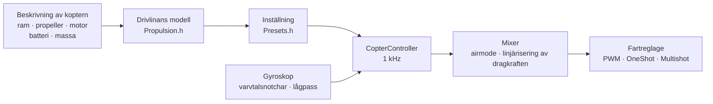

# COPTER.md – firmware för multikoptrar

Samma firmware, samma kort (Matek H743-WING V3, DevEBox H743), samma
sensorer och mottagare – men i stället för ett flygplan en quadkopter, hexa,
okto, Y6 eller X8. Den största skillnaden mot Betaflight, INAV och
ArduPilot: **PID, filter, tomgång och rates ställs inte in för hand**. Du
beskriver koptern (ram, propellrar, motorer, batteri, massa), och
firmwaren härleder inställningen själv ur en fysikalisk modell – och anpassar
sig under flygning till det som modellen gissade fel.

> **Ärligt talat.** Kopter-firmwaren är hittills bara kontrollerad i en
> simulator (en modell med 6 frihetsgrader, 12 byggen × 3 varianter av
> ”fel” fysik) och genom att byggas för korten. Den har inte flugit än. Att
> den flyger bättre än Betaflight eller ArduPilot går att påstå först efter
> flygprov – fram till dess är det ett mål, inte ett faktum.

## Hur det fungerar



1. **Drivlinans modell** (`copter/Propulsion.h`): en motor med mot-EMK och
   lindningsresistans (ur KV och statorvolym), propellerns dragkraft och
   vridmoment (ur diameter, stigning och antal blad), rotorns tröghet med
   propellern. För 5" 2207 1950KV på 6S ger modellen ~28 000 rpm, ~1,6 kg
   dragkraft och ~45 A på fullgas – som på provbänkar.
2. **Vad som följer av den** (`copter/Presets.h`): hovringsgas, varvtal på
   tomgång/i hovring/på fullgas, motorns fördröjning τ, ramens
   tröghetsmoment, förhållandet dragkraft/vikt, ström.
3. **Vinkelhastighetsslingan** väljs efter frekvenssvaret: motor, filter,
   notchar, cykelns och fartreglagets fördröjning – allt finns i modellen.
   Överkorsningsfrekvensen är den högsta med 50° fasmarginal (gir 55°) och
   **12 dB förstärkningsmarginal**: inställningen klarar en kopter vars
   dragkraft och tröghet är fel med en faktor två. Andelen D väljs genom
   sökning – den som gör slingan bredast. Ur överkorsningsfrekvensen följer
   P, I, D och framkoppling (FF).
4. **Gaskorrigering av förstärkningen (TPA)** – ur samma modell: på låg gas
   svarar motorn svagare, på hög gas starkare.
5. **Under flygning** lär sig firmwaren hovringsgasen själv (tyngre batteri,
   gimbal) och flyttar notcharna efter varvtalet.

## Katalog över byggen

| Bygge | Ram | Propeller · motor · batteri | Massa | Dragkraft/vikt | Hovring | Slingans bandbredd |
|---|---|---|---|---|---|---|
| `whoop65` | Quad X 65 mm | 31 mm ×4 · 0702 23000KV · 1S | 22 g | 4,2 | 31 % | 16 Hz |
| `whoop75` | Quad X 75 mm | 40 mm ×4 · 0802 19000KV · 1S | 32 g | 4,3 | 27 % | 16 Hz |
| `toothpick25` | Quad X 115 mm | 2.5" · 1103 8000KV · 3S | 70 g | 12,1 | 8 % | 14 Hz |
| `micro3` | Quad X 140 mm | 3" · 1404 4500KV · 4S | 190 g | 8,3 | 15 % | 14 Hz |
| `cinewhoop3` | Quad X 150 mm | 3" 5-blad · 1504 3600KV · 4S | 330 g | 4,1 | 32 % | 16 Hz |
| `freestyle5` | Quad X 225 mm | 5.1" · 2207 1950KV · 6S | 680 g | 9,0 | 15 % | 13 Hz |
| `race5` | Quad X utdragen | 5.1" · 2306 2000KV · 6S | 560 g | 10,8 | 11 % | 12 Hz |
| `longrange7` | Quad X 315 mm | 7" · 2806.5 1300KV · 6S | 1,0 kg | 7,0 | 20 % | 11 Hz |
| `heavy10` | Quad X 450 mm | 10" · 3115 900KV · 6S | 2,2 kg | 6,6 | 25 % | 10 Hz |
| `cinelifter8` | X8 380 mm | 8" · 2812 1100KV · 6S | 3,5 kg | 6,4 | 23 % | 11 Hz |
| `hex13` | Hex X 700 mm | 13" · 3510 600KV · 6S | 4,0 kg | 3,7 | 35 % | 8 Hz |
| `hex15` | Hex X 900 mm | 15" · 4114 400KV · 6S | 6,0 kg | 3,0 | 45 % | 8 Hz |

Ramar: Quad X, utdragen X, H, Deadcat, ”+”, Hex X/+, Y6, Okto X/+, X8.
Motornumreringen är som i Betaflight (quad: 1 – bak höger, 2 – fram höger,
3 – bak vänster, 4 – fram vänster), propellrar inåt eller utåt.
Flygstilar – inomhus, freestyle, racing, filmning, långdistans, tunglyft: de
styr rates och största lutning.

## Din egen kopter

`include/config/CopterConfig.h`:

```cpp
#define COPTER_BUILD "freestyle5"     // närmaste bygge i katalogen
constexpr float MASS_G = 742;          // väg den med batteri – det viktigaste
constexpr float PROP_DIAMETER_IN = 5.1f, PROP_PITCH_IN = 3.6f;
constexpr float MOTOR_KV = 2150;       // 0 – som i bygget
constexpr copter::EscProtocol ESC_PROTOCOL = copter::EscProtocol::ONESHOT125;
```

Bygget kan också väljas med en flagga: `-D COPTER_BUILD=\"race5\"`. Efter
flashningen visar tangenten `t` i konsolen vad som härleddes och varnar om
något är fel: för lite dragkraft, motorn klarar inte den propellern,
närliggande propellrar slår i varandra, hovring över 60 % gas, motorerna
snurrar fortare än halva cykelfrekvensen.

## Flashning och första start

```bash
pio run -e matek-h743-quad -t upload          # Matek H743-WING V3: BOOT-knappen + USB
pio run -e stm32h743-devebox-quad -t upload   # DevEBox H743
```

Utgångar till motorerna i ordning: Matek – S1…S8, DevEBox – PA0–PA3, PD14,
PD15, PE9. **Första start – utan propellrar**, seriemonitor på 115200:

| Tangent | Vad den gör |
|---|---|
| `t` | inställningen: dragkraft, hovring, varvtal, motorns τ, filter, slingans bandbredd och marginaler, P/I/D/FF, rates, varningar |
| `m` | motortest: ber om bekräftelse med `y` (propellrarna av!), snurrar varje motor i 2 s och säger var den sitter och åt vilket håll den ska snurra |
| `s` | tillstånd och **varför den inte armerar** – varje orsak i ord |
| `o` | monteringskalibrering av kortet med tre lägen (obligatorisk på Matek före ARM) |
| `i` · `r` · `l` · `D` | gyroskop · sändarkanaler · liverad · DFU-bootloader |

Fel motor snurrar – ändra ordningen i `CopterConfig::MOTOR_PINS`; den
snurrar åt fel håll – ändra riktningen i fartreglagets konfigurator
(BLHeliSuite, ESC-Configurator), löd inte om några ledningar.

## Sändare och lägen

Mode 2: CH1 roll, CH2 tippning, CH3 gas, CH4 gir. **ARM** – SwA (CH5), som
på flygplanet. **Läge** – SwC (CH7):

| SwC | Läge | Vad spaken gör |
|---|---|---|
| upp | ANGLE | lutning (upp till stilens gräns); släpp – koptern planar ut; gir – runt lodlinjen |
| mitten | ALT_HOLD | ANGLE + höjd: gas i mitten – hovrar, över/under – stigning upp till 3 m/s, sjunkning upp till 2 m/s |
| ner | ACRO | rotationshastighet enligt rate-kurvan; airmode – styrbar även på noll gas |

HORIZON (ANGLE nära mitten, ACRO vid kanten) slås på genom att ändra en rad
i `CopterConfig.h`.

## Skydd

- **ARM** – bara om: förbindelsen finns, gasen är i botten, koptern står
  plant (upp till 25°) och inte rörs, gyroskopet svarar, orienteringen har
  bestämts, batteriet inte är tomt, inget motortest pågår, kortets montering
  är kalibrerad (där det krävs). En ARM-brytare som slogs på för tidigt måste
  slås av och på igen.
- **ARM-brytaren ner – motorerna stannar i samma cykel**, i alla lägen.
- **Förlorad förbindelse**: ett avbrott på upp till 0,3 s ändrar ingenting;
  längre – på marken direkt DISARM, i luften – plant läge och sjunkning med
  0,7 m/s (efter barometern, utan den efter accelerometern), markkontakt –
  DISARM. Är förbindelsen tillbaka i 1 s får piloten styrningen igen.
- **Krasch**: i ANGLE/ALT_HOLD lutning över 90° längre än 0,7 s, eller mer
  än 30° från det spaken begär längre än 2 s (trasig motor, ligger på
  sidan); i alla lägen 1 s på rygg – motorerna stannar. Armera igen – först
  efter att brytaren slagits av.
- **På marken byggs integralen inte upp** – koptern hoppar inte och välter
  inte vid starten.

## Vad som finns inuti – kort

| Fil | Vad |
|---|---|
| `copter/Propulsion.h` | modell av motor och propeller |
| `copter/Presets.h` | katalog över byggen, härledning av inställningen, varningar |
| `copter/Frames.h` · `Mixer.h` | ramar och mixer (airmode, roll/tippning före gir, linjärisering av dragkraften) |
| `copter/RateController.h` | P, I (relax vid flippar och under acceleration, anti-gravity), D på gyroskopet, FF |
| `copter/Attitude.h` | orientering som kvaternion; accelerometern litas inte på vid ryck, under rotation eller när den säger emot gyroskopet |
| `copter/AltitudeHold.h` | höjd: barometer + accelerometer, hovringsgasen lärs in |
| `copter/GyroFilter.h` | notchar vid 1× och 2× varvtalet och vid bladpassagen + lågpass |
| `copter/CopterController.h` | allt tillsammans: ARM, lägen, failsafe, krasch |
| `hal/stm32/Stm32MotorOutput.h` · `src/stm32/main_copter.cpp` | fartreglage och startpunkt på STM32 |

## Hur det kontrollerades

`test/native/test_copter_sim` – den **riktiga** `CopterController` och en
koptermodell med 6 frihetsgrader: motorer med mot-EMK, batteriets
spänningsfall under ström, propellrarnas reaktionsmoment, luftmotstånd, byig
vind, fartreglagets fördröjning, ett gyroskop med brus och motorvibrationer
(vibrationer över halva cykelfrekvensen viks tillbaka, som på kortet), en
50 Hz-barometer, marken. Varje bygge i katalogen flyger på sin egen
inställning och på en modell som med avsikt inte stämmer med beskrivningen:

- **”trög”**: propellern drar 20 % mindre, motor och ram är 30 % trögare,
  20 % tyngre, tyngdpunkten förskjuten framåt;
- **”kvick”**: dragkraft +20 %, tröghet −30 %, massa −15 %, tyngdpunkten
  förskjuten åt sidan – slingans förstärkning är nästan dubbelt så hög som
  den beräknade.

| Vad | Resultat över 36 flygningar (12 byggen × 3 fysiker) |
|---|---|
| Start och hovring i ALT_HOLD | höjd ±0,3 m, lutning < 1°, hovringsgas inlärd (den ”kvicka” whoopen: 0,22 i stället för beräknade 0,31) |
| ANGLE: full spak | 90 % av lutningen på 0,14–0,35 s, översläng < 3 %, utplaning till 3° på 0,15–0,4 s |
| ACRO: full spak | 90 % av raten på 0,04–0,15 s, översläng < 12 % |
| Förlorad förbindelse på 10 m | sjunkning ≤ 0,94 m/s, markkontakt – DISARM, 17–28 s |

Och separat på 5":an: airmode på noll gas, gir, 4,5 m/s vind med byar,
failsafe utan barometer, vanliga PWM-fartreglage, avbrott och återkomst av
förbindelsen, fall på rygg, motorfel, motortestet, batteriets spänningsfall.
`test_copter` kontrollerar varje block för sig (41 tester),
`native_stm32/test_app_stm32_copter` – hela firmwaren på attrapper av Matek
H743: ”stopp”-pulser före ARM, monteringskalibrering, tomgång efter ARM,
lägen från brytaren, förlorad förbindelse på marken, konsolen.

Simulatorn hittade och hjälpte till att rätta verkliga fel som inte syns i
beräkningen: notchar som hoppade efter varje mixercykel; extra fasförlust
från notchar nära slingans bandbredd; integralen som byggdes upp under den
”tröga” hexans acceleration (32 % översläng); en accelerometer som i en flipp
på hovringsgas visar exakt 1 g och drog iväg horisonten med 10°; en kopter
med trasig motor som fortsatte snurra på marken.

## Vad som inte finns än

- **DShot** (även dubbelriktat – exakt varvtal för notcharna): kräver en
  DMA-drivrutin; beräkning av ramar och CRC finns redan
  (`copter/EscProtocol.h`).
- **En cykel snabbare än 1 kHz** – för whoops, vars motorer snurrar fortare
  än 500 Hz (simuleringen visar att de blir klart bättre på 4 kHz).
- Svart låda, MAVLink och OpenPlane Studio för koptern; positionshållning
  med GPS, hemflygning, uppdrag.
- Flygprov.
