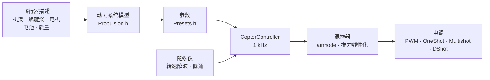

# COPTER.md — 多旋翼固件

同一套固件、同样的开发板（Matek H743-WING V3、DevEBox H743，以及几乎任何运行 Betaflight 的 F405）、同样的传感器和接收机——只是飞的不再是飞机，而是四旋翼、六旋翼、八旋翼、Y6 或 X8。与 Betaflight、INAV、ArduPilot 的主要区别在于：**PID、滤波器、怠速和速率都不需要手动调整**。只需描述这架飞行器（机架、螺旋桨、电机、电池、质量），固件就会根据物理模型自行推导出参数，并在飞行中自行修正模型估计不准的部分。

> **实话实说。** 多旋翼固件目前只在仿真器中验证过（6 自由度模型，12 种机型 × 3 种“不对”的物理参数），并已为开发板编译通过。它还没有真正飞过。要说它比 Betaflight 或 ArduPilot 飞得更好，只有在试飞之后才能下结论——在那之前这只是目标，而不是事实。

## 工作原理



1. **动力系统模型**（`copter/Propulsion.h`）：带反电动势和绕组电阻的电机（由 KV 和定子体积得出），螺旋桨的推力和扭矩（由直径、螺距和桨叶数得出），转子连同螺旋桨的转动惯量。对于 6S 上的 5" 2207 1950KV，模型给出满油门约 28 000 rpm、约 1.6 kg 推力和约 45 A——与台架数据一致。
2. **由此得出**（`copter/Presets.h`）：悬停油门，怠速/悬停/满油门时的转速，电机滞后 τ，机架的转动惯量，推重比，电流。
3. **角速度环**根据频率响应来选取：电机、滤波器、陷波器、控制周期和电调的延迟——全部包含在模型中。穿越频率取满足 50° 相位裕度（偏航 55°）和 **12 dB 增益裕度**的最高值：这样的参数即使推力和惯量偏差一倍也能撑住。D 的比例通过搜索选取——取使回路最宽的那个。P、I、D 和前馈（FF）都由穿越频率推出。
4. **按油门的增益修正（TPA）**来自同一个模型：小油门时电机响应弱，大油门时响应强。也提供 Betaflight 的曲线（`tpa_mode = PD` 或 `D`）。
5. **飞行中**，固件会自行学习悬停油门（电池更重、加了云台），并让陷波器跟随转速移动。

## 机型目录

| 机型 | 机架 | 螺旋桨 · 电机 · 电池 | 质量 | 推重比 | 悬停 | 回路带宽 |
|---|---|---|---|---|---|---|
| `whoop65` | Quad X 65 mm | 31 mm ×4 · 0702 23000KV · 1S | 22 g | 4.2 | 31% | 16 Hz |
| `whoop75` | Quad X 75 mm | 40 mm ×4 · 0802 19000KV · 1S | 32 g | 4.3 | 27% | 16 Hz |
| `toothpick25` | Quad X 115 mm | 2.5" · 1103 8000KV · 3S | 70 g | 12.1 | 8% | 14 Hz |
| `micro3` | Quad X 140 mm | 3" · 1404 4500KV · 4S | 190 g | 8.3 | 15% | 14 Hz |
| `cinewhoop3` | Quad X 150 mm | 3" 五叶 · 1504 3600KV · 4S | 330 g | 4.1 | 32% | 16 Hz |
| `freestyle5` | Quad X 225 mm | 5.1" · 2207 1950KV · 6S | 680 g | 9.0 | 15% | 13 Hz |
| `race5` | 加长 Quad X | 5.1" · 2306 2000KV · 6S | 560 g | 10.8 | 11% | 12 Hz |
| `longrange7` | Quad X 315 mm | 7" · 2806.5 1300KV · 6S | 1.0 kg | 7.0 | 20% | 11 Hz |
| `longrange7li` | Quad X 315 mm | 7" 双叶 · 2810 1300KV · 6S Li-ion 4000 | 1.05 kg | 7.5 | 23% | 12 Hz |
| `heavy10` | Quad X 450 mm | 10" · 3115 900KV · 6S | 2.2 kg | 6.6 | 25% | 10 Hz |
| `cinelifter8` | X8 380 mm | 8" · 2812 1100KV · 6S | 3.5 kg | 6.4 | 23% | 11 Hz |
| `hex13` | Hex X 700 mm | 13" · 3510 600KV · 6S | 4.0 kg | 3.7 | 35% | 8 Hz |
| `hex15` | Hex X 900 mm | 15" · 4114 400KV · 6S | 6.0 kg | 3.0 | 45% | 8 Hz |

机架：Quad X、加长 X、H、Deadcat、“+”、Hex X/+、Y6、Octo X/+、X8。电机编号与 Betaflight 相同（四旋翼：1 — 右后，2 — 右前，3 — 左后，4 — 左前），螺旋桨可内旋或外旋。飞行风格——室内、花飞、竞速、航拍、远航、重载：它们决定速率和最大倾角。

## 你自己的飞行器

`include/config/CopterConfig.h`：

```cpp
#define COPTER_BUILD "freestyle5"     // 目录中最接近的机型
constexpr float MASS_G = 742;          // 带电池称重——这是最重要的
constexpr float PROP_DIAMETER_IN = 5.1f, PROP_PITCH_IN = 3.6f;
constexpr float MOTOR_KV = 2150;       // 0 — 与机型相同
constexpr copter::EscProtocol ESC_PROTOCOL = copter::EscProtocol::ONESHOT125;
```

机型也可以用编译标志选择：`-D COPTER_BUILD=\"race5\"`；也可以不重新编译，直接在 CLI 中设置：`set copter_build = race5`、`set copter_mass_g = 742`、`save`（设置见下文；此时文件中的值只作为默认值）。烧录后，在控制台按 `t` 可以看到推导结果；如果有问题会给出警告：推力不足、电机带不动这副桨、相邻螺旋桨会相碰、悬停油门超过 60%、电机转速超过控制频率的一半。电机数量不同的另一种机架需要重启后才生效：在此之前 ARM 被禁止（`REBOOT_REQD`）。

## 烧录与首次启动

```bash
pio run -e matek-h743-quad -t upload          # Matek H743-WING V3：BOOT 按键 + USB
pio run -e stm32h743-devebox-quad -t upload   # DevEBox H743
pio run -e aocodarc-f405v3-quad -t upload     # 来自 Betaflight 的 F405 飞控——见下文
```

电机输出依次为：Matek — S1…S8，DevEBox — PA0–PA3、PD14、PD15、PE9。**首次启动请卸下螺旋桨**，串口监视器 115200：

| 按键 | 作用 |
|---|---|
| `t` | 参数：推力、悬停、转速、电机 τ、滤波器、回路带宽和裕度、P/I/D/FF、速率、警告 |
| `m` | 电机测试：要求按 `y` 确认（已卸桨！），每个电机转 2 s，并说明它的位置和应转的方向 |
| `s` | 状态，类似 Betaflight 的 `status`：控制周期负载、频率、电池以及**为什么不能解锁**——每个原因都给出 BF 代码（`RXLOSS`、`ANGLE`、`CLI`…）和文字说明 |
| `o` | 用三个姿态校准开发板的安装方向（Matek 上 ARM 前必须完成） |
| `c` | 罗盘校准：15 s 内让飞行器绕所有轴转动（罗盘——GPS 模块上的 QMC5883L 或 QMC5883P，哪个有响应用哪个） |
| `i` · `r` · `l` · `D` | 陀螺仪 · 遥控器通道 · 实时行 · DFU 引导程序 |
| `#` | 类似 Betaflight 的 CLI：`set`、`get`、`diff`、`aux`、`map`、`profile`、`save`——[见下文](#设置类似-betaflight-的-cli) |

转的是错误的电机——在 `CopterConfig::MOTOR_PINS` 中调整顺序；方向反了——在电调配置工具（BLHeliSuite、ESC-Configurator）中改方向，不要重新焊线。

### 来自 Betaflight 的 F405 飞控

几乎任何基于 STM32F405 的四旋翼飞控（Betaflight，8 MHz 晶振）都可以用，只要板上有 ICM-42688-P 和 SPL06 或 DPS310 气压计。引脚分配直接取自 Betaflight 本身——所以即使目标板不在任何仓库中（GETFUN F405V3）也能用：

```bash
# 1. 板上还是 Betaflight；Configurator 已关闭。把 CLI 转储到文件
#    （PlatformIO 自带的 Python——其中有 pyserial）：
~/.platformio/penv/Scripts/python tools/bf_board.py read --port COM5 --out stack/MYBOARD_bf.txt
# 2. 备份全部原厂固件——需要时可以刷回 Betaflight
#    （板子进入 DFU：按住 BOOT 再插 USB）：
python tools/bf_board.py backup --out stack/MYBOARD_original.bin
# 3. 板子的头文件：哪个引脚接了什么（BF 不知道气压计型号——按产品描述填写）：
python tools/bf_board.py header stack/MYBOARD_bf.txt --baro SPL06 --out include/config/boards/MYBOARD.h
```

然后在 `platformio.ini` 中仿照 `aocodarc-f405v3-quad` 新建一个 env（参考板：其引脚分配公开，F405 核心始终在它上面编译和测试），加上 `-D OP_BOARD_FILE=\"config/boards/MYBOARD.h\"`。电机按 Betaflight 的编号为 M1…M8；接收机、GPS 和遥测在 Betaflight 原来使用的 UART 上；每个电机的定时器就是 Betaflight 选的那个（转储中的 `timer B06 AF2` 行 -> `OPB_MOTOR_AF`：一个引脚可能有两三个定时器，BF 在这块板上选的是没有 DMA 冲突的那组）。黑匣子闪存的总线和 CS 也来自转储。已经刷了我们固件的板子——用 [github.com/betaflight/config](https://github.com/betaflight/config) 中的 `config.h` 运行 `bf_board.py header`。

F405 只有一个闪存 bank：写入设置会让处理器停顿 1–2 s，所以只在未解锁时写入设置。

## 设置：类似 Betaflight 的 CLI

由描述推导出的参数可以手动修改——无需重新编译，逐行修改，就像 Betaflight 的 CLI 一样。在控制台按 `#` 进入（只能在未解锁时进入；CLI 打开期间 ARM 被禁止）：

```text
# get p_roll                     ← 数值、范围、默认值及其来源
# set p_roll = 50                ← 使用 Betaflight 单位
# set tune_source = BETAFLIGHT   ← 用 BF 4.5 的默认值代替模型
# profile 1                      ← PID 配置 0–3（rateprofile — 速率）；立即生效，运行中也可
# diff                           ← 只显示改动，BF 格式
# save                           ← 写入闪存，重新计算参数，退出
```

- **未手动设置的项使用默认值，而 PID 和速率的默认值不是表中的固定数字，而是由飞行器描述算出的结果**（`get` 显示“来自飞行器模型”）。修改描述——所有没动过的项会随之改变；手动设置的保持不变。设成与默认值相同的数，等于恢复默认。
- **单位与 Betaflight 相同**：PID 项 = 数值 × BF 系数 × 误差，总和 ÷ 1000 进入混控器（P 0.032029，I 0.244381，偏航再 ×2.5，D 0.000529，F 0.013754 × 0.01）。`t` 也会用这些数字显示模型参数：5" 为 P 25、I 41、D 28、F 35，而 BF 默认为 45/80/40/120——模型更柔和，因为它保留了 12 dB 的增益裕度。
- **Betaflight 的 diff 可以整段粘贴**（4.5 的 `diff all`）：已知设置会被应用，`profile`/`rateprofile` 会切换，`map`、`aux`、`rxrange`、`vtx` 和 `rxfail` 进入各自的表，注释被忽略，未知设置输出 `###错误…###` 行。BF 的硬件命令（`resource`、`timer`、`dma`、`serial`、`feature`、`board_name`…：在我们这里由板子头文件决定）会被跳过，并附上注释 `# 已跳过`；diff 中的 `defaults nosave` 不会改动飞行器描述（BF 没有这个）。在 `batch end`（或粘贴中途的 `save`）时输出汇总：`# 已粘贴：应用 N 行；未迁移 M 项：名称…`。这样的 `save` 之后半秒内，粘贴的剩余内容不会被当作控制台按键。
- `tune_source = BETAFLIGHT`——BF 4.5 的全部默认值：PID 45/80/40/120、47/84/46/125、45/80/0/120；速率 Actual 70/670/0；TPA 只作用于 D，油门 1350 起 65%，起飞前小油门时 −20%；`iterm_limit` 400；PID 总和 500（偏航 400）；anti-gravity 80、5 Hz、P 100；`throttle_boost` 5；ANGLE 每度 5 °/s，最大 60°；`yaw_lowpass_hz` 100；滤波器——换算到我们的链路上（陀螺仪 PT2 250 Hz，D — PT1 60 Hz：在回路带宽处延迟相同）。转速陷波仍然是我们自己的。
- 闪存中只保存手动设置的项（以及所选配置）；重新烧录不会清除，`defaults` 会清除。不 `save` 直接 `exit`——取消修改。

| 命令 | 作用 |
|---|---|
| `set` · `set 名称 = 值` | 全部设置 · 设置（`save` 后生效） |
| `get 名称片段` | 数值、范围、默认值、含义 |
| `diff [all]` · `dump [all]` | 改动 · 全部；`all`——所有配置 |
| `profile [0-3]` · `rateprofile [0-3]` | 选择 PID 配置 · 速率配置 |
| `aux` · `aux 序号 模式 通道 起 止 [逻辑 关联]` · `aux help` | 开关上的模式表 · 一行 · 模式编号——[见下文](#遥控器与模式) |
| `map [AETR1234]` · `rxrange [0-3 min max]` | 通道顺序 · 横滚/俯仰/偏航/油门摇杆的端点 |
| `rxfail` · `rxfail 通道 a\|h\|s [值]` | 失去信号时如何处理通道，与 BF 相同：摇杆 0–3 — `a`（failsafe 自动机）或 `h`（保持最后值），AUX 4–17 — `h` 或 `s 750…2250`（固定值）；前 0.3 s 始终保持最后的有效值 |
| `vtx` · `vtx 序号 通道 频段 图传频道 功率 起 止` · `vtx_info` | 用开关控制图传，与 BF 相同 · 图传的回应及其功率档——[见下文](#图传发射机) |
| `dshot_telemetry_info` | 与 BF 相同：每个电机的 eRPM、rpm、Hz 和无应答帧比例（`dshot_bidir`） |
| `flash_info` · `flash_erase` | 黑匣子闪存（F405）：芯片、容量、JEDEC ID、占用和飞行记录 · 全部擦除（一条命令，最多等待一分钟，与 BF 相同） |
| `save` · `defaults [nosave]` | 保存并重新计算 · 全部恢复默认 |
| `status` · `tasks` | 状态（同 `s`）· 控制周期各部分的耗时：频率、平均和最差、处理器占比 |
| `version` · `help` · `exit` | 版本 · 列表 · 退出 |

### 设置项

| 设置 | 位置 | 范围 | 默认 | 含义 |
|---|---|---|---|---|
| `tune_source` | 通用 | `MODEL`、`BETAFLIGHT` | `MODEL` | PID、滤波器和 TPA 的来源：飞行器描述或 BF 4.5 默认值 |
| `profile_name` | PID 配置 | 最多 8 个字符 | — | PID 配置名称 |
| `p_roll` `i_roll` `d_roll` `f_roll` | PID 配置 | P、I、D 0–250；F 0–1000 | 来自模型；BF：45、80、40、120 | 横滚 PID，BF 单位 |
| `p_pitch` `i_pitch` `d_pitch` `f_pitch` | PID 配置 | 同上 | 来自模型；BF：47、84、46、125 | 俯仰 PID |
| `p_yaw` `i_yaw` `d_yaw` `f_yaw` | PID 配置 | 同上 | 来自模型；BF：45、80、0、120 | 偏航 PID |
| `d_max_roll` `d_max_pitch` `d_max_yaw` | PID 配置 | 0–250 | 0（D 恒定） | 剧烈动作时的 D，与 BF 2025.12 相同：此时 `d_*` 为静止时的 D |
| `d_min_roll` `d_min_pitch` `d_min_yaw` | PID 配置 | 0–250 | 0；BF：30、34、0 | 与 BF 4.5 相同：静止时的 D，`d_*`——剧烈动作时（若未设置 `d_max_*`） |
| `d_max_gain`（`d_min_gain`） | PID 配置 | 0–100 | 37 | 陀螺仪抖动时 D 升高的难易：37 时——约 5000 °/s² 完全升高 |
| `d_max_advance`（`d_min_advance`） | PID 配置 | 0–200 | 20 | 摇杆移动时 D 提前升高的程度：20 时——设定值约 2500 °/s² 完全升高 |
| `iterm_relax` | PID 配置 | `OFF`、`RP`、`RPY`、`RP_INC`、`RPY_INC` | `RPY`；BF：`RP` | 在哪些轴上设定值剧变时 I 暂停累积（翻滚后不回弹）；`_INC`——只抑制增长 |
| `iterm_relax_type` | PID 配置 | `GYRO`、`SETPOINT` | `SETPOINT` | `SETPOINT`——I 累积变慢；`GYRO`——I 朝向平滑后的设定值，紧贴时为零 |
| `iterm_relax_cutoff` | PID 配置 | 1–50 Hz | 10；BF：15 | relax 用的设定值平滑：越低——等待越久 |
| `iterm_relax_error` | PID 配置 | `OFF`、`ON` | `ON` | 我们独有：加速到新设定值（翻滚）时的大误差不计入 I；没有摇杆动作的误差（阵风、油门冲击）照常计入 |
| `iterm_rotation` | PID 配置 | `OFF`、`ON` | `OFF` | I 随机架旋转：自旋时，横滚上累积的部分转到俯仰上 |
| `iterm_windup` | PID 配置 | 30–100% | 100（关闭）；BF：85 | 电机输出差距越大，I 累积越弱；差距到顶时停止 |
| `iterm_limit` | PID 配置 | 0–500 | 来自模型（300）；BF：400 | I 的上限，1000——电机全行程 |
| `pidsum_limit` · `pidsum_limit_yaw` | PID 配置 | 100–1000 | 1000；BF：500 · 400 | 横滚和俯仰 PID 总和上限 · 偏航（1000——全行程）；到达上限时 I 不累积 |
| `anti_gravity_gain` | PID 配置 | 0–250 | 80 | 油门冲击时加强 I，机头不点头：完全冲击（0.1 s 走完全行程）时为 1 + gain/10 倍 |
| `anti_gravity_cutoff_hz` | PID 配置 | 2–50 Hz | 5 | 油门变化速度的平滑：越低——峰值越低但持续越久 |
| `anti_gravity_p_gain` | PID 配置 | 0–250% | 0；BF：100 | 同时加强横滚和俯仰的 P：100 时——完全冲击时加强 50% |
| `throttle_boost` · `throttle_boost_cutoff` | PID 配置 | 0–100（×0.1）· 5–50 Hz | 0；BF：5 · 15 | 摇杆上的油门冲击（油门减去其低通）放大 1 + boost/10 倍——电机更早跟上摇杆；ALT_HOLD 中不生效 |
| `tpa_mode` | PID 配置 | `PD`、`D`、`MODEL` | `MODEL`；BF：`D` | 按油门修正 PD：`PD`/`D`——BF 曲线（见下两行），`MODEL`——模型对 P 和 D 的修正 |
| `tpa_rate` · `tpa_breakpoint` | PID 配置 | 0–100% · 750–2250 µs | 65 · 1350 | `PD`/`D`：超过该点后 PD（或仅 D）线性减弱，满油门时减弱 `tpa_rate` |
| `tpa_low_rate` · `tpa_low_breakpoint` | PID 配置 | −128…100% · 750–2250 µs | 0；BF：20 · 1050 | 零油门时 PD（D）减弱 `tpa_low_rate`（小于 0——增强），线性过渡到该点 |
| `tpa_low_always` | PID 配置 | `OFF`、`ON` | `OFF` | `OFF`——仅在 ARM 后油门尚未超过 `tpa_low_breakpoint`（在地面）时生效，`ON`——始终 |
| `feedforward_transition` | PID 配置 | 0–100% | 0 | 摇杆比这更靠近中位时前馈减弱（线性降到零）——中位更柔和 |
| `feedforward_averaging` | PID 配置 | `OFF`、`2_POINT`、`3_POINT`、`4_POINT` | `OFF` | 用于前馈的摇杆速度在 2–4 个接收机帧上取平均：帧稀疏时更平滑，但更滞后 |
| `feedforward_smooth_factor` | PID 配置 | 0–95% | 0；BF：25 | 前馈的帧间平滑（每帧保留旧值的比例） |
| `feedforward_jitter_factor` | PID 配置 | 0–20 | 0；BF：7 | 一帧内摇杆移动小于此值（500——半杆）时前馈平滑减弱到零：手指抖动不会让电机抽动 |
| `feedforward_boost` | PID 配置 | 0–50 | 0；BF：15 | 按摇杆加速度追加（15——提前 3 ms，不超过摇杆速度本身） |
| `feedforward_max_rate_limit` | PID 配置 | 0–150% | 0；BF：90 | 设定值达到最大速率的该比例时，向外的前馈不超过 P 对剩余余量给出的值，超出后为零：满杆翻滚不超调 |
| `yaw_lowpass_hz` | PID 配置 | 0–500 Hz | 来自模型（30–100）；BF：100 | 偏航 PID 输出的低通（0——不滤波）；模型 PID 按模型频率计算 |
| `use_integrated_yaw` · `integrated_yaw_relax` | PID 配置 | `OFF`、`ON` · 0–255 | `OFF` · 200 | 用 PID 总和的积分控制偏航（×100 1/s，泄漏 relax × 0.08 1/s）——用于大桨，偏航会改变桨的转速。BF 的数值表现与 BF 相同（I 不乘 2.5；5" 需要 `d_yaw`，否则会振荡）；未手动设置的模型偏航 PID 会重新计算，使回路保持不变 |
| `abs_control_gain` | PID 配置 | 0–20（°/s 每 °） | 0（关闭） | ACRO：被阵风或推力不平衡带走的角度和航向会恢复；横滚和俯仰——仅 ACRO，偏航——任何模式，空中 |
| `abs_control_limit` · `abs_control_error_limit` · `abs_control_cutoff` | PID 配置 | 10–255 °/s · 1–45° · 1–45 Hz | 90 · 20 · 11 | 修正量上限 · 累积角度误差上限 · 设定值低通（快速打杆时机架的滞后不被累积） |
| `thrust_linear` | PID 配置 | 0–150% | 来自模型（15–30）；BF：0 | 推力线性化：小油门的响应与大油门一致 |
| `motor_output_limit` | PID 配置 | 1–100% | 100 | 怠速以上电机行程的比例：4S 电机用 6S 电池——66 |
| `rateprofile_name` | 速率配置 | 最多 8 个字符 | — | 速率配置名称 |
| `roll_rc_rate` `pitch_rc_rate` `yaw_rc_rate` | 速率配置 | 1–255（×10 °/s） | 按飞行风格；BF：7 | 摇杆中位处的速率 |
| `roll_srate` `pitch_srate` `yaw_srate` | 速率配置 | 0–255（×10 °/s） | 按飞行风格；BF：67 | 满杆速率 |
| `roll_expo` `pitch_expo` `yaw_expo` | 速率配置 | 0–100% | 按飞行风格；BF：0 | expo：中位更柔和 |
| `serialrx_provider` | 通用 | `IBUS`、`SBUS`、`CRSF` | `Config.h` 中的 `RX_PROTOCOL` | 接收机协议；`save` 后切换，无需重启 |
| `rx_min_usec` `rx_max_usec` | 通用 | 750–2250 µs | 885、2115 | 超出该范围的脉冲视为通道错误：摇杆通道——信号丢失，AUX 保持上一个值 |
| `copter_build` | 通用 | 目录中的机型 | `COPTER_BUILD` | 飞行器描述的基础 |
| `copter_mass_g` | 通用 | 0–30000 g（0——估算） | 来自机型 | 含电池的起飞质量 |
| `copter_wheelbase_mm` | 通用 | 30–2000 mm | 来自机型 | 对角电机轴距 |
| `prop_diameter_in` `prop_pitch_in` `prop_blades` | 通用 | 0.5–40"、0.3–30"、2–8 | 来自机型 | 螺旋桨 |
| `motor_stator_mm` `motor_height_mm` `motor_kv` | 通用 | 3–120 mm、0.5–60 mm、50–80000 | 来自机型 | 电机：2207 — 22 和 7 |
| `battery_cells` `battery_mah` | 通用 | 1–14 S、50–50000 mAh | 来自机型 | 电池 |
| `props_out` | 通用 | `OFF`、`ON` | `PROPS_OUT` | 螺旋桨外旋：所有电机反转 |
| `battery_chemistry` | 通用 | `LIPO`、`LIHV`、`LIION` | 来自机型（LiPo） | 电池化学类型：单节阈值和推力模型用的负载电压（3.75 / 3.85 / 3.5 V） |
| `vbat_min_cell_voltage` `vbat_warning_cell_voltage` `vbat_max_cell_voltage` | 通用 | 100–500（×0.01 V） | 按化学类型：LiPo 330/350/430，LiHV 330/350/440，Li-ion 280/310/425 | 单节：耗尽（CRITICAL）· 该返航了（WARNING；静止时低于此值——不允许解锁）· 满电 |
| `vbat_full_cell_voltage` | 通用 | 100–500（×0.01 V） | 按化学类型：LiPo 410，LiHV 425，Li-ion 410 | 接电时单节高于此值——电池是满的；否则未解锁时 OSD 显示 `BATT < FULL` |
| `vbat_scale` · `vbat_divider` · `vbat_multiplier` | 通用 | 0–255 · 1–255 · 1–255 | 板载分压（110 · 10 · 1 — 1:11；F405——来自板子转储） | 伏特 = 引脚 mV × `vbat_scale` /（1000 × `vbat_divider` × `vbat_multiplier`），与 BF 相同 |
| `battery_meter` | 通用 | `NONE`、`ADC`、`ESC` | 板子有电池输入时为 `ADC` | 电压来源（`ESC`——来自电调遥测，尚不可用） |
| `current_meter` · `ibata_scale` · `ibata_offset` | 通用 | `NONE`/`ADC`/`VIRTUAL`/`ESC`/`MSP` · ±16000（×0.1 mV/A）· ±32000 mV | 板子有电流输入时为 `ADC`；400（Matek — 250，F405——来自板子转储）；0 | 电流传感器：电流、已用 mAh、剩余（`VIRTUAL`、`ESC`、`MSP` 可从 BF diff 接收，但暂不提供电流） |
| `vbat_detect_cell_voltage` | 通用 | 0–2000（×0.01 V） | 300 | 电压在此值与满电单节（1S）之间，或高于此值的两倍时，视为接了电池；否则——USB 供电 |
| `force_battery_cell_count` | 通用 | 0–24 S | 0 | 电芯节数；0——取自飞行器描述（`battery_cells`）。在 BF 中 0 表示按电压猜测；我们不猜：耗尽的 6S Li-ion（17 V）和满电的 4S LiPo 无法区分 |
| `bat_capacity` | 通用 | 0–20000 mAh | 0 | 用于剩余量和耗电报警的容量；0——取描述中的 `battery_mah` |
| `vbat_hysteresis` | 通用 | 0–250（×0.01 V） | 1 | 电压再低于阈值这么多时触发报警（整组电池，与 BF 相同）；回到阈值以上时解除 |
| `vbat_duration_for_warning` · `vbat_duration_for_critical` | 通用 | 0–150（×0.1 s） | 20 · 20（BF：0 · 0） | 连续低于阈值这么久——WARNING · CRITICAL：油门冲击时的压降不算报警 |
| `use_vbat_alerts` · `use_cbat_alerts` · `cbat_alert_percent` | 通用 | `OFF`/`ON` · `OFF`/`ON` · 0–100% | `ON` · `OFF` · 10 | 电池报警的蜂鸣和显示 · 也按 mAh 报警（剩余不超过 `cbat_alert_percent`——WARNING，为零——CRITICAL；需要电流传感器） |
| `vbat_cutoff_percent` | 通用 | 0–100% | 100（不限制） | 从第一次 CRITICAL 起，10 s 内把摇杆油门平滑限制到这个比例（BF 的 LVC）；不影响定高和 failsafe 自动机 |
| `vbat_display_lpf_period` · `vbat_sag_lpf_period` · `ibat_lpf_period` | 通用 | 1–255（×0.1 s） | 30 · 2 · 10 | 平滑（低通 10/周期 Hz，与 BF 相同）：显示和报警 · 压降补偿用的电压 · 电流 |
| `vtx_protocol` | 通用 | `AUTO`、`SMARTAUDIO`、`TRAMP`、`NONE` | 板子有 VTX 线时为 `AUTO` | 图传控制线 |
| `vtx_band` · `vtx_channel` · `vtx_freq` | 通用 | 0–10 · 1–8 · 0–6200 MHz | 5（R）· 1 · 0 | 频段（1 A、2 B、3 E、4 F、5 R、6 L、7 X、8 V、9 G、10 S；0——直接用频率数值） |
| `vtx_power` | 通用 | 1–12 | 1 | 功率档，1——最低；功率表来自图传（`vtx_info`） |
| `vtx_max_power_mw` | 通用 | 0–10000 mW | 0（不限制） | **上限**：无论开关还是图传按键都不能超过 |
| `vtx_low_power_disarm` | 通用 | `OFF`、`ON`、`UNTIL_FIRST_ARM` | `OFF` | 未解锁时——最低功率档 |
| `gps_minimum_sats` | 通用 | 4–50 | 8 | 至少有这么多卫星时，ARM 时记录家的位置 |
| `crsf_telemetry` | 通用 | `OFF`、`ON` | `ON` | 通过 CRSF 向遥控器回传遥测 |
| `blackbox_device` | 通用 | `NONE`、`SPIFLASH`、`SDCARD`、`SERIAL` | F405 上为 `SPIFLASH`，H743 上为 `SDCARD` | 黑匣子写到哪里；只有选择了本板的存储介质才会记录（`SERIAL` 可从 BF diff 接收，但不会记录） |
| `blackbox_mode` | 通用 | `NORMAL`、`MOTOR_TEST`、`ALWAYS` | `NORMAL` | 何时记录：解锁期间、电机转动期间、始终 |
| `blackbox_sample_rate` | 通用 | `1/1` … `1/32` | `1/1`（带闪存的 F405 — `1/2`） | 陀螺仪、PID 和电机——每多少个周期记录一次 |
| `motor_poles` | 通用 | 4–255 | 14 | 转子磁极数：rpm = eRPM × 2 / `motor_poles` |
| `dshot_bidir` | 通用 | `OFF`、`ON` | `OFF` | 双向 DShot：电调回传转速；重启后生效（在此之前禁止 ARM，`REBOOT_REQD`）；开启后控制周期上限更低——帧、30 µs 和应答：DShot600——最高 11.8 kHz，300 — 7.2，150 — 4.0 |
| `small_angle` | 通用 | 0–180° | 25 | 放置倾角大于此值——不允许解锁；180——不检查 |
| `auto_disarm_delay` | 通用 | 0–60 s | 5 | 已解锁但放在地上、油门最低持续这么久——DISARM（BF 中仅限摇杆解锁；我们开关解锁也适用）；0——从不 |
| `runaway_takeoff_prevention` | 通用 | `OFF`、`ON` | `ON` | ARM 后控制器输出顶到极限而飞行器在转动——DISARM |
| `runaway_takeoff_deactivate_delay` | 通用 | 100–1000 ms | 500 | 平稳飞行这么久后，runaway 检查关闭，直到下次 ARM |
| `runaway_takeoff_deactivate_throttle_percent` | 通用 | 0–100% | 20 | 油门高于此值才算在飞（或飞行器已升高超过一米） |
| `failsafe_delay` | 通用 | 1–200（×0.1 s） | 15 | 无信号持续这么久——进入第 2 阶段；在此之前为第 1 阶段：改平并保持高度（BF 中——摇杆回中、油门 0） |
| `failsafe_procedure` | 通用 | `AUTO-LAND`、`DROP`、`GPS-RESCUE` | `AUTO-LAND`（BF：`DROP`） | 第 2 阶段：改平下降 · 关闭电机 · 返航（目前没有 GPS——同 AUTO-LAND，打杆可收回控制） |
| `failsafe_landing_time` | 通用 | 1–250 s | 120（BF：60） | AUTO-LAND 在这段时间内未落地——DISARM；我们的下降按高度进行并在触地时结束，这只是余量 |
| `failsafe_throttle` | 通用 | 1000–2000 µs | 1000 | AUTO-LAND：1000——按高度以 0.7 m/s 下降；更大——固定油门，与 BF 相同 |
| `failsafe_throttle_low_delay` | 通用 | 0–300（×0.1 s） | 100 | 失去信号前油门处于最低的时间超过此值——立即 DISARM（飞行器显然在地上）；0——不启用 |
| `failsafe_recovery_delay` | 通用 | 1–200（×0.1 s） | 5 | 信号保持这么久——控制权交还飞手（第 2 阶段），failsafe 导致 DISARM 后也可再次解锁 |
| `failsafe_stick_threshold` | 通用 | 0–50% | 30 | GPS-RESCUE：信号恢复后，摇杆推过此值时控制权交还飞手 |
| `failsafe_switch_mode` | 通用 | `STAGE1`、`KILL`、`STAGE2` | `STAGE1` | 开关触发的 FAILSAFE 模式：等同信号丢失 · 立即关闭电机（1 s 后可 ARM）· 直接进入第 2 阶段 |
| `craft_name` | 通用 | 最多 16 个字符 | — | 飞行器名称：BF 配置器（`MSP_NAME`）和日志 |
| `vbat_sag_compensation` | PID 配置 | 0–150% | 100（BF：0） | 按电压降修正电机：100——电池电压下降时响应与满电相同，0——不修正 |

飞行器描述（`copter_build` … `props_out`）：默认值是目录中的机型加上 `CopterConfig.h` 中“你自己的飞行器”的修正；更换机型——质量、螺旋桨、电机和电池的默认值来自新机型，手动设置的保持不变。`save` 时会按新描述重新计算 PID 和滤波器。

速率曲线目前是我们自己的：中位为 `rc_rate`，满杆为 `srate`，expo 让中位更柔和；expo 为 0 时与 Betaflight 的 Actual 一致。对于 13"/15" 六旋翼，模型要求的 D 超过 250、F 超过 1000——`get` 显示截断到上限的默认值，但实际应用的是模型的精确值。

## 遥控器与模式

默认美国手（Mode 2）：CH1 横滚，CH2 俯仰，CH3 油门，CH4 偏航。**ARM** — SwA（CH5），与飞机相同。**模式** — SwC（CH7）：

| SwC | 模式 | 摇杆的作用 |
|---|---|---|
| 上 | ANGLE | 倾角（不超过风格限制）；松杆——飞行器自动改平；偏航——绕垂直轴 |
| 中 | ALT_HOLD | ANGLE + 定高：油门居中——悬停，高于/低于中位——爬升最快 3 m/s、下降最快 2 m/s |
| 下 | ACRO | 按速率曲线控制旋转角速度；airmode——零油门也能操控 |

这些都可以在 CLI 中修改，与 Betaflight 相同：

- `map TAER1234`——通道顺序：每个通道用一个字母表示（A — 横滚，E — 俯仰，T — 油门，R — 偏航，1–4 — AUX1–AUX4）。油门的 failsafe 阈值（`RX_FAILSAFE_THROTTLE_US`）跟随油门通道。
- `rxrange 3 1050 1950`——把油门摇杆的端点拉伸到 1000–2000（0 — 横滚，1 — 俯仰，2 — 偏航，3 — 油门）。
- `aux 0 0 1 1700 2100 0 0`——通道在范围内时模式生效：行号 0–19、模式（BF 编号）、通道（0 — AUX1，即 `map AETR1234` 时的 CH5）、起止 µs（步长 25）、逻辑（0——该模式任一行满足即可，1——需全部满足）、关联（与另一模式一起开启）。不带参数的 `aux`——显示表，`aux help`——模式编号。

| 模式 | BF 编号 | 作用 |
|---|---|---|
| ARM | 0 | 电机启动 |
| ANGLE · HORIZON · ALTHOLD | 1 · 2 · 3 | 飞行模式；同时开启多个时——ALTHOLD，其次 ANGLE，再次 HORIZON；都没有——ACRO |
| FAILSAFE | 27 | 等同信号丢失（在地面检查 failsafe） |
| AIR MODE | 28 | 即使 `CopterConfig.h` 中关闭了 `AIRMODE` 也启用 airmode |
| PREARM | 36 | 若在表中——只有 PREARM 激活时才能 ARM |
| USER1 … USER4 | 40 … 43 | 板子的 PINIO 引脚（GETFUN F405V3 上：USER1 — 摄像头 CAM1/CAM2，USER2 — 12 V 电源） |
| VTX PIT MODE · VTX CONTROL DISABLE | 39 · 48 | 图传进入 PIT · 不控制图传 |

**表为空时（例如 `defaults` 之后），使用 `CopterConfig.h` 中的开关**（`aux` 会把它们显示为可复制的行）。只要有一行，就只有表生效，与 BF 相同：粘贴的 Betaflight diff 完整描述了这张表，不会混入固件默认值。表中没有 ARM——飞行器无法解锁（`NO_ARM_AUX`）。我们尚未实现的 BF 模式（BEEPER、GPS RESCUE…）会被接收并保存，但不起作用——`aux` 会说明。

## 图传发射机

带控制线的模拟图传（SmartAudio 或 Tramp——`vtx_protocol = AUTO` 会自动识别）由固件保持在设置中的频率和功率上：

```text
# set vtx_band = 5            ← R
# set vtx_channel = 1         ← R1，5658 MHz
# set vtx_max_power_mw = 400  ← “城市”上限
# vtx 0 2 0 0 2 900 1300      ← AUX3（SwC）上——功率档 2
# vtx 1 2 0 0 6 1700 2100     ← AUX3 下——功率档 6（但不超过上限）
# vtx_info                    ← 图传的回应及其功率档
# save
```

- **上限 `vtx_max_power_mw`** 最重要：开关的 `vtx` 行和 `vtx_power` 都不能超过它；如果用图传自身的按键调高了功率，固件会在一秒内把它降回来。取消上限——`set vtx_max_power_mw = 0`。
- **用遥控器调功率**——`vtx` 行，与 Betaflight 相同：AUX 在范围内时，图传使用该频段、频道和功率档（0——不改）。开关、旋钮或 EdgeTX 的逻辑通道都可以。
- 功率表来自图传本身：SmartAudio 2.1 以 dBm 报告各档（36 dBm——“4 W”），Tramp 报告 mW 上限；SmartAudio 1.0/2.0 为 25/200/500/800 mW 四档，与 TBS Unify 相同。
- 频率——80 频道 4.9–6.1 GHz 图传的频率表：A、B、E、F、R、L（商家称 D）、X、V、G、S。**模拟眼镜（Cobra X V4）只能接收 A、B、E、F、R 和 L**——在 X/V/G/S 上没有图像。
- VTX PIT MODE 模式——PIT（在地面时不干扰他人），GETFUN 上的 USER2——整个图传的 12 V 电源。图传无响应——`status` 显示“VTX：无响应”；此时用图传按键设置频率和功率。

## OSD 与蜂鸣器

**OSD**——飞控上的 AT7456E/MAX7456 芯片（来自 Betaflight 的板子，其总线和 CS 来自板子转储）。摄像头画面始终经过芯片，OSD 叠加在上面：链路（LQ）、模式、卫星数、VTX 功率、准星、指向家的箭头和距离、高度、电压（及单节电压）、电流、mAh、飞行时间，以及中央的**一条主要警告**：FAILSAFE、RXLOSS、BATT CRITICAL、LOW BATTERY，未解锁时——为什么不能解锁（BF 代码，例如 THROTTLE）或 DISARMED。字体来自芯片（运行 Betaflight 的板子上——BF 字体），所以文字都是拉丁字母。PAL/NTSC 按摄像头自动选择；OSD DISABLE 模式隐藏全部内容。

**蜂鸣器**：ARM——长鸣，DISARM——两声短鸣，上电后可以解锁时——一声短鸣；电池 WARNING——每 2 s 一声短鸣，CRITICAL——频繁鸣叫；failsafe——警报；BEEPER 模式——“寻找模型”（即使没有信号——AUX 保持最后值），BEEPER MUTE——静音（寻找除外）。

## GPS、罗盘和遥控器遥测

- **GPS**（u-blox M10）——接在 Betaflight 原来使用的 UART 上。`status` 显示定位状态、卫星数、精度、速度和**家的位置**：ARM 时若有 3D 定位且卫星数不少于 `gps_minimum_sats` 即记录；否则——在第一次良好定位时记录，即使已在空中（“在飞行中记录”）。到家的距离和方向——显示在 `status`、`@live` 和遥控器上。GPS 模式（返航、定点）**尚未实现**。
- **罗盘**在 GPS 模块上——QMC5883L 或 QMC5883P，固件会两种都尝试。校准——控制台中按 `c`。机头航向来自罗盘（若已校准），速度高于 3 m/s 时来自 GPS，否则来自上电以来的陀螺仪。倾斜尚未补偿：快速飞行时罗盘航向可能偏差十几度。
- **CRSF 遥测**（ELRS、Crossfire）——走通道数据所在的同一个 UART：电池（V、A、mAh、%）、GPS、姿态、模式（`ACRO`、`ANGL`、`HOR`、`ALTH`、`!FS!`；未解锁——带“*”）、垂直速度。在 EdgeTX（RadioMaster TX12）中——在模型的遥测页面选择“发现传感器”。

## 黑匣子

在 H743（Matek H743、DevEBox）上，多旋翼把飞行数据写到 SD 卡——格式和文件 `BLACKBOX.BIN` 都与飞机相同（准备 SD 卡——[BLACKBOX.md](BLACKBOX.md#sd-卡stm32h743)）。在 F405 上——写到板载 SPI 闪存（`blackbox_device = SPIFLASH`，与 BF 相同）：W25Q128、W25Q64、M25P16、GD25Q 及类似芯片通过 JEDEC ID 识别（最大 16 MB）；格式和下载方式相同。闪存始终保留一半处于擦除状态（16 MB、`1/2` 时约 8 分钟飞行），旧的飞行记录在地面时整段擦除，最旧的先擦——而不是像 BF 那样“满了——停止记录”。记录队列放在 F405 的 CCM RAM 中（60 KB），与 OSD 共用总线的闪存与其共享一个互斥锁，挂在陀螺仪总线上的闪存不使用。CLI 中的 `flash_info` 和 `flash_erase`——与 BF 相同。

| 记录 | 频率 | 内容 |
|---|---|---|
| `QGYRO` | 每个周期（`blackbox_sample_rate`） | 滤波前后的陀螺仪、设定值、周期耗时 |
| `QCTRL` | 同一时刻 | 各轴 P、I、D、F（占电机行程的比例）、电机 1–4、混控器油门 |
| `QMOT8` | 同一时刻，电机多于 4 个时 | 电机 5–8 |
| `QSTATE` | 50 Hz | 角度、高度与目标、爬升率、摇杆、悬停油门、电池（V、A、mAh）、转速、LQ、模式、标志、ARM 禁止项 |
| `GPS`、`SYS` | 新解算、1 Hz | 与飞机相同 |
| `EVENT` | — | ARM/DISARM、模式、FAILSAFE、事故、链路、电池、配置、“ARM 被拒绝：BF 代码”、GPS 和家、电机测试、队列丢失 |

飞行开始时——机型、机架、BF 单位的 PID、速率、滤波器以及 CLI 中设置的所有项（`set.<名称>=<值>`，同 `diff`）。

何时记录——`blackbox_mode`，与 Betaflight 相同：`NORMAL`——解锁期间（前 2 s 到后 2 s），`MOTOR_TEST`——电机转动期间（包括台架上的电机测试），`ALWAYS`——从上电开始。`blackbox_device = NONE`——不记录。1 kHz 时数据流约 70 KB/s：以 512 字节的块写入卡中，256 MB 的文件大约够一小时。如果日志提示“队列已满”——`blackbox_sample_rate = 1/2`。

查看——**OpenPlane Studio 的“黑匣子”页面**：通过 USB 读取板上的飞行记录（“下载”按钮，文件保存到项目文件夹）、已保存的日志，或直接读取卡上的 `BLACKBOX.BIN`。带模式和事件的时间轴，设定值和陀螺仪（滤波前后）、各轴 PID、电机、油门、高度、电池的曲线——共用光标、滚轮缩放和回放；可见窗口内陀螺仪噪声的频谱，带电机转速标记；光标处飞行器的 3D 姿态。不用应用——`python tools/blackbox.py download` 和 `decode`（每种记录一个 CSV）。控制台：`k`——状态和飞行记录。

**Betaflight 格式**（`.BFL`——Blackbox Explorer、PIDtoolbox）：`python tools/blackbox.py download --bfl`——板子自己转换飞行记录（`bb bfl N`，`telemetry/BflEncoder.h`）并输出现成的文件。每个记录周期一帧：`axisP/I/D/F`（电机行程的千分之一，与 BF 相同）、`rcCommand`、`setpoint`、`gyroADC` 和 `gyroUnfilt`（°/s）、`motor`（48–2047）、`vbatLatest`、`amperageLatest`；模式和 failsafe——在 S 帧中。文件头自称 `Betaflight 4.5.0 (OpenPlane …)`——否则 Explorer 不知道如何读取各字段。文件大小约为我们日志的一半。

已在仿真器中验证：包含翻滚、自旋和油门冲击的飞行被完整记录（`test/native/test_copter_blackbox`；`OPENPLANE_COPTER_BLACKBOX_DUMP=文件` 保存给 Studio 用的日志，`OPENPLANE_COPTER_BFL_DUMP=文件.bfl`——同一次飞行给 Blackbox Explorer 用），带 SD 卡的固件——`test_app_stm32_copter_blackbox`，带闪存的 F405——`test_app_stm32_f405_copter_blackbox`（W25Q128 模拟器）。`.BFL` 能否在 Blackbox Explorer 本身中打开由用户验证：格式按其规范检查，我们的解析器按它自己的文件头读取。

## Betaflight 配置器（MSP）

Betaflight 配置器通过同一个 USB 控制台连接飞行器：MSP 帧（`$M<…` v1 和 `$X<…` v2，`telemetry/Msp.h`）与按键和应用的命令行混在一起传输。飞行器自称 **Betaflight 4.5**（FC_VARIANT `BTFL`、MSP API 1.46、FC_VERSION 4.5.0）——配置器据此决定显示哪些标签页；BOARD_INFO 和 BUILD_INFO 如实报告 `OpenPlane`、板子名称和提交号（`telemetry/CopterMsp.h`）。

| 内容 | 消息 | 我们的实现 |
|---|---|---|
| 连接与板子 | `API_VERSION`、`FC_VARIANT`、`FC_VERSION`、`BOARD_INFO`、`BUILD_INFO`、`UID`、`NAME`/`SET_NAME` | 名称即 `craft_name` |
| 实时数据 | `STATUS`、`STATUS_EX`、`RAW_IMU`、`ATTITUDE`、`ALTITUDE`、`ANALOG`、`BATTERY_STATE`、`RC`、`MOTOR`、`BOXNAMES`、`BOXIDS` | ARM 禁止项——按 BF 编号（`status`），模式——我们的表 |
| PID、速率 | `PID`、`RC_TUNING`、`PID_ADVANCED` 及 `SET_*` | 存于注册表，BF 单位；速率类型为 `ACTUAL`（我们的曲线），LEVEL 和 MAG——BF 默认值，不变 |
| 滤波器 | `FILTER_CONFIG`、`SET_FILTER_CONFIG` | 显示模型的滤波器；只有 `yaw_lowpass_hz` 可写 |
| 模式、接收机 | `MODE_RANGES`、`SET_MODE_RANGE`、`RX_CONFIG`、`RX_MAP`、`RXFAIL_CONFIG` 及 `SET_*` | `aux`、`map`、`rxfail` 表，`serialrx_provider`、`rx_min/max_usec` |
| 电机、安全、电池 | `MOTOR_CONFIG`、`ADVANCED_CONFIG`、`FAILSAFE_CONFIG`、`ARMING_CONFIG`、`BATTERY_CONFIG`、`MIXER_CONFIG`、`FEATURE_CONFIG` 及 `SET_*` | `motor_poles`、`dshot_bidir`、`failsafe_*`、`small_angle`、`auto_disarm_delay`、`vbat_*`；电调协议——由编译决定，features——仅显示 |
| 配置、保存、重启 | `SELECT_SETTING`、`EEPROM_WRITE`、`REBOOT`（0 — 板子，1 — DFU）、`SET_ARMING_DISABLED` | 同 CLI 中的 `save` |

写入（`SET_*`）只修改内存中的设置，`EEPROM_WRITE` 保存并应用；在此之前 ARM 被禁止（`MSP` 标志），配置器保持 `SET_ARMING_DISABLED` 并持续轮询板子时也是如此（静默 3 s——标志解除）。解锁状态下设置不会改变（应答 `!`）。暂不支持从配置器测试电机（`SET_MOTOR`）——用控制台的 `m`。配置器如何显示这一切——计划第 160 项（台架）。

## 与应用的连接

电脑发来的命令与飞机相同：一个 STX 字节（0x02）、一行文本、换行。应答是一行 `@名称 {JSON}`（`telemetry/CopterLink.h`）：

| 命令 | 应答 |
|---|---|
| `id` | `@id`：固件、板子、提交号、机型、应用护照（哈希和模型名称）、接收机协议 |
| `params` | `@params`（数量、配置、机型），每个设置一条 `@param`——名称、类型、分组（= 标签页）、范围、默认值及其来源、单位、说明、数值，配置类设置给出全部四个；`@rc`——`map`、`rxrange`、`aux` 表和固件开关；`@modes`——BF 模式 |
| `set 名称 值` | `@set`：ok 或错误，以及新值 |
| `profile N` · `rateprofile N` | `@profile` |
| `aux …` · `map …` · `rxrange …` · `vtx …` · `rxfail …` | `@rc`（其中也包含修改过的 `rxfail`：`[通道, "a/h/s", µs]`） |
| `calibrate vbat V` · `calibrate ibat A` | 按万用表读数：新的 `vbat_scale` · `ibata_scale`，应答同 `set`（要保留——`save`） |
| `save` · `revert` | `@save`（写入闪存并生效）· `@revert`（丢弃未保存的修改） |
| `live` · `live 0` | `@live` 每秒 20 次，持续 3 s：ARM、模式、链路、通道、角度、高度、油门、电机、电池、ARM 禁止项、激活的模式、负载 · 停止 |

只能在未解锁且 CLI 关闭时修改；来自应用的修改既未保存也未丢弃时，ARM 被禁止（`MSP`，与连接 BF 配置器时相同）。

**OpenPlane Studio** 把多旋翼和飞机一起放在机库里：固件构建（`platformio.ini` 中的一个 env）和组件。烧录用同一个按钮：编译、板子进入 DFU、写入并核对护照——应用只往 `config/Project.h` 写入名称和哈希（`opconfig.py apply`，带 `"vehicle": "copter"`），多旋翼的设置保留在板子上。只要板子头文件还是占位文件（固件描述中的 `needsBoardDump`），应用就显示 `tools/bf_board.py` 的三条命令来代替按钮。首次配置——CRSF 接收机、带功率上限的图传、ARM/模式/蜂鸣器/图传功率开关——由应用用上述命令和 `save` 写到板子上。

## 保护

- **ARM** 的前提：有遥控信号、油门在最低、飞行器放平（不超过 `small_angle`，25°）且没有被移动、陀螺仪有响应、姿态已确定、电池未耗尽、没有进行电机测试、开发板安装已校准（如有要求）、CLI 已关闭、应用中的设置已保存、控制周期跟得上、failsafe 之后信号已保持 `failsafe_recovery_delay`。过早打开的 ARM 开关需要关掉再打开。每个原因都是 Betaflight 4.5 的一个 ARM 禁止标志：位号相同（0–25，BF 配置器按位号读取掩码），`status` 中的代码也相同（`NOGYRO`、`FAILSAFE`、`RXLOSS`、`NOT_DISARMED`、`BOXFAILSAFE`、`RUNAWAY`、`CRASH`、`THROTTLE`、`ANGLE`、`NOPREARM`、`LOAD`、`CALIB`、`CLI`、`MSP`、`REBOOT_REQD`、`NO_ACC_CAL`、`ARMSWITCH`；`BOOTGRACE`、`CMS`、`BST`、`PARALYZE`、`GPS`、`RESC`、`RPMFILTER`、`DSHOT_BBANG`、`MOTOR_PROTO`——预留给将来会设置它们的功能）。我们独有、BF 没有的，从第 26 位开始：`MOVING`、`BATTERY`、`MOTOR_TEST`、`NO_ARM_AUX`、`CONFIG`。每一项也都有文字说明。
- **ARM 开关拨下——电机在同一个周期内停转**，任何模式下都是如此。
- **自动上锁**：已解锁、放在地上、油门最低持续 `auto_disarm_delay`（5 s）——DISARM；要再次解锁——把开关关掉再打开（`NOT_DISARMED`）。
- **Runaway takeoff**（`runaway_takeoff_prevention`）：ARM 后，某轴 PID 总和超过电机行程的 60%，同时飞行器绕该轴转动快于 15 °/s（偏航——50 °/s），连续 75 ms——DISARM（`RUNAWAY`）：电机接错输出、螺旋桨装反、板子装错方向。仿真中，两个电机接反的 5" 在倾斜 46° 后 0.26 s 内上锁。飞行器平稳飞行半秒（油门高于 20% 或高于一米）后检查即关闭——之后的翻滚不会触发它。
- **信号丢失**（或开关触发的 FAILSAFE 模式，`failsafe_switch_mode`）：0.3 s 以内的中断——保持最后的摇杆，不做任何处理。在地面时更长（或失去信号前油门最低的时间超过 `failsafe_throttle_low_delay`）——立即 DISARM。在空中，`failsafe_delay`（1.5 s）之前为第 1 阶段——改平并保持高度（设置了 `rxfail … h` 的摇杆——保持最后位置；油门 `rxfail 3 h`——用最后的油门代替定高，与 BF 相同）；0.3 s 后 AUX 通道取 `rxfail` 的值（`h`——最后值，`s`——固定值）；然后按 `failsafe_procedure` 进入第 2 阶段：`AUTO-LAND`——改平并以 0.7 m/s 下降（依据气压计，没有气压计时依据加速度计；`failsafe_throttle` 大于 1000 时——固定油门，与 BF 相同），触地或到达 `failsafe_landing_time`——DISARM；`DROP`——关闭电机；`GPS-RESCUE`——目前同 `AUTO-LAND`。第 1 阶段信号恢复——控制权立即交还飞手；第 2 阶段——在 `failsafe_recovery_delay`（0.5 s）之后，`GPS-RESCUE` 还要求飞手把摇杆推过 `failsafe_stick_threshold`；关掉 FAILSAFE 开关——立即交还。failsafe 结束前，遥控器摇杆不起作用。failsafe 导致 DISARM 后，信号保持 `failsafe_recovery_delay`（`KILL` 之后——1 s）并且 ARM 开关已关掉，才能再次解锁。
- **事故**：在 ANGLE/ALT_HOLD 中倾角超过 90° 达 0.7 s 以上，或与摇杆要求的倾角相差 30° 以上达 2 s 以上（电机故障、侧翻在地）；在任何模式下倒扣 1 s，或偏航偏离设定值超过 200 °/s 达 1.5 s 以上（电机故障，飞行器靠三个电机保持倾角、像陀螺一样旋转）——电机停转。要再次解锁，必须先把开关关掉。
- **在地面时积分不累积**——起飞时飞行器不会跳起或翻倒。

## 内部结构概览

| 文件 | 内容 |
|---|---|
| `copter/Propulsion.h` | 电机与螺旋桨模型 |
| `copter/Presets.h` | 机型目录、参数推导、警告 |
| `copter/Frames.h` · `Mixer.h` | 机架与混控器（airmode、横滚/俯仰优先于偏航、推力线性化） |
| `copter/RateController.h` | P、I（翻滚和加速时 relax，anti-gravity）、基于陀螺仪的 D、FF、总和限制 |
| `copter/Attitude.h` | 四元数姿态；在冲击、旋转或与陀螺仪不一致时不信任加速度计 |
| `copter/AltitudeHold.h` | 高度：气压计 + 加速度计，学习悬停油门 |
| `copter/GyroFilter.h` | 1× 和 2× 转速及桨叶通过频率处的陷波 + 低通 |
| `copter/CopterController.h` | 全部组合：ARM、模式、failsafe、事故 |
| `copter/Params.h` | 设置注册表：Betaflight 的名称、单位和默认值，配置，飞行器描述，闪存 |
| `copter/RcSetup.h` | 遥控器：`map`、`rxrange`、开关上的模式（`aux`） |
| `copter/Battery.h` | 电池：电压、电流、mAh，按化学类型（LiPo、LiHV、Li-ion）的单节阈值 |
| `copter/Vtx.h` · `hal/stm32/Stm32VtxPort.h` | 图传：SmartAudio 1/2/2.1 和 Tramp、频率表、功率上限 |
| `copter/GpsHome.h` · `copter/CrsfTelemetry.h` | 基于 GPS 的家（距离、方向）· 发往遥控器的遥测帧 |
| `copter/Osd.h` · `hal/Max7456.h` | OSD 画面 · AT7456E/MAX7456 芯片 |
| `copter/Beeper.h` | 何时鸣叫、鸣叫什么 |
| `tools/bf_board.py` · `include/config/boards/` | 来自 Betaflight 的板子：板子 CLI 转储、通过 DFU 备份原厂固件、带引脚分配的头文件 |
| `copter/CopterCli.h` | 类似 Betaflight 的 CLI（`telemetry/CopterConsole.h`——按键控制台） |
| `telemetry/CopterLink.h` | 面向应用的设置与实时数据协议 |
| `hal/stm32/Stm32MotorOutput.h` · `hal/stm32/Stm32Dshot.h` | 电调：脉冲（PWM、OneShot、Multishot）· 基于定时器 + DMA 的 DShot、电调应答 |
| `telemetry/CopterBlackBox.h` · `hal/SpiNorFlash.h` · `telemetry/BflEncoder.h` | 黑匣子 · F405 的 SPI 闪存 · Betaflight 格式（.BFL） |
| `telemetry/Msp.h` · `telemetry/CopterMsp.h` | MSP：v1/v2 帧 · 对 Betaflight 配置器的应答 |
| `src/stm32/main_copter.cpp` | STM32 上的入口 |

## 如何验证

`test/native/test_copter_sim`——**真实的** `CopterController` 加上 6 自由度的飞行器模型：带反电动势的电机、电流下的电池压降、螺旋桨反扭矩、空气阻力、阵风、电调延迟、带噪声和电机振动的陀螺仪（高于控制频率一半的振动会混叠，与开发板上一样）、50 Hz 气压计、地面。目录中的每个机型都用自己的参数飞行，同时也在故意与描述不符的模型上飞行：

- **“迟钝”**：螺旋桨推力少 20%，电机和机架惯量大 30%，重 20%，重心前移；
- **“灵敏”**：推力 +20%，惯量 −30%，质量 −15%，重心侧移——回路增益几乎是计算值的两倍。

| 项目 | 36 次飞行（12 种机型 × 3 种物理参数）的结果 |
|---|---|
| ALT_HOLD 起飞和悬停 | 高度 ±0.3 m，倾角 < 1°，悬停油门已学习（“灵敏”的 whoop：0.22，而计算值为 0.31） |
| ANGLE：满杆 | 0.14–0.35 s 达到 90% 倾角，超调 < 3%，0.15–0.4 s 内改平到 3° 以内 |
| ACRO：满杆 | 0.04–0.15 s 达到 90% 速率，超调 < 12% |
| 10 m 高度信号丢失 | 先在原高度悬停 1.5 s，然后以 ≤ 0.94 m/s 下降，触地——DISARM |
| 正常起飞时的 runaway takeoff | 不触发，36 次全部在起飞后关闭检查 |

另外在 5" 上单独测试：零油门 airmode、偏航、4.5 m/s 阵风、无气压计的 failsafe、普通 PWM 电调、信号中断与恢复、failsafe 各阶段及 DROP / GPS-RESCUE 流程、FAILSAFE 开关（STAGE2、KILL）、电机线接反（runaway takeoff）、背朝下摔落、电机故障、电机测试、电池压降。`test_copter` 逐个检查各模块（108 项测试，包括设置注册表、BF 单位、配置、CLI 和粘贴 BF diff、MSP、电池、DShot 和电调应答），`native_stm32/test_app_stm32_copter`——在 Matek H743 的模拟环境上运行完整固件：ARM 前的“停止”脉冲、安装校准、ARM 后的怠速、开关切换模式、地面信号丢失、控制台、CLI → `save` → 闪存 →“重启”。

### Betaflight 默认值在我们回路上的表现

`tune_source = BETAFLIGHT`，1 kHz 控制周期，OneShot125，标称物理参数：ALT_HOLD 悬停 4 s 和 ACRO 满杆——测量方法与模型参数相同（`test_betaflight_defaults_on_our_loop`）。BF 的默认值是为使用 DShot、4–8 kHz 控制周期的 5" 选定的：

| 机型 | 悬停（晃动） | ACRO：达到 90% 速率 · 超调 |
|---|---|---|
| `whoop65` · `whoop75` | 是（0.3 · 0.1 °/s） | 0.039 s · 6–8% |
| `toothpick25` · `micro3` · `cinewhoop3` | 是（0.1 °/s） | 0.035–0.041 s · 1–4% |
| `freestyle5` · `race5` | 是（0.1 °/s） | 0.041–0.043 s · 1% |
| `longrange7` · `longrange7li` · `heavy10` · `cinelifter8` | 是（≤ 0.1 °/s） | 0.049–0.064 s · 1–7% |
| `hex13` · `hex15` | **否：振荡约 95–150 °/s** | 0.11–0.21 s，跟不上速率（误差 6–26%） |

使用随动作升高的 D（`d_min` 30/34 → `d_*` 40/46）、I-relax `RP` 15 Hz、`iterm_windup` 85%、PID 总和 500/400、anti-gravity 80/5 Hz/100、`throttle_boost` 5、小油门 TPA、`feedforward_max_rate_limit` 90 和 `thrust_linear` 0——与 BF 4.5 相同。FF 限制让 5" 达到 90% 速率慢约 6 ms（0.037 → 0.043 s），但“灵敏”的 5" 满杆翻滚时只超调 1.3%，而不是 7.9%（`test_feedforward_max_rate_limit_on_a_full_stick_flip`）；没有推力线性化时，六旋翼跟随速率更差（`hex13` 误差 26%，而不是 10%）。用 BF 默认值时六旋翼的 P 和 D 都不够，悬停时会振荡；以前我们的误差 relax 能稍微抑制一点（约 40 °/s），现在它不再在没有摇杆动作时抑制 I。

**模型中随动作升高的 D**（`d_max_*`，`test_d_max_keeps_hover_quiet`）：静止时 D 比推导值低 30%，机动时与以前相同。所有机型悬停时的电机噪声降低 25–30%，特技表现不变。电机转速超过控制频率一半的 whoop（`WARN_VIBRATION_ALIAS`）——只适合 4 kHz 控制周期：1 kHz 时振动落在回路带宽内，D 会随噪声升高（`whoop65` 噪声 +5%）。**与 BF 相同的 I-relax**（`RP`、15 Hz、`SETPOINT` 或 `GYRO`）在“迟钝”的六旋翼上——超调 10–12%（`test_bf_iterm_relax_on_sluggish_hexa`）。

**油门冲击**（`test_anti_gravity_holds_the_nose_on_punch`）：在 ACRO 中从悬停推到满油门。如果重心不在中心，推力不平衡会随油门增大，I 必须追上。以前我们的误差 relax 把这种误差（几十 °/s）当成向设定值的加速，不让 I 累积——“迟钝”和“灵敏”的 5" 机头偏离 44–83°。现在 relax 只抑制最近约 0.2 s 内摇杆动作能解释的误差，模型的 anti-gravity 与 BF 4.3+ 相同（80、5 Hz、不含 P）：3.1° 和 2.4°（没有 anti-gravity——13° 和 10°，旧版——11° 和 7°），与描述相符时——0.05°。`throttle_boost` 5（与 BF 相同）使冲击后 50 ms 的爬升速度提高 12%，10——提高 24%。满油门——任何 `tpa_mode` 下都不振荡，零油门加 `tpa_low_always`（−20% 和 +50%）——也不振荡。

`feedforward_*` 设置只作用于设定值中来自摇杆的部分（ANGLE 中的地平线修正仍按原来的方式进入前馈），并按接收机帧计数（没有帧时——250 Hz）。BF 默认值（25 / 7 / 15）在 250 Hz 帧率下 20 ms 内推半杆：上升到速率的过程相同，超调 10.3%，不用时为 13.4%（“迟钝”——18.5 对 20.1，“灵敏”——8.7 对 9.0）。

**Integrated yaw**（`test_integrated_yaw_on_big_hexa`）：大桨上偏航会改变桨的转速（仿真器考虑了这一点）。使用 BF 数值和 `use_integrated_yaw = ON` 的 15" 六旋翼，半杆偏航的误差为 1.3 °/s RMS，超调 3.9%——不用积分时为 11.9 °/s 和 14.7%。用模型 PID（重新计算后）在三种物理参数下都能保持速率（误差不超过 0.9 °/s）。在 5" 上，带积分且没有 `d_yaw` 的 BF 数值会振荡——这是为大桨准备的功能，与 BF 相同。

**Absolute control**（`test_absolute_control_holds_attitude_against_torque`）：ACRO，摇杆居中，一个扭矩作用在机架上 2 s——横滚和偏航控制能力的 5%。没有它时，5" 横滚偏 2–5°、航向偏 16–49° 且不会恢复；`abs_control_gain = 10` 时——小于 0.03° 和 0.3°。

13"/15" 桨的六旋翼用 BF 默认值不够：模型要求 P 150–220、D 250（BF 单位），BF 给的是 45 和 40——飞行器悬停时会振荡。它们只能用 `tune_source = MODEL`。模型参数的 BF 单位（横滚）：

| 机型 | P · I · D · F | 机型 | P · I · D · F |
|---|---|---|---|
| `whoop65` | 42 · 88 · 60 · 29 | `race5` | 20 · 31 · 23 · 30 |
| `toothpick25` | 19 · 36 · 31 · 16 | `longrange7` | 37 · 53 · 61 · 61 |
| `micro3` | 22 · 42 · 29 · 23 | `heavy10` | 58 · 77 · 74 · 107 |
| `cinewhoop3` | 40 · 83 · 56 · 36 | `cinelifter8` | 48 · 69 · 53 · 81 |
| `freestyle5` | 25 · 41 · 28 · 35 | `hex13` · `hex15` | 168–221 · 179–222 · 250+ · 304–508 |

仿真器发现并帮助修复了计算中看不到的真实错误：陷波器随混控器每个周期跳动；回路带宽附近陷波器带来的额外相位滞后；“迟钝”六旋翼加速时的积分饱和（超调 32%）；悬停油门下翻滚时加速度计恰好读到 1 g，把地平线拉偏 10°；电机故障的飞行器落地后仍在原地打转。

## 尚未实现

- **DShot 尚未在硬件上验证**：驱动已有（`hal/stm32/Stm32Dshot.h`：定时器 burst 模式 + 更新事件上的一个 DMA 流，无中断，F405 和 H743；在 env 中用 `-D COPTER_ESC_PROTOCOL=DSHOT600` 启用），帧、CRC、位时长以及跳过忙碌的 DMA 流都已在 DMA 模拟环境中验证。控制周期快于协议能跟上的速度（一帧加同样长的间隔：DShot150——最高 4.7 kHz，300 — 9.4，600 — 18.8）时禁止 ARM。最多 4 个定时器（M1–M8）由一次 `write` 启动；不同定时器的 DMA 流互不重叠，其他驱动不使用 DMA。
- **来自电调的转速（`dshot_bidir`）——暂时不读取应答**：双向帧（反相线路和 CRC）、应答解码（GCR、CRC、周期 -> eRPM，基于线路采样）、错误比例和 `dshot_telemetry_info` 都已完成，并用参考应答验证过，但硬件上读取引脚的部分还没有（F405 上只有 DMA2 能读取端口，而它的 DMA 流属于 TIM1/TIM8——BF 为此有专门的 bitbang 驱动）。这一步在台架上完成；在此之前遥测错误率为 100%，电机照常运转。
- **高于 1 kHz 的控制周期**——用于电机转速超过 500 Hz 的 whoop（仿真显示 4 kHz 时明显更好）。
- 多旋翼的 MAVLink，在 OpenPlane Studio 中调整 PID 和其他设置（目前——用 CLI）；GPS 定点、返航、任务。
- 罗盘倾斜补偿和轴向选择（`align_mag`）。
- 自定义 OSD 布局（`osd_*_pos`）和自定义字体。
- 试飞。
