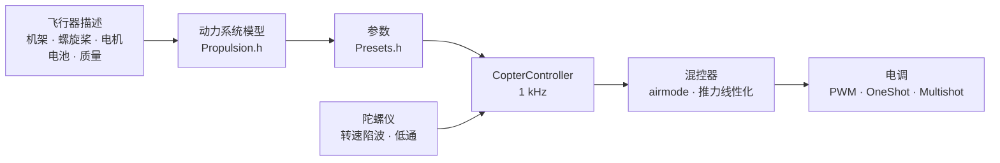

# COPTER.md — 多旋翼固件

同一套固件、同样的开发板（Matek H743-WING V3、DevEBox H743）、同样的传感器和接收机——只是飞的不再是飞机，而是四旋翼、六旋翼、八旋翼、Y6 或 X8。与 Betaflight、INAV、ArduPilot 的主要区别在于：**PID、滤波器、怠速和速率都不需要手动调整**。只需描述这架飞行器（机架、螺旋桨、电机、电池、质量），固件就会根据物理模型自行推导出参数，并在飞行中自行修正模型估计不准的部分。

> **实话实说。** 多旋翼固件目前只在仿真器中验证过（6 自由度模型，12 种机型 × 3 种“不对”的物理参数），并已为开发板编译通过。它还没有真正飞过。要说它比 Betaflight 或 ArduPilot 飞得更好，只有在试飞之后才能下结论——在那之前这只是目标，而不是事实。

## 工作原理



1. **动力系统模型**（`copter/Propulsion.h`）：带反电动势和绕组电阻的电机（由 KV 和定子体积得出），螺旋桨的推力和扭矩（由直径、螺距和桨叶数得出），转子连同螺旋桨的转动惯量。对于 6S 上的 5" 2207 1950KV，模型给出满油门约 28 000 rpm、约 1.6 kg 推力和约 45 A——与台架数据一致。
2. **由此得出**（`copter/Presets.h`）：悬停油门，怠速/悬停/满油门时的转速，电机滞后 τ，机架的转动惯量，推重比，电流。
3. **角速度环**根据频率响应来选取：电机、滤波器、陷波器、控制周期和电调的延迟——全部包含在模型中。穿越频率取满足 50° 相位裕度（偏航 55°）和 **12 dB 增益裕度**的最高值：这样的参数即使推力和惯量偏差一倍也能撑住。D 的比例通过搜索选取——取使回路最宽的那个。P、I、D 和前馈（FF）都由穿越频率推出。
4. **按油门的增益修正（TPA）**来自同一个模型：小油门时电机响应弱，大油门时响应强。
5. **飞行中**，固件会自行学习悬停油门（电池更重、加了云台），并让陷波器跟随转速移动。

## 机型目录

| 机型 | 机架 | 螺旋桨 · 电机 · 电池 | 质量 | 推重比 | 悬停 | 回路带宽 |
|---|---|---|---|---|---|---|
| `whoop65` | Quad X 65 mm | 31 mm ×4 · 0702 23000KV · 1S | 22 g | 4.2 | 31% | 16 Hz |
| `whoop75` | Quad X 75 mm | 40 mm ×4 · 0802 19000KV · 1S | 32 g | 4.3 | 27% | 16 Hz |
| `toothpick25` | Quad X 115 mm | 2.5" · 1103 8000KV · 3S | 70 g | 12.1 | 8% | 14 Hz |
| `micro3` | Quad X 140 mm | 3" · 1404 4500KV · 4S | 190 g | 8.3 | 15% | 14 Hz |
| `cinewhoop3` | Quad X 150 mm | 3" 五叶 · 1504 3600KV · 4S | 330 g | 4.1 | 32% | 16 Hz |
| `freestyle5` | Quad X 225 mm | 5.1" · 2207 1950KV · 6S | 680 g | 9.0 | 15% | 13 Hz |
| `race5` | 加长 Quad X | 5.1" · 2306 2000KV · 6S | 560 g | 10.8 | 11% | 12 Hz |
| `longrange7` | Quad X 315 mm | 7" · 2806.5 1300KV · 6S | 1.0 kg | 7.0 | 20% | 11 Hz |
| `heavy10` | Quad X 450 mm | 10" · 3115 900KV · 6S | 2.2 kg | 6.6 | 25% | 10 Hz |
| `cinelifter8` | X8 380 mm | 8" · 2812 1100KV · 6S | 3.5 kg | 6.4 | 23% | 11 Hz |
| `hex13` | Hex X 700 mm | 13" · 3510 600KV · 6S | 4.0 kg | 3.7 | 35% | 8 Hz |
| `hex15` | Hex X 900 mm | 15" · 4114 400KV · 6S | 6.0 kg | 3.0 | 45% | 8 Hz |

机架：Quad X、加长 X、H、Deadcat、“+”、Hex X/+、Y6、Octo X/+、X8。电机编号与 Betaflight 相同（四旋翼：1 — 右后，2 — 右前，3 — 左后，4 — 左前），螺旋桨可内旋或外旋。飞行风格——室内、花飞、竞速、航拍、远航、重载：它们决定速率和最大倾角。

## 你自己的飞行器

`include/config/CopterConfig.h`：

```cpp
#define COPTER_BUILD "freestyle5"     // 目录中最接近的机型
constexpr float MASS_G = 742;          // 带电池称重——这是最重要的
constexpr float PROP_DIAMETER_IN = 5.1f, PROP_PITCH_IN = 3.6f;
constexpr float MOTOR_KV = 2150;       // 0 — 与机型相同
constexpr copter::EscProtocol ESC_PROTOCOL = copter::EscProtocol::ONESHOT125;
```

机型也可以用编译标志选择：`-D COPTER_BUILD=\"race5\"`。烧录后，在控制台按 `t` 可以看到推导结果；如果有问题会给出警告：推力不足、电机带不动这副桨、相邻螺旋桨会相碰、悬停油门超过 60%、电机转速超过控制频率的一半。

## 烧录与首次启动

```bash
pio run -e matek-h743-quad -t upload          # Matek H743-WING V3：BOOT 按键 + USB
pio run -e stm32h743-devebox-quad -t upload   # DevEBox H743
```

电机输出依次为：Matek — S1…S8，DevEBox — PA0–PA3、PD14、PD15、PE9。**首次启动请卸下螺旋桨**，串口监视器 115200：

| 按键 | 作用 |
|---|---|
| `t` | 参数：推力、悬停、转速、电机 τ、滤波器、回路带宽和裕度、P/I/D/FF、速率、警告 |
| `m` | 电机测试：要求按 `y` 确认（已卸桨！），每个电机转 2 s，并说明它的位置和应转的方向 |
| `s` | 状态，以及**为什么不能解锁**——每个原因都用文字说明 |
| `o` | 用三个姿态校准开发板的安装方向（Matek 上 ARM 前必须完成） |
| `i` · `r` · `l` · `D` | 陀螺仪 · 遥控器通道 · 实时行 · DFU 引导程序 |

转的是错误的电机——在 `CopterConfig::MOTOR_PINS` 中调整顺序；方向反了——在电调配置工具（BLHeliSuite、ESC-Configurator）中改方向，不要重新焊线。

## 遥控器与模式

美国手（Mode 2）：CH1 横滚，CH2 俯仰，CH3 油门，CH4 偏航。**ARM** — SwA（CH5），与飞机相同。**模式** — SwC（CH7）：

| SwC | 模式 | 摇杆的作用 |
|---|---|---|
| 上 | ANGLE | 倾角（不超过风格限制）；松杆——飞行器自动改平；偏航——绕垂直轴 |
| 中 | ALT_HOLD | ANGLE + 定高：油门居中——悬停，高于/低于中位——爬升最快 3 m/s、下降最快 2 m/s |
| 下 | ACRO | 按速率曲线控制旋转角速度；airmode——零油门也能操控 |

HORIZON（中位附近为 ANGLE，杆量大时为 ACRO）只需修改 `CopterConfig.h` 中的一行即可启用。

## 保护

- **ARM** 的前提：有遥控信号、油门在最低、飞行器放平（不超过 25°）且没有被移动、陀螺仪有响应、姿态已确定、电池未耗尽、没有进行电机测试、开发板安装已校准（如有要求）。过早打开的 ARM 开关需要关掉再打开。
- **ARM 开关拨下——电机在同一个周期内停转**，任何模式下都是如此。
- **信号丢失**：0.3 s 以内的中断不做任何处理；更长时——在地面立即 DISARM；在空中——改平并以 0.7 m/s 下降（依据气压计，没有气压计时依据加速度计），触地——DISARM。信号恢复 1 s 后，控制权交还飞手。
- **事故**：在 ANGLE/ALT_HOLD 中倾角超过 90° 达 0.7 s 以上，或与摇杆要求的倾角相差 30° 以上达 2 s 以上（电机故障、侧翻在地）；在任何模式下倒扣在地 1 s——电机停转。要再次解锁，必须先把开关关掉。
- **在地面时积分不累积**——起飞时飞行器不会跳起或翻倒。

## 内部结构概览

| 文件 | 内容 |
|---|---|
| `copter/Propulsion.h` | 电机与螺旋桨模型 |
| `copter/Presets.h` | 机型目录、参数推导、警告 |
| `copter/Frames.h` · `Mixer.h` | 机架与混控器（airmode、横滚/俯仰优先于偏航、推力线性化） |
| `copter/RateController.h` | P、I（翻滚和加速时 relax，anti-gravity）、基于陀螺仪的 D、FF |
| `copter/Attitude.h` | 四元数姿态；在冲击、旋转或与陀螺仪不一致时不信任加速度计 |
| `copter/AltitudeHold.h` | 高度：气压计 + 加速度计，学习悬停油门 |
| `copter/GyroFilter.h` | 1× 和 2× 转速及桨叶通过频率处的陷波 + 低通 |
| `copter/CopterController.h` | 全部组合：ARM、模式、failsafe、事故 |
| `hal/stm32/Stm32MotorOutput.h` · `src/stm32/main_copter.cpp` | STM32 上的电调输出和入口 |

## 如何验证

`test/native/test_copter_sim`——**真实的** `CopterController` 加上 6 自由度的飞行器模型：带反电动势的电机、电流下的电池压降、螺旋桨反扭矩、空气阻力、阵风、电调延迟、带噪声和电机振动的陀螺仪（高于控制频率一半的振动会混叠，与开发板上一样）、50 Hz 气压计、地面。目录中的每个机型都用自己的参数飞行，同时也在故意与描述不符的模型上飞行：

- **“迟钝”**：螺旋桨推力少 20%，电机和机架惯量大 30%，重 20%，重心前移；
- **“灵敏”**：推力 +20%，惯量 −30%，质量 −15%，重心侧移——回路增益几乎是计算值的两倍。

| 项目 | 36 次飞行（12 种机型 × 3 种物理参数）的结果 |
|---|---|
| ALT_HOLD 起飞和悬停 | 高度 ±0.3 m，倾角 < 1°，悬停油门已学习（“灵敏”的 whoop：0.22，而计算值为 0.31） |
| ANGLE：满杆 | 0.14–0.35 s 达到 90% 倾角，超调 < 3%，0.15–0.4 s 内改平到 3° 以内 |
| ACRO：满杆 | 0.04–0.15 s 达到 90% 速率，超调 < 12% |
| 10 m 高度信号丢失 | 下降 ≤ 0.94 m/s，触地——DISARM，17–28 s |

另外在 5" 上单独测试：零油门 airmode、偏航、4.5 m/s 阵风、无气压计的 failsafe、普通 PWM 电调、信号中断与恢复、背朝下摔落、电机故障、电机测试、电池压降。`test_copter` 逐个检查各模块（41 项测试），`native_stm32/test_app_stm32_copter`——在 Matek H743 的模拟环境上运行完整固件：ARM 前的“停止”脉冲、安装校准、ARM 后的怠速、开关切换模式、地面信号丢失、控制台。

仿真器发现并帮助修复了计算中看不到的真实错误：陷波器随混控器每个周期跳动；回路带宽附近陷波器带来的额外相位滞后；“迟钝”六旋翼加速时的积分饱和（超调 32%）；悬停油门下翻滚时加速度计恰好读到 1 g，把地平线拉偏 10°；电机故障的飞行器落地后仍在转动。

## 尚未实现

- **DShot**（以及双向 DShot——为陷波器提供精确转速）：需要 DMA 驱动；帧和 CRC 的计算已经有了（`copter/EscProtocol.h`）。
- **高于 1 kHz 的控制周期**——用于电机转速超过 500 Hz 的 whoop（仿真显示 4 kHz 时明显更好）。
- 多旋翼的黑匣子、MAVLink 和 OpenPlane Studio；GPS 定点、返航、任务。
- 试飞。
